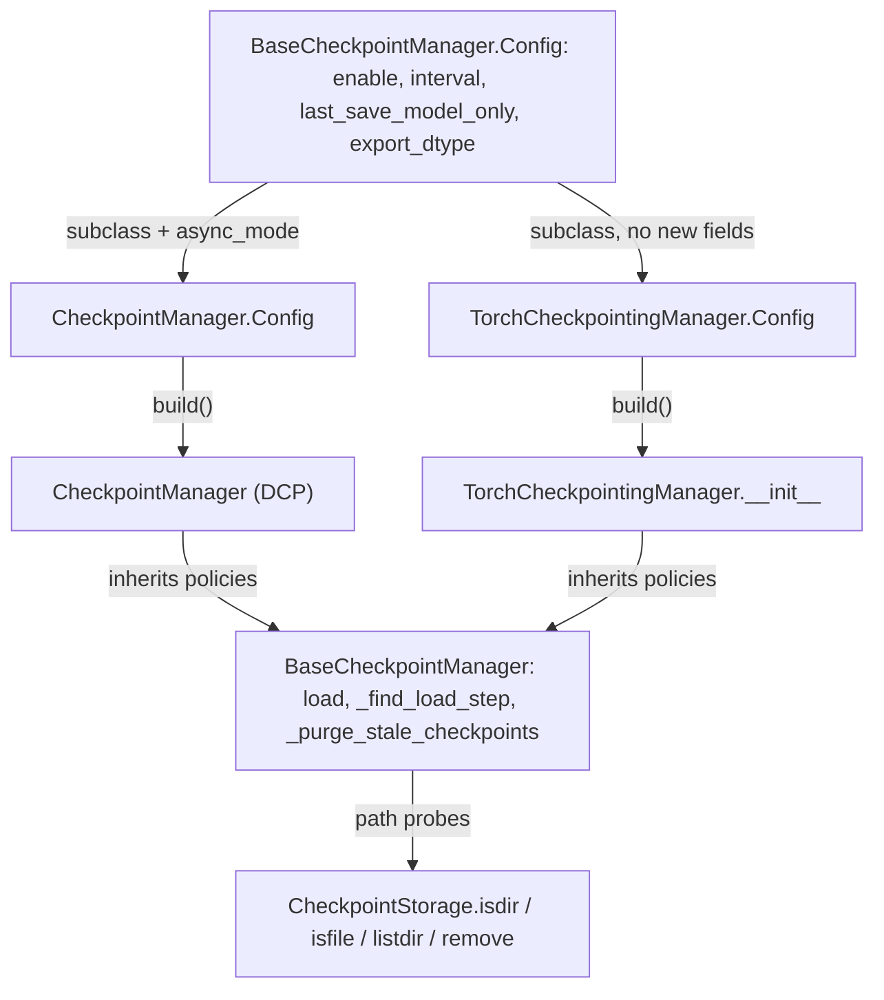
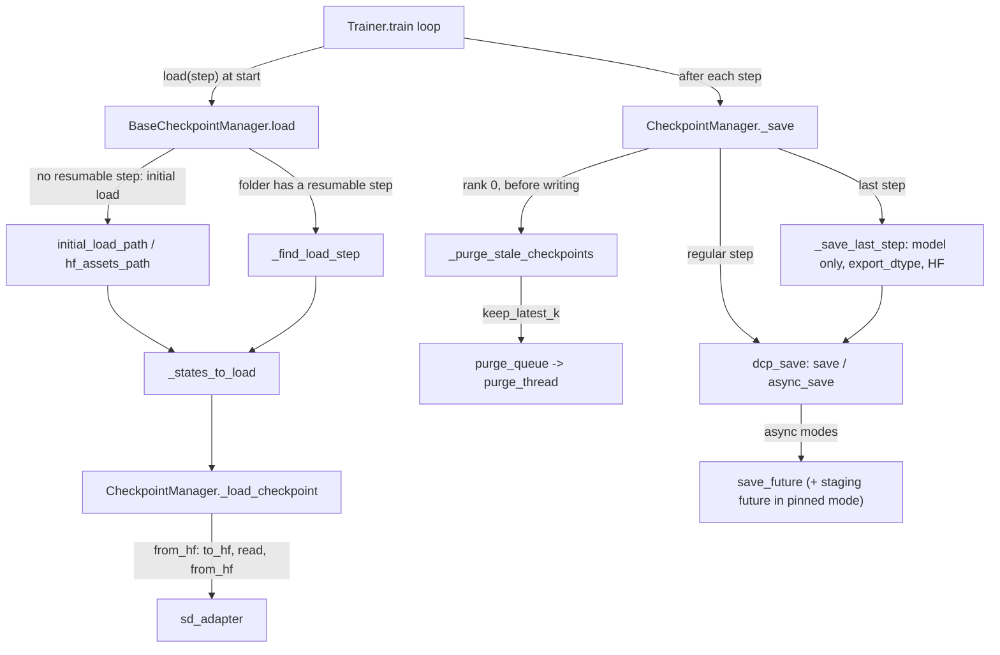

# Checkpointing: CheckpointManager, DCP save/load, async modes and HF interop

## Overview
All persistent training state in TorchTitan goes through one object built by the trainer from
its `checkpoint` config section. The package `torchtitan/components/checkpointer` splits that
object in two layers: [`BaseCheckpointManager`](https://github.com/google-pytorch/torchtitan/blob/033f131322a8b5b026ac53d734c689d664442bf8/torchtitan/components/checkpointer/base.py#L194 "torchtitan/components/checkpointer/base#BaseCheckpointManager") - in its own words the
"Contract every TorchTitan checkpoint manager implements" - owns the backend-independent policies
(which step to load, which states to restore, when to save, retention), and a concrete backend
reads and writes the bytes. The default backend is the DCP-based
[`CheckpointManager`](https://github.com/google-pytorch/torchtitan/blob/033f131322a8b5b026ac53d734c689d664442bf8/torchtitan/components/checkpointer/dcp.py#L89 "torchtitan/components/checkpointer/dcp#CheckpointManager"); a second backend built on the external
`torch_checkpointing` library ([`Config`](https://github.com/google-pytorch/torchtitan/blob/033f131322a8b5b026ac53d734c689d664442bf8/torchtitan/components/checkpointer/torch_checkpointing.py#L221 "torchtitan/components/checkpointer/torch_checkpointing#TorchCheckpointingManager.Config")) shares the
same contract. Either way the manager owns a dictionary of `Stateful` components (model,
optimizer, LR scheduler, dataloader, and the trainer's own step counter) and hands a flattened
view of it to the backend. The key design idea is that **nothing is ever gathered**: every rank
passes its local DTensor shards to DCP, which writes one sharded checkpoint with a global
`.metadata` file and can reshard on load into a different mesh. On top of that core the managers
add four policies: *when* to save (interval, first step, last step), *how synchronously* (three
[`AsyncMode`](https://github.com/google-pytorch/torchtitan/blob/033f131322a8b5b026ac53d734c689d664442bf8/torchtitan/components/checkpointer/dcp.py#L58 "torchtitan/components/checkpointer/dcp#AsyncMode") values in the DCP backend), *what* to load at startup (resume from
`{dump_folder}/{folder}/step-N`, or an initial load from a DCP or Hugging Face path), and
*retention* (a background purge thread). Hugging Face interop is delegated to the model's
[state-dict adapter](state-dict-adapters.md): the manager only decides when to call it.

## Diagram
Structure: one shared config and policy base, two backends selected by which `Config` subclass
the job config holds.

Legend:
- `BCFG` - [`Config`](https://github.com/google-pytorch/torchtitan/blob/033f131322a8b5b026ac53d734c689d664442bf8/torchtitan/components/checkpointer/base.py#L529 "torchtitan/components/checkpointer/base#BaseCheckpointManager.Config") with [`enable`](https://github.com/google-pytorch/torchtitan/blob/033f131322a8b5b026ac53d734c689d664442bf8/torchtitan/components/checkpointer/base.py#L532 "torchtitan/components/checkpointer/base#BaseCheckpointManager.Config.enable"), [`interval`](https://github.com/google-pytorch/torchtitan/blob/033f131322a8b5b026ac53d734c689d664442bf8/torchtitan/components/checkpointer/base.py#L538 "torchtitan/components/checkpointer/base#BaseCheckpointManager.Config.interval"), [`last_save_model_only`](https://github.com/google-pytorch/torchtitan/blob/033f131322a8b5b026ac53d734c689d664442bf8/torchtitan/components/checkpointer/base.py#L553 "torchtitan/components/checkpointer/base#BaseCheckpointManager.Config.last_save_model_only"), [`export_dtype`](https://github.com/google-pytorch/torchtitan/blob/033f131322a8b5b026ac53d734c689d664442bf8/torchtitan/components/checkpointer/base.py#L559 "torchtitan/components/checkpointer/base#BaseCheckpointManager.Config.export_dtype")
- `DCFG` - [`Config`](https://github.com/google-pytorch/torchtitan/blob/033f131322a8b5b026ac53d734c689d664442bf8/torchtitan/components/checkpointer/dcp.py#L136 "torchtitan/components/checkpointer/dcp#CheckpointManager.Config")
- `TCFG` - [`Config`](https://github.com/google-pytorch/torchtitan/blob/033f131322a8b5b026ac53d734c689d664442bf8/torchtitan/components/checkpointer/torch_checkpointing.py#L221 "torchtitan/components/checkpointer/torch_checkpointing#TorchCheckpointingManager.Config")
- `CM` - [`CheckpointManager`](https://github.com/google-pytorch/torchtitan/blob/033f131322a8b5b026ac53d734c689d664442bf8/torchtitan/components/checkpointer/dcp.py#L89 "torchtitan/components/checkpointer/dcp#CheckpointManager")
- `TCM` - [`__init__`](https://github.com/google-pytorch/torchtitan/blob/033f131322a8b5b026ac53d734c689d664442bf8/torchtitan/components/checkpointer/torch_checkpointing.py#L224 "torchtitan/components/checkpointer/torch_checkpointing#TorchCheckpointingManager.__init__")
- `BASE` - [`BaseCheckpointManager`](https://github.com/google-pytorch/torchtitan/blob/033f131322a8b5b026ac53d734c689d664442bf8/torchtitan/components/checkpointer/base.py#L194 "torchtitan/components/checkpointer/base#BaseCheckpointManager"), [`load`](https://github.com/google-pytorch/torchtitan/blob/033f131322a8b5b026ac53d734c689d664442bf8/torchtitan/components/checkpointer/base.py#L230 "torchtitan/components/checkpointer/base#BaseCheckpointManager.load"), [`_find_load_step`](https://github.com/google-pytorch/torchtitan/blob/033f131322a8b5b026ac53d734c689d664442bf8/torchtitan/components/checkpointer/base.py#L444 "torchtitan/components/checkpointer/base#BaseCheckpointManager._find_load_step"), [`_purge_stale_checkpoints`](https://github.com/google-pytorch/torchtitan/blob/033f131322a8b5b026ac53d734c689d664442bf8/torchtitan/components/checkpointer/base.py#L472 "torchtitan/components/checkpointer/base#BaseCheckpointManager._purge_stale_checkpoints")
- `ST` - [`isdir`](https://github.com/google-pytorch/torchtitan/blob/033f131322a8b5b026ac53d734c689d664442bf8/torchtitan/components/checkpointer/base.py#L177 "torchtitan/components/checkpointer/base#CheckpointStorage.isdir") (one method of the storage protocol held in [`_storage`](https://github.com/google-pytorch/torchtitan/blob/033f131322a8b5b026ac53d734c689d664442bf8/torchtitan/components/checkpointer/base.py#L221 "torchtitan/components/checkpointer/base#BaseCheckpointManager._storage"))

Flow through the DCP backend:

Legend:
- `TR` - (concept) the trainer's training loop in [`Trainer`](https://github.com/google-pytorch/torchtitan/blob/033f131322a8b5b026ac53d734c689d664442bf8/torchtitan/trainer.py#L74 "torchtitan/trainer#Trainer"), see [training-loop](training-loop.md)
- `LD` - [`load`](https://github.com/google-pytorch/torchtitan/blob/033f131322a8b5b026ac53d734c689d664442bf8/torchtitan/components/checkpointer/base.py#L230 "torchtitan/components/checkpointer/base#BaseCheckpointManager.load")
- `INIT` - [`initial_load_path`](https://github.com/google-pytorch/torchtitan/blob/033f131322a8b5b026ac53d734c689d664442bf8/torchtitan/components/checkpointer/base.py#L541 "torchtitan/components/checkpointer/base#BaseCheckpointManager.Config.initial_load_path") and [`initial_load_in_hf`](https://github.com/google-pytorch/torchtitan/blob/033f131322a8b5b026ac53d734c689d664442bf8/torchtitan/components/checkpointer/base.py#L547 "torchtitan/components/checkpointer/base#BaseCheckpointManager.Config.initial_load_in_hf")
- `FLS` - [`_find_load_step`](https://github.com/google-pytorch/torchtitan/blob/033f131322a8b5b026ac53d734c689d664442bf8/torchtitan/components/checkpointer/base.py#L444 "torchtitan/components/checkpointer/base#BaseCheckpointManager._find_load_step")
- `SL` - [`_states_to_load`](https://github.com/google-pytorch/torchtitan/blob/033f131322a8b5b026ac53d734c689d664442bf8/torchtitan/components/checkpointer/base.py#L389 "torchtitan/components/checkpointer/base#BaseCheckpointManager._states_to_load")
- `LC` - [`_load_checkpoint`](https://github.com/google-pytorch/torchtitan/blob/033f131322a8b5b026ac53d734c689d664442bf8/torchtitan/components/checkpointer/dcp.py#L354 "torchtitan/components/checkpointer/dcp#CheckpointManager._load_checkpoint")
- `SDA` - [`sd_adapter`](https://github.com/google-pytorch/torchtitan/blob/033f131322a8b5b026ac53d734c689d664442bf8/torchtitan/components/checkpointer/base.py#L217 "torchtitan/components/checkpointer/base#BaseCheckpointManager.sd_adapter")
- `SV` - [`_save`](https://github.com/google-pytorch/torchtitan/blob/033f131322a8b5b026ac53d734c689d664442bf8/torchtitan/components/checkpointer/dcp.py#L405 "torchtitan/components/checkpointer/dcp#CheckpointManager._save")
- `PG` - [`_purge_stale_checkpoints`](https://github.com/google-pytorch/torchtitan/blob/033f131322a8b5b026ac53d734c689d664442bf8/torchtitan/components/checkpointer/base.py#L472 "torchtitan/components/checkpointer/base#BaseCheckpointManager._purge_stale_checkpoints")
- `PQ` - [`purge_queue`](https://github.com/google-pytorch/torchtitan/blob/033f131322a8b5b026ac53d734c689d664442bf8/torchtitan/components/checkpointer/dcp.py#L224 "torchtitan/components/checkpointer/dcp#CheckpointManager.purge_queue") consumed by the daemon thread (concept; the thread handle is [`purge_thread`](https://github.com/google-pytorch/torchtitan/blob/033f131322a8b5b026ac53d734c689d664442bf8/torchtitan/components/checkpointer/torch_checkpointing.py#L241 "torchtitan/components/checkpointer/torch_checkpointing#TorchCheckpointingManager.purge_thread") on the other backend)
- `DS` - [`dcp_save`](https://github.com/google-pytorch/torchtitan/blob/033f131322a8b5b026ac53d734c689d664442bf8/torchtitan/components/checkpointer/dcp.py#L252 "torchtitan/components/checkpointer/dcp#CheckpointManager.dcp_save")
- `LAST` - [`_save_last_step`](https://github.com/google-pytorch/torchtitan/blob/033f131322a8b5b026ac53d734c689d664442bf8/torchtitan/components/checkpointer/dcp.py#L598 "torchtitan/components/checkpointer/dcp#CheckpointManager._save_last_step")
- `SF` - [`save_future`](https://github.com/google-pytorch/torchtitan/blob/033f131322a8b5b026ac53d734c689d664442bf8/torchtitan/components/checkpointer/dcp.py#L215 "torchtitan/components/checkpointer/dcp#CheckpointManager.save_future")

## Design rationale (why it's built this way)
- **Policies once, bytes per backend.** [`BaseCheckpointManager`](https://github.com/google-pytorch/torchtitan/blob/033f131322a8b5b026ac53d734c689d664442bf8/torchtitan/components/checkpointer/base.py#L194 "torchtitan/components/checkpointer/base#BaseCheckpointManager")
  implements [`load`](https://github.com/google-pytorch/torchtitan/blob/033f131322a8b5b026ac53d734c689d664442bf8/torchtitan/components/checkpointer/base.py#L230 "torchtitan/components/checkpointer/base#BaseCheckpointManager.load"), latest-step discovery and retention
  against a four-method storage protocol ([`isdir`](https://github.com/google-pytorch/torchtitan/blob/033f131322a8b5b026ac53d734c689d664442bf8/torchtitan/components/checkpointer/base.py#L177 "torchtitan/components/checkpointer/base#CheckpointStorage.isdir") and friends),
  and leaves `_load_checkpoint`, `_save`, staging and close to subclasses
  ([`_load_checkpoint`](https://github.com/google-pytorch/torchtitan/blob/033f131322a8b5b026ac53d734c689d664442bf8/torchtitan/components/checkpointer/base.py#L379 "torchtitan/components/checkpointer/base#BaseCheckpointManager._load_checkpoint") is abstract). The protocol's
  docstring says why: managers "ask the same handful of questions about paths", so "policies like
  retention and latest-step discovery can live on `BaseCheckpointManager` without knowing which
  backend answers them". Paths stay `str` because `Path` would collapse the double slash of a
  `gs://` URI. The class docstring adds one trap: every subclass must declare its own nested
  `Config`, even an empty one, because `build()` constructs the class that *declares* the
  `Config`; an inherited one would build the abstract base.
- **Flatten everything into one FQN-keyed dict.** The [`CheckpointManager`](https://github.com/google-pytorch/torchtitan/blob/033f131322a8b5b026ac53d734c689d664442bf8/torchtitan/components/checkpointer/dcp.py#L89 "torchtitan/components/checkpointer/dcp#CheckpointManager")
  docstring explains the problem: with pipeline parallelism each PP rank has its own optimizer,
  and integer-indexed `param_group[0]` on rank 0 and rank 1 refer to different layers, so they
  collide on save. The fix is to key optimizer state by parameter FQN (done inside the optimizer
  container, see [optimizer-and-lr-schedule](optimizer-and-lr-schedule.md)) and to merge the
  state dicts of all local model chunks into one flat view. The DCP backend splices the model's
  parameters in at the *top level* (under their FQNs, not under a [`MODEL`](https://github.com/google-pytorch/torchtitan/blob/033f131322a8b5b026ac53d734c689d664442bf8/torchtitan/components/checkpointer/base.py#L33 "torchtitan/components/checkpointer/base#MODEL") key)
  while optimizer, scheduler, dataloader and `train_state` stay nested. This is also what makes a
  model-only checkpoint (seed checkpoint, last-step export, HF load) key-compatible with a full
  one.
- **Stable tensor storage for fast async saves.** The model wrapper inside `states` caches its
  flattened state dict and, on every call, copies new values into the *same* storage instead of
  returning fresh tensors. The docstring says why: async DCP staging "may cache pinned host
  buffers keyed by the source storage", so stable storage lets repeated saves reuse the host
  buffers. Tensors produced by `state_dict` hooks (for example one that splits a fused
  parameter) are refreshed in place for the same reason. A consequence: structurally modifying
  the model after the manager is built makes the cache stale.
- **Three async modes, one knob (DCP backend).** `async_mode` on
  [`Config`](https://github.com/google-pytorch/torchtitan/blob/033f131322a8b5b026ac53d734c689d664442bf8/torchtitan/components/checkpointer/dcp.py#L136 "torchtitan/components/checkpointer/dcp#CheckpointManager.Config") selects [`AsyncMode`](https://github.com/google-pytorch/torchtitan/blob/033f131322a8b5b026ac53d734c689d664442bf8/torchtitan/components/checkpointer/dcp.py#L58 "torchtitan/components/checkpointer/dcp#AsyncMode") `DISABLED`
  (training blocks until the write finishes), `ASYNC` (training blocks only for the
  device-to-host copy; `dcp.async_save` writes from a background thread), or `ASYNC_WITH_PINNED_MEM`
  (a process-based async checkpointer writes from a pinned, shared-memory stager and even the copy
  overlaps the next step, at the cost of pinned host RAM; the config docstring at this pin only
  says "synchronous, threaded async, or pinned-memory async"). Both async modes create a dedicated
  gloo [`pg`](https://github.com/google-pytorch/torchtitan/blob/033f131322a8b5b026ac53d734c689d664442bf8/torchtitan/components/checkpointer/dcp.py#L209 "torchtitan/components/checkpointer/dcp#CheckpointManager.pg") so DCP's background coordination collectives never
  share a communicator with training collectives. `async_mode` lives only on the DCP subclass's
  config; the `torch_checkpointing` backend saves interval checkpoints asynchronously with pinned
  staging (synchronously when `load_only`), and like DCP writes the last step synchronously.
- **The last save is special.** Training ends with a synchronous, model-only (by default) save,
  optionally cast to [`export_dtype`](https://github.com/google-pytorch/torchtitan/blob/033f131322a8b5b026ac53d734c689d664442bf8/torchtitan/components/checkpointer/base.py#L559 "torchtitan/components/checkpointer/base#BaseCheckpointManager.Config.export_dtype") and
  optionally written as HF safetensors.
  [`last_save_model_only`](https://github.com/google-pytorch/torchtitan/blob/033f131322a8b5b026ac53d734c689d664442bf8/torchtitan/components/checkpointer/base.py#L553 "torchtitan/components/checkpointer/base#BaseCheckpointManager.Config.last_save_model_only") is documented
  as "Whether the final checkpoint contains only model state": an artifact for downstream use
  rather than for resumption.
- **Validate combinations early.** [`__post_init__`](https://github.com/google-pytorch/torchtitan/blob/033f131322a8b5b026ac53d734c689d664442bf8/torchtitan/components/checkpointer/base.py#L584 "torchtitan/components/checkpointer/base#BaseCheckpointManager.Config.__post_init__")
  rejects configs that would otherwise fail deep inside the backend: an empty `folder`, an
  `interval` below 1, `keep_latest_k == 1` (the newest checkpoint "may be in the process of being
  saved"), excluding `optimizer` from loading without also excluding `lr_scheduler`, a relative
  `initial_load_path`, HF load or save without model-only, a quantized HF load without an explicit
  path, and HF safetensors against a remote (`gs://`, fsspec) path, because "Remote (fsspec)
  checkpoint IO supports only the native DCP format". The DCP subclass's
  [`__post_init__`](https://github.com/google-pytorch/torchtitan/blob/033f131322a8b5b026ac53d734c689d664442bf8/torchtitan/components/checkpointer/dcp.py#L140 "torchtitan/components/checkpointer/dcp#CheckpointManager.Config.__post_init__") chains to it and then validates
  and lower-cases `async_mode`.

> [!inferred]
> On TPU the host-offload cost model matters more than on GPU: a TPU VM host has a fixed RAM
> budget shared by the dataloader and runtime, so `async_with_pinned_mem` (which pins a full
> host copy of every local shard) is the mode most likely to cause host paging. The shipped TPU
> recipes all build the DCP `CheckpointManager.Config` and leave `async_mode` at `"disabled"`,
> and most set `enable=False`, so neither async checkpointing nor the `torch_checkpointing`
> backend is exercised by any in-tree TPU recipe.

## Entry points
- [`Config`](https://github.com/google-pytorch/torchtitan/blob/033f131322a8b5b026ac53d734c689d664442bf8/torchtitan/components/checkpointer/dcp.py#L136 "torchtitan/components/checkpointer/dcp#CheckpointManager.Config") is the default value of the trainer's `checkpoint`
  section, which is typed as the base [`Config`](https://github.com/google-pytorch/torchtitan/blob/033f131322a8b5b026ac53d734c689d664442bf8/torchtitan/components/checkpointer/base.py#L529 "torchtitan/components/checkpointer/base#BaseCheckpointManager.Config") so a job can
  substitute the `torch_checkpointing` backend's [`Config`](https://github.com/google-pytorch/torchtitan/blob/033f131322a8b5b026ac53d734c689d664442bf8/torchtitan/components/checkpointer/torch_checkpointing.py#L221 "torchtitan/components/checkpointer/torch_checkpointing#TorchCheckpointingManager.Config")
  instead. TPU recipes set it directly: [`llama3_70b`](https://github.com/google-pytorch/torchtitan/blob/033f131322a8b5b026ac53d734c689d664442bf8/torchtitan/experiments/tpu/llama3/config_registry.py#L244 "torchtitan/experiments/tpu/llama3/config_registry#llama3_70b")
  ships with `enable=False, interval=500, last_save_model_only=True`;
  [`qwen3_8b`](https://github.com/google-pytorch/torchtitan/blob/033f131322a8b5b026ac53d734c689d664442bf8/torchtitan/experiments/tpu/qwen3/config_registry.py#L375 "torchtitan/experiments/tpu/qwen3/config_registry#qwen3_8b") and
  [`reg_trainer_qwen3_8b`](https://github.com/google-pytorch/torchtitan/blob/033f131322a8b5b026ac53d734c689d664442bf8/torchtitan/experiments/tpu/qwen3/config_registry.py#L289 "torchtitan/experiments/tpu/qwen3/config_registry#reg_trainer_qwen3_8b")
  keep full last saves (`last_save_model_only=False`). Turning checkpointing on is a matter of
  flipping [`enable`](https://github.com/google-pytorch/torchtitan/blob/033f131322a8b5b026ac53d734c689d664442bf8/torchtitan/components/checkpointer/base.py#L532 "torchtitan/components/checkpointer/base#BaseCheckpointManager.Config.enable").
- [`__init__`](https://github.com/google-pytorch/torchtitan/blob/033f131322a8b5b026ac53d734c689d664442bf8/torchtitan/components/checkpointer/dcp.py#L151 "torchtitan/components/checkpointer/dcp#CheckpointManager.__init__") runs once during
  [`Trainer`](https://github.com/google-pytorch/torchtitan/blob/033f131322a8b5b026ac53d734c689d664442bf8/torchtitan/trainer.py#L74 "torchtitan/trainer#Trainer") construction, after the model is parallelized and
  the optimizer and LR schedulers exist, via `config.checkpoint.build(...)`. The trainer passes
  `states={"train_state": self}` plus the model parts, optimizers, schedulers, dataloader and an
  adapter instance built from the model spec. If `enable` is false it returns immediately without
  setting any other attribute, and every public entry point checks
  [`enable`](https://github.com/google-pytorch/torchtitan/blob/033f131322a8b5b026ac53d734c689d664442bf8/torchtitan/components/checkpointer/base.py#L203 "torchtitan/components/checkpointer/base#BaseCheckpointManager.enable") first, so every later call is a no-op.
- [`load`](https://github.com/google-pytorch/torchtitan/blob/033f131322a8b5b026ac53d734c689d664442bf8/torchtitan/components/checkpointer/base.py#L230 "torchtitan/components/checkpointer/base#BaseCheckpointManager.load") is called once at the top of the training loop with
  `checkpoint.load_step` (default -1, meaning latest). It restores `train_state` too, so the
  trainer's step counter resumes.
- `save` (on the base class) is called after every training step with
  `last_step=(step == training.steps)`; it wraps the backend's
  [`_save`](https://github.com/google-pytorch/torchtitan/blob/033f131322a8b5b026ac53d734c689d664442bf8/torchtitan/components/checkpointer/dcp.py#L405 "torchtitan/components/checkpointer/dcp#CheckpointManager._save"), which decides internally whether this step actually
  saves.
- `maybe_wait_for_staging` is called inside the train step after the finite-loss check and
  immediately before the optimizer step, and [`close`](https://github.com/google-pytorch/torchtitan/blob/033f131322a8b5b026ac53d734c689d664442bf8/torchtitan/components/checkpointer/base.py#L334 "torchtitan/components/checkpointer/base#BaseCheckpointManager.close") is
  called from trainer shutdown; it drains staging and the in-flight save, then stops the purge
  thread and the stager.

## Mechanism (step-by-step)
1. **Construction registers the state.** [`__init__`](https://github.com/google-pytorch/torchtitan/blob/033f131322a8b5b026ac53d734c689d664442bf8/torchtitan/components/checkpointer/dcp.py#L151 "torchtitan/components/checkpointer/dcp#CheckpointManager.__init__") resolves
   [`folder`](https://github.com/google-pytorch/torchtitan/blob/033f131322a8b5b026ac53d734c689d664442bf8/torchtitan/components/checkpointer/base.py#L209 "torchtitan/components/checkpointer/base#BaseCheckpointManager.folder") as `{dump_folder}/{checkpoint.folder}` (local or
   remote), installs a filesystem-backed [`_storage`](https://github.com/google-pytorch/torchtitan/blob/033f131322a8b5b026ac53d734c689d664442bf8/torchtitan/components/checkpointer/base.py#L221 "torchtitan/components/checkpointer/base#BaseCheckpointManager._storage"), then
   fills [`states`](https://github.com/google-pytorch/torchtitan/blob/033f131322a8b5b026ac53d734c689d664442bf8/torchtitan/components/checkpointer/base.py#L211 "torchtitan/components/checkpointer/base#BaseCheckpointManager.states") with `model` (a wrapper over all model
   parts), `optimizer`, `dataloader` and `lr_scheduler` on top of the caller's `train_state`. It
   converts [`export_dtype`](https://github.com/google-pytorch/torchtitan/blob/033f131322a8b5b026ac53d734c689d664442bf8/torchtitan/components/checkpointer/dcp.py#L193 "torchtitan/components/checkpointer/dcp#CheckpointManager.export_dtype") to a torch dtype, refuses
   `last_save_in_hf` without an adapter, creates the gloo group for async modes, builds the
   optional `purge_exempt` predicate, and, when `keep_latest_k > 0`, starts a daemon purge thread
   fed by [`purge_queue`](https://github.com/google-pytorch/torchtitan/blob/033f131322a8b5b026ac53d734c689d664442bf8/torchtitan/components/checkpointer/dcp.py#L224 "torchtitan/components/checkpointer/dcp#CheckpointManager.purge_queue"). Everything that decides *what* is
   in a checkpoint is fixed here.
2. **Load picks a source.** [`load`](https://github.com/google-pytorch/torchtitan/blob/033f131322a8b5b026ac53d734c689d664442bf8/torchtitan/components/checkpointer/base.py#L230 "torchtitan/components/checkpointer/base#BaseCheckpointManager.load") first asks whether the
   run's own checkpoint folder holds a resumable step. If it does, the run is a *resume*:
   [`_find_load_step`](https://github.com/google-pytorch/torchtitan/blob/033f131322a8b5b026ac53d734c689d664442bf8/torchtitan/components/checkpointer/base.py#L444 "torchtitan/components/checkpointer/base#BaseCheckpointManager._find_load_step") ("The highest step in `folder`
   that can actually be loaded") lists canonical `step-N` subfolders and keeps those the backend
   calls resumable - for DCP, those containing a `.metadata` file - and returns the largest N. A
   folder without metadata (a save that died mid-write) is skipped rather than half-loaded, and
   step 0 is treated as a model-only seed checkpoint. Otherwise (no folder, or a folder with no
   resumable step) it performs an *initial load*: from
   [`initial_load_path`](https://github.com/google-pytorch/torchtitan/blob/033f131322a8b5b026ac53d734c689d664442bf8/torchtitan/components/checkpointer/base.py#L541 "torchtitan/components/checkpointer/base#BaseCheckpointManager.Config.initial_load_path") if set, otherwise
   (only when [`initial_load_in_hf`](https://github.com/google-pytorch/torchtitan/blob/033f131322a8b5b026ac53d734c689d664442bf8/torchtitan/components/checkpointer/base.py#L547 "torchtitan/components/checkpointer/base#BaseCheckpointManager.Config.initial_load_in_hf") is
   true) from the adapter's `hf_assets_path`; with neither, it returns false and training starts
   from random init. The initial load is model-only by default (`initial_load_model_only`). An
   explicit `load_step` with no checkpoint folder raises `FileNotFoundError` instead.
3. **Choose which states to restore.** [`_states_to_load`](https://github.com/google-pytorch/torchtitan/blob/033f131322a8b5b026ac53d734c689d664442bf8/torchtitan/components/checkpointer/base.py#L389 "torchtitan/components/checkpointer/base#BaseCheckpointManager._states_to_load")
   returns just the model entry for model-only loads; otherwise it drops the keys in
   `exclude_from_loading` (the model key is forbidden there) and keeps the rest. Because the
   model's own tensors are the DTensor parameters themselves, DCP reads each rank's shard directly
   into parameter storage; no rank holds a full copy.
4. **Read, native or HF.** The DCP backend's [`_load_checkpoint`](https://github.com/google-pytorch/torchtitan/blob/033f131322a8b5b026ac53d734c689d664442bf8/torchtitan/components/checkpointer/dcp.py#L354 "torchtitan/components/checkpointer/dcp#CheckpointManager._load_checkpoint")
   flattens the selected states, and for native checkpoints calls DCP load and then explicitly
   pushes the model entries back through the model wrapper (a TODO notes this is needed because
   model states are flattened). For HF it uses the [`sd_adapter`](https://github.com/google-pytorch/torchtitan/blob/033f131322a8b5b026ac53d734c689d664442bf8/torchtitan/components/checkpointer/base.py#L217 "torchtitan/components/checkpointer/base#BaseCheckpointManager.sd_adapter")
   three times: `to_hf` turns the live (sharded) model state dict into an HF-keyed template, the
   adapter's storage reader fills the template from safetensors (dequantizing if
   `initial_load_in_hf_quantized`), and `from_hf` maps it back before loading into the model. The
   details, including Q/K permutation and MoE expert splitting, are in
   [state-dict-adapters](state-dict-adapters.md).
5. **Decide whether to save, then make room.** [`_save`](https://github.com/google-pytorch/torchtitan/blob/033f131322a8b5b026ac53d734c689d664442bf8/torchtitan/components/checkpointer/dcp.py#L405 "torchtitan/components/checkpointer/dcp#CheckpointManager._save") saves never
   when disabled or `load_only`; always on step 1 if `enable_first_step_checkpoint`, always on the
   last step, else when `step % interval == 0`
   ([`interval`](https://github.com/google-pytorch/torchtitan/blob/033f131322a8b5b026ac53d734c689d664442bf8/torchtitan/components/checkpointer/base.py#L538 "torchtitan/components/checkpointer/base#BaseCheckpointManager.Config.interval"), default 500). It then waits for the
   previous upload, so at most one background write is ever in flight: if the previous async write
   is slower than `interval` steps, training stalls here. Next, still before writing, it calls
   [`_purge_stale_checkpoints`](https://github.com/google-pytorch/torchtitan/blob/033f131322a8b5b026ac53d734c689d664442bf8/torchtitan/components/checkpointer/base.py#L472 "torchtitan/components/checkpointer/base#BaseCheckpointManager._purge_stale_checkpoints") ("Delete
   abandoned entries and reserve one retained slot for this save"): on global rank 0 it lists the
   folder, enqueues every `step-N` that is not a completed checkpoint as abandoned, keeps the
   newest `keep_latest_k - 1` completed ones (so the save about to happen makes `k`), skips steps
   the `purge_exempt` predicate protects, and puts the rest on the purge queue.
6. **Regular saves dispatch by mode.** For a non-final step `_save` builds the path with
   [`_create_checkpoint_id`](https://github.com/google-pytorch/torchtitan/blob/033f131322a8b5b026ac53d734c689d664442bf8/torchtitan/components/checkpointer/base.py#L373 "torchtitan/components/checkpointer/base#BaseCheckpointManager._create_checkpoint_id") (`{folder}/step-N`),
   flattens state, and calls [`dcp_save`](https://github.com/google-pytorch/torchtitan/blob/033f131322a8b5b026ac53d734c689d664442bf8/torchtitan/components/checkpointer/dcp.py#L252 "torchtitan/components/checkpointer/dcp#CheckpointManager.dcp_save"). In `DISABLED` mode
   that is a blocking DCP save followed by a GC. In `ASYNC` mode it GCs, calls DCP async save on
   the gloo group, GCs again, and stores the returned future in
   [`save_future`](https://github.com/google-pytorch/torchtitan/blob/033f131322a8b5b026ac53d734c689d664442bf8/torchtitan/components/checkpointer/dcp.py#L215 "torchtitan/components/checkpointer/dcp#CheckpointManager.save_future"). In pinned mode it lazily creates a DCP
   stager (pinned, shared, async, non-blocking copies), uses the process-based async
   checkpointer, and keeps two futures: staging completion and upload completion.
7. **Guard the staging race.** In pinned mode the device-to-host copy is still running when
   [`_save`](https://github.com/google-pytorch/torchtitan/blob/033f131322a8b5b026ac53d734c689d664442bf8/torchtitan/components/checkpointer/dcp.py#L405 "torchtitan/components/checkpointer/dcp#CheckpointManager._save") returns, and it reads parameter and optimizer-state
   storage that the next optimizer step overwrites in place. That is why the trainer calls
   `maybe_wait_for_staging` right before `optimizers.step()`: the copy overlaps the next forward
   and backward, but never the update. The DCP backend raises if a staging future exists in any
   other mode.
8. **The last step exports.** [`_save_last_step`](https://github.com/google-pytorch/torchtitan/blob/033f131322a8b5b026ac53d734c689d664442bf8/torchtitan/components/checkpointer/dcp.py#L598 "torchtitan/components/checkpointer/dcp#CheckpointManager._save_last_step") is
   always synchronous. With [`last_save_model_only`](https://github.com/google-pytorch/torchtitan/blob/033f131322a8b5b026ac53d734c689d664442bf8/torchtitan/components/checkpointer/base.py#L553 "torchtitan/components/checkpointer/base#BaseCheckpointManager.Config.last_save_model_only")
   (the default) it saves only model tensors, casting floating-point tensors to `export_dtype`
   when they differ from it (integer buffers pass through); otherwise it saves the full flattened
   state without casting so training can resume. With `last_save_in_hf`, `dcp_save` runs `to_hf`
   and writes through an HF storage writer. If the adapter has an FQN-to-file index mapping (read
   from the HF index file), weights go to a `sharded/` subfolder and `dcp_save` then runs a
   consolidation pass on every rank that merges them into the original multi-file layout in the
   checkpoint folder (at this pin that call raises `NameError`, see Edge cases); without one, the writer
   consolidates into a single file.
9. **Retention runs off the critical path.** The daemon thread drains the purge queue enqueued in
   step 5 and deletes each entry through the storage's `remove` (a filesystem `rmtree` for DCP);
   a failed deletion is logged and skipped so the thread survives transient remote errors, and a
   `None` sentinel enqueued by [`close`](https://github.com/google-pytorch/torchtitan/blob/033f131322a8b5b026ac53d734c689d664442bf8/torchtitan/components/checkpointer/base.py#L334 "torchtitan/components/checkpointer/base#BaseCheckpointManager.close") stops it.
10. **The `torch_checkpointing` backend runs the same policies with its own writer.** Its
    [`_save`](https://github.com/google-pytorch/torchtitan/blob/033f131322a8b5b026ac53d734c689d664442bf8/torchtitan/components/checkpointer/torch_checkpointing.py#L365 "torchtitan/components/checkpointer/torch_checkpointing#TorchCheckpointingManager._save") uses the same save decision, wait and purge
    (also preserving the current step's staging directory), then hands the state to the
    backend's own manager ([`_manager`](https://github.com/google-pytorch/torchtitan/blob/033f131322a8b5b026ac53d734c689d664442bf8/torchtitan/components/checkpointer/torch_checkpointing.py#L305 "torchtitan/components/checkpointer/torch_checkpointing#TorchCheckpointingManager._manager")), which returns a
    future. On the first step it is *not* saving, it prewarms pinned staging buffers "so the first
    real save does not pay for pinned-buffer allocation". Its
    [`_save_last_step`](https://github.com/google-pytorch/torchtitan/blob/033f131322a8b5b026ac53d734c689d664442bf8/torchtitan/components/checkpointer/torch_checkpointing.py#L456 "torchtitan/components/checkpointer/torch_checkpointing#TorchCheckpointingManager._save_last_step") retires the async manager
    and writes synchronously through a fresh one, because "The final save must land before the
    process exits"; for an HF export, ranks write per-rank safetensors into `sharded/` and a
    pre-finalize callback consolidates them into HF layout before the atomic publish.
    [`_is_valid_checkpoint`](https://github.com/google-pytorch/torchtitan/blob/033f131322a8b5b026ac53d734c689d664442bf8/torchtitan/components/checkpointer/torch_checkpointing.py#L411 "torchtitan/components/checkpointer/torch_checkpointing#TorchCheckpointingManager._is_valid_checkpoint") counts both its
    native layout and a final HF export as complete so retention does not delete a finished
    export, but only the native layout is resumable.

## Key data structures
- [`states`](https://github.com/google-pytorch/torchtitan/blob/033f131322a8b5b026ac53d734c689d664442bf8/torchtitan/components/checkpointer/base.py#L211 "torchtitan/components/checkpointer/base#BaseCheckpointManager.states"): the registry of `Stateful` objects under the keys
  `model`, `optimizer`, `lr_scheduler`, `dataloader`, and `train_state` (the trainer, which saves
  `step` and `ntokens_seen`).
- The on-disk layout: `{dump_folder}/{folder}/step-N/` with DCP shard files plus `.metadata`, or
  HF safetensors plus `model.safetensors.index.json` for an HF export. Model keys sit at the top
  level of a DCP checkpoint, optimizer keys are flat `state.{fqn}.{name}` and
  `param_groups.{fqn}.{key}` entries under `optimizer`. The `torch_checkpointing` backend writes
  per-item files (`model_<rank>.pt`, `optimizer_<rank>.pt`) plus its own metadata file instead.
- [`AsyncMode`](https://github.com/google-pytorch/torchtitan/blob/033f131322a8b5b026ac53d734c689d664442bf8/torchtitan/components/checkpointer/dcp.py#L58 "torchtitan/components/checkpointer/dcp#AsyncMode"): a string enum so the config value can be a plain literal.
- [`save_future`](https://github.com/google-pytorch/torchtitan/blob/033f131322a8b5b026ac53d734c689d664442bf8/torchtitan/components/checkpointer/dcp.py#L215 "torchtitan/components/checkpointer/dcp#CheckpointManager.save_future") and the staging future: the only async
  state; both are cleared when waited on. The save future is cleared *before* it is awaited, so a
  failed save is not retried by a later `close()` or `__del__`.
- [`Config`](https://github.com/google-pytorch/torchtitan/blob/033f131322a8b5b026ac53d734c689d664442bf8/torchtitan/components/checkpointer/base.py#L529 "torchtitan/components/checkpointer/base#BaseCheckpointManager.Config"): `enable`, `folder`, `interval`,
  `initial_load_path`, `initial_load_model_only`, `initial_load_in_hf`,
  `initial_load_in_hf_quantized`, `last_save_model_only`, `last_save_in_hf`, `export_dtype`,
  `keep_latest_k` (default 10), `purge_exempt`, `load_step`, `exclude_from_loading`,
  `enable_first_step_checkpoint`, `create_seed_checkpoint`, `load_only`; the DCP
  [`Config`](https://github.com/google-pytorch/torchtitan/blob/033f131322a8b5b026ac53d734c689d664442bf8/torchtitan/components/checkpointer/dcp.py#L136 "torchtitan/components/checkpointer/dcp#CheckpointManager.Config") adds `async_mode`.

## Dynamics (design intent)
- One save in flight: each save waits for the previous upload before starting a new one, and the
  pinned-mode staging must finish before each optimizer step.
- DCP save and load are collective: every rank must reach `save`/`load` on the same step.
  Purging, by contrast, is rank-0 only and asynchronous.
- Retention is decided *before* the new checkpoint is written, so a crash during the save leaves
  `keep_latest_k - 1` older completed checkpoints plus a partial directory that the next save's
  purge classifies as abandoned.
- The fault-tolerant (torchft) subclass of [`CheckpointManager`](https://github.com/google-pytorch/torchtitan/blob/033f131322a8b5b026ac53d734c689d664442bf8/torchtitan/components/checkpointer/dcp.py#L89 "torchtitan/components/checkpointer/dcp#CheckpointManager")
  overrides the save, load, wait-for-saving and should-purge hooks; its test
  `test_torchft_async_save_calls_maybe_wait_for_saving` checks that async saves still wait on
  [`save_future`](https://github.com/google-pytorch/torchtitan/blob/033f131322a8b5b026ac53d734c689d664442bf8/torchtitan/components/checkpointer/dcp.py#L215 "torchtitan/components/checkpointer/dcp#CheckpointManager.save_future").

## Edge cases
- **`load_only` suppresses every save, including the last step.** The TPU SFT recipe
  [`sft_llama3_8b_metamath`](https://github.com/google-pytorch/torchtitan/blob/033f131322a8b5b026ac53d734c689d664442bf8/torchtitan/experiments/tpu/llama3/config_registry.py#L376 "torchtitan/experiments/tpu/llama3/config_registry#sft_llama3_8b_metamath")
  relies on this: it sets `enable=True, load_only=True, initial_load_in_hf=True` purely so the HF
  weights are loaded, with a comment saying `load_only` "suppresses every save, including the
  unconditional last-step one".
- **A resumable checkpoint folder wins, silently.** If `{dump_folder}/{folder}` holds a resumable
  `step-N` from an earlier run, `initial_load_path` and `initial_load_in_hf` are skipped without a
  warning; a fine-tuning job pointed at a reused dump folder resumes the old run instead of
  loading HF weights. If the folder exists but has no resumable step, the initial-load path is
  used as on a fresh run.
- **An HF last-step export is not a resume point.** The DCP backend's resumability check accepts
  only `.metadata`, so a run whose newest `step-N` is a model-only HF export resumes from the
  newest older DCP checkpoint (or from the initial load) rather than from the export, while
  retention still counts the export as complete.
- **Step folders must be canonical.** Only `step-N` with no leading zeros and nothing else in the
  name is recognized by discovery and retention; other entries in the folder are ignored.
- **`initial_load_model_only=True` by default**, and it logs a warning when set without a path.
  Loading optimizer state from another run requires the negated flag.
- **Pipeline-parallel optimizer and LR state** rely on FQN flattening; the LR scheduler state is
  assumed identical across schedulers (only `last_epoch` is saved).
- **`export_dtype` materializes a second copy** of the local model shards in the export dtype
  during the last save (a per-tensor `.to`), which briefly adds to device memory.
- **HF export of multi-file models** in the DCP backend goes through a consolidation call whose
  import is commented out in this fork (see Open questions); a last save with
  `last_save_in_hf=True` and an `hf_assets_path` that contains an index file is likely to fail at
  the end of training. The `torch_checkpointing` backend consolidates through its own library
  call instead.
- `last_save_in_hf` with a remote `folder`, and `initial_load_in_hf` with a remote
  `initial_load_path`, are rejected at config time. The `torch_checkpointing` backend rejects any
  remote `folder` or `initial_load_path` at construction and cannot load HF checkpoints at all.

## Open questions
- [`dcp_save`](https://github.com/google-pytorch/torchtitan/blob/033f131322a8b5b026ac53d734c689d664442bf8/torchtitan/components/checkpointer/dcp.py#L252 "torchtitan/components/checkpointer/dcp#CheckpointManager.dcp_save") calls `consolidate_safetensors_files_on_every_rank`,
  but the module comments out its import (a comment says it is unavailable in the fork's build
  environment). Unless it is injected elsewhere, the multi-file HF last-save path raises a
  NameError. No in-tree test exercises that path.
- The `torch_checkpointing` backend imports an external `torch_checkpointing` package that no
  requirements file in this checkout lists; whether it is installable or tested on the torch_tpu
  backend is not settled here.
- Whether DCP's pinned-memory stager is meaningful for torch_tpu tensors (the options are CUDA
  oriented: pinned memory, non-blocking copy) is not settled by any TPU recipe or test here.
- The step-0 seed checkpoint (`create_seed_checkpoint`) is described in the config but the code
  that writes it lives outside this package.

## See also
- [State-dict adapters](state-dict-adapters.md): the HF <-> TorchTitan key and layout conversion used by `_load_checkpoint` and the last save.
- [Optimizer and LR schedule](optimizer-and-lr-schedule.md): how optimizer and scheduler state is flattened for DCP.
- [Trainer lifecycle](trainer-lifecycle.md) and [Training loop](training-loop.md): where `load`, `save` and `maybe_wait_for_staging` are called.
- [FSDP sharding](fsdp-sharding.md) and [DTensor and sharding types](dtensor-and-sharding-types.md): the sharded tensors DCP reads and writes.
- [Pipeline parallel](pipeline-parallel.md): why model and optimizer state is flattened across chunks.
- [Dataloading and tokenizer](dataloading-and-tokenizer.md): the dataloader state saved with each checkpoint.
- [LoRA](lora.md): what a checkpoint contains when adapters are enabled.

## Recent changes
- `fa627bf2` rebases the fork onto upstream TorchTitan `d771abb0`: the single `components/checkpoint.py` module becomes the `components/checkpointer/` package, with policies (load source, latest-step discovery, retention) on `BaseCheckpointManager`, the DCP code in `CheckpointManager`, and a new `torch_checkpointing`-backed `TorchCheckpointingManager` behind the same config.
- Behavior that moved with it: retention now runs before each save (keeping `keep_latest_k - 1` plus the one being written), deletes abandoned partial `step-N` folders and honors a new `purge_exempt` predicate; HF-only exports are no longer picked for auto-resume; a checkpoint folder with no resumable step now falls back to the initial load; the last-step `export_dtype` cast touches only floating-point tensors.
- The other commits since `63e334d5ba` touching cited files (`801355af`, `ed34fbce`, `58c3e9b6`, `3d57bb2c` and the Qwen3 recipe commits) change TPU recipe performance flags, LR schedules and FLOP accounting; none touches a recipe's `checkpoint` section.
- [all changes in 033f131322](../changes/033f131322.md)
