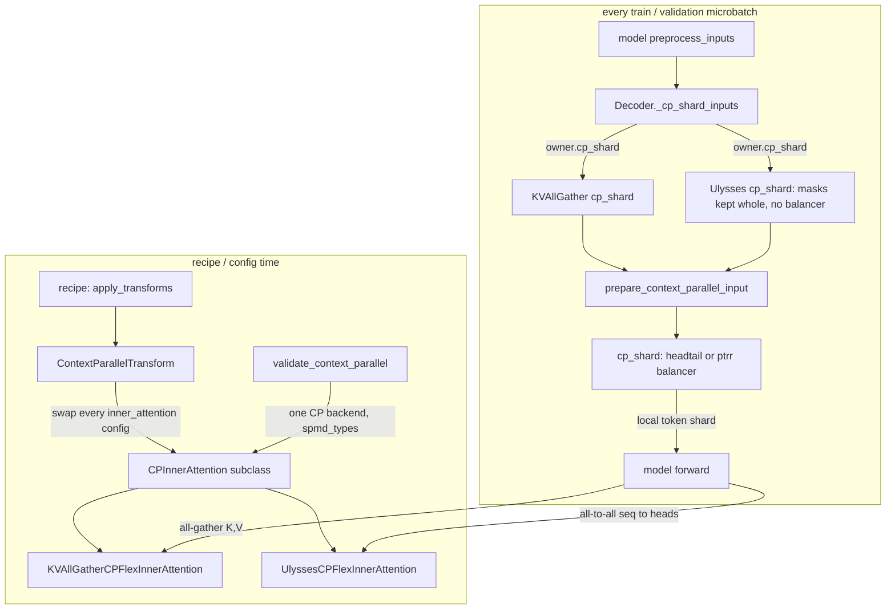

# Context parallel (CP): sequence sharding with load balancing, K/V all-gather and Ulysses

## Overview
Context parallelism splits the **sequence** (token) dimension of every activation across
the `cp` mesh axis so that a single long sequence can be trained on several devices, with
each rank holding `T / cp` tokens end to end. Everything except attention is token-local,
so only two things have to change: the *data* entering the model must be sharded
consistently (tokens, labels, RoPE positions, and the query rows of the attention mask),
and each *attention* call must see the keys and values of the whole sequence. At this pin
both halves belong to one object, the inner attention class. A recipe applies
[`ContextParallelTransform`](https://github.com/google-pytorch/torchtitan/blob/033f131322a8b5b026ac53d734c689d664442bf8/torchtitan/config/transform/context_parallel.py#L22 "torchtitan/config/transform/context_parallel#ContextParallelTransform"), a model-config
transform that replaces every inner attention config with a
[`CPInnerAttention`](https://github.com/google-pytorch/torchtitan/blob/033f131322a8b5b026ac53d734c689d664442bf8/torchtitan/models/common/cp_attention.py#L39 "torchtitan/models/common/cp_attention#CPInnerAttention") subclass: either
[`KVAllGatherCPFlexInnerAttention`](https://github.com/google-pytorch/torchtitan/blob/033f131322a8b5b026ac53d734c689d664442bf8/torchtitan/models/common/cp_attention.py#L55 "torchtitan/models/common/cp_attention#KVAllGatherCPFlexInnerAttention") (local Q,
all-gathered K/V) or [`UlyssesCPFlexInnerAttention`](https://github.com/google-pytorch/torchtitan/blob/033f131322a8b5b026ac53d734c689d664442bf8/torchtitan/models/common/cp_attention.py#L113 "torchtitan/models/common/cp_attention#UlyssesCPFlexInnerAttention")
(all-to-all from token-sharded to head-sharded). Each subclass also owns a `cp_shard`
classmethod that the model's `preprocess_inputs` calls to shard the batch, so the input
layout and the attention algorithm cannot drift apart. The shared sharding code is
[`prepare_context_parallel_input`](https://github.com/google-pytorch/torchtitan/blob/033f131322a8b5b026ac53d734c689d664442bf8/torchtitan/distributed/context_parallel/api.py#L39 "torchtitan/distributed/context_parallel/api#prepare_context_parallel_input") /
[`cp_shard`](https://github.com/google-pytorch/torchtitan/blob/033f131322a8b5b026ac53d734c689d664442bf8/torchtitan/distributed/context_parallel/api.py#L110 "torchtitan/distributed/context_parallel/api#cp_shard"). Because causal attention makes
naive contiguous sharding unbalanced (the last chunk attends to everything, the first to
almost nothing), the all-gather path reorders tokens through a load balancer before
splitting, and the same reordering is applied to masks and positions.

## Diagram

Legend:
- `REC` - (concept) a recipe that sets `context_parallel_degree` and calls `apply_transforms`, e.g. [`llama3_debugmodel_cp4`](https://github.com/google-pytorch/torchtitan/blob/033f131322a8b5b026ac53d734c689d664442bf8/torchtitan_recipes/tests/features.py#L379 "torchtitan_recipes/tests/features#llama3_debugmodel_cp4")
- `CPT` - [`ContextParallelTransform`](https://github.com/google-pytorch/torchtitan/blob/033f131322a8b5b026ac53d734c689d664442bf8/torchtitan/config/transform/context_parallel.py#L22 "torchtitan/config/transform/context_parallel#ContextParallelTransform")
- `CPA` - [`CPInnerAttention`](https://github.com/google-pytorch/torchtitan/blob/033f131322a8b5b026ac53d734c689d664442bf8/torchtitan/models/common/cp_attention.py#L39 "torchtitan/models/common/cp_attention#CPInnerAttention")
- `KVG` - [`KVAllGatherCPFlexInnerAttention`](https://github.com/google-pytorch/torchtitan/blob/033f131322a8b5b026ac53d734c689d664442bf8/torchtitan/models/common/cp_attention.py#L55 "torchtitan/models/common/cp_attention#KVAllGatherCPFlexInnerAttention")
- `ULY` - [`UlyssesCPFlexInnerAttention`](https://github.com/google-pytorch/torchtitan/blob/033f131322a8b5b026ac53d734c689d664442bf8/torchtitan/models/common/cp_attention.py#L113 "torchtitan/models/common/cp_attention#UlyssesCPFlexInnerAttention")
- `VAL` - [`validate_context_parallel`](https://github.com/google-pytorch/torchtitan/blob/033f131322a8b5b026ac53d734c689d664442bf8/torchtitan/config/validation.py#L20 "torchtitan/config/validation#validate_context_parallel")
- `PRE` - (concept) the model's `preprocess_inputs`, e.g. the decoder default or [`preprocess_inputs`](https://github.com/google-pytorch/torchtitan/blob/033f131322a8b5b026ac53d734c689d664442bf8/torchtitan/models/qwen3_5/model.py#L376 "torchtitan/models/qwen3_5/model#Qwen35Model.preprocess_inputs")
- `CSI` - [`_cp_shard_inputs`](https://github.com/google-pytorch/torchtitan/blob/033f131322a8b5b026ac53d734c689d664442bf8/torchtitan/models/common/decoder.py#L351 "torchtitan/models/common/decoder#Decoder._cp_shard_inputs")
- `KCS` - [`cp_shard`](https://github.com/google-pytorch/torchtitan/blob/033f131322a8b5b026ac53d734c689d664442bf8/torchtitan/models/common/cp_attention.py#L68 "torchtitan/models/common/cp_attention#KVAllGatherCPFlexInnerAttention.cp_shard")
- `UCS` - [`cp_shard`](https://github.com/google-pytorch/torchtitan/blob/033f131322a8b5b026ac53d734c689d664442bf8/torchtitan/models/common/cp_attention.py#L121 "torchtitan/models/common/cp_attention#UlyssesCPFlexInnerAttention.cp_shard")
- `PCI` - [`prepare_context_parallel_input`](https://github.com/google-pytorch/torchtitan/blob/033f131322a8b5b026ac53d734c689d664442bf8/torchtitan/distributed/context_parallel/api.py#L39 "torchtitan/distributed/context_parallel/api#prepare_context_parallel_input")
- `CS` - [`cp_shard`](https://github.com/google-pytorch/torchtitan/blob/033f131322a8b5b026ac53d734c689d664442bf8/torchtitan/distributed/context_parallel/api.py#L110 "torchtitan/distributed/context_parallel/api#cp_shard")
- `FWD` - (concept) the model forward over the local token shard

## Design rationale (why it's built this way)
- **CP is a property of the attention kernel, chosen in config.** The transform's docstring
  is "Run attention under context parallelism. Replace every inner attention with
  `inner_attention` while preserving its config." It rebuilds each inner attention config
  as the replacement class's config from the existing fields, which is why the CP classes
  subclass [`FlexInnerAttention`](https://github.com/google-pytorch/torchtitan/blob/033f131322a8b5b026ac53d734c689d664442bf8/torchtitan/models/common/attention.py#L233 "torchtitan/models/common/attention#FlexInnerAttention") rather than wrap it.
  [`ModelConfigTransform`](https://github.com/google-pytorch/torchtitan/blob/033f131322a8b5b026ac53d734c689d664442bf8/torchtitan/config/transform/base.py#L18 "torchtitan/config/transform/base#ModelConfigTransform") describes the family as "A
  feature that rewrites a completed model config tree". Because the swap happens before
  the model is built, every later build step (TP, AC, compile, FSDP) sees the CP-aware
  attention module as an ordinary module; there is no forward monkey-patch whose order
  relative to `parallelize()` matters.
- **Input sharding is owned by the attention class.** The docstring of
  [`CPInnerAttention`](https://github.com/google-pytorch/torchtitan/blob/033f131322a8b5b026ac53d734c689d664442bf8/torchtitan/models/common/cp_attention.py#L39 "torchtitan/models/common/cp_attention#CPInnerAttention") reads "Inner attention that
  owns its context-parallel behavior", and its one abstract method,
  [`cp_shard`](https://github.com/google-pytorch/torchtitan/blob/033f131322a8b5b026ac53d734c689d664442bf8/torchtitan/models/common/cp_attention.py#L44 "torchtitan/models/common/cp_attention#CPInnerAttention.cp_shard"), should "Shard model
  inputs for this attention implementation." The two algorithms need different layouts:
  all-gather wants Q-sharded masks and benefits from load balancing, while Ulysses ends up
  with the full sequence per head, so its masks must stay whole and its token order
  contiguous.
- **All-gather K/V vs Ulysses.** The all-gather kernel keeps Q local and redistributes K and
  V from token-sharded to replicated over the CP group; its backward is a reduce-scatter
  whose dtype is the config field `reduce_dtype` (default `float32`, "Dtype of the backward
  reduce-scatter"). Ulysses instead "Shard[s] heads instead of tokens: (T/cp, H, *) ->
  (T, H/cp, *)" with all-to-alls on q, k and v and one more on the output. It has no
  per-rank causal imbalance ("Head-sharded attention has no per-rank sequence imbalance to
  balance", says [`llama3_debugmodel_ulysses_cp2`](https://github.com/google-pytorch/torchtitan/blob/033f131322a8b5b026ac53d734c689d664442bf8/torchtitan_recipes/tests/features.py#L389 "torchtitan_recipes/tests/features#llama3_debugmodel_ulysses_cp2")), but
  its degree is capped by the head count: n_heads and n_kv_heads must divide by
  `tensor_parallel_degree x context_parallel_degree`.
- **Load balancing is a data concern.** Balancing is done once per microbatch in
  [`cp_shard`](https://github.com/google-pytorch/torchtitan/blob/033f131322a8b5b026ac53d734c689d664442bf8/torchtitan/distributed/context_parallel/api.py#L110 "torchtitan/distributed/context_parallel/api#cp_shard") by reordering the sequence
  before splitting, not inside attention. `headtail` (the default; the docstrings still
  say "for SDPA") pairs a head chunk with a tail chunk on each rank so causal work evens
  out; `ptrr` (for FlexAttention) derives the permutation from the actual `BlockMask`,
  which is why it refuses a missing mask.
- **CP requires the `spmd_types` backend.**
  [`validate_context_parallel`](https://github.com/google-pytorch/torchtitan/blob/033f131322a8b5b026ac53d734c689d664442bf8/torchtitan/config/validation.py#L20 "torchtitan/config/validation#validate_context_parallel") raises "Context Parallel
  requires parallelism.spmd_backend='spmd_types'", and both CP kernels look up their
  process group through the SPMD mesh for
  [`MeshAxisName`](https://github.com/google-pytorch/torchtitan/blob/033f131322a8b5b026ac53d734c689d664442bf8/torchtitan/distributed/parallel_dims.py#L65 "torchtitan/distributed/parallel_dims#MeshAxisName") `CP`.
- **CP ranks are also data-parallel ranks for weights.** The parallel-dims docstring says
  "we always assume that when `cp` is used, FSDP is also applied to utilize its weight
  all-gather and gradients reduce_scatter even if there may be no data parallelism", and
  the loss axis flattens `batch` and `cp`. The legacy backend folds `dp_shard x cp` into a
  single `fsdp` axis; the `spmd_types` backend keeps `cp` as its own axis in both its
  storage mesh `(dp_replicate, dp_shard, cp, tp)` and its forward/backward mesh
  `(dp, cp, tp)`.

## Entry points
- [`ContextParallelTransform`](https://github.com/google-pytorch/torchtitan/blob/033f131322a8b5b026ac53d734c689d664442bf8/torchtitan/config/transform/context_parallel.py#L22 "torchtitan/config/transform/context_parallel#ContextParallelTransform") is applied by
  a recipe after it sets `context_parallel_degree`, through `apply_transforms`; for
  example [`llama3_debugmodel_cp4`](https://github.com/google-pytorch/torchtitan/blob/033f131322a8b5b026ac53d734c689d664442bf8/torchtitan_recipes/tests/features.py#L379 "torchtitan_recipes/tests/features#llama3_debugmodel_cp4") (all-gather, default
  `headtail` balancer), [`llama3_debugmodel_ulysses_cp2`](https://github.com/google-pytorch/torchtitan/blob/033f131322a8b5b026ac53d734c689d664442bf8/torchtitan_recipes/tests/features.py#L389 "torchtitan_recipes/tests/features#llama3_debugmodel_ulysses_cp2")
  (Ulysses, balancer `None`) and
  [`muse_glimmer_debugmodel_fsdp2_tp2_cp2`](https://github.com/google-pytorch/torchtitan/blob/033f131322a8b5b026ac53d734c689d664442bf8/torchtitan_recipes/tests/models.py#L427 "torchtitan_recipes/tests/models#muse_glimmer_debugmodel_fsdp2_tp2_cp2"). Its
  `__post_init__` rejects an `inner_attention` that does not inherit `CPInnerAttention`.
- [`validate_context_parallel`](https://github.com/google-pytorch/torchtitan/blob/033f131322a8b5b026ac53d734c689d664442bf8/torchtitan/config/validation.py#L20 "torchtitan/config/validation#validate_context_parallel") runs in the trainer config's
  `__post_init__` whenever a model spec is set, so a CP degree without the transform (or
  the transform without a CP degree) fails before anything is built.
- [`_cp_shard_inputs`](https://github.com/google-pytorch/torchtitan/blob/033f131322a8b5b026ac53d734c689d664442bf8/torchtitan/models/common/decoder.py#L351 "torchtitan/models/common/decoder#Decoder._cp_shard_inputs") is called from the
  decoder's `preprocess_inputs` (and from Muse Glimmer's, which adds multimodal input
  layouts) when `cp_enabled`; it dispatches to the `cp_shard` of the class that owns the
  first full-attention layer's config.
- [`prepare_context_parallel_input`](https://github.com/google-pytorch/torchtitan/blob/033f131322a8b5b026ac53d734c689d664442bf8/torchtitan/distributed/context_parallel/api.py#L39 "torchtitan/distributed/context_parallel/api#prepare_context_parallel_input") is called
  directly by models that hard-code the all-gather input layout:
  [`preprocess_inputs`](https://github.com/google-pytorch/torchtitan/blob/033f131322a8b5b026ac53d734c689d664442bf8/torchtitan/models/qwen3_5/model.py#L376 "torchtitan/models/qwen3_5/model#Qwen35Model.preprocess_inputs"),
  [`preprocess_inputs`](https://github.com/google-pytorch/torchtitan/blob/033f131322a8b5b026ac53d734c689d664442bf8/torchtitan/models/deepseek_v3/mtp.py#L224 "torchtitan/models/deepseek_v3/mtp#MTPDecoder.preprocess_inputs"),
  [`preprocess_inputs`](https://github.com/google-pytorch/torchtitan/blob/033f131322a8b5b026ac53d734c689d664442bf8/torchtitan/models/kimi_k2_7/model.py#L108 "torchtitan/models/kimi_k2_7/model#KimiK25Model.preprocess_inputs") and the HF backend's
  [`preprocess_inputs`](https://github.com/google-pytorch/torchtitan/blob/033f131322a8b5b026ac53d734c689d664442bf8/torchtitan/experiments/transformers_modeling_backend/model.py#L1182 "torchtitan/experiments/transformers_modeling_backend/model#HFTransformerModel.preprocess_inputs")
  (which passes `input_shardings=None`, i.e. the default decoder dims).
- [`cp_shard`](https://github.com/google-pytorch/torchtitan/blob/033f131322a8b5b026ac53d734c689d664442bf8/torchtitan/distributed/context_parallel/api.py#L110 "torchtitan/distributed/context_parallel/api#cp_shard") is called directly only by
  Flux ("`cp_shard` is only used by Flux, which has a different input pattern from LLMs",
  says the package docstring): the Flux trainer's
  [`forward_backward_step`](https://github.com/google-pytorch/torchtitan/blob/033f131322a8b5b026ac53d734c689d664442bf8/torchtitan/models/flux/trainer.py#L216 "torchtitan/models/flux/trainer#FluxTrainer.forward_backward_step") and Flux
  [`validate`](https://github.com/google-pytorch/torchtitan/blob/033f131322a8b5b026ac53d734c689d664442bf8/torchtitan/models/flux/validate.py#L142 "torchtitan/models/flux/validate#FluxValidator.validate").

## Mechanism (step-by-step)
1. **Rewrite the model config.**
   [`ContextParallelTransform`](https://github.com/google-pytorch/torchtitan/blob/033f131322a8b5b026ac53d734c689d664442bf8/torchtitan/config/transform/context_parallel.py#L22 "torchtitan/config/transform/context_parallel#ContextParallelTransform") traverses every
   [`BaseAttention`](https://github.com/google-pytorch/torchtitan/blob/033f131322a8b5b026ac53d734c689d664442bf8/torchtitan/models/common/attention.py#L745 "torchtitan/models/common/attention#BaseAttention") config in the model tree and
   replaces its `inner_attention` with the CP class's config, carrying over every field
   (the replacement's `Config` must inherit the current one). One class is used for every
   layer; the docstring carries a TODO to "support one kernel per attention type, for
   models that mix them."
2. **Validate the combination.**
   [`validate_context_parallel`](https://github.com/google-pytorch/torchtitan/blob/033f131322a8b5b026ac53d734c689d664442bf8/torchtitan/config/validation.py#L20 "torchtitan/config/validation#validate_context_parallel") requires the `spmd_types`
   backend when CP > 1; requires every attention to use a `CPInnerAttention` when CP > 1
   (the error says "Apply ContextParallelTransform") and none to use one when CP == 1
   ("Select a non-CP kernel"); requires all layers to share one CP backend, because "model
   inputs are sharded once"; and, for Ulysses, requires `context_parallel_load_balancer`
   to be `None` and the head counts to divide by TP x CP. Model parallelizers add their own
   limits, e.g. [`parallelize_gptoss`](https://github.com/google-pytorch/torchtitan/blob/033f131322a8b5b026ac53d734c689d664442bf8/torchtitan/models/gpt_oss/parallelize.py#L58 "torchtitan/models/gpt_oss/parallelize#parallelize_gptoss") rejects
   Ulysses "because its per-head sinks are not sharded over CP". The trainer also requires
   `num_tokens_per_microbatch_per_dp_rank` to be divisible by `2 x cp` (times TP when
   sequence parallel is on).
3. **Shard each microbatch inside `preprocess_inputs`.** The decoder first builds
   full-sequence attention masks from `positions` (for Flex/Varlen backends), then
   [`_cp_shard_inputs`](https://github.com/google-pytorch/torchtitan/blob/033f131322a8b5b026ac53d734c689d664442bf8/torchtitan/models/common/decoder.py#L351 "torchtitan/models/common/decoder#Decoder._cp_shard_inputs") hands the batch, the
   per-input SPMD layouts, the `cp` mesh, the balancer and the PTRR mask key to the owning
   class's `cp_shard`; SPMD type annotation happens only after sharding. The trainer counts
   tokens seen *after* this call, so `labels.numel()` reflects the tokens this rank
   actually trains on.
4. **Pick the layout per algorithm.**
   [`cp_shard`](https://github.com/google-pytorch/torchtitan/blob/033f131322a8b5b026ac53d734c689d664442bf8/torchtitan/models/common/cp_attention.py#L68 "torchtitan/models/common/cp_attention#KVAllGatherCPFlexInnerAttention.cp_shard") is a
   straight call to `prepare_context_parallel_input`.
   [`cp_shard`](https://github.com/google-pytorch/torchtitan/blob/033f131322a8b5b026ac53d734c689d664442bf8/torchtitan/models/common/cp_attention.py#L121 "torchtitan/models/common/cp_attention#UlyssesCPFlexInnerAttention.cp_shard") pops
   `attention_masks`, shards the tensors with no load balancer, and puts the unsharded
   masks back: after its all-to-all every rank sees the whole sequence for its heads, so
   the full mask is the right one.
5. **Resolve what to shard.**
   [`prepare_context_parallel_input`](https://github.com/google-pytorch/torchtitan/blob/033f131322a8b5b026ac53d734c689d664442bf8/torchtitan/distributed/context_parallel/api.py#L39 "torchtitan/distributed/context_parallel/api#prepare_context_parallel_input") derives
   `{name: seq_dim}` from each input's SPMD layout, keeping only inputs whose CP axis is a
   `Shard` (an input that is Replicate/Partial on CP, "e.g. an image stream that is not
   sequence-sharded", is left untouched). Without layouts it defaults to
   `{"input": 0, "labels": 0, "positions": 0}`, the folded `[num_tokens]` decoder inputs.
   It mutates and returns the same dict, and is a no-op when none of the named tensors is
   present.
6. **Shard with a balancer.** [`cp_shard`](https://github.com/google-pytorch/torchtitan/blob/033f131322a8b5b026ac53d734c689d664442bf8/torchtitan/distributed/context_parallel/api.py#L110 "torchtitan/distributed/context_parallel/api#cp_shard")
   builds `_HeadTailLoadBalancer(seq_len, cp_world_size, device_type)` for `headtail`, or
   `_PTRRLoadBalancer(mask, cp_world_size)` for `ptrr`, which needs a `BlockMask`, or a
   dict of masks plus `context_parallel_ptrr_mask_key` naming the one to build the
   balancer from. All buffers go through PyTorch's `_context_parallel_shard` along their
   per-tensor sequence dims (default 0). Masks are then sharded with the same balancer
   along dim 2 of `[B, H, Q, KV]` ("Only Q can be sequence-sharded"), which matches the
   all-gather kernel where every rank holds all keys; a non-`BlockMask` value in a mask
   dict is rejected.
7. **Run attention.** In
   [`KVAllGatherCPFlexInnerAttention`](https://github.com/google-pytorch/torchtitan/blob/033f131322a8b5b026ac53d734c689d664442bf8/torchtitan/models/common/cp_attention.py#L55 "torchtitan/models/common/cp_attention#KVAllGatherCPFlexInnerAttention") the forward
   redistributes K and V from `S(0)` (token-sharded) to `R` over the CP group, with the
   backward reduce-scatter in `reduce_dtype`, then calls the plain FlexAttention forward
   with local Q. In [`UlyssesCPFlexInnerAttention`](https://github.com/google-pytorch/torchtitan/blob/033f131322a8b5b026ac53d734c689d664442bf8/torchtitan/models/common/cp_attention.py#L113 "torchtitan/models/common/cp_attention#UlyssesCPFlexInnerAttention")
   q, k and v go from `S(0)` to `S(1)` (head-sharded), FlexAttention runs on
   `(T, H/cp)`, and the output goes back from `S(1)` to `S(0)`. Both raise "CP attention
   requires an active multi-rank CP mesh axis" when no CP group is active.

## Key data structures
- `cp` mesh axis, [`MeshAxisName`](https://github.com/google-pytorch/torchtitan/blob/033f131322a8b5b026ac53d734c689d664442bf8/torchtitan/distributed/parallel_dims.py#L65 "torchtitan/distributed/parallel_dims#MeshAxisName") `CP`: sits between
  `batch` and `tp` in the data-loading mesh `("pp", "batch", "cp", "tp")` and between `dp`
  and `tp` in the `spmd_types` forward/backward mesh.
- `input_shardings` - per-input SPMD layout (`decoder_input_sharding()`, plus multimodal
  layouts in Muse Glimmer); a `Shard(dim)` on the CP axis marks an input for sharding.
- The batch dict - `input`, `labels`, `positions` and `attention_masks`, typed
  [`AttentionMasksType`](https://github.com/google-pytorch/torchtitan/blob/033f131322a8b5b026ac53d734c689d664442bf8/torchtitan/models/common/attention.py#L90 "torchtitan/models/common/attention#AttentionMasksType") (`BlockMask`,
  `dict[str, BlockMask]` or absent).
- Knobs: `ParallelismConfig.context_parallel_degree`,
  `context_parallel_load_balancer` (`headtail` default, `ptrr`, or `None`; an empty string
  is rejected at config time with "Use None to disable load balancing"),
  `context_parallel_ptrr_mask_key`, and `KVAllGatherCPFlexInnerAttention.Config.reduce_dtype`.

## Dynamics (design intent)
- **Communication per layer.** All-gather CP issues one all-gather each of K and V per
  attention layer in forward and a reduce-scatter in backward; K/V for the full sequence is
  materialized on every rank while Q, the other activations and the MLP work stay at
  `1/cp`. Ulysses issues four all-to-alls per layer in forward (q, k, v, output) and keeps
  every tensor at `1/cp` of its size, but each rank computes attention for `H/cp` heads
  over the full sequence.
- **Order of wrappers.** Since the swap is in the config, the CP kernel is just the inner
  attention module that TP, AC, per-block compile and FSDP wrap; AC recomputation and
  compile both see the CP collectives.
- **Loss reduction.** Because labels are sharded too, each rank's loss covers only its
  tokens; the loss all-reduce runs over the flattened `batch x cp` mesh, and losses are
  normalized by global valid tokens (see [loss-and-validation](loss-and-validation.md)).

> [!inferred]
> For TPU, CP is currently a GPU-first feature. The TPU experiment's guards reject
> `context_parallel_degree > 1` for scan-over-layers ("TP and CP add a second [shard
> axis]"), for the SimpleFSDP all-reduce-plus-slice path, for the `[B, L]` layout
> ("context or tensor parallelism shards the token dim"), for Mamba-2 and for Muse Glimmer
> on TPU ("Context parallelism is not supported for Muse Glimmer on TPU yet"). Both CP
> kernels are FlexAttention subclasses driven by `spmd_types` redistributes; whether those
> lower to XLA on TPU is not established by this subsystem. On TPU, long context is more
> commonly addressed by activation checkpointing (see
> [activation-checkpointing](activation-checkpointing.md)) than by CP at this pin.

## Edge cases
- Only FlexAttention has CP kernels at this pin. Because validation demands a
  `CPInnerAttention` whenever CP > 1, a model on
  [`ScaledDotProductInnerAttention`](https://github.com/google-pytorch/torchtitan/blob/033f131322a8b5b026ac53d734c689d664442bf8/torchtitan/models/common/attention.py#L393 "torchtitan/models/common/attention#ScaledDotProductInnerAttention") or
  [`VarlenInnerAttention`](https://github.com/google-pytorch/torchtitan/blob/033f131322a8b5b026ac53d734c689d664442bf8/torchtitan/models/common/attention.py#L137 "torchtitan/models/common/attention#VarlenInnerAttention") cannot enable CP.
- Mixed CP backends across layers are rejected; the input batch is sharded once, by the
  class that owns the first full-attention layer.
- `ptrr` with no masks, or with a mask dict and no (or an unknown)
  `context_parallel_ptrr_mask_key`, raises a `ValueError`; `headtail` with Flex is
  accepted and is what the all-gather test recipes use.
- Ulysses with any load balancer is an error, and its degree is limited by KV heads: the
  Muse Glimmer recipe notes "The model has two KV heads, which limits Ulysses CP to degree
  2."
- The graph trainer's precompile path still has a TODO to call
  `prepare_context_parallel_input`, so CP there is not wired end to end.

## Open questions
- Which exact per-chunk permutation the head-tail and PTRR balancers produce, and the
  sequence-length divisibility constraints they impose, are defined in
  `torch.distributed.tensor.experimental`, outside this repo.
- The models that call `prepare_context_parallel_input` directly (Qwen3.5, DeepSeek MTP,
  Kimi K2.7, the HF backend) bypass the `cp_shard` dispatch and always shard masks on Q;
  whether they are meant to support Ulysses is not settled by the source.
- Whether FlexAttention plus the `spmd_types` redistributes have a TPU lowering; no TPU
  test in the evidence exercises CP.

## See also
- [Parallel dims and mesh](parallel-dims-and-mesh.md) - the `cp` axis and how it folds into `fsdp` and `loss`.
- [Tensor parallel](tensor-parallel.md) - shares the head-sharding budget with Ulysses CP.
- [DTensor and sharding types](dtensor-and-sharding-types.md) - the `spmd_types` backend CP now requires.
- [Training loop](training-loop.md) - where `preprocess_inputs` runs per microbatch.
- [Model definitions](model-definitions.md) - inner attention modules (`FlexInnerAttention`, SDPA, `VarlenInnerAttention`).
- [Pipeline parallel](pipeline-parallel.md), [Expert parallel](expert-parallel.md) - the other axes it composes with.

## Recent changes
- `fa627bf2` updates TorchTitan from upstream `d771abb0`. For CP it removes the
  `apply_cp_to_forward` forward monkey-patch and the SDPA DTensor path: CP is now a config
  transform (`ContextParallelTransform`) that installs a `CPInnerAttention` kernel, with a
  new Ulysses all-to-all kernel next to the K/V all-gather one, `distributed/context_parallel/api.py`
  sharding driven by per-input SPMD layouts and called from the model's
  `preprocess_inputs`, a `context_parallel_ptrr_mask_key` for dict masks, and a hard
  requirement on the `spmd_types` backend.
- `d4fcbc42` adds training of Hugging Face transformers models on TorchTPU through the HF
  modeling-backend adapter; it touches the HF backend model whose `preprocess_inputs`
  CP-shards inputs.
- [all changes in 033f131322](../changes/033f131322.md)
