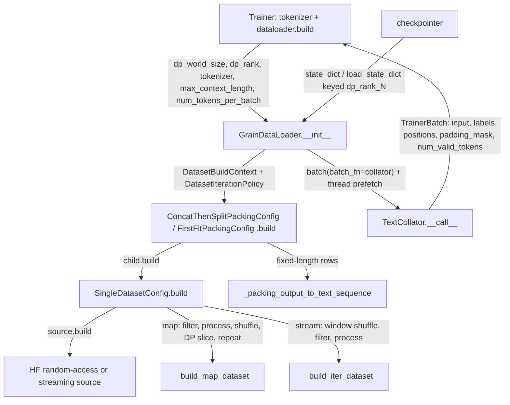

# Dataloading and tokenizer: Grain dataset graphs, DP-aware stateful loader, token-budget packing, per-document positions

## Overview
TorchTitan's input pipeline is one Grain-based data stack for text pretraining, SFT and image
training. A dataloader config holds a small **tree of frozen dataclass configs**, each a
[`DatasetConfig`](https://github.com/google-pytorch/torchtitan/blob/033f131322a8b5b026ac53d734c689d664442bf8/torchtitan/components/data/dataset.py#L26 "torchtitan/components/data/dataset#DatasetConfig") whose `build(context,
dataset_iteration_policy)` returns one node of a Grain dataset graph ("Builds one node of a Grain
dataset graph"): a source, a [`SingleDatasetConfig`](https://github.com/google-pytorch/torchtitan/blob/033f131322a8b5b026ac53d734c689d664442bf8/torchtitan/components/data/dataset.py#L84 "torchtitan/components/data/dataset#SingleDatasetConfig")
that filters and processes its rows, optional mix/concat nodes, and a packing node on top.
[`GrainDataLoader`](https://github.com/google-pytorch/torchtitan/blob/033f131322a8b5b026ac53d734c689d664442bf8/torchtitan/components/data/loader.py#L61 "torchtitan/components/data/loader#GrainDataLoader") ("Batches and checkpoints
one composed Grain dataset graph") builds that graph for its data-parallel rank, batches rows through a
[`Collator`](https://github.com/google-pytorch/torchtitan/blob/033f131322a8b5b026ac53d734c689d664442bf8/torchtitan/components/data/collators.py#L36 "torchtitan/components/data/collators#Collator"), prefetches on a background thread, and
checkpoints the whole Grain iterator state under a per-DP-rank key. The key design idea is that batches
are sized in **tokens, not samples**: documents are packed into rows of exactly `num_tokens_per_batch`
tokens, and the collator emits flat 1-D `[T]` tensors with a `positions` tensor that restarts at 0 at
each document boundary (for RoPE and document masking) and a `padding_mask` for the tail. Every batch
therefore has the same static shape, which is what a TPU wants: one compiled program for the whole run.

## Diagram

Legend:
- `TR` - [`Trainer`](https://github.com/google-pytorch/torchtitan/blob/033f131322a8b5b026ac53d734c689d664442bf8/torchtitan/trainer.py#L74 "torchtitan/trainer#Trainer") (builds the tokenizer, then the loader; consumes batches)
- `GL` - [`__init__`](https://github.com/google-pytorch/torchtitan/blob/033f131322a8b5b026ac53d734c689d664442bf8/torchtitan/components/data/loader.py#L82 "torchtitan/components/data/loader#GrainDataLoader.__init__") of [`GrainDataLoader`](https://github.com/google-pytorch/torchtitan/blob/033f131322a8b5b026ac53d734c689d664442bf8/torchtitan/components/data/loader.py#L61 "torchtitan/components/data/loader#GrainDataLoader")
- `PK` - [`build`](https://github.com/google-pytorch/torchtitan/blob/033f131322a8b5b026ac53d734c689d664442bf8/torchtitan/components/data/packing.py#L27 "torchtitan/components/data/packing#ConcatThenSplitPackingConfig.build") of [`ConcatThenSplitPackingConfig`](https://github.com/google-pytorch/torchtitan/blob/033f131322a8b5b026ac53d734c689d664442bf8/torchtitan/components/data/packing.py#L22 "torchtitan/components/data/packing#ConcatThenSplitPackingConfig") and the first-fit [`build`](https://github.com/google-pytorch/torchtitan/blob/033f131322a8b5b026ac53d734c689d664442bf8/torchtitan/components/data/packing.py#L236 "torchtitan/components/data/packing#FirstFitPackingConfig.build")
- `SD` - [`build`](https://github.com/google-pytorch/torchtitan/blob/033f131322a8b5b026ac53d734c689d664442bf8/torchtitan/components/data/dataset.py#L96 "torchtitan/components/data/dataset#SingleDatasetConfig.build") of [`SingleDatasetConfig`](https://github.com/google-pytorch/torchtitan/blob/033f131322a8b5b026ac53d734c689d664442bf8/torchtitan/components/data/dataset.py#L84 "torchtitan/components/data/dataset#SingleDatasetConfig")
- `SRC` - [`HuggingFaceRandomAccessSource`](https://github.com/google-pytorch/torchtitan/blob/033f131322a8b5b026ac53d734c689d664442bf8/torchtitan/components/data/sources.py#L94 "torchtitan/components/data/sources#HuggingFaceRandomAccessSource") or [`HuggingFaceStreamingSource`](https://github.com/google-pytorch/torchtitan/blob/033f131322a8b5b026ac53d734c689d664442bf8/torchtitan/components/data/sources.py#L145 "torchtitan/components/data/sources#HuggingFaceStreamingSource")
- `MAP` - [`_build_map_dataset`](https://github.com/google-pytorch/torchtitan/blob/033f131322a8b5b026ac53d734c689d664442bf8/torchtitan/components/data/dataset.py#L126 "torchtitan/components/data/dataset#SingleDatasetConfig._build_map_dataset")
- `ITER` - [`_build_iter_dataset`](https://github.com/google-pytorch/torchtitan/blob/033f131322a8b5b026ac53d734c689d664442bf8/torchtitan/components/data/dataset.py#L173 "torchtitan/components/data/dataset#SingleDatasetConfig._build_iter_dataset")
- `FIN` - [`_packing_output_to_text_sequence`](https://github.com/google-pytorch/torchtitan/blob/033f131322a8b5b026ac53d734c689d664442bf8/torchtitan/components/data/packing.py#L381 "torchtitan/components/data/packing#_packing_output_to_text_sequence")
- `COL` - [`__call__`](https://github.com/google-pytorch/torchtitan/blob/033f131322a8b5b026ac53d734c689d664442bf8/torchtitan/components/data/collators.py#L64 "torchtitan/components/data/collators#TextCollator.__call__") of [`TextCollator`](https://github.com/google-pytorch/torchtitan/blob/033f131322a8b5b026ac53d734c689d664442bf8/torchtitan/components/data/collators.py#L52 "torchtitan/components/data/collators#TextCollator")
- `CK` - (concept) the checkpoint manager, which holds the loader as a stateful component; see [checkpointing](checkpointing.md)

## Design rationale (why it's built this way)
- **Sharding by DP rank happens in the dataset graph, before batching.** The loader passes
  `dp_rank` / `dp_world_size` down in a
  [`DatasetIterationPolicy`](https://github.com/google-pytorch/torchtitan/blob/033f131322a8b5b026ac53d734c689d664442bf8/torchtitan/components/data/types.py#L28 "torchtitan/components/data/types#DatasetIterationPolicy")
  ("Controls dataset order, repetition, and data-parallel ownership"). A random-access source is
  shuffled globally and then sliced into contiguous, balanced per-rank shards in
  [`_build_map_dataset`](https://github.com/google-pytorch/torchtitan/blob/033f131322a8b5b026ac53d734c689d664442bf8/torchtitan/components/data/dataset.py#L126 "torchtitan/components/data/dataset#SingleDatasetConfig._build_map_dataset");
  a stream is split at the source by [`__init__`](https://github.com/google-pytorch/torchtitan/blob/033f131322a8b5b026ac53d734c689d664442bf8/torchtitan/components/data/sources.py#L166 "torchtitan/components/data/sources#HuggingFaceStreamingSource.__init__")
  of the streaming source; packing then runs locally per rank. The trainer passes the size and rank of
  the *batch* mesh (data-parallel replicate x shard), so tensor-, context- and pipeline-parallel peers of
  one DP rank read identical data, which they must.
- **Checkpoint state is per DP rank, and covers the whole graph.** `state_dict` stores
  `{"version": 1, "dp_world_size": N, <rank key>: iterator.get_state()}` with the key
  [`_rank_id`](https://github.com/google-pytorch/torchtitan/blob/033f131322a8b5b026ac53d734c689d664442bf8/torchtitan/components/data/loader.py#L106 "torchtitan/components/data/loader#GrainDataLoader._rank_id") (`dp_rank_<N>`). Grain
  recurses `get_state` through every node, so source cursors, shuffle/repeat progress, mix-child and
  packing-buffer state and the batching/prefetch state are all captured. Custom iterators implement
  `get_state` / `set_state` themselves: the Hugging Face cursor iterator (whose
  [`__next__`](https://github.com/google-pytorch/torchtitan/blob/033f131322a8b5b026ac53d734c689d664442bf8/torchtitan/components/data/sources.py#L244 "torchtitan/components/data/sources#_HuggingFaceCursorIterator.__next__") also handles
  repeat) saves `{epoch, hf state_dict}`, and the document-aware packer saves its parent's state from
  before the partially consumed document plus an offset into it.
- **Exhaustion is a normal exception, not `StopIteration`.** The long comment on
  `DataloaderExhaustedError` (in the loader module, next to
  [`BaseDataLoader`](https://github.com/google-pytorch/torchtitan/blob/033f131322a8b5b026ac53d734c689d664442bf8/torchtitan/components/data/loader.py#L39 "torchtitan/components/data/loader#BaseDataLoader")) explains PEP 479: a
  `StopIteration` raised inside a generator is converted into `RuntimeError`, so the trainer's
  generator-based batch iterator would crash instead of ending the run cleanly.
- **Finite data with DP > 1 is refused outright.** [`__init__`](https://github.com/google-pytorch/torchtitan/blob/033f131322a8b5b026ac53d734c689d664442bf8/torchtitan/components/data/loader.py#L82 "torchtitan/components/data/loader#GrainDataLoader.__init__")
  raises when `repeat=False` and `dp_world_size > 1`: "repeat=False with data parallelism can exhaust
  ranks at different steps and hang collectives; use repeat=True with a trainer-controlled step count".
  The trainer's step count, not data exhaustion, ends a distributed run.
- **Pack, never pad, for pretraining; first-fit for SFT.**
  [`ConcatThenSplitPackingConfig`](https://github.com/google-pytorch/torchtitan/blob/033f131322a8b5b026ac53d734c689d664442bf8/torchtitan/components/data/packing.py#L22 "torchtitan/components/data/packing#ConcatThenSplitPackingConfig")
  ("Concatenates documents, chunking them into fixed-length rows") wastes no compute on padding;
  per-document positions recover the document structure the concatenation erased. SFT data, where a
  sample should not be split across rows, uses the first-fit packer
  ([`build`](https://github.com/google-pytorch/torchtitan/blob/033f131322a8b5b026ac53d734c689d664442bf8/torchtitan/components/data/packing.py#L236 "torchtitan/components/data/packing#FirstFitPackingConfig.build")), which keeps
  `num_packing_bins` candidate rows open and pads only the tail of a row.
- **The collator does host work the trainer would otherwise do on the critical path.**
  [`TrainerBatch`](https://github.com/google-pytorch/torchtitan/blob/033f131322a8b5b026ac53d734c689d664442bf8/torchtitan/components/data/collators.py#L27 "torchtitan/components/data/collators#TrainerBatch.TrainerBatch")'s comment says
  collators "count them here so the trainer does not rescan every batch on the critical path" (the
  `num_valid_tokens` label count), and [`TextCollator`](https://github.com/google-pytorch/torchtitan/blob/033f131322a8b5b026ac53d734c689d664442bf8/torchtitan/components/data/collators.py#L52 "torchtitan/components/data/collators#TextCollator")
  ("Packs text rows into one page-locked, pre-padded token batch") allocates page-locked tensors because
  "a copy out of pageable memory is synchronous whatever `non_blocking` says"; CPU-only runs fall back
  to pageable memory.
- **Composition is configuration, not code.** Mixing, concatenation and packing are just wrapper
  configs ([`build`](https://github.com/google-pytorch/torchtitan/blob/033f131322a8b5b026ac53d734c689d664442bf8/torchtitan/components/data/dataset.py#L226 "torchtitan/components/data/dataset#DatasetMixConfig.build") of the mix,
  [`build`](https://github.com/google-pytorch/torchtitan/blob/033f131322a8b5b026ac53d734c689d664442bf8/torchtitan/components/data/dataset.py#L272 "torchtitan/components/data/dataset#DatasetConcatConfig.build") of the concat), so
  whether a mix weight counts documents or packed tokens is decided by nesting order: mix then pack
  weights documents, pack then mix weights fixed-length rows (the mix docstring: "mixing `TextSequence`
  children weights documents; mixing packed fixed-length children weights physical tokens").

> [!inferred]
> For TPU, the static batch shape is the property that matters most: XLA compiles one program per input
> shape. Every text batch is exactly `num_tokens_per_batch` tokens, because the collator pre-pads into a
> fixed buffer, concat-then-split drops the trailing partial row, and the loader batches with
> `drop_remainder=repeat`. The loader now overlaps host work with the device step through a
> background-thread prefetch of `num_prefetch_batches` (2) collated batches, replacing the old
> synchronous `num_workers = 0` default; but it is threads only (a TODO notes CPU-heavy processing
> "should use multiple processes rather than only threads"), so Python tokenization remains GIL-bound.
> Pinning is decided by `torch.accelerator.is_available()`; whether pinned host memory speeds the TPU
> host-to-device copy depends on the TorchTPU backend. The model receives flat `[T]` tensors; the TPU
> fork's `TT-UNFLATTEN-SHIM` reshapes them back to `[B, S]` for TPU kernels not yet ported to `[T]`, and
> requires `T` to be a multiple of `max_context_length`. The trainer records per-batch data-loading time
> in the metrics processor so host stalls can be checked.

## Entry points
- [`Trainer`](https://github.com/google-pytorch/torchtitan/blob/033f131322a8b5b026ac53d734c689d664442bf8/torchtitan/trainer.py#L74 "torchtitan/trainer#Trainer") builds its tokenizer from `hf_assets_path`, then calls
  `config.dataloader.build(dp_world_size=..., dp_rank=..., tokenizer=..., max_context_length=...,
  num_tokens_per_batch=...)`, where `num_tokens_per_batch` is
  `training.num_tokens_per_microbatch_per_dp_rank`; the loader is handed to the checkpointer as a
  stateful component. The validator builds a fresh loader from its own dataloader config on every
  validation pass (default: packed `c4_validation`, with `repeat` forced to `steps != -1`) and closes it
  when the pass ends.
- [`GrainDataLoader`](https://github.com/google-pytorch/torchtitan/blob/033f131322a8b5b026ac53d734c689d664442bf8/torchtitan/components/data/loader.py#L61 "torchtitan/components/data/loader#GrainDataLoader") is the only concrete loader
  in the package; its [`Config`](https://github.com/google-pytorch/torchtitan/blob/033f131322a8b5b026ac53d734c689d664442bf8/torchtitan/components/data/loader.py#L65 "torchtitan/components/data/loader#GrainDataLoader.Config") holds the
  dataset tree ([`dataset`](https://github.com/google-pytorch/torchtitan/blob/033f131322a8b5b026ac53d734c689d664442bf8/torchtitan/components/data/loader.py#L66 "torchtitan/components/data/loader#GrainDataLoader.Config.dataset")),
  the [`collator`](https://github.com/google-pytorch/torchtitan/blob/033f131322a8b5b026ac53d734c689d664442bf8/torchtitan/components/data/loader.py#L67 "torchtitan/components/data/loader#GrainDataLoader.Config.collator") (default
  [`TextCollator`](https://github.com/google-pytorch/torchtitan/blob/033f131322a8b5b026ac53d734c689d664442bf8/torchtitan/components/data/collators.py#L52 "torchtitan/components/data/collators#TextCollator")), and run-wide policy: `seed`
  (42), `shuffle`, `repeat`,
  [`streaming_shuffle_buffer_size`](https://github.com/google-pytorch/torchtitan/blob/033f131322a8b5b026ac53d734c689d664442bf8/torchtitan/components/data/loader.py#L73 "torchtitan/components/data/loader#GrainDataLoader.Config.streaming_shuffle_buffer_size")
  (1000 rows per rank), Grain `read_options` and `num_prefetch_batches` (2). Text pretraining recipes
  such as [`llama3_debugmodel`](https://github.com/google-pytorch/torchtitan/blob/033f131322a8b5b026ac53d734c689d664442bf8/torchtitan/models/llama3/config_registry.py#L63 "torchtitan/models/llama3/config_registry#llama3_debugmodel") wrap a
  registered dataset in a concat-then-split packer; SFT recipes such as
  [`sft_qwen3_8b_math`](https://github.com/google-pytorch/torchtitan/blob/033f131322a8b5b026ac53d734c689d664442bf8/torchtitan/models/qwen3/config_registry.py#L512 "torchtitan/models/qwen3/config_registry#sft_qwen3_8b_math") and the TPU
  [`sft_llama3_8b_metamath`](https://github.com/google-pytorch/torchtitan/blob/033f131322a8b5b026ac53d734c689d664442bf8/torchtitan/experiments/tpu/llama3/config_registry.py#L376 "torchtitan/experiments/tpu/llama3/config_registry#sft_llama3_8b_metamath")
  use first-fit packing over a random-access Hugging Face source with a chat processor.
- [`SingleDatasetConfig`](https://github.com/google-pytorch/torchtitan/blob/033f131322a8b5b026ac53d734c689d664442bf8/torchtitan/components/data/dataset.py#L84 "torchtitan/components/data/dataset#SingleDatasetConfig") ("Build one
  dataset from a source and row-level transforms") is where a user adds data: a
  [`source`](https://github.com/google-pytorch/torchtitan/blob/033f131322a8b5b026ac53d734c689d664442bf8/torchtitan/components/data/dataset.py#L91 "torchtitan/components/data/dataset#SingleDatasetConfig.source"), `pre_filters`, a
  [`processor`](https://github.com/google-pytorch/torchtitan/blob/033f131322a8b5b026ac53d734c689d664442bf8/torchtitan/components/data/dataset.py#L93 "torchtitan/components/data/dataset#SingleDatasetConfig.processor") (a
  [`SampleProcessor`](https://github.com/google-pytorch/torchtitan/blob/033f131322a8b5b026ac53d734c689d664442bf8/torchtitan/components/data/dataset.py#L67 "torchtitan/components/data/dataset#SampleProcessor"), "Configured row processor
  using Grain-provided deterministic randomness") and
  [`post_filters`](https://github.com/google-pytorch/torchtitan/blob/033f131322a8b5b026ac53d734c689d664442bf8/torchtitan/components/data/dataset.py#L94 "torchtitan/components/data/dataset#SingleDatasetConfig.post_filters") (recipes
  use `lambda sample: sample is not None` to drop rows a processor rejected).
- Non-text trainers reuse the same loader with their own processor and collator: the Flux recipes
  ([`flux_debugmodel`](https://github.com/google-pytorch/torchtitan/blob/033f131322a8b5b026ac53d734c689d664442bf8/torchtitan/models/flux/config_registry.py#L55 "torchtitan/models/flux/config_registry#flux_debugmodel"),
  [`flux_dev`](https://github.com/google-pytorch/torchtitan/blob/033f131322a8b5b026ac53d734c689d664442bf8/torchtitan/models/flux/config_registry.py#L128 "torchtitan/models/flux/config_registry#flux_dev")) pass an image collator whose
  `num_rows_per_batch` is `num_tokens_per_batch / max_context_length`, overriding the base
  [`Collator`](https://github.com/google-pytorch/torchtitan/blob/033f131322a8b5b026ac53d734c689d664442bf8/torchtitan/components/data/collators.py#L36 "torchtitan/components/data/collators#Collator") default of one row per batch.

## Mechanism (step-by-step)
1. **Build the tokenizer and the build context.** The [`Trainer`](https://github.com/google-pytorch/torchtitan/blob/033f131322a8b5b026ac53d734c689d664442bf8/torchtitan/trainer.py#L74 "torchtitan/trainer#Trainer")
   builds its tokenizer config with `tokenizer_path` set to the assets directory. The loader's
   [`__init__`](https://github.com/google-pytorch/torchtitan/blob/033f131322a8b5b026ac53d734c689d664442bf8/torchtitan/components/data/loader.py#L82 "torchtitan/components/data/loader#GrainDataLoader.__init__") packages the tokenizer,
   `max_context_length`, [`num_tokens_per_batch`](https://github.com/google-pytorch/torchtitan/blob/033f131322a8b5b026ac53d734c689d664442bf8/torchtitan/components/data/types.py#L22 "torchtitan/components/data/types#DatasetBuildContext.num_tokens_per_batch"),
   Grain read options and `max_num_documents` into a
   [`DatasetBuildContext`](https://github.com/google-pytorch/torchtitan/blob/033f131322a8b5b026ac53d734c689d664442bf8/torchtitan/components/data/types.py#L17 "torchtitan/components/data/types#DatasetBuildContext") ("Runtime values
   shared while building the data pipeline"), and seed / shuffle / repeat / DP coordinates into a
   [`DatasetIterationPolicy`](https://github.com/google-pytorch/torchtitan/blob/033f131322a8b5b026ac53d734c689d664442bf8/torchtitan/components/data/types.py#L28 "torchtitan/components/data/types#DatasetIterationPolicy"). Both are
   threaded through every `build` call, so a node never reads global state.
2. **Open the source.** [`build`](https://github.com/google-pytorch/torchtitan/blob/033f131322a8b5b026ac53d734c689d664442bf8/torchtitan/components/data/dataset.py#L96 "torchtitan/components/data/dataset#SingleDatasetConfig.build")
   builds its source and branches on its type. A random-access source
   ([`__init__`](https://github.com/google-pytorch/torchtitan/blob/033f131322a8b5b026ac53d734c689d664442bf8/torchtitan/components/data/sources.py#L115 "torchtitan/components/data/sources#HuggingFaceRandomAccessSource.__init__") loads a
   materialized `datasets.Dataset`) becomes a Grain `MapDataset`; the streaming source
   ([`__init__`](https://github.com/google-pytorch/torchtitan/blob/033f131322a8b5b026ac53d734c689d664442bf8/torchtitan/components/data/sources.py#L166 "torchtitan/components/data/sources#HuggingFaceStreamingSource.__init__")) loads an
   `IterableDataset`, insists that it supports `state_dict` ("does not support exact resume" otherwise),
   and splits it by DP rank with `split_dataset_by_node`.
3. **Filter, process, shuffle and shard rows.** On the map path,
   [`_build_map_dataset`](https://github.com/google-pytorch/torchtitan/blob/033f131322a8b5b026ac53d734c689d664442bf8/torchtitan/components/data/dataset.py#L126 "torchtitan/components/data/dataset#SingleDatasetConfig._build_map_dataset")
   ("Process globally indexed rows before shuffle, sharding, and repeat") applies pre-filters, the
   processor via `random_map` seeded with the run seed, post-filters, a global shuffle, the contiguous
   DP slice, and `repeat()` (Grain carries the epoch through the slice so each repeat reshuffles with
   seed + epoch). On the stream path,
   [`_build_iter_dataset`](https://github.com/google-pytorch/torchtitan/blob/033f131322a8b5b026ac53d734c689d664442bf8/torchtitan/components/data/dataset.py#L173 "torchtitan/components/data/dataset#SingleDatasetConfig._build_iter_dataset")
   ("Shuffle streaming rows before row processing") window-shuffles raw rows over
   `streaming_shuffle_buffer_size`, then filters and processes them with seed + `dp_rank`; on
   exhaustion with `repeat`, the cursor iterator's
   [`__next__`](https://github.com/google-pytorch/torchtitan/blob/033f131322a8b5b026ac53d734c689d664442bf8/torchtitan/components/data/sources.py#L244 "torchtitan/components/data/sources#_HuggingFaceCursorIterator.__next__") bumps the
   epoch, re-seeds the HF shuffle and restarts from the initial state. The processor's output is a
   [`TextSequence`](https://github.com/google-pytorch/torchtitan/blob/033f131322a8b5b026ac53d734c689d664442bf8/torchtitan/components/data/dataset.py#L39 "torchtitan/components/data/dataset#TextSequence") ("Next-token-aligned text
   preserved through composition and packing"): [`input_ids`](https://github.com/google-pytorch/torchtitan/blob/033f131322a8b5b026ac53d734c689d664442bf8/torchtitan/components/data/dataset.py#L46 "torchtitan/components/data/dataset#TextSequence.input_ids")
   and `labels` are already shifted by one, because "It is the dataset's processor responsibility to
   shift tokens into aligned input and label pairs. The trainer does not do it."
4. **Pack documents into fixed-length rows.** The concat-then-split
   [`build`](https://github.com/google-pytorch/torchtitan/blob/033f131322a8b5b026ac53d734c689d664442bf8/torchtitan/components/data/packing.py#L27 "torchtitan/components/data/packing#ConcatThenSplitPackingConfig.build") converts each
   sequence to arrays (missing positions become `arange(len) % max_context_length`), runs Grain's
   concat-then-split over `num_tokens_per_batch`-long rows, and keeps only rows that are completely
   full. When `max_num_documents` is set it instead uses a document-aware iterator whose
   [`__next__`](https://github.com/google-pytorch/torchtitan/blob/033f131322a8b5b026ac53d734c689d664442bf8/torchtitan/components/data/packing.py#L117 "torchtitan/components/data/packing#_DocumentAwareConcatThenSplitIterator.__next__")
   also stops a row at that many document segments and pads the rest. The first-fit
   [`build`](https://github.com/google-pytorch/torchtitan/blob/033f131322a8b5b026ac53d734c689d664442bf8/torchtitan/components/data/packing.py#L236 "torchtitan/components/data/packing#FirstFitPackingConfig.build") first splits every
   document into chunks no longer than the context window
   ([`flat_map`](https://github.com/google-pytorch/torchtitan/blob/033f131322a8b5b026ac53d734c689d664442bf8/torchtitan/components/data/packing.py#L305 "torchtitan/components/data/packing#_SplitTextSequenceDocuments.flat_map")), then
   first-fit packs chunks into `num_packing_bins` open rows (seeded, bins shuffled when `shuffle`, at
   most `max_num_documents` sequences per bin). Both packers finish in
   [`_packing_output_to_text_sequence`](https://github.com/google-pytorch/torchtitan/blob/033f131322a8b5b026ac53d734c689d664442bf8/torchtitan/components/data/packing.py#L381 "torchtitan/components/data/packing#_packing_output_to_text_sequence")
   ("Finalize packed text by masking padding and canonicalizing positions"): padding becomes
   `padding_mask=True` with `IGNORE_INDEX` labels, positions are rebuilt to restart at 0 at every
   document start, and the padding tail gets `arange % max_context_length` positions.
5. **Collate and prefetch.** The loader converts a remaining `MapDataset` to an iterable, batches
   `collator.num_rows_per_batch()` rows with the collator as `batch_fn` (dropping the remainder when
   `repeat`), and wraps the result in a Grain thread-prefetch dataset.
   [`__call__`](https://github.com/google-pytorch/torchtitan/blob/033f131322a8b5b026ac53d734c689d664442bf8/torchtitan/components/data/collators.py#L64 "torchtitan/components/data/collators#TextCollator.__call__") of the text collator
   concatenates the rows into pre-allocated, page-locked `[num_tokens_per_batch]` buffers (zeros for
   `input`, `IGNORE_INDEX` for `labels`, `True` for `padding_mask`), fills missing positions with a
   per-row `arange`, gives any leftover tail `arange % max_context_length` positions, and returns a
   [`TrainerBatch`](https://github.com/google-pytorch/torchtitan/blob/033f131322a8b5b026ac53d734c689d664442bf8/torchtitan/components/data/collators.py#L27 "torchtitan/components/data/collators#TrainerBatch.TrainerBatch") with
   `num_valid_tokens = (labels != IGNORE_INDEX).sum()`.
6. **Consume on the host, then on the device.** The [`Trainer`](https://github.com/google-pytorch/torchtitan/blob/033f131322a8b5b026ac53d734c689d664442bf8/torchtitan/trainer.py#L74 "torchtitan/trainer#Trainer")'s batch
   generator pulls from the loader, raises `DataloaderExhaustedError` on `StopIteration` (the step is
   abandoned), and records tokens seen and data-loading time; tensors stay on CPU. A step pops
   `num_valid_tokens` from each microbatch, sums them and all-reduces the total over the batch mesh on
   device (the loss denominator), then copies each microbatch to the device with `non_blocking=True`
   only when it is about to run. The model's `preprocess_inputs` pops `padding_mask` and, for a
   FlexAttention or varlen attention backend, turns `positions` into a causal + packed-document block
   mask or cumulative-length varlen metadata (using `padding_mask` and `max_num_documents` for
   fixed-shape metadata); positions also feed RoPE, so each packed document sees rotary positions from 0.
   Context parallelism then splits inputs, labels and kwargs along the sequence.
7. **Checkpoint and resume.** The checkpointer holds the
   [`GrainDataLoader`](https://github.com/google-pytorch/torchtitan/blob/033f131322a8b5b026ac53d734c689d664442bf8/torchtitan/components/data/loader.py#L61 "torchtitan/components/data/loader#GrainDataLoader") as a stateful component
   (the [`BaseDataLoader`](https://github.com/google-pytorch/torchtitan/blob/033f131322a8b5b026ac53d734c689d664442bf8/torchtitan/components/data/loader.py#L39 "torchtitan/components/data/loader#BaseDataLoader") contract: "Enforces the
   `Stateful`, `state_dict()`, and `load_state_dict()` contract"). On load it accepts an empty state,
   then requires `version == 1`, an unchanged DP world size ("cannot resume after changing the effective
   data-parallel degree") and its own `dp_rank_<N>` key, raising `ValueError` otherwise, before calling
   `set_state` on the Grain iterator; if that fails, it closes the iterator and re-raises.

> [!inferred]
> The processors and dataset registry live in `torchtitan/hf_datasets/text_datasets.py`, outside this
> page's symbol set; this is their behavior from the source. `TextProcessor` encodes text with
> `add_bos=True, add_eos=True` and returns `input = ids[:-1]`, `labels = ids[1:]` (dropping documents
> shorter than two tokens). `ChatProcessor` handles single-turn `[user, assistant]` SFT: it renders the
> chat template, forces a single trailing EOS, drops samples longer than `max_context_length` instead
> of truncating them, and masks the prompt in labels with `IGNORE_INDEX`, finding the boundary by
> re-rendering the user turn with `add_generation_prompt=True` (a TODO notes the prefix is not yet
> validated). The registry `DATASETS` maps `c4` (streaming), `c4_test` (local JSON, random access) and
> `c4_validation` (streaming) to `SingleDatasetConfig`s. The tokenizer (`torchtitan/components/tokenizer.py`,
> also outside the symbol set) loads `tokenizer.json`, infers BOS/EOS from `tokenizer_config.json`, and
> now encodes with the underlying tokenizer's own special tokens suppressed, adding BOS/EOS itself
> exactly when `add_bos` / `add_eos` ask for it (the defaults fall back to the config or to whether the
> HF tokenizer would have added them), so a special token is never doubled. The TPU recipes build their
> loaders through a `TPUGrainDataLoader` wrapper (in `torchtitan/experiments/tpu/datasets.py`) that
> keeps the old `--dataloader.dataset c4_test` / `--dataloader.dataset_path` flags by resolving a
> dataset name into a concat-then-split packed registry entry (or a Flux dataset).

## Key data structures
- [`Config`](https://github.com/google-pytorch/torchtitan/blob/033f131322a8b5b026ac53d734c689d664442bf8/torchtitan/components/data/loader.py#L45 "torchtitan/components/data/loader#BaseDataLoader.Config") of `BaseDataLoader` holds only
  `max_num_documents` (the "Maximum non-padding document segments in one local token batch", validated
  positive); everything shape-related (`max_context_length`, `num_tokens_per_batch`) comes from the
  trainer's training config at build time, so one loader config is reusable for training and
  validation.
- [`Config`](https://github.com/google-pytorch/torchtitan/blob/033f131322a8b5b026ac53d734c689d664442bf8/torchtitan/components/data/loader.py#L65 "torchtitan/components/data/loader#GrainDataLoader.Config") of `GrainDataLoader` is the
  run-wide policy listed under Entry points; most fields are hidden from the CLI (`tyro.conf.Suppress`),
  so the dataset tree is set in Python recipes.
- [`DatasetBuildContext`](https://github.com/google-pytorch/torchtitan/blob/033f131322a8b5b026ac53d734c689d664442bf8/torchtitan/components/data/types.py#L17 "torchtitan/components/data/types#DatasetBuildContext") and
  [`DatasetIterationPolicy`](https://github.com/google-pytorch/torchtitan/blob/033f131322a8b5b026ac53d734c689d664442bf8/torchtitan/components/data/types.py#L28 "torchtitan/components/data/types#DatasetIterationPolicy") are the two
  frozen records every node receives: what the pipeline produces versus which rows this rank owns and
  in what order.
- [`TextSequence`](https://github.com/google-pytorch/torchtitan/blob/033f131322a8b5b026ac53d734c689d664442bf8/torchtitan/components/data/dataset.py#L39 "torchtitan/components/data/dataset#TextSequence") is the row type between
  processor and collator: `input_ids`, `labels` (with `IGNORE_INDEX` where loss is disabled), optional
  `positions` and `padding_mask`, all of equal length (checked in `__post_init__`).
- A batch is a [`TrainerBatch`](https://github.com/google-pytorch/torchtitan/blob/033f131322a8b5b026ac53d734c689d664442bf8/torchtitan/components/data/collators.py#L27 "torchtitan/components/data/collators#TrainerBatch.TrainerBatch"):
  `{"input": int64[T], "labels": int64[T], "positions": int64[T], "padding_mask": bool[T],
  "num_valid_tokens": int}` with `T = num_tokens_per_batch`; there is no batch dimension. Other
  collators add keys, and every extra key is forwarded to the model (and to every pipeline stage).
- Collator and processor configs ([`Config`](https://github.com/google-pytorch/torchtitan/blob/033f131322a8b5b026ac53d734c689d664442bf8/torchtitan/components/data/collators.py#L40 "torchtitan/components/data/collators#Collator.Config"),
  [`Config`](https://github.com/google-pytorch/torchtitan/blob/033f131322a8b5b026ac53d734c689d664442bf8/torchtitan/components/data/collators.py#L56 "torchtitan/components/data/collators#TextCollator.Config"),
  [`Config`](https://github.com/google-pytorch/torchtitan/blob/033f131322a8b5b026ac53d734c689d664442bf8/torchtitan/components/data/dataset.py#L71 "torchtitan/components/data/dataset#SampleProcessor.Config")) are empty bases built with
  the `DatasetBuildContext`, following the [`Configurable`](https://github.com/google-pytorch/torchtitan/blob/033f131322a8b5b026ac53d734c689d664442bf8/torchtitan/config/configurable.py#L18 "torchtitan/config/configurable#Configurable")
  pattern; source configs such as the streaming one's
  [`Config`](https://github.com/google-pytorch/torchtitan/blob/033f131322a8b5b026ac53d734c689d664442bf8/torchtitan/components/data/sources.py#L149 "torchtitan/components/data/sources#HuggingFaceStreamingSource.Config") carry `path`,
  `split`, `name`, `revision` and extra `load_dataset_kwargs` (which may not repeat those fields).
- The checkpointed dataloader state is `{"version": 1, "dp_world_size": N, "dp_rank_<N>": Grain
  iterator state}`.

## Dynamics (design intent)
- **Determinism.** Graph-trainer bitwise tests (`test_eager_self_deterministic`,
  `test_aot_fx_trace_vs_eager`) run the same data twice through the [`Trainer`](https://github.com/google-pytorch/torchtitan/blob/033f131322a8b5b026ac53d734c689d664442bf8/torchtitan/trainer.py#L74 "torchtitan/trainer#Trainer"),
  which depends on the pipeline producing identical rows for the same seed and rank. Every random
  choice is seeded from the policy: the map-path processor with `seed`, the stream-path processor with
  `seed + dp_rank`, shuffles with `seed` (plus epoch on repeat), and each mix child with `seed + index`
  ("Inserting or reordering a child reseeds every later child").
- **Prefetch overlaps loading with compute.** The loader's thread prefetch queues
  `num_prefetch_batches` collated batches "while the trainer consumes the previous batch"; each
  `MapDataset`-to-`IterDataset` conversion additionally runs `read_options.num_threads` concurrent
  indexed reads with its own buffer.
- **Microbatches before compute.** A step collects all of its gradient-accumulation microbatches from
  the loader first (to sum `num_valid_tokens` for loss normalization), then runs them; data loading for
  a step therefore drains the prefetch queue in one burst at its start.

## Edge cases
- **Changing DP degree on resume** raises in `load_state_dict`; changing TP/PP/CP while keeping the
  batch-mesh size is fine because the state is keyed by DP rank. The data README adds that resume
  requires unchanged code, config, source contents and tokenizer as well.
- **A missing rank key now raises** instead of warning and silently replaying the shard from the start.
- **`repeat=False` with DP > 1 raises at construction**, so validation with `steps=-1` (one finite pass)
  needs an effective DP degree of one; bounded validation forces `repeat=True`.
- **A map dataset with fewer rows than `dp_world_size`** raises when it is sharded.
- **Concat-then-split discards the final partial row**, while the document-aware variant (with
  `max_num_documents`) pads it; first-fit pads every row's tail.
- **Long documents are chunked** at `max_context_length`; each chunk restarts its positions (and RoPE)
  at 0.
- **Rows larger than the token budget** make [`__call__`](https://github.com/google-pytorch/torchtitan/blob/033f131322a8b5b026ac53d734c689d664442bf8/torchtitan/components/data/collators.py#L64 "torchtitan/components/data/collators#TextCollator.__call__")
  raise "text rows exceed the configured token batch".
- **Mix semantics.** With `repeat=False` a mix stops at the first exhausted child; on the all-map path a
  filtered child's rejected indices still count toward its weight; weights must be finite and positive.
  A concat requires map-style children.

> [!inferred]
> Document boundaries are only enforced by masking backends. The upstream helper that maps backend
> names to attention configs says SDPA "cannot consume per-document positions". Yet the TPU recipes
> build their models with `attn_backend="sdpa"` (the TPU SDPA path is overridden by a Splash attention
> kernel). There, the decoder computes Splash `segment_ids` from `positions` once per step (cumulative
> count of position-0 tokens) and passes them to every layer; both TPU Splash wrappers now accept
> `segment_ids` for document-aware masking. With a plain SDPA fallback, packed documents attend across
> boundaries and only RoPE restarts. Because padding tails carry `arange % max_context_length`
> positions, they look like extra documents to a positions-only consumer; their labels are
> `IGNORE_INDEX`, so they never reach the loss.

## Open questions
- The processors, the concrete Hugging Face tokenizer, the TPU loader wrapper and the TPU Splash
  wrappers are not in this page's symbol set, so their behavior above is from source reading rather
  than cited.
- Whether a thread-only prefetch keeps up with host tokenization on large TPU slices is not settled by
  the source; multi-process loading is an open TODO.
- Resharding dataloader state across a DP-degree change is explicitly unsupported; there is no
  documented recipe for resuming a run on a different slice size without replaying or skipping data.

## See also
- [Training loop](training-loop.md) - batch generator, microbatch collection and valid-token counting
- [Loss and validation](loss-and-validation.md) - how `IGNORE_INDEX` labels are excluded and normalized
- [Checkpointing](checkpointing.md) - the stateful components saved alongside the model
- [Context parallel](context-parallel.md) - sequence splitting of inputs, labels and positions
- [Parallel dims and mesh](parallel-dims-and-mesh.md) - the batch mesh that defines `dp_rank`
- [Model definitions](model-definitions.md) - how `positions` become masks, RoPE angles and segment ids
- [Job configuration](job-configuration.md) - `hf_assets_path`, tokenizer and dataloader configs
- [TorchTPU backend](torchtpu-backend.md) - the TPU lane and its attention kernels

## Recent changes
- `fa627bf2` updates the fork from upstream `d771abb0`: upstream replaced the `torchdata`
  `StatefulDataLoader` stack (`components/dataloader.py`, `HuggingFaceTextDataLoader`, the chat and
  interleaved loaders) with the Grain package `components/data/` (loader, dataset, sources, packing,
  collators, types) and token-based batch sizing.
- The same commit flattens batches from `[B, S]` to `[T]`; the TPU fork adds `#TT-UNFLATTEN-SHIM`
  shims at the Splash attention boundary and a `TPUGrainDataLoader` that keeps the old dataset flags.
- The tokenizer's `encode` now suppresses the underlying tokenizer's special tokens and adds BOS/EOS
  itself.
- [all changes in 033f131322](../changes/033f131322.md)
