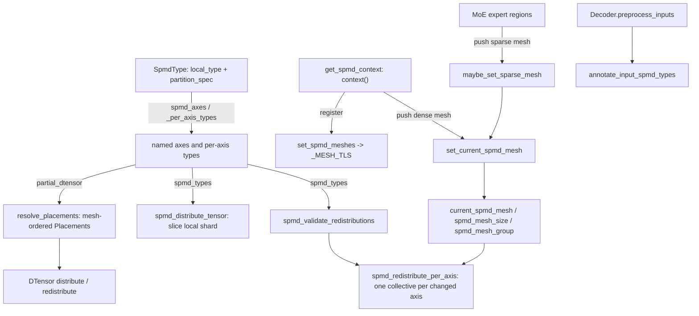

# DTensor placements and SPMD types: TorchTitan's sharding vocabulary and spmd_backend

## Overview
TorchTitan writes every sharding decision once, as an `SpmdType` from the external `spmd_types`
library: a dict from logical mesh axis ([`MeshAxisName`](https://github.com/google-pytorch/torchtitan/blob/033f131322a8b5b026ac53d734c689d664442bf8/torchtitan/distributed/parallel_dims.py#L65 "torchtitan/distributed/parallel_dims#MeshAxisName")
such as `dp`, `cp`, `tp`, `ep`) to a per-axis SPMD type, plus an optional `PartitionSpec`. The types
are `R` (replicate), `I` (invariant), `P` (partial sum), `S(d)` (sharded on tensor dim `d`) or
`V` (varying, with the `PartitionSpec` ordering several axes on one dim). How that description is
*executed* depends on `parallelism.spmd_backend`, now one of two values. Under `partial_dtensor`
(the default) it is converted to PyTorch DTensor placements (`Replicate`/`Partial`/`Shard`) for the
model-parallel axes only, and DTensor inserts the collectives. Under `spmd_types` tensors stay
*local*, the layout is only asserted as a type, and every redistribution is an explicit per-axis
collective issued by the helpers in `torchtitan/distributed/spmd_types.py`. That module is the
subject of this page. It owns the helpers that read a layout's axes
([`spmd_axes`](https://github.com/google-pytorch/torchtitan/blob/033f131322a8b5b026ac53d734c689d664442bf8/torchtitan/distributed/spmd_types.py#L57 "torchtitan/distributed/spmd_types#spmd_axes"),
[`_per_axis_types`](https://github.com/google-pytorch/torchtitan/blob/033f131322a8b5b026ac53d734c689d664442bf8/torchtitan/distributed/spmd_types.py#L281 "torchtitan/distributed/spmd_types#_per_axis_types")), a thread-local
stack of "current" runtime meshes (dense vs sparse/MoE), the per-axis distribute/redistribute
primitives the module protocol calls, and the input/parameter annotation entry points.

## Diagram

Legend:
- `LAYOUT` - (concept) the external `spmd_types.SpmdType`
- `AX` - [`spmd_axes`](https://github.com/google-pytorch/torchtitan/blob/033f131322a8b5b026ac53d734c689d664442bf8/torchtitan/distributed/spmd_types.py#L57 "torchtitan/distributed/spmd_types#spmd_axes") and [`_per_axis_types`](https://github.com/google-pytorch/torchtitan/blob/033f131322a8b5b026ac53d734c689d664442bf8/torchtitan/distributed/spmd_types.py#L281 "torchtitan/distributed/spmd_types#_per_axis_types")
- `RP` - [`resolve_placements`](https://github.com/google-pytorch/torchtitan/blob/033f131322a8b5b026ac53d734c689d664442bf8/torchtitan/protocols/sharding.py#L120 "torchtitan/protocols/sharding#resolve_placements")
- `DT` - (concept) PyTorch DTensor runtime
- `DIST` - [`spmd_distribute_tensor`](https://github.com/google-pytorch/torchtitan/blob/033f131322a8b5b026ac53d734c689d664442bf8/torchtitan/distributed/spmd_types.py#L490 "torchtitan/distributed/spmd_types#spmd_distribute_tensor")
- `VAL` - [`spmd_validate_redistributions`](https://github.com/google-pytorch/torchtitan/blob/033f131322a8b5b026ac53d734c689d664442bf8/torchtitan/distributed/spmd_types.py#L306 "torchtitan/distributed/spmd_types#spmd_validate_redistributions")
- `RED` - [`spmd_redistribute_per_axis`](https://github.com/google-pytorch/torchtitan/blob/033f131322a8b5b026ac53d734c689d664442bf8/torchtitan/distributed/spmd_types.py#L448 "torchtitan/distributed/spmd_types#spmd_redistribute_per_axis")
- `CTX` - [`context`](https://github.com/google-pytorch/torchtitan/blob/033f131322a8b5b026ac53d734c689d664442bf8/torchtitan/distributed/utils.py#L425 "torchtitan/distributed/utils#get_spmd_context.context")
- `REG` - [`set_spmd_meshes`](https://github.com/google-pytorch/torchtitan/blob/033f131322a8b5b026ac53d734c689d664442bf8/torchtitan/distributed/spmd_types.py#L111 "torchtitan/distributed/spmd_types#set_spmd_meshes") storing into [`_MESH_TLS`](https://github.com/google-pytorch/torchtitan/blob/033f131322a8b5b026ac53d734c689d664442bf8/torchtitan/distributed/spmd_types.py#L54 "torchtitan/distributed/spmd_types#_MESH_TLS")
- `SET` - [`set_current_spmd_mesh`](https://github.com/google-pytorch/torchtitan/blob/033f131322a8b5b026ac53d734c689d664442bf8/torchtitan/distributed/spmd_types.py#L195 "torchtitan/distributed/spmd_types#set_current_spmd_mesh")
- `CUR` - [`current_spmd_mesh`](https://github.com/google-pytorch/torchtitan/blob/033f131322a8b5b026ac53d734c689d664442bf8/torchtitan/distributed/spmd_types.py#L141 "torchtitan/distributed/spmd_types#current_spmd_mesh"), [`spmd_mesh_size`](https://github.com/google-pytorch/torchtitan/blob/033f131322a8b5b026ac53d734c689d664442bf8/torchtitan/distributed/spmd_types.py#L151 "torchtitan/distributed/spmd_types#spmd_mesh_size") and [`spmd_mesh_group`](https://github.com/google-pytorch/torchtitan/blob/033f131322a8b5b026ac53d734c689d664442bf8/torchtitan/distributed/spmd_types.py#L162 "torchtitan/distributed/spmd_types#spmd_mesh_group")
- `MOE` - (concept) the routed-expert and token-dispatch code in `models/common/moe.py` / `token_dispatcher.py`
- `SPARSE` - [`maybe_set_sparse_mesh`](https://github.com/google-pytorch/torchtitan/blob/033f131322a8b5b026ac53d734c689d664442bf8/torchtitan/distributed/spmd_types.py#L220 "torchtitan/distributed/spmd_types#maybe_set_sparse_mesh")
- `PRE` - [`preprocess_inputs`](https://github.com/google-pytorch/torchtitan/blob/033f131322a8b5b026ac53d734c689d664442bf8/torchtitan/models/common/decoder.py#L310 "torchtitan/models/common/decoder#Decoder.preprocess_inputs")
- `ANN` - [`annotate_input_spmd_types`](https://github.com/google-pytorch/torchtitan/blob/033f131322a8b5b026ac53d734c689d664442bf8/torchtitan/distributed/spmd_types.py#L230 "torchtitan/distributed/spmd_types#annotate_input_spmd_types")

## Design rationale (why it's built this way)
- **One layout language, two executors.** Sharding plans are written against *logical* axes
  (`DP`, `CP`, `TP`) with SPMD types, not against a concrete mesh. This lets the same plan run
  under both backends while TorchTitan moves toward `spmd_types`. Docstrings still mark the
  arrangement as transitional: the redistribution validator is "transitional code while
  ShardingConfig-based redistributions are written in src/dst DTensor-style placements", to be
  replaced by collective-based redistributions "once the partial_dtensor backend is removed". The
  former TorchTitan-local `SpmdLayout` class and the `full_dtensor` backend are gone; layouts are
  now the library's own `SpmdType`, read through [`spmd_axes`](https://github.com/google-pytorch/torchtitan/blob/033f131322a8b5b026ac53d734c689d664442bf8/torchtitan/distributed/spmd_types.py#L57 "torchtitan/distributed/spmd_types#spmd_axes")
  (which insists on named axes: "TorchTitan SPMD layouts require named mesh axes").
- **What each backend treats as "in band".** [`ParallelDims`](https://github.com/google-pytorch/torchtitan/blob/033f131322a8b5b026ac53d734c689d664442bf8/torchtitan/distributed/parallel_dims.py#L105 "torchtitan/distributed/parallel_dims#ParallelDims")
  resolves a layout's axes to a real submesh, but the backend first filters them. Under
  `partial_dtensor`, only `tp` and `ep` survive: DP and CP stay "out-of-band", handled by FSDP and
  CP input sharding on plain tensors, so the plan makes parameters DTensors on the 1-D `tp` (or
  `ep`) mesh only (FSDP later adds its own data-parallel dim). Under `spmd_types` the in-band axes
  are `dp`, `cp`, `tp` and `ep`, but tensors are local and the mesh is used only for types and
  process groups. [`resolve_placements`](https://github.com/google-pytorch/torchtitan/blob/033f131322a8b5b026ac53d734c689d664442bf8/torchtitan/protocols/sharding.py#L120 "torchtitan/protocols/sharding#resolve_placements")
  unfolds the logical `dp` key into the storage axes `dp_replicate` and `dp_shard` when a mesh
  carries them.
- **Explicit collectives instead of placement propagation.** Under `spmd_types`,
  [`spmd_redistribute_per_axis`](https://github.com/google-pytorch/torchtitan/blob/033f131322a8b5b026ac53d734c689d664442bf8/torchtitan/distributed/spmd_types.py#L448 "torchtitan/distributed/spmd_types#spmd_redistribute_per_axis")
  issues exactly "a single collective (all-reduce, reduce-scatter, or all-gather) on that axis's
  process group" for each axis whose type changes. The collective is visible in the source that
  requests it, which is the point of the design: no DTensor sharding propagation runs at op
  level, so there is no hidden redistribute. The price is expressiveness. The validator
  [`spmd_validate_redistributions`](https://github.com/google-pytorch/torchtitan/blob/033f131322a8b5b026ac53d734c689d664442bf8/torchtitan/distributed/spmd_types.py#L306 "torchtitan/distributed/spmd_types#spmd_validate_redistributions")
  rejects any plan that changes more than one axis at a boundary, changes an axis to or from `V`
  ("write an explicit collective when the value semantics are unclear"), or changes shard *order*
  (for example `PartitionSpec((DP, CP)) -> PartitionSpec((CP, DP))`), and tells the author to
  "write this as an explicit collective instead".
- **Dense and sparse regions need different meshes.** MoE experts run on the sparse view
  `(dp_replicate, efsdp, ep)`, not on the dense `(dp, cp, tp)` view. Rather than threading two
  meshes through every call, the module keeps a thread-local stack:
  [`set_current_spmd_mesh`](https://github.com/google-pytorch/torchtitan/blob/033f131322a8b5b026ac53d734c689d664442bf8/torchtitan/distributed/spmd_types.py#L195 "torchtitan/distributed/spmd_types#set_current_spmd_mesh")
  pushes a mesh for a region, and [`maybe_set_sparse_mesh`](https://github.com/google-pytorch/torchtitan/blob/033f131322a8b5b026ac53d734c689d664442bf8/torchtitan/distributed/spmd_types.py#L220 "torchtitan/distributed/spmd_types#maybe_set_sparse_mesh")
  switches to the registered sparse mesh inside expert code. Everything else asks
  [`current_spmd_mesh`](https://github.com/google-pytorch/torchtitan/blob/033f131322a8b5b026ac53d734c689d664442bf8/torchtitan/distributed/spmd_types.py#L141 "torchtitan/distributed/spmd_types#current_spmd_mesh"),
  [`spmd_mesh_size`](https://github.com/google-pytorch/torchtitan/blob/033f131322a8b5b026ac53d734c689d664442bf8/torchtitan/distributed/spmd_types.py#L151 "torchtitan/distributed/spmd_types#spmd_mesh_size") or
  [`spmd_mesh_group`](https://github.com/google-pytorch/torchtitan/blob/033f131322a8b5b026ac53d734c689d664442bf8/torchtitan/distributed/spmd_types.py#L162 "torchtitan/distributed/spmd_types#spmd_mesh_group").
  All are safe to call under any backend: outside `spmd_types` they report "no mesh", size 1 or
  no group, so model code can branch on `spmd_mesh_size("tp") > 1` without knowing the backend.
- **Local axes for per-rank arithmetic.** [`spmd_local_context`](https://github.com/google-pytorch/torchtitan/blob/033f131322a8b5b026ac53d734c689d664442bf8/torchtitan/distributed/spmd_types.py#L174 "torchtitan/distributed/spmd_types#spmd_local_context")
  marks named axes as local during global type checking: "each coordinate selects an independent
  tensor, and only the remaining axes describe that tensor's global sharding". The MoE balance loss
  ([`forward`](https://github.com/google-pytorch/torchtitan/blob/033f131322a8b5b026ac53d734c689d664442bf8/torchtitan/models/common/moe.py#L880 "torchtitan/models/common/moe#MicrobatchWiseLoadBalanceLoss.forward")) uses it
  for `dp` because "each DP rank owns an independent token stream, so DP must not be reduced".
- **Size-1 axes are normalized.** [`resolve_placements`](https://github.com/google-pytorch/torchtitan/blob/033f131322a8b5b026ac53d734c689d664442bf8/torchtitan/protocols/sharding.py#L120 "torchtitan/protocols/sharding#resolve_placements")
  turns `Shard(d)` or `Partial` on a size-1 axis into `Replicate()`, because they are
  "operationally identical on a 1-rank axis" but DTensor's op rules "treat them as distinct and
  reject Shard/Partial in places where Replicate would work". The spmd path gets the same effect
  by skipping axes of size 1 in both distribute and redistribute.

> [!inferred]
> The spmd_types backend fits TPU well. Its collectives are explicit calls on local tensors
> against named process groups. When a region is compiled for TPU, those become ordinary
> collective ops in the traced graph rather than DTensor dispatch logic that has to trace through.
> The R vs I distinction comes from the `spmd_types` library. As used here, `R` marks a replicated
> value whose gradient still needs a reduction (the norm weight under SP is "R if SP (pending BWD
> AR handled by FSDP)"), and `I` marks a value that is identical everywhere with no pending
> reduction (labels on TP). Both map to DTensor `Replicate`.

## Entry points
- [`context`](https://github.com/google-pytorch/torchtitan/blob/033f131322a8b5b026ac53d734c689d664442bf8/torchtitan/distributed/utils.py#L425 "torchtitan/distributed/utils#get_spmd_context.context")
  (the context manager returned by `get_spmd_context`, which wraps the training loop) is where the
  runtime state is established. When the backend is `spmd_types`, it builds the mesh if needed,
  calls [`set_spmd_meshes`](https://github.com/google-pytorch/torchtitan/blob/033f131322a8b5b026ac53d734c689d664442bf8/torchtitan/distributed/spmd_types.py#L111 "torchtitan/distributed/spmd_types#set_spmd_meshes")
  with the dense and sparse SPMD meshes from [`ParallelDims`](https://github.com/google-pytorch/torchtitan/blob/033f131322a8b5b026ac53d734c689d664442bf8/torchtitan/distributed/parallel_dims.py#L105 "torchtitan/distributed/parallel_dims#ParallelDims"),
  enters [`set_current_spmd_mesh`](https://github.com/google-pytorch/torchtitan/blob/033f131322a8b5b026ac53d734c689d664442bf8/torchtitan/distributed/spmd_types.py#L195 "torchtitan/distributed/spmd_types#set_current_spmd_mesh")
  on the dense mesh for the rest of the region, and optionally enters global type checking.
- [`annotate_input_spmd_types`](https://github.com/google-pytorch/torchtitan/blob/033f131322a8b5b026ac53d734c689d664442bf8/torchtitan/distributed/spmd_types.py#L230 "torchtitan/distributed/spmd_types#annotate_input_spmd_types")
  is called from each model's input hook under `spmd_types`, after CP sharding:
  [`Decoder.preprocess_inputs`](https://github.com/google-pytorch/torchtitan/blob/033f131322a8b5b026ac53d734c689d664442bf8/torchtitan/models/common/decoder.py#L310 "torchtitan/models/common/decoder#Decoder.preprocess_inputs"),
  [`Qwen35Model.preprocess_inputs`](https://github.com/google-pytorch/torchtitan/blob/033f131322a8b5b026ac53d734c689d664442bf8/torchtitan/models/qwen3_5/model.py#L376 "torchtitan/models/qwen3_5/model#Qwen35Model.preprocess_inputs"),
  [`MuseGlimmerModel.preprocess_inputs`](https://github.com/google-pytorch/torchtitan/blob/033f131322a8b5b026ac53d734c689d664442bf8/torchtitan/models/muse_glimmer/model.py#L360 "torchtitan/models/muse_glimmer/model#MuseGlimmerModel.preprocess_inputs"),
  [`KimiK3Model.preprocess_inputs`](https://github.com/google-pytorch/torchtitan/blob/033f131322a8b5b026ac53d734c689d664442bf8/torchtitan/models/kimi_k3/model.py#L340 "torchtitan/models/kimi_k3/model#KimiK3Model.preprocess_inputs"),
  [`MTPDecoder.preprocess_inputs`](https://github.com/google-pytorch/torchtitan/blob/033f131322a8b5b026ac53d734c689d664442bf8/torchtitan/models/deepseek_v3/mtp.py#L224 "torchtitan/models/deepseek_v3/mtp#MTPDecoder.preprocess_inputs")
  and the HF backend's [`preprocess_inputs`](https://github.com/google-pytorch/torchtitan/blob/033f131322a8b5b026ac53d734c689d664442bf8/torchtitan/experiments/transformers_modeling_backend/model.py#L1182 "torchtitan/experiments/transformers_modeling_backend/model#HFTransformerModel.preprocess_inputs").
- [`_distribute_states`](https://github.com/google-pytorch/torchtitan/blob/033f131322a8b5b026ac53d734c689d664442bf8/torchtitan/protocols/module.py#L401 "torchtitan/protocols/module#Module._distribute_states")
  and [`_redistribute_inputs`](https://github.com/google-pytorch/torchtitan/blob/033f131322a8b5b026ac53d734c689d664442bf8/torchtitan/protocols/module.py#L594 "torchtitan/protocols/module#Module._redistribute_inputs")
  are the module-protocol hooks that call into this unit once per parameter at parallelize time
  and on every forward.
- [`annotate_replicated_parameters`](https://github.com/google-pytorch/torchtitan/blob/033f131322a8b5b026ac53d734c689d664442bf8/torchtitan/distributed/spmd_types.py#L266 "torchtitan/distributed/spmd_types#annotate_replicated_parameters")
  is called by parallelize functions such as [`parallelize_flux`](https://github.com/google-pytorch/torchtitan/blob/033f131322a8b5b026ac53d734c689d664442bf8/torchtitan/models/flux/parallelize.py#L52 "torchtitan/models/flux/parallelize#parallelize_flux")
  and [`parallelize_kimi_k3`](https://github.com/google-pytorch/torchtitan/blob/033f131322a8b5b026ac53d734c689d664442bf8/torchtitan/models/kimi_k3/parallelize.py#L27 "torchtitan/models/kimi_k3/parallelize#parallelize_kimi_k3")
  under `spmd_types` (Kimi K3 before `Module.parallelize`, as its docstring asks; Flux right after
  it), so parameters without a `ShardingConfig` still carry an `R` type for FSDP.
- Model and loss code query the current mesh: [`GroupedExperts.forward`](https://github.com/google-pytorch/torchtitan/blob/033f131322a8b5b026ac53d734c689d664442bf8/torchtitan/models/common/moe.py#L460 "torchtitan/models/common/moe#GroupedExperts.forward")
  checks [`spmd_mesh_size`](https://github.com/google-pytorch/torchtitan/blob/033f131322a8b5b026ac53d734c689d664442bf8/torchtitan/distributed/spmd_types.py#L151 "torchtitan/distributed/spmd_types#spmd_mesh_size")`("ep")`, loss code
  ([`cross_entropy_loss`](https://github.com/google-pytorch/torchtitan/blob/033f131322a8b5b026ac53d734c689d664442bf8/torchtitan/components/loss.py#L37 "torchtitan/components/loss#cross_entropy_loss"),
  [`compute_logprobs`](https://github.com/google-pytorch/torchtitan/blob/033f131322a8b5b026ac53d734c689d664442bf8/torchtitan/components/loss.py#L334 "torchtitan/components/loss#compute_logprobs"))
  uses it to detect a vocab-sharded TP region, and the fused TP GEMMs read their group per forward
  through [`_tp_group_from_context`](https://github.com/google-pytorch/torchtitan/blob/033f131322a8b5b026ac53d734c689d664442bf8/torchtitan/models/common/dist_gemm.py#L70 "torchtitan/models/common/dist_gemm#_tp_group_from_context").
- RL weight sync converts state dicts with [`plain_tensor_to_dtensor_state_dict`](https://github.com/google-pytorch/torchtitan/blob/033f131322a8b5b026ac53d734c689d664442bf8/torchtitan/distributed/spmd_types.py#L69 "torchtitan/distributed/spmd_types#plain_tensor_to_dtensor_state_dict")
  and [`dtensor_to_plain_tensor_state_dict`](https://github.com/google-pytorch/torchtitan/blob/033f131322a8b5b026ac53d734c689d664442bf8/torchtitan/distributed/spmd_types.py#L101 "torchtitan/distributed/spmd_types#dtensor_to_plain_tensor_state_dict").

## Mechanism (step-by-step)
1. **Pick the backend.** The trainer stores `parallelism.spmd_backend` in a module global read by [`get_spmd_backend`](https://github.com/google-pytorch/torchtitan/blob/033f131322a8b5b026ac53d734c689d664442bf8/torchtitan/distributed/utils.py#L45 "torchtitan/distributed/utils#get_spmd_backend"). The same value on [`ParallelDims`](https://github.com/google-pytorch/torchtitan/blob/033f131322a8b5b026ac53d734c689d664442bf8/torchtitan/distributed/parallel_dims.py#L105 "torchtitan/distributed/parallel_dims#ParallelDims") decides which mesh views are built. Under `spmd_types` there is a `(dp, cp, tp)` view where `dp` folds `dp_replicate * dp_shard`, used as the dense fwd/bwd mesh, plus a sparse `(dp_replicate, efsdp, ep)` view when `ep > 1` (see [ParallelDims and the device mesh](parallel-dims-and-mesh.md)).
2. **Register and activate the runtime meshes.** At training start, [`context`](https://github.com/google-pytorch/torchtitan/blob/033f131322a8b5b026ac53d734c689d664442bf8/torchtitan/distributed/utils.py#L425 "torchtitan/distributed/utils#get_spmd_context.context") calls [`set_spmd_meshes`](https://github.com/google-pytorch/torchtitan/blob/033f131322a8b5b026ac53d734c689d664442bf8/torchtitan/distributed/spmd_types.py#L111 "torchtitan/distributed/spmd_types#set_spmd_meshes"), which writes `dense_mesh` and `sparse_mesh` onto [`_MESH_TLS`](https://github.com/google-pytorch/torchtitan/blob/033f131322a8b5b026ac53d734c689d664442bf8/torchtitan/distributed/spmd_types.py#L54 "torchtitan/distributed/spmd_types#_MESH_TLS"). It then enters [`set_current_spmd_mesh`](https://github.com/google-pytorch/torchtitan/blob/033f131322a8b5b026ac53d734c689d664442bf8/torchtitan/distributed/spmd_types.py#L195 "torchtitan/distributed/spmd_types#set_current_spmd_mesh") with the registered dense mesh ([`spmd_dense_mesh`](https://github.com/google-pytorch/torchtitan/blob/033f131322a8b5b026ac53d734c689d664442bf8/torchtitan/distributed/spmd_types.py#L121 "torchtitan/distributed/spmd_types#spmd_dense_mesh")). That asserts the backend is `spmd_types`, pushes onto the per-thread [`_spmd_mesh_stack`](https://github.com/google-pytorch/torchtitan/blob/033f131322a8b5b026ac53d734c689d664442bf8/torchtitan/distributed/spmd_types.py#L133 "torchtitan/distributed/spmd_types#_spmd_mesh_stack"), enters the library's own `spmd.set_current_mesh`, and on exit asserts that it popped the same object it pushed. Pushing `None` is allowed and creates a "no mesh" region.
3. **Materialize local parameter shards.** During `Module.parallelize`, [`_distribute_states`](https://github.com/google-pytorch/torchtitan/blob/033f131322a8b5b026ac53d734c689d664442bf8/torchtitan/protocols/module.py#L401 "torchtitan/protocols/module#Module._distribute_states") first rejects layouts that would shard a parameter unevenly over `tp` or `ep` ("spmd_types does not support uneven model-parallel parameter sharding"), then fetches a mesh over *all* the layout's axes (with singleton axes included) and calls [`spmd_distribute_tensor`](https://github.com/google-pytorch/torchtitan/blob/033f131322a8b5b026ac53d734c689d664442bf8/torchtitan/distributed/spmd_types.py#L490 "torchtitan/distributed/spmd_types#spmd_distribute_tensor"). That function lists `(axis, dim)` shard pairs, either from the direct `S(dim)` entries or, for `V + PartitionSpec` layouts, from the PartitionSpec in tuple order ("`(DP, CP)` means shard by DP, then shard each DP slice by CP"). For each pair on an axis of size > 1 it calls `spmd.shard(..., src=I, dst=S(dim))` on that axis's process group, which slices the local piece with no communication. The result is registered as a plain parameter and then `spmd.assert_type`d under the mesh.
4. **Convert types to DTensor placements (`partial_dtensor`).** On the DTensor path, [`_distribute_states`](https://github.com/google-pytorch/torchtitan/blob/033f131322a8b5b026ac53d734c689d664442bf8/torchtitan/protocols/module.py#L401 "torchtitan/protocols/module#Module._distribute_states") resolves the in-band mesh and calls [`resolve_placements`](https://github.com/google-pytorch/torchtitan/blob/033f131322a8b5b026ac53d734c689d664442bf8/torchtitan/protocols/sharding.py#L120 "torchtitan/protocols/sharding#resolve_placements"). That reads the per-axis types through [`_per_axis_types`](https://github.com/google-pytorch/torchtitan/blob/033f131322a8b5b026ac53d734c689d664442bf8/torchtitan/distributed/spmd_types.py#L281 "torchtitan/distributed/spmd_types#_per_axis_types") (which rewrites PartitionSpec entries as `S(dim)`), expands the logical `dp` key into `dp_replicate` and `dp_shard`, maps each type with the library's `spmd_type_to_dtensor_placement` (`R`/`I` -> `Replicate`, `P` -> `Partial`, `S(d)` -> `Shard(d)`), emits one placement per mesh axis in mesh order, raises if the layout omits an axis the mesh has, and normalizes size-1 axes to `Replicate`.
5. **Validate boundary redistributions once.** When a module with a sharding plan is parallelized under `spmd_types`, [`spmd_validate_redistributions`](https://github.com/google-pytorch/torchtitan/blob/033f131322a8b5b026ac53d734c689d664442bf8/torchtitan/distributed/spmd_types.py#L306 "torchtitan/distributed/spmd_types#spmd_validate_redistributions") checks each input and output (src, dst) pair with [`_validate_redistribute_spmd_pair`](https://github.com/google-pytorch/torchtitan/blob/033f131322a8b5b026ac53d734c689d664442bf8/torchtitan/distributed/spmd_types.py#L343 "torchtitan/distributed/spmd_types#spmd_validate_redistributions._validate_redistribute_spmd_pair"). The axis keys must match, at most one axis may change type, that change may not involve `V`, and if a PartitionSpec is involved (a missing side is synthesized by [`_normalize_partition_spec`](https://github.com/google-pytorch/torchtitan/blob/033f131322a8b5b026ac53d734c689d664442bf8/torchtitan/distributed/spmd_types.py#L322 "torchtitan/distributed/spmd_types#spmd_validate_redistributions._normalize_partition_spec"), which puts one axis on each dim) each tensor dim's shard axes may only stay the same, gain the changed axis as the *innermost* shard, or lose it from the innermost position.
6. **Redistribute on every forward.** At runtime, [`_redistribute_inputs`](https://github.com/google-pytorch/torchtitan/blob/033f131322a8b5b026ac53d734c689d664442bf8/torchtitan/protocols/module.py#L594 "torchtitan/protocols/module#Module._redistribute_inputs") (and its output counterpart) first `assert_type` the source layout (only while type checking is on, "so compile doesn't error"). They then call [`spmd_redistribute_per_axis`](https://github.com/google-pytorch/torchtitan/blob/033f131322a8b5b026ac53d734c689d664442bf8/torchtitan/distributed/spmd_types.py#L448 "torchtitan/distributed/spmd_types#spmd_redistribute_per_axis") with the mesh from [`current_spmd_mesh`](https://github.com/google-pytorch/torchtitan/blob/033f131322a8b5b026ac53d734c689d664442bf8/torchtitan/distributed/spmd_types.py#L141 "torchtitan/distributed/spmd_types#current_spmd_mesh"). For each axis in the destination types whose type differs and whose size is > 1, it calls `spmd.redistribute(x, mesh.get_group(axis), src, dst, backward_options={"op_dtype": x.dtype})`. Examples: a rowwise output `P` on TP moving to the sequence-parallel token shard is a reduce-scatter, a token shard on TP moving to `R` is an all-gather, `P -> I` is an all-reduce. With no mesh it returns `x` unchanged.
7. **Annotate the data.** For every batch, [`annotate_input_spmd_types`](https://github.com/google-pytorch/torchtitan/blob/033f131322a8b5b026ac53d734c689d664442bf8/torchtitan/distributed/spmd_types.py#L230 "torchtitan/distributed/spmd_types#annotate_input_spmd_types") asserts each named tensor input against the layout the model declares (for decoders, token ids and positions are tokens sharded over `(dp, cp)` and `R` on TP; labels the same but `I` on TP) under the dense mesh. It raises if a tensor input has no layout entry ("spmd_types backend requires an SPMD layout for every tensor input"), and returns the tensors unchanged, because under this backend a type is metadata, not a wrapper.
8. **Switch to the sparse mesh inside MoE.** Expert code wraps its body in [`maybe_set_sparse_mesh`](https://github.com/google-pytorch/torchtitan/blob/033f131322a8b5b026ac53d734c689d664442bf8/torchtitan/distributed/spmd_types.py#L220 "torchtitan/distributed/spmd_types#maybe_set_sparse_mesh"). If the backend is `spmd_types` and [`spmd_sparse_mesh`](https://github.com/google-pytorch/torchtitan/blob/033f131322a8b5b026ac53d734c689d664442bf8/torchtitan/distributed/spmd_types.py#L128 "torchtitan/distributed/spmd_types#spmd_sparse_mesh") is registered, it pushes the sparse mesh, so collectives named `"ep"` inside the token dispatch resolve to the EP all-to-all group. Otherwise it is a no-op.

## Key data structures
- **Layouts (`spmd_types.SpmdType`)**: a `local_type` dict (axis -> R/I/P/S(d)/V) and an optional
  `partition_spec`. TorchTitan builds them through helpers such as
  `dense_param_placement`/`dense_activation_placement` (see [Tensor parallel](tensor-parallel.md)).
  The canonical sequence-parallel activation is `{DP: V, CP: V, TP: V}` with
  `PartitionSpec((DP, CP, TP), None)`: the flattened token dim sharded by DP, then CP, then TP.
  [`__all__`](https://github.com/google-pytorch/torchtitan/blob/033f131322a8b5b026ac53d734c689d664442bf8/torchtitan/distributed/spmd_types.py#L33 "torchtitan/distributed/spmd_types#__all__") lists the module's public helpers.
- **[`_MESH_TLS`](https://github.com/google-pytorch/torchtitan/blob/033f131322a8b5b026ac53d734c689d664442bf8/torchtitan/distributed/spmd_types.py#L54 "torchtitan/distributed/spmd_types#_MESH_TLS")**:
  a `threading.local` holding `dense_mesh`, `sparse_mesh` and `mesh_stack`. Being per-thread, a
  helper thread does not inherit the training thread's registered meshes.
- **Mesh views** consumed here come from [`ParallelDims`](https://github.com/google-pytorch/torchtitan/blob/033f131322a8b5b026ac53d734c689d664442bf8/torchtitan/distributed/parallel_dims.py#L105 "torchtitan/distributed/parallel_dims#ParallelDims")
  (its [`pp`](https://github.com/google-pytorch/torchtitan/blob/033f131322a8b5b026ac53d734c689d664442bf8/torchtitan/distributed/parallel_dims.py#L110 "torchtitan/distributed/parallel_dims#ParallelDims.pp") axis is never in band);
  a torchax variant, [`TorchaxParallelDims`](https://github.com/google-pytorch/torchtitan/blob/033f131322a8b5b026ac53d734c689d664442bf8/torchtitan/experiments/torchax/distributed.py#L269 "torchtitan/experiments/torchax/distributed#TorchaxParallelDims"),
  subclasses it.

| SPMD type | DTensor placement | Meaning | Typical use |
|---|---|---|---|
| `R` | `Replicate` | same value; gradient may still need reduction | replicated weights under SP, token ids on TP |
| `I` | `Replicate` | same value, invariant | labels on TP, norm weights without SP |
| `P` | `Partial` | pending sum | rowwise-linear output before reduction |
| `S(d)` | `Shard(d)` | split on dim `d` | colwise weight `S(0)`, rowwise weight `S(1)`, expert weights `S(0)` on EP |
| `V` + PartitionSpec | several `Shard` | multi-axis sharding with explicit order | token-sharded activations |

## Dynamics (design intent)
- The mesh stack is strictly LIFO and identity-checked: every
  [`set_current_spmd_mesh`](https://github.com/google-pytorch/torchtitan/blob/033f131322a8b5b026ac53d734c689d664442bf8/torchtitan/distributed/spmd_types.py#L195 "torchtitan/distributed/spmd_types#set_current_spmd_mesh")
  exit asserts it popped the mesh it pushed, which catches interleaved or leaked regions.
- Redistribution cost is exactly one collective per changed, non-singleton axis per boundary.
  Multi-axis moves are forbidden rather than silently decomposed, so the communication schedule of
  a plan can be read directly from its (src, dst) layout pairs.
- Type assertions at module boundaries are gated on `spmd.is_type_checking()`, so a traced or
  compiled forward pays no assertion cost. They are turned on by the `debug.spmd_typechecking`
  flag ("only effective under spmd_backend=\"spmd_types\""), which the training context enters as
  a global type-checking region.

## Edge cases
- **Calling [`set_current_spmd_mesh`](https://github.com/google-pytorch/torchtitan/blob/033f131322a8b5b026ac53d734c689d664442bf8/torchtitan/distributed/spmd_types.py#L195 "torchtitan/distributed/spmd_types#set_current_spmd_mesh")
  under another backend asserts.** Use [`maybe_set_sparse_mesh`](https://github.com/google-pytorch/torchtitan/blob/033f131322a8b5b026ac53d734c689d664442bf8/torchtitan/distributed/spmd_types.py#L220 "torchtitan/distributed/spmd_types#maybe_set_sparse_mesh")
  or check the backend first. [`current_spmd_mesh`](https://github.com/google-pytorch/torchtitan/blob/033f131322a8b5b026ac53d734c689d664442bf8/torchtitan/distributed/spmd_types.py#L141 "torchtitan/distributed/spmd_types#current_spmd_mesh")
  returns `None` outside `spmd_types` even if meshes were registered.
- **`spmd_dense_mesh()` asserts if nothing was registered.** Code that runs before the training
  context (for example at model build or parallelize time) must not call it; the dist-GEMM helper
  notes the mesh context "is unavailable during `__init__` and `parallelize`".
- **Missing axis declarations.** Under `partial_dtensor`, a layout must name every axis of
  the resolved mesh or `resolve_placements` raises. Under `spmd_types`, an input redistribution
  without `in_src_shardings` raises ("SPMD input redistribution requires explicit
  in_src_shardings"), and so does a tensor model input without a layout.
- **Uneven TP/EP parameter shards** are rejected under `spmd_types` at parallelize time.
- **Only single-tensor outputs** are redistributed under `spmd_types`. A tuple `out_src` raises.
- **Negative shard dims** are normalized against the tensor rank when comparing PartitionSpecs.
  A dim outside the rank raises `ValueError`.
- **Tied parameters** that are already DTensors are skipped under `partial_dtensor`, but only
  if their placements match the new declaration.

## Open questions
- The precise semantics of `R` vs `I` vs `V` (in particular how each propagates gradients) live in
  the external `spmd_types` library, not in this repo. The mapping above is read from how
  TorchTitan uses them.
- Several TODOs plan to move [`spmd_redistribute_per_axis`](https://github.com/google-pytorch/torchtitan/blob/033f131322a8b5b026ac53d734c689d664442bf8/torchtitan/distributed/spmd_types.py#L448 "torchtitan/distributed/spmd_types#spmd_redistribute_per_axis")
  and the validation into `spmd_types` itself ("so the library handles multi-axis redistribute
  ordering internally"). Until then, shard-order changes must be written as manual collectives.
- Which backend the TPU experiment trainers are validated against is not stated. The TPU minimal
  trainer now forwards `spmd_backend` from the config (falling back to `partial_dtensor` for a
  single-process run), while the Conformer trainer constructs `ParallelDims` without it.

## See also
- [ParallelDims and the device mesh](parallel-dims-and-mesh.md) - the dense/sparse mesh views these helpers resolve against.
- [Tensor parallel](tensor-parallel.md) - the colwise/rowwise/sequence-parallel plan expressed in this vocabulary.
- [FSDP sharding](fsdp-sharding.md) - how DP axes are handled out-of-band under `partial_dtensor` and via `DataParallelMeshDims` under `spmd_types`.
- [Expert parallel](expert-parallel.md) - the sparse mesh region and token dispatch.
- [Context parallel](context-parallel.md), [Loss and validation](loss-and-validation.md), [Train spec and model protocol](train-spec-and-model-protocol.md)

## Recent changes
- `fa627bf2` rebases onto upstream `d771abb0`: the `full_dtensor` backend and the local `SpmdLayout`
  class are removed in favor of the library `SpmdType`; `spmd_types.py` gains `spmd_axes`,
  `spmd_local_context`, `spmd_mesh_group`, `annotate_replicated_parameters` and state-dict DTensor
  converters, loses `spmd_layout_to_dtensor_placements`, and input annotation moves into each
  model's `preprocess_inputs` with a model-declared layout dict.
- `9f6ed5f1` and `67d17d26` restore the global-batch MoE aux loss on upstream's router interface and
  run it directly on the router's `[T, E]` outputs instead of recovering sequences from the TPU unflatten shim.
- `c79866f6` makes MoE token counting configurable (`token_count_impl`), skipping a routing-map
  scatter that is slow on TPU.
- [all changes in 033f131322](../changes/033f131322.md)
