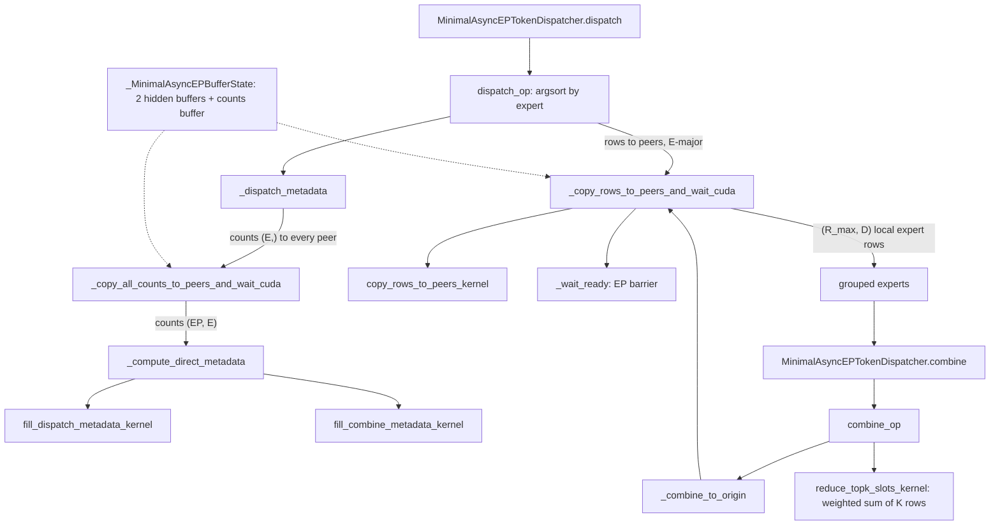

# Expert parallel (EP): MoE token dispatch and combine with the MinimalAsyncEP backend

## Overview
In an expert-parallel MoE layer every rank holds `E / EP` of the experts, so after routing,
each token's `K` chosen expert rows must travel to the ranks that own those experts
(**dispatch**), be processed by a grouped matmul there, and travel back to be weighted by the
router scores and summed (**combine**). TorchTitan selects the transport per model through
`moe_comm_backend` (`standard` all-to-all, `deepep`, `hybridep`, `minimal_async_ep`). This
page documents the `minimal_async_ep` backend, the subsystem in
`torchtitan/distributed/minimal_async_ep`, because it spells out the whole dispatch/combine
data movement in about 1,600 lines of Python and Triton. Its key idea: instead of an
all-to-all followed by a local permute, it exchanges only the per-expert **counts**, computes
on device the exact destination rank and row for every routed row, and then has each rank
**write rows directly into its peers' symmetric-memory receive buffers**, already in the
expert-major order the grouped matmul wants. The same metadata, saved in a
[`MinimalAsyncEPDispatchMetadata`](https://github.com/google-pytorch/torchtitan/blob/033f131322a8b5b026ac53d734c689d664442bf8/torchtitan/distributed/minimal_async_ep/api.py#L145 "torchtitan/distributed/minimal_async_ep/api#MinimalAsyncEPDispatchMetadata"),
drives combine and both backward passes.

## Diagram

Legend:
- `DD` - [`dispatch`](https://github.com/google-pytorch/torchtitan/blob/033f131322a8b5b026ac53d734c689d664442bf8/torchtitan/models/common/token_dispatcher.py#L1094 "torchtitan/models/common/token_dispatcher#MinimalAsyncEPTokenDispatcher.dispatch")
- `DOP` - [`dispatch_op`](https://github.com/google-pytorch/torchtitan/blob/033f131322a8b5b026ac53d734c689d664442bf8/torchtitan/distributed/minimal_async_ep/api.py#L561 "torchtitan/distributed/minimal_async_ep/api#dispatch_op")
- `DM` - [`_dispatch_metadata`](https://github.com/google-pytorch/torchtitan/blob/033f131322a8b5b026ac53d734c689d664442bf8/torchtitan/distributed/minimal_async_ep/api.py#L505 "torchtitan/distributed/minimal_async_ep/api#_dispatch_metadata")
- `CC` - [`_copy_all_counts_to_peers_and_wait_cuda`](https://github.com/google-pytorch/torchtitan/blob/033f131322a8b5b026ac53d734c689d664442bf8/torchtitan/distributed/minimal_async_ep/api.py#L366 "torchtitan/distributed/minimal_async_ep/api#_copy_all_counts_to_peers_and_wait_cuda") using [`copy_full_counts_to_peers_kernel`](https://github.com/google-pytorch/torchtitan/blob/033f131322a8b5b026ac53d734c689d664442bf8/torchtitan/distributed/minimal_async_ep/kernels.py#L351 "torchtitan/distributed/minimal_async_ep/kernels#copy_full_counts_to_peers_kernel")
- `CDM` - [`_compute_direct_metadata`](https://github.com/google-pytorch/torchtitan/blob/033f131322a8b5b026ac53d734c689d664442bf8/torchtitan/distributed/minimal_async_ep/api.py#L386 "torchtitan/distributed/minimal_async_ep/api#_compute_direct_metadata")
- `FDK` - [`fill_dispatch_metadata_kernel`](https://github.com/google-pytorch/torchtitan/blob/033f131322a8b5b026ac53d734c689d664442bf8/torchtitan/distributed/minimal_async_ep/kernels.py#L426 "torchtitan/distributed/minimal_async_ep/kernels#fill_dispatch_metadata_kernel")
- `FCK` - [`fill_combine_metadata_kernel`](https://github.com/google-pytorch/torchtitan/blob/033f131322a8b5b026ac53d734c689d664442bf8/torchtitan/distributed/minimal_async_ep/kernels.py#L463 "torchtitan/distributed/minimal_async_ep/kernels#fill_combine_metadata_kernel")
- `CR` - [`_copy_rows_to_peers_and_wait_cuda`](https://github.com/google-pytorch/torchtitan/blob/033f131322a8b5b026ac53d734c689d664442bf8/torchtitan/distributed/minimal_async_ep/api.py#L296 "torchtitan/distributed/minimal_async_ep/api#_copy_rows_to_peers_and_wait_cuda")
- `CPK` - [`copy_rows_to_peers_kernel`](https://github.com/google-pytorch/torchtitan/blob/033f131322a8b5b026ac53d734c689d664442bf8/torchtitan/distributed/minimal_async_ep/kernels.py#L382 "torchtitan/distributed/minimal_async_ep/kernels#copy_rows_to_peers_kernel")
- `WR` - [`_wait_ready`](https://github.com/google-pytorch/torchtitan/blob/033f131322a8b5b026ac53d734c689d664442bf8/torchtitan/distributed/minimal_async_ep/api.py#L352 "torchtitan/distributed/minimal_async_ep/api#_wait_ready")
- `GEMM` - (concept) the grouped-matmul experts; see [model-definitions](model-definitions.md)
- `DC` - [`combine`](https://github.com/google-pytorch/torchtitan/blob/033f131322a8b5b026ac53d734c689d664442bf8/torchtitan/models/common/token_dispatcher.py#L1161 "torchtitan/models/common/token_dispatcher#MinimalAsyncEPTokenDispatcher.combine")
- `COP` - [`combine_op`](https://github.com/google-pytorch/torchtitan/blob/033f131322a8b5b026ac53d734c689d664442bf8/torchtitan/distributed/minimal_async_ep/api.py#L687 "torchtitan/distributed/minimal_async_ep/api#combine_op")
- `CO` - [`_combine_to_origin`](https://github.com/google-pytorch/torchtitan/blob/033f131322a8b5b026ac53d734c689d664442bf8/torchtitan/distributed/minimal_async_ep/api.py#L483 "torchtitan/distributed/minimal_async_ep/api#_combine_to_origin")
- `RED` - [`reduce_topk_slots_kernel`](https://github.com/google-pytorch/torchtitan/blob/033f131322a8b5b026ac53d734c689d664442bf8/torchtitan/distributed/minimal_async_ep/kernels.py#L525 "torchtitan/distributed/minimal_async_ep/kernels#reduce_topk_slots_kernel")
- `BUF` - [`_MinimalAsyncEPBufferState`](https://github.com/google-pytorch/torchtitan/blob/033f131322a8b5b026ac53d734c689d664442bf8/torchtitan/distributed/minimal_async_ep/api.py#L50 "torchtitan/distributed/minimal_async_ep/api#_MinimalAsyncEPBufferState")

## Design rationale (why it's built this way)
- **Narrow, but no longer DP-only.** The module docstring now reads "This backend supports
  EP with optional CP, TP, and PP"; the dispatcher's docstring explains how: "CP and TP
  token sharding are handled by the common MoE sharding path. PP composes by using a
  separate EP process group within each pipeline stage."
  [`maybe_update_minimal_async_ep_config`](https://github.com/google-pytorch/torchtitan/blob/033f131322a8b5b026ac53d734c689d664442bf8/torchtitan/distributed/minimal_async_ep/api.py#L84 "torchtitan/distributed/minimal_async_ep/api#maybe_update_minimal_async_ep_config")
  still enforces EP > 1 and `num_experts` divisible by `expert_parallel_degree` at config
  time, but no longer rejects TP, CP, PP or the `full_dtensor` backend.
- **Counts first, then direct placement.** The comment in
  [`_dispatch_metadata`](https://github.com/google-pytorch/torchtitan/blob/033f131322a8b5b026ac53d734c689d664442bf8/torchtitan/distributed/minimal_async_ep/api.py#L505 "torchtitan/distributed/minimal_async_ep/api#_dispatch_metadata")
  says it "mirrors" the standard dispatcher's count exchange, but "instead of materializing
  an all-to-all rank-major receive tensor and then calling _permute(), compute the final
  E-major receive rows directly." Each sender therefore knows the final row index of every
  row it sends, and the receiver never permutes.
- **Static, worst-case capacity; dropless.** Symmetric memory must be allocated up front
  and be identical on all peers. [`init_buffer`](https://github.com/google-pytorch/torchtitan/blob/033f131322a8b5b026ac53d734c689d664442bf8/torchtitan/distributed/minimal_async_ep/api.py#L172 "torchtitan/distributed/minimal_async_ep/api#init_buffer")
  sizes each receive buffer as `EP x num_max_tokens_per_rank x min(K, E/EP)` rows of width
  `D`, the most rows a rank can possibly receive, so no token is ever dropped; the
  dispatcher computes the per-call bound `receive_capacity` the same way from the actual
  local token count.
- **Synchronous op boundaries.** The docstring of
  [`_copy_rows_to_peers_and_wait_cuda`](https://github.com/google-pytorch/torchtitan/blob/033f131322a8b5b026ac53d734c689d664442bf8/torchtitan/distributed/minimal_async_ep/api.py#L296 "torchtitan/distributed/minimal_async_ep/api#_copy_rows_to_peers_and_wait_cuda")
  is explicit that callers "receive a readable buffer, not an async handle. This keeps the
  operator interface simple for graph capture, but means this backend does not provide
  microbatch communication overlap." Despite the name, dispatch and combine are blocking.
- **One fused barrier.** [`_wait_ready`](https://github.com/google-pytorch/torchtitan/blob/033f131322a8b5b026ac53d734c689d664442bf8/torchtitan/distributed/minimal_async_ep/api.py#L352 "torchtitan/distributed/minimal_async_ep/api#_wait_ready")
  replaces a former loop of `2 x (EP - 1)` per-peer signal/wait kernels, described as "the
  dominant MinimalAsyncEP comm cost once CPU-launch overhead is removed by CUDA graphs /
  compiled steps", with a single `barrier` on the symmetric-memory handle.
- **Custom ops with explicit backward.** [`dispatch_op`](https://github.com/google-pytorch/torchtitan/blob/033f131322a8b5b026ac53d734c689d664442bf8/torchtitan/distributed/minimal_async_ep/api.py#L561 "torchtitan/distributed/minimal_async_ep/api#dispatch_op"),
  [`combine_op`](https://github.com/google-pytorch/torchtitan/blob/033f131322a8b5b026ac53d734c689d664442bf8/torchtitan/distributed/minimal_async_ep/api.py#L687 "torchtitan/distributed/minimal_async_ep/api#combine_op"),
  [`dispatch_backward_op`](https://github.com/google-pytorch/torchtitan/blob/033f131322a8b5b026ac53d734c689d664442bf8/torchtitan/distributed/minimal_async_ep/api.py#L768 "torchtitan/distributed/minimal_async_ep/api#dispatch_backward_op")
  and [`combine_backward_op`](https://github.com/google-pytorch/torchtitan/blob/033f131322a8b5b026ac53d734c689d664442bf8/torchtitan/distributed/minimal_async_ep/api.py#L829 "torchtitan/distributed/minimal_async_ep/api#combine_backward_op")
  are `torch.library` custom ops with fake (meta) implementations such as
  [`dispatch_op_fake`](https://github.com/google-pytorch/torchtitan/blob/033f131322a8b5b026ac53d734c689d664442bf8/torchtitan/distributed/minimal_async_ep/api.py#L647 "torchtitan/distributed/minimal_async_ep/api#dispatch_op_fake"),
  so `torch.compile` and graph capture treat each exchange as one opaque node with static
  output shapes (`R_max` rows), while autograd uses the hand-written backward that reuses the
  forward metadata in reverse.
- **Full recompute is mandatory.** `maybe_update_minimal_async_ep_config` rejects any
  activation-checkpointing mode other than full AC (or `memory_policy full` in the graph
  trainer): "MinimalAsyncEP requires full recompute".

> [!inferred]
> The full-recompute requirement follows from the buffer design: dispatch returns the
> symmetric receive buffer itself (not a copy), and only
> [`_HIDDEN_RECV_BUFFER_COUNT`](https://github.com/google-pytorch/torchtitan/blob/033f131322a8b5b026ac53d734c689d664442bf8/torchtitan/distributed/minimal_async_ep/api.py#L43 "torchtitan/distributed/minimal_async_ep/api#_HIDDEN_RECV_BUFFER_COUNT")
> = 2 such buffers rotate across all layers and both directions. Any activation saved
> for backward that aliases a receive buffer would be overwritten by a later layer's
> exchange; with full AC nothing inside the MoE block is saved, and the exchange is simply
> replayed during backward.

## Entry points
- [`maybe_update_minimal_async_ep_config`](https://github.com/google-pytorch/torchtitan/blob/033f131322a8b5b026ac53d734c689d664442bf8/torchtitan/distributed/minimal_async_ep/api.py#L84 "torchtitan/distributed/minimal_async_ep/api#maybe_update_minimal_async_ep_config")
  runs from the decoder config's update-from-trainer-config hook, at the end of the shared
  EP dispatcher config pass that also serves DeepEP and HybridEP. That shared pass derives
  `num_max_tokens_per_rank = num_tokens_per_microbatch_per_dp_rank / (CP x TP)` (CP and
  TP/SP shard tokens before the MoE, so the product must divide the microbatch) and accepts
  a larger user-set value; `hidden_dim` is set from the model dim when the dispatcher config
  is built. The MinimalAsyncEP hook finds every MoE whose `routed_experts` dispatcher is the
  MinimalAsyncEP config, validates it, and fills `dtype = mixed_precision_param` (bf16 or
  fp32 only).
- [`init_buffer`](https://github.com/google-pytorch/torchtitan/blob/033f131322a8b5b026ac53d734c689d664442bf8/torchtitan/distributed/minimal_async_ep/api.py#L172 "torchtitan/distributed/minimal_async_ep/api#init_buffer")
  is reached from the dispatcher's `init_buffer` once its EP mesh is wired. It keys the
  buffer on `(group, hidden_dim, num_max_tokens_per_rank, local experts, top_k, dtype,
  device)` in the module global
  [`_buffer_key`](https://github.com/google-pytorch/torchtitan/blob/033f131322a8b5b026ac53d734c689d664442bf8/torchtitan/distributed/minimal_async_ep/api.py#L70 "torchtitan/distributed/minimal_async_ep/api#_buffer_key._buffer_key"):
  the comment says "the first dispatcher initializes it, same-configuration dispatchers
  reuse it, and differing metadata is invalid because the buffer layout would not match."
- [`dispatch`](https://github.com/google-pytorch/torchtitan/blob/033f131322a8b5b026ac53d734c689d664442bf8/torchtitan/models/common/token_dispatcher.py#L1094 "torchtitan/models/common/token_dispatcher#MinimalAsyncEPTokenDispatcher.dispatch")
  and [`combine`](https://github.com/google-pytorch/torchtitan/blob/033f131322a8b5b026ac53d734c689d664442bf8/torchtitan/models/common/token_dispatcher.py#L1161 "torchtitan/models/common/token_dispatcher#MinimalAsyncEPTokenDispatcher.combine")
  are called by the MoE experts module on every forward; they wrap
  [`dispatch_op`](https://github.com/google-pytorch/torchtitan/blob/033f131322a8b5b026ac53d734c689d664442bf8/torchtitan/distributed/minimal_async_ep/api.py#L561 "torchtitan/distributed/minimal_async_ep/api#dispatch_op")
  and [`combine_op`](https://github.com/google-pytorch/torchtitan/blob/033f131322a8b5b026ac53d734c689d664442bf8/torchtitan/distributed/minimal_async_ep/api.py#L687 "torchtitan/distributed/minimal_async_ep/api#combine_op")
  and carry the metadata between them.

## Mechanism (step-by-step)
Shape names follow the module docstring: `T` local tokens, `D` model dim, `K` experts per
token, `N = T x K` routed rows, `E` global experts, `R` rows actually received,
`R_max >= R` the static receive capacity.

1. **Sort routed rows by expert.** [`dispatch_op`](https://github.com/google-pytorch/torchtitan/blob/033f131322a8b5b026ac53d734c689d664442bf8/torchtitan/distributed/minimal_async_ep/api.py#L561 "torchtitan/distributed/minimal_async_ep/api#dispatch_op")
   flattens the `(T, K)` expert ids to `N` slots and takes a stable `argsort`, giving
   [`E_row_to_T_row`](https://github.com/google-pytorch/torchtitan/blob/033f131322a8b5b026ac53d734c689d664442bf8/torchtitan/distributed/minimal_async_ep/api.py#L165 "torchtitan/distributed/minimal_async_ep/api#MinimalAsyncEPDispatchMetadata.E_row_to_T_row")
   (expert-major row -> token-major slot); `slot // K` is the source token. Nothing is
   gathered yet: the copy kernel later reads source rows through this index.
2. **Exchange counts.** [`_copy_all_counts_to_peers_and_wait_cuda`](https://github.com/google-pytorch/torchtitan/blob/033f131322a8b5b026ac53d734c689d664442bf8/torchtitan/distributed/minimal_async_ep/api.py#L366 "torchtitan/distributed/minimal_async_ep/api#_copy_all_counts_to_peers_and_wait_cuda")
   has [`copy_full_counts_to_peers_kernel`](https://github.com/google-pytorch/torchtitan/blob/033f131322a8b5b026ac53d734c689d664442bf8/torchtitan/distributed/minimal_async_ep/kernels.py#L351 "torchtitan/distributed/minimal_async_ep/kernels#copy_full_counts_to_peers_kernel")
   write this rank's `(E,)` token-per-expert counts into row `rank` of every peer's
   `(EP, E)` counts buffer, then waits on the counts barrier
   ([`_wait_counts_ready`](https://github.com/google-pytorch/torchtitan/blob/033f131322a8b5b026ac53d734c689d664442bf8/torchtitan/distributed/minimal_async_ep/api.py#L347 "torchtitan/distributed/minimal_async_ep/api#_wait_counts_ready")).
   Afterwards every rank holds the full source-by-expert count matrix.
3. **Compute every destination on device.** [`_compute_direct_metadata`](https://github.com/google-pytorch/torchtitan/blob/033f131322a8b5b026ac53d734c689d664442bf8/torchtitan/distributed/minimal_async_ep/api.py#L386 "torchtitan/distributed/minimal_async_ep/api#_compute_direct_metadata")
   views the counts as `(source, dest, local_expert)` and uses prefix sums to find, for each
   destination rank, where each local expert's segment starts and where within it this
   source's rows go. [`fill_dispatch_metadata_kernel`](https://github.com/google-pytorch/torchtitan/blob/033f131322a8b5b026ac53d734c689d664442bf8/torchtitan/distributed/minimal_async_ep/kernels.py#L426 "torchtitan/distributed/minimal_async_ep/kernels#fill_dispatch_metadata_kernel")
   expands that into per-row [`dispatch_dst_ranks`](https://github.com/google-pytorch/torchtitan/blob/033f131322a8b5b026ac53d734c689d664442bf8/torchtitan/distributed/minimal_async_ep/api.py#L160 "torchtitan/distributed/minimal_async_ep/api#MinimalAsyncEPDispatchMetadata.dispatch_dst_ranks")
   (`expert // local_experts`) and [`dispatch_dst_rows`](https://github.com/google-pytorch/torchtitan/blob/033f131322a8b5b026ac53d734c689d664442bf8/torchtitan/distributed/minimal_async_ep/api.py#L161 "torchtitan/distributed/minimal_async_ep/api#MinimalAsyncEPDispatchMetadata.dispatch_dst_rows");
   [`fill_combine_metadata_kernel`](https://github.com/google-pytorch/torchtitan/blob/033f131322a8b5b026ac53d734c689d664442bf8/torchtitan/distributed/minimal_async_ep/kernels.py#L463 "torchtitan/distributed/minimal_async_ep/kernels#fill_combine_metadata_kernel")
   builds the inverse for the rows this rank will receive, [`combine_dst_ranks`](https://github.com/google-pytorch/torchtitan/blob/033f131322a8b5b026ac53d734c689d664442bf8/torchtitan/distributed/minimal_async_ep/api.py#L162 "torchtitan/distributed/minimal_async_ep/api#MinimalAsyncEPDispatchMetadata.combine_dst_ranks")
   / [`combine_dst_rows`](https://github.com/google-pytorch/torchtitan/blob/033f131322a8b5b026ac53d734c689d664442bf8/torchtitan/distributed/minimal_async_ep/api.py#L163 "torchtitan/distributed/minimal_async_ep/api#MinimalAsyncEPDispatchMetadata.combine_dst_rows"),
   plus the device scalar [`combine_num_valid_rows`](https://github.com/google-pytorch/torchtitan/blob/033f131322a8b5b026ac53d734c689d664442bf8/torchtitan/distributed/minimal_async_ep/api.py#L164 "torchtitan/distributed/minimal_async_ep/api#MinimalAsyncEPDispatchMetadata.combine_num_valid_rows")
   `= R`. All of this stays on device: no host sync is needed to know `R`.
4. **Push rows to peers.** [`invert_flat_indices_kernel`](https://github.com/google-pytorch/torchtitan/blob/033f131322a8b5b026ac53d734c689d664442bf8/torchtitan/distributed/minimal_async_ep/kernels.py#L508 "torchtitan/distributed/minimal_async_ep/kernels#invert_flat_indices_kernel")
   inverts the sort into [`T_row_to_E_row`](https://github.com/google-pytorch/torchtitan/blob/033f131322a8b5b026ac53d734c689d664442bf8/torchtitan/distributed/minimal_async_ep/api.py#L166 "torchtitan/distributed/minimal_async_ep/api#MinimalAsyncEPDispatchMetadata.T_row_to_E_row")
   for combine. Then [`_copy_rows_to_peers_and_wait_cuda`](https://github.com/google-pytorch/torchtitan/blob/033f131322a8b5b026ac53d734c689d664442bf8/torchtitan/distributed/minimal_async_ep/api.py#L296 "torchtitan/distributed/minimal_async_ep/api#_copy_rows_to_peers_and_wait_cuda")
   picks the next of the two hidden receive buffers (round-robin via
   [`hidden_recv_buffer_index`](https://github.com/google-pytorch/torchtitan/blob/033f131322a8b5b026ac53d734c689d664442bf8/torchtitan/distributed/minimal_async_ep/api.py#L63 "torchtitan/distributed/minimal_async_ep/api#_MinimalAsyncEPBufferState.hidden_recv_buffer_index")),
   and [`copy_rows_to_peers_kernel`](https://github.com/google-pytorch/torchtitan/blob/033f131322a8b5b026ac53d734c689d664442bf8/torchtitan/distributed/minimal_async_ep/kernels.py#L382 "torchtitan/distributed/minimal_async_ep/kernels#copy_rows_to_peers_kernel")
   reads each source token row (via the sort index) and stores it straight into
   `peer_buffer[dst_row]` through the peer pointer table
   [`hidden_recv_peer_ptrs`](https://github.com/google-pytorch/torchtitan/blob/033f131322a8b5b026ac53d734c689d664442bf8/torchtitan/distributed/minimal_async_ep/api.py#L58 "torchtitan/distributed/minimal_async_ep/api#_MinimalAsyncEPBufferState.hidden_recv_peer_ptrs").
   A barrier ([`_wait_hidden_ready`](https://github.com/google-pytorch/torchtitan/blob/033f131322a8b5b026ac53d734c689d664442bf8/torchtitan/distributed/minimal_async_ep/api.py#L343 "torchtitan/distributed/minimal_async_ep/api#_wait_hidden_ready"))
   guarantees every peer has finished writing before the local buffer is read. The result is
   `(R_max, D)` rows grouped by local expert, returned with per-local-expert counts for the
   grouped matmul; rows past `R` are stale capacity padding.
5. **Combine: send outputs home and reduce.** [`combine_op`](https://github.com/google-pytorch/torchtitan/blob/033f131322a8b5b026ac53d734c689d664442bf8/torchtitan/distributed/minimal_async_ep/api.py#L687 "torchtitan/distributed/minimal_async_ep/api#combine_op")
   calls [`_combine_to_origin`](https://github.com/google-pytorch/torchtitan/blob/033f131322a8b5b026ac53d734c689d664442bf8/torchtitan/distributed/minimal_async_ep/api.py#L483 "torchtitan/distributed/minimal_async_ep/api#_combine_to_origin"),
   which reuses the same copy path in reverse: only the first `R` rows (masked by
   `combine_num_valid_rows`) are written back to their origin rank and origin expert-major
   row, and the receive buffer is narrowed to `(N, D)` "so downstream reductions should not
   see capacity padding". [`reduce_topk_slots_kernel`](https://github.com/google-pytorch/torchtitan/blob/033f131322a8b5b026ac53d734c689d664442bf8/torchtitan/distributed/minimal_async_ep/kernels.py#L525 "torchtitan/distributed/minimal_async_ep/kernels#reduce_topk_slots_kernel")
   then, per token, gathers its `K` rows through `T_row_to_E_row`, multiplies by
   [`routed_scores`](https://github.com/google-pytorch/torchtitan/blob/033f131322a8b5b026ac53d734c689d664442bf8/torchtitan/distributed/minimal_async_ep/api.py#L167 "torchtitan/distributed/minimal_async_ep/api#MinimalAsyncEPDispatchMetadata.routed_scores")
   and sums, producing `(T, D)`. Router-score weighting therefore happens on the origin rank
   after the return trip.
6. **Backward mirrors forward.** [`combine_autograd_backward`](https://github.com/google-pytorch/torchtitan/blob/033f131322a8b5b026ac53d734c689d664442bf8/torchtitan/distributed/minimal_async_ep/api.py#L972 "torchtitan/distributed/minimal_async_ep/api#combine_autograd_backward")
   calls [`combine_backward_op`](https://github.com/google-pytorch/torchtitan/blob/033f131322a8b5b026ac53d734c689d664442bf8/torchtitan/distributed/minimal_async_ep/api.py#L829 "torchtitan/distributed/minimal_async_ep/api#combine_backward_op"):
   [`expand_topk_grad_kernel`](https://github.com/google-pytorch/torchtitan/blob/033f131322a8b5b026ac53d734c689d664442bf8/torchtitan/distributed/minimal_async_ep/kernels.py#L562 "torchtitan/distributed/minimal_async_ep/kernels#expand_topk_grad_kernel")
   fans `(T, D)` gradients out to `N` score-scaled rows,
   [`topk_scores_grad_kernel`](https://github.com/google-pytorch/torchtitan/blob/033f131322a8b5b026ac53d734c689d664442bf8/torchtitan/distributed/minimal_async_ep/kernels.py#L602 "torchtitan/distributed/minimal_async_ep/kernels#topk_scores_grad_kernel")
   computes the router-score gradient as a row dot product with the saved routed outputs,
   and [`_dispatch_to_experts`](https://github.com/google-pytorch/torchtitan/blob/033f131322a8b5b026ac53d734c689d664442bf8/torchtitan/distributed/minimal_async_ep/api.py#L466 "torchtitan/distributed/minimal_async_ep/api#_dispatch_to_experts")
   ships the row gradients to the expert owners using the *dispatch* metadata.
   [`dispatch_autograd_backward`](https://github.com/google-pytorch/torchtitan/blob/033f131322a8b5b026ac53d734c689d664442bf8/torchtitan/distributed/minimal_async_ep/api.py#L924 "torchtitan/distributed/minimal_async_ep/api#dispatch_autograd_backward")
   calls [`dispatch_backward_op`](https://github.com/google-pytorch/torchtitan/blob/033f131322a8b5b026ac53d734c689d664442bf8/torchtitan/distributed/minimal_async_ep/api.py#L768 "torchtitan/distributed/minimal_async_ep/api#dispatch_backward_op"),
   which sends the expert-input gradients home with the *combine* metadata and sums the `K`
   slots per token (no scores). Four exchanges per MoE layer per step, plus replays under
   full AC.

## Key data structures
- [`MinimalAsyncEPDispatchMetadata`](https://github.com/google-pytorch/torchtitan/blob/033f131322a8b5b026ac53d734c689d664442bf8/torchtitan/distributed/minimal_async_ep/api.py#L145 "torchtitan/distributed/minimal_async_ep/api#MinimalAsyncEPDispatchMetadata"):
  per-call routing plan. `dispatch_dst_*` are `(N,)`, `combine_dst_*` are `(R_max,)`,
  `combine_num_valid_rows` is a `(1,)` device scalar, the two permutations and scores are
  `(N,)`, plus [`num_tokens`](https://github.com/google-pytorch/torchtitan/blob/033f131322a8b5b026ac53d734c689d664442bf8/torchtitan/distributed/minimal_async_ep/api.py#L168 "torchtitan/distributed/minimal_async_ep/api#MinimalAsyncEPDispatchMetadata.num_tokens")
  `T` and [`top_k`](https://github.com/google-pytorch/torchtitan/blob/033f131322a8b5b026ac53d734c689d664442bf8/torchtitan/distributed/minimal_async_ep/api.py#L169 "torchtitan/distributed/minimal_async_ep/api#MinimalAsyncEPDispatchMetadata.top_k") `K`.
- [`_MinimalAsyncEPBufferState`](https://github.com/google-pytorch/torchtitan/blob/033f131322a8b5b026ac53d734c689d664442bf8/torchtitan/distributed/minimal_async_ep/api.py#L50 "torchtitan/distributed/minimal_async_ep/api#_MinimalAsyncEPBufferState")
  (module global [`_buffer_state`](https://github.com/google-pytorch/torchtitan/blob/033f131322a8b5b026ac53d734c689d664442bf8/torchtitan/distributed/minimal_async_ep/api.py#L66 "torchtitan/distributed/minimal_async_ep/api#_buffer_state._buffer_state")):
  the EP [`group`](https://github.com/google-pytorch/torchtitan/blob/033f131322a8b5b026ac53d734c689d664442bf8/torchtitan/distributed/minimal_async_ep/api.py#L53 "torchtitan/distributed/minimal_async_ep/api#_MinimalAsyncEPBufferState.group"),
  [`num_max_tokens_per_rank`](https://github.com/google-pytorch/torchtitan/blob/033f131322a8b5b026ac53d734c689d664442bf8/torchtitan/distributed/minimal_async_ep/api.py#L54 "torchtitan/distributed/minimal_async_ep/api#_MinimalAsyncEPBufferState.num_max_tokens_per_rank"),
  two [`hidden_recv_buffers`](https://github.com/google-pytorch/torchtitan/blob/033f131322a8b5b026ac53d734c689d664442bf8/torchtitan/distributed/minimal_async_ep/api.py#L55 "torchtitan/distributed/minimal_async_ep/api#_MinimalAsyncEPBufferState.hidden_recv_buffers")
  with their rendezvous [`hidden_recv_handles`](https://github.com/google-pytorch/torchtitan/blob/033f131322a8b5b026ac53d734c689d664442bf8/torchtitan/distributed/minimal_async_ep/api.py#L56 "torchtitan/distributed/minimal_async_ep/api#_MinimalAsyncEPBufferState.hidden_recv_handles")
  and per-peer views [`hidden_recv_peer_buffers`](https://github.com/google-pytorch/torchtitan/blob/033f131322a8b5b026ac53d734c689d664442bf8/torchtitan/distributed/minimal_async_ep/api.py#L57 "torchtitan/distributed/minimal_async_ep/api#_MinimalAsyncEPBufferState.hidden_recv_peer_buffers"),
  and one `(EP, E)` int64 [`counts_recv_buffer`](https://github.com/google-pytorch/torchtitan/blob/033f131322a8b5b026ac53d734c689d664442bf8/torchtitan/distributed/minimal_async_ep/api.py#L59 "torchtitan/distributed/minimal_async_ep/api#_MinimalAsyncEPBufferState.counts_recv_buffer")
  with [`counts_recv_handle`](https://github.com/google-pytorch/torchtitan/blob/033f131322a8b5b026ac53d734c689d664442bf8/torchtitan/distributed/minimal_async_ep/api.py#L60 "torchtitan/distributed/minimal_async_ep/api#_MinimalAsyncEPBufferState.counts_recv_handle"),
  [`counts_recv_peer_buffers`](https://github.com/google-pytorch/torchtitan/blob/033f131322a8b5b026ac53d734c689d664442bf8/torchtitan/distributed/minimal_async_ep/api.py#L61 "torchtitan/distributed/minimal_async_ep/api#_MinimalAsyncEPBufferState.counts_recv_peer_buffers")
  and [`counts_recv_peer_ptrs`](https://github.com/google-pytorch/torchtitan/blob/033f131322a8b5b026ac53d734c689d664442bf8/torchtitan/distributed/minimal_async_ep/api.py#L62 "torchtitan/distributed/minimal_async_ep/api#_MinimalAsyncEPBufferState.counts_recv_peer_ptrs").
  Peer data pointers are stored as device int64 tensors so Triton kernels can address any
  peer without host involvement.
- Kernel tile constants: [`_COUNT_COPY_BLOCK_SIZE`](https://github.com/google-pytorch/torchtitan/blob/033f131322a8b5b026ac53d734c689d664442bf8/torchtitan/distributed/minimal_async_ep/kernels.py#L14 "torchtitan/distributed/minimal_async_ep/kernels#_COUNT_COPY_BLOCK_SIZE")
  (1024), [`_METADATA_BLOCK_SIZE`](https://github.com/google-pytorch/torchtitan/blob/033f131322a8b5b026ac53d734c689d664442bf8/torchtitan/distributed/minimal_async_ep/kernels.py#L15 "torchtitan/distributed/minimal_async_ep/kernels#_METADATA_BLOCK_SIZE")
  (256) and [`_MAX_BLOCK_N`](https://github.com/google-pytorch/torchtitan/blob/033f131322a8b5b026ac53d734c689d664442bf8/torchtitan/distributed/minimal_async_ep/kernels.py#L16 "torchtitan/distributed/minimal_async_ep/kernels#_MAX_BLOCK_N")
  (2048 columns per program).

## Dynamics (design intent)
- **Memory.** Each hidden buffer is `EP x num_max_tokens_per_rank x min(K, E/EP) x D`
  elements; with two of them this is the dominant fixed HBM cost of the backend and grows
  linearly with EP and with the per-rank token count (which CP and TP divide down).
- **Ordering.** Every exchange is copy-then-barrier, so the next kernel on a rank never
  starts before all peers have written. Successive exchanges alternate between the two
  hidden receive buffers.
- **No overlap.** Because every op returns only after its barrier, communication is fully
  exposed on the critical path; the backend optimizes launch count and removes the permute
  instead of hiding latency.
- **Graph friendliness.** Output shapes depend only on `T`, `K`, `EP` and `R_max`, never on
  the routing result, which is what lets compiled steps and CUDA graphs capture the MoE
  layer.

> [!inferred]
> Alternating buffers means consecutive exchanges (for example dispatch then combine of one
> layer) land in different buffers, so a fast peer that has already started the next
> exchange cannot overwrite rows a slower rank is still reading from the previous one; the
> source does not state this reason.

> [!inferred]
> For TPU training this backend is not usable as written: [`init_buffer`](https://github.com/google-pytorch/torchtitan/blob/033f131322a8b5b026ac53d734c689d664442bf8/torchtitan/distributed/minimal_async_ep/api.py#L172 "torchtitan/distributed/minimal_async_ep/api#init_buffer")
> raises unless the symmetric-memory backend is CUDA, the custom ops are registered for
> `device_types="cuda"`, and the kernels are Triton. The TPU experiment's model registries
> pass `moe_comm_backend="standard"` (PyTorch all-to-all collectives) and add TPU-specific
> VJPs for the local permutation and top-K reduction. The ideas that do transfer are the
> ones this page foregrounds: exchange counts before rows, size receive buffers statically to
> a dropless worst case so shapes are compile-time constants (which XLA requires), and fold
> the permutation into destination indices rather than a separate gather.

## Edge cases
- The DeepSeek-V3 recipes that select `minimal_async_ep` set every parallel degree to 1,
  including EP; since the validator raises when EP = 1, the EP degree must be overridden at
  launch.
- Only `bfloat16` and `float32` hidden rows are supported by the copy kernel; the dtype comes
  from `mixed_precision_param`, not from the activations.
- `num_max_tokens_per_rank` defaults to the training microbatch's per-rank token count; a
  forward with more local tokens (for example a validation run with a different shape)
  needs a larger configured value, since the static buffer cannot grow.
- [`init_buffer`](https://github.com/google-pytorch/torchtitan/blob/033f131322a8b5b026ac53d734c689d664442bf8/torchtitan/distributed/minimal_async_ep/api.py#L172 "torchtitan/distributed/minimal_async_ep/api#init_buffer")
  initializes the buffer once per process and returns early for a matching key; layers
  with a different `top_k`, dim or expert count in the same model raise "MinimalAsyncEP
  buffer was already initialized with a different configuration".
- The dispatcher carries its state in the generic `EPDispatchMetadata` wrapper shared with
  DeepEP and HybridEP ("Metadata for DeepEP, HybridEP, and MinimalAsyncEP token
  dispatch"), so code that inspects dispatch metadata must look at its backend-specific
  `state`.
- The Triton kernels now index rows with int64 program ids, so very large `N` or `T` no
  longer overflow 32-bit row offsets.

## Open questions
- The standard all-to-all dispatcher and the TPU subclass used on TPU are outside this
  packet's subgraph; their dispatch/combine cost on ICI is not documented here.
- Whether the full-AC requirement could be relaxed (for example by copying out of the
  receive buffer) is not discussed in source; the reasoning above is inferred.
- How `R_max` would interact with a capacity factor below 1 (token dropping) is open: the
  code has only the dropless bound.

## See also
- [Parallel dims and mesh](parallel-dims-and-mesh.md) - the `ep` / `efsdp` axes and the `dp_shard x cp x tp = efsdp x ep` constraint.
- [FSDP sharding](fsdp-sharding.md) - expert weights sharded on `efsdp`.
- [Activation checkpointing](activation-checkpointing.md) - the full-AC requirement.
- [Model definitions](model-definitions.md) - MoE router and grouped experts.
- [Torch compile integration](torch-compile-integration.md) - why fake kernels and static shapes matter.
- [TorchTPU backend](torchtpu-backend.md) - the TPU lane and its MoE dispatcher choice.
- [Pipeline parallel](pipeline-parallel.md), [Context parallel](context-parallel.md), [Tensor parallel](tensor-parallel.md) - axes this backend now composes with.

## Recent changes
- `fa627bf2` updates TorchTitan from upstream `d771abb0`. For MinimalAsyncEP it lifts the
  DP-only restriction (EP now composes with CP, TP and PP, exercised by the
  `fsdp2_tp2_cp2_ep8` H100 recipe), renames `tokens_per_rank` to `num_max_tokens_per_rank`
  and derives it from `num_tokens_per_microbatch_per_dp_rank / (CP x TP)` in a pass shared
  with DeepEP and HybridEP, lets same-configuration dispatchers reuse one process-global
  buffer, finds MoE layers by config traversal (`routed_experts`), and widens Triton row
  indices to int64.
- [all changes in 033f131322](../changes/033f131322.md)
