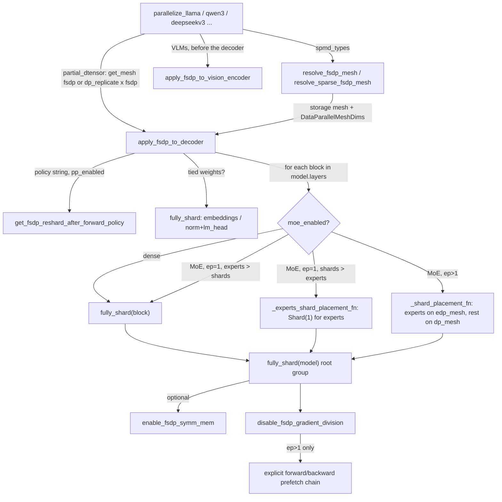

# FSDP2 sharding of decoder models (apply_fsdp_to_decoder)

## Overview
TorchTitan's data parallelism is PyTorch FSDP2 (`fully_shard`), applied by one shared function,
[`apply_fsdp_to_decoder`](https://github.com/google-pytorch/torchtitan/blob/033f131322a8b5b026ac53d734c689d664442bf8/torchtitan/distributed/fsdp.py#L189 "torchtitan/distributed/fsdp#apply_fsdp_to_decoder"),
whose docstring says it is "Shared by all dense and MoE decoders (llama3, qwen3, deepseek_v3,
gpt_oss, qwen3_vl, ...)". The unit of sharding is the **transformer block**: every block becomes
one FSDP group whose parameters are all-gathered together just before the block runs and
reduce-scattered together after its backward, so at any moment only about one block's full
weights are materialized. The embedding, the final norm plus `lm_head`, and finally the root
model each get their own group. The mesh passed in decides the flavor: a 1-D `fsdp` mesh gives
plain FSDP, a 2-D `(dp_replicate, fsdp)` mesh gives HSDP (shard within a group, replicate across
groups). Under the `spmd_types` backend the mesh is instead a multi-axis storage mesh, and
[`resolve_fsdp_mesh`](https://github.com/google-pytorch/torchtitan/blob/033f131322a8b5b026ac53d734c689d664442bf8/torchtitan/distributed/fsdp.py#L32 "torchtitan/distributed/fsdp#resolve_fsdp_mesh") /
[`resolve_sparse_fsdp_mesh`](https://github.com/google-pytorch/torchtitan/blob/033f131322a8b5b026ac53d734c689d664442bf8/torchtitan/distributed/fsdp.py#L65 "torchtitan/distributed/fsdp#resolve_sparse_fsdp_mesh") pair it
with a `DataParallelMeshDims` that tells `fully_shard` which axes are data-parallel. A sibling,
[`apply_fsdp_to_vision_encoder`](https://github.com/google-pytorch/torchtitan/blob/033f131322a8b5b026ac53d734c689d664442bf8/torchtitan/distributed/fsdp.py#L150 "torchtitan/distributed/fsdp#apply_fsdp_to_vision_encoder"),
wraps a VLM vision tower as one group. Around this core sit three small policy helpers: one
resolving the reshard-after-forward policy, one turning off FSDP's built-in gradient division,
and one enabling symmetric-memory comms.

## Diagram

Legend:
- `CALLER` - [`parallelize_llama`](https://github.com/google-pytorch/torchtitan/blob/033f131322a8b5b026ac53d734c689d664442bf8/torchtitan/models/llama3/parallelize.py#L23 "torchtitan/models/llama3/parallelize#parallelize_llama")
- `AF` - [`apply_fsdp_to_decoder`](https://github.com/google-pytorch/torchtitan/blob/033f131322a8b5b026ac53d734c689d664442bf8/torchtitan/distributed/fsdp.py#L189 "torchtitan/distributed/fsdp#apply_fsdp_to_decoder")
- `RM` - [`resolve_fsdp_mesh`](https://github.com/google-pytorch/torchtitan/blob/033f131322a8b5b026ac53d734c689d664442bf8/torchtitan/distributed/fsdp.py#L32 "torchtitan/distributed/fsdp#resolve_fsdp_mesh") and [`resolve_sparse_fsdp_mesh`](https://github.com/google-pytorch/torchtitan/blob/033f131322a8b5b026ac53d734c689d664442bf8/torchtitan/distributed/fsdp.py#L65 "torchtitan/distributed/fsdp#resolve_sparse_fsdp_mesh")
- `VE` - [`apply_fsdp_to_vision_encoder`](https://github.com/google-pytorch/torchtitan/blob/033f131322a8b5b026ac53d734c689d664442bf8/torchtitan/distributed/fsdp.py#L150 "torchtitan/distributed/fsdp#apply_fsdp_to_vision_encoder")
- `RP` - [`get_fsdp_reshard_after_forward_policy`](https://github.com/google-pytorch/torchtitan/blob/033f131322a8b5b026ac53d734c689d664442bf8/torchtitan/distributed/fsdp.py#L123 "torchtitan/distributed/fsdp#get_fsdp_reshard_after_forward_policy")
- `EMB` - (concept) the `fully_shard` calls on embeddings and head inside [`apply_fsdp_to_decoder`](https://github.com/google-pytorch/torchtitan/blob/033f131322a8b5b026ac53d734c689d664442bf8/torchtitan/distributed/fsdp.py#L189 "torchtitan/distributed/fsdp#apply_fsdp_to_decoder")
- `BLK` - (concept) the per-block loop over [`layers`](https://github.com/google-pytorch/torchtitan/blob/033f131322a8b5b026ac53d734c689d664442bf8/torchtitan/models/common/decoder.py#L84 "torchtitan/models/common/decoder#Decoder.Config.layers")
- `FS` - (concept) a plain `fully_shard` call (PyTorch FSDP2 API)
- `P1` - [`_experts_shard_placement_fn`](https://github.com/google-pytorch/torchtitan/blob/033f131322a8b5b026ac53d734c689d664442bf8/torchtitan/distributed/fsdp.py#L324 "torchtitan/distributed/fsdp#apply_fsdp_to_decoder._experts_shard_placement_fn")
- `P2` - [`_shard_placement_fn`](https://github.com/google-pytorch/torchtitan/blob/033f131322a8b5b026ac53d734c689d664442bf8/torchtitan/distributed/fsdp.py#L360 "torchtitan/distributed/fsdp#apply_fsdp_to_decoder._shard_placement_fn")
- `ROOT` - (concept) the final `fully_shard(model)` call
- `SYM` - [`enable_fsdp_symm_mem`](https://github.com/google-pytorch/torchtitan/blob/033f131322a8b5b026ac53d734c689d664442bf8/torchtitan/distributed/fsdp.py#L113 "torchtitan/distributed/fsdp#enable_fsdp_symm_mem")
- `DIV` - [`disable_fsdp_gradient_division`](https://github.com/google-pytorch/torchtitan/blob/033f131322a8b5b026ac53d734c689d664442bf8/torchtitan/distributed/fsdp.py#L85 "torchtitan/distributed/fsdp#disable_fsdp_gradient_division")
- `PF` - (concept) `set_modules_to_forward_prefetch` / `set_modules_to_backward_prefetch` chain

## Design rationale (why it's built this way)
- **One FSDP group per transformer block.** This is the granularity that bounds peak memory
  (one block's unsharded weights plus its prefetched neighbor) while keeping collectives large
  enough to be efficient. Per-block groups also line up with the per-block activation
  checkpointing and per-block `torch.compile` that callers apply *before* FSDP
  ([`parallelize_llama`](https://github.com/google-pytorch/torchtitan/blob/033f131322a8b5b026ac53d734c689d664442bf8/torchtitan/models/llama3/parallelize.py#L23 "torchtitan/models/llama3/parallelize#parallelize_llama")
  comments "turn on per-TransformerBlock compile after AC wrapping and before FSDP").
- **FSDP is also the mixed-precision mechanism, so it is always applied.** The function builds a
  `MixedPrecisionPolicy(param_dtype, reduce_dtype, cast_forward_inputs=False)` from
  `training.mixed_precision_param` (default bf16) and `training.mixed_precision_reduce` (default
  fp32). Callers apply it even at FSDP degree 1: "with shard_degree=1 it is a no-op for the
  all-gather but still installs the MixedPrecisionPolicy". This is why the mesh layer keeps the
  `fsdp` axis alive at size 1 (see [ParallelDims and the mesh](parallel-dims-and-mesh.md)).
- **Reshard-after-forward is a memory vs communication trade.** Resharding frees a block's full
  weights after forward, and the backward must all-gather them again. The "default" policy of
  [`get_fsdp_reshard_after_forward_policy`](https://github.com/google-pytorch/torchtitan/blob/033f131322a8b5b026ac53d734c689d664442bf8/torchtitan/distributed/fsdp.py#L123 "torchtitan/distributed/fsdp#get_fsdp_reshard_after_forward_policy")
  is `not pp_enabled`. The source explains: "For PP, by default do not reshard after forward to avoid
  per-microbatch all-gathers, which can be expensive and non-overlapped". The final norm and
  `lm_head` are never resharded unless the policy is "always", because "FSDP would prefetch them
  immediately" for the backward that starts right there.
- **Tied embeddings are one unit.** With `enable_weight_tying`, `tok_embeddings`, `norm` and
  `lm_head` go into a single group "to avoid duplicate all-gathers" of the shared weight.
- **Gradient scaling is TorchTitan's job, not FSDP's.** [`disable_fsdp_gradient_division`](https://github.com/google-pytorch/torchtitan/blob/033f131322a8b5b026ac53d734c689d664442bf8/torchtitan/distributed/fsdp.py#L85 "torchtitan/distributed/fsdp#disable_fsdp_gradient_division")
  sets `gradient_divide_factor=1.0` because "We handle gradient scaling ourselves in the training
  loop with global token count". The trainer all-reduces the valid-token count over the `batch`
  mesh and divides the summed loss by it, so the correct gradient is a plain *sum* across ranks.
  Averaging by FSDP would divide twice and would be wrong when ranks see different numbers of
  valid tokens.
- **TPU-specific: no `premul_sum`.** The same helper calls `set_force_sum_reduction_for_comms(True)`
  on every non-CUDA device. The comment: "The `premul_sum` reduction type is not supported on
  non-CUDA devices (e.g., TPU)". With a divide factor of 1.0, forcing a plain sum is numerically
  identical ("A/1+B/1+C/1 == (A+B+C)/1"), so TPU and GPU runs match.
- **MoE experts are sharded to avoid padding.** Experts are stored as a stacked tensor with
  `num_experts` on dim 0. When the number of shards (`efsdp * ep`, or the FSDP mesh size when
  `ep == 1`) exceeds `num_experts`, sharding dim 0 would give some ranks empty or padded shards,
  so the code switches experts to `Shard(1)`. With EP > 1, experts already live on the `ep`
  axis and must be FSDP-sharded on the separate `efsdp` mesh while the other parameters of the
  same block use the dense mesh. That per-parameter mesh choice goes through FSDP2 private
  internals (`_get_mesh_info`, `ShardPlacementResult`).
- **Under `spmd_types`, the data-parallel axes are declared, not inferred.** The storage mesh
  there is multi-axis (`_DENSE_STORAGE_AXES` = `dp_replicate, dp_shard, cp, tp`; the sparse
  `_SPARSE_STORAGE_AXES` = `dp_replicate, efsdp, ep`), so `fully_shard` must be told which of them
  to flatten into its shard dim. The `dp_mesh_dims` docstring explains why this is explicit: "the
  naming contract between `fully_shard` and torchtitan is not strong enough to infer safely, and
  an explicit declaration avoids silent miscategorization when new mesh axes appear".
  [`resolve_fsdp_mesh`](https://github.com/google-pytorch/torchtitan/blob/033f131322a8b5b026ac53d734c689d664442bf8/torchtitan/distributed/fsdp.py#L32 "torchtitan/distributed/fsdp#resolve_fsdp_mesh") declares `dp_shard`
  (plus `cp` when CP is on) as the shard axes and `dp_replicate` as the replicate axis when it is
  enabled; `dp_shard` is "force-kept-alive in the dense storage mesh even at size 1 so FSDP can pick
  the DP submesh out of the multi-axis storage mesh".
- **A vision encoder is one group.** [`apply_fsdp_to_vision_encoder`](https://github.com/google-pytorch/torchtitan/blob/033f131322a8b5b026ac53d734c689d664442bf8/torchtitan/distributed/fsdp.py#L150 "torchtitan/distributed/fsdp#apply_fsdp_to_vision_encoder")
  shards the whole tower with a single `fully_shard`: "One all-gather for all vision params is more
  efficient than per-layer sharding (the vision encoder is small relative to the decoder)". It must
  run before `apply_fsdp_to_decoder`, and its `cpu_offload` must match the decoder's, or backward
  fails with a CPU-parameter / CUDA-gradient device mismatch.
- **Explicit prefetch under EP.** "set up explicit prefetching when EP is enabled, as D2H syncs in
  EP could interfere with implicit prefetching in FSDP". (The likely source of those syncs is the
  all-to-all token dispatch reading split sizes on the host; the comment does not say.)

> [!inferred]
> TPU memory and communication model for one block of `P` parameters over an FSDP axis of size
> `N`. Persistent memory for params, grads and optimizer states is about `1/N` of the unsharded
> amount (fp32 master weights stay sharded because `param_dtype` only affects the gathered copy).
> Per step, the block costs one all-gather of `P` elements in `param_dtype` (bf16) in forward,
> one more in backward if reshard-after-forward is on, and one reduce-scatter of `P` gradient
> elements in `reduce_dtype`. The fp32 default for `reduce_dtype` makes the reduce-scatter carry
> twice the bytes of the bf16 all-gathers; switching `mixed_precision_reduce` to bf16 halves that
> traffic at the cost of reduction precision. Under HSDP the reduce-scatter is followed
> by an all-reduce across `dp_replicate`, which is the collective that should cross DCN on
> multi-slice TPU jobs.

## Entry points
- [`apply_fsdp_to_decoder`](https://github.com/google-pytorch/torchtitan/blob/033f131322a8b5b026ac53d734c689d664442bf8/torchtitan/distributed/fsdp.py#L189 "torchtitan/distributed/fsdp#apply_fsdp_to_decoder")
  is called at the end of every decoder's parallelize function, after TP, CP, activation
  checkpointing and compile: [`parallelize_llama`](https://github.com/google-pytorch/torchtitan/blob/033f131322a8b5b026ac53d734c689d664442bf8/torchtitan/models/llama3/parallelize.py#L23 "torchtitan/models/llama3/parallelize#parallelize_llama"),
  [`parallelize_qwen3`](https://github.com/google-pytorch/torchtitan/blob/033f131322a8b5b026ac53d734c689d664442bf8/torchtitan/models/qwen3/parallelize.py#L28 "torchtitan/models/qwen3/parallelize#parallelize_qwen3"),
  [`parallelize_deepseekv3`](https://github.com/google-pytorch/torchtitan/blob/033f131322a8b5b026ac53d734c689d664442bf8/torchtitan/models/deepseek_v3/parallelize.py#L21 "torchtitan/models/deepseek_v3/parallelize#parallelize_deepseekv3")
  (through an MTP wrapper that temporarily appends the MTP layers to `model.layers` so they are
  wrapped like ordinary blocks; MoE models also pass `ep_degree` and the `efsdp` mesh), [`parallelize_gptoss`](https://github.com/google-pytorch/torchtitan/blob/033f131322a8b5b026ac53d734c689d664442bf8/torchtitan/models/gpt_oss/parallelize.py#L58 "torchtitan/models/gpt_oss/parallelize#parallelize_gptoss"),
  [`parallelize_qwen3_5`](https://github.com/google-pytorch/torchtitan/blob/033f131322a8b5b026ac53d734c689d664442bf8/torchtitan/models/qwen3_5/parallelize.py#L34 "torchtitan/models/qwen3_5/parallelize#parallelize_qwen3_5"),
  [`parallelize_muse_glimmer`](https://github.com/google-pytorch/torchtitan/blob/033f131322a8b5b026ac53d734c689d664442bf8/torchtitan/models/muse_glimmer/parallelize.py#L30 "torchtitan/models/muse_glimmer/parallelize#parallelize_muse_glimmer")
  and the TPU Mamba examples [`parallelize_mamba2`](https://github.com/google-pytorch/torchtitan/blob/033f131322a8b5b026ac53d734c689d664442bf8/torchtitan/experiments/tpu/examples/mamba2/parallelize.py#L21 "torchtitan/experiments/tpu/examples/mamba2/parallelize#parallelize_mamba2")
  and [`parallelize_mamba3`](https://github.com/google-pytorch/torchtitan/blob/033f131322a8b5b026ac53d734c689d664442bf8/torchtitan/experiments/tpu/examples/mamba3/parallelize.py#L17 "torchtitan/experiments/tpu/examples/mamba3/parallelize#parallelize_mamba3").
- [`resolve_fsdp_mesh`](https://github.com/google-pytorch/torchtitan/blob/033f131322a8b5b026ac53d734c689d664442bf8/torchtitan/distributed/fsdp.py#L32 "torchtitan/distributed/fsdp#resolve_fsdp_mesh") and
  [`resolve_sparse_fsdp_mesh`](https://github.com/google-pytorch/torchtitan/blob/033f131322a8b5b026ac53d734c689d664442bf8/torchtitan/distributed/fsdp.py#L65 "torchtitan/distributed/fsdp#resolve_sparse_fsdp_mesh")
  are what those parallelize functions call instead of `get_mesh` when
  `spmd_backend == "spmd_types"`; under `partial_dtensor` they still request
  `["dp_replicate","fsdp"]` / `["fsdp"]` (and `["dp_replicate","efsdp"]` / `["efsdp"]` for experts) by name.
- [`apply_fsdp_to_vision_encoder`](https://github.com/google-pytorch/torchtitan/blob/033f131322a8b5b026ac53d734c689d664442bf8/torchtitan/distributed/fsdp.py#L150 "torchtitan/distributed/fsdp#apply_fsdp_to_vision_encoder")
  is called just before the decoder wrap by VLM paths such as
  [`parallelize_qwen3_5`](https://github.com/google-pytorch/torchtitan/blob/033f131322a8b5b026ac53d734c689d664442bf8/torchtitan/models/qwen3_5/parallelize.py#L34 "torchtitan/models/qwen3_5/parallelize#parallelize_qwen3_5"),
  [`parallelize_kimi_k2_5`](https://github.com/google-pytorch/torchtitan/blob/033f131322a8b5b026ac53d734c689d664442bf8/torchtitan/models/kimi_k2_7/parallelize.py#L36 "torchtitan/models/kimi_k2_7/parallelize#parallelize_kimi_k2_5") and
  [`parallelize_kimi_k3`](https://github.com/google-pytorch/torchtitan/blob/033f131322a8b5b026ac53d734c689d664442bf8/torchtitan/models/kimi_k3/parallelize.py#L27 "torchtitan/models/kimi_k3/parallelize#parallelize_kimi_k3").
- [`get_fsdp_reshard_after_forward_policy`](https://github.com/google-pytorch/torchtitan/blob/033f131322a8b5b026ac53d734c689d664442bf8/torchtitan/distributed/fsdp.py#L123 "torchtitan/distributed/fsdp#get_fsdp_reshard_after_forward_policy")
  is reused by paths that wrap on their own, such as the HF transformers backend
  [`parallelize_hf_transformers`](https://github.com/google-pytorch/torchtitan/blob/033f131322a8b5b026ac53d734c689d664442bf8/torchtitan/experiments/transformers_modeling_backend/parallelize.py#L87 "torchtitan/experiments/transformers_modeling_backend/parallelize#parallelize_hf_transformers")
  and the graph trainer's [`parallelize_autoparallel_llama`](https://github.com/google-pytorch/torchtitan/blob/033f131322a8b5b026ac53d734c689d664442bf8/torchtitan/experiments/graph_trainer/llama3/parallelize_autoparallel.py#L38 "torchtitan/experiments/graph_trainer/llama3/parallelize_autoparallel#parallelize_autoparallel_llama")
  and [`parallelize_autoparallel_deepseekv3`](https://github.com/google-pytorch/torchtitan/blob/033f131322a8b5b026ac53d734c689d664442bf8/torchtitan/experiments/graph_trainer/deepseek_v3/parallelize_autoparallel.py#L91 "torchtitan/experiments/graph_trainer/deepseek_v3/parallelize_autoparallel#parallelize_autoparallel_deepseekv3").
- [`disable_fsdp_gradient_division`](https://github.com/google-pytorch/torchtitan/blob/033f131322a8b5b026ac53d734c689d664442bf8/torchtitan/distributed/fsdp.py#L85 "torchtitan/distributed/fsdp#disable_fsdp_gradient_division")
  and [`enable_fsdp_symm_mem`](https://github.com/google-pytorch/torchtitan/blob/033f131322a8b5b026ac53d734c689d664442bf8/torchtitan/distributed/fsdp.py#L113 "torchtitan/distributed/fsdp#enable_fsdp_symm_mem")
  are also called directly by non-decoder models that call `fully_shard` themselves, for example
  [`parallelize_flux`](https://github.com/google-pytorch/torchtitan/blob/033f131322a8b5b026ac53d734c689d664442bf8/torchtitan/models/flux/parallelize.py#L52 "torchtitan/models/flux/parallelize#parallelize_flux") and the Flux
  encoders in [`parallelize_encoders`](https://github.com/google-pytorch/torchtitan/blob/033f131322a8b5b026ac53d734c689d664442bf8/torchtitan/models/flux/parallelize.py#L257 "torchtitan/models/flux/parallelize#parallelize_encoders").

## Mechanism (step-by-step)
1. **Pick the mesh and build the shared config.** Under `partial_dtensor` the caller picks the mesh from [ParallelDims](parallel-dims-and-mesh.md): `["dp_replicate","fsdp"]` when replication is on, else `["fsdp"]` ([`parallelize_llama`](https://github.com/google-pytorch/torchtitan/blob/033f131322a8b5b026ac53d734c689d664442bf8/torchtitan/models/llama3/parallelize.py#L23 "torchtitan/models/llama3/parallelize#parallelize_llama")). Under `spmd_types` it calls [`resolve_fsdp_mesh`](https://github.com/google-pytorch/torchtitan/blob/033f131322a8b5b026ac53d734c689d664442bf8/torchtitan/distributed/fsdp.py#L32 "torchtitan/distributed/fsdp#resolve_fsdp_mesh"), which takes the activated subset of the dense storage axes and returns it with `DataParallelMeshDims(shard="dp_shard" or ("dp_shard","cp"), replicate="dp_replicate" or None)`, or with `None` dims when the whole storage mesh has size 1 (params then carry no SPMD annotations to translate). [`apply_fsdp_to_decoder`](https://github.com/google-pytorch/torchtitan/blob/033f131322a8b5b026ac53d734c689d664442bf8/torchtitan/distributed/fsdp.py#L189 "torchtitan/distributed/fsdp#apply_fsdp_to_decoder") creates the mixed-precision policy and a `fsdp_config` dict holding the `mesh` (plus `dp_mesh_dims` when given, and a `CPUOffloadPolicy` when `cpu_offload` is set), then resolves the reshard flag via [`get_fsdp_reshard_after_forward_policy`](https://github.com/google-pytorch/torchtitan/blob/033f131322a8b5b026ac53d734c689d664442bf8/torchtitan/distributed/fsdp.py#L123 "torchtitan/distributed/fsdp#get_fsdp_reshard_after_forward_policy"): "always" -> True, "never" -> False, "default" -> `not pp_enabled`, anything else raises `ValueError`.
2. **Wrap the edges of the model.** With weight tying, `tok_embeddings`, `norm` and `lm_head` are passed together as one group to a single `fully_shard` call (resharded only under "always"). Without tying, `tok_embeddings` gets its own group using the resolved reshard flag, and `[norm, lm_head]` form one group resharded only under "always". Modules that are `None` (for example on a pipeline stage that does not own them) are skipped. The model type is a [`Decoder`](https://github.com/google-pytorch/torchtitan/blob/033f131322a8b5b026ac53d734c689d664442bf8/torchtitan/models/common/decoder.py#L67 "torchtitan/models/common/decoder#Decoder"). For VLMs the caller has already wrapped the vision tower with [`apply_fsdp_to_vision_encoder`](https://github.com/google-pytorch/torchtitan/blob/033f131322a8b5b026ac53d734c689d664442bf8/torchtitan/distributed/fsdp.py#L150 "torchtitan/distributed/fsdp#apply_fsdp_to_vision_encoder") on the same mesh and dims.
3. **Wrap each transformer block.** For each entry of [`layers`](https://github.com/google-pytorch/torchtitan/blob/033f131322a8b5b026ac53d734c689d664442bf8/torchtitan/models/common/decoder.py#L84 "torchtitan/models/common/decoder#Decoder.Config.layers"), a dense block simply becomes one FSDP group. An MoE block takes its expert bank from `moe.routed_experts.inner_experts` ("Expert weights live on the grouped-GEMM child"), computes the shard count (`efsdp * ep` when EP > 1, else the dense mesh size) and picks `Shard(1)` for experts if that count exceeds `num_experts`, else `Shard(0)`. Then there are three cases. With EP = 1 and `Shard(0)` it is a plain `fully_shard`. With EP = 1 and `Shard(1)`, [`_experts_shard_placement_fn`](https://github.com/google-pytorch/torchtitan/blob/033f131322a8b5b026ac53d734c689d664442bf8/torchtitan/distributed/fsdp.py#L324 "torchtitan/distributed/fsdp#apply_fsdp_to_decoder._experts_shard_placement_fn") returns `Shard(1)` for expert parameters and `None` (the default dim 0) for everything else. With EP > 1, [`_shard_placement_fn`](https://github.com/google-pytorch/torchtitan/blob/033f131322a8b5b026ac53d734c689d664442bf8/torchtitan/distributed/fsdp.py#L360 "torchtitan/distributed/fsdp#apply_fsdp_to_decoder._shard_placement_fn") returns both a placement and a mesh per parameter: experts go to the `efsdp`-based mesh with the chosen placement, and other parameters go to the dense mesh with `Shard(0)`. Both mesh infos are pre-computed through FSDP2's internal mesh-info builder, which, when `dp_mesh_dims`/`edp_mesh_dims` are set (the `spmd_types` path, fed by [`resolve_sparse_fsdp_mesh`](https://github.com/google-pytorch/torchtitan/blob/033f131322a8b5b026ac53d734c689d664442bf8/torchtitan/distributed/fsdp.py#L65 "torchtitan/distributed/fsdp#resolve_sparse_fsdp_mesh") for experts), also flattens the DP axes out of the multi-axis mesh.
4. **Wrap the root.** A final `fully_shard(model)` at the end of [`apply_fsdp_to_decoder`](https://github.com/google-pytorch/torchtitan/blob/033f131322a8b5b026ac53d734c689d664442bf8/torchtitan/distributed/fsdp.py#L189 "torchtitan/distributed/fsdp#apply_fsdp_to_decoder") collects any parameters not owned by a child group and gives FSDP a root to drive the forward/backward hooks and implicit prefetch.
5. **Adjust communication.** If `enable_symm_mem` is set, [`enable_fsdp_symm_mem`](https://github.com/google-pytorch/torchtitan/blob/033f131322a8b5b026ac53d734c689d664442bf8/torchtitan/distributed/fsdp.py#L113 "torchtitan/distributed/fsdp#enable_fsdp_symm_mem") switches every FSDP module to symmetric-memory collectives (and forces sum reduction). Then [`disable_fsdp_gradient_division`](https://github.com/google-pytorch/torchtitan/blob/033f131322a8b5b026ac53d734c689d664442bf8/torchtitan/distributed/fsdp.py#L85 "torchtitan/distributed/fsdp#disable_fsdp_gradient_division") walks all modules, sets the divide factor to 1.0, and on non-CUDA devices (TPU) forces sum reduction. The function logs "Applied HSDP" if the mesh has a `dp_replicate` axis, else "Applied FSDP", through [`logger`](https://github.com/google-pytorch/torchtitan/blob/033f131322a8b5b026ac53d734c689d664442bf8/torchtitan/tools/logging.py#L12 "torchtitan/tools/logging#logger").
6. **EP-only explicit prefetch.** When `ep_degree > 1`, [`apply_fsdp_to_decoder`](https://github.com/google-pytorch/torchtitan/blob/033f131322a8b5b026ac53d734c689d664442bf8/torchtitan/distributed/fsdp.py#L189 "torchtitan/distributed/fsdp#apply_fsdp_to_decoder") wires a forward chain (embeddings -> block 0 -> block 1 -> ... -> last block -> `[norm, lm_head]`) and a reverse backward chain (`lm_head` -> last block -> ... -> block 0 -> embeddings), so each group's all-gather is issued one group ahead regardless of host syncs in the MoE dispatch.

## Key data structures
- **`fsdp_config`** (local dict): `mesh`, `mp_policy`, optional `dp_mesh_dims` and
  `offload_policy`. Every `fully_shard` call in the function shares it, so all groups use the same
  mesh and precision unless a placement function overrides the mesh per parameter.
- **Storage axes and `DataParallelMeshDims`**: [`_DENSE_STORAGE_AXES`](https://github.com/google-pytorch/torchtitan/blob/033f131322a8b5b026ac53d734c689d664442bf8/torchtitan/distributed/fsdp.py#L28 "torchtitan/distributed/fsdp#_DENSE_STORAGE_AXES")
  and [`_SPARSE_STORAGE_AXES`](https://github.com/google-pytorch/torchtitan/blob/033f131322a8b5b026ac53d734c689d664442bf8/torchtitan/distributed/fsdp.py#L29 "torchtitan/distributed/fsdp#_SPARSE_STORAGE_AXES") are the axis
  lists the two resolvers activate; the returned `DataParallelMeshDims` names the shard axes
  (`dp_shard`[, `cp`] dense, `efsdp` sparse) and the optional `dp_replicate` replicate axis.
- **MixedPrecisionPolicy**: `param_dtype` is the dtype of the all-gathered weights used in compute;
  `reduce_dtype` is the dtype of the gradient reduce-scatter/all-reduce; `cast_forward_inputs=False`
  leaves activation dtypes to the model.
- **Placement functions**: [`_experts_shard_placement_fn`](https://github.com/google-pytorch/torchtitan/blob/033f131322a8b5b026ac53d734c689d664442bf8/torchtitan/distributed/fsdp.py#L324 "torchtitan/distributed/fsdp#apply_fsdp_to_decoder._experts_shard_placement_fn")
  returns a `Shard` or `None`. [`_shard_placement_fn`](https://github.com/google-pytorch/torchtitan/blob/033f131322a8b5b026ac53d734c689d664442bf8/torchtitan/distributed/fsdp.py#L360 "torchtitan/distributed/fsdp#apply_fsdp_to_decoder._shard_placement_fn")
  returns a placement *and* a mesh info. Both capture the expert parameter set through default
  arguments, which binds the current block's set rather than the loop variable.
- **Expert tensors**: the grouped-GEMM expert bank under an [`MoE`](https://github.com/google-pytorch/torchtitan/blob/033f131322a8b5b026ac53d734c689d664442bf8/torchtitan/models/common/moe.py#L934 "torchtitan/models/common/moe#MoE")
  layer's `routed_experts.inner_experts`, stacked on dim 0 by expert, which is what makes dim 1 the
  fallback shard dimension.

## Dynamics (design intent)
- FSDP2 issues each group's all-gather from a pre-forward hook and, by default, prefetches the
  next group. The root wrap and the per-block order are what make that prefetch follow layer
  order.
- With pipeline parallelism, several microbatches go through the same stage. That is why the
  default keeps weights unsharded between forward and backward (`not pp_enabled`): the weights
  are gathered once per step instead of once per microbatch.
- With EP, the explicit prefetch chain replaces FSDP's implicit ordering heuristics, trading some
  memory (one extra group resident) for guaranteed overlap.

## Edge cases
- **Unknown policy string** raises `ValueError` from the resolver. Valid values are "default",
  "always" and "never" (the config field `parallelism.fsdp_reshard_after_forward`).
- **The resolvers are `spmd_types`-only.** Both assert `spmd_backend == "spmd_types"`;
  [`resolve_sparse_fsdp_mesh`](https://github.com/google-pytorch/torchtitan/blob/033f131322a8b5b026ac53d734c689d664442bf8/torchtitan/distributed/fsdp.py#L65 "torchtitan/distributed/fsdp#resolve_sparse_fsdp_mesh") returns
  `(None, None)` when EP is off. Upstream Muse Glimmer
  ([`parallelize_muse_glimmer`](https://github.com/google-pytorch/torchtitan/blob/033f131322a8b5b026ac53d734c689d664442bf8/torchtitan/models/muse_glimmer/parallelize.py#L30 "torchtitan/models/muse_glimmer/parallelize#parallelize_muse_glimmer"))
  calls `resolve_fsdp_mesh` unconditionally and raises `NotImplementedError` for any other backend.
- **Symmetric memory is GPU-only.** `ParallelismConfig.__post_init__` rejects
  `enable_fsdp_symm_mem` unless CUDA is available with compute capability >= 9.0 (or ROCm), so the
  flag cannot be enabled on TPU.
- **CPU offload is disabled on TPU.** The TPU llama3 wrapper overrides
  `training.enable_cpu_offload` to False with a warning ("CPU offload is not supported for TPU
  torchtitan run").
- **`edp_mesh` is required when `ep_degree > 1`** (asserted). Passing a dense mesh for experts under
  EP is not supported.
- **Weight tying and resharding:** in the tied case even `tok_embeddings` is only resharded under
  "always", so "default" keeps the shared weight gathered after forward.
- **Gradient values are sums.** Anything that consumes FSDP gradients outside the normal trainer
  (custom loops, tests) must scale by the global token count itself, because FSDP no longer
  averages.

## Open questions
- The TPU wrappers can bypass this function entirely with `parallelism.use_simple_fsdp` (a
  compiler-friendly SimpleFSDP implementation from the graph trainer). The trade-offs between the
  two on TPU (overlap, compile time, uneven-shard handling) are not documented in this unit, and
  that path's symbols are outside this page's subgraph; the TPU Muse Glimmer wrapper
  ([`parallelize_muse_glimmer`](https://github.com/google-pytorch/torchtitan/blob/033f131322a8b5b026ac53d734c689d664442bf8/torchtitan/experiments/tpu/muse_glimmer/infra/parallelize.py#L124 "torchtitan/experiments/tpu/muse_glimmer/infra/parallelize#parallelize_muse_glimmer"))
  is one place where both branches sit side by side.
- Whether the fp32 `reduce_dtype` default is the recommended setting for large TPU runs, or bf16
  is preferred there, is not stated in the source.
- The reliance on FSDP2 private modules (`_fsdp_common`, `_fsdp_init`) for the EP path is a
  maintenance risk; nothing in this unit pins the PyTorch version it requires.

## See also
- [ParallelDims and the device mesh](parallel-dims-and-mesh.md) - where the `fsdp`, `dp_replicate` and `efsdp` meshes come from.
- [Tensor parallel](tensor-parallel.md) - applied before FSDP; FSDP then shards TP-sharded DTensors along the data axes.
- [DTensor and sharding types](dtensor-and-sharding-types.md) - the `spmd_types` backend whose storage meshes the resolvers return.
- [Expert parallel](expert-parallel.md), [Pipeline parallel](pipeline-parallel.md), [Context parallel](context-parallel.md)
- [Activation checkpointing](activation-checkpointing.md), [torch.compile integration](torch-compile-integration.md) - applied per block before FSDP.
- [Loss and validation](loss-and-validation.md), [Training loop](training-loop.md) - the global-token loss scaling that replaces FSDP's gradient division.
- [Checkpointing](checkpointing.md) - saving and loading sharded FSDP state.

## Recent changes
- `fa627bf2` rebases onto upstream `d771abb0`: `fsdp.py` gains `resolve_fsdp_mesh` /
  `resolve_sparse_fsdp_mesh` (storage mesh + `DataParallelMeshDims` under `spmd_types`, replacing the
  `full_dtensor` path) and `apply_fsdp_to_vision_encoder`, and experts are now read from
  `moe.routed_experts.inner_experts`.
- `9f6ed5f1`, `67d17d26` and `c79866f6` rework the MoE layer around the sharded experts (global-batch
  aux loss on the router's `[T, E]` outputs, configurable token counting via `token_count_impl`).
- `a6e16462` keeps full activation checkpointing for FLUX blocks but saves the splash-attention
  forward, in the same `parallelize_flux` that applies FSDP to FLUX.
- [all changes in 033f131322](../changes/033f131322.md)
