# Job configuration: Configurable, config registries, CLI overrides and the override mechanism

## Overview
TorchTitan has no TOML or YAML job files. A job is a tree of Python dataclasses rooted at the
trainer's config, and every node that builds something is a
[`Config`](https://github.com/google-pytorch/torchtitan/blob/033f131322a8b5b026ac53d734c689d664442bf8/torchtitan/config/configurable.py#L41 "torchtitan/config/configurable#Configurable.Config")
nested inside the [`Configurable`](https://github.com/google-pytorch/torchtitan/blob/033f131322a8b5b026ac53d734c689d664442bf8/torchtitan/config/configurable.py#L18 "torchtitan/config/configurable#Configurable")
class it builds. Three layers produce the final tree: a **config registry function** (plain Python,
called a "full configuration" in the config README, for example the TPU recipe
[`sft_llama3_8b_metamath`](https://github.com/google-pytorch/torchtitan/blob/033f131322a8b5b026ac53d734c689d664442bf8/torchtitan/experiments/tpu/llama3/config_registry.py#L376 "torchtitan/experiments/tpu/llama3/config_registry#sft_llama3_8b_metamath"))
returns a fully populated config, optionally rewritten by **model config transforms**
([`apply_transforms`](https://github.com/google-pytorch/torchtitan/blob/033f131322a8b5b026ac53d734c689d664442bf8/torchtitan/config/transform/apply.py#L76 "torchtitan/config/transform/apply#apply_transforms"));
the **CLI** edits leaf values through tyro
([`ConfigManager`](https://github.com/google-pytorch/torchtitan/blob/033f131322a8b5b026ac53d734c689d664442bf8/torchtitan/config/manager.py#L29 "torchtitan/config/manager#ConfigManager"),
precedence "CLI args > config_registry function defaults"); and, inside the trainer, the **override
mechanism** ([`apply_overrides`](https://github.com/google-pytorch/torchtitan/blob/033f131322a8b5b026ac53d734c689d664442bf8/torchtitan/config/override.py#L448 "torchtitan/config/override#apply_overrides"))
can swap whole component configs for alternative implementations by class and FQN glob. Only then
does anything call [`build`](https://github.com/google-pytorch/torchtitan/blob/033f131322a8b5b026ac53d734c689d664442bf8/torchtitan/config/configurable.py#L134 "torchtitan/config/configurable#Configurable.Config.build").
The single key idea: configuration *is* the object graph's blueprint, so selecting an
implementation is replacing a `Config` node, not setting a string flag. Upstream now treats the CLI
flag surface as frozen: new knobs go into the config tree, and recipes are the supported way to
change a run.

## Diagram

```mermaid
flowchart LR
  ARGS["argv: --module M --config F --a.b v"] --> PA["ConfigManager.parse_args"]
  PA -->|"import M.config_registry, call F()"| REG["config_registry function"]
  REG -.->|"optional"| TF["apply_transforms"]
  REG -->|"default instance"| TYRO["tyro.cli (dotted overrides)"]
  TF --> TYRO
  TYRO --> CFG["Trainer.Config tree"]
  CFG -->|"update_from_config, then"| AO["apply_overrides"]
  IMP["override.imports targets"] -->|"module.function"| OV["@override registry"]
  OV --> AO
  AO -->|"traverse + _collect_claims"| TR["Configurable.Config.traverse"]
  AO -->|"factory(cfg, **kwargs), often derive()"| CFG2["rewritten tree"]
  CFG2 -->|"build()"| OBJ["component instances (_owner)"]
```

Legend:
- `ARGS` - (concept) command-line arguments of `torchtitan.train` or the TPU launcher
- `PA` - [`parse_args`](https://github.com/google-pytorch/torchtitan/blob/033f131322a8b5b026ac53d734c689d664442bf8/torchtitan/config/manager.py#L44 "torchtitan/config/manager#ConfigManager.parse_args") on [`ConfigManager`](https://github.com/google-pytorch/torchtitan/blob/033f131322a8b5b026ac53d734c689d664442bf8/torchtitan/config/manager.py#L29 "torchtitan/config/manager#ConfigManager")
- `REG` - a registry function such as [`qwen3_8b`](https://github.com/google-pytorch/torchtitan/blob/033f131322a8b5b026ac53d734c689d664442bf8/torchtitan/experiments/tpu/qwen3/config_registry.py#L375 "torchtitan/experiments/tpu/qwen3/config_registry#qwen3_8b")
- `TF` - [`apply_transforms`](https://github.com/google-pytorch/torchtitan/blob/033f131322a8b5b026ac53d734c689d664442bf8/torchtitan/config/transform/apply.py#L76 "torchtitan/config/transform/apply#apply_transforms") with, for example, [`ContextParallelTransform`](https://github.com/google-pytorch/torchtitan/blob/033f131322a8b5b026ac53d734c689d664442bf8/torchtitan/config/transform/context_parallel.py#L22 "torchtitan/config/transform/context_parallel#ContextParallelTransform"), called by the recipe itself
- `TYRO` - (concept) tyro's dataclass CLI, driven from [`parse_args`](https://github.com/google-pytorch/torchtitan/blob/033f131322a8b5b026ac53d734c689d664442bf8/torchtitan/config/manager.py#L44 "torchtitan/config/manager#ConfigManager.parse_args")
- `CFG` - the trainer config; its [`training`](https://github.com/google-pytorch/torchtitan/blob/033f131322a8b5b026ac53d734c689d664442bf8/torchtitan/trainer.py#L113 "torchtitan/trainer#Trainer.Config.training") section is a [`TrainingConfig`](https://github.com/google-pytorch/torchtitan/blob/033f131322a8b5b026ac53d734c689d664442bf8/torchtitan/config/configs.py#L36 "torchtitan/config/configs#TrainingConfig") and its [`parallelism`](https://github.com/google-pytorch/torchtitan/blob/033f131322a8b5b026ac53d734c689d664442bf8/torchtitan/trainer.py#L114 "torchtitan/trainer#Trainer.Config.parallelism") section a [`ParallelismConfig`](https://github.com/google-pytorch/torchtitan/blob/033f131322a8b5b026ac53d734c689d664442bf8/torchtitan/config/configs.py#L123 "torchtitan/config/configs#ParallelismConfig")
- `IMP` - [`imports`](https://github.com/google-pytorch/torchtitan/blob/033f131322a8b5b026ac53d734c689d664442bf8/torchtitan/config/override.py#L62 "torchtitan/config/override#OverrideConfig.imports") on [`OverrideConfig`](https://github.com/google-pytorch/torchtitan/blob/033f131322a8b5b026ac53d734c689d664442bf8/torchtitan/config/override.py#L61 "torchtitan/config/override#OverrideConfig")
- `OV` - factories registered by the [`override`](https://github.com/google-pytorch/torchtitan/blob/033f131322a8b5b026ac53d734c689d664442bf8/torchtitan/config/override.py#L175 "torchtitan/config/override#override") decorator
- `AO` - [`apply_overrides`](https://github.com/google-pytorch/torchtitan/blob/033f131322a8b5b026ac53d734c689d664442bf8/torchtitan/config/override.py#L448 "torchtitan/config/override#apply_overrides") using [`_collect_claims`](https://github.com/google-pytorch/torchtitan/blob/033f131322a8b5b026ac53d734c689d664442bf8/torchtitan/config/override.py#L386 "torchtitan/config/override#_collect_claims")
- `TR` - [`traverse`](https://github.com/google-pytorch/torchtitan/blob/033f131322a8b5b026ac53d734c689d664442bf8/torchtitan/config/configurable.py#L75 "torchtitan/config/configurable#Configurable.Config.traverse")
- `CFG2` - (concept) the same tree with claimed nodes replaced; factories typically use [`derive`](https://github.com/google-pytorch/torchtitan/blob/033f131322a8b5b026ac53d734c689d664442bf8/torchtitan/config/override.py#L249 "torchtitan/config/override#derive")
- `OBJ` - [`build`](https://github.com/google-pytorch/torchtitan/blob/033f131322a8b5b026ac53d734c689d664442bf8/torchtitan/config/configurable.py#L134 "torchtitan/config/configurable#Configurable.Config.build") constructing [`_owner`](https://github.com/google-pytorch/torchtitan/blob/033f131322a8b5b026ac53d734c689d664442bf8/torchtitan/config/configurable.py#L44 "torchtitan/config/configurable#Configurable.Config._owner")

## Design rationale (why it's built this way)
- **Config and class are paired by nesting, wired automatically.**
  [`Configurable`](https://github.com/google-pytorch/torchtitan/blob/033f131322a8b5b026ac53d734c689d664442bf8/torchtitan/config/configurable.py#L18 "torchtitan/config/configurable#Configurable")'s
  subclass hook runs on the *outer* class when it is defined, finds a nested `Config`, enforces
  `@dataclass(kw_only=True, slots=True)` and keyword-only fields, and sets `Config._owner = cls`. The
  docstring explains the check must live on the outer class "because @dataclass(slots=True) replaces
  the class, so Config.__init_subclass__ sees the pre-decorator version". Slots make typos in
  attribute assignment an error; keyword-only fields keep subclass configs safe to extend.
- **`build()` copies the config and separates config from runtime objects.**
  [`build`](https://github.com/google-pytorch/torchtitan/blob/033f131322a8b5b026ac53d734c689d664442bf8/torchtitan/config/configurable.py#L134 "torchtitan/config/configurable#Configurable.Config.build")
  constructs `_owner(config=replace(self), **kwargs)`: each built object owns a shallow copy, so the
  same config node can build several instances. Runtime-only arguments (a mesh, the model parts, a
  tokenizer) are passed as kwargs, and a kwarg that collides with a config field raises: "Put these
  values in the Config, not in build() kwargs". [`Module`](https://github.com/google-pytorch/torchtitan/blob/033f131322a8b5b026ac53d734c689d664442bf8/torchtitan/protocols/module.py#L43 "torchtitan/protocols/module#Module")
  extends this with its own [`build`](https://github.com/google-pytorch/torchtitan/blob/033f131322a8b5b026ac53d734c689d664442bf8/torchtitan/protocols/module.py#L98 "torchtitan/protocols/module#Module.Config.build")
  to attach `param_init` and `sharding_config` (see [train-spec-and-model-protocol](train-spec-and-model-protocol.md)).
- **Recipes are code, the CLI only edits - and is frozen.** [`ConfigManager`](https://github.com/google-pytorch/torchtitan/blob/033f131322a8b5b026ac53d734c689d664442bf8/torchtitan/config/manager.py#L29 "torchtitan/config/manager#ConfigManager")
  imports `<module>.config_registry` (searching `torchtitan.models`, `torchtitan.experiments`, then RL
  examples, or a fully qualified path), calls the named function, and passes the result to tyro as
  `default=`. The recipe can therefore compute things (pick a model flavor, set per-layer
  `param_init`, swap the parallelize function, apply transforms, append override targets), while the
  CLI stays a flat `--section.key value` editor over the same dataclasses. The config README now
  states the `--section.option` flags "are not the way to configure a run any more, and they will be
  deleted"; new fields must be annotated `tyro.conf.Suppress` so the CLI does not grow, and
  `Trainer.Config.model_spec` is suppressed, which takes the whole model config tree off the CLI.
  Upstream moves full configurations into a separate `torchtitan_recipes` package selected with a
  fully qualified `--module`; the per-model `config_registry.py` modules "keep working and they will
  eventually be deleted".
- **Transforms rewrite a finished model config, ordered and validated.**
  [`apply_transforms`](https://github.com/google-pytorch/torchtitan/blob/033f131322a8b5b026ac53d734c689d664442bf8/torchtitan/config/transform/apply.py#L76 "torchtitan/config/transform/apply#apply_transforms")
  deep-copies the trainer config, topologically orders transforms by their `run_after`
  declarations, rejects `conflicts_with` pairs, rewrites `model_spec.model`, then re-runs
  `__post_init__`; "The input config stays unchanged if a transform fails." The transform README puts
  context parallelism, TP GEMM backends, MoE communication backends, quantization and LoRA in this
  layer, while `model_registry` keeps choosing the base architecture and attention algorithm.
- **Cross-section validation has one home.** Single-config invariants stay in each dataclass's
  `__post_init__`; checks spanning sections live in `config/validation.py`, for example
  [`validate_context_parallel`](https://github.com/google-pytorch/torchtitan/blob/033f131322a8b5b026ac53d734c689d664442bf8/torchtitan/config/validation.py#L20 "torchtitan/config/validation#validate_context_parallel"),
  which `Trainer.Config.__post_init__` calls after its local checks.
- **Overrides are collected before any mutation.** [`_collect_claims`](https://github.com/google-pytorch/torchtitan/blob/033f131322a8b5b026ac53d734c689d664442bf8/torchtitan/config/override.py#L386 "torchtitan/config/override#_collect_claims")
  walks the *original* tree for every active override and records `(override, fqn, cfg, parent,
  attr, kwargs)` claims; only then are factories called. Its docstring: "Collecting before mutating
  makes application order-independent: replacements are never re-traversed, so one override cannot
  affect another's matches." Conflicts are per node, not per class: two overrides of the same Config
  class on disjoint FQNs are fine; the same node or an ancestor/descendant pair raises.
- **Only what you name is applied.** Registration is global (importing any module with `@override`
  adds to one registry keyed by the factory's import path `module.function`), but
  [`apply_overrides`](https://github.com/google-pytorch/torchtitan/blob/033f131322a8b5b026ac53d734c689d664442bf8/torchtitan/config/override.py#L448 "torchtitan/config/override#apply_overrides")
  activates exactly the factories listed in
  [`imports`](https://github.com/google-pytorch/torchtitan/blob/033f131322a8b5b026ac53d734c689d664442bf8/torchtitan/config/override.py#L62 "torchtitan/config/override#OverrideConfig.imports");
  there is no whole-module form. Each entry is a target string or a `(target, kwargs)` tuple whose
  kwargs reach the factory, "so two config trees can share one override yet configure it
  differently". A target naming no registered override, or named twice, raises; a run whose
  targets resolve but match no node logs a warning instead of silently doing nothing.
- **`derive` is for version robustness.** [`derive`](https://github.com/google-pytorch/torchtitan/blob/033f131322a8b5b026ac53d734c689d664442bf8/torchtitan/config/override.py#L249 "torchtitan/config/override#derive")
  copies every field shared by the source and target config, then applies deltas; unknown deltas
  raise. "When the target Config later gains a field ... derive copies it automatically instead of
  silently reverting to the default."

## Entry points
- [`parse_args`](https://github.com/google-pytorch/torchtitan/blob/033f131322a8b5b026ac53d734c689d664442bf8/torchtitan/config/manager.py#L44 "torchtitan/config/manager#ConfigManager.parse_args")
  is called by `torchtitan.train`'s main and by the TPU launcher's gmain; both `--module` and
  `--config` are required. `python -m torchtitan.config.manager --module ... --config ...` prints the
  resolved config for debugging.
- [`apply_transforms`](https://github.com/google-pytorch/torchtitan/blob/033f131322a8b5b026ac53d734c689d664442bf8/torchtitan/config/transform/apply.py#L76 "torchtitan/config/transform/apply#apply_transforms")
  is called by a recipe function, after it has set all training options ("Set all training options
  first. Then call `apply_transforms` once."), and returns a new config.
- [`apply_overrides`](https://github.com/google-pytorch/torchtitan/blob/033f131322a8b5b026ac53d734c689d664442bf8/torchtitan/config/override.py#L448 "torchtitan/config/override#apply_overrides")
  is called once from the trainer's constructor when `override.imports` is non-empty, after the model
  config's `update_from_config` and before the model or any other component is built; the trainer
  re-runs the full config `__post_init__` afterwards because "Overrides may change any config field".
  The RL trainer actor and the TPU Ray RL trainer pass the model config itself as the root instead.
- [`override`](https://github.com/google-pytorch/torchtitan/blob/033f131322a8b5b026ac53d734c689d664442bf8/torchtitan/config/override.py#L175 "torchtitan/config/override#override")
  is the decorator an override module uses; its `target` must be a `Configurable.Config` subclass
  ("Targets like ModelSpec or a plain class are not overridable; pick the component's `.Config`"),
  and "a function may carry only one @override".
- [`build`](https://github.com/google-pytorch/torchtitan/blob/033f131322a8b5b026ac53d734c689d664442bf8/torchtitan/config/configurable.py#L134 "torchtitan/config/configurable#Configurable.Config.build")
  is how every component is instantiated, including the trainer itself.
- [`Function`](https://github.com/google-pytorch/torchtitan/blob/033f131322a8b5b026ac53d734c689d664442bf8/torchtitan/config/function.py#L16 "torchtitan/config/function#Function")
  wraps a callable in a nested `Config`
  so lazily computed values (the docstring's example is per-layer init std that "varies by depth") fit
  the same build protocol.

## Mechanism (step-by-step)
1. **Select the recipe.** [`parse_args`](https://github.com/google-pytorch/torchtitan/blob/033f131322a8b5b026ac53d734c689d664442bf8/torchtitan/config/manager.py#L44 "torchtitan/config/manager#ConfigManager.parse_args")
   strips `--module`/`--config` (both `--x v` and `--x=v` forms), imports the registry module, and
   calls the function. A missing function lists the available lowercase callables in the error.
   TPU recipes return a TPU subclass of the trainer config that adds `tpu_config`, XLA/libtpu flag
   maps and Pallas kernel sections; the concrete class is what tyro parses, so those sections become
   CLI-editable too. A recipe that enables CP builds its base config, sets the degree, then hands it
   to [`apply_transforms`](https://github.com/google-pytorch/torchtitan/blob/033f131322a8b5b026ac53d734c689d664442bf8/torchtitan/config/transform/apply.py#L76 "torchtitan/config/transform/apply#apply_transforms")
   with a [`ContextParallelTransform`](https://github.com/google-pytorch/torchtitan/blob/033f131322a8b5b026ac53d734c689d664442bf8/torchtitan/config/transform/context_parallel.py#L22 "torchtitan/config/transform/context_parallel#ContextParallelTransform"),
   which replaces every attention's inner attention with its
   [`inner_attention`](https://github.com/google-pytorch/torchtitan/blob/033f131322a8b5b026ac53d734c689d664442bf8/torchtitan/config/transform/context_parallel.py#L32 "torchtitan/config/transform/context_parallel#ContextParallelTransform.inner_attention")
   class (which must inherit `CPInnerAttention`) while keeping the existing config fields.
2. **Apply CLI edits.** tyro parses the remaining args against the config's class with the registry
   result as default; custom rules parse `list[str]` fields as comma-separated values (so
   `--compile.components model,loss` works) and parse `--override.imports` tokens as space- or
   comma-separated targets, each optionally `target='{"k": v}'` with JSON kwargs. Dataclass
   `__post_init__` hooks run on construction:
   [`__post_init__`](https://github.com/google-pytorch/torchtitan/blob/033f131322a8b5b026ac53d734c689d664442bf8/torchtitan/config/configs.py#L54 "torchtitan/config/configs#TrainingConfig.__post_init__")
   rejects non-positive token budgets or context length and a negative `max_norm`;
   [`__post_init__`](https://github.com/google-pytorch/torchtitan/blob/033f131322a8b5b026ac53d734c689d664442bf8/torchtitan/config/configs.py#L286 "torchtitan/config/configs#ParallelismConfig.__post_init__")
   validates [`spmd_backend`](https://github.com/google-pytorch/torchtitan/blob/033f131322a8b5b026ac53d734c689d664442bf8/torchtitan/config/configs.py#L199 "torchtitan/config/configs#ParallelismConfig.spmd_backend"),
   the CP load balancer and the PP schedule name; `CompileConfig` rejects unknown components; and the
   trainer config checks cross-section combinations, ending with
   [`validate_context_parallel`](https://github.com/google-pytorch/torchtitan/blob/033f131322a8b5b026ac53d734c689d664442bf8/torchtitan/config/validation.py#L20 "torchtitan/config/validation#validate_context_parallel").
3. **Validate paths.** After parsing, [`ConfigManager`](https://github.com/google-pytorch/torchtitan/blob/033f131322a8b5b026ac53d734c689d664442bf8/torchtitan/config/manager.py#L29 "torchtitan/config/manager#ConfigManager") warns when `hf_assets_path` does not exist (falling back to a
   legacy tokenizer path if present) and raises if it points at an old `tokenizer.model` file.
4. **Traverse and claim.** Inside the trainer, [`apply_overrides`](https://github.com/google-pytorch/torchtitan/blob/033f131322a8b5b026ac53d734c689d664442bf8/torchtitan/config/override.py#L448 "torchtitan/config/override#apply_overrides")
   splits every entry of [`imports`](https://github.com/google-pytorch/torchtitan/blob/033f131322a8b5b026ac53d734c689d664442bf8/torchtitan/config/override.py#L62 "torchtitan/config/override#OverrideConfig.imports")
   into module and function, imports the module (which runs its `@override` decorators), looks the
   full target up in the registry, and [`_collect_claims`](https://github.com/google-pytorch/torchtitan/blob/033f131322a8b5b026ac53d734c689d664442bf8/torchtitan/config/override.py#L386 "torchtitan/config/override#_collect_claims")
   calls [`traverse`](https://github.com/google-pytorch/torchtitan/blob/033f131322a8b5b026ac53d734c689d664442bf8/torchtitan/config/configurable.py#L75 "torchtitan/config/configurable#Configurable.Config.traverse")
   with each override's target class.
   `traverse` yields `(fqn, config, parent, field_name)` for every nested instance, descending
   through dataclass fields and list items, with FQNs mirroring the module FQNs `build()` would
   produce; the model config is reached through the model spec's own `traverse`, so model FQNs are
   prefixed `model_spec.model.`. Matching stops descending at a match unless `recurse=True`, and an
   `exact=True` override skips subclasses.
5. **Replace in place.** For each claim the override's factory receives the matched config plus the
   entry's kwargs and returns the replacement, which [`apply_overrides`](https://github.com/google-pytorch/torchtitan/blob/033f131322a8b5b026ac53d734c689d664442bf8/torchtitan/config/override.py#L448 "torchtitan/config/override#apply_overrides")
   writes back via `setattr(parent, attr, ...)` or list index. A kwarg the factory does not accept
   raises `TypeError`. Claiming the root raises. Each replacement is logged as
   `[Override] module.function: fqn Old -> New` (with the kwargs appended when present).
6. **Build.** Components are built from the rewritten tree by
   [`build`](https://github.com/google-pytorch/torchtitan/blob/033f131322a8b5b026ac53d734c689d664442bf8/torchtitan/config/configurable.py#L134 "torchtitan/config/configurable#Configurable.Config.build"),
   each inside a structured-trace span named after the config class, which constructs the class
   recorded in [`_owner`](https://github.com/google-pytorch/torchtitan/blob/033f131322a8b5b026ac53d734c689d664442bf8/torchtitan/config/configurable.py#L44 "torchtitan/config/configurable#Configurable.Config._owner").

## Key knobs for TPU training
All below live on [`TrainingConfig`](https://github.com/google-pytorch/torchtitan/blob/033f131322a8b5b026ac53d734c689d664442bf8/torchtitan/config/configs.py#L36 "torchtitan/config/configs#TrainingConfig"),
[`ParallelismConfig`](https://github.com/google-pytorch/torchtitan/blob/033f131322a8b5b026ac53d734c689d664442bf8/torchtitan/config/configs.py#L123 "torchtitan/config/configs#ParallelismConfig"),
[`CompileConfig`](https://github.com/google-pytorch/torchtitan/blob/033f131322a8b5b026ac53d734c689d664442bf8/torchtitan/config/configs.py#L338 "torchtitan/config/configs#CompileConfig")
and [`DebugConfig`](https://github.com/google-pytorch/torchtitan/blob/033f131322a8b5b026ac53d734c689d664442bf8/torchtitan/config/configs.py#L398 "torchtitan/config/configs#DebugConfig").
The batch is now specified in tokens, not samples: the old `local_batch_size`, `global_batch_size`,
`seq_len` and `pipeline_parallel_microbatch_size` fields are gone.

| Knob | Default | What it controls |
|---|---|---|
| [`num_tokens_per_microbatch_per_dp_rank`](https://github.com/google-pytorch/torchtitan/blob/033f131322a8b5b026ac53d734c689d664442bf8/torchtitan/config/configs.py#L37 "torchtitan/config/configs#TrainingConfig.num_tokens_per_microbatch_per_dp_rank") | 16384 | "input-token slots processed per data-parallel rank in one model forward, before context or tensor parallel sharding"; must divide by TP (with SP) times 2 x CP |
| `num_tokens_per_train_step` | -1 | global token slots per optimizer step; -1 means one microbatch per DP rank per PP microbatch (no gradient accumulation) |
| [`max_context_length`](https://github.com/google-pytorch/torchtitan/blob/033f131322a8b5b026ac53d734c689d664442bf8/torchtitan/config/configs.py#L51 "torchtitan/config/configs#TrainingConfig.max_context_length") | 2048 | "Maximum logical context length used for training" (TPU recipes set 8192 with `1 * 8192` tokens per microbatch, i.e. one sequence per rank) |
| [`steps`](https://github.com/google-pytorch/torchtitan/blob/033f131322a8b5b026ac53d734c689d664442bf8/torchtitan/config/configs.py#L69 "torchtitan/config/configs#TrainingConfig.steps") | 10000 | loop length and LR-schedule horizon |
| `dtype` | float32 | storage dtype of params, grads and optimizer state; `bfloat16` means pure-BF16 training with no FP32 master copy |
| [`mixed_precision_param`](https://github.com/google-pytorch/torchtitan/blob/033f131322a8b5b026ac53d734c689d664442bf8/torchtitan/config/configs.py#L96 "torchtitan/config/configs#TrainingConfig.mixed_precision_param") | bfloat16 | compute dtype of params under FSDP (dp_shard or cp > 1) or autocast (DDP / single device) |
| [`mixed_precision_reduce`](https://github.com/google-pytorch/torchtitan/blob/033f131322a8b5b026ac53d734c689d664442bf8/torchtitan/config/configs.py#L104 "torchtitan/config/configs#TrainingConfig.mixed_precision_reduce") | float32 | FSDP gradient reduction dtype; bf16 halves reduce-scatter bytes but changes numerics |
| [`enable_cpu_offload`](https://github.com/google-pytorch/torchtitan/blob/033f131322a8b5b026ac53d734c689d664442bf8/torchtitan/config/configs.py#L72 "torchtitan/config/configs#TrainingConfig.enable_cpu_offload") | False | FSDP offload of params, grads and optimizer state to host |
| [`disable_cuda_graphs`](https://github.com/google-pytorch/torchtitan/blob/033f131322a8b5b026ac53d734c689d664442bf8/torchtitan/config/configs.py#L77 "torchtitan/config/configs#TrainingConfig.disable_cuda_graphs") | False | CUDA-graph capture of forward+backward is on by default upstream; the TPU trainer config forces this to True |
| [`data_parallel_shard_degree`](https://github.com/google-pytorch/torchtitan/blob/033f131322a8b5b026ac53d734c689d664442bf8/torchtitan/config/configs.py#L160 "torchtitan/config/configs#ParallelismConfig.data_parallel_shard_degree") | -1 | FSDP degree; -1 takes leftover ranks (the only degree that may be negative) |
| [`data_parallel_replicate_degree`](https://github.com/google-pytorch/torchtitan/blob/033f131322a8b5b026ac53d734c689d664442bf8/torchtitan/config/configs.py#L149 "torchtitan/config/configs#ParallelismConfig.data_parallel_replicate_degree") | 1 | DDP degree; with shard > 1 gives HSDP |
| [`fsdp_reshard_after_forward`](https://github.com/google-pytorch/torchtitan/blob/033f131322a8b5b026ac53d734c689d664442bf8/torchtitan/config/configs.py#L172 "torchtitan/config/configs#ParallelismConfig.fsdp_reshard_after_forward") | default | `never` keeps gathered params through backward (ZeRO-2 style, more HBM, fewer all-gathers) |
| [`tensor_parallel_degree`](https://github.com/google-pytorch/torchtitan/blob/033f131322a8b5b026ac53d734c689d664442bf8/torchtitan/config/configs.py#L193 "torchtitan/config/configs#ParallelismConfig.tensor_parallel_degree") | 1 | TP degree; must divide head counts |
| [`pipeline_parallel_degree`](https://github.com/google-pytorch/torchtitan/blob/033f131322a8b5b026ac53d734c689d664442bf8/torchtitan/config/configs.py#L207 "torchtitan/config/configs#ParallelismConfig.pipeline_parallel_degree") / [`pipeline_parallel_schedule`](https://github.com/google-pytorch/torchtitan/blob/033f131322a8b5b026ac53d734c689d664442bf8/torchtitan/config/configs.py#L243 "torchtitan/config/configs#ParallelismConfig.pipeline_parallel_schedule") | 1 / 1F1B | PP ranks and schedule (the schedule name is validated at config construction) |
| [`num_pp_microbatches`](https://github.com/google-pytorch/torchtitan/blob/033f131322a8b5b026ac53d734c689d664442bf8/torchtitan/config/configs.py#L259 "torchtitan/config/configs#ParallelismConfig.num_pp_microbatches") | 1 | "pipeline microbatches per data-parallel rank and gradient accumulation iteration"; ignored without PP |
| [`context_parallel_degree`](https://github.com/google-pytorch/torchtitan/blob/033f131322a8b5b026ac53d734c689d664442bf8/torchtitan/config/configs.py#L266 "torchtitan/config/configs#ParallelismConfig.context_parallel_degree") | 1 | sequence sharding for long context; > 1 requires `spmd_backend="spmd_types"` and CP inner attention installed by a transform |
| [`expert_parallel_degree`](https://github.com/google-pytorch/torchtitan/blob/033f131322a8b5b026ac53d734c689d664442bf8/torchtitan/config/configs.py#L326 "torchtitan/config/configs#ParallelismConfig.expert_parallel_degree") | 1 | EP; borrows ranks so `dp_shard * cp * tp == efsdp * ep` |
| [`spmd_backend`](https://github.com/google-pytorch/torchtitan/blob/033f131322a8b5b026ac53d734c689d664442bf8/torchtitan/config/configs.py#L199 "torchtitan/config/configs#ParallelismConfig.spmd_backend") | partial_dtensor | `partial_dtensor` ("use DTensor for model-parallel axes only") or `spmd_types` |
| [`enable`](https://github.com/google-pytorch/torchtitan/blob/033f131322a8b5b026ac53d734c689d664442bf8/torchtitan/config/configs.py#L339 "torchtitan/config/configs#CompileConfig.enable") / [`components`](https://github.com/google-pytorch/torchtitan/blob/033f131322a8b5b026ac53d734c689d664442bf8/torchtitan/config/configs.py#L345 "torchtitan/config/configs#CompileConfig.components") / [`backend`](https://github.com/google-pytorch/torchtitan/blob/033f131322a8b5b026ac53d734c689d664442bf8/torchtitan/config/configs.py#L348 "torchtitan/config/configs#CompileConfig.backend") | False / model,loss / inductor | torch.compile; TPU recipes set `backend="tpu"`, `components=["model"]`; async TP (`enable_async_tensor_parallel`, moved here from `ParallelismConfig`) requires compile with `model` |
| `seed` | None | base RNG seed on `DebugConfig` (the TPU launcher forces 42 when unset) |

`ParallelismConfig` also carries two TPU-relevant switches without a subgraph anchor of their own:
`enable_tpu_topo_mesh` (topology-aware mesh for TPU devices; the Llama3 SimpleFSDP recipes now turn
it on) and `enable_min_cost_redistribute` (DTensor's min-cost planner, documented as a large win for
HSDP on multi-slice where the replicate axis crosses DCN; see [training-loop](training-loop.md)).

## Key data structures
- [`Config`](https://github.com/google-pytorch/torchtitan/blob/033f131322a8b5b026ac53d734c689d664442bf8/torchtitan/config/configurable.py#L41 "torchtitan/config/configurable#Configurable.Config"):
  base of every component config; provides `to_dict` (recursive, skips `_`-prefixed fields, `repr`
  for callables, and now also converts values inside plain dataclasses), `traverse` and `build`;
  `_owner` is a `ClassVar`, not a field.
- [`OverrideConfig`](https://github.com/google-pytorch/torchtitan/blob/033f131322a8b5b026ac53d734c689d664442bf8/torchtitan/config/override.py#L61 "torchtitan/config/override#OverrideConfig"):
  just `imports`, a list whose entries are a `module.function` target string or a
  `(target, kwargs)` tuple, exposed on the CLI as `--override.imports a.b.f,c.d.g`.
- An override registration: target class, factory (keyed and named by its import path, so there is
  no separate name), optional `fqns` globs (`fnmatch`, where `*` also crosses `.`), description,
  origin module, `exact`.
- [`ContextParallelTransform`](https://github.com/google-pytorch/torchtitan/blob/033f131322a8b5b026ac53d734c689d664442bf8/torchtitan/config/transform/context_parallel.py#L22 "torchtitan/config/transform/context_parallel#ContextParallelTransform"):
  the first shipped model config transform, a keyword-only dataclass whose only option is
  [`inner_attention`](https://github.com/google-pytorch/torchtitan/blob/033f131322a8b5b026ac53d734c689d664442bf8/torchtitan/config/transform/context_parallel.py#L32 "torchtitan/config/transform/context_parallel#ContextParallelTransform.inner_attention").
- [`TORCH_DTYPE_MAP`](https://github.com/google-pytorch/torchtitan/blob/033f131322a8b5b026ac53d734c689d664442bf8/torchtitan/config/__init__.py#L9 "torchtitan/config/__init__#TORCH_DTYPE_MAP"):
  the string-to-dtype table (`float16`, `float32`, `bfloat16`) used wherever a config dtype string
  becomes a `torch.dtype`, for example the default dtype during the meta-device model build.

## Dynamics (design intent)
- TPU recipes compose the layers. The Llama3 recipes such as
  [`sft_llama3_8b_metamath`](https://github.com/google-pytorch/torchtitan/blob/033f131322a8b5b026ac53d734c689d664442bf8/torchtitan/experiments/tpu/llama3/config_registry.py#L376 "torchtitan/experiments/tpu/llama3/config_registry#sft_llama3_8b_metamath")
  swap the model spec's parallelize function for the TPU one, select SimpleFSDP with the
  topology-aware mesh, full AC, `compile` with the `tpu` backend and Splash attention block sizes,
  then append override targets (a real-arithmetic RoPE that is exact and traceable in `scan`, and a
  fused-loss LM-head override paired with a Pallas cross-entropy loss), each spelled as
  `module.function`. [`qwen3_8b`](https://github.com/google-pytorch/torchtitan/blob/033f131322a8b5b026ac53d734c689d664442bf8/torchtitan/experiments/tpu/qwen3/config_registry.py#L375 "torchtitan/experiments/tpu/qwen3/config_registry#qwen3_8b")
  sets `fsdp_reshard_after_forward="never"` explicitly because "the current best-performing benchmark
  recipe uses Zero-2", and [`reg_trainer_qwen3_8b`](https://github.com/google-pytorch/torchtitan/blob/033f131322a8b5b026ac53d734c689d664442bf8/torchtitan/experiments/tpu/qwen3/config_registry.py#L289 "torchtitan/experiments/tpu/qwen3/config_registry#reg_trainer_qwen3_8b")
  is the same model on the regular (non-graph) trainer with graph split and compiled grad norm.
- Override application happens once per process at trainer construction; the registry persists for
  the life of the process (a `clear_overrides` helper exists for tests).
- The minimal TPU launchers (`train_minimal.py`, including the Conformer one) consume the same
  parsed config but never call `apply_overrides`, so `--override.imports` has no effect on those
  lanes.

## Edge cases
- A subclass of `Trainer.Config` declared at module level (not nested in a `Configurable`) inherits
  `_owner` from the parent, so its `build()` constructs the *parent* class. TPU trainer configs are
  declared this way, which is why the TPU launcher picks the trainer class explicitly instead of
  calling `build()`.
- `Configurable.Config.build` with `slots=True` cannot use zero-arg `super()`;
  [`build`](https://github.com/google-pytorch/torchtitan/blob/033f131322a8b5b026ac53d734c689d664442bf8/torchtitan/protocols/module.py#L98 "torchtitan/protocols/module#Module.Config.build")
  calls the base explicitly for that reason.
- `dtype` accepts only `bfloat16` or `float32` even though `TORCH_DTYPE_MAP` also has `float16`.
- `enable_fsdp_symm_mem=True` raises in `__post_init__` whenever CUDA is unavailable, so it cannot be
  set on TPU.
- `context_parallel_load_balancer=""` raises; use `None` to disable. Only `None`, `headtail` and
  `ptrr` are accepted.
- `context_parallel_degree > 1` with the default `spmd_backend` raises in
  [`validate_context_parallel`](https://github.com/google-pytorch/torchtitan/blob/033f131322a8b5b026ac53d734c689d664442bf8/torchtitan/config/validation.py#L20 "torchtitan/config/validation#validate_context_parallel"),
  as does any attention whose inner attention is not a CP kernel ("Apply ContextParallelTransform"),
  a CP kernel left in place at degree 1, or two attentions using different CP backends.
- Upstream validates CUDA-graph capturability in `Trainer.Config.__post_init__` and rejects MoE token
  dispatchers it does not recognize, which includes all TPU ones; the TPU trainer config therefore
  sets [`disable_cuda_graphs`](https://github.com/google-pytorch/torchtitan/blob/033f131322a8b5b026ac53d734c689d664442bf8/torchtitan/config/configs.py#L77 "torchtitan/config/configs#TrainingConfig.disable_cuda_graphs")
  before calling the parent `__post_init__`.
- Model code on the TPU fork still expects sample-count batch sizes, so the trainer re-derives them
  as `num_tokens_per_microbatch_per_dp_rank // max_context_length` (times the DP degree) before
  `update_from_config`; a token budget that is not a multiple of `max_context_length` silently
  truncates there.
- FQNs are full paths from the trainer config root (`model_spec.model.layers.0.feed_forward`), which is
  what lets conflict detection see a whole-model override as an ancestor of a component override. The
  decorator's docstring still says "The FQN is the bare module FQN" and shows `layers.1[0-9].moe`;
  because `fnmatch` matches the whole string, such a glob matches nothing when applied from the
  trainer. Lead globs with `*.` (the overrides README uses `*.layers.1[0-9].moe`). Callers that pass
  the model config as the root (the RL trainer actors) do see bare FQNs.
- An override module that fails to import raises with the target path; a target that names no
  registered override raises; an override whose `fqns` match nothing only warns.
- Model-level overrides see the post-`update_from_config` tree; a factory that rebuilds a module
  config from scratch instead of using `derive` drops the sharding declarations set there.

## Open questions
- The deprecated `_merge_configs` path pickles merged configs through a reconstruct helper that calls
  `ConfigManager(base)`, but the constructor takes no arguments (a `TypeError`), and the helper then
  calls `_dict_to_dataclass`, which `ConfigManager` does not define; that path appears broken if ever
  unpickled.
- How tyro renders nested `Config` subclasses chosen by the recipe (for example a chunked loss or a
  different AC config) on the CLI, and whether their type can be switched from the command line, is
  not settled by this subsystem's source.
- The short `--module` names still resolve only under `torchtitan.models`, `torchtitan.experiments`
  and RL examples; `torchtitan_recipes` modules need the fully qualified path, and no TPU recipes
  live there yet.

## See also
- [Trainer lifecycle](trainer-lifecycle.md): where `apply_overrides` and each `build` run.
- [Train spec and model protocol](train-spec-and-model-protocol.md): `ModelSpec`, `Module.Config.build`, sharding configs.
- [Training loop](training-loop.md): the launchers that call `parse_args`, and how the token budget becomes microbatches.
- [Parallel dims and mesh](parallel-dims-and-mesh.md): how the degrees become meshes.
- [FSDP sharding](fsdp-sharding.md), [Tensor parallel](tensor-parallel.md), [Pipeline parallel](pipeline-parallel.md), [Context parallel](context-parallel.md), [Expert parallel](expert-parallel.md): what each degree turns on.
- [torch.compile integration](torch-compile-integration.md): `CompileConfig` and the `tpu` backend.
- [Quantization](quantization.md) and [LoRA](lora.md): model-config converters that rewrite the tree like overrides do.

## Recent changes
- `fa627bf2` rebases onto upstream `d771abb0`: the batch is now configured in tokens (`num_tokens_per_microbatch_per_dp_rank`, `num_tokens_per_train_step`, `max_context_length`, `num_pp_microbatches`), `spmd_backend` becomes `partial_dtensor`/`spmd_types`, override targets become `module.function` with optional kwargs, and the `config/transform` and `config/validation.py` layers arrive; the authors ask recipe owners to "review your recipes and configs to see how invocation and configuration fields for your recipe have changed".
- `ed34fbce` enables the topology-aware mesh in the Llama3 SimpleFSDP recipes; `801355af` aligns their `lr`, warmup and linear decay with upstream's Llama3 registry.
- `58c3e9b6` adds a float8 Llama3 70B recipe, and `3d57bb2c` makes its converter import lazy "so torchao is only required when using float8 configurations".
- `033f1313` and `bf4af2be` add `xla_tpu_enable_ici_ag_pipelining` to the Llama3 scan flags and the Qwen3-235B scan recipe, overlapping each layer's FSDP weight all-gather with the previous layer's compute (llama3_405b_scan on 64 v7x chips: 100.26s -> 98.60s per step).
- `ea1284ce` / `e7964fec` make upstream torchtitan FLOPs the Qwen3 default and keep MaxText FLOPs only for recipes named `*maxtext*`, carried in the recipe's model config rather than a TPU flag.
- [all changes in 033f131322](../changes/033f131322.md)
