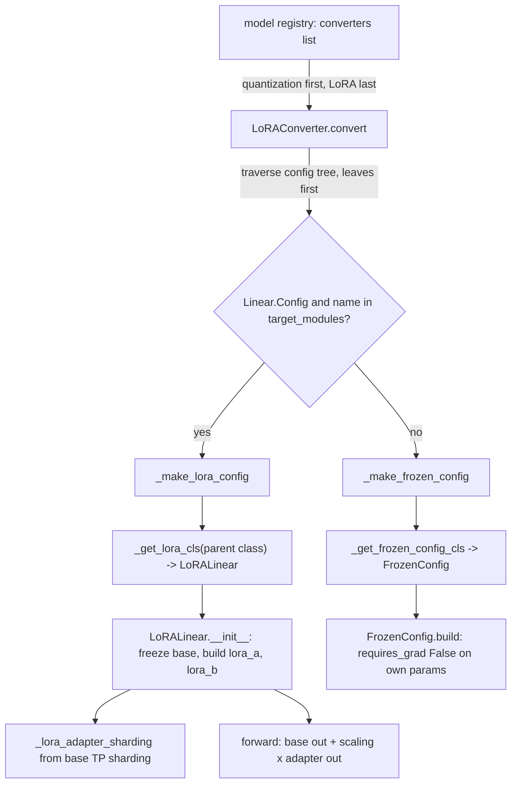

# LoRA: LoRAConverter, config-tree rewriting and frozen base weights

## Overview
TorchTitan implements LoRA as a **model config converter**, not as a module-swapping pass. A
[`LoRAConverter`](https://github.com/google-pytorch/torchtitan/blob/033f131322a8b5b026ac53d734c689d664442bf8/torchtitan/components/lora.py#L141 "torchtitan/components/lora#LoRAConverter")
is listed in the model registry's `converters` and runs over the model's config tree *before*
anything is built. Every targeted `Linear` config is replaced by the config of a generated
subclass of the layer's own class (so `Linear` becomes `LoRALinear`, a float8 linear becomes
`LoRAFloat8Linear`) that freezes the base weight and adds two small trainable linears,
[`lora_a`](https://github.com/google-pytorch/torchtitan/blob/033f131322a8b5b026ac53d734c689d664442bf8/torchtitan/components/lora.py#L87 "torchtitan/components/lora#LoRALinear.lora_a")
and [`lora_b`](https://github.com/google-pytorch/torchtitan/blob/033f131322a8b5b026ac53d734c689d664442bf8/torchtitan/components/lora.py#L96 "torchtitan/components/lora#LoRALinear.lora_b").
Every other config in the tree is replaced by a "frozen" config subclass whose `build` turns off
gradients for that module's own parameters. The model that comes out of `build()` therefore
already has the right `requires_grad` flags and adapter shardings, and the rest of the stack
(parallelization, optimizer construction, checkpointing) needs no LoRA-specific code.

## Diagram

Legend:
- `REG` - (concept) the model registry's `converters` argument; converters implement [`ModelConfigConverter`](https://github.com/google-pytorch/torchtitan/blob/033f131322a8b5b026ac53d734c689d664442bf8/torchtitan/protocols/model.py#L19 "torchtitan/protocols/model#ModelConfigConverter")
- `CONV` - [`convert`](https://github.com/google-pytorch/torchtitan/blob/033f131322a8b5b026ac53d734c689d664442bf8/torchtitan/components/lora.py#L196 "torchtitan/components/lora#LoRAConverter.convert")
- `DEC` - [`target_modules`](https://github.com/google-pytorch/torchtitan/blob/033f131322a8b5b026ac53d734c689d664442bf8/torchtitan/components/lora.py#L172 "torchtitan/components/lora#LoRAConverter.target_modules") tested against [`Config`](https://github.com/google-pytorch/torchtitan/blob/033f131322a8b5b026ac53d734c689d664442bf8/torchtitan/models/common/linear.py#L35 "torchtitan/models/common/linear#Linear.Config")
- `MLC` - [`_make_lora_config`](https://github.com/google-pytorch/torchtitan/blob/033f131322a8b5b026ac53d734c689d664442bf8/torchtitan/components/lora.py#L186 "torchtitan/components/lora#LoRAConverter._make_lora_config")
- `MFC` - [`_make_frozen_config`](https://github.com/google-pytorch/torchtitan/blob/033f131322a8b5b026ac53d734c689d664442bf8/torchtitan/components/lora.py#L135 "torchtitan/components/lora#_make_frozen_config")
- `GLC` - [`_get_lora_cls`](https://github.com/google-pytorch/torchtitan/blob/033f131322a8b5b026ac53d734c689d664442bf8/torchtitan/components/lora.py#L61 "torchtitan/components/lora#_get_lora_cls") producing [`LoRALinear`](https://github.com/google-pytorch/torchtitan/blob/033f131322a8b5b026ac53d734c689d664442bf8/torchtitan/components/lora.py#L73 "torchtitan/components/lora#_get_lora_cls.LoRALinear")
- `GFC` - [`_get_frozen_config_cls`](https://github.com/google-pytorch/torchtitan/blob/033f131322a8b5b026ac53d734c689d664442bf8/torchtitan/components/lora.py#L115 "torchtitan/components/lora#_get_frozen_config_cls") producing [`FrozenConfig`](https://github.com/google-pytorch/torchtitan/blob/033f131322a8b5b026ac53d734c689d664442bf8/torchtitan/components/lora.py#L122 "torchtitan/components/lora#_get_frozen_config_cls.FrozenConfig")
- `INIT` - [`__init__`](https://github.com/google-pytorch/torchtitan/blob/033f131322a8b5b026ac53d734c689d664442bf8/torchtitan/components/lora.py#L79 "torchtitan/components/lora#_get_lora_cls.LoRALinear.__init__")
- `SH` - [`_lora_adapter_sharding`](https://github.com/google-pytorch/torchtitan/blob/033f131322a8b5b026ac53d734c689d664442bf8/torchtitan/components/lora.py#L23 "torchtitan/components/lora#_lora_adapter_sharding")
- `FB` - [`build`](https://github.com/google-pytorch/torchtitan/blob/033f131322a8b5b026ac53d734c689d664442bf8/torchtitan/components/lora.py#L123 "torchtitan/components/lora#_get_frozen_config_cls.FrozenConfig.build")
- `FWD` - [`forward`](https://github.com/google-pytorch/torchtitan/blob/033f131322a8b5b026ac53d734c689d664442bf8/torchtitan/components/lora.py#L104 "torchtitan/components/lora#_get_lora_cls.LoRALinear.forward")

## Design rationale (why it's built this way)
- **Rewrite configs, not modules.** The class docstring: "Operates on the model config tree:
  target Linear configs are replaced with `LoRALinear.Config` (which builds a LoRA subclass with
  frozen base and trainable adapters). Non-target modules are replaced with dynamic frozen config
  subclasses that freeze direct parameters at build time." Doing it at config level means LoRA
  layers are created in the same meta-device build as the rest of the model, with their sharding
  config already attached, so FSDP/TP parallelization and weight init see a normal model.
- **Subclass the parent, whatever it is.** [`_get_lora_cls`](https://github.com/google-pytorch/torchtitan/blob/033f131322a8b5b026ac53d734c689d664442bf8/torchtitan/components/lora.py#L61 "torchtitan/components/lora#_get_lora_cls")
  builds the LoRA class from the target config's owner class, not from a fixed `Linear`, and
  caches one class per parent in [`_lora_class_cache`](https://github.com/google-pytorch/torchtitan/blob/033f131322a8b5b026ac53d734c689d664442bf8/torchtitan/components/lora.py#L57 "torchtitan/components/lora#_lora_class_cache._lora_class_cache").
  The base forward is whatever the parent does, so a float8 base linear keeps its quantized
  matmul while the adapters stay in the normal dtype. This is why quantization converters must
  run before LoRA: each model registry calls
  [`validate_converter_order`](https://github.com/google-pytorch/torchtitan/blob/033f131322a8b5b026ac53d734c689d664442bf8/torchtitan/models/utils.py#L27 "torchtitan/models/utils#validate_converter_order"), which raises `ValueError` if a quantization converter appears after LoRA. [`llama3_debugmodel_float8_emulate_lora`](https://github.com/google-pytorch/torchtitan/blob/033f131322a8b5b026ac53d734c689d664442bf8/torchtitan/models/llama3/config_registry.py#L225 "torchtitan/models/llama3/config_registry#llama3_debugmodel_float8_emulate_lora")
  is the in-tree example (float8 emulation, then LoRA on the fused `wqkv` and on `wo`).
- **Freeze by construction, and stay type-compatible.** Non-target configs are copied into a
  generated `Frozen<Name>` subclass ([`_make_frozen_config`](https://github.com/google-pytorch/torchtitan/blob/033f131322a8b5b026ac53d734c689d664442bf8/torchtitan/components/lora.py#L135 "torchtitan/components/lora#_make_frozen_config"),
  docstring: "a frozen config that still passes checks for the original type"), cached per
  class in [`_frozen_config_class_cache`](https://github.com/google-pytorch/torchtitan/blob/033f131322a8b5b026ac53d734c689d664442bf8/torchtitan/components/lora.py#L58 "torchtitan/components/lora#_frozen_config_class_cache._frozen_config_class_cache").
  Its [`build`](https://github.com/google-pytorch/torchtitan/blob/033f131322a8b5b026ac53d734c689d664442bf8/torchtitan/components/lora.py#L123 "torchtitan/components/lora#_get_frozen_config_cls.FrozenConfig.build")
  freezes only *direct* parameters (`recurse=False`); since every config in the tree is
  converted, every module freezes its own parameters, and a composite module with a LoRA child
  does not accidentally freeze the child's adapters.
- **Adapters follow the base layer's tensor-parallel sharding.** [`_lora_adapter_sharding`](https://github.com/google-pytorch/torchtitan/blob/033f131322a8b5b026ac53d734c689d664442bf8/torchtitan/components/lora.py#L23 "torchtitan/components/lora#_lora_adapter_sharding")
  mirrors the Megatron pattern. For a column-parallel base (weight sharded on dim 0), `lora_a`
  is TP-replicated and `lora_b` is sharded on its output dim like the base. For a row-parallel
  base (dim 1), `lora_a` is sharded on its input dim and `lora_b` is replicated, "producing the
  same partial-output shape as the base linear", so the base and adapter outputs are summed by
  the same reduction. A base with no weight sharding gets unsharded adapters.
- **Standard LoRA init and scaling.** `lora_a` uses Kaiming-uniform init and `lora_b` is
  zero-initialized, so the adapted model starts exactly equal to the base; the adapter output is
  scaled by [`alpha`](https://github.com/google-pytorch/torchtitan/blob/033f131322a8b5b026ac53d734c689d664442bf8/torchtitan/components/lora.py#L159 "torchtitan/components/lora#LoRAConverter.Config.alpha")
  / [`rank`](https://github.com/google-pytorch/torchtitan/blob/033f131322a8b5b026ac53d734c689d664442bf8/torchtitan/components/lora.py#L156 "torchtitan/components/lora#LoRAConverter.Config.rank")
  (defaults 16 / 8 = 2.0).

> [!inferred]
> Memory on TPU: LoRA removes the gradient and the Adam moments for every frozen weight,
> because the optimizer only collects `requires_grad` parameters (see
> [optimizer-and-lr-schedule](optimizer-and-lr-schedule.md)); with fp32 AdamW that is roughly
> 12 of the 16 bytes per frozen parameter. It does *not* shrink the base weights themselves
> (still stored and FSDP-sharded in the training dtype) and does not remove activation memory:
> backward still has to propagate through every frozen layer to reach earlier adapters, so
> activation checkpointing settings matter as much as in full fine-tuning.

## Entry points
- [`Config`](https://github.com/google-pytorch/torchtitan/blob/033f131322a8b5b026ac53d734c689d664442bf8/torchtitan/components/lora.py#L155 "torchtitan/components/lora#LoRAConverter.Config")
  is what a recipe puts in the `converters` list passed to a model registry, with
  [`rank`](https://github.com/google-pytorch/torchtitan/blob/033f131322a8b5b026ac53d734c689d664442bf8/torchtitan/components/lora.py#L156 "torchtitan/components/lora#LoRAConverter.Config.rank"),
  [`alpha`](https://github.com/google-pytorch/torchtitan/blob/033f131322a8b5b026ac53d734c689d664442bf8/torchtitan/components/lora.py#L159 "torchtitan/components/lora#LoRAConverter.Config.alpha")
  and [`target_modules`](https://github.com/google-pytorch/torchtitan/blob/033f131322a8b5b026ac53d734c689d664442bf8/torchtitan/components/lora.py#L162 "torchtitan/components/lora#LoRAConverter.Config.target_modules")
  (`None` = every `Linear`, `[]` = none).
- [`__init__`](https://github.com/google-pytorch/torchtitan/blob/033f131322a8b5b026ac53d734c689d664442bf8/torchtitan/components/lora.py#L166 "torchtitan/components/lora#LoRAConverter.__init__")
  runs when the registry builds the converter from its config; it rejects `rank <= 0` and logs
  the active rank, alpha and targets.
- [`convert`](https://github.com/google-pytorch/torchtitan/blob/033f131322a8b5b026ac53d734c689d664442bf8/torchtitan/components/lora.py#L196 "torchtitan/components/lora#LoRAConverter.convert")
  is called once by the model registry on the model config, after any quantization converter,
  and returns the (possibly new) root config that the model spec then carries.

## Mechanism (step-by-step)
1. **Traverse the config tree leaves-first.** [`convert`](https://github.com/google-pytorch/torchtitan/blob/033f131322a8b5b026ac53d734c689d664442bf8/torchtitan/components/lora.py#L196 "torchtitan/components/lora#LoRAConverter.convert")
   lists every nested module config with its FQN, parent and attribute (the traversal FQN
   "mirrors the module FQN that `build()` would produce") and walks the list in reverse, so
   children are replaced before their parents are copied. Replacement is done in place through
   `setattr` on the parent or index assignment into a list (for per-layer lists); the root, if
   replaced, is returned.
2. **Classify each config.** A config is a target when it is a
   [`Config`](https://github.com/google-pytorch/torchtitan/blob/033f131322a8b5b026ac53d734c689d664442bf8/torchtitan/models/common/linear.py#L35 "torchtitan/models/common/linear#Linear.Config")
   of [`Linear`](https://github.com/google-pytorch/torchtitan/blob/033f131322a8b5b026ac53d734c689d664442bf8/torchtitan/models/common/linear.py#L31 "torchtitan/models/common/linear#Linear")
   (including subclasses such as a float8 linear) and either no targets were given or the last
   FQN segment is in [`target_modules`](https://github.com/google-pytorch/torchtitan/blob/033f131322a8b5b026ac53d734c689d664442bf8/torchtitan/components/lora.py#L172 "torchtitan/components/lora#LoRAConverter.target_modules").
   The match is on config field names, which are not always module names. Llama 3 now builds
   attention with a fused QKV projection by default, so a single `wqkv` linear (FQN
   `attention.qkv_linear.wqkv`) is the target for Q, K and V together and gets one adapter pair
   over the concatenated output; with the unfused variant one `wkv` config builds both the `wk`
   and `wv` modules, so `"wkv"` adapts K and V. Old target lists such as `["wq", "wkv", "wo"]`
   now adapt only `wo` on a fused model, with just a warning for the unmatched names. Any requested name that matched nothing produces a warning, not an
   error.
3. **Make the LoRA config.** [`_make_lora_config`](https://github.com/google-pytorch/torchtitan/blob/033f131322a8b5b026ac53d734c689d664442bf8/torchtitan/components/lora.py#L186 "torchtitan/components/lora#LoRAConverter._make_lora_config")
   looks up the config's owner class, gets (or creates) its LoRA subclass, and instantiates that
   subclass's [`Config`](https://github.com/google-pytorch/torchtitan/blob/033f131322a8b5b026ac53d734c689d664442bf8/torchtitan/components/lora.py#L75 "torchtitan/components/lora#_get_lora_cls.LoRALinear.Config")
   with every init field of the original plus [`rank`](https://github.com/google-pytorch/torchtitan/blob/033f131322a8b5b026ac53d734c689d664442bf8/torchtitan/components/lora.py#L76 "torchtitan/components/lora#_get_lora_cls.LoRALinear.Config.rank")
   and [`alpha`](https://github.com/google-pytorch/torchtitan/blob/033f131322a8b5b026ac53d734c689d664442bf8/torchtitan/components/lora.py#L77 "torchtitan/components/lora#_get_lora_cls.LoRALinear.Config.alpha").
   Because it subclasses the original config, `isinstance` checks elsewhere in the model code
   still pass. Non-targets go through [`_make_frozen_config`](https://github.com/google-pytorch/torchtitan/blob/033f131322a8b5b026ac53d734c689d664442bf8/torchtitan/components/lora.py#L135 "torchtitan/components/lora#_make_frozen_config").
4. **Build the LoRA layer.** When the model is built,
   [`__init__`](https://github.com/google-pytorch/torchtitan/blob/033f131322a8b5b026ac53d734c689d664442bf8/torchtitan/components/lora.py#L79 "torchtitan/components/lora#_get_lora_cls.LoRALinear.__init__")
   first runs the parent constructor and freezes every parameter that exists at that point (the
   base weight and bias), stores [`_lora_scaling`](https://github.com/google-pytorch/torchtitan/blob/033f131322a8b5b026ac53d734c689d664442bf8/torchtitan/components/lora.py#L83 "torchtitan/components/lora#LoRALinear._lora_scaling")
   `= alpha / rank`, derives the adapter shardings from the base's sharding config, and only then
   builds `lora_a` (`in_features -> rank`) and `lora_b` (`rank -> out_features`) as plain,
   bias-free `Linear` layers. Because they are built after the freezing loop and from ordinary
   configs, they are the only trainable parameters in the layer.
5. **Freeze everything else at build time.** Each non-target module is built through
   [`build`](https://github.com/google-pytorch/torchtitan/blob/033f131322a8b5b026ac53d734c689d664442bf8/torchtitan/components/lora.py#L123 "torchtitan/components/lora#_get_frozen_config_cls.FrozenConfig.build"),
   which calls the original class's build and then sets `requires_grad=False` on the instance's
   direct parameters: embeddings, norms such as [`RMSNorm`](https://github.com/google-pytorch/torchtitan/blob/033f131322a8b5b026ac53d734c689d664442bf8/torchtitan/models/common/nn_modules.py#L134 "torchtitan/models/common/nn_modules#RMSNorm"),
   the routed-expert weights inside a [`MoE`](https://github.com/google-pytorch/torchtitan/blob/033f131322a8b5b026ac53d734c689d664442bf8/torchtitan/models/common/moe.py#L934 "torchtitan/models/common/moe#MoE") layer (3-D grouped parameters, not `Linear`,
   so never adapted), and non-targeted linears.
6. **Forward.** [`forward`](https://github.com/google-pytorch/torchtitan/blob/033f131322a8b5b026ac53d734c689d664442bf8/torchtitan/components/lora.py#L104 "torchtitan/components/lora#_get_lora_cls.LoRALinear.forward")
   computes the parent's output, then `lora_b(lora_a(x))`, and returns
   `base + scaling * lora`. The adapters are never merged into the base weight in this module.
7. **Downstream, nothing special.** The optimizer sees only adapter parameters
   (the optimizer container, now in the `components/optimizer/` package, filters on
   `requires_grad` and asserts every trainable parameter is assigned), and the
   [`CheckpointManager`](https://github.com/google-pytorch/torchtitan/blob/033f131322a8b5b026ac53d734c689d664442bf8/torchtitan/components/checkpointer/dcp.py#L89 "torchtitan/components/checkpointer/dcp#CheckpointManager") (now in `components/checkpointer/dcp.py`)
   saves the full model state dict, base weights and adapters alike.

## Key data structures
- [`LoRALinear`](https://github.com/google-pytorch/torchtitan/blob/033f131322a8b5b026ac53d734c689d664442bf8/torchtitan/components/lora.py#L73 "torchtitan/components/lora#_get_lora_cls.LoRALinear"):
  the generated subclass (renamed `LoRA<Parent>`), holding the frozen base parameters,
  [`lora_a`](https://github.com/google-pytorch/torchtitan/blob/033f131322a8b5b026ac53d734c689d664442bf8/torchtitan/components/lora.py#L87 "torchtitan/components/lora#LoRALinear.lora_a"),
  [`lora_b`](https://github.com/google-pytorch/torchtitan/blob/033f131322a8b5b026ac53d734c689d664442bf8/torchtitan/components/lora.py#L96 "torchtitan/components/lora#LoRALinear.lora_b")
  and [`_lora_scaling`](https://github.com/google-pytorch/torchtitan/blob/033f131322a8b5b026ac53d734c689d664442bf8/torchtitan/components/lora.py#L83 "torchtitan/components/lora#LoRALinear._lora_scaling").
  State dict keys gain `.lora_a.weight` and `.lora_b.weight` under the base layer's FQN.
- [`FrozenConfig`](https://github.com/google-pytorch/torchtitan/blob/033f131322a8b5b026ac53d734c689d664442bf8/torchtitan/components/lora.py#L122 "torchtitan/components/lora#_get_frozen_config_cls.FrozenConfig"):
  a per-class subclass of any module config, renamed `Frozen<Name>`, whose only behaviour
  change is the freezing `build`.
- The two class caches, [`_lora_class_cache`](https://github.com/google-pytorch/torchtitan/blob/033f131322a8b5b026ac53d734c689d664442bf8/torchtitan/components/lora.py#L57 "torchtitan/components/lora#_lora_class_cache._lora_class_cache")
  and [`_frozen_config_class_cache`](https://github.com/google-pytorch/torchtitan/blob/033f131322a8b5b026ac53d734c689d664442bf8/torchtitan/components/lora.py#L58 "torchtitan/components/lora#_frozen_config_class_cache._frozen_config_class_cache"):
  process-global, so repeated conversions reuse the same generated classes (the unit test checks
  `_get_lora_cls(Linear) is _get_lora_cls(Linear)`).
- The converter keeps its [`config`](https://github.com/google-pytorch/torchtitan/blob/033f131322a8b5b026ac53d734c689d664442bf8/torchtitan/components/lora.py#L169 "torchtitan/components/lora#LoRAConverter.config"),
  [`rank`](https://github.com/google-pytorch/torchtitan/blob/033f131322a8b5b026ac53d734c689d664442bf8/torchtitan/components/lora.py#L170 "torchtitan/components/lora#LoRAConverter.rank"),
  [`alpha`](https://github.com/google-pytorch/torchtitan/blob/033f131322a8b5b026ac53d734c689d664442bf8/torchtitan/components/lora.py#L171 "torchtitan/components/lora#LoRAConverter.alpha")
  and the target set.

## Dynamics (design intent)
- Conversion is a one-shot, build-time transform: there is no runtime toggle, no merge/unmerge,
  and no adapter-only mode in the training loop.
- Unit tests pin the contract: after conversion the only trainable parameters are `lora_a` and
  `lora_b`; composite modules freeze their own direct parameters while a LoRA child stays
  trainable; `rank` 0 or negative is rejected; and quantization-after-LoRA ordering raises. The
  Llama 3 build test also pins the exact adapted set on the debug model: `qkv_linear.wqkv` and
  `wo` in each of the 6 layers when targeting `["wqkv", "wo"]`.

## Edge cases
- **Default targets are every `Linear`**, including the output projection and MoE router gates
  (the shared MoE builders now use a `Linear` subclass for the gate that computes in FP32, so it
  matches and its LoRA subclass adds a bf16 adapter to an FP32 router logit). Pass
  `target_modules` to restrict it.
- **Checkpoints are full-size.** Every periodic save contains all base weights plus adapters, and
  the frozen base has no optimizer state. Resuming a LoRA run from a pre-LoRA DCP checkpoint
  would ask DCP for adapter keys the checkpoint does not have.
- **HF import works, HF export drops the adapters.** On an HF initial load the Llama 3 and
  Qwen 3 [state-dict adapters](state-dict-adapters.md) skip unknown keys, so the base weights
  load from safetensors and the adapters keep their init (`lora_b = 0`). On an HF last-step
  export the same skipping silently omits `lora_a`/`lora_b`, and since the adapters are never
  merged, the exported HF model is the unmodified base. The DeepSeek-V3 adapter indexes its map
  directly and would raise on adapter keys.
- **Misspelled targets** only warn, so a run can train with fewer adapters than intended.

## Open questions
- There is no merge-and-export path for LoRA in this module; producing an HF checkpoint with
  adapters folded in is not covered here.
- The TPU experiment configuration (`torchtitan/experiments/tpu/tpu_job_config.py`) carries a
  separate LoRA block (enable flag, rank, alpha, LoRA dtype, and an option to keep LoRA
  parameters replicated instead of FSDP-sharded) used by TPU recipes. It is a
  different mechanism from this converter and is not in this packet; how the two relate is not
  settled here.
- How FSDP wrapping treats a block that mixes frozen base parameters and trainable adapters (for
  example, whether frozen parameters still participate in gradient reduce-scatter buffers) is
  decided in the parallelization code, outside this packet.

## See also
- [Quantization](quantization.md): the float8 converters that must run before LoRA.
- [Optimizer and LR schedule](optimizer-and-lr-schedule.md): why only adapter parameters get optimizer state.
- [Checkpointing](checkpointing.md) and [State-dict adapters](state-dict-adapters.md): what gets saved, loaded from HF, and exported.
- [Tensor parallel](tensor-parallel.md): the colwise/rowwise sharding the adapters mirror.
- [Model definitions](model-definitions.md) and [Train spec and model protocol](train-spec-and-model-protocol.md): the config tree and model registry the converter rewrites.
- [Activation checkpointing](activation-checkpointing.md): still needed, since activations are not reduced by LoRA.

## Recent changes
- `lora.py` itself is unchanged since `63e334d5ba`; the upstream rebase `fa627bf2` (TorchTitan
  `d771abb0`) changed what surrounds it: Llama 3 attention now uses a fused `wqkv` projection, so
  the float8+LoRA debug recipe and unit tests target `["wqkv", "wo"]` instead of
  `["wq", "wkv", "wo"]`; the optimizer and checkpoint modules moved into the
  `components/optimizer/` and `components/checkpointer/` packages; the LoRA tests moved to
  `tests/unit_tests/cpu/`.
- `9f6ed5f1`, `67d17d26` and `c79866f6` rework the MoE aux loss and router token counting; LoRA
  still freezes the routed experts and only adapts `Linear` configs such as the gate.
- `9b288c48` removes partner model code from the tree, including its model-protocol exemption.
- [all changes in 033f131322](../changes/033f131322.md)
