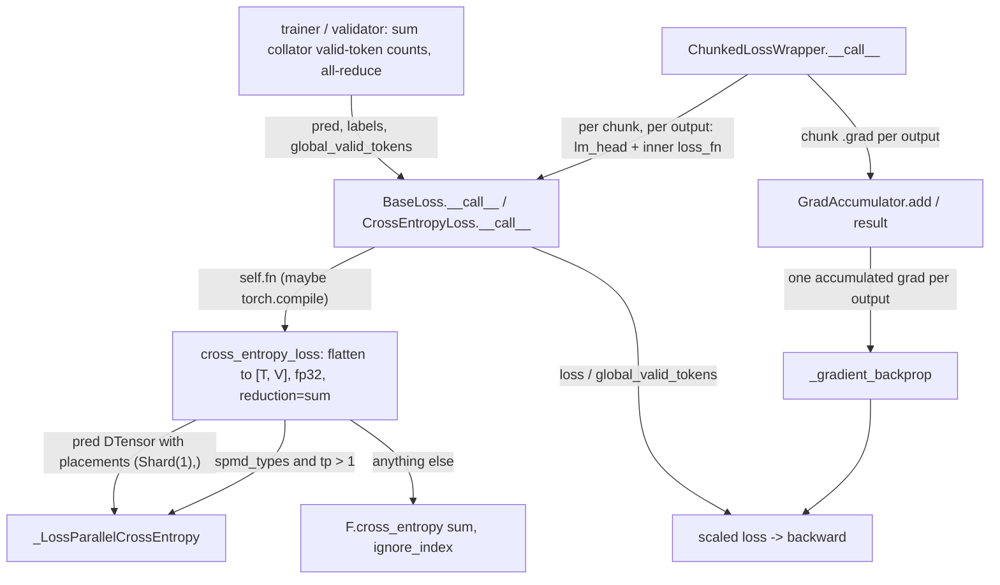

# Loss functions and validation: sum-reduced cross-entropy, loss parallel, chunked loss

## Overview
Every TorchTitan loss is a configurable callable with one contract, stated by
[`BaseLoss`](https://github.com/google-pytorch/torchtitan/blob/033f131322a8b5b026ac53d734c689d664442bf8/torchtitan/components/loss.py#L236 "torchtitan/components/loss#BaseLoss"):
`(pred, labels, global_valid_tokens) -> (scaled_loss, metrics)`. The single most important design
decision is that the per-token loss is always **summed**, never averaged, inside the loss function,
and then divided by a *global* count of non-ignored tokens that the trainer computed across all
microbatches and data-parallel ranks before the step started. That makes the gradient independent of
how the batch was split and of how many padding / prompt tokens (labelled
[`IGNORE_INDEX`](https://github.com/google-pytorch/torchtitan/blob/033f131322a8b5b026ac53d734c689d664442bf8/torchtitan/components/loss.py#L32 "torchtitan/components/loss#IGNORE_INDEX"),
-100) each rank happened to get. Since the upstream rebase the loss works on **token-major** tensors:
logits are `[T, V]` and labels `[T]` (the batch and sequence dimensions are flattened into one token
dimension), and the leaf flattens any leftover `[B, L, V]` input itself. On top of that contract sit
three mechanisms: the leaf
[`cross_entropy_loss`](https://github.com/google-pytorch/torchtitan/blob/033f131322a8b5b026ac53d734c689d664442bf8/torchtitan/components/loss.py#L37 "torchtitan/components/loss#cross_entropy_loss")
that always upcasts logits to fp32 and dispatches to a vocab-parallel variant when the logits are
sharded on the vocabulary dimension; the explicit autograd function
[`_LossParallelCrossEntropy`](https://github.com/google-pytorch/torchtitan/blob/033f131322a8b5b026ac53d734c689d664442bf8/torchtitan/components/loss.py#L74 "torchtitan/components/loss#_LossParallelCrossEntropy")
that computes an exact softmax over TP vocab shards with three all-reduces; and the
[`ChunkedLossWrapper`](https://github.com/google-pytorch/torchtitan/blob/033f131322a8b5b026ac53d734c689d664442bf8/torchtitan/components/loss.py#L515 "torchtitan/components/loss#ChunkedLossWrapper"),
which takes the LM head out of the model and runs head + loss one token chunk at a time so the full
`[T, V]` logits tensor never exists. Validation reuses the same loss objects in no-grad mode.

## Diagram

Legend:
- `TR` - (concept) the trainer's `train_step` and the validator; see [training-loop](training-loop.md)
- `BC` - [`__call__`](https://github.com/google-pytorch/torchtitan/blob/033f131322a8b5b026ac53d734c689d664442bf8/torchtitan/components/loss.py#L264 "torchtitan/components/loss#BaseLoss.__call__") of `BaseLoss`, overridden by [`__call__`](https://github.com/google-pytorch/torchtitan/blob/033f131322a8b5b026ac53d734c689d664442bf8/torchtitan/components/loss.py#L300 "torchtitan/components/loss#CrossEntropyLoss.__call__") of `CrossEntropyLoss`
- `CEL` - [`cross_entropy_loss`](https://github.com/google-pytorch/torchtitan/blob/033f131322a8b5b026ac53d734c689d664442bf8/torchtitan/components/loss.py#L37 "torchtitan/components/loss#cross_entropy_loss")
- `LP` - [`_LossParallelCrossEntropy`](https://github.com/google-pytorch/torchtitan/blob/033f131322a8b5b026ac53d734c689d664442bf8/torchtitan/components/loss.py#L74 "torchtitan/components/loss#_LossParallelCrossEntropy")
- `FCE` - (concept) plain `torch.nn.functional.cross_entropy`
- `OUT` - (concept) the scalar the trainer calls `.backward()` on
- `CW` - [`__call__`](https://github.com/google-pytorch/torchtitan/blob/033f131322a8b5b026ac53d734c689d664442bf8/torchtitan/components/loss.py#L581 "torchtitan/components/loss#ChunkedLossWrapper.__call__") of `ChunkedLossWrapper`
- `GA` - [`add`](https://github.com/google-pytorch/torchtitan/blob/033f131322a8b5b026ac53d734c689d664442bf8/torchtitan/components/loss.py#L448 "torchtitan/components/loss#GradAccumulator.add") and [`result`](https://github.com/google-pytorch/torchtitan/blob/033f131322a8b5b026ac53d734c689d664442bf8/torchtitan/components/loss.py#L491 "torchtitan/components/loss#GradAccumulator.result")
- `GB` - [`_gradient_backprop`](https://github.com/google-pytorch/torchtitan/blob/033f131322a8b5b026ac53d734c689d664442bf8/torchtitan/components/loss.py#L806 "torchtitan/components/loss#ChunkedLossWrapper._gradient_backprop")

## Design rationale (why it's built this way)
- **Sum, then divide by a global token count.** The docstring of
  [`CrossEntropyLoss`](https://github.com/google-pytorch/torchtitan/blob/033f131322a8b5b026ac53d734c689d664442bf8/torchtitan/components/loss.py#L287 "torchtitan/components/loss#CrossEntropyLoss")
  says it outright: "Cross-entropy loss with sum reduction for token-based normalization." A mean
  reduction inside each microbatch would weight a microbatch with 10 valid tokens the same as one with
  8000; summing and dividing by `global_valid_tokens` makes every valid token in the global batch count
  exactly once, so gradient accumulation, DP degree and SFT prompt masking do not change the effective
  objective. The trainer then gets the global average loss for logging by a plain sum across ranks.
- **fp32 at the softmax, whatever the model dtype.** Every path upcasts: `cross_entropy_loss` calls
  `.float()` on the `[T, V]` logits in each of its branches (on the local shard for the loss-parallel
  ones),
  [`forward`](https://github.com/google-pytorch/torchtitan/blob/033f131322a8b5b026ac53d734c689d664442bf8/torchtitan/components/loss.py#L112 "torchtitan/components/loss#_LossParallelCrossEntropy.forward")
  of the loss-parallel function upcasts again before the max/sum-exp and remembers the input dtype, and
  [`compute_logprobs`](https://github.com/google-pytorch/torchtitan/blob/033f131322a8b5b026ac53d734c689d664442bf8/torchtitan/components/loss.py#L334 "torchtitan/components/loss#compute_logprobs")
  does a "single bf16->fp32 upcast" shared by logprobs and entropy. The gradient is cast back to the
  logits dtype on the way out, so the model stays bf16 while the log-sum-exp over a 128K-256K vocabulary
  is done in fp32. On TPU this matters twice: bf16 logits are the norm (the MXU produces bf16/fp32), and
  the fp32 `[T, V]` copy is the largest transient tensor of the step, which is exactly what the
  chunked and fused losses exist to avoid.
- **Loss parallel as an explicit autograd function, not a context manager.** The docstring of
  [`_LossParallelCrossEntropy`](https://github.com/google-pytorch/torchtitan/blob/033f131322a8b5b026ac53d734c689d664442bf8/torchtitan/components/loss.py#L74 "torchtitan/components/loss#_LossParallelCrossEntropy")
  explains it "replaces `torch.distributed.tensor.parallel.loss_parallel()` with an explicit autograd
  Function so that SPMD code can operate on local tensors and process groups directly". The forward uses
  three TP all-reduces (max, sum of exp, gathered target log-prob) on `[T, 1]`-shaped tensors, never on
  the vocabulary; the backward is "fused (NLL + log-softmax) with zero collectives", because each rank
  only needs `softmax - onehot` on its own vocab slice. It also supports uneven vocab sharding (last rank
  holds fewer classes), which is what a 128256- or 151936-entry vocabulary needs on a TP degree that
  does not divide it.
- **Chunking trades peak memory for a Python loop.** [`ChunkedLossWrapper`](https://github.com/google-pytorch/torchtitan/blob/033f131322a8b5b026ac53d734c689d664442bf8/torchtitan/components/loss.py#L515 "torchtitan/components/loss#ChunkedLossWrapper")
  documents the trade: peak memory goes "from O(T*V) to O(T/N*V)". It keeps the LM-head weight
  unsharded across all outputs and chunks (FSDP reshard disabled) so it pays one all-gather, not N, and
  keeps gradient sync off until the final chunk "so one reduce-scatter processes the accumulated
  lm_head parameter gradients".
- **Losses are Configurable leaves with an optional compile.** [`_maybe_compile`](https://github.com/google-pytorch/torchtitan/blob/033f131322a8b5b026ac53d734c689d664442bf8/torchtitan/components/loss.py#L255 "torchtitan/components/loss#BaseLoss._maybe_compile")
  wraps `self.fn` in `torch.compile` only when `"loss"` is listed in the compile components, so the
  loss can be compiled independently of the model (the chunked wrapper compiles only its inner loss,
  never the LM head).

> [!inferred]
> On the TPU lane the production recipes do not use either of the upstream memory strategies. The
> TPU Llama 3 recipes such as [`llama3_70b`](https://github.com/google-pytorch/torchtitan/blob/033f131322a8b5b026ac53d734c689d664442bf8/torchtitan/experiments/tpu/llama3/config_registry.py#L244 "torchtitan/experiments/tpu/llama3/config_registry#llama3_70b")
> and [`sft_llama3_8b_metamath`](https://github.com/google-pytorch/torchtitan/blob/033f131322a8b5b026ac53d734c689d664442bf8/torchtitan/experiments/tpu/llama3/config_registry.py#L376 "torchtitan/experiments/tpu/llama3/config_registry#sft_llama3_8b_metamath")
> start from a plain `CrossEntropyLoss.Config()` and then switch to a TPU-only fused Pallas
> linear-softmax-cross-entropy loss (in `torchtitan/experiments/tpu/loss.py`) plus an LM-head override
> that hands the loss `(hidden, lm_head.weight^T)` instead of logits, so the projection, softmax and
> CE run in one kernel and logits are never written to HBM. That kernel keeps a fixed token count: it
> zeroes hidden states of `IGNORE_INDEX` rows, gives them label 0, and subtracts the resulting
> `log(V)` per ignored row, so the sum-then-divide contract is preserved. Its Mosaic implementation
> requires the token count to be a multiple of its batch tile (1024 by default) and refuses to fall
> back silently. The fused loss now also takes `soft_cap` / `output_multiplier`, re-applying a
> soft-capped LM head's logit transform (Muse Glimmer's `SoftCappedLinear`) inside the kernel, since
> the override hands over only the raw weight; zeroed ignored rows still produce all-zero logits under
> the transform. The TPU graph trainer rejects `ChunkedLossWrapper` outright because "FX unrolls its
> loop and defeats bounded-memory execution". Smaller recipes such as
> [`reg_trainer_qwen3_8b`](https://github.com/google-pytorch/torchtitan/blob/033f131322a8b5b026ac53d734c689d664442bf8/torchtitan/experiments/tpu/qwen3/config_registry.py#L289 "torchtitan/experiments/tpu/qwen3/config_registry#reg_trainer_qwen3_8b")
> and [`qwen3_1_7b`](https://github.com/google-pytorch/torchtitan/blob/033f131322a8b5b026ac53d734c689d664442bf8/torchtitan/experiments/tpu/qwen3/config_registry.py#L215 "torchtitan/experiments/tpu/qwen3/config_registry#qwen3_1_7b")
> keep plain `CrossEntropyLoss`, while upstream GPU recipes such as
> [`llama3_debugmodel`](https://github.com/google-pytorch/torchtitan/blob/033f131322a8b5b026ac53d734c689d664442bf8/torchtitan/models/llama3/config_registry.py#L63 "torchtitan/models/llama3/config_registry#llama3_debugmodel")
> default to `ChunkedLossWrapper` around a `CrossEntropyLoss` that carries `global_vocab_size`.

## Entry points
- [`CrossEntropyLoss`](https://github.com/google-pytorch/torchtitan/blob/033f131322a8b5b026ac53d734c689d664442bf8/torchtitan/components/loss.py#L287 "torchtitan/components/loss#CrossEntropyLoss")
  is what almost every recipe builds from its [`Config`](https://github.com/google-pytorch/torchtitan/blob/033f131322a8b5b026ac53d734c689d664442bf8/torchtitan/components/loss.py#L291 "torchtitan/components/loss#CrossEntropyLoss.Config");
  the trainer calls it once per microbatch (or the pipeline schedule calls it on the last stage) with
  the model output, the labels and `global_valid_tokens`. Its only knob,
  [`global_vocab_size`](https://github.com/google-pytorch/torchtitan/blob/033f131322a8b5b026ac53d734c689d664442bf8/torchtitan/components/loss.py#L292 "torchtitan/components/loss#CrossEntropyLoss.Config.global_vocab_size"),
  is "needed for spmd_types loss-parallel CE", because under that backend the logits arrive as a plain
  local shard with no record of the full vocabulary width.
- [`ChunkedLossWrapper`](https://github.com/google-pytorch/torchtitan/blob/033f131322a8b5b026ac53d734c689d664442bf8/torchtitan/components/loss.py#L515 "torchtitan/components/loss#ChunkedLossWrapper")
  is selected by config with [`num_chunks`](https://github.com/google-pytorch/torchtitan/blob/033f131322a8b5b026ac53d734c689d664442bf8/torchtitan/components/loss.py#L561 "torchtitan/components/loss#ChunkedLossWrapper.Config.num_chunks")
  (default 8) and an inner [`loss_fn`](https://github.com/google-pytorch/torchtitan/blob/033f131322a8b5b026ac53d734c689d664442bf8/torchtitan/components/loss.py#L564 "torchtitan/components/loss#ChunkedLossWrapper.Config.loss_fn")
  (default `CrossEntropyLoss`). The trainer must call [`set_lm_head`](https://github.com/google-pytorch/torchtitan/blob/033f131322a8b5b026ac53d734c689d664442bf8/torchtitan/components/loss.py#L577 "torchtitan/components/loss#ChunkedLossWrapper.set_lm_head")
  and set the model's skip-LM-head flag before the first step, so the model returns hidden states.
  `pred` may be one hidden-state tensor or an aligned tuple of them (one labels tensor per prediction),
  all projected by the same LM head; the inner loss then receives a tuple of logits.
- [`MSELoss`](https://github.com/google-pytorch/torchtitan/blob/033f131322a8b5b026ac53d734c689d664442bf8/torchtitan/components/loss.py#L322 "torchtitan/components/loss#MSELoss")
  is the leaf used by diffusion training ("e.g. Flux"): same sum reduction, both operands upcast to fp32,
  labels detached.
- [`compute_logprobs`](https://github.com/google-pytorch/torchtitan/blob/033f131322a8b5b026ac53d734c689d664442bf8/torchtitan/components/loss.py#L334 "torchtitan/components/loss#compute_logprobs")
  is the RL entry point: per-token log-probabilities `[T]` (and optional entropy under `no_grad`) from
  `logits[T, V]` and `labels[T]`, with all vocab-gather logic for DTensor and `spmd_types` centralized in
  one place.

## Mechanism (step-by-step)
1. **The trainer fixes the denominator first.** The collator already counts `labels != IGNORE_INDEX`
   per batch and ships it as `num_valid_tokens`; before any forward, the step pops and sums those counts
   over its gradient-accumulation microbatches and all-reduces the sum over the batch mesh, keeping it
   an on-device tensor. That tensor is passed into every loss call.
   [`__call__`](https://github.com/google-pytorch/torchtitan/blob/033f131322a8b5b026ac53d734c689d664442bf8/torchtitan/components/loss.py#L264 "torchtitan/components/loss#BaseLoss.__call__")
   of `BaseLoss` runs `self.fn(pred, labels)`, drops any extra keyword arguments, and divides by it.
   Under the `spmd_types` backend it first asserts the raw loss is Partial over `dp` and `cp` and that
   `global_valid_tokens` is Replicate over `dp`/`cp` and Invariant over `tp`, which is the typed form of
   "each rank holds a partial sum, and every rank divides by the same global count".
   `CrossEntropyLoss` overrides `__call__` only to forward its `global_vocab_size` into the leaf function.
2. **The leaf flattens, then dispatches on how the logits are sharded.**
   [`cross_entropy_loss`](https://github.com/google-pytorch/torchtitan/blob/033f131322a8b5b026ac53d734c689d664442bf8/torchtitan/components/loss.py#L37 "torchtitan/components/loss#cross_entropy_loss")
   first flattens `pred` to `[T, V]` and labels to `[T]` if they still carry batch dimensions. If pred is
   a DTensor (only allowed under the default `partial_dtensor` backend, which it asserts) whose placements
   are exactly `(Shard(1),)`, i.e. vocab-sharded on a TP-only mesh, it calls the loss-parallel function on
   the local shard with the TP process group and the global vocab size read from the DTensor shape. Under
   `spmd_types` with a TP mesh larger than 1 it does the same with the configured `global_vocab_size`.
   Everything else falls through to `F.cross_entropy(..., reduction="sum", ignore_index=IGNORE_INDEX)` on
   fp32 logits.
3. **Loss-parallel forward: exact softmax from vocab shards.**
   [`forward`](https://github.com/google-pytorch/torchtitan/blob/033f131322a8b5b026ac53d734c689d664442bf8/torchtitan/components/loss.py#L112 "torchtitan/components/loss#_LossParallelCrossEntropy.forward")
   computes this rank's `[vocab_start, vocab_end)` from `ceil(V / tp)` and raises if the local width
   disagrees or is empty. It enqueues an asynchronous device assert that every label is `IGNORE_INDEX` or
   in `[0, V)`. It all-reduces the row max (MAX), subtracts it, all-reduces the sum of exp (SUM), forms
   local log-probs, then gathers each target's log-prob on the one rank that owns that token id (other
   ranks contribute 0) and all-reduces again (SUM). Ignored labels are mapped to a safe index and zeroed.
   It saves only the local log-probs and labels for backward and returns either the scalar sum (SFT) or,
   with `reduction="none"`, the per-token NLL `[T]` that GRPO negates into log-probs without
   all-gathering the vocabulary. Its `spmd_types` check is: logits `S(-1)` at TP, labels `I` at TP,
   result typed like the logits but `I` at TP.
4. **Loss-parallel backward: no collectives.**
   [`backward`](https://github.com/google-pytorch/torchtitan/blob/033f131322a8b5b026ac53d734c689d664442bf8/torchtitan/components/loss.py#L199 "torchtitan/components/loss#_LossParallelCrossEntropy.backward")
   rebuilds the local one-hot (only on the owning rank), computes `(exp(log_probs) - onehot) *
   grad_output` (unsqueezing a per-token `grad_output` to `[T, 1]`), masks ignored rows and casts back to
   the logits dtype. The gradient of a softmax over a sharded vocabulary is local once the forward has put
   the global normalizer into `log_probs`, which is why the backward is communication-free.
5. **Chunked loss: split the token dimension on the local view.**
   [`__call__`](https://github.com/google-pytorch/torchtitan/blob/033f131322a8b5b026ac53d734c689d664442bf8/torchtitan/components/loss.py#L581 "torchtitan/components/loss#ChunkedLossWrapper.__call__")
   receives hidden states `[T, D]` (or a tuple of them) instead of logits, normalizes a single tensor into
   a one-element tuple, and requires every prediction to agree on `requires_grad`.
   [`_chunk`](https://github.com/google-pytorch/torchtitan/blob/033f131322a8b5b026ac53d734c689d664442bf8/torchtitan/components/loss.py#L649 "torchtitan/components/loss#ChunkedLossWrapper._chunk")
   runs [`_chunk_local`](https://github.com/google-pytorch/torchtitan/blob/033f131322a8b5b026ac53d734c689d664442bf8/torchtitan/components/loss.py#L638 "torchtitan/components/loss#ChunkedLossWrapper._chunk_local")
   under `local_map` when the input is a DTensor, because chunking a `Shard(0)` global view would hand
   whole chunks to single ranks and leave others with zero-length chunks. Each chunk is detached and
   re-marked `requires_grad` so it becomes a leaf that collects its own `.grad`; labels and any extra
   per-token loss inputs are chunked the same way.
6. **Chunked loss: head + loss + backward per chunk.** If the LM head is an FSDP module, reshard after
   forward/backward and gradient sync are disabled and the head is explicitly unsharded while FSDP is idle
   (an implicit unshard would leave an all-gather event in FSDP's shared state that CUDA graph capture
   cannot wait on). Gradient sync is re-enabled only for the last chunk; after the loop both reshard flags
   are restored and the head is explicitly resharded. Each chunk runs `lm_head` on that chunk of every
   output, the inner
   [`loss_fn`](https://github.com/google-pytorch/torchtitan/blob/033f131322a8b5b026ac53d734c689d664442bf8/torchtitan/components/loss.py#L574 "torchtitan/components/loss#ChunkedLossWrapper.loss_fn")
   (already divided by `global_valid_tokens`), accumulates the detached value, and in training
   immediately calls `chunk_loss.backward()`, which fills the LM-head weight gradient and each output's
   chunk gradient. [`add`](https://github.com/google-pytorch/torchtitan/blob/033f131322a8b5b026ac53d734c689d664442bf8/torchtitan/components/loss.py#L448 "torchtitan/components/loss#GradAccumulator.add")
   copies each chunk gradient into its output's preallocated fp32 buffer slice;
   [`result`](https://github.com/google-pytorch/torchtitan/blob/033f131322a8b5b026ac53d734c689d664442bf8/torchtitan/components/loss.py#L491 "torchtitan/components/loss#GradAccumulator.result")
   rewraps it as a DTensor with the placement of the first chunk (for a colwise-parallel head that is
   `Partial(sum)` on TP, so the reduction happens once, later, not per chunk).
7. **Chunked loss: reconnect to the decoder graph.**
   [`_gradient_backprop`](https://github.com/google-pytorch/torchtitan/blob/033f131322a8b5b026ac53d734c689d664442bf8/torchtitan/components/loss.py#L806 "torchtitan/components/loss#ChunkedLossWrapper._gradient_backprop")
   returns "a differentiable loss via _DecoderOutputGradientBackProp": a detached total loss whose
   backward simply returns "each accumulated gradient for its corresponding hidden state". When the
   trainer (or pipeline schedule) calls `.backward()` on it, autograd continues through the decoder in a
   single pass. In validation (`requires_grad` false) the loop skips all backward work and returns the
   summed loss directly.

> [!inferred]
> Validation follows the same contract with a separate loop. The validator (in
> `torchtitan/components/validate.py`) runs under `torch.no_grad()` and `model.eval()`, builds a fresh
> dataloader per validation pass (default: the Grain loader with concat-then-split packing over
> `c4_validation`, `repeat=False` unless `steps` is set) and closes it when the pass ends. Per step it
> takes one batch (or `num_pp_microbatches` batches under PP), pops each batch's collator-computed
> `num_valid_tokens`, all-reduces the count over the batch mesh, lets the model's own input preprocessing
> build masks and CP/DTensor inputs, and calls `loss_fn(predictions, labels)` *without*
> `global_valid_tokens` so it gets the raw sum. It accumulates loss sums and global token counts across
> steps, sums the loss over the loss mesh, and divides once: one global token count for the whole
> validation pass, not a per-batch average. The trainer calls it after the checkpoint save on steps
> selected by the validator's `freq`, which must now be positive.

## Key data structures
- [`Config`](https://github.com/google-pytorch/torchtitan/blob/033f131322a8b5b026ac53d734c689d664442bf8/torchtitan/components/loss.py#L248 "torchtitan/components/loss#BaseLoss.Config")
  of `BaseLoss` is empty; each loss adds only what it needs.
  [`Config`](https://github.com/google-pytorch/torchtitan/blob/033f131322a8b5b026ac53d734c689d664442bf8/torchtitan/components/loss.py#L560 "torchtitan/components/loss#ChunkedLossWrapper.Config")
  of the chunked wrapper nests another loss config, so a chunked loss is a config tree, and
  [`Config`](https://github.com/google-pytorch/torchtitan/blob/033f131322a8b5b026ac53d734c689d664442bf8/torchtitan/components/loss.py#L326 "torchtitan/components/loss#MSELoss.Config")
  of `MSELoss` has no fields at all. All derive from [`Configurable`](https://github.com/google-pytorch/torchtitan/blob/033f131322a8b5b026ac53d734c689d664442bf8/torchtitan/config/configurable.py#L18 "torchtitan/config/configurable#Configurable"),
  which is how `config.loss.build(compile_config=...)` works.
- [`fn`](https://github.com/google-pytorch/torchtitan/blob/033f131322a8b5b026ac53d734c689d664442bf8/torchtitan/components/loss.py#L245 "torchtitan/components/loss#BaseLoss.fn")
  (typed as [`LossFunction`](https://github.com/google-pytorch/torchtitan/blob/033f131322a8b5b026ac53d734c689d664442bf8/torchtitan/components/loss.py#L34 "torchtitan/components/loss#LossFunction.LossFunction"))
  is the possibly-compiled leaf; [`fn`](https://github.com/google-pytorch/torchtitan/blob/033f131322a8b5b026ac53d734c689d664442bf8/torchtitan/components/loss.py#L296 "torchtitan/components/loss#CrossEntropyLoss.fn")
  on `CrossEntropyLoss` is `cross_entropy_loss` and [`global_vocab_size`](https://github.com/google-pytorch/torchtitan/blob/033f131322a8b5b026ac53d734c689d664442bf8/torchtitan/components/loss.py#L298 "torchtitan/components/loss#CrossEntropyLoss.global_vocab_size")
  is stored alongside it by [`__init__`](https://github.com/google-pytorch/torchtitan/blob/033f131322a8b5b026ac53d734c689d664442bf8/torchtitan/components/loss.py#L295 "torchtitan/components/loss#CrossEntropyLoss.__init__").
- The chunked wrapper's runtime state is [`num_chunks`](https://github.com/google-pytorch/torchtitan/blob/033f131322a8b5b026ac53d734c689d664442bf8/torchtitan/components/loss.py#L573 "torchtitan/components/loss#ChunkedLossWrapper.num_chunks"),
  the built inner [`loss_fn`](https://github.com/google-pytorch/torchtitan/blob/033f131322a8b5b026ac53d734c689d664442bf8/torchtitan/components/loss.py#L574 "torchtitan/components/loss#ChunkedLossWrapper.loss_fn")
  and a borrowed [`lm_head`](https://github.com/google-pytorch/torchtitan/blob/033f131322a8b5b026ac53d734c689d664442bf8/torchtitan/components/loss.py#L575 "torchtitan/components/loss#ChunkedLossWrapper.lm_head")
  module, all set in [`__init__`](https://github.com/google-pytorch/torchtitan/blob/033f131322a8b5b026ac53d734c689d664442bf8/torchtitan/components/loss.py#L567 "torchtitan/components/loss#ChunkedLossWrapper.__init__")
  (the head is `None` until injected).
- The wrapper builds one gradient accumulator per output. Each holds a preallocated
  [`_buffer`](https://github.com/google-pytorch/torchtitan/blob/033f131322a8b5b026ac53d734c689d664442bf8/torchtitan/components/loss.py#L446 "torchtitan/components/loss#GradAccumulator._buffer")
  shaped like the local hidden states, the split dimension
  [`seq_dim`](https://github.com/google-pytorch/torchtitan/blob/033f131322a8b5b026ac53d734c689d664442bf8/torchtitan/components/loss.py#L434 "torchtitan/components/loss#GradAccumulator.seq_dim")
  (now 0, the token dimension), a write cursor [`_next_idx`](https://github.com/google-pytorch/torchtitan/blob/033f131322a8b5b026ac53d734c689d664442bf8/torchtitan/components/loss.py#L435 "torchtitan/components/loss#GradAccumulator._next_idx"),
  and, only when chunks are DTensors, the [`_device_mesh`](https://github.com/google-pytorch/torchtitan/blob/033f131322a8b5b026ac53d734c689d664442bf8/torchtitan/components/loss.py#L436 "torchtitan/components/loss#GradAccumulator._device_mesh")
  and first-chunk [`_placements`](https://github.com/google-pytorch/torchtitan/blob/033f131322a8b5b026ac53d734c689d664442bf8/torchtitan/components/loss.py#L438 "torchtitan/components/loss#GradAccumulator._placements")
  used to relabel the result.

## Dynamics (design intent)
- **Ordering inside a step.** Because the chunked wrapper calls `backward()` per chunk *inside* the loss
  call, the LM-head weight gradient is complete before the decoder backward has started; the decoder
  backward only begins when the trainer calls `.backward()` on the returned loss. The graph-trainer
  tests (`test_seq_chunk_marker_traces_chunked_loss_backward`,
  `test_last_stage_chunked_loss_preserves_hidden_grad_accumulator`) pin this chunk structure and its
  pipeline-stage behavior, and `test_multi_output_matches_base_wrapper` checks the tuple-of-outputs path
  against a wrapper that computes the same gradients with one `autograd.grad`.
- **Communication volume.** Loss parallel adds three all-reduces of `[T, 1]` per forward and none
  per backward; chunking adds one LM-head all-gather per step (not per chunk or per output) and one
  reduce-scatter on the last chunk.
- **Bitwise parity.** RL tests (`_flex_prefill_logprobs`, `_varlen_prefill_logprobs`) use
  [`compute_logprobs`](https://github.com/google-pytorch/torchtitan/blob/033f131322a8b5b026ac53d734c689d664442bf8/torchtitan/components/loss.py#L334 "torchtitan/components/loss#compute_logprobs")
  with `IGNORE_INDEX` to compare trainer and generator log-probs bit for bit, and
  `test_bitwise_equal_with_chunked_loss` checks the chunked path against the unchunked one; the TPU
  test `test_fused_loss_matches_unfused_cross_entropy` does the same for the fused Pallas loss against
  [`cross_entropy_loss`](https://github.com/google-pytorch/torchtitan/blob/033f131322a8b5b026ac53d734c689d664442bf8/torchtitan/components/loss.py#L37 "torchtitan/components/loss#cross_entropy_loss").

## Edge cases
- **Token count must divide by `num_chunks`.** `_chunk_local` uses `torch._check(seq_len %
  num_chunks == 0)` on dimension 0 of the local `[T, D]` view; with context parallelism the check is on
  the *local* (already CP-split) length.
- **`global_vocab_size` is silently needed under `spmd_types`.** With that backend and TP > 1 the leaf
  passes the configured value straight into the loss-parallel function; a `CrossEntropyLoss.Config()`
  without it (as in the TPU recipes, which use the default `partial_dtensor` backend) would hand `None`
  to the shard-bounds arithmetic.
- **Only a pure `(Shard(1),)` DTensor takes the loss-parallel path.** A vocab-sharded DTensor on a
  multi-axis mesh does not match and falls through to the plain `F.cross_entropy` call, leaving it
  to DTensor dispatch; the old
  `local_map` route that derived per-axis placements is gone, and the `full_dtensor` backend it served
  no longer exists.
- **Empty vocab shards are rejected.** If `tp` is so large relative to `V` that the last rank's shard
  is empty, the forward raises rather than producing a wrong normalizer. Out-of-range labels trip the
  asynchronous device assert, which surfaces at a later sync point, not at the call.
- **Multi-output inputs must line up.** A tensor `pred` needs tensor labels; tuples must be non-empty
  and the same length, and all predictions must agree on `requires_grad`; anything else raises.
- **Mixed DTensor / plain chunk gradients raise.** The accumulator refuses a plain tensor after a
  DTensor chunk (it "would silently drop the implied reduction") and refuses mismatched placements.
- **Chunked metrics need a reducible name.** [`_combine_chunk_metrics`](https://github.com/google-pytorch/torchtitan/blob/033f131322a8b5b026ac53d734c689d664442bf8/torchtitan/components/loss.py#L778 "torchtitan/components/loss#ChunkedLossWrapper._combine_chunk_metrics")
  requires chunk metrics to end in `/mean`, `/frac`, `_mean`, `_frac`, `/max` or `/min`; anything else
  raises, since the wrapper cannot know how to combine it.
- **The chunked backward assumes nothing touches the loss afterwards.** A comment in the bridging
  autograd function warns that running tensor ops on the returned loss would produce a non-trivial
  `grad_output` it ignores.
- **Validation `steps=-1` needs DP degree 1.** The validator docstring says consuming the finite
  dataset "requires an effective data-parallel degree of one" (ranks with fewer samples would leave the
  loop while others wait in a collective); the runtime warning the old code logged is gone.

## Open questions
- The TPU fused loss class, its LM-head override and the validator are not in this page's symbol
  subgraph, so their mechanics above are stated from source reading rather than cited; a dedicated page
  for the TPU loss kernel would be the natural home.
- `_DecoderOutputGradientBackProp` and `mse_loss` are not in the subgraph either; the page describes
  them through [`_gradient_backprop`](https://github.com/google-pytorch/torchtitan/blob/033f131322a8b5b026ac53d734c689d664442bf8/torchtitan/components/loss.py#L806 "torchtitan/components/loss#ChunkedLossWrapper._gradient_backprop")
  and [`MSELoss`](https://github.com/google-pytorch/torchtitan/blob/033f131322a8b5b026ac53d734c689d664442bf8/torchtitan/components/loss.py#L322 "torchtitan/components/loss#MSELoss").
- Which model produces tuple outputs for the multi-output chunked path is not visible in this subsystem;
  the only caller in the evidence is a unit test with a two-output fake decoder.
- Whether XLA fuses the fp32 upcast of `[T, V]` logits into the log-softmax on TPU (avoiding a
  materialized fp32 copy) for the plain `CrossEntropyLoss` path is not settled by the source.

## See also
- [Training loop](training-loop.md) - where `global_valid_tokens` is computed and the loss is reduced for logging
- [Tensor parallel](tensor-parallel.md) - the vocab sharding of the LM head that loss parallel consumes
- [DTensor and sharding types](dtensor-and-sharding-types.md) - Partial / Replicate / Shard and the `spmd_types` backend
- [FSDP sharding](fsdp-sharding.md) - the reshard and gradient-sync hooks the chunked loss toggles
- [Pipeline parallel](pipeline-parallel.md) - the last stage calls the loss with `loss_kwargs`
- [torch.compile integration](torch-compile-integration.md) - compiling the loss as its own component
- [Dataloading and tokenizer](dataloading-and-tokenizer.md) - where `IGNORE_INDEX` labels and `num_valid_tokens` come from
- [TorchTPU backend](torchtpu-backend.md) - the TPU lane that swaps in the fused Pallas loss

## Recent changes
- `fa627bf2` rebases onto upstream `d771abb0`, which flattens `[B, S]` to `[T]`: the loss now takes `[T, V]` logits and `[T]` labels, `global_valid_tokens` is an on-device tensor fed by the collator's `num_valid_tokens`, the `full_dtensor` local-map CE route is removed, `ChunkedLossWrapper` splits the token dimension and accepts tuples of outputs, and validation divides by one global token count.
- `9f6ed5f1` restores the global-batch MoE load-balance aux loss and routing metrics after the rebase, porting `MoELoadBalanceAuxLoss` to upstream's `router.aux_loss` interface (upstream's aux loss takes the step's global valid-token count as its denominator, the same one the main loss divides by).
- `58c3e9b6` adds a float8 Llama3 70B TPU recipe and `3d57bb2c` makes its converter import lazy; the Llama3 TPU recipes keep the fused Pallas loss.
- [all changes in 033f131322](../changes/033f131322.md)
