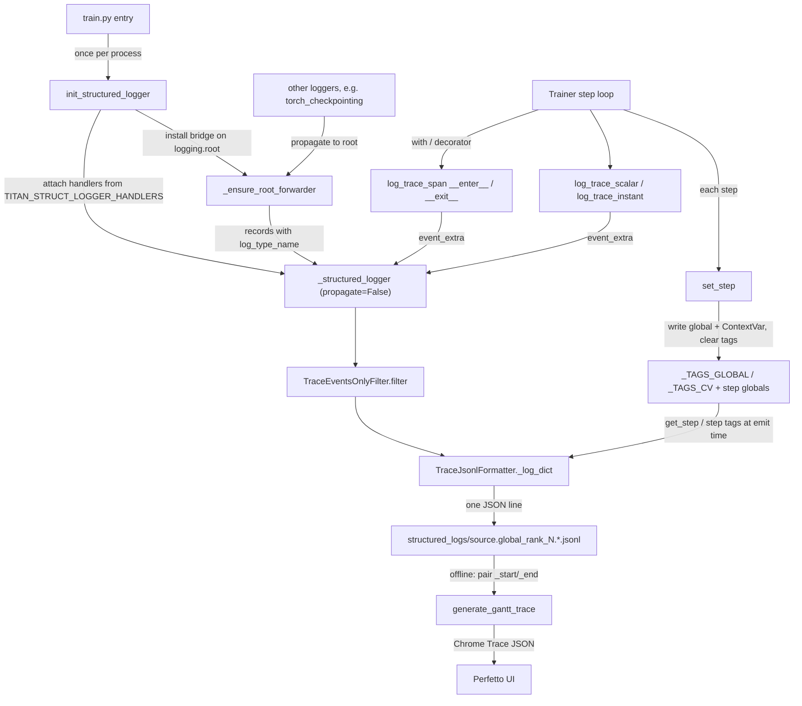
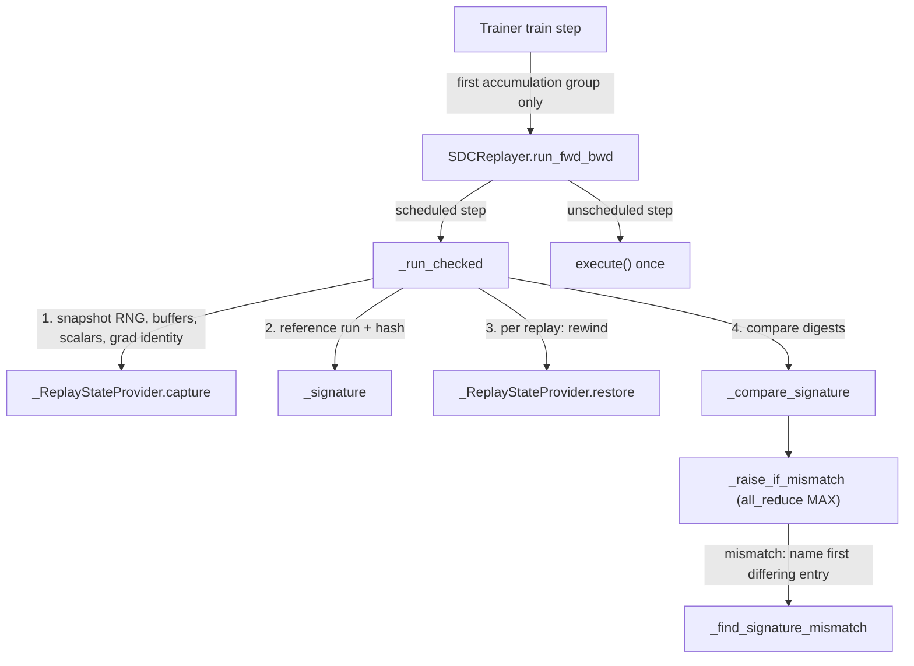

# Structured logger and SDC replayer: per-rank JSONL trace and silent data corruption checks

## Overview
TorchTitan has two observability layers. The familiar one is the console/TensorBoard/W&B metric
line (loss, tokens per second, TFLOPS, MFU, peak memory) produced by the metrics processor every
`log_freq` steps; its inputs, the peak-FLOPS table and device memory shims, live in
[profiling-and-tooling](profiling-and-tooling.md). This page is about the second layer, the
`torchtitan/observability` subsystem. Its main part is the
**structured logger** in `torchtitan/observability/structured_logger`: a per-rank, per-event JSONL
trace that records *when* every phase of every step started and ended on every rank. The README
states the intent: "Emits per-rank JSONL events for phase timing, diagnostics, and post-hoc
analysis", be "LLM friendly", "stay invisible to users -- no metric dictionaries to pass around",
and "never block training". The key design idea is that callers only say *what* happened
([`log_trace_span`](https://github.com/google-pytorch/torchtitan/blob/033f131322a8b5b026ac53d734c689d664442bf8/torchtitan/observability/structured_logger/structured_logging.py#L364 "torchtitan/observability/structured_logger/structured_logging#log_trace_span"),
[`log_trace_instant`](https://github.com/google-pytorch/torchtitan/blob/033f131322a8b5b026ac53d734c689d664442bf8/torchtitan/observability/structured_logger/structured_logging.py#L339 "torchtitan/observability/structured_logger/structured_logging#log_trace_instant"),
[`log_trace_scalar`](https://github.com/google-pytorch/torchtitan/blob/033f131322a8b5b026ac53d734c689d664442bf8/torchtitan/observability/structured_logger/structured_logging.py#L295 "torchtitan/observability/structured_logger/structured_logging#log_trace_scalar"));
the *context* (step, relative step, step tags, rank, host, pid, thread, caller file:line) is
pulled from ambient state at emit time by the formatter, so no function signature in the trainer
has to carry a logging handle. Everything flows through one dedicated Python `logging.Logger`, so
backends are ordinary `logging.Handler`s chosen by an env var, and offline
[`generate_gantt_trace`](https://github.com/google-pytorch/torchtitan/blob/033f131322a8b5b026ac53d734c689d664442bf8/torchtitan/observability/structured_logger/gantt_generator.py#L25 "torchtitan/observability/structured_logger/gantt_generator#generate_gantt_trace")
turns the per-rank files into a Chrome/Perfetto timeline where stragglers are visible at a glance.
The subsystem's second, newer part is the opt-in [`SDCReplayer`](https://github.com/google-pytorch/torchtitan/blob/033f131322a8b5b026ac53d734c689d664442bf8/torchtitan/observability/sdc_replayer.py#L318 "torchtitan/observability/sdc_replayer#SDCReplayer")
(`sdc_replayer.py`, documented in `silent_data_corruption.md`): it detects silent data corruption
by re-executing a step's first forward/backward under fully deterministic execution and comparing
hashes of everything the execution touched, raising on every rank before the optimizer commits a
corrupted update.

## Diagram

Legend:
- `MAIN` - (concept) the `main` function of `torchtitan/train.py` (and the RL entry point / actors)
- `INIT` - [`init_structured_logger`](https://github.com/google-pytorch/torchtitan/blob/033f131322a8b5b026ac53d734c689d664442bf8/torchtitan/observability/structured_logger/structured_logging.py#L224 "torchtitan/observability/structured_logger/structured_logging#init_structured_logger")
- `LOG` - [`_structured_logger`](https://github.com/google-pytorch/torchtitan/blob/033f131322a8b5b026ac53d734c689d664442bf8/torchtitan/observability/structured_logger/structured_logging.py#L37 "torchtitan/observability/structured_logger/structured_logging#_structured_logger._structured_logger")
- `FWD` - [`_ensure_root_forwarder`](https://github.com/google-pytorch/torchtitan/blob/033f131322a8b5b026ac53d734c689d664442bf8/torchtitan/observability/structured_logger/structured_logging.py#L142 "torchtitan/observability/structured_logger/structured_logging#_ensure_root_forwarder")
- `EXT` - (concept) any propagating Python logger, such as the checkpoint backend's `torch_checkpointing` logger
- `LOOP` - [`Trainer`](https://github.com/google-pytorch/torchtitan/blob/033f131322a8b5b026ac53d734c689d664442bf8/torchtitan/trainer.py#L74 "torchtitan/trainer#Trainer")
- `SET` - [`set_step`](https://github.com/google-pytorch/torchtitan/blob/033f131322a8b5b026ac53d734c689d664442bf8/torchtitan/observability/structured_logger/step_state.py#L101 "torchtitan/observability/structured_logger/step_state#set_step")
- `STATE` - [`_TAGS_GLOBAL`](https://github.com/google-pytorch/torchtitan/blob/033f131322a8b5b026ac53d734c689d664442bf8/torchtitan/observability/structured_logger/step_state.py#L75 "torchtitan/observability/structured_logger/step_state#_TAGS_GLOBAL._TAGS_GLOBAL"), [`_TAGS_CV`](https://github.com/google-pytorch/torchtitan/blob/033f131322a8b5b026ac53d734c689d664442bf8/torchtitan/observability/structured_logger/step_state.py#L84 "torchtitan/observability/structured_logger/step_state#_TAGS_CV._TAGS_CV")
- `SPAN` - [`__enter__`](https://github.com/google-pytorch/torchtitan/blob/033f131322a8b5b026ac53d734c689d664442bf8/torchtitan/observability/structured_logger/structured_logging.py#L414 "torchtitan/observability/structured_logger/structured_logging#log_trace_span.__enter__") / [`__exit__`](https://github.com/google-pytorch/torchtitan/blob/033f131322a8b5b026ac53d734c689d664442bf8/torchtitan/observability/structured_logger/structured_logging.py#L441 "torchtitan/observability/structured_logger/structured_logging#log_trace_span.__exit__")
- `SCAL` - [`log_trace_scalar`](https://github.com/google-pytorch/torchtitan/blob/033f131322a8b5b026ac53d734c689d664442bf8/torchtitan/observability/structured_logger/structured_logging.py#L295 "torchtitan/observability/structured_logger/structured_logging#log_trace_scalar") / [`log_trace_instant`](https://github.com/google-pytorch/torchtitan/blob/033f131322a8b5b026ac53d734c689d664442bf8/torchtitan/observability/structured_logger/structured_logging.py#L339 "torchtitan/observability/structured_logger/structured_logging#log_trace_instant")
- `FILT` - [`filter`](https://github.com/google-pytorch/torchtitan/blob/033f131322a8b5b026ac53d734c689d664442bf8/torchtitan/observability/structured_logger/structured_logging.py#L207 "torchtitan/observability/structured_logger/structured_logging#TraceEventsOnlyFilter.filter")
- `FMT` - [`_log_dict`](https://github.com/google-pytorch/torchtitan/blob/033f131322a8b5b026ac53d734c689d664442bf8/torchtitan/observability/structured_logger/jsonl_handler.py#L74 "torchtitan/observability/structured_logger/jsonl_handler#TraceJsonlFormatter._log_dict")
- `FILE` - (concept) the per-rank JSONL file written by the default handler
- `GANTT` - [`generate_gantt_trace`](https://github.com/google-pytorch/torchtitan/blob/033f131322a8b5b026ac53d734c689d664442bf8/torchtitan/observability/structured_logger/gantt_generator.py#L25 "torchtitan/observability/structured_logger/gantt_generator#generate_gantt_trace")
- `PERF` - (concept) the Perfetto / chrome://tracing viewer

The SDC replay check, which wraps the first forward/backward of a scheduled step:

Legend:
- `TR` - [`Trainer`](https://github.com/google-pytorch/torchtitan/blob/033f131322a8b5b026ac53d734c689d664442bf8/torchtitan/trainer.py#L74 "torchtitan/trainer#Trainer")
- `RUN` - [`run_fwd_bwd`](https://github.com/google-pytorch/torchtitan/blob/033f131322a8b5b026ac53d734c689d664442bf8/torchtitan/observability/sdc_replayer.py#L392 "torchtitan/observability/sdc_replayer#SDCReplayer.run_fwd_bwd")
- `CHK` - [`_run_checked`](https://github.com/google-pytorch/torchtitan/blob/033f131322a8b5b026ac53d734c689d664442bf8/torchtitan/observability/sdc_replayer.py#L528 "torchtitan/observability/sdc_replayer#SDCReplayer._run_checked")
- `EXE` - (concept) the caller's forward/backward closure, run without replay overhead
- `CAP` - [`capture`](https://github.com/google-pytorch/torchtitan/blob/033f131322a8b5b026ac53d734c689d664442bf8/torchtitan/observability/sdc_replayer.py#L188 "torchtitan/observability/sdc_replayer#_ReplayStateProvider.capture")
- `SIG` - [`_signature`](https://github.com/google-pytorch/torchtitan/blob/033f131322a8b5b026ac53d734c689d664442bf8/torchtitan/observability/sdc_replayer.py#L415 "torchtitan/observability/sdc_replayer#SDCReplayer._signature")
- `RES` - [`restore`](https://github.com/google-pytorch/torchtitan/blob/033f131322a8b5b026ac53d734c689d664442bf8/torchtitan/observability/sdc_replayer.py#L236 "torchtitan/observability/sdc_replayer#_ReplayStateProvider.restore")
- `CMP` - [`_compare_signature`](https://github.com/google-pytorch/torchtitan/blob/033f131322a8b5b026ac53d734c689d664442bf8/torchtitan/observability/sdc_replayer.py#L276 "torchtitan/observability/sdc_replayer#_compare_signature")
- `RAISE` - [`_raise_if_mismatch`](https://github.com/google-pytorch/torchtitan/blob/033f131322a8b5b026ac53d734c689d664442bf8/torchtitan/observability/sdc_replayer.py#L490 "torchtitan/observability/sdc_replayer#SDCReplayer._raise_if_mismatch")
- `FIND` - [`_find_signature_mismatch`](https://github.com/google-pytorch/torchtitan/blob/033f131322a8b5b026ac53d734c689d664442bf8/torchtitan/observability/sdc_replayer.py#L296 "torchtitan/observability/sdc_replayer#_find_signature_mismatch")

## Design rationale (why it's built this way)
- **A dedicated logger that never leaks into the console.** The module creates
  [`_structured_logger`](https://github.com/google-pytorch/torchtitan/blob/033f131322a8b5b026ac53d734c689d664442bf8/torchtitan/observability/structured_logger/structured_logging.py#L37 "torchtitan/observability/structured_logger/structured_logging#_structured_logger._structured_logger")
  under the name `torchtitan.structured_logger` (deliberately not `__name__`) with
  `propagate = False`, so trace records never reach the root `[titan]` console handler, while the
  module's own diagnostics go through a separate console logger.
  Riding on stdlib `logging` means backends are just handlers, and `stacklevel` gives a free,
  accurate `caller` field.
- **A root bridge for other libraries.** `init_structured_logger` also installs, via
  [`_ensure_root_forwarder`](https://github.com/google-pytorch/torchtitan/blob/033f131322a8b5b026ac53d734c689d664442bf8/torchtitan/observability/structured_logger/structured_logging.py#L142 "torchtitan/observability/structured_logger/structured_logging#_ensure_root_forwarder"),
  a forwarder handler on `logging.root`. Any logger that keeps normal propagation (the docstring's
  example is the checkpoint backend's `torch_checkpointing` logger) can join the trace just by
  emitting a record whose `extra` carries a `log_type_name`; the forwarder skips records that came
  from the structured logger itself and records without that key. Native records are not
  logged twice because `propagate = False` stops them before the root; the bridge is installed
  on the root "so future integrated libraries do not need separate handler installation".
- **Context is ambient, not passed.** Step, relative step and tags live in module state
  (`step_state.py`) and are read at format time by readers such as
  [`get_step`](https://github.com/google-pytorch/torchtitan/blob/033f131322a8b5b026ac53d734c689d664442bf8/torchtitan/observability/structured_logger/step_state.py#L129 "torchtitan/observability/structured_logger/step_state#get_step"). That is what lets a deeply nested helper such as
  the GC handler or the checkpointer annotate the current step with a single
  [`add_step_tag`](https://github.com/google-pytorch/torchtitan/blob/033f131322a8b5b026ac53d734c689d664442bf8/torchtitan/observability/structured_logger/step_state.py#L153 "torchtitan/observability/structured_logger/step_state#add_step_tag")
  call.
- **Two runtime models, one state.** The `step_state` docstring spells out that SPMD pretraining
  (one thread, no asyncio) and async RL (many actor tasks per process) share the same API. Each
  value is stored twice: a module global (SPMD, and the fallback for plain threads, which do not
  inherit `ContextVar`s) and a `ContextVar` (per asyncio task, inherited at spawn, isolated from
  siblings). Tags are stored as immutable tuples so a snapshot cannot be mutated through a
  reference to bypass task isolation.
- **Strict schema, enforced defensively.** Every record built by
  [`event_extra`](https://github.com/google-pytorch/torchtitan/blob/033f131322a8b5b026ac53d734c689d664442bf8/torchtitan/observability/structured_logger/structured_logging.py#L159 "torchtitan/observability/structured_logger/structured_logging#event_extra")
  carries a `log_type_name`; [`filter`](https://github.com/google-pytorch/torchtitan/blob/033f131322a8b5b026ac53d734c689d664442bf8/torchtitan/observability/structured_logger/structured_logging.py#L207 "torchtitan/observability/structured_logger/structured_logging#TraceEventsOnlyFilter.filter")
  drops anything without one (a plain `.info("text")` on the logger) and warns once, so "the
  schema stays strict" even if someone grabs the logger by name.
- **Every `_start` gets a close.** On exception,
  [`__exit__`](https://github.com/google-pytorch/torchtitan/blob/033f131322a8b5b026ac53d734c689d664442bf8/torchtitan/observability/structured_logger/structured_logging.py#L441 "torchtitan/observability/structured_logger/structured_logging#log_trace_span.__exit__")
  emits an `_error` record *and then* the normal `_end` carrying elapsed-until-crash, which "keeps
  pairing simple -- analysis tools don't have to special-case exceptional spans".
- **Zero cost under compile or when disabled.** All three `log_trace_*` entry points return
  immediately when `torch.compiler.is_compiling()` is true or
  [`_structured_logger_disabled`](https://github.com/google-pytorch/torchtitan/blob/033f131322a8b5b026ac53d734c689d664442bf8/torchtitan/observability/structured_logger/structured_logging.py#L53 "torchtitan/observability/structured_logger/structured_logging#_structured_logger_disabled")
  reports the kill switch (`DebugConfig.enable_structured_logging=False`), so instrumentation
  inside a module traced by `torch.compile` never becomes a graph break.
- **SDC replay checks only what is cheap and likely to matter.** [`SDCReplayer`](https://github.com/google-pytorch/torchtitan/blob/033f131322a8b5b026ac53d734c689d664442bf8/torchtitan/observability/sdc_replayer.py#L318 "torchtitan/observability/sdc_replayer#SDCReplayer")
  checks only the first forward/backward (one gradient-accumulation group; under pipeline
  parallelism one complete pipeline schedule) of the first
  [`Config`](https://github.com/google-pytorch/torchtitan/blob/033f131322a8b5b026ac53d734c689d664442bf8/torchtitan/observability/sdc_replayer.py#L331 "torchtitan/observability/sdc_replayer#SDCReplayer.Config") `num_steps` optimizer steps after each (re)start, because "corruption from a bad restore or
  initialization is most likely" there; the trainer comment adds that later accumulation groups
  "exercise the same compute and communication paths, so checking them too would only add
  overhead". The expected checked-step cost is `1 + num_replays` forward/backward executions;
  unchecked steps compute no signatures.
- **No gradient snapshots.** [`capture`](https://github.com/google-pytorch/torchtitan/blob/033f131322a8b5b026ac53d734c689d664442bf8/torchtitan/observability/sdc_replayer.py#L188 "torchtitan/observability/sdc_replayer#_ReplayStateProvider.capture") records only each
  parameter's entry gradient *identity*; [`restore`](https://github.com/google-pytorch/torchtitan/blob/033f131322a8b5b026ac53d734c689d664442bf8/torchtitan/observability/sdc_replayer.py#L236 "torchtitan/observability/sdc_replayer#_ReplayStateProvider.restore")
  rebuilds the post-`zero_grad` entry state (`None` stays `None`, tensors are zeroed in place,
  "preserving storage addresses for CUDA graphs"), so a checked step costs no gradient-sized
  clone or copy kernels. The price is the entry contract: `run_fwd_bwd` must be entered with no
  pending gradients, or replays diverge and surface as a false mismatch.
- **Digests, not tensors.** [`_signature`](https://github.com/google-pytorch/torchtitan/blob/033f131322a8b5b026ac53d734c689d664442bf8/torchtitan/observability/sdc_replayer.py#L415 "torchtitan/observability/sdc_replayer#SDCReplayer._signature")
  hashes the loss, CPU and accelerator RNG state, every registered buffer and every local gradient
  with `torch.hash_tensor` and keeps the digests on the loss device for one batched comparison;
  names are resolved only after a mismatch is detected.

> [!inferred]
> For TPU the most important property is what a span actually times. [`log_trace_span`](https://github.com/google-pytorch/torchtitan/blob/033f131322a8b5b026ac53d734c689d664442bf8/torchtitan/observability/structured_logger/structured_logging.py#L364 "torchtitan/observability/structured_logger/structured_logging#log_trace_span")
> uses host wall-clock (`timeit.default_timer`) between `__enter__` and `__exit__`; it never
> synchronizes the device. With an asynchronous/deferred backend such as torch_tpu, `fwd_bwd` may
> therefore measure host dispatch and tracing time, and the device work surfaces later in whichever
> span first blocks on a result (for example `collect_dist_metrics`, where loss and token counts are
> reduced to host values). Per-step `step` spans are reliable once the pipeline reaches steady
> state; per-phase splits inside a step should be read with that caveat, and cross-checked with the
> device trace from the Kineto/XProf profiler described in [profiling-and-tooling](profiling-and-tooling.md).

## Entry points
- [`init_structured_logger`](https://github.com/google-pytorch/torchtitan/blob/033f131322a8b5b026ac53d734c689d664442bf8/torchtitan/observability/structured_logger/structured_logging.py#L224 "torchtitan/observability/structured_logger/structured_logging#init_structured_logger")
  is called once per process before any trace call: by the `main` function
  in `torchtitan/train.py` with `source="training"` ("internal meta tooling relies on
  source=training") and `output_dir=config.dump_folder`, and by the RL entry point
  and each RL actor with its own source name. Immediately afterwards both emit a
  `structured_logger_started` instant.
- [`set_step`](https://github.com/google-pytorch/torchtitan/blob/033f131322a8b5b026ac53d734c689d664442bf8/torchtitan/observability/structured_logger/step_state.py#L101 "torchtitan/observability/structured_logger/step_state#set_step")
  is called at the top of every iteration of the [`Trainer`](https://github.com/google-pytorch/torchtitan/blob/033f131322a8b5b026ac53d734c689d664442bf8/torchtitan/trainer.py#L74 "torchtitan/trainer#Trainer") training loop
  as `set_step(self.step, relative_step=self.step - loaded_step)`, and by the RL controller's
  [`_trainer_loop`](https://github.com/google-pytorch/torchtitan/blob/033f131322a8b5b026ac53d734c689d664442bf8/torchtitan/experiments/rl/controller.py#L1043 "torchtitan/experiments/rl/controller#Controller._trainer_loop")
  to propagate the step counter to actors.
- [`log_trace_span`](https://github.com/google-pytorch/torchtitan/blob/033f131322a8b5b026ac53d734c689d664442bf8/torchtitan/observability/structured_logger/structured_logging.py#L364 "torchtitan/observability/structured_logger/structured_logging#log_trace_span")
  is the most-used entry: as a context manager around `step`, `fetching_batch`,
  `preprocess_inputs`, `optim`, `collect_dist_metrics` and `model_parallelism_init` in the trainer,
  `torch_distributed_teardown` in `train.py`, and the profiler step calls; as a decorator on
  `fwd_bwd`, `torch_distributed_init`, the GC handler (`gc_collect`) and
  [`validate`](https://github.com/google-pytorch/torchtitan/blob/033f131322a8b5b026ac53d734c689d664442bf8/torchtitan/components/validate.py#L142 "torchtitan/components/validate#Validator.validate") (`eval`). The checkpointer
  (for example [`CheckpointManager`](https://github.com/google-pytorch/torchtitan/blob/033f131322a8b5b026ac53d734c689d664442bf8/torchtitan/components/checkpointer/dcp.py#L89 "torchtitan/components/checkpointer/dcp#CheckpointManager")) wraps its `save` and `load` bodies in `checkpoint_save` /
  `checkpoint_load` spans in the shared base manager.
- [`add_step_tag`](https://github.com/google-pytorch/torchtitan/blob/033f131322a8b5b026ac53d734c689d664442bf8/torchtitan/observability/structured_logger/step_state.py#L153 "torchtitan/observability/structured_logger/step_state#add_step_tag")
  marks atypical steps so analysis can exclude them: the checkpointer tags `checkpoint_save`, the
  validator tags `eval`, and the GC handler tags `gc`.
- [`log_trace_scalar`](https://github.com/google-pytorch/torchtitan/blob/033f131322a8b5b026ac53d734c689d664442bf8/torchtitan/observability/structured_logger/structured_logging.py#L295 "torchtitan/observability/structured_logger/structured_logging#log_trace_scalar")
  and [`log_trace_instant`](https://github.com/google-pytorch/torchtitan/blob/033f131322a8b5b026ac53d734c689d664442bf8/torchtitan/observability/structured_logger/structured_logging.py#L339 "torchtitan/observability/structured_logger/structured_logging#log_trace_instant")
  add point-in-time context: the trainer logs `local_valid_tokens` and `global_valid_tokens` per
  step and a `training_start` marker, and the DCP checkpointer logs the async-save total latency as
  a scalar when the save future completes.
- [`get_structured_logger_subprocess_init_fn`](https://github.com/google-pytorch/torchtitan/blob/033f131322a8b5b026ac53d734c689d664442bf8/torchtitan/observability/structured_logger/structured_logging.py#L151 "torchtitan/observability/structured_logger/structured_logging#get_structured_logger_subprocess_init_fn")
  hands the async checkpoint backend a callable that re-runs `init_structured_logger` with the
  parent's arguments inside the save subprocess, which "does not inherit the parent's logging
  handlers". It returns `None` when the logger is disabled or has no handlers.
- [`generate_gantt_trace`](https://github.com/google-pytorch/torchtitan/blob/033f131322a8b5b026ac53d734c689d664442bf8/torchtitan/observability/structured_logger/gantt_generator.py#L25 "torchtitan/observability/structured_logger/gantt_generator#generate_gantt_trace")
  is the offline analysis entry: point it at `<dump_folder>/structured_logs/` after (or during) a run.
- [`SDCReplayer`](https://github.com/google-pytorch/torchtitan/blob/033f131322a8b5b026ac53d734c689d664442bf8/torchtitan/observability/sdc_replayer.py#L318 "torchtitan/observability/sdc_replayer#SDCReplayer")
  is built in [`__init__`](https://github.com/google-pytorch/torchtitan/blob/033f131322a8b5b026ac53d734c689d664442bf8/torchtitan/trainer.py#L344 "torchtitan/trainer#Trainer.__init__") from
  `config.sdc_replayer` (suppressed from the tyro CLI; `None` disables replay, so it is enabled only
  programmatically in a config/recipe) with the model parts, the device and an `ntokens_seen`
  scalar accessor. Each step, [`run_fwd_bwd`](https://github.com/google-pytorch/torchtitan/blob/033f131322a8b5b026ac53d734c689d664442bf8/torchtitan/observability/sdc_replayer.py#L392 "torchtitan/observability/sdc_replayer#SDCReplayer.run_fwd_bwd")
  wraps the first forward/backward; `load_state_dict` calls `reset_schedule` after a checkpoint
  load so the steps right after a restore are checked again.

## Mechanism (step-by-step)
1. **Wiring the backends.** [`init_structured_logger`](https://github.com/google-pytorch/torchtitan/blob/033f131322a8b5b026ac53d734c689d664442bf8/torchtitan/observability/structured_logger/structured_logging.py#L224 "torchtitan/observability/structured_logger/structured_logging#init_structured_logger")
   first honors the kill switch: with `enable=False` it sets
   [`_disabled`](https://github.com/google-pytorch/torchtitan/blob/033f131322a8b5b026ac53d734c689d664442bf8/torchtitan/observability/structured_logger/structured_logging.py#L46 "torchtitan/observability/structured_logger/structured_logging#_disabled._disabled")
   and returns without attaching anything. Otherwise repeated calls are no-ops via
   [`_is_initialized`](https://github.com/google-pytorch/torchtitan/blob/033f131322a8b5b026ac53d734c689d664442bf8/torchtitan/observability/structured_logger/structured_logging.py#L42 "torchtitan/observability/structured_logger/structured_logging#_is_initialized._is_initialized")
   ("Repeated calls do not duplicate handlers").
   `rank` defaults to `$RANK`, so it can run *before* `torch.distributed` is initialized (which is
   why the `torch_distributed_init` span itself can be traced). It reads
   `TITAN_STRUCT_LOGGER_HANDLERS` (comma-separated `module.path.factory`); when unset it uses the
   default JSONL factory, and when set *only* the listed factories run. Each factory is imported
   and called with `structured_logger`, `rank`, `source` and `output_dir`, and the logger
   level is raised to at least `INFO`. The default factory attaches a file handler writing
   `{output_dir}/structured_logs/{source}.global_rank_{rank}.{timestamp}-{random}.jsonl` with the
   events-only filter and the JSONL formatter; the random suffix means a restart never appends to
   a previous run's file. Finally it stores a `functools.partial` of itself in
   [`_structured_logger_subprocess_init_fn`](https://github.com/google-pytorch/torchtitan/blob/033f131322a8b5b026ac53d734c689d664442bf8/torchtitan/observability/structured_logger/structured_logging.py#L43 "torchtitan/observability/structured_logger/structured_logging#_structured_logger_subprocess_init_fn._structured_logger_subprocess_init_fn")
   (for subprocesses to replay the same setup) and installs the root forwarder.
2. **Setting the step context.** [`set_step`](https://github.com/google-pytorch/torchtitan/blob/033f131322a8b5b026ac53d734c689d664442bf8/torchtitan/observability/structured_logger/step_state.py#L101 "torchtitan/observability/structured_logger/step_state#set_step")
   writes the absolute step to both the step global and its `ContextVar`,
   and the relative step (steps since this process started; defaults to `step`, and "resumed
   trainers must pass it explicitly") to the matching relative-step pair.
   It then calls [`clear_step_tags`](https://github.com/google-pytorch/torchtitan/blob/033f131322a8b5b026ac53d734c689d664442bf8/torchtitan/observability/structured_logger/step_state.py#L178 "torchtitan/observability/structured_logger/step_state#clear_step_tags"),
   so tags are strictly per step. `relative_step` exists so that analysis can align timelines
   across restarts: after resuming at step 100, the first step is `step=101, relative_step=1`, and
   first-step effects (lazy init, compilation) line up across restarts.
3. **Tagging.** [`add_step_tag`](https://github.com/google-pytorch/torchtitan/blob/033f131322a8b5b026ac53d734c689d664442bf8/torchtitan/observability/structured_logger/step_state.py#L153 "torchtitan/observability/structured_logger/step_state#add_step_tag")
   is task-aware: inside a running asyncio task it appends to
   [`_TAGS_CV`](https://github.com/google-pytorch/torchtitan/blob/033f131322a8b5b026ac53d734c689d664442bf8/torchtitan/observability/structured_logger/step_state.py#L84 "torchtitan/observability/structured_logger/step_state#_TAGS_CV._TAGS_CV")
   only; outside it appends to [`_TAGS_GLOBAL`](https://github.com/google-pytorch/torchtitan/blob/033f131322a8b5b026ac53d734c689d664442bf8/torchtitan/observability/structured_logger/step_state.py#L75 "torchtitan/observability/structured_logger/step_state#_TAGS_GLOBAL._TAGS_GLOBAL")
   only. Duplicates are ignored. Readers such as
   [`get_step`](https://github.com/google-pytorch/torchtitan/blob/033f131322a8b5b026ac53d734c689d664442bf8/torchtitan/observability/structured_logger/step_state.py#L129 "torchtitan/observability/structured_logger/step_state#get_step")
   prefer the `ContextVar` and fall back to the global.
4. **Timing a phase.** [`__enter__`](https://github.com/google-pytorch/torchtitan/blob/033f131322a8b5b026ac53d734c689d664442bf8/torchtitan/observability/structured_logger/structured_logging.py#L414 "torchtitan/observability/structured_logger/structured_logging#log_trace_span.__enter__")
   caches the current asyncio task name (`None` in SPMD code) so that `__exit__` emits the same
   one, stamps the start time, and logs `<event>_start` with the current step.
   [`__exit__`](https://github.com/google-pytorch/torchtitan/blob/033f131322a8b5b026ac53d734c689d664442bf8/torchtitan/observability/structured_logger/structured_logging.py#L441 "torchtitan/observability/structured_logger/structured_logging#log_trace_span.__exit__")
   computes the duration in milliseconds, emits `<event>_error` first if an exception is
   propagating, then `<event>_end` with `value=delta_ms`. It returns `None`, so exceptions are never
   swallowed. Used as a decorator, [`__call__`](https://github.com/google-pytorch/torchtitan/blob/033f131322a8b5b026ac53d734c689d664442bf8/torchtitan/observability/structured_logger/structured_logging.py#L478 "torchtitan/observability/structured_logger/structured_logging#log_trace_span.__call__")
   builds a *fresh* span per invocation (so concurrent calls do not clobber `start_time`) through
   [`sync_wrapper`](https://github.com/google-pytorch/torchtitan/blob/033f131322a8b5b026ac53d734c689d664442bf8/torchtitan/observability/structured_logger/structured_logging.py#L506 "torchtitan/observability/structured_logger/structured_logging#log_trace_span.sync_wrapper")
   (which bumps `stacklevel` by one so `caller` points at the user) or
   [`async_wrapper`](https://github.com/google-pytorch/torchtitan/blob/033f131322a8b5b026ac53d734c689d664442bf8/torchtitan/observability/structured_logger/structured_logging.py#L499 "torchtitan/observability/structured_logger/structured_logging#log_trace_span.async_wrapper")
   (which closes the span only after `await`; a sync wrapper would record ~0 ms for a coroutine).
5. **Scalars and markers.** [`log_trace_scalar`](https://github.com/google-pytorch/torchtitan/blob/033f131322a8b5b026ac53d734c689d664442bf8/torchtitan/observability/structured_logger/structured_logging.py#L295 "torchtitan/observability/structured_logger/structured_logging#log_trace_scalar")
   emits one `metric_value` record per `(name, value)` pair with `log_type` set to
   `instant` ([`LogType`](https://github.com/google-pytorch/torchtitan/blob/033f131322a8b5b026ac53d734c689d664442bf8/torchtitan/observability/structured_logger/structured_logging.py#L62 "torchtitan/observability/structured_logger/structured_logging#LogType"));
   non-numeric values and `bool`s are skipped and reported once per call through the console logger.
   [`log_trace_instant`](https://github.com/google-pytorch/torchtitan/blob/033f131322a8b5b026ac53d734c689d664442bf8/torchtitan/observability/structured_logger/structured_logging.py#L339 "torchtitan/observability/structured_logger/structured_logging#log_trace_instant")
   emits a zero-duration record whose `log_type_name` is the event string itself.
6. **Building the payload.** All emitters pass their fields through
   [`event_extra`](https://github.com/google-pytorch/torchtitan/blob/033f131322a8b5b026ac53d734c689d664442bf8/torchtitan/observability/structured_logger/structured_logging.py#L159 "torchtitan/observability/structured_logger/structured_logging#event_extra"),
   which maps them onto [`ExtraFields`](https://github.com/google-pytorch/torchtitan/blob/033f131322a8b5b026ac53d734c689d664442bf8/torchtitan/observability/structured_logger/structured_logging.py#L75 "torchtitan/observability/structured_logger/structured_logging#ExtraFields")
   keys (`log_type`, `log_type_name`, `event_name`, `step`, `relative_step`, `value`,
   `task_name`). Python logging turns `extra` keys into `LogRecord` attributes, which is how the
   filter and formatter see them. The enums now derive from the standard library's
   `enum.StrEnum` (Python 3.11+), so `str(member)` is the bare value; the local Python 3.10
   stand-in is gone.
7. **Formatting one JSON line.** The formatter's `format`
   is `json.dumps` of [`_log_dict`](https://github.com/google-pytorch/torchtitan/blob/033f131322a8b5b026ac53d734c689d664442bf8/torchtitan/observability/structured_logger/jsonl_handler.py#L74 "torchtitan/observability/structured_logger/jsonl_handler#TraceJsonlFormatter._log_dict"),
   which assembles a flat dict: per-process constants captured at construction
   (`rank`, `local_rank` from `$LOCAL_RANK`, `source`, `host_name`), a `pid` from `os.getpid()` and the
   native `tid` read per record, per-step context read *now*
   from the step-state readers (with a per-record `step` from
   `event_extra` overriding the ambient one), `time`, `time_ms`, `time_us`, the `ExtraFields`
   attributes (including an optional `context` value, which `event_extra` itself never sets, so it
   arrives only on records other loggers forward), `caller` as `relpath:line:function`, a
   monotonically increasing `seq_id`, and a `delta_ms` since the previous record on the same
   thread (kept in per-formatter thread-local state so two backends on one logger do not steal
   each other's deltas). Messages longer than 1000 characters are middle-truncated.
8. **Building the Gantt view.** [`generate_gantt_trace`](https://github.com/google-pytorch/torchtitan/blob/033f131322a8b5b026ac53d734c689d664442bf8/torchtitan/observability/structured_logger/gantt_generator.py#L25 "torchtitan/observability/structured_logger/gantt_generator#generate_gantt_trace")
   loads every `*.jsonl` in the directory (one Perfetto process per file, so one row per rank and
   source), then pairs `_start`/`_end` via a LIFO stack per `(source, task_name)`. It branches on
   `log_type == instant` *before* suffix matching, so markers such as `training_start` are not
   mistaken for span starts. Span end time is `start_ts + value`, i.e. the duration measured on the
   rank, not the `_end` record's own timestamp; an orphan `_end` (truncated file) is back-dated
   from its own timestamp. Tasks are then slot-packed into Perfetto thread ids with min-heap
   interval scheduling, so sequential asyncio tasks share one track and only truly concurrent
   ones get a new track, and the result is written as Chrome Trace `X`/`i`/`M` events.
9. **Arming the SDC replayer.** [`__post_init__`](https://github.com/google-pytorch/torchtitan/blob/033f131322a8b5b026ac53d734c689d664442bf8/torchtitan/observability/sdc_replayer.py#L346 "torchtitan/observability/sdc_replayer#SDCReplayer.Config.__post_init__")
   rejects `num_steps` other than `-1` or `>= 1`, and a [`num_replays`](https://github.com/google-pytorch/torchtitan/blob/033f131322a8b5b026ac53d734c689d664442bf8/torchtitan/observability/sdc_replayer.py#L340 "torchtitan/observability/sdc_replayer#SDCReplayer.Config.num_replays") below 1. The trainer config
   additionally requires `debug.deterministic=True` and `debug.deterministic_warn_only=False`, and
   allows only one replay while CUDA graphs are enabled. At construction the replayer builds its
   [`_state_provider`](https://github.com/google-pytorch/torchtitan/blob/033f131322a8b5b026ac53d734c689d664442bf8/torchtitan/observability/sdc_replayer.py#L365 "torchtitan/observability/sdc_replayer#SDCReplayer._state_provider") over the model parts and
   probes `torch.hash_tensor` on the target device, failing fast if it is missing.
10. **Scheduling.** [`run_fwd_bwd`](https://github.com/google-pytorch/torchtitan/blob/033f131322a8b5b026ac53d734c689d664442bf8/torchtitan/observability/sdc_replayer.py#L392 "torchtitan/observability/sdc_replayer#SDCReplayer.run_fwd_bwd")
    compares the steps seen since the last reset with `num_steps` (`-1` checks every step). An
    unscheduled step just calls `execute()`; a scheduled one goes through
    [`_run_checked`](https://github.com/google-pytorch/torchtitan/blob/033f131322a8b5b026ac53d734c689d664442bf8/torchtitan/observability/sdc_replayer.py#L528 "torchtitan/observability/sdc_replayer#SDCReplayer._run_checked"). The step counter advances
    either way, and `step` is used only for error reporting.
11. **Reference, rewind, replay.** [`_run_checked`](https://github.com/google-pytorch/torchtitan/blob/033f131322a8b5b026ac53d734c689d664442bf8/torchtitan/observability/sdc_replayer.py#L528 "torchtitan/observability/sdc_replayer#SDCReplayer._run_checked")
    takes a baseline with [`capture`](https://github.com/google-pytorch/torchtitan/blob/033f131322a8b5b026ac53d734c689d664442bf8/torchtitan/observability/sdc_replayer.py#L188 "torchtitan/observability/sdc_replayer#_ReplayStateProvider.capture") (Python, CPU and
    accelerator RNG, clones of every registered buffer, caller-owned scalars such as
    `ntokens_seen`, and each parameter's entry gradient identity), runs the reference execution and
    keeps a [`clone`](https://github.com/google-pytorch/torchtitan/blob/033f131322a8b5b026ac53d734c689d664442bf8/torchtitan/observability/sdc_replayer.py#L72 "torchtitan/observability/sdc_replayer#_ReplaySignature.clone") of its signature. For each of the
    `num_replays` replays it calls [`restore`](https://github.com/google-pytorch/torchtitan/blob/033f131322a8b5b026ac53d734c689d664442bf8/torchtitan/observability/sdc_replayer.py#L236 "torchtitan/observability/sdc_replayer#_ReplayStateProvider.restore"), re-executes,
    and compares. Only the final execution's gradients, buffers, RNG advancement, token counter and
    loss stay committed; the reference and intermediate results are discarded.
12. **Hashing and comparing.** [`_signature`](https://github.com/google-pytorch/torchtitan/blob/033f131322a8b5b026ac53d734c689d664442bf8/torchtitan/observability/sdc_replayer.py#L415 "torchtitan/observability/sdc_replayer#SDCReplayer._signature")
    records, through [`add_tensor`](https://github.com/google-pytorch/torchtitan/blob/033f131322a8b5b026ac53d734c689d664442bf8/torchtitan/observability/sdc_replayer.py#L426 "torchtitan/observability/sdc_replayer#SDCReplayer.add_tensor"), a schema entry
    (name, shape, dtype, device) and a device-side digest per tensor: `loss`, `rng:cpu`,
    `rng:accelerator:<i>`, `buffer:<part index>:<qualified name>` and `gradient:<part index>:<name>`, where the index is the model part's position (missing buffers
    and gradients get a zero digest and a `:none` schema name), plus Python RNG and scalar values in
    [`state`](https://github.com/google-pytorch/torchtitan/blob/033f131322a8b5b026ac53d734c689d664442bf8/torchtitan/observability/sdc_replayer.py#L70 "torchtitan/observability/sdc_replayer#_ReplaySignature.state"). [`_compare_signature`](https://github.com/google-pytorch/torchtitan/blob/033f131322a8b5b026ac53d734c689d664442bf8/torchtitan/observability/sdc_replayer.py#L276 "torchtitan/observability/sdc_replayer#_compare_signature")
    returns a device boolean: any schema or state difference is an immediate mismatch, otherwise the
    stacked digests are compared in one `ne(...).any()`.
13. **Failing everywhere.** [`_raise_if_mismatch`](https://github.com/google-pytorch/torchtitan/blob/033f131322a8b5b026ac53d734c689d664442bf8/torchtitan/observability/sdc_replayer.py#L490 "torchtitan/observability/sdc_replayer#SDCReplayer._raise_if_mismatch")
    all-reduces the local mismatch flag with `MAX`, so a rank whose own replay matched still raises
    when another rank diverged. Only a locally mismatching rank runs
    [`_find_signature_mismatch`](https://github.com/google-pytorch/torchtitan/blob/033f131322a8b5b026ac53d734c689d664442bf8/torchtitan/observability/sdc_replayer.py#L296 "torchtitan/observability/sdc_replayer#_find_signature_mismatch") to name the first
    differing entry; the details are `all_gather_object`-ed and every rank raises
    `SDCReplayMismatch` with the step, `local_step` (1-based position in the current schedule), the
    replay number, the originating rank and that entry name, before gradient clipping, the
    optimizer, the LR scheduler or checkpoint saving run.

## Key data structures
- **Step state** - the six module globals / `ContextVar`s in `step_state.py` (absolute step,
  relative step and the tag pair [`_TAGS_GLOBAL`](https://github.com/google-pytorch/torchtitan/blob/033f131322a8b5b026ac53d734c689d664442bf8/torchtitan/observability/structured_logger/step_state.py#L75 "torchtitan/observability/structured_logger/step_state#_TAGS_GLOBAL._TAGS_GLOBAL") / [`_TAGS_CV`](https://github.com/google-pytorch/torchtitan/blob/033f131322a8b5b026ac53d734c689d664442bf8/torchtitan/observability/structured_logger/step_state.py#L84 "torchtitan/observability/structured_logger/step_state#_TAGS_CV._TAGS_CV")).
  Steps agree across tasks; tags are task-scoped inside asyncio.
- **[`LogType`](https://github.com/google-pytorch/torchtitan/blob/033f131322a8b5b026ac53d734c689d664442bf8/torchtitan/observability/structured_logger/structured_logging.py#L62 "torchtitan/observability/structured_logger/structured_logging#LogType")**
  - `event` (paired span records), `instant` (markers and scalars), `text` (free text, filtered
  out). The formatter defaults to `text` when a record has no `log_type`.
- **[`ExtraFields`](https://github.com/google-pytorch/torchtitan/blob/033f131322a8b5b026ac53d734c689d664442bf8/torchtitan/observability/structured_logger/structured_logging.py#L75 "torchtitan/observability/structured_logger/structured_logging#ExtraFields")**
  - the schema of the structured payload; `log_type_name`
  is the event name (`fwd_bwd_start`, `metric_value`, ...) and the filter's admission key,
  `event_name` carries the scalar name, `step`
  and `relative_step` are per-record overrides, `log_type`
  is the record kind, and the new `context` key is copied into the JSONL line when present.
- **A JSONL record** (from the formatter docstring): `{"rank": 0, "source": "training", "step": 5,
  "log_type_name": "fwd_bwd_end", "value": 12.5, "task_name": "Task-1", "step_tags": ["gc"],
  "time_us": ..., "caller": "trainer.py:796:train_step", "seq_id": 42}`. For `_end` records `value`
  is the span duration in ms; for `metric_value` it is the scalar.
- **[`_ReplaySignature`](https://github.com/google-pytorch/torchtitan/blob/033f131322a8b5b026ac53d734c689d664442bf8/torchtitan/observability/sdc_replayer.py#L67 "torchtitan/observability/sdc_replayer#_ReplaySignature")** - the SDC fingerprint
  of one execution: a `schema` tuple of `(name, shape, dtype, device)`, a parallel tuple of
  `torch.hash_tensor` digests on the loss device, and [`state`](https://github.com/google-pytorch/torchtitan/blob/033f131322a8b5b026ac53d734c689d664442bf8/torchtitan/observability/sdc_replayer.py#L70 "torchtitan/observability/sdc_replayer#_ReplaySignature.state")
  (Python RNG state and caller-owned scalars, compared by value).
- **[`Config`](https://github.com/google-pytorch/torchtitan/blob/033f131322a8b5b026ac53d734c689d664442bf8/torchtitan/observability/sdc_replayer.py#L331 "torchtitan/observability/sdc_replayer#SDCReplayer.Config")** - `num_steps` (default 1; `-1`
  for every step) and [`num_replays`](https://github.com/google-pytorch/torchtitan/blob/033f131322a8b5b026ac53d734c689d664442bf8/torchtitan/observability/sdc_replayer.py#L340 "torchtitan/observability/sdc_replayer#SDCReplayer.Config.num_replays") (default 1).
  Replay state is process-local and not checkpointed.

## Dynamics (design intent)
- **Per-step ordering in the SPMD trainer.** Each iteration of the
  [`Trainer`](https://github.com/google-pytorch/torchtitan/blob/033f131322a8b5b026ac53d734c689d664442bf8/torchtitan/trainer.py#L74 "torchtitan/trainer#Trainer") loop
  calls `set_step` *before* opening the outer `step` span, so every record inside the step (GC,
  `fwd_bwd`, `optim`, `collect_dist_metrics`, checkpoint save, eval, profiler step calls) carries
  the same step and the tags accumulated during it; the next `set_step` wipes the tags.
- **Async isolation.** Because asyncio copies the context at task creation, sibling actor tasks
  tagging independently (one GC, one eval) do not see each other's tags, and a task does not see
  global tags once it has any of its own. The unit tests in
  `tests/unit_tests/cpu/observability/test_structured_logging.py` cover concurrent task isolation,
  plain `threading.Thread` falling back to the global, task inheritance of the step, recording of
  the subprocess init function, and forwarding only structured records from other loggers.
- **Pairing depends on stable task names.** Nested spans in one task pair correctly because the
  LIFO stack is keyed by `(source, task_name)`; SPMD code uses `task_name=None` and a single stack
  per source.
- **SDC replay is a collective.** Every checked replay ends in an `all_reduce` (and, on a
  mismatch, an `all_gather_object`), so all ranks must run the same checked steps; the schedule is
  deterministic per process (step count since the last reset), which keeps ranks aligned.
  `tests/unit_tests/cpu/observability/test_sdc_replayer.py` covers committing only the final
  candidate, wrapping a compiled forward/backward, ignoring unregistered scratch state, schedule
  re-arming on reset, DTensor local shards, and a remote mismatch being fatal on a locally matching
  rank.

> [!inferred]
> The default handler is a synchronous `logging.FileHandler`, so each record is a write on the
> calling thread; the volume per step is small (a few dozen records), which is consistent with the
> README's "never block training" goal, but a slow network filesystem under `dump_folder` would add
> host latency to every span boundary. Since rank is part of the filename and records carry
> `host_name` and `time_us`, cross-host clock skew shows up directly as misaligned bars in the Gantt
> view.

## Edge cases
- **Traces vanish inside compiled regions.** Any `log_trace_*` call made while
  `torch.compiler.is_compiling()` is true is dropped, not deferred; spans around a compiled model
  call (outside it) still work.
- **Disabled means silent.** With `--debug.enable_structured_logging=False`,
  [`_structured_logger_disabled`](https://github.com/google-pytorch/torchtitan/blob/033f131322a8b5b026ac53d734c689d664442bf8/torchtitan/observability/structured_logger/structured_logging.py#L53 "torchtitan/observability/structured_logger/structured_logging#_structured_logger_disabled")
  short-circuits every `log_trace_*` call and no handler or file is created; `set_step` and
  `add_step_tag` still update state, but nothing is emitted, and no subprocess init function is
  handed out.
- **Setting `TITAN_STRUCT_LOGGER_HANDLERS` replaces the default.** To keep the JSONL file and add
  your own backend, list `...jsonl_handler.register_jsonl_handler` explicitly.
- **Missing subprocess initializer.** If the logger is initialized with handlers but the stored
  initializer is absent, [`get_structured_logger_subprocess_init_fn`](https://github.com/google-pytorch/torchtitan/blob/033f131322a8b5b026ac53d734c689d664442bf8/torchtitan/observability/structured_logger/structured_logging.py#L151 "torchtitan/observability/structured_logger/structured_logging#get_structured_logger_subprocess_init_fn")
  raises `RuntimeError` rather than silently dropping the async save subprocess's records.
- **Resumed runs.** Callers that resume from a checkpoint must pass `relative_step`, or it silently
  equals the absolute step.
- **Rank is the launcher's `$RANK` (or the actor mesh rank).** A TODO notes it is not globally
  unique across RL meshes and that duplicate `source` names collide on `(source, rank)`.
- **Async decorator `caller`.** A TODO in [`__call__`](https://github.com/google-pytorch/torchtitan/blob/033f131322a8b5b026ac53d734c689d664442bf8/torchtitan/observability/structured_logger/structured_logging.py#L478 "torchtitan/observability/structured_logger/structured_logging#log_trace_span.__call__")
  says `caller` is inaccurate for async decorator use; use the context-manager form when it matters.
- **Gantt scale.** The generator loads all records into memory; its module docstring says it is
  "not tuned for thousands of ranks or long runs".
- **SDC false mismatches.** Entering `run_fwd_bwd` with pending gradients (for example routing a
  non-first accumulation group through it, or a `requires_grad` parameter left out of the
  optimizer so `zero_grad` never clears it) is unrecoverable and surfaces as a mismatch; the
  `capture` comment recommends freezing such parameters with `requires_grad=False`.
- **SDC hash collisions.** The XOR-based `torch.hash_tensor` mode is order-insensitive, so
  permutations and some repeated-value corruptions can collide; complex tensors (RoPE caches) are
  hashed through their real view and share that limitation.
- **SDC on a non-CUDA accelerator.** Accelerator RNG is read and restored through
  `torch.<device type>.get_rng_state_all` / `set_rng_state_all` when that module exists;
  [`restore`](https://github.com/google-pytorch/torchtitan/blob/033f131322a8b5b026ac53d734c689d664442bf8/torchtitan/observability/sdc_replayer.py#L236 "torchtitan/observability/sdc_replayer#_ReplayStateProvider.restore") raises if it captured
  accelerator RNG state but cannot find the setter.

> [!inferred]
> On TPU, SDC replay depends on two things the code only checks at run time: that
> `torch.hash_tensor` runs on the TPU device (the constructor's probe fails fast otherwise) and
> that the backend exposes per-device RNG get/set under the device-type module; if it exposes
> neither, accelerator RNG is silently left out of the snapshot and signature. It also needs
> `debug.deterministic=True`, so a checked step runs under deterministic kernels in addition to
> paying `1 + num_replays` forward/backward executions.

## Open questions
- The throughput/MFU metric line (`MetricsProcessor.log`) and the device memory monitor are not in
  this packet's subgraph; how the two layers could share data (for example emitting `tps` or MFU as
  `log_trace_scalar`) is not settled in source. The trainer currently logs only token counts to the
  structured stream.
- Whether torch_tpu's asynchronous execution makes `fwd_bwd` / `optim` spans host-only timings on
  TPU is a reading of the code, not something a test asserts.
- Whether `torch.hash_tensor` and deterministic mode are supported by the torch_tpu backend, and
  hence whether SDC replay can be enabled on TPU at all, is not settled by any TPU test in this
  checkout.

## See also
- [training-loop](training-loop.md) - where the per-step spans are opened and the SDC replayer wraps the first forward/backward.
- [trainer-lifecycle](trainer-lifecycle.md) - init-time spans (`torch_distributed_init`, `model_parallelism_init`).
- [profiling-and-tooling](profiling-and-tooling.md) - Kineto/XProf profiler, peak FLOPS for MFU, device memory shims, GC.
- [checkpointing](checkpointing.md) - `checkpoint_save` / `checkpoint_load` spans and step tag, async-save subprocess logging, SDC schedule reset on load.
- [loss-and-validation](loss-and-validation.md) - the `eval` span and tag.
- [job-configuration](job-configuration.md) - `debug.enable_structured_logging`, `debug.deterministic`, `sdc_replayer` and `dump_folder`.
- [torchtpu-backend](torchtpu-backend.md) - the TPU experiment backend these traces are read against.

## Recent changes
- `fa627bf2` rebases TorchTitan onto upstream `d771abb0` (9/11/26). For this subsystem it adds the
  opt-in `SDCReplayer` (`observability/sdc_replayer.py`, documented in
  `observability/silent_data_corruption.md`) and its trainer hooks (`config.sdc_replayer`,
  first-accumulation-group replay, schedule reset on checkpoint load).
- The same commit adds a root-logger forwarder so propagating loggers (the `torch_checkpointing`
  backend) can emit structured records, `get_structured_logger_subprocess_init_fn` for async
  checkpoint save subprocesses, and an optional `context` field in JSONL lines; the enums move to
  `enum.StrEnum`.
- Checkpoint spans now live in the shared checkpointer base under `components/checkpointer/`, and
  the logger's unit tests move to `tests/unit_tests/cpu/observability/`.
- [all changes in 033f131322](../changes/033f131322.md)
