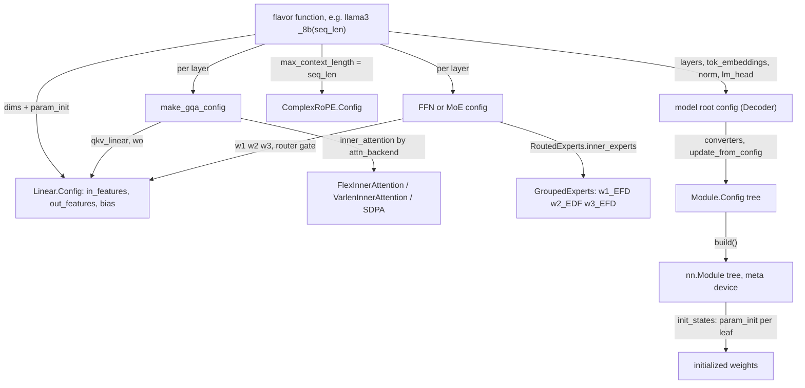

# Model definitions: shared building blocks and the model zoo

## Overview
A TorchTitan model is not written as a monolithic `nn.Module`. It is a **fully-specified tree of
config dataclasses** built by a per-size "flavor" function (for example Llama 3's
[`_8b`](https://github.com/google-pytorch/torchtitan/blob/033f131322a8b5b026ac53d734c689d664442bf8/torchtitan/models/llama3/__init__.py#L245 "torchtitan/models/llama3/__init__#_8b")),
and then turned into modules by calling `build()` on the root. Every node in that tree is the nested
`Config` of a [`Module`](https://github.com/google-pytorch/torchtitan/blob/033f131322a8b5b026ac53d734c689d664442bf8/torchtitan/protocols/module.py#L43 "torchtitan/protocols/module#Module")
subclass, and every leaf that owns parameters carries its own dimensions and its own `param_init`
dict. The shared building blocks live in `torchtitan/models/common`: a configurable
[`Linear`](https://github.com/google-pytorch/torchtitan/blob/033f131322a8b5b026ac53d734c689d664442bf8/torchtitan/models/common/linear.py#L31 "torchtitan/models/common/linear#Linear"),
grouped-query attention built by [`make_gqa_config`](https://github.com/google-pytorch/torchtitan/blob/033f131322a8b5b026ac53d734c689d664442bf8/torchtitan/models/common/config_utils.py#L170 "torchtitan/models/common/config_utils#make_gqa_config")
around a pluggable *inner* attention (`FlexInnerAttention`, `VarlenInnerAttention` or
`ScaledDotProductInnerAttention`), a SwiGLU feed-forward, an MoE layer whose experts are one
3-D-weight [`GroupedExperts`](https://github.com/google-pytorch/torchtitan/blob/033f131322a8b5b026ac53d734c689d664442bf8/torchtitan/models/common/moe.py#L440 "torchtitan/models/common/moe#GroupedExperts")
module, a vocab-parallel embedding, [`RMSNorm`](https://github.com/google-pytorch/torchtitan/blob/033f131322a8b5b026ac53d734c689d664442bf8/torchtitan/models/common/nn_modules.py#L134 "torchtitan/models/common/nn_modules#RMSNorm")
and RoPE variants such as [`ComplexRoPE`](https://github.com/google-pytorch/torchtitan/blob/033f131322a8b5b026ac53d734c689d664442bf8/torchtitan/models/common/rope.py#L185 "torchtitan/models/common/rope#ComplexRoPE"),
all stacked by a common decoder. The key design idea: because the whole architecture is data before
it is code, other subsystems (quantization, LoRA, sharding, the TPU overrides) can rewrite the tree -
swap a `Linear.Config`, change the inner attention, attach placements - before a single parameter is
allocated. The twelve model directories (llama3, qwen3, qwen3_5, qwen3_6, qwen3_8, deepseek_v3,
deepseek_v4, kimi_k2_7, kimi_k3, gpt_oss, muse_glimmer, flux) are mostly different *assemblies* of
these blocks; qwen3_6 and qwen3_8 are thin registry packages over the qwen3_5 implementation. Since
the upstream rebase, every module works on a **flattened token stream** `[T, ...]` rather than
`[B, L, ...]`.

## Diagram

Legend:
- `FL` - [`_8b`](https://github.com/google-pytorch/torchtitan/blob/033f131322a8b5b026ac53d734c689d664442bf8/torchtitan/models/llama3/__init__.py#L245 "torchtitan/models/llama3/__init__#_8b") (one of many flavor functions)
- `GQA` - [`make_gqa_config`](https://github.com/google-pytorch/torchtitan/blob/033f131322a8b5b026ac53d734c689d664442bf8/torchtitan/models/common/config_utils.py#L170 "torchtitan/models/common/config_utils#make_gqa_config")
- `FFN` - (concept) the SwiGLU feed-forward or MoE sub-config of a transformer block
- `LIN` - [`Config`](https://github.com/google-pytorch/torchtitan/blob/033f131322a8b5b026ac53d734c689d664442bf8/torchtitan/models/common/linear.py#L35 "torchtitan/models/common/linear#Linear.Config") of [`Linear`](https://github.com/google-pytorch/torchtitan/blob/033f131322a8b5b026ac53d734c689d664442bf8/torchtitan/models/common/linear.py#L31 "torchtitan/models/common/linear#Linear")
- `ROPE` - [`ComplexRoPE`](https://github.com/google-pytorch/torchtitan/blob/033f131322a8b5b026ac53d734c689d664442bf8/torchtitan/models/common/rope.py#L185 "torchtitan/models/common/rope#ComplexRoPE")
- `INNER` - (concept) the inner-attention backend chosen by the `attn_backend` string
- `GE` - [`GroupedExperts`](https://github.com/google-pytorch/torchtitan/blob/033f131322a8b5b026ac53d734c689d664442bf8/torchtitan/models/common/moe.py#L440 "torchtitan/models/common/moe#GroupedExperts") and its [`Config`](https://github.com/google-pytorch/torchtitan/blob/033f131322a8b5b026ac53d734c689d664442bf8/torchtitan/models/common/moe.py#L442 "torchtitan/models/common/moe#GroupedExperts.Config")
- `ROOT` - (concept) the decoder model config (`Decoder.Config` subclass per model)
- `MC` - [`Config`](https://github.com/google-pytorch/torchtitan/blob/033f131322a8b5b026ac53d734c689d664442bf8/torchtitan/protocols/module.py#L94 "torchtitan/protocols/module#Module.Config") of [`Module`](https://github.com/google-pytorch/torchtitan/blob/033f131322a8b5b026ac53d734c689d664442bf8/torchtitan/protocols/module.py#L43 "torchtitan/protocols/module#Module")
- `MOD` - (concept) the built module tree
- `INIT` - (concept) `init_states`, which applies each leaf's `param_init`

## Design rationale (why it's built this way)
- **Fully-specified configs, no hidden arithmetic.** The docstring of
  [`make_gqa_config`](https://github.com/google-pytorch/torchtitan/blob/033f131322a8b5b026ac53d734c689d664442bf8/torchtitan/models/common/config_utils.py#L170 "torchtitan/models/common/config_utils#make_gqa_config")
  ("Build a fully-specified GQAttention.Config") and the module note of `config_utils` ("construct
  fully-specified sub-configs with all dimensional fields set at config creation time") state the
  rule: every [`Config`](https://github.com/google-pytorch/torchtitan/blob/033f131322a8b5b026ac53d734c689d664442bf8/torchtitan/models/common/linear.py#L35 "torchtitan/models/common/linear#Linear.Config")
  of a linear carries its own [`in_features`](https://github.com/google-pytorch/torchtitan/blob/033f131322a8b5b026ac53d734c689d664442bf8/torchtitan/models/common/linear.py#L36 "torchtitan/models/common/linear#Linear.Config.in_features"),
  [`out_features`](https://github.com/google-pytorch/torchtitan/blob/033f131322a8b5b026ac53d734c689d664442bf8/torchtitan/models/common/linear.py#L37 "torchtitan/models/common/linear#Linear.Config.out_features")
  and [`bias`](https://github.com/google-pytorch/torchtitan/blob/033f131322a8b5b026ac53d734c689d664442bf8/torchtitan/models/common/linear.py#L38 "torchtitan/models/common/linear#Linear.Config.bias")
  (default `False`). A converter that swaps a linear therefore has everything it needs locally, and a
  reader can see every GEMM shape by printing the config. The same rule now covers context length:
  flavor functions take a keyword-only `seq_len` and build every RoPE cache at exactly that
  `max_context_length`, instead of building at the model maximum and shrinking later.
- **Diamond inheritance keeps the module tree flat.** [`Linear`](https://github.com/google-pytorch/torchtitan/blob/033f131322a8b5b026ac53d734c689d664442bf8/torchtitan/models/common/linear.py#L31 "torchtitan/models/common/linear#Linear")
  is `nn.Linear` + `Module`, so all of `nn.Linear`'s forward and state-dict logic is reused and there
  is no wrapper level in FQNs; `build()` comes from [`Configurable`](https://github.com/google-pytorch/torchtitan/blob/033f131322a8b5b026ac53d734c689d664442bf8/torchtitan/config/configurable.py#L18 "torchtitan/config/configurable#Configurable").
  [`Config`](https://github.com/google-pytorch/torchtitan/blob/033f131322a8b5b026ac53d734c689d664442bf8/torchtitan/protocols/module.py#L94 "torchtitan/protocols/module#Module.Config")
  of `Module` adds the two cross-cutting fields every leaf can carry, `param_init` and `sharding_config`,
  and copies them onto the instance at build time. [`RMSNorm`](https://github.com/google-pytorch/torchtitan/blob/033f131322a8b5b026ac53d734c689d664442bf8/torchtitan/models/common/nn_modules.py#L134 "torchtitan/models/common/nn_modules#RMSNorm")
  ("Configurable nn.RMSNorm") follows the same pattern.
- **Initialization is data, per parameter.** Instead of an `init_weights` method per model, each
  config names an init function per local parameter name, and `init_states` recurses. Flavor functions
  use this to express depth-scaled init: in [`_8b`](https://github.com/google-pytorch/torchtitan/blob/033f131322a8b5b026ac53d734c689d664442bf8/torchtitan/models/llama3/__init__.py#L245 "torchtitan/models/llama3/__init__#_8b")
  the `wo` and `w2`/`w3` projections of layer `i` get `std = 0.02 / sqrt(2 (i + 1))`, the LM head
  gets `std = dim^-0.5` truncated at 3 sigma, and embeddings `std = 1`. Weight tying works by pointing
  the embedding's init at a no-op and re-tying before init.
- **Attention is split into "projections" and "inner attention".** The outer attention module owns
  QKV / output projections, QK-norm and RoPE; the inner module only computes softmax(QK^T)V on the
  flattened `(T, N, H)` layout. The backend is a string (`attn_backend`) resolved per flavor, so the
  same model runs with FlexAttention (block masks from packed-document positions), varlen
  FlashAttention (CUDA) or SDPA (TPU). The flex inner attention keeps a single class-level compiled
  `flex_attention` ("otherwise there will be multiple compiled flex_attention instances, which can
  be slow") and autotunes it with inductor/Triton. Upstream's `config_utils` now says SDPA "is not a
  valid language-model backend" because it cannot consume per-document positions; the `"sdpa"` string
  still maps to it, and it is what the TPU lane uses.
- **Experts as one 3-D tensor per projection.** [`GroupedExperts`](https://github.com/google-pytorch/torchtitan/blob/033f131322a8b5b026ac53d734c689d664442bf8/torchtitan/models/common/moe.py#L440 "torchtitan/models/common/moe#GroupedExperts")
  stores `w1_EFD` and `w3_EFD` of shape `(num_experts, hidden, dim)` and `w2_EDF` of shape
  `(num_experts, dim, hidden)`, and runs all experts with
  three `torch._grouped_mm` calls over tokens sorted by expert, rather than a Python loop of small
  per-expert matmuls. That is both the GPU-efficient form and the shape that expert parallelism shards
  along `E`. The grouped matmul sits behind an overridable `_grouped_mm` seam ("the MXFP8 converter
  swaps this for a scaled grouped GEMM"), kept as a plain method so FX tracers capture it. Its
  [`Config`](https://github.com/google-pytorch/torchtitan/blob/033f131322a8b5b026ac53d734c689d664442bf8/torchtitan/models/common/moe.py#L442 "torchtitan/models/common/moe#GroupedExperts.Config")
  is now only `dim`, `hidden_dim`, `num_experts`: the token dispatcher moved out to a sibling inside
  `RoutedExperts`, so "each can be overridden independently".

> [!inferred]
> The pieces not in this page's symbol set work as follows (from `torchtitan/models/common`):
> `Decoder` is the base for all language models and owns `tok_embeddings`, a `ModuleDict` of layers
> keyed `"0".."N-1"`, a final RMSNorm and an `lm_head` `Linear`; its forward computes Splash-style
> `segment_ids` once from `positions` ("each layer is its own activation-checkpoint region") and passes
> `(h, attention_masks, positions, segment_ids)` to every layer, and can skip the LM head for the
> chunked loss. Its `preprocess_inputs` now builds the flex/varlen masks (only when the first
> full-attention layer's backend is flex or varlen), CP-shards the batch and annotates spmd_types.
> `TransformerBlock` is pre-norm: `x + attn(norm(x))`, then `x + ffn_or_moe(norm(x))`.
> `FeedForward` is SwiGLU, `w2(silu(w1 x) * w3 x)`, with the Llama-style hidden size
> `round_up(ffn_multiplier * 8 dim / 3, multiple_of)`. `MoE` = `TokenChoiceTopKRouter` (gate is a
> `RouterGateLinear` with FP32 output and backward GEMMs; sigmoid, softmax or `sqrtsoftplus` scores;
> optional node-limited group routing; top-k with `sorted=True` for TorchTPU kernel compatibility;
> optional renormalization and route scale) + `RoutedExperts` (token dispatcher + `GroupedExperts`) +
> optional shared-expert FFN. Load balancing is auxiliary-loss-free through an `expert_bias_E` buffer
> updated outside the forward, and/or an aux loss configured on `router.aux_loss`
> (`MoELoadBalanceAuxLoss` sequence- or batch-wise, mutually exclusive with the bias; or
> `MicrobatchWiseLoadBalanceLoss`, which DeepSeek-V3 combines with the bias). `Embedding` is
> vocab-parallel when it has a TP group, masking out-of-shard ids. `Decoder.Config.update_from_config`
> checks TP divides both head counts, EP divides every MoE's `num_experts`, rejects weight tying with
> PP, and rewrites token-dispatcher configs for EP.

## Entry points
- A model directory's `model_registry(flavor, seq_len=..., attn_backend=..., converters=...)` looks
  up a `(flavor function, max_context_length)` pair such as
  [`_8b`](https://github.com/google-pytorch/torchtitan/blob/033f131322a8b5b026ac53d734c689d664442bf8/torchtitan/models/llama3/__init__.py#L245 "torchtitan/models/llama3/__init__#_8b")
  (131072), [`_671b`](https://github.com/google-pytorch/torchtitan/blob/033f131322a8b5b026ac53d734c689d664442bf8/torchtitan/models/deepseek_v3/__init__.py#L557 "torchtitan/models/deepseek_v3/__init__#_671b")
  (16384) or [`_kimi_k2_5`](https://github.com/google-pytorch/torchtitan/blob/033f131322a8b5b026ac53d734c689d664442bf8/torchtitan/models/kimi_k2_7/__init__.py#L410 "torchtitan/models/kimi_k2_7/__init__#_kimi_k2_5")
  (262144), raises if the requested `seq_len` exceeds that maximum, calls the flavor with
  `seq_len`, applies converters to the returned config, and wraps it in a `ModelSpec` (which now also
  carries `max_context_length`) with the model's parallelize/pipeline functions and state-dict
  adapter. Recipes (`config_registry.py`) call it.
- The [`Trainer`](https://github.com/google-pytorch/torchtitan/blob/033f131322a8b5b026ac53d734c689d664442bf8/torchtitan/trainer.py#L74 "torchtitan/trainer#Trainer") calls the
  root config's `update_from_config` with the whole trainer config (plus batch sizes re-derived from
  the token-based training fields for the MoE aux-loss normalization), applies config overrides,
  builds the model on the meta device, parallelizes it, materializes it with `to_empty` and calls
  `init_weights`, a backward-compatible alias of `init_states`. Each step it hands the batch to the
  model's `preprocess_inputs`, which asks for attention masks only when the first full-attention
  layer's inner attention is flex or varlen.
- The TPU lane reuses the same builders with its own small configs and backends, for example
  [`_testmodel`](https://github.com/google-pytorch/torchtitan/blob/033f131322a8b5b026ac53d734c689d664442bf8/torchtitan/experiments/tpu/llama3/__init__.py#L12 "torchtitan/experiments/tpu/llama3/__init__#_testmodel")
  for Llama 3, [`_testmodel_moe`](https://github.com/google-pytorch/torchtitan/blob/033f131322a8b5b026ac53d734c689d664442bf8/torchtitan/experiments/tpu/qwen3/__init__.py#L29 "torchtitan/experiments/tpu/qwen3/__init__#_testmodel_moe")
  and [`_8b_tpu`](https://github.com/google-pytorch/torchtitan/blob/033f131322a8b5b026ac53d734c689d664442bf8/torchtitan/experiments/tpu/qwen3/__init__.py#L72 "torchtitan/experiments/tpu/qwen3/__init__#_8b_tpu")
  for Qwen3, and [`_testmodel`](https://github.com/google-pytorch/torchtitan/blob/033f131322a8b5b026ac53d734c689d664442bf8/torchtitan/experiments/tpu/deepseek_v3/__init__.py#L17 "torchtitan/experiments/tpu/deepseek_v3/__init__#_testmodel")
  / [`_testmodel_moe`](https://github.com/google-pytorch/torchtitan/blob/033f131322a8b5b026ac53d734c689d664442bf8/torchtitan/experiments/tpu/deepseek_v3/__init__.py#L77 "torchtitan/experiments/tpu/deepseek_v3/__init__#_testmodel_moe")
  for DeepSeek-V3. The TPU Llama 3 registry builds the upstream 1B/8B/70B/405B flavors with `"sdpa"`
  at each flavor's full context length (the registry docstring explains this reproduces the
  pre-rebase callable after upstream made `seq_len` required). `_8b_tpu` differs from upstream's 8B
  by `fuse_qkv=False` "to avoid running attention projection GEMMs as a single fused block on TPU".
- The [`CheckpointManager`](https://github.com/google-pytorch/torchtitan/blob/033f131322a8b5b026ac53d734c689d664442bf8/torchtitan/components/checkpointer/dcp.py#L89 "torchtitan/components/checkpointer/dcp#CheckpointManager")
  relies on the stable FQNs the config tree produces (e.g. `layers.3.attention.wo.weight`) to map to
  Hugging Face names through each model's state-dict adapter; a fused `wqkv` is saved and loaded in
  the stock `wq`/`wk`/`wv` layout by state-dict hooks, so fused and unfused checkpoints interoperate.

## Mechanism (step-by-step)
1. **A flavor function fixes the architecture numbers.** For Llama 3,
   [`_8b`](https://github.com/google-pytorch/torchtitan/blob/033f131322a8b5b026ac53d734c689d664442bf8/torchtitan/models/llama3/__init__.py#L245 "torchtitan/models/llama3/__init__#_8b")
   sets `dim=4096`, 32 heads, 8 KV heads, 32 layers, vocab 128256, FFN hidden
   `compute_ffn_hidden_dim(4096, multiple_of=1024, ffn_dim_multiplier=1.3)` = 14336, and a
   [`ComplexRoPE`](https://github.com/google-pytorch/torchtitan/blob/033f131322a8b5b026ac53d734c689d664442bf8/torchtitan/models/common/rope.py#L185 "torchtitan/models/common/rope#ComplexRoPE")
   with Llama 3.1 scaling and `max_context_length=seq_len`; siblings
   [`_1b`](https://github.com/google-pytorch/torchtitan/blob/033f131322a8b5b026ac53d734c689d664442bf8/torchtitan/models/llama3/__init__.py#L151 "torchtitan/models/llama3/__init__#_1b"),
   [`_3b`](https://github.com/google-pytorch/torchtitan/blob/033f131322a8b5b026ac53d734c689d664442bf8/torchtitan/models/llama3/__init__.py#L198 "torchtitan/models/llama3/__init__#_3b"),
   [`_70b`](https://github.com/google-pytorch/torchtitan/blob/033f131322a8b5b026ac53d734c689d664442bf8/torchtitan/models/llama3/__init__.py#L289 "torchtitan/models/llama3/__init__#_70b")
   (8192 / 64 heads / FFN 28672) and [`_405b`](https://github.com/google-pytorch/torchtitan/blob/033f131322a8b5b026ac53d734c689d664442bf8/torchtitan/models/llama3/__init__.py#L333 "torchtitan/models/llama3/__init__#_405b")
   (16384 / 128 heads / FFN 53248 / 126 layers) differ mostly in numbers (1B and 3B also tie the
   embedding to the LM head), and
   [`_debugmodel`](https://github.com/google-pytorch/torchtitan/blob/033f131322a8b5b026ac53d734c689d664442bf8/torchtitan/models/llama3/__init__.py#L114 "torchtitan/models/llama3/__init__#_debugmodel")
   shrinks everything to `dim=256`, vocab 2048 for CI.
2. **Per-layer configs are built in a loop so init can depend on depth.** The layer builder calls
   [`make_gqa_config`](https://github.com/google-pytorch/torchtitan/blob/033f131322a8b5b026ac53d734c689d664442bf8/torchtitan/models/common/config_utils.py#L170 "torchtitan/models/common/config_utils#make_gqa_config")
   for each layer. With `fuse_qkv=True` (every shipped upstream Llama 3 / Qwen3 flavor except Qwen3's
   `debugmodel_non_fused_qkv` test flavor) it emits a fused QKV module around one `wqkv`
   [`Linear`](https://github.com/google-pytorch/torchtitan/blob/033f131322a8b5b026ac53d734c689d664442bf8/torchtitan/models/common/linear.py#L31 "torchtitan/models/common/linear#Linear")
   of `out_features = (n_heads + 2 n_kv_heads) * head_dim`, laid out KV-group-major, with a special
   per-slice initializer so the fused weight is "bit-identical to the stock separate wq/wk/wv"
   (and, under the `spmd_types` backend, already chunked to this TP rank). Otherwise it emits separate
   `wq` and `wkv`. The output projection gets the depth-scaled init, the inner attention comes from
   the backend string, and the RoPE config is copied per layer (`rope=None` builds a NoPE layer). A
   new `tp_gemm_backend="dist_gemm"` swaps in all-gather-fused QKV and row-parallel output classes
   that fold the TP collectives into the GEMMs over symmetric memory; it requires `fuse_qkv=True`,
   CUDA and the spmd_types backend.
3. **Attention backends are chosen by string.** `"flex"` gives the flex inner attention (compiled
   `flex_attention` with a `BlockMask`, max-autotune and coordinate-descent tuning enabled;
   `[T, H, K]` inputs adapted to `[1, H, T, K]` only at the kernel boundary), `"flex_flash"` the same
   with the FLASH backend and 256x128 blocks (Hopper/Blackwell only), `"varlen"` the varlen inner
   attention (consumes the already-flat `T` tokens with cumulative sequence lengths, casts q/k/v to
   bf16, supports a `(left, right)` window for sliding-window attention, activates the configured CUDA
   flash-attention implementation), and `"sdpa"` plain scaled-dot-product attention, which on a TPU
   host restricts SDPA to the overrideable and math backends. Because upstream now passes 3-D
   `[T, H, K]` tensors, the SDPA path carries a `TT-UNFLATTEN-SHIM` that reshapes back to
   `[B, L, H, K]` using a `seq_len` set by the TPU trainer's shim context (and treats `T` as one
   sequence when no shim is active). These choices are exercised with
   [`make_mla_attention_config`](https://github.com/google-pytorch/torchtitan/blob/033f131322a8b5b026ac53d734c689d664442bf8/torchtitan/models/deepseek_v3/__init__.py#L85 "torchtitan/models/deepseek_v3/__init__#make_mla_attention_config")
   too, which takes the same `attn_backend` string through an `attention_config_factory`.
4. **Dense FFN or MoE per layer.** Dense models attach a SwiGLU config of three linears. MoE models
   attach a router whose gate is a `Linear` subclass (`dim -> num_experts`, FP32 output), a
   `RoutedExperts` config holding a
   [`GroupedExperts`](https://github.com/google-pytorch/torchtitan/blob/033f131322a8b5b026ac53d734c689d664442bf8/torchtitan/models/common/moe.py#L440 "torchtitan/models/common/moe#GroupedExperts")
   [`Config`](https://github.com/google-pytorch/torchtitan/blob/033f131322a8b5b026ac53d734c689d664442bf8/torchtitan/models/common/moe.py#L442 "torchtitan/models/common/moe#GroupedExperts.Config")
   (`dim`, `hidden_dim`, `num_experts`) next to a token dispatcher chosen by `comm_backend` (local,
   all-to-all, DeepEP, HybridEP or minimal-async EP), and optionally a shared-expert FFN. At run time
   the router counts tokens per expert (by default with `histc` over the top-k ids, skipping a
   `(T, E)` one-hot routing map that is slow on TPU), the dispatcher reorders tokens (with EP:
   all-to-all to the owning ranks), the experts compute `w2(silu(x w1^T) * (x w3^T))` with three
   grouped matmuls, and the dispatcher combines back; the expert math is done explicitly in bf16
   (`x.bfloat16()`, `weight.bfloat16()`) and cast back to the input dtype. The TPU test helper
   [`_moe_config`](https://github.com/google-pytorch/torchtitan/blob/033f131322a8b5b026ac53d734c689d664442bf8/torchtitan/experiments/tpu/tests/test_discarded_token_counter.py#L32 "torchtitan/experiments/tpu/tests/test_discarded_token_counter#_moe_config")
   and the transformers-backend
   [`_build_moe_config`](https://github.com/google-pytorch/torchtitan/blob/033f131322a8b5b026ac53d734c689d664442bf8/torchtitan/experiments/transformers_modeling_backend/moe_replacement.py#L540 "torchtitan/experiments/transformers_modeling_backend/moe_replacement#_build_moe_config")
   ("Build a fully-specified MoE.Config from probed parameters") assemble the same tree.
5. **The root config is adjusted by the job, then built.** Converters rewrite leaves (for example
   `Linear.Config` to a float8 variant), `update_from_config` validates TP/EP/PP compatibility,
   per-model sharding helpers fill `sharding_config` on each
   [`Config`](https://github.com/google-pytorch/torchtitan/blob/033f131322a8b5b026ac53d734c689d664442bf8/torchtitan/protocols/module.py#L94 "torchtitan/protocols/module#Module.Config"),
   and `build()` instantiates the tree (on meta). Under the spmd_types backend,
   [`Module`](https://github.com/google-pytorch/torchtitan/blob/033f131322a8b5b026ac53d734c689d664442bf8/torchtitan/protocols/module.py#L43 "torchtitan/protocols/module#Module")
   rejects any parameter whose TP or EP shard would be uneven. After parallelization, `init_states`
   walks the tree and applies each leaf's `param_init`, falling back to `reset_parameters` and raising
   if a parameter has neither.

## Key data structures
- [`Config`](https://github.com/google-pytorch/torchtitan/blob/033f131322a8b5b026ac53d734c689d664442bf8/torchtitan/models/common/linear.py#L35 "torchtitan/models/common/linear#Linear.Config")
  of `Linear` - `in_features`, `out_features`, `bias`, plus inherited `param_init` and
  `sharding_config`. Every GEMM in a language model is one of these (or a subclass such as the FP32
  router gate), which is why quantization and LoRA can be written as config traversals.
- [`GroupedExperts`](https://github.com/google-pytorch/torchtitan/blob/033f131322a8b5b026ac53d734c689d664442bf8/torchtitan/models/common/moe.py#L440 "torchtitan/models/common/moe#GroupedExperts")
  parameters `w1_EFD`, `w2_EDF`, `w3_EFD` (suffixes: E experts, F hidden, D model dim); the dispatcher
  is a sibling in `RoutedExperts`. The shape-suffix naming convention (`T, D, F, E, K, R` and, in
  attention, `T, H, K, V`) is used throughout `moe.py` and `attention.py` and is the fastest way to
  read that code; `T` (packed tokens) replaced `B, L` almost everywhere in the rebase.
- [`ComplexRoPE`](https://github.com/google-pytorch/torchtitan/blob/033f131322a8b5b026ac53d734c689d664442bf8/torchtitan/models/common/rope.py#L185 "torchtitan/models/common/rope#ComplexRoPE")
  - a `(max_context_length, dim / 2)` complex64 cache with optional `"llama"` or `"yarn"` scaling,
  applied by complex multiplication on adjacent dimension pairs. Its sibling `CosSinRoPE` rotates
  halves instead; the two are not interchangeable for an existing checkpoint.
- Config knobs of the inner attentions: the flex inner attention takes `block_size` and
  `kernel_options`; the varlen inner attention takes `window_size` (`(-1, 0)` causal, `(-1, -1)`
  bidirectional, `(W, 0)` sliding window).
- The model root config (a `Decoder.Config` subclass per model) holds `dim`, `vocab_size`,
  `tok_embeddings`, `layers` (a list of per-layer block configs, which may differ layer to layer),
  `norm`, `lm_head` and `enable_weight_tying`, plus `first_attention` / `first_moe` helpers that
  hybrid models rely on.

## Model families (how each differs)

**Llama 3 (dense, reference).** The template the models README tells new models to copy: GQA with
fused QKV, SwiGLU FFN, `ComplexRoPE`, no biases, no QK-norm, untied embeddings except in the 1B and
3B flavors, which set `enable_weight_tying=True`. Flavors
[`_debugmodel`](https://github.com/google-pytorch/torchtitan/blob/033f131322a8b5b026ac53d734c689d664442bf8/torchtitan/models/llama3/__init__.py#L114 "torchtitan/models/llama3/__init__#_debugmodel")
through [`_405b`](https://github.com/google-pytorch/torchtitan/blob/033f131322a8b5b026ac53d734c689d664442bf8/torchtitan/models/llama3/__init__.py#L333 "torchtitan/models/llama3/__init__#_405b"),
all with a 131072 maximum context. Head dim is 128 in the 3B, 8B, 70B and 405B flavors but 64 in 1B
(`dim=2048`, 32 heads, so its KV width is 512); `dim` and FFN hidden are multiples of 1024 in every
production flavor.

**Qwen3 (dense and MoE).** Same decoder with per-head QK-norm (RMSNorm on q and k before RoPE),
explicit `head_dim=128` decoupled from `dim` (the 4B flavor has 32 x 128 = 4096 query width on a
`dim=2560` residual), `CosSinRoPE` with theta 1e6, a 40960 maximum context, and weight tying on the
small dense flavors (`0.6B`, `1.7B`, `4B`; `debugmodel` and `testmodel` for CI). The MoE flavor
`30B-A3B` replaces every FFN with 128 experts, top-8, expert hidden 768, softmax router with
renormalized top-k and bias-based load balancing; `30B-A3B-global-aux` swaps the bias for Qwen's
global-batch `MoELoadBalanceAuxLoss` (`batch_wise`) on `router.aux_loss`. The TPU lane's
[`_8b_tpu`](https://github.com/google-pytorch/torchtitan/blob/033f131322a8b5b026ac53d734c689d664442bf8/torchtitan/experiments/tpu/qwen3/__init__.py#L72 "torchtitan/experiments/tpu/qwen3/__init__#_8b_tpu")
and [`_testmodel_moe`](https://github.com/google-pytorch/torchtitan/blob/033f131322a8b5b026ac53d734c689d664442bf8/torchtitan/experiments/tpu/qwen3/__init__.py#L29 "torchtitan/experiments/tpu/qwen3/__init__#_testmodel_moe")
reuse the upstream Qwen3 layer builders.

**Qwen3.5 / Qwen3.6 / Qwen3.8 (hybrid attention, multimodal).** Per its README: "75% GatedDeltaNet
(linear attention) + 25% full attention with output gating and partial RoPE", a ViT vision encoder
whose patch tokens are scattered into placeholder positions of the text sequence, and MRoPE, which
"interleaves RoPE from temporal, height, and width position IDs". Only every fourth layer
(`full_attention_interval=4`) has an attention config; the others carry a delta-net config (a layer
with `attention=None`, which is why the decoder looks up the *first* attention layer for mask type
and TP validation). Full-attention layers use `head_dim=256` with only 64 rotary dims split
`[11, 11, 10]` across the three MRoPE axes, and a query projection twice as wide as the heads (the
extra half is the output gate). [`_27b`](https://github.com/google-pytorch/torchtitan/blob/033f131322a8b5b026ac53d734c689d664442bf8/torchtitan/models/qwen3_5/__init__.py#L831 "torchtitan/models/qwen3_5/__init__#_27b")
("Qwen3.5-27B dense config with vision encoder") is `dim=5120`, 64 layers, 24 query / 4 KV heads,
FFN 17408 and a 27-layer vision tower. The registry also has dense `0.8B`, `2B`, `4B`, `9B`, MoE
(routed experts plus a sigmoid-gated shared expert) `35B-A3B`, `122B-A10B`, `397B-A17B`, and
`debugmodel` / `debugmodel_moe`, all with a 262144 maximum context. `qwen3_6` (27B dense, 35B-A3B
MoE) and `qwen3_8` (27B dense, which its README calls "architecturally identical to Qwen3.5-27B",
and a text-only 2.4T-A95B MoE with 512 experts top-10) are registry-and-recipe packages only: "The
model architecture and implementation remain in `torchtitan/models/qwen3_5/`". Released MTP weights
are not imported by either.

**DeepSeek-V3 (MLA + fine-grained MoE, optional MTP).** Attention is Multi-head Latent Attention,
built by [`make_mla_attention_config`](https://github.com/google-pytorch/torchtitan/blob/033f131322a8b5b026ac53d734c689d664442bf8/torchtitan/models/deepseek_v3/__init__.py#L85 "torchtitan/models/deepseek_v3/__init__#make_mla_attention_config")
("Build a fully-specified DeepSeek V3 MLA ``Attention.Config``", now public so Kimi reuses it):
queries go through a low-rank `wq_a -> RMSNorm -> wq_b` bottleneck when `q_lora_rank > 0` (direct
`wq` when it is 0), keys and values are compressed by `wkv_a` to a `kv_lora_rank` latent plus a
shared RoPE key, normalized, and expanded by `wkv_b`; the query/key head dim is
`qk_nope_head_dim + qk_rope_head_dim` (128 + 64 = 192 in
[`_671b`](https://github.com/google-pytorch/torchtitan/blob/033f131322a8b5b026ac53d734c689d664442bf8/torchtitan/models/deepseek_v3/__init__.py#L557 "torchtitan/models/deepseek_v3/__init__#_671b"))
while the value head dim is 128. The first `n_dense_layers` (3 of 61) are dense; the rest are MoE with
256 routed experts plus one shared expert, top-8 sigmoid routing, node-limited routing (8 groups, 4
selected), route scale 2.5 and a microbatch-wise aux loss on top of the bias balancing, with
YaRN-scaled RoPE. Every flavor now takes `num_mtp_layers` (multi-token prediction layers built from
the last decoder layer; see the directory's `MTP.md`). Smaller flavors:
[`_16b`](https://github.com/google-pytorch/torchtitan/blob/033f131322a8b5b026ac53d734c689d664442bf8/torchtitan/models/deepseek_v3/__init__.py#L406 "torchtitan/models/deepseek_v3/__init__#_16b"),
[`_236b`](https://github.com/google-pytorch/torchtitan/blob/033f131322a8b5b026ac53d734c689d664442bf8/torchtitan/models/deepseek_v3/__init__.py#L480 "torchtitan/models/deepseek_v3/__init__#_236b"),
[`_debugmodel`](https://github.com/google-pytorch/torchtitan/blob/033f131322a8b5b026ac53d734c689d664442bf8/torchtitan/models/deepseek_v3/__init__.py#L332 "torchtitan/models/deepseek_v3/__init__#_debugmodel"),
and an upstream [`_testmodel`](https://github.com/google-pytorch/torchtitan/blob/033f131322a8b5b026ac53d734c689d664442bf8/torchtitan/models/deepseek_v3/__init__.py#L635 "torchtitan/models/deepseek_v3/__init__#_testmodel")
(`dim=16`, 2 layers, 4 experts); all have a 16384 maximum context.

**DeepSeek-V4 (compressed sparse attention, hyper-connections, MTP).** New in this pin.
[`_make_v4_attn_config`](https://github.com/google-pytorch/torchtitan/blob/033f131322a8b5b026ac53d734c689d664442bf8/torchtitan/models/deepseek_v4/__init__.py#L172 "torchtitan/models/deepseek_v4/__init__#_make_v4_attn_config")
picks the inner attention per layer from its `compress_ratio`: ratio 4 gets compressed sparse
attention (a KV compressor with overlap plus a top-k indexer), ratios above 1 get "heavily
compressed" attention, and ratio 1 gets sliding-window attention. Queries use a `wq_a -> q_norm ->
wq_b` low-rank path, keys/values a single `wkv` of `head_dim` (512), the output a grouped low-rank
`wo_a -> wo_b`, and per-head attention sinks are held in a `(n_heads, 1)` `Linear`. The MoE router
uses `sqrtsoftplus` scores with hash routing on the first layers, and blocks mix `hc_mult=4`
branches through the HC modules of `mhc.py` (Sinkhorn-normalized combination weights).
[`_deepseek_v4_flash`](https://github.com/google-pytorch/torchtitan/blob/033f131322a8b5b026ac53d734c689d664442bf8/torchtitan/models/deepseek_v4/__init__.py#L742 "torchtitan/models/deepseek_v4/__init__#_deepseek_v4_flash")
is `dim=4096`, 43 layers, 64 heads, 256 experts top-6;
[`_deepseek_v4_pro`](https://github.com/google-pytorch/torchtitan/blob/033f131322a8b5b026ac53d734c689d664442bf8/torchtitan/models/deepseek_v4/__init__.py#L874 "torchtitan/models/deepseek_v4/__init__#_deepseek_v4_pro")
is `dim=7168`, 61 layers, 128 heads, 384 experts top-6; both are registered with only a 4096 maximum
context. [`_build_mtp_layers`](https://github.com/google-pytorch/torchtitan/blob/033f131322a8b5b026ac53d734c689d664442bf8/torchtitan/models/deepseek_v4/__init__.py#L535 "torchtitan/models/deepseek_v4/__init__#_build_mtp_layers")
appends MTP blocks with their own `e_proj`/`h_proj` linears and depth-scaled init, and
[`_debugmodel`](https://github.com/google-pytorch/torchtitan/blob/033f131322a8b5b026ac53d734c689d664442bf8/torchtitan/models/deepseek_v4/__init__.py#L610 "torchtitan/models/deepseek_v4/__init__#_debugmodel")
is the smoke-test flavor. The README warns that "Checkpoint compatibility and larger-scale
convergence validation should be verified before using the larger configs for production training."

**Kimi K2.5 / K2.6 / K2.7 (`kimi_k2_7`: DeepSeek-V3 decoder + vision).** The README: a
"**DeepSeek-V3-style** decoder (Multi-head Latent Attention + Mixture-of-Experts) with a
**MoonViT3d** vision encoder", projected vision embeddings scattered into the text sequence.
[`_kimi_k2_5`](https://github.com/google-pytorch/torchtitan/blob/033f131322a8b5b026ac53d734c689d664442bf8/torchtitan/models/kimi_k2_7/__init__.py#L410 "torchtitan/models/kimi_k2_7/__init__#_kimi_k2_5")
is the "Architecture shared by Kimi K2.5, K2.6, and K2.7-Code: a ~1T-total / ~32B-active
DeepSeekV3-style text tower (384 routed experts, top-8)" at `dim=7168`, 61 layers, 64 heads.
[`_moonlight_16b_a3b_config`](https://github.com/google-pytorch/torchtitan/blob/033f131322a8b5b026ac53d734c689d664442bf8/torchtitan/models/kimi_k2_7/__init__.py#L295 "torchtitan/models/kimi_k2_7/__init__#_moonlight_16b_a3b_config")
is the "Shared Moonshot 16B-A3B DeepSeekV3 text tower" behind the Moonlight and Kimi-VL flavors
(no q-LoRA, 64 experts top-6), and
[`_debugmodel`](https://github.com/google-pytorch/torchtitan/blob/033f131322a8b5b026ac53d734c689d664442bf8/torchtitan/models/kimi_k2_7/__init__.py#L219 "torchtitan/models/kimi_k2_7/__init__#_debugmodel")
is the CI flavor. Recipes use DistMuon with the Kimi K2 QK-clipping update.

**Kimi K3 (`kimi_k3`: hybrid KDA + MLA, LatentMoE).** The README: "69 KDA layers and 24 Gated MLA
layers", "Stable LatentMoE selects 16 of 896 experts per token", SiTU-GLU activation, MoonViT-V2
vision. [`_latent_moe_config`](https://github.com/google-pytorch/torchtitan/blob/033f131322a8b5b026ac53d734c689d664442bf8/torchtitan/models/kimi_k3/__init__.py#L219 "torchtitan/models/kimi_k3/__init__#_latent_moe_config")
shows what "latent" means for shapes: tokens are projected down `dim -> latent_dim` before routing,
the routed experts (a SiTU subclass of the shared grouped experts) and the token dispatcher work on
the latent width ("the dispatcher buffers size by latent_dim, not model dim"), and the result is
normalized and projected back up, while shared experts run at full `dim`. Only FSDP2/HSDP is listed
as supported.

**GPT-OSS (MoE with sinks and sliding windows).** [`_make_gptoss_attn_config`](https://github.com/google-pytorch/torchtitan/blob/033f131322a8b5b026ac53d734c689d664442bf8/torchtitan/models/gpt_oss/__init__.py#L70 "torchtitan/models/gpt_oss/__init__#_make_gptoss_attn_config")
("Build a fully-specified GPT-OSS Attention.Config for a single layer") adds biases on every
projection, learned attention sinks (a per-layer `sinks` parameter with depth-scaled init), and, when
a sliding window is requested with the varlen backend, rewrites the inner attention's window to
`(W - 1, 0)`. [`_build_gptoss_layers`](https://github.com/google-pytorch/torchtitan/blob/033f131322a8b5b026ac53d734c689d664442bf8/torchtitan/models/gpt_oss/__init__.py#L185 "torchtitan/models/gpt_oss/__init__#_build_gptoss_layers")
alternates layers ("Even-indexed layers (0, 2, 4, ...) use sliding window attention", window 128) and
gives every layer a model-specific grouped-experts class with biases and a softmax router; it now also
takes `fuse_qkv` (default on). Flavors
[`_20b`](https://github.com/google-pytorch/torchtitan/blob/033f131322a8b5b026ac53d734c689d664442bf8/torchtitan/models/gpt_oss/__init__.py#L296 "torchtitan/models/gpt_oss/__init__#_20b")
(`dim=2880`, 32 experts, top-4, head dim 64, YaRN RoPE),
[`_120b`](https://github.com/google-pytorch/torchtitan/blob/033f131322a8b5b026ac53d734c689d664442bf8/torchtitan/models/gpt_oss/__init__.py#L342 "torchtitan/models/gpt_oss/__init__#_120b"),
[`_debugmodel`](https://github.com/google-pytorch/torchtitan/blob/033f131322a8b5b026ac53d734c689d664442bf8/torchtitan/models/gpt_oss/__init__.py#L250 "torchtitan/models/gpt_oss/__init__#_debugmodel");
the default backend is varlen.

**Muse Glimmer (GQA with iRoPE, per-layer windows, gated output).** New in this pin.
[`_build_muse_glimmer_attention`](https://github.com/google-pytorch/torchtitan/blob/033f131322a8b5b026ac53d734c689d664442bf8/torchtitan/models/muse_glimmer/__init__.py#L134 "torchtitan/models/muse_glimmer/__init__#_build_muse_glimmer_attention")
builds unfused `wq`/`wkv`, a scaleless QK-norm, a tuned query scale, a sigmoid output gate
(`o_gate`, a `dim -> n_heads * head_dim` linear applied before `wo`), and a
[`ComplexRoPE`](https://github.com/google-pytorch/torchtitan/blob/033f131322a8b5b026ac53d734c689d664442bf8/torchtitan/models/common/rope.py#L185 "torchtitan/models/common/rope#ComplexRoPE")
(theta 500000) only on non-NoPE layers (the README's "iRoPE": RoPE skipped every fourth layer). A
cyclic `window_pattern` gives each layer a sliding window or global attention; varlen carries it as
a kernel window, flex as a window-keyed `BlockMask`.
[`_muse_glimmer_config`](https://github.com/google-pytorch/torchtitan/blob/033f131322a8b5b026ac53d734c689d664442bf8/torchtitan/models/muse_glimmer/__init__.py#L353 "torchtitan/models/muse_glimmer/__init__#_muse_glimmer_config")
adds gain-centered post-norm residuals, an embedding bundled with its norm (so it travels together
under PP splitting), a soft-capped LM head (so it "runs wherever lm_head runs", including the chunked
loss), and, for the `_mm` flavors, a vision encoder/adapter plus a projection into `dim`. Flavors:
`debugmodel` (4096 context) and `30B` (`dim=6656`, 52 layers, 32/2 heads, 16384 context), each with a
multimodal twin.

**Flux (diffusion, not a decoder).** Flux is a text-to-image diffusion transformer, trained here with an
MSE loss. It does not use the decoder at all: [`_flux_dev`](https://github.com/google-pytorch/torchtitan/blob/033f131322a8b5b026ac53d734c689d664442bf8/torchtitan/models/flux/__init__.py#L213 "torchtitan/models/flux/__init__#_flux_dev")
assembles 19 double-stream blocks (separate image and text streams with their own modulation
linears, QK-norm and attention, built by
[`_make_double_block_config`](https://github.com/google-pytorch/torchtitan/blob/033f131322a8b5b026ac53d734c689d664442bf8/torchtitan/models/flux/__init__.py#L50 "torchtitan/models/flux/__init__#_make_double_block_config"))
and 38 single-stream blocks ([`_make_single_block_config`](https://github.com/google-pytorch/torchtitan/blob/033f131322a8b5b026ac53d734c689d664442bf8/torchtitan/models/flux/__init__.py#L161 "torchtitan/models/flux/__init__#_make_single_block_config")),
`hidden_size=3072`, 24 heads, 3-axis positional embedding, plus frozen T5 and CLIP text encoders and
an autoencoder for latents. Modulation linears are zero-initialized. Other flavors:
[`_flux_schnell`](https://github.com/google-pytorch/torchtitan/blob/033f131322a8b5b026ac53d734c689d664442bf8/torchtitan/models/flux/__init__.py#L327 "torchtitan/models/flux/__init__#_flux_schnell"),
[`_flux_debug`](https://github.com/google-pytorch/torchtitan/blob/033f131322a8b5b026ac53d734c689d664442bf8/torchtitan/models/flux/__init__.py#L441 "torchtitan/models/flux/__init__#_flux_debug"),
and a new tiny [`_flux_test`](https://github.com/google-pytorch/torchtitan/blob/033f131322a8b5b026ac53d734c689d664442bf8/torchtitan/models/flux/__init__.py#L557 "torchtitan/models/flux/__init__#_flux_test")
(`hidden_size=256`, 2 heads). It still reuses the shared [`Linear`](https://github.com/google-pytorch/torchtitan/blob/033f131322a8b5b026ac53d734c689d664442bf8/torchtitan/models/common/linear.py#L31 "torchtitan/models/common/linear#Linear")
and config machinery, which is how MXFP8 conversion applies to it.

> [!inferred]
> **Shapes on the TPU MXU.** The MXU is a 128x128 (v5e) or 256x256 (v6e, v7) systolic array, so GEMM
> dimensions that are multiples of 128 (ideally 256) avoid padding waste. Llama 3 and Qwen3 are well
> aligned: head dim 128, hidden sizes 14336 / 28672 / 53248, Qwen3 MoE expert hidden 768 = 6 x 128.
> Weak spots: DeepSeek-V3's 192-wide query/key heads (and 64-wide RoPE part) under MLA, GPT-OSS's
> `dim=2880` (22.5 x 128) with 64-wide heads, and small per-expert token groups in fine-grained MoE
> (256 experts top-8 in DeepSeek-V3, 896 experts top-16 in Kimi K3), where each expert's GEMM has few
> rows; Kimi K3's latent MoE narrows the expert GEMMs to `latent_dim`. On TPU, `torch._grouped_mm`
> has to lower to a ragged/grouped dot, and the TPU recipes build models with `attn_backend="sdpa"`
> because FlexAttention compiles through inductor/Triton and varlen needs CUDA FlashAttention; the
> SDPA call is then served by the TPU's overrideable (Splash) path, which still expects `[B, L]`
> inputs and so depends on the unflatten shim. `ComplexRoPE`'s complex arithmetic cannot be traced
> inside a scan on TPU (a TPU test asserts the `view_as_complex_copy` failure), so the TPU recipes
> override it with a real-arithmetic equivalent. GPT-OSS's sliding windows and sinks, DeepSeek-V4's
> compressed sparse attention, Muse Glimmer's per-layer windows (flex or varlen only), and Qwen3.5's
> GatedDeltaNet and Kimi K3's KDA (Qwen3.5's kernels now come from `attn_gym.linear`, with a
> CUDA-only varlen causal conv) are the parts with no obvious TPU kernel in the upstream model code;
> the TPU experiment tree does carry its own `muse_glimmer` package.

## Dynamics (design intent)
- **Determinism and tracing.** Graph-trainer tests (`test_deepseek_v3_flex_attention`,
  `test_mark_dynamic_token_dim_with_rope`, and the bitwise-determinism suite) trace and run models
  built from these configs, for example the `TinyFlexMLA` test module's
  [`attn`](https://github.com/google-pytorch/torchtitan/blob/033f131322a8b5b026ac53d734c689d664442bf8/torchtitan/experiments/graph_trainer/tests/test_trace_module.py#L2043 "torchtitan/experiments/graph_trainer/tests/test_trace_module#TinyFlexMLA.attn").
  The source supports batch-invariant runs explicitly: the decoder disables FlexAttention's
  separate-full-blocks optimization in batch-invariant mode, and the varlen inner attention forces
  `num_splits=1` there (and always under FA2) to avoid non-deterministic split-k reductions.
- **Routing decisions are not recomputed.** The router runs its expert selection in a remat region
  with `recompute=False` ("Routing choices must remain identical between forward and replay"), and
  [`Module`](https://github.com/google-pytorch/torchtitan/blob/033f131322a8b5b026ac53d734c689d664442bf8/torchtitan/protocols/module.py#L43 "torchtitan/protocols/module#Module")
  now carries remat-region names and save patterns that RegionAC sets on every module of a
  checkpointed block.
- **Build order.** Config construction, conversion and `update_from_config` all happen before any
  tensor exists; the model is built on the meta device, sharded, materialized with `to_empty`, and only
  then initialized, so `param_init` functions always run on the final (possibly sharded) parameters.
- **MoE counters.** `tokens_per_expert_E` accumulates in the forward (and is double counted under
  activation checkpointing, harmless because the bias update uses `sign`); the expert bias is updated
  by an optimizer pre-step hook, not in the forward, so it composes with gradient accumulation.
- **FLOPs accounting.** The TPU lane's
  [`get_maxtext_decoder_nparams_and_flops`](https://github.com/google-pytorch/torchtitan/blob/033f131322a8b5b026ac53d734c689d664442bf8/torchtitan/experiments/tpu/mfu_flops.py#L17 "torchtitan/experiments/tpu/mfu_flops#get_maxtext_decoder_nparams_and_flops")
  ("Return parameter count and MaxText-style FLOPs for a standard decoder") reads the dimensions
  straight from the config tree; tests pin it against MaxText for Qwen3 8B and 30B-A3B.

## Edge cases
- **Sequence length above the flavor's maximum context** raises in `model_registry`; below it, RoPE
  caches are built at exactly `seq_len`. Positions beyond the cache are checked at apply time.
- **TP must divide both `n_heads` and `n_kv_heads`**, so an 8-KV-head model caps TP at 8 without
  replicating KV heads; **EP must divide every MoE's `num_experts`**; and under spmd_types any uneven
  TP/EP parameter shard is rejected at distribution time.
- **CP needs a CP-aware inner attention.** The decoder delegates CP sharding of the batch to the
  first full-attention backend's class, so that backend must be one of the CP inner attentions (the
  KV-all-gather or Ulysses flex variants); weight tying is rejected with PP.
- **SDPA cannot take attention masks.** Passing masks raises; with SDPA the model relies on
  `is_causal` and (on TPU) segment ids, so packed documents are only separated if the TPU kernel
  consumes those ids. Outside a TPU shim context, SDPA treats the whole flattened batch as one
  sequence.
- **The router's `topk` is `sorted=True`** for TorchTPU kernel compatibility, and the default
  `token_count_impl="histc"` skips the `(T, E)` routing map; the map is still built when an aux loss
  other than batch-wise `MoELoadBalanceAuxLoss` consumes it.
- **`_testmodel` configs use tiny dims** (`dim=16` to `128`, vocab 128-2048) and are for correctness
  tests only; their shapes say nothing about MXU efficiency.

## Open questions
- `Decoder`, `TransformerBlock`, `FeedForward`, `MoE`, `RoutedExperts`, `TokenChoiceTopKRouter`,
  `RouterGateLinear`, `Embedding`, `CosSinRoPE`, the inner-attention classes and the per-model
  attention classes (MLA, DeepSeek-V4 sparse attention, GPT-OSS, Qwen3.5, Kimi K3 KDA, Muse Glimmer,
  Flux blocks) are not in this page's symbol set; their behavior is described from source in the
  inferred blocks and would each merit citable coverage.
- How `torch._grouped_mm` lowers on the TorchTPU backend (and its efficiency at small per-expert
  group sizes) is not visible in this repo.
- Whether the TPU Splash path supports GPT-OSS sinks and sliding windows, MLA's 192/128 head split,
  Muse Glimmer's per-layer windows, or Qwen3.5's gated attention is not established here.
- When the TPU kernels accept `[T]` natively, the unflatten shim is meant to be deleted; until then
  any non-TPU trainer that calls SDPA on a multi-sequence batch silently attends across sequences.

## See also
- [Train spec and model protocol](train-spec-and-model-protocol.md) - `ModelSpec`, `model_registry`, the Module protocol
- [Quantization](quantization.md) - config-tree rewrite of `Linear` and `GroupedExperts`
- [LoRA](lora.md) - the other config converter
- [Expert parallel](expert-parallel.md) - token dispatchers and sharding of `GroupedExperts`
- [Tensor parallel](tensor-parallel.md) - `sharding_config` placements on these blocks
- [Context parallel](context-parallel.md) - which inner attentions support CP
- [State dict adapters](state-dict-adapters.md) - mapping these FQNs to Hugging Face checkpoints
- [Dataloading and tokenizer](dataloading-and-tokenizer.md) - where `positions` for masks and RoPE come from
- [Loss and validation](loss-and-validation.md) - the LM head, chunked loss and MSE loss for Flux
- [TorchTPU backend](torchtpu-backend.md) - the TPU recipes, SDPA/Splash and layer-loop overrides

## Recent changes
- `fa627bf2` brings in upstream `d771abb0`: modules now take a flattened `[T]` token stream (TPU SDPA keeps working through `TT-UNFLATTEN-SHIM` reshapes), flavor functions take `seq_len` and registries pair each flavor with a maximum context, inner attentions are renamed `*InnerAttention`, experts move under `RoutedExperts`, and the deepseek_v4, kimi_k2_7, kimi_k3, muse_glimmer, qwen3_6 and qwen3_8 directories arrive.
- `9f6ed5f1` ports `MoELoadBalanceAuxLoss` to upstream's `router.aux_loss` interface, restores the routing-metrics producer and drops the dead `MoE.Config.aux_loss` plumbing.
- `c79866f6` adds `TokenChoiceTopKRouter.Config.token_count_impl`: `"histc"` counts routed tokens from the top-k ids, skipping the `zeros_like + scatter_` routing map that is slow on TPU.
- `67d17d26` runs `MoELoadBalanceAuxLoss` on the router's `[T, E]` outputs instead of recovering sequences from the TPU shim, which had made the `30B-A3B-global-aux` flavor raise on trainers that never set it.
- [all changes in 033f131322](../changes/033f131322.md)
