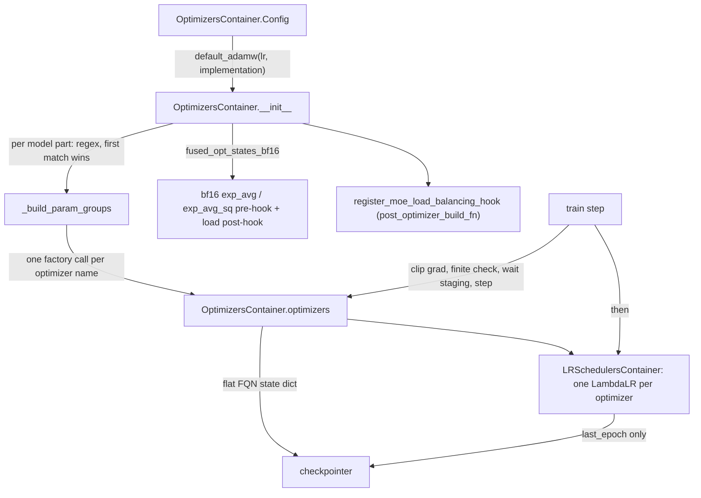

# Optimizer and LR schedule: OptimizersContainer, param groups, bf16 Adam states, warmup-stable-decay

## Overview
TorchTitan never hands the training loop a raw `torch.optim` optimizer. The
`torchtitan/components/optimizer` package builds an
[`OptimizersContainer`](https://github.com/google-pytorch/torchtitan/blob/033f131322a8b5b026ac53d734c689d664442bf8/torchtitan/components/optimizer/optimizer.py#L84 "torchtitan/components/optimizer/optimizer#OptimizersContainer"),
which *is* an `Optimizer` (so hooks and `step()` work) but internally holds a list of real
optimizers: one per (model part, optimizer type) pair, where model parts are pipeline stages and
parameters are routed to optimizer types by regex param groups. A matching
[`LRSchedulersContainer`](https://github.com/google-pytorch/torchtitan/blob/033f131322a8b5b026ac53d734c689d664442bf8/torchtitan/components/optimizer/lr_scheduler.py#L25 "torchtitan/components/optimizer/lr_scheduler#LRSchedulersContainer")
wraps one `LambdaLR` per inner optimizer, all driven by the same warmup-stable-decay lambda, and a
small `utils` module holds the FQN flatten/unflatten and state-materialization helpers the
checkpointer relies on. The
key design idea is that **everything is keyed by parameter FQN, not by index**: param groups
carry canonical parameter names, optimizer state is saved as a flat `state.{fqn}.{name}` dict,
and the scheduler saves only its step count, so both can be reloaded after changing the number of
pipeline stages or the optimizer layout. Because the optimizer is built *after* parallelization,
Adam's moments are created with `zeros_like` on the DTensor parameters and are therefore sharded
exactly like the parameters (FSDP shards on TPU), which is the main lever for optimizer memory.

## Diagram

Legend:
- `CFG` - [`Config`](https://github.com/google-pytorch/torchtitan/blob/033f131322a8b5b026ac53d734c689d664442bf8/torchtitan/components/optimizer/optimizer.py#L108 "torchtitan/components/optimizer/optimizer#OptimizersContainer.Config") built from [`default_adamw`](https://github.com/google-pytorch/torchtitan/blob/033f131322a8b5b026ac53d734c689d664442bf8/torchtitan/components/optimizer/optimizer.py#L396 "torchtitan/components/optimizer/optimizer#default_adamw")
- `OC` - [`__init__`](https://github.com/google-pytorch/torchtitan/blob/033f131322a8b5b026ac53d734c689d664442bf8/torchtitan/components/optimizer/optimizer.py#L223 "torchtitan/components/optimizer/optimizer#OptimizersContainer.__init__")
- `PG` - [`_build_param_groups`](https://github.com/google-pytorch/torchtitan/blob/033f131322a8b5b026ac53d734c689d664442bf8/torchtitan/components/optimizer/optimizer.py#L173 "torchtitan/components/optimizer/optimizer#OptimizersContainer._build_param_groups")
- `OPTS` - [`optimizers`](https://github.com/google-pytorch/torchtitan/blob/033f131322a8b5b026ac53d734c689d664442bf8/torchtitan/components/optimizer/optimizer.py#L143 "torchtitan/components/optimizer/optimizer#OptimizersContainer.optimizers")
- `BF` - [`_register_bf16_optimizer_state_hook`](https://github.com/google-pytorch/torchtitan/blob/033f131322a8b5b026ac53d734c689d664442bf8/torchtitan/components/optimizer/optimizer.py#L337 "torchtitan/components/optimizer/optimizer#OptimizersContainer._register_bf16_optimizer_state_hook")
- `HOOK` - [`register_moe_load_balancing_hook`](https://github.com/google-pytorch/torchtitan/blob/033f131322a8b5b026ac53d734c689d664442bf8/torchtitan/components/optimizer/optimizer.py#L449 "torchtitan/components/optimizer/optimizer#register_moe_load_balancing_hook")
- `LRS` - [`LRSchedulersContainer`](https://github.com/google-pytorch/torchtitan/blob/033f131322a8b5b026ac53d734c689d664442bf8/torchtitan/components/optimizer/lr_scheduler.py#L25 "torchtitan/components/optimizer/lr_scheduler#LRSchedulersContainer")
- `TS` - (concept) the trainer's train step, see [training-loop](training-loop.md); owned by [`Trainer`](https://github.com/google-pytorch/torchtitan/blob/033f131322a8b5b026ac53d734c689d664442bf8/torchtitan/trainer.py#L74 "torchtitan/trainer#Trainer")
- `CKPT` - (concept) the checkpoint manager, see [checkpointing](checkpointing.md); it reads [`state_dict`](https://github.com/google-pytorch/torchtitan/blob/033f131322a8b5b026ac53d734c689d664442bf8/torchtitan/components/optimizer/optimizer.py#L311 "torchtitan/components/optimizer/optimizer#OptimizersContainer.state_dict")

## Design rationale (why it's built this way)
- **A container that is itself an Optimizer.** The class docstring says the container "wraps
  multiple optimizers into a single object to simplify the training loop". The container's
  constructor ends by calling the base `Optimizer.__init__` on the union of all parameters; the
  comment says this is needed "to initialize some necessary optimizer functionality such as
  hooks (e.g. register_step_pre_hook for MoE load balancing)". Hooks registered on the
  container therefore fire once per global step, before any inner optimizer runs.
- **Regex param groups, first match wins, same-type groups batched.** Each
  [`ParamGroupConfig`](https://github.com/google-pytorch/torchtitan/blob/033f131322a8b5b026ac53d734c689d664442bf8/torchtitan/components/optimizer/optimizer.py#L46 "torchtitan/components/optimizer/optimizer#ParamGroupConfig") has a
  [`pattern`](https://github.com/google-pytorch/torchtitan/blob/033f131322a8b5b026ac53d734c689d664442bf8/torchtitan/components/optimizer/optimizer.py#L63 "torchtitan/components/optimizer/optimizer#ParamGroupConfig.pattern"), an
  [`optimizer_name`](https://github.com/google-pytorch/torchtitan/blob/033f131322a8b5b026ac53d734c689d664442bf8/torchtitan/components/optimizer/optimizer.py#L67 "torchtitan/components/optimizer/optimizer#ParamGroupConfig.optimizer_name") and complete
  [`optimizer_kwargs`](https://github.com/google-pytorch/torchtitan/blob/033f131322a8b5b026ac53d734c689d664442bf8/torchtitan/components/optimizer/optimizer.py#L70 "torchtitan/components/optimizer/optimizer#ParamGroupConfig.optimizer_kwargs") ("no implicit inheritance"). Groups that
  resolve to the same optimizer name become param groups of *one* optimizer instance "for
  performance". A pattern that matches nothing is an error, and a final check asserts every
  trainable parameter landed in exactly one optimizer, so a typo cannot silently freeze weights.
  Only `requires_grad` parameters are considered, which is what makes frozen-base
  [LoRA](lora.md) cheap. The Qwen3 debug MoE param-group recipe in the Qwen3 config registry
  is the worked example: a no-weight-decay group whose pattern names `tok_embeddings` and
  `output`, plain Adam at a lower LR for router gates, AdamW with decay for everything else.
  At this pin the decoder's head is named `lm_head`, not `output`, so only the embeddings match
  the first group and the head falls through to the catch-all AdamW group with decay.
- **Optimizer factories, not just classes.** Names resolve to factories: `"Adam"` and
  `"AdamW"` map to the torch classes and `"DistMuon"` to a FlexShard-backed Muon builder.
  Instance-wide arguments (per-parameter compute layouts, communication bucket specs) go in
  [`Config`](https://github.com/google-pytorch/torchtitan/blob/033f131322a8b5b026ac53d734c689d664442bf8/torchtitan/components/optimizer/optimizer.py#L108 "torchtitan/components/optimizer/optimizer#OptimizersContainer.Config")'s `optimizer_factory_kwargs_by_name`, which the
  docstring says "are not copied into PyTorch parameter groups" - so they never enter the
  checkpoint, while group hyperparameters stay in `optimizer_kwargs`.
- **FQN-keyed state to survive pipeline parallelism and resharding.** Param groups carry a
  `param_names` list of canonical FQNs (the activation-checkpoint wrapper's path segment is
  stripped so names match model state dict keys).
  [`state_dict`](https://github.com/google-pytorch/torchtitan/blob/033f131322a8b5b026ac53d734c689d664442bf8/torchtitan/components/optimizer/optimizer.py#L311 "torchtitan/components/optimizer/optimizer#OptimizersContainer.state_dict") materializes state if needed
  and emits a flat FQN-keyed dict via
  [`get_flat_optim_state_dict`](https://github.com/google-pytorch/torchtitan/blob/033f131322a8b5b026ac53d734c689d664442bf8/torchtitan/components/optimizer/utils.py#L88 "torchtitan/components/optimizer/utils#get_flat_optim_state_dict"), whose docstring says the flat layout "avoids the integer
  `param_group` index collisions that break pipeline-parallel checkpoints"; the
  [checkpointing](checkpointing.md) page explains the save side.
- **Stateless schedules, minimal scheduler state.** The docstring states the checkpoint
  contract: "On save, only `last_epoch` is saved. On load, `last_epoch` is restored and each
  scheduler recomputes its lr from its own optimizer's `base_lrs`." This works for mixed
  optimizers with different base LRs and for a different number of schedulers after
  resharding, and it is correct only because the lambda is a pure function of the step.
- **bf16 Adam moments as an explicit memory knob.** `implementation="fused_opt_states_bf16"`
  registers a step pre-hook that pre-creates `exp_avg`/`exp_avg_sq` in bfloat16 before Adam's
  lazy init would allocate fp32 ones, while parameters stay fp32. A load post-hook "reapplies the
  state dtype after PyTorch's `load_state_dict` casts floating-point states to the parameter
  dtype", so a resume does not silently return the moments to fp32. On TPU the Llama 3 "scan lane"
  helper turns this on for every recipe it touches, with the comment: "bf16 Adam moments halve
  the optimizer state, which is 12.7 GiB at 405B and the difference between sequence 8192 fitting
  and not."

> [!inferred]
> Memory arithmetic that follows from the above: with fp32 master weights (the TPU layer-stack
> test asserts the stored weight stays fp32 while FSDP gathers bf16 copies), AdamW costs
> 4 (param) + 4 (grad) + 8 (two fp32 moments) bytes per parameter, divided by the FSDP shard
> degree; bf16 moments cut the moments to 4 bytes. Most TPU recipes in-tree pass
> `implementation="foreach"` to [`default_adamw`](https://github.com/google-pytorch/torchtitan/blob/033f131322a8b5b026ac53d734c689d664442bf8/torchtitan/components/optimizer/optimizer.py#L396 "torchtitan/components/optimizer/optimizer#default_adamw")
> instead of the `"fused"` default (the Llama 3 scan-lane helper then overrides this to
> `fused_opt_states_bf16`, which sets `fused=True`), which suggests the fused AdamW kernel is not
> the default path on the torch_tpu backend; the exception is the Qwen3 MoE 30B FSDP-only benchmark
> recipe, which a TPU config test pins to `"fused"`. The TPU graph trainer instead compiles AdamW
> itself from a functional implementation (see [torchtpu-backend](torchtpu-backend.md)).

## Entry points
- [`default_adamw`](https://github.com/google-pytorch/torchtitan/blob/033f131322a8b5b026ac53d734c689d664442bf8/torchtitan/components/optimizer/optimizer.py#L396 "torchtitan/components/optimizer/optimizer#default_adamw")
  is what almost every recipe calls: one catch-all `r".*"` AdamW group with
  `betas=(0.9, 0.95)`, `eps=1e-8`, `weight_decay=0.1`, the given `lr` (default 8e-4) and any extra
  kwargs; `implementation` is lifted out and applied to the container config.
- [`Config`](https://github.com/google-pytorch/torchtitan/blob/033f131322a8b5b026ac53d734c689d664442bf8/torchtitan/components/optimizer/optimizer.py#L108 "torchtitan/components/optimizer/optimizer#OptimizersContainer.Config")
  is the type of the trainer config's `optimizer` field; the
  [`Trainer`](https://github.com/google-pytorch/torchtitan/blob/033f131322a8b5b026ac53d734c689d664442bf8/torchtitan/trainer.py#L74 "torchtitan/trainer#Trainer") builds it with `config.optimizer.build(model_parts=...)` right after
  parallelizing the model and stores the result as its `optimizers`. The RL policy trainer has its
  own `optimizer` field with the same type.
- [`register_moe_load_balancing_hook`](https://github.com/google-pytorch/torchtitan/blob/033f131322a8b5b026ac53d734c689d664442bf8/torchtitan/components/optimizer/optimizer.py#L449 "torchtitan/components/optimizer/optimizer#register_moe_load_balancing_hook")
  is reached as the model spec's post-optimizer-build function for MoE models (Qwen3 and its
  newer variants, DeepSeek-V3/V4, GPT-OSS, Qwen3.5, Kimi); dense models leave that slot empty.
  DeepSeek-V3 wraps it in its own function that also registers an aux-loss zeroing hook.
- [`build`](https://github.com/google-pytorch/torchtitan/blob/033f131322a8b5b026ac53d734c689d664442bf8/torchtitan/components/optimizer/lr_scheduler.py#L90 "torchtitan/components/optimizer/lr_scheduler#LRSchedulersContainer.Config.build")
  on the `lr_scheduler` config section is called with the optimizers and `training.steps` and
  returns the [`LRSchedulersContainer`](https://github.com/google-pytorch/torchtitan/blob/033f131322a8b5b026ac53d734c689d664442bf8/torchtitan/components/optimizer/lr_scheduler.py#L25 "torchtitan/components/optimizer/lr_scheduler#LRSchedulersContainer").
- [`configure_moe_routing_metrics`](https://github.com/google-pytorch/torchtitan/blob/033f131322a8b5b026ac53d734c689d664442bf8/torchtitan/components/optimizer/optimizer.py#L570 "torchtitan/components/optimizer/optimizer#configure_moe_routing_metrics") and
  [`get_moe_load_balancing_metrics`](https://github.com/google-pytorch/torchtitan/blob/033f131322a8b5b026ac53d734c689d664442bf8/torchtitan/components/optimizer/optimizer.py#L654 "torchtitan/components/optimizer/optimizer#get_moe_load_balancing_metrics") are imported by the trainer for MoE routing metrics:
  the first "enable[s] graph-safe routing metric capture on supported MoE layers", the second
  reduces the captured per-layer counts for logging.

## Mechanism (step-by-step)
1. **Resolve the implementation flags.**
   [`_build_impl_kwargs`](https://github.com/google-pytorch/torchtitan/blob/033f131322a8b5b026ac53d734c689d664442bf8/torchtitan/components/optimizer/optimizer.py#L158 "torchtitan/components/optimizer/optimizer#OptimizersContainer._build_impl_kwargs") turns the container config's
   [`implementation`](https://github.com/google-pytorch/torchtitan/blob/033f131322a8b5b026ac53d734c689d664442bf8/torchtitan/components/optimizer/optimizer.py#L114 "torchtitan/components/optimizer/optimizer#OptimizersContainer.Config.implementation") into
   per-group `fused`/`foreach` kwargs (`fused_opt_states_bf16` implies `fused=True`); per-group
   `optimizer_kwargs` are spread after them and can override them (the docstring's example is
   `"fused": False` for optimizers that do not support fused). Only `"Adam"`, `"AdamW"` and
   `"DistMuon"` are registered names; anything else raises `NotImplementedError`.
2. **Route parameters per model part.** For each model part,
   [`_build_param_groups`](https://github.com/google-pytorch/torchtitan/blob/033f131322a8b5b026ac53d734c689d664442bf8/torchtitan/components/optimizer/optimizer.py#L173 "torchtitan/components/optimizer/optimizer#OptimizersContainer._build_param_groups") walks
   `named_parameters()`, assigns each trainable parameter to the first matching pattern, and
   returns group dicts and patterns keyed by optimizer name; the constructor calls one factory per
   optimizer name found (passing that name's `optimizer_factory_kwargs_by_name` entry), appends it
   to [`optimizers`](https://github.com/google-pytorch/torchtitan/blob/033f131322a8b5b026ac53d734c689d664442bf8/torchtitan/components/optimizer/optimizer.py#L143 "torchtitan/components/optimizer/optimizer#OptimizersContainer.optimizers") and logs the assignment through
   [`_log_optimizer`](https://github.com/google-pytorch/torchtitan/blob/033f131322a8b5b026ac53d734c689d664442bf8/torchtitan/components/optimizer/optimizer.py#L250 "torchtitan/components/optimizer/optimizer#OptimizersContainer._log_optimizer") ("patterns are logging-only").
   With PP and two optimizer types, a rank with two stages holds four optimizers. The TPU test
   `test_the_optimizer_sees_each_stack_once` checks this routing by identity when layer weights
   are stacked for `scan`, since row views share storage with the stacks.
3. **Install hooks.** For `fused_opt_states_bf16`,
   [`_register_bf16_optimizer_state_hook`](https://github.com/google-pytorch/torchtitan/blob/033f131322a8b5b026ac53d734c689d664442bf8/torchtitan/components/optimizer/optimizer.py#L337 "torchtitan/components/optimizer/optimizer#OptimizersContainer._register_bf16_optimizer_state_hook")
   registers on each inner Adam/AdamW a step pre-hook that only fills state for parameters that
   have a gradient and no state yet, plus a load-state-dict post-hook that casts `exp_avg`,
   `exp_avg_sq` and `max_exp_avg_sq` back to bfloat16. Then the
   base optimizer init runs on the container, and for MoE models
   [`register_moe_load_balancing_hook`](https://github.com/google-pytorch/torchtitan/blob/033f131322a8b5b026ac53d734c689d664442bf8/torchtitan/components/optimizer/optimizer.py#L449 "torchtitan/components/optimizer/optimizer#register_moe_load_balancing_hook")
   adds a container-level pre-hook, but only if
   [`_should_register_moe_balancing_hook`](https://github.com/google-pytorch/torchtitan/blob/033f131322a8b5b026ac53d734c689d664442bf8/torchtitan/components/optimizer/optimizer.py#L465 "torchtitan/components/optimizer/optimizer#register_moe_load_balancing_hook._should_register_moe_balancing_hook")
   finds MoE layers with `load_balance_coeff` set; it raises if some layers have it and others do
   not.
4. **Build the LR lambda.** [`build`](https://github.com/google-pytorch/torchtitan/blob/033f131322a8b5b026ac53d734c689d664442bf8/torchtitan/components/optimizer/lr_scheduler.py#L90 "torchtitan/components/optimizer/lr_scheduler#LRSchedulersContainer.Config.build")
   uses `total_steps` (or `training.steps`), clamps
   [`warmup_steps`](https://github.com/google-pytorch/torchtitan/blob/033f131322a8b5b026ac53d734c689d664442bf8/torchtitan/components/optimizer/lr_scheduler.py#L52 "torchtitan/components/optimizer/lr_scheduler#LRSchedulersContainer.Config.warmup_steps") to it, derives
   `decay_steps` from [`decay_ratio`](https://github.com/google-pytorch/torchtitan/blob/033f131322a8b5b026ac53d734c689d664442bf8/torchtitan/components/optimizer/lr_scheduler.py#L65 "torchtitan/components/optimizer/lr_scheduler#LRSchedulersContainer.Config.decay_ratio") (or "all remaining steps"
   when unset), and sets
   `stable_steps = total + 1 - warmup - decay`: the extra virtual step keeps the final LR from
   hitting exactly zero. The lambda returns a multiplier: linear warmup `(step+1)/warmup`, then
   1.0, then `linear`, `sqrt` or `cosine` decay ([`decay_type`](https://github.com/google-pytorch/torchtitan/blob/033f131322a8b5b026ac53d734c689d664442bf8/torchtitan/components/optimizer/lr_scheduler.py#L74 "torchtitan/components/optimizer/lr_scheduler#LRSchedulersContainer.Config.decay_type"))
   scaled into `[min_lr_factor, 1]` ([`min_lr_factor`](https://github.com/google-pytorch/torchtitan/blob/033f131322a8b5b026ac53d734c689d664442bf8/torchtitan/components/optimizer/lr_scheduler.py#L82 "torchtitan/components/optimizer/lr_scheduler#LRSchedulersContainer.Config.min_lr_factor")). One
   `LambdaLR` per inner optimizer is created in
   [`__init__`](https://github.com/google-pytorch/torchtitan/blob/033f131322a8b5b026ac53d734c689d664442bf8/torchtitan/components/optimizer/lr_scheduler.py#L198 "torchtitan/components/optimizer/lr_scheduler#LRSchedulersContainer.__init__").
5. **Step.** Each train step starts with
   [`zero_grad`](https://github.com/google-pytorch/torchtitan/blob/033f131322a8b5b026ac53d734c689d664442bf8/torchtitan/components/optimizer/optimizer.py#L307 "torchtitan/components/optimizer/optimizer#OptimizersContainer.zero_grad") (with `set_to_none` tied to
   `training.disable_cuda_graphs`, so by default gradients are zeroed in place) and records the
   current LRs through [`get_metrics`](https://github.com/google-pytorch/torchtitan/blob/033f131322a8b5b026ac53d734c689d664442bf8/torchtitan/components/optimizer/lr_scheduler.py#L211 "torchtitan/components/optimizer/lr_scheduler#LRSchedulersContainer.get_metrics"). After
   forward/backward the trainer clips the gradient norm, asserts asynchronously that the loss
   (min-reduced over the loss and PP meshes) and the grad norm are finite, waits for any async
   checkpoint staging, then calls [`step`](https://github.com/google-pytorch/torchtitan/blob/033f131322a8b5b026ac53d734c689d664442bf8/torchtitan/components/optimizer/optimizer.py#L294 "torchtitan/components/optimizer/optimizer#OptimizersContainer.step") on the container, which
   fires the MoE pre-hook once and steps each inner optimizer in order, and finally steps the
   [`LRSchedulersContainer`](https://github.com/google-pytorch/torchtitan/blob/033f131322a8b5b026ac53d734c689d664442bf8/torchtitan/components/optimizer/lr_scheduler.py#L25 "torchtitan/components/optimizer/lr_scheduler#LRSchedulersContainer").
   The MoE hook body, [`_update_expert_bias`](https://github.com/google-pytorch/torchtitan/blob/033f131322a8b5b026ac53d734c689d664442bf8/torchtitan/components/optimizer/optimizer.py#L484 "torchtitan/components/optimizer/optimizer#register_moe_load_balancing_hook._update_expert_bias"),
   walks layers with [`_iter_moe_layers`](https://github.com/google-pytorch/torchtitan/blob/033f131322a8b5b026ac53d734c689d664442bf8/torchtitan/components/optimizer/optimizer.py#L425 "torchtitan/components/optimizer/optimizer#_iter_moe_layers") (which also covers MTP blocks in `mtp_layers`),
   takes each layer's local `tokens_per_expert` (unwrapping a DTensor with `to_local`), halves
   the counts of any block wrapped
   with a non-reentrant checkpoint wrapper (the check is on `checkpoint_impl`, so it fires for
   selective AC as well as full AC, although the comment speaks only of full AC), all-reduces the
   stacked counts over the dense TP mesh when EP is on with TP > 1 and then over the loss mesh,
   rewraps them as a replicated DTensor if needed, and nudges each expert's bias by
   `coeff * sign(mean - count)` (mean-centred), so under-used experts become more likely to be
   picked; a TODO notes this sync is blocking and exposed.
6. **Save and restore.** On checkpoint the checkpointer
   calls [`state_dict`](https://github.com/google-pytorch/torchtitan/blob/033f131322a8b5b026ac53d734c689d664442bf8/torchtitan/components/optimizer/optimizer.py#L311 "torchtitan/components/optimizer/optimizer#OptimizersContainer.state_dict"), which first runs
   [`init_optim_state`](https://github.com/google-pytorch/torchtitan/blob/033f131322a8b5b026ac53d734c689d664442bf8/torchtitan/components/optimizer/utils.py#L29 "torchtitan/components/optimizer/utils#init_optim_state") on each inner optimizer and then
   [`get_flat_optim_state_dict`](https://github.com/google-pytorch/torchtitan/blob/033f131322a8b5b026ac53d734c689d664442bf8/torchtitan/components/optimizer/utils.py#L88 "torchtitan/components/optimizer/utils#get_flat_optim_state_dict"). `init_optim_state` materializes state only for trainable
   parameters that have none, with a zero-gradient, zero-LR step that saves and restores existing
   gradients, and then resets Adam's `step` and moments "so the first real update remains Adam
   step 1". [`load_state_dict`](https://github.com/google-pytorch/torchtitan/blob/033f131322a8b5b026ac53d734c689d664442bf8/torchtitan/components/optimizer/optimizer.py#L325 "torchtitan/components/optimizer/optimizer#OptimizersContainer.load_state_dict") does the same
   materialization before [`load_flat_optim_state_dict`](https://github.com/google-pytorch/torchtitan/blob/033f131322a8b5b026ac53d734c689d664442bf8/torchtitan/components/optimizer/utils.py#L110 "torchtitan/components/optimizer/utils#load_flat_optim_state_dict"), which "ignores" keys the optimizer
   does not own, so one flat dict serves every inner optimizer. The
   scheduler container saves `{"last_epoch": n}` and on load rewrites `last_epoch`,
   `_step_count` and the current LR of every scheduler.

## Key data structures
- [`optimizers`](https://github.com/google-pytorch/torchtitan/blob/033f131322a8b5b026ac53d734c689d664442bf8/torchtitan/components/optimizer/optimizer.py#L143 "torchtitan/components/optimizer/optimizer#OptimizersContainer.optimizers"):
  the flat list of inner `torch.optim` instances, ordered by model part then optimizer name;
  iteration ([`__iter__`](https://github.com/google-pytorch/torchtitan/blob/033f131322a8b5b026ac53d734c689d664442bf8/torchtitan/components/optimizer/optimizer.py#L287 "torchtitan/components/optimizer/optimizer#OptimizersContainer.__iter__")) and `len()` on the container go
  through it, and the scheduler container zips over it.
- [`param_groups`](https://github.com/google-pytorch/torchtitan/blob/033f131322a8b5b026ac53d734c689d664442bf8/torchtitan/components/optimizer/optimizer.py#L109 "torchtitan/components/optimizer/optimizer#OptimizersContainer.Config.param_groups"): the ordered list of
  [`ParamGroupConfig`](https://github.com/google-pytorch/torchtitan/blob/033f131322a8b5b026ac53d734c689d664442bf8/torchtitan/components/optimizer/optimizer.py#L46 "torchtitan/components/optimizer/optimizer#ParamGroupConfig") entries. Built param group dict: `params`, `param_names` (canonical
  FQNs), `fused`, `foreach`, plus the group's kwargs. Regex patterns are kept out of the group so
  they never enter the checkpoint.
- Flat optimizer state keys: `state.{fqn}.{exp_avg|exp_avg_sq|step}` and
  `param_groups.{fqn}.{lr|betas|...}`; nested per-parameter state (the comment names Shampoo) is
  dotted further by [`_flatten_state_nested`](https://github.com/google-pytorch/torchtitan/blob/033f131322a8b5b026ac53d734c689d664442bf8/torchtitan/components/optimizer/utils.py#L208 "torchtitan/components/optimizer/utils#_flatten_state_nested"). Each moment tensor is a DTensor with the
  parameter's placements.
- Scheduler state: a single integer, `last_epoch`; the live schedulers are
  [`schedulers`](https://github.com/google-pytorch/torchtitan/blob/033f131322a8b5b026ac53d734c689d664442bf8/torchtitan/components/optimizer/lr_scheduler.py#L196 "torchtitan/components/optimizer/lr_scheduler#LRSchedulersContainer.schedulers").

## Dynamics (design intent)
- Order within a step is fixed: clip, finiteness assert, staging wait, optimizer pre-hooks,
  inner optimizer steps, scheduler step. The LR logged for step N is the one used by step N.
- `LambdaLR` evaluates the lambda at construction, so the first step already runs at
  `lr / warmup_steps`, not at 0.
- The graph trainer's test `test_titan_optimizers_container` exercises its contract with
  [`OptimizersContainer`](https://github.com/google-pytorch/torchtitan/blob/033f131322a8b5b026ac53d734c689d664442bf8/torchtitan/components/optimizer/optimizer.py#L84 "torchtitan/components/optimizer/optimizer#OptimizersContainer"): it reaches into `container.optimizers[0]`, rebinds its parameters to
  other tensors for tracing, and verifies the original state is restored exactly afterwards.
- `test_the_optimizer_state_is_keyed_the_same_way_in_both_layouts` checks that
  [`get_flat_optim_state_dict`](https://github.com/google-pytorch/torchtitan/blob/033f131322a8b5b026ac53d734c689d664442bf8/torchtitan/components/optimizer/utils.py#L88 "torchtitan/components/optimizer/utils#get_flat_optim_state_dict") produces the same keys whether TPU layer weights are stacked
  for `scan` or not, which is what lets a run switch layouts across a resume.

## Edge cases
- **The default optimizer config is unusable on its own.** `param_groups` defaults to an empty
  list, so a trainer config that never sets `optimizer` builds no optimizers and fails the
  every-parameter-assigned check (and the scheduler container asserts at least one optimizer).
  Recipes always go through [`default_adamw`](https://github.com/google-pytorch/torchtitan/blob/033f131322a8b5b026ac53d734c689d664442bf8/torchtitan/components/optimizer/optimizer.py#L396 "torchtitan/components/optimizer/optimizer#default_adamw")
  or explicit groups.
- **Extra kwargs become group keys.** Anything passed to `default_adamw` that is not
  `implementation` lands in the param group dict (and so in the checkpoint), for example a
  `name="AdamW"` kwarg.
- **Frozen parameters get no state**, so optimizer memory tracks trainable parameters only; a
  parameter that later becomes trainable is not in any optimizer.
- **Adding a stateful scheduler breaks resume**: the load comment warns that a scheduler such as
  ReduceLROnPlateau would need more than `last_epoch` restored.
- **Warmup longer than training** is clamped with a warning; `warmup + decay > total` shrinks
  the decay phase.
- **Shape changes under the same keys.** A TPU reshard test notes that flat optimizer state "is
  keyed off the live parameters", so a stacked-expert layout that flattens differently between
  save and resume sees different shapes under the same keys; that "has to fail at load".
- **MoE load balancing with AC** relies on a halving hack, applied to every non-reentrant
  checkpoint-wrapped block (full or selective), that "does not affect expert choice, but affects
  the experts usage metrics" if the double-counting assumption is wrong.

## Open questions
- The `implementation` docstring now describes `"fused"` as "CUDA only", yet a TPU recipe (the
  Qwen3 MoE 30B FSDP-only benchmark) is tested to use it, and `fused_opt_states_bf16` also sets
  `fused=True`; whether the torch_tpu AdamW path honours or ignores `fused=True` in the regular
  trainer is not settled here.
- The functional AdamW used by the TPU graph trainer for optimizer-in-graph and separate-graph
  compilation lives outside this packet; how it treats bf16 moments is not documented here.
- The `canonical_fqn` helper that strips wrapper segments from parameter names, and the DistMuon
  factory itself, live outside this packet (checkpointer utilities and FlexShard respectively).

## See also
- [Checkpointing](checkpointing.md): how the flat optimizer and scheduler state is written and restored.
- [Training loop](training-loop.md): where clip, step and scheduler step are sequenced.
- [FSDP sharding](fsdp-sharding.md): why optimizer moments are sharded like the parameters.
- [Expert parallel](expert-parallel.md): the MoE layers whose expert bias the pre-hook updates.
- [LoRA](lora.md): trainable-only param groups and the resulting optimizer footprint.
- [TorchTPU backend](torchtpu-backend.md): the TPU graph trainer's compiled optimizer.
- [Metrics and observability](metrics-and-observability.md): per-optimizer LR metrics.

## Recent changes
- `fa627bf2` rebases onto upstream `d771abb0`: `optimizer.py` and `lr_scheduler.py` move into the
  `components/optimizer/` package, the flat-state helpers move into its `utils` module (with a
  per-parameter `init_optim_state` that preserves gradients and resets Adam counters), optimizer
  names now resolve to factories (adding `DistMuon` and `optimizer_factory_kwargs_by_name`), the
  bf16 states gain a load post-hook, and the MoE bias hook drops its `full_dtensor` branch for
  local all-reduces over the dense TP and loss meshes.
- `9f6ed5f1` restores global-batch MoE aux loss and routing metrics after `d771abb0`, porting
  them to upstream's `router.aux_loss` interface.
- `a32c7a03` removes internal references from source comments (docstring-only change here).
- [all changes in 033f131322](../changes/033f131322.md)
