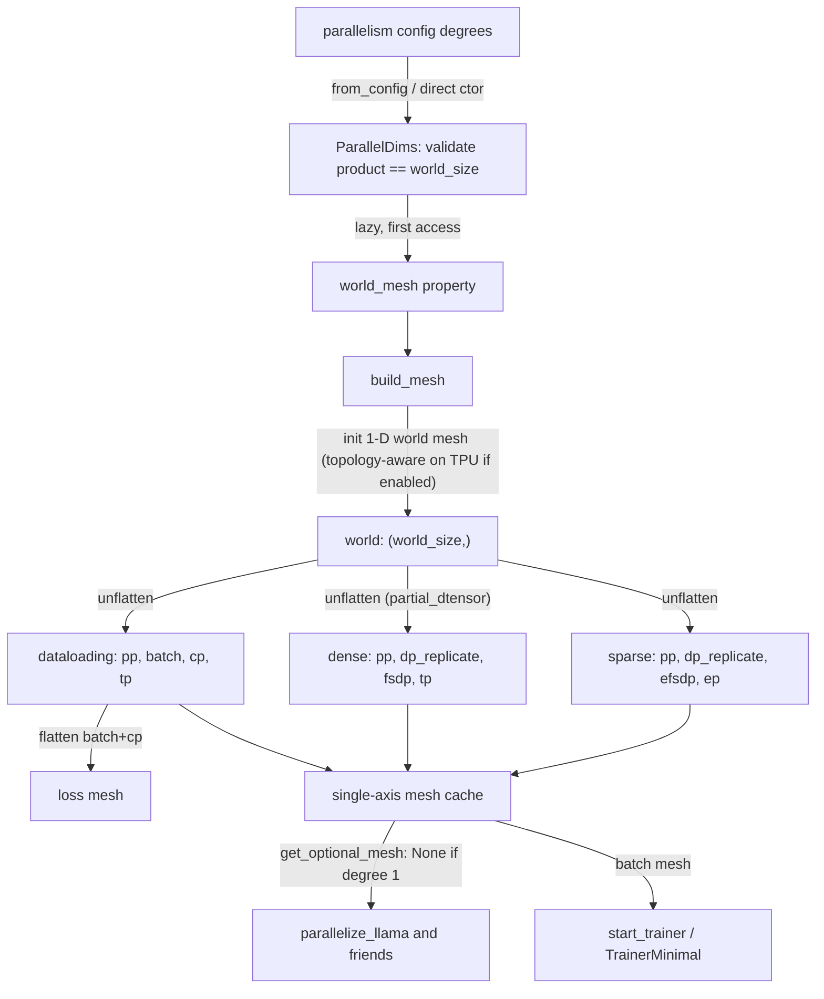
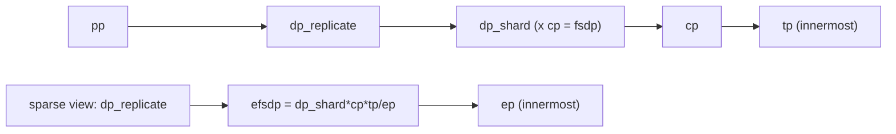

# ParallelDims and the device mesh: how parallelism degrees become named mesh axes

## Overview
Every TorchTitan run, on GPU or TPU, describes its parallelism with one small dataclass,
[`ParallelDims`](https://github.com/google-pytorch/torchtitan/blob/033f131322a8b5b026ac53d734c689d664442bf8/torchtitan/distributed/parallel_dims.py#L105 "torchtitan/distributed/parallel_dims#ParallelDims"):
six integer degrees (`dp_replicate`, `dp_shard`, `cp`, `tp`, `pp`, `ep`), the world size, a
`spmd_backend` selector and a TPU-only `enable_tpu_topo_mesh` flag. The key design idea is
**one physical mesh, many named views**:
[`build_mesh`](https://github.com/google-pytorch/torchtitan/blob/033f131322a8b5b026ac53d734c689d664442bf8/torchtitan/distributed/parallel_dims.py#L185 "torchtitan/distributed/parallel_dims#ParallelDims.build_mesh")
creates a single 1-D `world` `DeviceMesh` over all ranks and then *unflattens* it several times
into differently-named multi-axis meshes over the same devices (a dataloading view, a loss view,
a dense-parameter view and a sparse/MoE view). Each parallelism technique then asks the object
for "the mesh of axis X" by name through
[`get_optional_mesh`](https://github.com/google-pytorch/torchtitan/blob/033f131322a8b5b026ac53d734c689d664442bf8/torchtitan/distributed/parallel_dims.py#L367 "torchtitan/distributed/parallel_dims#ParallelDims.get_optional_mesh")
(or its raising sibling), and gets back `None` for an axis whose degree is 1. Model-specific
`parallelize_*` functions never compute ranks themselves; they compose FSDP, TP, CP and EP
purely by requesting named submeshes from this object.

## Diagram

Legend:
- `CFG` - (concept) the `parallelism` section of the job config
- `PD` - [`ParallelDims`](https://github.com/google-pytorch/torchtitan/blob/033f131322a8b5b026ac53d734c689d664442bf8/torchtitan/distributed/parallel_dims.py#L105 "torchtitan/distributed/parallel_dims#ParallelDims")
- `WM` - [`world_mesh`](https://github.com/google-pytorch/torchtitan/blob/033f131322a8b5b026ac53d734c689d664442bf8/torchtitan/distributed/parallel_dims.py#L592 "torchtitan/distributed/parallel_dims#ParallelDims.world_mesh")
- `BM` - [`build_mesh`](https://github.com/google-pytorch/torchtitan/blob/033f131322a8b5b026ac53d734c689d664442bf8/torchtitan/distributed/parallel_dims.py#L185 "torchtitan/distributed/parallel_dims#ParallelDims.build_mesh")
- `W1` - (concept) the 1-D `world` DeviceMesh created inside `build_mesh` on [`device_type`](https://github.com/google-pytorch/torchtitan/blob/033f131322a8b5b026ac53d734c689d664442bf8/torchtitan/tools/utils.py#L219 "torchtitan/tools/utils#device_type")
- `DL` - (concept) dataloading view built by [`build_mesh`](https://github.com/google-pytorch/torchtitan/blob/033f131322a8b5b026ac53d734c689d664442bf8/torchtitan/distributed/parallel_dims.py#L185 "torchtitan/distributed/parallel_dims#ParallelDims.build_mesh")
- `LOSS` - (concept) loss view built by [`build_mesh`](https://github.com/google-pytorch/torchtitan/blob/033f131322a8b5b026ac53d734c689d664442bf8/torchtitan/distributed/parallel_dims.py#L185 "torchtitan/distributed/parallel_dims#ParallelDims.build_mesh")
- `DENSE` - (concept) dense view built by [`build_mesh`](https://github.com/google-pytorch/torchtitan/blob/033f131322a8b5b026ac53d734c689d664442bf8/torchtitan/distributed/parallel_dims.py#L185 "torchtitan/distributed/parallel_dims#ParallelDims.build_mesh")
- `SPARSE` - (concept) sparse view built by [`build_mesh`](https://github.com/google-pytorch/torchtitan/blob/033f131322a8b5b026ac53d734c689d664442bf8/torchtitan/distributed/parallel_dims.py#L185 "torchtitan/distributed/parallel_dims#ParallelDims.build_mesh")
- `CACHE` - (concept) the per-axis submesh dictionary read by [`get_optional_mesh`](https://github.com/google-pytorch/torchtitan/blob/033f131322a8b5b026ac53d734c689d664442bf8/torchtitan/distributed/parallel_dims.py#L367 "torchtitan/distributed/parallel_dims#ParallelDims.get_optional_mesh")
- `PAR` - [`parallelize_llama`](https://github.com/google-pytorch/torchtitan/blob/033f131322a8b5b026ac53d734c689d664442bf8/torchtitan/models/llama3/parallelize.py#L23 "torchtitan/models/llama3/parallelize#parallelize_llama")
- `TR` - [`start_trainer`](https://github.com/google-pytorch/torchtitan/blob/033f131322a8b5b026ac53d734c689d664442bf8/torchtitan/experiments/tpu/conformer/train_minimal.py#L144 "torchtitan/experiments/tpu/conformer/train_minimal#start_trainer") and [`parallel_dims`](https://github.com/google-pytorch/torchtitan/blob/033f131322a8b5b026ac53d734c689d664442bf8/torchtitan/experiments/tpu/train_minimal.py#L113 "torchtitan/experiments/tpu/train_minimal#TrainerMinimal.parallel_dims")

Axis layout (outermost to innermost, the order of every unflatten):

Legend:
- `PP` - [`pp`](https://github.com/google-pytorch/torchtitan/blob/033f131322a8b5b026ac53d734c689d664442bf8/torchtitan/distributed/parallel_dims.py#L110 "torchtitan/distributed/parallel_dims#ParallelDims.pp")
- `DR` - [`dp_replicate`](https://github.com/google-pytorch/torchtitan/blob/033f131322a8b5b026ac53d734c689d664442bf8/torchtitan/distributed/parallel_dims.py#L106 "torchtitan/distributed/parallel_dims#ParallelDims.dp_replicate")
- `DR2` - [`dp_replicate`](https://github.com/google-pytorch/torchtitan/blob/033f131322a8b5b026ac53d734c689d664442bf8/torchtitan/distributed/parallel_dims.py#L106 "torchtitan/distributed/parallel_dims#ParallelDims.dp_replicate")
- `DS` - [`dp_shard`](https://github.com/google-pytorch/torchtitan/blob/033f131322a8b5b026ac53d734c689d664442bf8/torchtitan/distributed/parallel_dims.py#L107 "torchtitan/distributed/parallel_dims#ParallelDims.dp_shard")
- `CPX` - [`cp`](https://github.com/google-pytorch/torchtitan/blob/033f131322a8b5b026ac53d734c689d664442bf8/torchtitan/distributed/parallel_dims.py#L108 "torchtitan/distributed/parallel_dims#ParallelDims.cp")
- `TPX` - [`tp`](https://github.com/google-pytorch/torchtitan/blob/033f131322a8b5b026ac53d734c689d664442bf8/torchtitan/distributed/parallel_dims.py#L109 "torchtitan/distributed/parallel_dims#ParallelDims.tp")
- `EF` - (concept) the `efsdp` axis computed in [`build_mesh`](https://github.com/google-pytorch/torchtitan/blob/033f131322a8b5b026ac53d734c689d664442bf8/torchtitan/distributed/parallel_dims.py#L185 "torchtitan/distributed/parallel_dims#ParallelDims.build_mesh")
- `EPX` - [`ep`](https://github.com/google-pytorch/torchtitan/blob/033f131322a8b5b026ac53d734c689d664442bf8/torchtitan/distributed/parallel_dims.py#L111 "torchtitan/distributed/parallel_dims#ParallelDims.ep")

## Design rationale (why it's built this way)
- **One world mesh, unflattened, instead of one N-D mesh.** Different subsystems need different
  groupings of the same ranks: the dataloader needs `batch = dp_replicate * dp_shard` (how many
  distinct data shards exist), the loss all-reduce needs `batch * cp` (every rank that saw
  different tokens), FSDP needs `dp_shard * cp` (every rank that holds a different weight shard),
  and MoE needs a sparse region where `ep` borrows ranks from the dense `dp_shard * cp * tp`
  block. [`build_mesh`](https://github.com/google-pytorch/torchtitan/blob/033f131322a8b5b026ac53d734c689d664442bf8/torchtitan/distributed/parallel_dims.py#L185 "torchtitan/distributed/parallel_dims#ParallelDims.build_mesh")
  documents the resulting unflattens in its docstring:
  `["pp","batch","cp","tp"]` (dataloading), `["pp","dp_replicate","fsdp","tp"]` (partial_dtensor dense),
  `["pp","dp_replicate","dp_shard","cp","tp"]` (spmd_types storage), `["pp","dp","cp","tp"]`
  (spmd_types fwd/bwd dense) and `["pp","dp_replicate","efsdp","ep"]` (sparse). Because all of them
  unflatten the same 1-D mesh in the same outer-to-inner order, an axis name refers to the same
  rank groups regardless of which view it came from.
- **FSDP always spans CP.** The docstring states the intent directly: "we always assume that when
  `cp` is used, FSDP is also applied to utilize its weight all-gather and gradients reduce_scatter
  even if there may be no data parallelism". CP ranks hold identical weights but see different
  sequence chunks, so their gradients must be reduced anyway; folding them into the FSDP axis
  makes that reduction free and also shards the weights across them.
- **Degree-1 axes get a fake process group.** Creating NCCL/TPU process groups is not free, so the
  inner `unflatten_mesh` helper passes `backend_override="fake"` for any axis whose degree is 1.
  Three axes are deliberately kept real even at size 1: `fsdp` ("so fully_shard() can apply
  MixedPrecisionPolicy even at degree 1"), `dp_shard` under `spmd_types` (same
  reason), and `efsdp` whenever `ep > 1` ("we need FSDP wrapping to help the MoE layers do mixed
  precision training"). This is why [`parallelize_llama`](https://github.com/google-pytorch/torchtitan/blob/033f131322a8b5b026ac53d734c689d664442bf8/torchtitan/models/llama3/parallelize.py#L23 "torchtitan/models/llama3/parallelize#parallelize_llama")
  always calls FSDP even on a pure-TP job: FSDP doubles as the mixed-precision mechanism.
- **Submeshes are cached by identity.** `DeviceMesh` equality is by object identity (the field
  comment: "reuse the same object instead of re-slicing a submesh on every lookup"). [`get_optional_mesh`](https://github.com/google-pytorch/torchtitan/blob/033f131322a8b5b026ac53d734c689d664442bf8/torchtitan/distributed/parallel_dims.py#L367 "torchtitan/distributed/parallel_dims#ParallelDims.get_optional_mesh")
  therefore memoizes both single-axis and multi-axis submeshes so repeated requests return the
  very same object.
- **TPU topology matters for collective speed.** When `enable_tpu_topo_mesh` is set and
  `torch.tpu.topology_aware_mesh` exists, the world mesh is built from a topology-aware rank
  permutation with `preserve_rank_order=True`. The source comment explains the stakes: without
  it "the sub-group ranks are sorted ascending, which scrambles the physical device order and
  makes XLA fall back from the fast N-D SparseCore collective strategy to a slow 1-D ring".

> [!inferred]
> Because every view puts `tp` (and `ep` in the sparse view) innermost, TP groups are always made
> of *consecutive* ranks in the world order. On a TPU slice that means TP collectives (which fire
> on every layer, several times per step) run between the nearest devices, while `dp_replicate`
> and `pp` (outermost) span the farthest ones. That is the right mapping for multi-slice jobs, where
> `dp_replicate` is the axis that should cross DCN; the `enable_min_cost_redistribute` config
> docstring makes the same point ("the replicate dim crosses DCN"). The topology-aware
> permutation is computed for the 1-D `(world_size,)` shape, so whether consecutive ranks are
> physically adjacent on a 2-D/3-D torus depends on `torch.tpu.topology_aware_mesh`, which lives
> outside this repo.

## Entry points
- [`ParallelDims`](https://github.com/google-pytorch/torchtitan/blob/033f131322a8b5b026ac53d734c689d664442bf8/torchtitan/distributed/parallel_dims.py#L105 "torchtitan/distributed/parallel_dims#ParallelDims")
  is constructed once per process, right after the process group is initialized. The main trainer
  goes through a `from_config` classmethod that copies every `parallelism.*_degree` plus
  `spmd_backend` and `enable_tpu_topo_mesh`. The TPU minimal trainers call the constructor
  directly: [`start_trainer`](https://github.com/google-pytorch/torchtitan/blob/033f131322a8b5b026ac53d734c689d664442bf8/torchtitan/experiments/tpu/conformer/train_minimal.py#L144 "torchtitan/experiments/tpu/conformer/train_minimal#start_trainer")
  and [`parallel_dims`](https://github.com/google-pytorch/torchtitan/blob/033f131322a8b5b026ac53d734c689d664442bf8/torchtitan/experiments/tpu/train_minimal.py#L113 "torchtitan/experiments/tpu/train_minimal#TrainerMinimal.parallel_dims").
- [`world_mesh`](https://github.com/google-pytorch/torchtitan/blob/033f131322a8b5b026ac53d734c689d664442bf8/torchtitan/distributed/parallel_dims.py#L592 "torchtitan/distributed/parallel_dims#ParallelDims.world_mesh")
  is a lazy property: the first read calls `build_mesh`. The TPU minimal trainer reads it just to log it.
- [`get_optional_mesh`](https://github.com/google-pytorch/torchtitan/blob/033f131322a8b5b026ac53d734c689d664442bf8/torchtitan/distributed/parallel_dims.py#L367 "torchtitan/distributed/parallel_dims#ParallelDims.get_optional_mesh")
  is the query every consumer uses, and it also triggers `build_mesh` if nothing has been built.
  Consumers include the model parallelize functions ([`parallelize_llama`](https://github.com/google-pytorch/torchtitan/blob/033f131322a8b5b026ac53d734c689d664442bf8/torchtitan/models/llama3/parallelize.py#L23 "torchtitan/models/llama3/parallelize#parallelize_llama"),
  [`parallelize_qwen3`](https://github.com/google-pytorch/torchtitan/blob/033f131322a8b5b026ac53d734c689d664442bf8/torchtitan/models/qwen3/parallelize.py#L28 "torchtitan/models/qwen3/parallelize#parallelize_qwen3"),
  [`parallelize_deepseekv3`](https://github.com/google-pytorch/torchtitan/blob/033f131322a8b5b026ac53d734c689d664442bf8/torchtitan/models/deepseek_v3/parallelize.py#L21 "torchtitan/models/deepseek_v3/parallelize#parallelize_deepseekv3")),
  the per-module sharding pass [`Module.parallelize`](https://github.com/google-pytorch/torchtitan/blob/033f131322a8b5b026ac53d734c689d664442bf8/torchtitan/protocols/module.py#L279 "torchtitan/protocols/module#Module.parallelize"),
  which those functions call with the same object (each `ShardingConfig` field resolves its mesh
  through `resolve_mesh`), and pipeline splitting ([`pipeline_llm`](https://github.com/google-pytorch/torchtitan/blob/033f131322a8b5b026ac53d734c689d664442bf8/torchtitan/distributed/pipeline_parallel.py#L65 "torchtitan/distributed/pipeline_parallel#pipeline_llm")).
- The TPU wrappers [`parallelize_llama`](https://github.com/google-pytorch/torchtitan/blob/033f131322a8b5b026ac53d734c689d664442bf8/torchtitan/experiments/tpu/llama3/infra/parallelize.py#L21 "torchtitan/experiments/tpu/llama3/infra/parallelize#parallelize_llama")
  and [`parallelize_muse_glimmer`](https://github.com/google-pytorch/torchtitan/blob/033f131322a8b5b026ac53d734c689d664442bf8/torchtitan/experiments/tpu/muse_glimmer/infra/parallelize.py#L124 "torchtitan/experiments/tpu/muse_glimmer/infra/parallelize#parallelize_muse_glimmer")
  pass the same object through to the upstream parallelize machinery. With SimpleFSDP, the Muse
  Glimmer wrapper (like the Qwen3 one) hands it to
  [`apply_simple_fsdp`](https://github.com/google-pytorch/torchtitan/blob/033f131322a8b5b026ac53d734c689d664442bf8/torchtitan/experiments/graph_trainer/common_utils.py#L503 "torchtitan/experiments/graph_trainer/common_utils#apply_simple_fsdp"),
  which picks `["dp_replicate","fsdp"]`, `["dp_replicate"]` or `["fsdp"]` from the enabled flags
  (under `spmd_types` it instead asks for `["dp_shard","cp"]` with `include_singleton_axes=True`
  and flattens the result into an `fsdp` mesh itself); the Llama wrapper instead requests
  `["dp_replicate","fsdp"]` or `["fsdp"]` itself and calls SimpleFSDP's `data_parallel` directly.

## Mechanism (step-by-step)
1. **Validate and infer the leftover degree.** On construction, [`ParallelDims`](https://github.com/google-pytorch/torchtitan/blob/033f131322a8b5b026ac53d734c689d664442bf8/torchtitan/distributed/parallel_dims.py#L105 "torchtitan/distributed/parallel_dims#ParallelDims") asserts every degree is `>= 1`, except [`dp_shard`](https://github.com/google-pytorch/torchtitan/blob/033f131322a8b5b026ac53d734c689d664442bf8/torchtitan/distributed/parallel_dims.py#L107 "torchtitan/distributed/parallel_dims#ParallelDims.dp_shard"), which may be `-1` (the config default) meaning "whatever ranks are left": `world_size // (dp_replicate * cp * tp * pp)`. It then asserts `dp_replicate * dp_shard * cp * tp * pp == world_size`. Note that [`ep`](https://github.com/google-pytorch/torchtitan/blob/033f131322a8b5b026ac53d734c689d664442bf8/torchtitan/distributed/parallel_dims.py#L111 "torchtitan/distributed/parallel_dims#ParallelDims.ep") is not in the product: EP does not consume extra devices, it re-partitions the dense ranks (the config docstring says "EP borrows ranks from FSDP and TP"). The same validation now raises a `ValueError` up front when `ep` does not divide the sparse region `dp_shard * cp * tp`.
2. **Build the world mesh lazily.** Nothing collective happens until [`world_mesh`](https://github.com/google-pytorch/torchtitan/blob/033f131322a8b5b026ac53d734c689d664442bf8/torchtitan/distributed/parallel_dims.py#L592 "torchtitan/distributed/parallel_dims#ParallelDims.world_mesh") or a mesh query runs [`build_mesh`](https://github.com/google-pytorch/torchtitan/blob/033f131322a8b5b026ac53d734c689d664442bf8/torchtitan/distributed/parallel_dims.py#L185 "torchtitan/distributed/parallel_dims#ParallelDims.build_mesh"). It logs the degrees through [`logger`](https://github.com/google-pytorch/torchtitan/blob/033f131322a8b5b026ac53d734c689d664442bf8/torchtitan/tools/logging.py#L12 "torchtitan/tools/logging#logger"), computes `batch = dp_replicate*dp_shard`, `fsdp = dp_shard*cp` and `efsdp = fsdp*tp // ep`, and creates a 1-D `("world",)` mesh on [`device_type`](https://github.com/google-pytorch/torchtitan/blob/033f131322a8b5b026ac53d734c689d664442bf8/torchtitan/tools/utils.py#L219 "torchtitan/tools/utils#device_type"). On TPU with `enable_tpu_topo_mesh`, that world mesh uses the topology-aware rank order; otherwise it is the plain `init_device_mesh` order.
3. **Unflatten into views.** [`build_mesh`](https://github.com/google-pytorch/torchtitan/blob/033f131322a8b5b026ac53d734c689d664442bf8/torchtitan/distributed/parallel_dims.py#L185 "torchtitan/distributed/parallel_dims#ParallelDims.build_mesh") unflattens the world mesh into the dataloading view `(pp, batch, cp, tp)`, flattens its `batch` and `cp` axes into a `loss_mesh`, builds the dense view according to `spmd_backend` (`partial_dtensor`, the default: `(pp, dp_replicate, fsdp, tp)`, which is where `dp_shard` and `cp` are folded together; `spmd_types`: two dense views, a storage view `(pp, dp_replicate, dp_shard, cp, tp)` for `fully_shard` and a `(dp, cp, tp)` view, with `dp = dp_replicate * dp_shard`, for forward/backward type checking), and always builds the sparse view `(pp, dp_replicate, efsdp, ep)`. Each unflatten marks degree-1 axes with the fake backend, except the always-real `fsdp`/`dp_shard`/`efsdp` cases described above.
4. **Index single axes and self-check.** [`build_mesh`](https://github.com/google-pytorch/torchtitan/blob/033f131322a8b5b026ac53d734c689d664442bf8/torchtitan/distributed/parallel_dims.py#L185 "torchtitan/distributed/parallel_dims#ParallelDims.build_mesh") records each 1-D submesh by name (`pp`, `batch`, `loss`, `dp_replicate`, `cp`, `tp`, `ep`, `efsdp`, plus `fsdp` under `partial_dtensor`, or `dp_shard`/`dp` under `spmd_types`) and then asserts every one has the expected size, for example `efsdp == dp_shard*cp*tp // ep`, before returning the world mesh. (The earlier pre-computed list of "activated" SPMD meshes and its `spmd_meshes()` accessor are gone.)
5. **Answer queries.** [`get_optional_mesh`](https://github.com/google-pytorch/torchtitan/blob/033f131322a8b5b026ac53d734c689d664442bf8/torchtitan/distributed/parallel_dims.py#L367 "torchtitan/distributed/parallel_dims#ParallelDims.get_optional_mesh") validates the requested names, returns `None` if any requested axis is disabled (degree 1 and not one of the always-real axes; the keyword `include_singleton_axes=True` skips this filter for the `spmd_types` registration path), returns a cached 1-D mesh for a single name, and for a list of names finds the first global view whose axis names contain them all, slices it, and caches the result by the name tuple. That is how [`parallelize_llama`](https://github.com/google-pytorch/torchtitan/blob/033f131322a8b5b026ac53d734c689d664442bf8/torchtitan/models/llama3/parallelize.py#L23 "torchtitan/models/llama3/parallelize#parallelize_llama") gets `["dp_replicate","fsdp"]` (HSDP) or `["fsdp"]` (FSDP) as a 2-D or 1-D mesh from the dense view under `partial_dtensor`; it never asks for `"tp"` itself - the `Module.parallelize` pass it calls resolves `"tp"` (a single-axis mesh taken from the dataloading view) through `resolve_mesh`.
6. **Consumers derive behavior from the degrees.** The trainers use the `batch` mesh size and local rank to shard the dataset ([`start_trainer`](https://github.com/google-pytorch/torchtitan/blob/033f131322a8b5b026ac53d734c689d664442bf8/torchtitan/experiments/tpu/conformer/train_minimal.py#L144 "torchtitan/experiments/tpu/conformer/train_minimal#start_trainer") falls back to degree 1, rank 0 when only model parallelism is on, so every rank reads the same data). [`parallelize_conformer`](https://github.com/google-pytorch/torchtitan/blob/033f131322a8b5b026ac53d734c689d664442bf8/torchtitan/experiments/tpu/conformer/infra/parallelize.py#L57 "torchtitan/experiments/tpu/conformer/infra/parallelize#parallelize_conformer") maps the enabled flags (`fsdp_enabled`, `dp_replicate_enabled`) to FSDP2, SimpleFSDP or DDP variants and rejects `tp > 1`. [`compute_config_fingerprint`](https://github.com/google-pytorch/torchtitan/blob/033f131322a8b5b026ac53d734c689d664442bf8/torchtitan/experiments/graph_trainer/precompile.py#L73 "torchtitan/experiments/graph_trainer/precompile#compute_config_fingerprint") hashes every public field of the object, so a precompiled graph is invalidated when any degree changes.

## Key data structures
- **Degrees**: [`dp_replicate`](https://github.com/google-pytorch/torchtitan/blob/033f131322a8b5b026ac53d734c689d664442bf8/torchtitan/distributed/parallel_dims.py#L106 "torchtitan/distributed/parallel_dims#ParallelDims.dp_replicate")
  (DDP/HSDP replica groups: full weight copy per group, gradient all-reduce across groups),
  [`dp_shard`](https://github.com/google-pytorch/torchtitan/blob/033f131322a8b5b026ac53d734c689d664442bf8/torchtitan/distributed/parallel_dims.py#L107 "torchtitan/distributed/parallel_dims#ParallelDims.dp_shard")
  (FSDP shard degree), [`cp`](https://github.com/google-pytorch/torchtitan/blob/033f131322a8b5b026ac53d734c689d664442bf8/torchtitan/distributed/parallel_dims.py#L108 "torchtitan/distributed/parallel_dims#ParallelDims.cp"),
  [`tp`](https://github.com/google-pytorch/torchtitan/blob/033f131322a8b5b026ac53d734c689d664442bf8/torchtitan/distributed/parallel_dims.py#L109 "torchtitan/distributed/parallel_dims#ParallelDims.tp"),
  [`pp`](https://github.com/google-pytorch/torchtitan/blob/033f131322a8b5b026ac53d734c689d664442bf8/torchtitan/distributed/parallel_dims.py#L110 "torchtitan/distributed/parallel_dims#ParallelDims.pp"),
  [`ep`](https://github.com/google-pytorch/torchtitan/blob/033f131322a8b5b026ac53d734c689d664442bf8/torchtitan/distributed/parallel_dims.py#L111 "torchtitan/distributed/parallel_dims#ParallelDims.ep").
  Derived boolean properties (`dp_enabled`, `fsdp_enabled = dp_shard>1 or cp>1`, `tp_enabled`,
  and so on) are what parallelize code branches on, and `seq_len_divisor = tp * cp * 2` is the
  divisibility constraint the graph-trainer parallelize functions enforce on
  `training.num_tokens_per_microbatch_per_dp_rank` (sequence parallel needs divisibility by TP,
  load-balanced CP by 2*CP).
- **Global views**: a dictionary of `dataloading`, `loss`, `dense`, `sparse` (plus
  `spmd_dense_for_fwdbwd`/`spmd_sparse_for_fwdbwd` under `spmd_types`). Multi-axis queries are
  sliced out of these.
- **Single-axis and multi-axis caches**: dictionaries keyed by axis name and by name tuple.
  Identity-stable submeshes keep repeated lookups returning the very same `DeviceMesh` object.

| View | Axes (outer -> inner) | Used for |
|---|---|---|
| dataloading | pp, batch, cp, tp | dataset sharding (`batch`), `tp`/`cp`/`pp` single axes |
| loss | flatten(batch, cp) | global loss sum/max and token counts |
| dense (`partial_dtensor`) | pp, dp_replicate, fsdp, tp | FSDP/HSDP of dense params, TP |
| dense storage (`spmd_types`) | pp, dp_replicate, dp_shard, cp, tp | `fully_shard` shard/replicate axes |
| spmd dense (`spmd_types`) | dp, cp, tp | forward/backward SPMD type checking |
| sparse | pp, dp_replicate, efsdp, ep | MoE expert FSDP (`efsdp`) and EP all-to-all |

## Dynamics (design intent)
- Mesh construction is lazy and idempotent per process; `get_optional_mesh` and `world_mesh`
  both build on demand, so the order in which consumers first touch the object does not matter.
  It must, however, be reached by every rank, because unflattening creates process groups
  collectively.
- The docstring notes a known inefficiency: "DeviceMesh currently recreates the process group for
  each dimension", so the same rank group may get several process groups across views. The
  authors accept it rather than complicate the code with more fake backends.
- Tests build the object directly with explicit degrees and `world_size`, for example the
  graph-trainer FSDP prefetch test
  [`_run_and_get_layer_ids`](https://github.com/google-pytorch/torchtitan/blob/033f131322a8b5b026ac53d734c689d664442bf8/torchtitan/experiments/graph_trainer/tests/test_passes.py#L2128 "torchtitan/experiments/graph_trainer/tests/test_passes#TestBucketingPrefetchOrder._run_and_get_layer_ids")
  and the TPU scan-layer tests' [`_build`](https://github.com/google-pytorch/torchtitan/blob/033f131322a8b5b026ac53d734c689d664442bf8/torchtitan/experiments/tpu/graph_trainer/tests/test_layer_stack.py#L123 "torchtitan/experiments/tpu/graph_trainer/tests/test_layer_stack#_build"),
  which construct a `ParallelDims` and pass it straight to the parallelize helper under test.

## Edge cases
- **`dp_shard=-1` is the default.** If you set only `tensor_parallel_degree=4` on 16 chips, you
  silently get `dp_shard=4` (FSDP over the rest). Set `dp_shard=1` explicitly for pure TP/DDP.
- **EP must divide `dp_shard*cp*tp`.** Construction now fails fast with
  `expert_parallel_degree (ep) must divide dp_shard * cp * tp (...)`; previously a non-divisible
  `ep` only surfaced later as an unflatten or post-build mesh size failure.
- **`fsdp` is never `None`.** Asking for `"fsdp"` returns a mesh even at degree 1 (by design), so
  code that tests "is FSDP on?" must use `fsdp_enabled`, not the presence of the mesh.
- **Backend-dependent axis names.** Under `partial_dtensor` there is an `fsdp` axis and no
  `dp_shard`/`dp` single-axis entry; under `spmd_types` there are `dp_shard` and `dp` and no `fsdp`;
  asking for a name the current backend did not register raises `ValueError`. Only
  `"partial_dtensor"` and `"spmd_types"` are accepted; the former `"default"` and `"full_dtensor"`
  values were removed.
- **TPU minimal trainers ignore `enable_tpu_topo_mesh`.** They call the constructor without that
  field, so the default (`False`) applies regardless of the config; only the `from_config` path
  honors it. [`parallel_dims`](https://github.com/google-pytorch/torchtitan/blob/033f131322a8b5b026ac53d734c689d664442bf8/torchtitan/experiments/tpu/train_minimal.py#L113 "torchtitan/experiments/tpu/train_minimal#TrainerMinimal.parallel_dims")
  does pass `spmd_backend` (and downgrades `spmd_types` to `partial_dtensor` for a single-process
  run, which has no process group), while the Conformer
  [`start_trainer`](https://github.com/google-pytorch/torchtitan/blob/033f131322a8b5b026ac53d734c689d664442bf8/torchtitan/experiments/tpu/conformer/train_minimal.py#L144 "torchtitan/experiments/tpu/conformer/train_minimal#start_trainer") passes
  neither, so it always runs `partial_dtensor`.
- **Conformer "full DDP" shortcut.** [`start_trainer`](https://github.com/google-pytorch/torchtitan/blob/033f131322a8b5b026ac53d734c689d664442bf8/torchtitan/experiments/tpu/conformer/train_minimal.py#L144 "torchtitan/experiments/tpu/conformer/train_minimal#start_trainer")
  treats `data_parallel_replicate_degree == -1` as "replicate over leftover ranks with `dp_shard=1`",
  a convention the core class itself does not accept (it only allows `-1` for `dp_shard`).

## Open questions
- The inner helper's docstring says it uses the fake backend "for 'batch' dimension" as well, but
  the code only fakes degree-1 axes; a `batch` axis larger than 1 gets a real process group. It is
  unclear whether the docstring or the code reflects the intent.
- Whether `torch.tpu.topology_aware_mesh` maps a 1-D shape onto the torus so that the later
  unflatten produces physically compact `tp` groups is not visible in this repo.
- `get_mesh`, `from_config`, `resolve_mesh`, `get_activated_mesh`, the new `get_dense_tp_mesh`
  and RNG seeding (`set_determinism`) are part of this mechanism but are not in this page's symbol
  subgraph; see [DTensor and sharding types](dtensor-and-sharding-types.md) for how `resolve_mesh`
  filters axes per backend.

## See also
- [FSDP sharding](fsdp-sharding.md) - what runs on the `fsdp` / `dp_replicate` / `efsdp` meshes.
- [Tensor parallel](tensor-parallel.md) - what runs on the `tp` mesh.
- [Pipeline parallel](pipeline-parallel.md), [Context parallel](context-parallel.md), [Expert parallel](expert-parallel.md)
- [DTensor and sharding types](dtensor-and-sharding-types.md) - `spmd_backend` and how layouts resolve to these meshes.
- [Job configuration](job-configuration.md), [Trainer lifecycle](trainer-lifecycle.md), [TorchTPU backend](torchtpu-backend.md)

## Recent changes
- `fa627bf2` rebases onto upstream `d771abb0`: `spmd_backend` is now `partial_dtensor` (default) or
  `spmd_types` (the `default`/`full_dtensor` values and the `full_dtensor` dense view are gone), `SpmdLayout`
  and `spmd_meshes()` were removed from `parallel_dims.py`, EP divisibility is validated at construction,
  and parallelize functions now shard through `Module.parallelize`.
- `016f2f03`, `12f7ae96` and `9babc977` reshape the TPU SimpleFSDP path (uneven/narrow-axis shard planning,
  flattened scan stacks, BF16 expert dWeight) that consumes the `fsdp`/`efsdp` meshes.
- `9f6ed5f1` restores global-batch MoE aux loss and routing metrics in the TPU minimal trainer;
  `0785a99b` adds document-aware splash attention to the TPU HF backend.
- `c3487847`, `bbf91e7c`, `34ad42da` and `db492777` route `torch.tpu` device APIs behind `device_type`
  to `torch.accelerator` where available.
- [all changes in 033f131322](../changes/033f131322.md)
