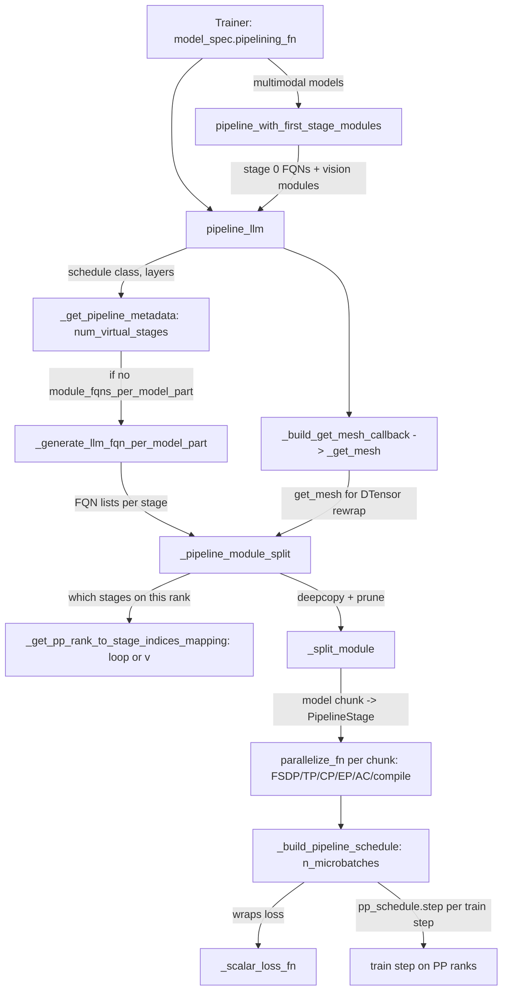

# Pipeline parallel (PP): stage split, rank-to-stage mapping and schedule construction

## Overview
Pipeline parallelism in TorchTitan is a thin, model-agnostic adapter over PyTorch's
`torch.distributed.pipelining`. The whole subsystem is one public function,
[`pipeline_llm`](https://github.com/google-pytorch/torchtitan/blob/033f131322a8b5b026ac53d734c689d664442bf8/torchtitan/distributed/pipeline_parallel.py#L65 "torchtitan/distributed/pipeline_parallel#pipeline_llm")
(the module's [`__all__`](https://github.com/google-pytorch/torchtitan/blob/033f131322a8b5b026ac53d734c689d664442bf8/torchtitan/distributed/pipeline_parallel.py#L38 "torchtitan/distributed/pipeline_parallel#__all__")
exports only it and a thin wrapper,
[`pipeline_with_first_stage_modules`](https://github.com/google-pytorch/torchtitan/blob/033f131322a8b5b026ac53d734c689d664442bf8/torchtitan/distributed/pipeline_parallel.py#L144 "torchtitan/distributed/pipeline_parallel#pipeline_with_first_stage_modules"), for models with extra first-stage modules), that a model registers as its
`pipelining_fn`. The key idea is
**splitting by module name, not by tracing**: the model is described as a list of fully
qualified names per stage (`tok_embeddings`, `layers.N`, `norm`, `lm_head`), each rank
deep-copies the full (meta-device) model and deletes every child it does not own, and the
resulting chunks become `PipelineStage`s. Each chunk is then handed to the model's ordinary
SPMD `parallelize_fn` (FSDP/TP/CP/EP/AC/compile), so PP composes with the other axes by
simply running them once per chunk. Finally a schedule object (1F1B, Interleaved1F1B,
ZBVZeroBubble, DualPipeV, or a CSV-defined runtime schedule) is built with
`n_microbatches = parallelism.num_pp_microbatches` (an explicit count, no longer derived
from a batch and microbatch size), and that number, relative to the total stage count, is
what determines the pipeline bubble.

## Diagram

Legend:
- `TR` - [`Trainer`](https://github.com/google-pytorch/torchtitan/blob/033f131322a8b5b026ac53d734c689d664442bf8/torchtitan/trainer.py#L74 "torchtitan/trainer#Trainer")
- `PWF` - [`pipeline_with_first_stage_modules`](https://github.com/google-pytorch/torchtitan/blob/033f131322a8b5b026ac53d734c689d664442bf8/torchtitan/distributed/pipeline_parallel.py#L144 "torchtitan/distributed/pipeline_parallel#pipeline_with_first_stage_modules")
- `PL` - [`pipeline_llm`](https://github.com/google-pytorch/torchtitan/blob/033f131322a8b5b026ac53d734c689d664442bf8/torchtitan/distributed/pipeline_parallel.py#L65 "torchtitan/distributed/pipeline_parallel#pipeline_llm")
- `META` - [`_get_pipeline_metadata`](https://github.com/google-pytorch/torchtitan/blob/033f131322a8b5b026ac53d734c689d664442bf8/torchtitan/distributed/pipeline_parallel.py#L194 "torchtitan/distributed/pipeline_parallel#_get_pipeline_metadata")
- `FQN` - [`_generate_llm_fqn_per_model_part`](https://github.com/google-pytorch/torchtitan/blob/033f131322a8b5b026ac53d734c689d664442bf8/torchtitan/distributed/pipeline_parallel.py#L357 "torchtitan/distributed/pipeline_parallel#_generate_llm_fqn_per_model_part")
- `CB` - [`_build_get_mesh_callback`](https://github.com/google-pytorch/torchtitan/blob/033f131322a8b5b026ac53d734c689d664442bf8/torchtitan/distributed/pipeline_parallel.py#L41 "torchtitan/distributed/pipeline_parallel#_build_get_mesh_callback") returning [`_get_mesh`](https://github.com/google-pytorch/torchtitan/blob/033f131322a8b5b026ac53d734c689d664442bf8/torchtitan/distributed/pipeline_parallel.py#L54 "torchtitan/distributed/pipeline_parallel#_build_get_mesh_callback._get_mesh")
- `SPLIT` - [`_pipeline_module_split`](https://github.com/google-pytorch/torchtitan/blob/033f131322a8b5b026ac53d734c689d664442bf8/torchtitan/distributed/pipeline_parallel.py#L572 "torchtitan/distributed/pipeline_parallel#_pipeline_module_split")
- `MAP` - [`_get_pp_rank_to_stage_indices_mapping`](https://github.com/google-pytorch/torchtitan/blob/033f131322a8b5b026ac53d734c689d664442bf8/torchtitan/distributed/pipeline_parallel.py#L532 "torchtitan/distributed/pipeline_parallel#_get_pp_rank_to_stage_indices_mapping")
- `SM` - [`_split_module`](https://github.com/google-pytorch/torchtitan/blob/033f131322a8b5b026ac53d734c689d664442bf8/torchtitan/distributed/pipeline_parallel.py#L470 "torchtitan/distributed/pipeline_parallel#_split_module")
- `PAR` - (concept) the model's SPMD `parallelize_fn`; see [fsdp-sharding](fsdp-sharding.md), [tensor-parallel](tensor-parallel.md)
- `SCH` - [`_build_pipeline_schedule`](https://github.com/google-pytorch/torchtitan/blob/033f131322a8b5b026ac53d734c689d664442bf8/torchtitan/distributed/pipeline_parallel.py#L267 "torchtitan/distributed/pipeline_parallel#_build_pipeline_schedule")
- `LOSS` - [`_scalar_loss_fn`](https://github.com/google-pytorch/torchtitan/blob/033f131322a8b5b026ac53d734c689d664442bf8/torchtitan/distributed/pipeline_parallel.py#L318 "torchtitan/distributed/pipeline_parallel#_build_pipeline_schedule._scalar_loss_fn")
- `STEP` - (concept) the PP branch of the training step; see [training-loop](training-loop.md)

## Design rationale (why it's built this way)
- **FQN-based splitting keeps models PP-agnostic.** Instead of graph tracing, a stage is
  "the model with other children removed". The docstring of
  [`_pipeline_module_split`](https://github.com/google-pytorch/torchtitan/blob/033f131322a8b5b026ac53d734c689d664442bf8/torchtitan/distributed/pipeline_parallel.py#L572 "torchtitan/distributed/pipeline_parallel#_pipeline_module_split")
  states the contract this imposes: "forward() method should tolerate deleted layers",
  "weight initialization methods should tolerate deleted layers", and nested
  `ModuleDict`/`ModuleList` structures are not supported. In exchange, any
  [`Decoder`](https://github.com/google-pytorch/torchtitan/blob/033f131322a8b5b026ac53d734c689d664442bf8/torchtitan/models/common/decoder.py#L67 "torchtitan/models/common/decoder#Decoder")-shaped
  model with `tok_embeddings`, `layers`, `norm`, `lm_head` children gets PP for free.
- **PP is the outer axis; SPMD parallelisms are applied inside each chunk.** The comment
  in [`pipeline_llm`](https://github.com/google-pytorch/torchtitan/blob/033f131322a8b5b026ac53d734c689d664442bf8/torchtitan/distributed/pipeline_parallel.py#L65 "torchtitan/distributed/pipeline_parallel#pipeline_llm")
  explains that with looped schedules "each item in model_parts is one stage-model-chunk"
  and that SPMD parallelisms, compilation, optimizer and checkpointing are iterated per
  chunk. This is why the optimizer and checkpoint containers take a *list* of model parts
  everywhere in the trainer.
- **Embedding and LM head are weighted like layers.** The first and last stages carry
  extra non-layer work. `pipeline_parallel_first_stage_less_layers` and
  `..._last_stage_less_layers` (both default 1) are fed to
  [`_generate_llm_fqn_per_model_part`](https://github.com/google-pytorch/torchtitan/blob/033f131322a8b5b026ac53d734c689d664442bf8/torchtitan/distributed/pipeline_parallel.py#L357 "torchtitan/distributed/pipeline_parallel#_generate_llm_fqn_per_model_part")
  as `input_weight`/`output_weight`, which count `tok_embeddings` and `norm + lm_head` as
  that many "effective layers", so the edge stages get fewer transformer blocks. The
  docstring of [`pipeline_with_first_stage_modules`](https://github.com/google-pytorch/torchtitan/blob/033f131322a8b5b026ac53d734c689d664442bf8/torchtitan/distributed/pipeline_parallel.py#L144 "torchtitan/distributed/pipeline_parallel#pipeline_with_first_stage_modules") warns that
  extra first-stage modules add load "that the auto split does not model (`input_weight`
  only accounts for `tok_embeddings`)" and points at `..._first_stage_less_layers` to
  rebalance.
- **DTensors cannot cross stage boundaries, so each stage rebuilds them.** The
  docstring of
  [`_build_get_mesh_callback`](https://github.com/google-pytorch/torchtitan/blob/033f131322a8b5b026ac53d734c689d664442bf8/torchtitan/distributed/pipeline_parallel.py#L41 "torchtitan/distributed/pipeline_parallel#_build_get_mesh_callback")
  is explicit: "DTensors are not directly serializable across PP stages (because
  ProcessGroup is not serializable), so each stage uses this callback to obtain its local
  DeviceMesh and re-wrap incoming tensors as DTensors with the correct placements."
  [`_get_mesh`](https://github.com/google-pytorch/torchtitan/blob/033f131322a8b5b026ac53d734c689d664442bf8/torchtitan/distributed/pipeline_parallel.py#L54 "torchtitan/distributed/pipeline_parallel#_build_get_mesh_callback._get_mesh")
  resolves names through
  [`get_mesh`](https://github.com/google-pytorch/torchtitan/blob/033f131322a8b5b026ac53d734c689d664442bf8/torchtitan/distributed/parallel_dims.py#L435 "torchtitan/distributed/parallel_dims#ParallelDims.get_mesh")
  and returns `None` when the cached mesh's layout differs from the requested one.
- **Loss scaling is TorchTitan's job, not the schedule's.** Schedules are built with
  `scale_grads=False`, and the loss is summed (not averaged) over microbatches in the
  trainer, because every loss class already normalizes by `global_valid_tokens`
  (see [loss-and-validation](loss-and-validation.md)).
- **Helpers are shared with Graph PP.** Four private helpers (the metadata, FQN, split and
  schedule builders) carry docstrings saying Graph PP uses them, two of them adding that it does
  so without running the full `pipeline_llm` setup:
  [`graph_pipeline_llm`](https://github.com/google-pytorch/torchtitan/blob/033f131322a8b5b026ac53d734c689d664442bf8/torchtitan/experiments/graph_trainer/graph_pp/pipeline.py#L66 "torchtitan/experiments/graph_trainer/graph_pp/pipeline#graph_pipeline_llm")
  calls the same metadata, FQN, mesh-callback, rank-mapping and split helpers, and passes
  `backward_requires_autograd=False` to the schedule builder because it runs explicit
  backward graphs.

> [!inferred]
> On TPU the bubble matters more than on GPU in one respect: every PP stage is a separate
> compiled XLA program per microbatch shape, and idle ranks during warmup/cooldown cannot
> overlap anything else. The practical knob is to make `local_batch_size /
> pipeline_parallel_microbatch_size` comfortably larger than `pipeline_parallel_degree x
> stages_per_rank`, which is exactly the condition the schedule builder warns about.

## Entry points
- [`pipeline_llm`](https://github.com/google-pytorch/torchtitan/blob/033f131322a8b5b026ac53d734c689d664442bf8/torchtitan/distributed/pipeline_parallel.py#L65 "torchtitan/distributed/pipeline_parallel#pipeline_llm")
  is reached from [`Trainer`](https://github.com/google-pytorch/torchtitan/blob/033f131322a8b5b026ac53d734c689d664442bf8/torchtitan/trainer.py#L74 "torchtitan/trainer#Trainer")
  initialization when `parallel_dims.pp_enabled` is true; the trainer raises if the model
  spec has no `pipelining_fn`. Model registries wire it in, for example the core
  [`model_registry`](https://github.com/google-pytorch/torchtitan/blob/033f131322a8b5b026ac53d734c689d664442bf8/torchtitan/models/llama3/__init__.py#L387 "torchtitan/models/llama3/__init__#model_registry")
  for Llama 3 and the TPU experiment's
  [`model_registry`](https://github.com/google-pytorch/torchtitan/blob/033f131322a8b5b026ac53d734c689d664442bf8/torchtitan/experiments/tpu/qwen3/__init__.py#L144 "torchtitan/experiments/tpu/qwen3/__init__#model_registry")
  for Qwen3, which passes the upstream Qwen3 `pipeline_llm` through unchanged.
- [`pipeline_with_first_stage_modules`](https://github.com/google-pytorch/torchtitan/blob/033f131322a8b5b026ac53d734c689d664442bf8/torchtitan/distributed/pipeline_parallel.py#L144 "torchtitan/distributed/pipeline_parallel#pipeline_with_first_stage_modules")
  is the template for a model whose top level is not purely a decoder; it replaces the
  per-model wrappers such as the old Qwen3.5 one. When `module_fqns_per_model_part` is unset it calls
  `_get_pipeline_metadata` and `_generate_llm_fqn_per_model_part` itself, prepends every
  module in `first_stage_module_fqns` that is actually present on the model to stage 0's
  FQN list, writes the result into a `dataclasses.replace`d copy of the parallelism config
  and delegates to `pipeline_llm`. Registries bind it with `functools.partial`: the
  [`model_registry`](https://github.com/google-pytorch/torchtitan/blob/033f131322a8b5b026ac53d734c689d664442bf8/torchtitan/models/qwen3_5/__init__.py#L1096 "torchtitan/models/qwen3_5/__init__#model_registry")
  for Qwen3.5 passes `("vision_encoder",)`, and the Muse Glimmer
  [`model_registry`](https://github.com/google-pytorch/torchtitan/blob/033f131322a8b5b026ac53d734c689d664442bf8/torchtitan/models/muse_glimmer/__init__.py#L526 "torchtitan/models/muse_glimmer/__init__#model_registry")
  passes its whole perception front end (`vision_encoder`, `vision_adapter`,
  `vision_projection`, `perception_emb_norm`).
- [`graph_pipeline_llm`](https://github.com/google-pytorch/torchtitan/blob/033f131322a8b5b026ac53d734c689d664442bf8/torchtitan/experiments/graph_trainer/graph_pp/pipeline.py#L66 "torchtitan/experiments/graph_trainer/graph_pp/pipeline#graph_pipeline_llm")
  and [`pipeline_hf_transformers`](https://github.com/google-pytorch/torchtitan/blob/033f131322a8b5b026ac53d734c689d664442bf8/torchtitan/experiments/transformers_modeling_backend/pipeline.py#L290 "torchtitan/experiments/transformers_modeling_backend/pipeline#pipeline_hf_transformers")
  are the alternate `pipelining_fn`s (graph-captured stages, Hugging Face model trees) that
  reuse the private helpers of this module.

## Mechanism (step-by-step)
1. **Count stages.** [`_get_pipeline_metadata`](https://github.com/google-pytorch/torchtitan/blob/033f131322a8b5b026ac53d734c689d664442bf8/torchtitan/distributed/pipeline_parallel.py#L194 "torchtitan/distributed/pipeline_parallel#_get_pipeline_metadata")
   resolves the schedule class from `pipeline_parallel_schedule` and asks whether it is a
   single-stage schedule. It reads the layer count from `model_config.layers` (a model
   config without `layers` is rejected). With `pipeline_parallel_layers_per_stage` set, it
   computes `num_virtual_stages = ceil((num_layers + input_weight + output_weight) /
   layers_per_stage)` and validates that it divides evenly by the PP degree, that
   single-stage schedules get exactly 1 stage per rank, and that multi-stage (looped)
   schedules get at least 2. Without it, the default is 1 stage per rank for single-stage
   schedules and 2 per rank for looped ones.
2. **Name what each stage owns.** If the user did not supply
   `module_fqns_per_model_part` in [`ParallelismConfig`](https://github.com/google-pytorch/torchtitan/blob/033f131322a8b5b026ac53d734c689d664442bf8/torchtitan/config/configs.py#L123 "torchtitan/config/configs#ParallelismConfig"),
   [`_generate_llm_fqn_per_model_part`](https://github.com/google-pytorch/torchtitan/blob/033f131322a8b5b026ac53d734c689d664442bf8/torchtitan/distributed/pipeline_parallel.py#L357 "torchtitan/distributed/pipeline_parallel#_generate_llm_fqn_per_model_part")
   spreads `num_layers + input_weight + output_weight` effective layers evenly, giving the
   remainder to the earliest stages. Stage 0 starts with `tok_embeddings` and gets
   `input_weight` fewer blocks; the last stage gets `output_weight` fewer blocks and ends
   with `norm` and `lm_head`. It refuses configurations with more stages than effective
   layers, with empty stages, or with a weight bigger than the minimum per-stage layer count.
3. **Decide which stages live on this rank.** Inside
   [`_pipeline_module_split`](https://github.com/google-pytorch/torchtitan/blob/033f131322a8b5b026ac53d734c689d664442bf8/torchtitan/distributed/pipeline_parallel.py#L572 "torchtitan/distributed/pipeline_parallel#_pipeline_module_split"),
   [`_get_pp_rank_to_stage_indices_mapping`](https://github.com/google-pytorch/torchtitan/blob/033f131322a8b5b026ac53d734c689d664442bf8/torchtitan/distributed/pipeline_parallel.py#L532 "torchtitan/distributed/pipeline_parallel#_get_pp_rank_to_stage_indices_mapping")
   uses the "loop" style (rank `r` owns stages `r, r + pp, r + 2pp, ...`) for every schedule
   except ZBVZeroBubble and DualPipeV, which use the "v" style: exactly 2 stages per rank,
   paired as `(r, num_stages - 1 - r)`, so rank 0 holds both the first and the last stage.
   That V pairing is why V schedules keep the loss on rank 0 rather than on the last PP rank.
4. **Carve the chunk.** For each owned stage,
   [`_split_module`](https://github.com/google-pytorch/torchtitan/blob/033f131322a8b5b026ac53d734c689d664442bf8/torchtitan/distributed/pipeline_parallel.py#L470 "torchtitan/distributed/pipeline_parallel#_split_module")
   deep-copies the whole model and prunes its direct children: for a `ModuleDict` it deletes
   unkept keys, for a `ModuleList` it rebuilds a new list of kept indices, a container with
   nothing kept becomes an empty container, and any other child not listed is set to
   `None`. The chunk is wrapped in a `PipelineStage` on the `pp` process group together with
   the mesh callback from
   [`_build_get_mesh_callback`](https://github.com/google-pytorch/torchtitan/blob/033f131322a8b5b026ac53d734c689d664442bf8/torchtitan/distributed/pipeline_parallel.py#L41 "torchtitan/distributed/pipeline_parallel#_build_get_mesh_callback").
5. **Apply SPMD parallelism per chunk.** Back in
   [`pipeline_llm`](https://github.com/google-pytorch/torchtitan/blob/033f131322a8b5b026ac53d734c689d664442bf8/torchtitan/distributed/pipeline_parallel.py#L65 "torchtitan/distributed/pipeline_parallel#pipeline_llm"),
   each chunk goes through the model's `parallelize_fn` with the same
   [`TrainingConfig`](https://github.com/google-pytorch/torchtitan/blob/033f131322a8b5b026ac53d734c689d664442bf8/torchtitan/config/configs.py#L36 "torchtitan/config/configs#TrainingConfig"),
   parallelism, compile and [`ActivationCheckpointingConfig`](https://github.com/google-pytorch/torchtitan/blob/033f131322a8b5b026ac53d734c689d664442bf8/torchtitan/distributed/activation_checkpoint.py#L418 "torchtitan/distributed/activation_checkpoint#ActivationCheckpointingConfig")
   as a non-PP run, and the stage's `submod` is replaced with the result because
   `torch.compile` or wrapping may have returned a new module object.
6. **Build the schedule.** [`_build_pipeline_schedule`](https://github.com/google-pytorch/torchtitan/blob/033f131322a8b5b026ac53d734c689d664442bf8/torchtitan/distributed/pipeline_parallel.py#L267 "torchtitan/distributed/pipeline_parallel#_build_pipeline_schedule")
   picks `_PipelineScheduleRuntime` when `pipeline_parallel_schedule_csv` is set (raising
   `FileNotFoundError` if it is not an existing file), otherwise the named class. It now
   receives the microbatch count directly (`num_microbatches`, which `pipeline_llm` takes
   from `parallelism.num_pp_microbatches`), so the old batch-divisibility check is gone, and
   it warns when `num_microbatches < pipeline_parallel_degree x len(stages)` because that
   "may result in a bubble in the pipeline". Looped schedules receive the list of stages and
   `backward_requires_autograd`; single-stage schedules receive `stages[0]`. The loss is
   adapted by [`_scalar_loss_fn`](https://github.com/google-pytorch/torchtitan/blob/033f131322a8b5b026ac53d734c689d664442bf8/torchtitan/distributed/pipeline_parallel.py#L318 "torchtitan/distributed/pipeline_parallel#_build_pipeline_schedule._scalar_loss_fn"),
   which drops the second element of TorchTitan's `(loss, aux)` tuple since schedules
   "expect a bare scalar loss tensor". A CSV schedule is loaded last via `_load_csv`.
7. **Report stage ownership and run.** `pipeline_llm` returns the schedule, the model
   parts, and whether this rank holds a first and/or last stage. The
   [`Trainer`](https://github.com/google-pytorch/torchtitan/blob/033f131322a8b5b026ac53d734c689d664442bf8/torchtitan/trainer.py#L74 "torchtitan/trainer#Trainer")
   materializes each part on device and runs `init_weights` per part. Microbatching now
   happens in the trainer, not in the schedule: the data loader yields `num_pp_microbatches`
   input dicts per step, each is preprocessed separately, and `pp_schedule.step(...)` gets
   pre-split `arg_mbs` (only on first-stage ranks), `kwarg_mbs` (all ranks) and
   `target_mbs` plus a `losses` list (only on last-stage ranks). The step's loss is the sum
   of the detached per-microbatch losses on last-stage ranks and a preallocated `-1.0`
   sentinel elsewhere.

## Key data structures
- `module_names_per_stage: list[list[str]]` - the whole split plan; index = global stage id.
  User-overridable as `ParallelismConfig.module_fqns_per_model_part`.
- `stages` / `model_parts` - parallel lists of `PipelineStage` and `nn.Module` for the
  stages this rank owns (1 for single-stage schedules, 2 or more for looped/V schedules).
- The four return values of
  [`pipeline_llm`](https://github.com/google-pytorch/torchtitan/blob/033f131322a8b5b026ac53d734c689d664442bf8/torchtitan/distributed/pipeline_parallel.py#L65 "torchtitan/distributed/pipeline_parallel#pipeline_llm"):
  `(pp_schedule, model_parts, has_first_stage, has_last_stage)`; the two booleans drive
  input and label routing in the training step.
- PP knobs in [`ParallelismConfig`](https://github.com/google-pytorch/torchtitan/blob/033f131322a8b5b026ac53d734c689d664442bf8/torchtitan/config/configs.py#L123 "torchtitan/config/configs#ParallelismConfig"):
  `pipeline_parallel_degree` (physical ranks, not stages), `pipeline_parallel_schedule`
  (default `1F1B`), `pipeline_parallel_schedule_csv`, `num_pp_microbatches` (default 1,
  "ignored when pipeline parallelism is disabled"), `pipeline_parallel_layers_per_stage`,
  and the two `..._less_layers` weights. The microbatch size is now a token count,
  `num_tokens_per_microbatch_per_dp_rank` in
  [`TrainingConfig`](https://github.com/google-pytorch/torchtitan/blob/033f131322a8b5b026ac53d734c689d664442bf8/torchtitan/config/configs.py#L36 "torchtitan/config/configs#TrainingConfig"),
  and the default `num_tokens_per_train_step` is that times `num_pp_microbatches` times the
  data-parallel degree.

## Dynamics (design intent)
- **Bubble.** With `P` PP ranks, `V` stages per rank and `M` microbatches, the total stage
  count is `P x V`; the builder only warns (does not fail) when `M < P x V`. Looped
  schedules (V >= 2) exist to shrink the warmup/cooldown fraction for a given `M`; V-shaped
  zero-bubble schedules additionally split backward into input- and weight-gradient parts.
- **Mesh position.** `pp` is the outermost dimension of every mesh
  [`ParallelDims`](https://github.com/google-pytorch/torchtitan/blob/033f131322a8b5b026ac53d734c689d664442bf8/torchtitan/distributed/parallel_dims.py#L105 "torchtitan/distributed/parallel_dims#ParallelDims")
  builds, so PP peers are the farthest-apart ranks, and FSDP, TP, CP and EP groups are
  formed inside each PP slice.
- **Loss visibility.** Only last-stage ranks (rank 0 under V schedules) see the real loss;
  the trainer calls a helper that warns if that rank is not in `LOG_RANK`, and
  [`MetricsProcessor`](https://github.com/google-pytorch/torchtitan/blob/033f131322a8b5b026ac53d734c689d664442bf8/torchtitan/components/metrics.py#L265 "torchtitan/components/metrics#MetricsProcessor")
  logs whatever the local rank computed.

> [!inferred]
> In the TPU experiment, PP is mostly fenced off rather than tuned: the TPU trainer skips
> its graph-split forward/backward when PP is enabled and falls back to the upstream step,
> `compile_grad_norm` requires PP=1 (stages own disjoint parameter subsets, so the norm
> needs one more cross-stage reduction), the SimpleFSDP all-reduce-plus-slice path
> requires PP=1, and scan-over-layers refuses PP because PP "splits up the very layer range
> the scan is looping over". The TPU per-model parallelize functions also turn off
> FSDP reshard-after-forward when PP is on, trading memory for not re-gathering weights
> once per microbatch.

## Edge cases
- `pipeline_parallel_degree` counts ranks. Asking for Interleaved1F1B without
  `layers_per_stage` silently gives 2 stages per rank; asking for a single-stage schedule
  with a `layers_per_stage` that yields 2 per rank is an error.
- V schedules assert exactly 2 stages per rank in
  [`_get_pp_rank_to_stage_indices_mapping`](https://github.com/google-pytorch/torchtitan/blob/033f131322a8b5b026ac53d734c689d664442bf8/torchtitan/distributed/pipeline_parallel.py#L532 "torchtitan/distributed/pipeline_parallel#_get_pp_rank_to_stage_indices_mapping").
- `PipelineScheduleSingle` itself is abstract and rejected; a CSV schedule is only
  accepted for the single, multi and runtime base classes.
- [`_split_module`](https://github.com/google-pytorch/torchtitan/blob/033f131322a8b5b026ac53d734c689d664442bf8/torchtitan/distributed/pipeline_parallel.py#L470 "torchtitan/distributed/pipeline_parallel#_split_module")
  only looks one level deep, and for a `ModuleList` it keeps only digit indices, so FQNs
  like `layers.0.attention` are ignored; the rebuilt `ModuleList` renumbers kept layers
  from 0, while a `ModuleDict` keeps its original keys (TorchTitan decoders use a
  `ModuleDict` for `layers`, which is what keeps checkpoint FQNs stable across stages).
- The auto-split assumes top-level names `tok_embeddings`, `layers`, `norm`, `lm_head`;
  models with extra top-level modules must supply their own FQN lists or go through
  [`pipeline_with_first_stage_modules`](https://github.com/google-pytorch/torchtitan/blob/033f131322a8b5b026ac53d734c689d664442bf8/torchtitan/distributed/pipeline_parallel.py#L144 "torchtitan/distributed/pipeline_parallel#pipeline_with_first_stage_modules"), which only
  touches stage 0; a model with extra modules that belong on the last stage still needs
  explicit `module_fqns_per_model_part`. On every other stage those modules are pruned to
  `None`, so the model's `forward` must tolerate them being absent.
- SPMD typechecking is rejected by the trainer when PP > 1, and so are CUDA graphs with
  looped schedules or with validation enabled.
- The trainer requires `num_tokens_per_microbatch_per_dp_rank` to be divisible by the
  TP (with sequence parallel) and `2 x CP` sharding factors, checked per PP microbatch.

## Open questions
- Whether the stock torchtitan PP path has been exercised end-to-end on TPU at this pin:
  the TPU experiment wires `pipelining_fn` for Qwen3 and one Qwen3 recipe names
  `Interleaved1F1B`, but its distributed tests and configs in the evidence all run PP=1.
- The validator carries a TODO that "PP+FSDP unexpectedly puts the loss back to the CPU";
  the root cause is not in this module.
- How the runtime-CSV schedule format is defined lives in `torch.distributed.pipelining`,
  outside this repo.

## See also
- [Parallel dims and mesh](parallel-dims-and-mesh.md) - where the `pp` mesh axis comes from.
- [Training loop](training-loop.md) - the PP branch of the forward/backward step.
- [FSDP sharding](fsdp-sharding.md), [Tensor parallel](tensor-parallel.md), [Context parallel](context-parallel.md), [Expert parallel](expert-parallel.md) - the per-chunk SPMD axes.
- [Activation checkpointing](activation-checkpointing.md) - applied per chunk by `parallelize_fn`.
- [Train spec and model protocol](train-spec-and-model-protocol.md) - `pipelining_fn` in the model spec.
- [Checkpointing](checkpointing.md) - saving a list of model parts.

## Recent changes
- `fa627bf2` updates TorchTitan from upstream `d771abb0`; for PP it brings the explicit
  `parallelism.num_pp_microbatches` count (replacing the batch-size / microbatch-size
  derivation inside `_build_pipeline_schedule`), trainer-side microbatch splitting into
  `arg_mbs` / `kwarg_mbs` / `target_mbs`, and the shared `pipeline_with_first_stage_modules`
  wrapper, which replaces the Qwen3.5-specific PP function and is also registered by the
  newly added Qwen3.6, Qwen3.8, Kimi K2.7 and Muse Glimmer models.
- `552d351b`, `ea1284ce`, `567dbe5d`, `e7964fec` touch the TPU Qwen3 registry only to choose
  the FLOP convention (torchtitan FLOPs by default, MaxText FLOPs in the `*maxtext*`
  recipes); its `pipelining_fn` wiring is unchanged.
- [all changes in 033f131322](../changes/033f131322.md)
