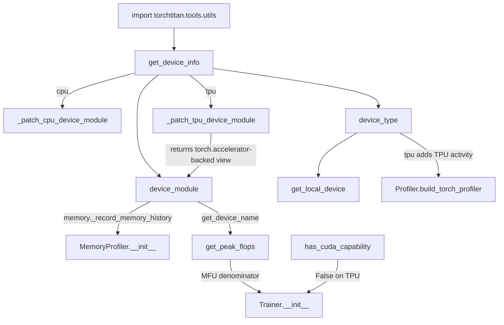
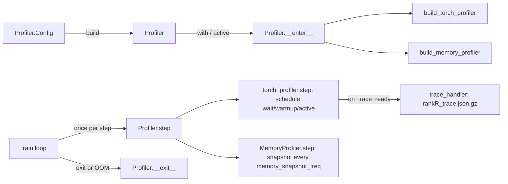

# Profiling and tooling: device detection, peak FLOPS, profiler windows, GC

## Overview
`torchtitan/tools` is the small layer that every other TorchTitan component leans on to stay
device-agnostic: it decides *once, at import time*, which accelerator backend the process runs on
and exposes it as two module globals,
[`device_type`](https://github.com/google-pytorch/torchtitan/blob/033f131322a8b5b026ac53d734c689d664442bf8/torchtitan/tools/utils.py#L219 "torchtitan/tools/utils#device_type")
(a string such as `"cuda"`, `"tpu"` or `"cpu"`) and
[`device_module`](https://github.com/google-pytorch/torchtitan/blob/033f131322a8b5b026ac53d734c689d664442bf8/torchtitan/tools/utils.py#L219 "torchtitan/tools/utils#device_module")
(the matching `torch.<backend>` module). The key design idea is that the rest of the code calls the
CUDA-shaped device-module API (`get_device_name`, `memory_stats`, `reset_peak_memory_stats`,
`empty_cache`, ...) unconditionally, and this layer **back-fills the functions a non-CUDA backend
lacks** so those calls succeed. On top of that it provides the hard-coded peak-FLOPS table that is
the MFU denominator ([`get_peak_flops`](https://github.com/google-pytorch/torchtitan/blob/033f131322a8b5b026ac53d734c689d664442bf8/torchtitan/tools/utils.py#L309 "torchtitan/tools/utils#get_peak_flops")),
the [`Profiler`](https://github.com/google-pytorch/torchtitan/blob/033f131322a8b5b026ac53d734c689d664442bf8/torchtitan/tools/profiler.py#L106 "torchtitan/tools/profiler#Profiler")
that "owns profiling and memory snapshot lifecycle for a training run" (Kineto on GPU, Kineto plus
the TPU tracer on TPU), a [`GarbageCollection`](https://github.com/google-pytorch/torchtitan/blob/033f131322a8b5b026ac53d734c689d664442bf8/torchtitan/tools/utils.py#L270 "torchtitan/tools/utils#GarbageCollection")
handler that takes Python GC off the critical path, the root [`logger`](https://github.com/google-pytorch/torchtitan/blob/033f131322a8b5b026ac53d734c689d664442bf8/torchtitan/tools/logging.py#L12 "torchtitan/tools/logging#logger"),
and local-or-`gs://` filesystem helpers used by checkpointing. For a TPU user, three things here
decide whether the numbers you see are meaningful: which device got detected, which peak-FLOPS
value MFU is divided by, and which steps the profiler actually captured.

## Diagram
Device detection and its consumers:

Legend:
- `IMP` - (concept) the first import of the module, which runs detection as a side effect
- `GDI` - [`get_device_info`](https://github.com/google-pytorch/torchtitan/blob/033f131322a8b5b026ac53d734c689d664442bf8/torchtitan/tools/utils.py#L206 "torchtitan/tools/utils#get_device_info")
- `PCPU` - [`_patch_cpu_device_module`](https://github.com/google-pytorch/torchtitan/blob/033f131322a8b5b026ac53d734c689d664442bf8/torchtitan/tools/utils.py#L59 "torchtitan/tools/utils#_patch_cpu_device_module")
- `PTPU` - [`_patch_tpu_device_module`](https://github.com/google-pytorch/torchtitan/blob/033f131322a8b5b026ac53d734c689d664442bf8/torchtitan/tools/utils.py#L164 "torchtitan/tools/utils#_patch_tpu_device_module")
- `DT` - [`device_type`](https://github.com/google-pytorch/torchtitan/blob/033f131322a8b5b026ac53d734c689d664442bf8/torchtitan/tools/utils.py#L219 "torchtitan/tools/utils#device_type")
- `DM` - [`device_module`](https://github.com/google-pytorch/torchtitan/blob/033f131322a8b5b026ac53d734c689d664442bf8/torchtitan/tools/utils.py#L219 "torchtitan/tools/utils#device_module")
- `LOC` - [`get_local_device`](https://github.com/google-pytorch/torchtitan/blob/033f131322a8b5b026ac53d734c689d664442bf8/torchtitan/tools/utils.py#L222 "torchtitan/tools/utils#get_local_device")
- `BTP` - [`build_torch_profiler`](https://github.com/google-pytorch/torchtitan/blob/033f131322a8b5b026ac53d734c689d664442bf8/torchtitan/tools/profiler.py#L286 "torchtitan/tools/profiler#Profiler.build_torch_profiler")
- `MPI` - [`__init__`](https://github.com/google-pytorch/torchtitan/blob/033f131322a8b5b026ac53d734c689d664442bf8/torchtitan/tools/profiler.py#L53 "torchtitan/tools/profiler#MemoryProfiler.__init__")
- `PF` - [`get_peak_flops`](https://github.com/google-pytorch/torchtitan/blob/033f131322a8b5b026ac53d734c689d664442bf8/torchtitan/tools/utils.py#L309 "torchtitan/tools/utils#get_peak_flops")
- `TR` - [`__init__`](https://github.com/google-pytorch/torchtitan/blob/033f131322a8b5b026ac53d734c689d664442bf8/torchtitan/trainer.py#L344 "torchtitan/trainer#Trainer.__init__")
- `CAP` - [`has_cuda_capability`](https://github.com/google-pytorch/torchtitan/blob/033f131322a8b5b026ac53d734c689d664442bf8/torchtitan/tools/utils.py#L29 "torchtitan/tools/utils#has_cuda_capability")

Profiler lifecycle inside the training loop:

Legend:
- `CFG` - [`Config`](https://github.com/google-pytorch/torchtitan/blob/033f131322a8b5b026ac53d734c689d664442bf8/torchtitan/tools/profiler.py#L129 "torchtitan/tools/profiler#Profiler.Config")
- `P` - [`Profiler`](https://github.com/google-pytorch/torchtitan/blob/033f131322a8b5b026ac53d734c689d664442bf8/torchtitan/tools/profiler.py#L106 "torchtitan/tools/profiler#Profiler")
- `ENT` - [`__enter__`](https://github.com/google-pytorch/torchtitan/blob/033f131322a8b5b026ac53d734c689d664442bf8/torchtitan/tools/profiler.py#L239 "torchtitan/tools/profiler#Profiler.__enter__")
- `BTP` - [`build_torch_profiler`](https://github.com/google-pytorch/torchtitan/blob/033f131322a8b5b026ac53d734c689d664442bf8/torchtitan/tools/profiler.py#L286 "torchtitan/tools/profiler#Profiler.build_torch_profiler")
- `BMP` - [`build_memory_profiler`](https://github.com/google-pytorch/torchtitan/blob/033f131322a8b5b026ac53d734c689d664442bf8/torchtitan/tools/profiler.py#L388 "torchtitan/tools/profiler#Profiler.build_memory_profiler")
- `LOOP` - (concept) the trainer loop, see [training-loop](training-loop.md)
- `STEP` - [`step`](https://github.com/google-pytorch/torchtitan/blob/033f131322a8b5b026ac53d734c689d664442bf8/torchtitan/tools/profiler.py#L276 "torchtitan/tools/profiler#Profiler.step")
- `TP` - [`torch_profiler`](https://github.com/google-pytorch/torchtitan/blob/033f131322a8b5b026ac53d734c689d664442bf8/torchtitan/tools/profiler.py#L214 "torchtitan/tools/profiler#Profiler.torch_profiler")
- `MS` - [`step`](https://github.com/google-pytorch/torchtitan/blob/033f131322a8b5b026ac53d734c689d664442bf8/torchtitan/tools/profiler.py#L77 "torchtitan/tools/profiler#MemoryProfiler.step")
- `TH` - [`trace_handler`](https://github.com/google-pytorch/torchtitan/blob/033f131322a8b5b026ac53d734c689d664442bf8/torchtitan/tools/profiler.py#L311 "torchtitan/tools/profiler#Profiler.trace_handler")
- `EX` - [`__exit__`](https://github.com/google-pytorch/torchtitan/blob/033f131322a8b5b026ac53d734c689d664442bf8/torchtitan/tools/profiler.py#L252 "torchtitan/tools/profiler#Profiler.__exit__")

## Design rationale (why it's built this way)
- **Detect once, at import, and let the environment decide.** [`get_device_info`](https://github.com/google-pytorch/torchtitan/blob/033f131322a8b5b026ac53d734c689d664442bf8/torchtitan/tools/utils.py#L206 "torchtitan/tools/utils#get_device_info")
  runs at module import and asks PyTorch which accelerator is available. Its comment explains the
  fork's deviation: "Upstream falls back to `cuda`; this fork falls back to `cpu` so that a machine
  with no accelerator -- or one where the accelerator was hidden on purpose, see
  experiments/tpu/device_env.py -- reports what it will run on." Because the choice is frozen at
  import, forcing CPU has to happen in the environment *before* `import torch` (that module sets
  `TORCH_DEVICE_BACKEND_AUTOLOAD` so torch_tpu never registers), not by mutating the global later.
- **Shim the device module instead of branching everywhere.** Rather than guard each
  `device_module.memory_stats()` call with `if device_type == ...`, the tools layer patches the
  missing functions onto the backend module.
  [`_patch_tpu_device_module`](https://github.com/google-pytorch/torchtitan/blob/033f131322a8b5b026ac53d734c689d664442bf8/torchtitan/tools/utils.py#L164 "torchtitan/tools/utils#_patch_tpu_device_module")
  documents what torch_tpu already provides natively (`get_device_name`, `get_device_properties`,
  `set_device`, `current_device`, `device_count`, `synchronize`) and adds only the rest:
  `reset_peak_memory_stats` and `empty_cache` as no-ops, `memory_stats` routed to
  `torch.accelerator.memory_stats()` ("torchtitan expects them on the legacy device-module
  namespace (torch.tpu). Route them across."; an empty dict when `torch.accelerator` lacks it),
  and `is_triton_capable` returning `False` when torch_tpu does not define it.
  [`_patch_cpu_device_module`](https://github.com/google-pytorch/torchtitan/blob/033f131322a8b5b026ac53d734c689d664442bf8/torchtitan/tools/utils.py#L59 "torchtitan/tools/utils#_patch_cpu_device_module")
  does the same for CPU, including `current_device()` returning index `0` and `total_memory` taken
  from host RAM.
- **Route torch.tpu device APIs through torch.accelerator, without touching torch.tpu.** torch_tpu
  now marks the `torch.tpu` APIs that have a `torch.accelerator` equivalent as internal (PyTorch
  >= 2.11): calls from outside torch/torch_tpu emit a one-time `InternalApi` warning. So
  [`_patch_tpu_device_module`](https://github.com/google-pytorch/torchtitan/blob/033f131322a8b5b026ac53d734c689d664442bf8/torchtitan/tools/utils.py#L164 "torchtitan/tools/utils#_patch_tpu_device_module")
  now *returns* the object that becomes `device_module`: a `_TpuDeviceModule` view whose
  `is_available`, `device_count`, `current_device`, `set_device`, `synchronize`,
  `current_stream` and `set_stream` call `torch.accelerator`, and which forwards every other
  attribute to `torch.tpu`. Its docstring explains why it is a separate object rather than a
  patch: "torch_tpu calls these same functions on `torch.tpu` internally (e.g. `set_device` from
  device guards, `device_count` from `is_available`), and their pre-initialization behavior must
  not change." The view is used only when `torch.accelerator` has `set_device_index` (one
  capability check stands for the whole set, which "first shipped in PyTorch 2.6"); otherwise
  `torch.tpu` itself is returned.
- **CUDA feature gates fail closed on TPU.** [`has_cuda_capability`](https://github.com/google-pytorch/torchtitan/blob/033f131322a8b5b026ac53d734c689d664442bf8/torchtitan/tools/utils.py#L29 "torchtitan/tools/utils#has_cuda_capability")
  requires `torch.cuda.is_available()`, a non-ROCm build and a compute capability at or above the
  requested one. On a TPU host it is simply `False`, so capability-gated paths (FA3/FA4 activation
  and the FlexAttention flash backend at sm90+, the MXFP8 and NVFP4 converters at sm100+) are
  skipped or rejected rather than mis-detected. The new [`get_cuda_flash_attention_impl`](https://github.com/google-pytorch/torchtitan/blob/033f131322a8b5b026ac53d734c689d664442bf8/torchtitan/tools/utils.py#L38 "torchtitan/tools/utils#get_cuda_flash_attention_impl")
  builds on it ("FA4" on sm100+, "FA3" on sm90, because FA4 "hangs under torch.compile" on
  Hopper) and returns `None` on TPU.
- **Peak FLOPS is a lookup table, not a measurement.** [`get_peak_flops`](https://github.com/google-pytorch/torchtitan/blob/033f131322a8b5b026ac53d734c689d664442bf8/torchtitan/tools/utils.py#L309 "torchtitan/tools/utils#get_peak_flops")
  maps a device-name string to a dense BF16 peak. For TPU it lower-cases the name, turns `-` into
  spaces (so both torch_tpu's `"TPU v6e"` and older `"tpu-v6e"` / `"tpu-7x"` match) and returns
  per-device numbers: v4 275e12, v5e 197e12, v5p 459e12 ("we assume megacore is enabled for v5p"),
  v6e 918e12, and v7 `2307e12 / 2` ("The quoted number is per chip. We halve it for per-core
  FLOPS"). Every entry is a per-device peak: v4, v5e, v5p and v6e expose one device per chip, so
  the per-chip number is already per device, while TPU7x exposes each chip's two TensorCores as
  separate devices (the TPU launch code doubles the per-host device count on `tpu7x`), so halving
  the per-chip number keeps MFU on the same per-device basis as the other generations rather than
  skewing it by 2x. The rebase also brought a second TPU branch (`device_name.startswith("TPU")`,
  same numbers, an explicit 312e12 fallback) further down the chain; it is unreachable, because
  any name starting with `TPU` already matched the earlier case-insensitive `"tpu"` branch.
- **Profiling is a scheduled window, not always-on.** Kineto tracing is expensive, so
  [`build_torch_profiler`](https://github.com/google-pytorch/torchtitan/blob/033f131322a8b5b026ac53d734c689d664442bf8/torchtitan/tools/profiler.py#L286 "torchtitan/tools/profiler#Profiler.build_torch_profiler")
  turns [`profile_freq`](https://github.com/google-pytorch/torchtitan/blob/033f131322a8b5b026ac53d734c689d664442bf8/torchtitan/tools/profiler.py#L136 "torchtitan/tools/profiler#Profiler.Config.profile_freq"),
  [`profiler_warmup`](https://github.com/google-pytorch/torchtitan/blob/033f131322a8b5b026ac53d734c689d664442bf8/torchtitan/tools/profiler.py#L167 "torchtitan/tools/profiler#Profiler.Config.profiler_warmup")
  and [`profiler_active`](https://github.com/google-pytorch/torchtitan/blob/033f131322a8b5b026ac53d734c689d664442bf8/torchtitan/tools/profiler.py#L160 "torchtitan/tools/profiler#Profiler.Config.profiler_active")
  into a `torch.profiler.schedule(wait, warmup, active)` with `wait = profile_freq - (warmup +
  active)`. The window is validated when the config is built, not when the profiler starts:
  [`__post_init__`](https://github.com/google-pytorch/torchtitan/blob/033f131322a8b5b026ac53d734c689d664442bf8/torchtitan/tools/profiler.py#L193 "torchtitan/tools/profiler#Profiler.Config.__post_init__")
  raises `ValueError` when profiling is enabled and `profile_freq < profiler_warmup +
  profiler_active`, so a bad recipe fails before any model is built. Memory history is recorded with `stacks="python"` only, because the default
  `stacks="all"` symbolizes C++ frames and makes the dump "take minutes".
- **Own GC to avoid stragglers.** [`GarbageCollection`](https://github.com/google-pytorch/torchtitan/blob/033f131322a8b5b026ac53d734c689d664442bf8/torchtitan/tools/utils.py#L270 "torchtitan/tools/utils#GarbageCollection")
  (comment: "used to avoid stragglers in garbage collection") disables automatic collection and
  collects generation 1 on a fixed step cadence on every rank at once, so a GC pause does not land
  on one rank at a random moment and stall every collective waiting on it.

> [!inferred]
> On TPU, the no-op `reset_peak_memory_stats` means the "peak" memory numbers the metrics processor
> prints are not reset between logging windows: whatever keys `torch.accelerator.memory_stats()`
> returns are reported as-is, and missing keys come out as the `-1` defaults of the memory monitor.
> Read TPU peak memory as a process-lifetime high-water mark (or as unavailable), not a per-window
> peak. Likewise `empty_cache` does nothing on TPU, so code that calls it to release memory before a
> phase has no effect there.

## Entry points
- [`device_type`](https://github.com/google-pytorch/torchtitan/blob/033f131322a8b5b026ac53d734c689d664442bf8/torchtitan/tools/utils.py#L219 "torchtitan/tools/utils#device_type")
  / [`device_module`](https://github.com/google-pytorch/torchtitan/blob/033f131322a8b5b026ac53d734c689d664442bf8/torchtitan/tools/utils.py#L219 "torchtitan/tools/utils#device_module")
  are read at import by nearly every subsystem: device-mesh construction (the TPU topology-aware
  mesh path), the distributed backend choice (`tpu_dist` when `device_type == "tpu"`), the memory
  monitor behind MFU/memory metrics, the MoE token dispatcher, and the profiler.
- [`get_local_device`](https://github.com/google-pytorch/torchtitan/blob/033f131322a8b5b026ac53d734c689d664442bf8/torchtitan/tools/utils.py#L222 "torchtitan/tools/utils#get_local_device")
  is called when the trainer binds its device. On `tpu` and `cpu` it returns an index-free
  `torch.device(device_type)`, because "a process owns exactly one of them" and
  `torch.tpu.device_count()` "reports the host's chip count -- not the process's single
  addressable chip -- until the PJRT runtime is initialized". Other backends map `LOCAL_RANK` to an
  index, or use index 0 when a visible-device mask leaves one device.
- [`get_peak_flops`](https://github.com/google-pytorch/torchtitan/blob/033f131322a8b5b026ac53d734c689d664442bf8/torchtitan/tools/utils.py#L309 "torchtitan/tools/utils#get_peak_flops")
  is called during [`__init__`](https://github.com/google-pytorch/torchtitan/blob/033f131322a8b5b026ac53d734c689d664442bf8/torchtitan/trainer.py#L344 "torchtitan/trainer#Trainer.__init__")
  (and by the metrics processor) with the memory monitor's device name, and the trainer logs
  "Peak FLOPS used for computing MFU".
- [`Profiler`](https://github.com/google-pytorch/torchtitan/blob/033f131322a8b5b026ac53d734c689d664442bf8/torchtitan/tools/profiler.py#L106 "torchtitan/tools/profiler#Profiler")
  is a [`Configurable`](https://github.com/google-pytorch/torchtitan/blob/033f131322a8b5b026ac53d734c689d664442bf8/torchtitan/config/configurable.py#L18 "torchtitan/config/configurable#Configurable"):
  the trainer's train loop does `with config.profiler.build(global_step=self.step,
  base_folder=config.dump_folder) as profiler:` and calls `profiler.step()` at the end of each
  step. Pre-built profilers can be (re)armed with [`active`](https://github.com/google-pytorch/torchtitan/blob/033f131322a8b5b026ac53d734c689d664442bf8/torchtitan/tools/profiler.py#L217 "torchtitan/tools/profiler#Profiler.active").
- [`GarbageCollection`](https://github.com/google-pytorch/torchtitan/blob/033f131322a8b5b026ac53d734c689d664442bf8/torchtitan/tools/utils.py#L270 "torchtitan/tools/utils#GarbageCollection")
  is built in the trainer's `__init__` from `training.gc_freq` / `training.gc_debug`, and its
  [`run`](https://github.com/google-pytorch/torchtitan/blob/033f131322a8b5b026ac53d734c689d664442bf8/torchtitan/tools/utils.py#L284 "torchtitan/tools/utils#GarbageCollection.run")
  is called at the top of every step.
- [`init_logger`](https://github.com/google-pytorch/torchtitan/blob/033f131322a8b5b026ac53d734c689d664442bf8/torchtitan/tools/logging.py#L15 "torchtitan/tools/logging#init_logger")
  is the console setup: the TPU entry point [`start_trainer`](https://github.com/google-pytorch/torchtitan/blob/033f131322a8b5b026ac53d734c689d664442bf8/torchtitan/experiments/tpu/train.py#L215 "torchtitan/experiments/tpu/train#start_trainer")
  calls it on rank 0 only, then installs the TPU profiler workaround before building the trainer.
- [`join`](https://github.com/google-pytorch/torchtitan/blob/033f131322a8b5b026ac53d734c689d664442bf8/torchtitan/tools/filesystem.py#L101 "torchtitan/tools/filesystem#join"),
  `exists`,
  [`isdir`](https://github.com/google-pytorch/torchtitan/blob/033f131322a8b5b026ac53d734c689d664442bf8/torchtitan/tools/filesystem.py#L50 "torchtitan/tools/filesystem#isdir"),
  [`isfile`](https://github.com/google-pytorch/torchtitan/blob/033f131322a8b5b026ac53d734c689d664442bf8/torchtitan/tools/filesystem.py#L57 "torchtitan/tools/filesystem#isfile")
  and [`listdir`](https://github.com/google-pytorch/torchtitan/blob/033f131322a8b5b026ac53d734c689d664442bf8/torchtitan/tools/filesystem.py#L64 "torchtitan/tools/filesystem#listdir")
  are called by the checkpoint manager so a checkpoint folder can be a `gs://` bucket.

## Mechanism (step-by-step)
1. **Backend detection on import.** When `torchtitan.tools.utils` is first imported,
   [`get_device_info`](https://github.com/google-pytorch/torchtitan/blob/033f131322a8b5b026ac53d734c689d664442bf8/torchtitan/tools/utils.py#L206 "torchtitan/tools/utils#get_device_info")
   calls PyTorch's available-device-type probe, falls back to `"cpu"` when nothing is found, and
   fetches the matching device module. If the type is `cpu` it applies
   [`_patch_cpu_device_module`](https://github.com/google-pytorch/torchtitan/blob/033f131322a8b5b026ac53d734c689d664442bf8/torchtitan/tools/utils.py#L59 "torchtitan/tools/utils#_patch_cpu_device_module");
   if it is `tpu` (torch_tpu registered as the privateuse1 backend) it applies
   [`_patch_tpu_device_module`](https://github.com/google-pytorch/torchtitan/blob/033f131322a8b5b026ac53d734c689d664442bf8/torchtitan/tools/utils.py#L164 "torchtitan/tools/utils#_patch_tpu_device_module")
   and *replaces* the module with what it returns (the `torch.accelerator`-backed view, or
   `torch.tpu` itself on a PyTorch without `torch.accelerator.set_device_index`). The view's
   `set_device` also accepts an index-free `"tpu"` / `torch.device("tpu")` and resolves it to
   the current index, because `torch.accelerator.set_device_index` rejects a device without an
   index; any other index-free device type raises `ValueError`. CUDA, ROCm and XPU are left
   untouched. The resulting pair is bound to the module-level
   [`device_type`](https://github.com/google-pytorch/torchtitan/blob/033f131322a8b5b026ac53d734c689d664442bf8/torchtitan/tools/utils.py#L219 "torchtitan/tools/utils#device_type")
   and [`device_module`](https://github.com/google-pytorch/torchtitan/blob/033f131322a8b5b026ac53d734c689d664442bf8/torchtitan/tools/utils.py#L219 "torchtitan/tools/utils#device_module"),
   which every other module imports by name. Nothing re-runs detection later.
2. **Peak FLOPS resolution.** [`get_peak_flops`](https://github.com/google-pytorch/torchtitan/blob/033f131322a8b5b026ac53d734c689d664442bf8/torchtitan/tools/utils.py#L309 "torchtitan/tools/utils#get_peak_flops")
   first runs `lspci` and, if it finds an `NVIDIA ... H100` line, uses that as the device name
   (to distinguish H100 SXM/PCIe/NVL); a missing `lspci` binary is caught and logged. It then walks
   an ordered `if/elif` chain of substrings (A100, H100 variants, H200, H20, GB200/GB300, B200/B300,
   AMD MI-series, Intel PVC, L40S, TPU generations, AWS Neuron), falling back to the A100 value
   312e12 for unknown GPUs. On TPU the name comes from torch_tpu's `get_device_name`; the matched
   value becomes the denominator the trainer uses for MFU and prints at start-up.
3. **Profiler arming.** [`__enter__`](https://github.com/google-pytorch/torchtitan/blob/033f131322a8b5b026ac53d734c689d664442bf8/torchtitan/tools/profiler.py#L239 "torchtitan/tools/profiler#Profiler.__enter__")
   builds both sub-profilers using the `global_step` passed at construction or via
   [`active`](https://github.com/google-pytorch/torchtitan/blob/033f131322a8b5b026ac53d734c689d664442bf8/torchtitan/tools/profiler.py#L217 "torchtitan/tools/profiler#Profiler.active").
   [`build_torch_profiler`](https://github.com/google-pytorch/torchtitan/blob/033f131322a8b5b026ac53d734c689d664442bf8/torchtitan/tools/profiler.py#L286 "torchtitan/tools/profiler#Profiler.build_torch_profiler")
   returns `None` unless [`enable_profiling`](https://github.com/google-pytorch/torchtitan/blob/033f131322a8b5b026ac53d734c689d664442bf8/torchtitan/tools/profiler.py#L130 "torchtitan/tools/profiler#Profiler.Config.enable_profiling")
   is set (the `profile_freq >= warmup + active` check already ran in the config's
   [`__post_init__`](https://github.com/google-pytorch/torchtitan/blob/033f131322a8b5b026ac53d734c689d664442bf8/torchtitan/tools/profiler.py#L193 "torchtitan/tools/profiler#Profiler.Config.__post_init__")); otherwise it picks activities (always CPU;
   plus `ProfilerActivity.TPU` with a `TpuProfilerConfig(host_tracer_level=2,
   device_tracer_level=1, run_dir=<trace_dir>/rank_<r>)` when `device_type == "tpu"`, else CUDA or
   XPU if available), creates `torch.profiler.profile(..., record_shapes=True)`, enters it
   immediately and sets its `step_num` to `global_step`. Setting `step_num` is what keeps trace
   directory names (`iteration_<step>`) and the schedule phase aligned with absolute training steps
   after a checkpoint resume.
4. **Per-step advance.** The train loop calls [`step`](https://github.com/google-pytorch/torchtitan/blob/033f131322a8b5b026ac53d734c689d664442bf8/torchtitan/tools/profiler.py#L276 "torchtitan/tools/profiler#Profiler.step")
   once per step. It advances the Kineto profiler and the memory profiler, each inside a structured
   logger span (`kineto_profiler_step_call`, `memory_profiler_step_call`), so the cost of a trace
   dump shows up as its own bar in the Gantt trace rather than being mistaken for a slow step. With
   the defaults (`profile_freq=10`, `profiler_warmup=3`, `profiler_active=1`) each 10-step cycle is
   6 steps idle, 3 warm-up, 1 recorded.
5. **Trace export.** When a window closes, [`trace_handler`](https://github.com/google-pytorch/torchtitan/blob/033f131322a8b5b026ac53d734c689d664442bf8/torchtitan/tools/profiler.py#L311 "torchtitan/tools/profiler#Profiler.trace_handler")
   writes `<dump_folder>/<save_traces_folder>/iteration_<step>/<leaf>/rank<r>_trace.json.gz` via
   `export_chrome_trace` (path pieces from [`save_traces_folder`](https://github.com/google-pytorch/torchtitan/blob/033f131322a8b5b026ac53d734c689d664442bf8/torchtitan/tools/profiler.py#L133 "torchtitan/tools/profiler#Profiler.Config.save_traces_folder")),
   The old `trace_post_processor` hook is gone; instead any CUDA graph annotations are passed to
   `export_chrome_trace(..., cuda_graph_annotations=...)` and "baked in during the export rather
   than joined onto the written file afterwards: re-reading and rewriting a gzipped trace paid the
   compression cost twice" (with a warning and no annotations on a torch whose export lacks that
   parameter). On TPU there are no CUDA graph annotations, so the export is a plain Chrome trace.
   On TPU the TPU tracer additionally writes an XPlane (`*.xplane.pb`) device trace under
   `<trace_dir>/rank_<r>/`; the TPU profiler test asserts that both the Chrome trace and an XPlane
   with `/device:TPU:` events are produced.
6. **Memory snapshots.** [`build_memory_profiler`](https://github.com/google-pytorch/torchtitan/blob/033f131322a8b5b026ac53d734c689d664442bf8/torchtitan/tools/profiler.py#L388 "torchtitan/tools/profiler#Profiler.build_memory_profiler")
   constructs a `MemoryProfiler` only when memory snapshots are enabled; its
   [`__init__`](https://github.com/google-pytorch/torchtitan/blob/033f131322a8b5b026ac53d734c689d664442bf8/torchtitan/tools/profiler.py#L53 "torchtitan/tools/profiler#MemoryProfiler.__init__")
   starts `device_module.memory._record_memory_history(stacks="python", max_entries=...)` (a ring
   buffer, default 1,000,000 events). [`step`](https://github.com/google-pytorch/torchtitan/blob/033f131322a8b5b026ac53d734c689d664442bf8/torchtitan/tools/profiler.py#L77 "torchtitan/tools/profiler#MemoryProfiler.step")
   increments its counter and, every `memory_snapshot_freq` steps (new; it defaults to
   [`profile_freq`](https://github.com/google-pytorch/torchtitan/blob/033f131322a8b5b026ac53d734c689d664442bf8/torchtitan/tools/profiler.py#L136 "torchtitan/tools/profiler#Profiler.Config.profile_freq")
   "for backward compatibility", and a resolved value `<= 0` raises `ValueError`), pickles `device_module.memory._snapshot()`
   (protocol 4, for the pytorch.org/memory_viz parser) to `step_<NNNNNNNNNNNN>/<rank>_step_<n>.pickle`.
7. **Teardown and OOM dump.** [`__exit__`](https://github.com/google-pytorch/torchtitan/blob/033f131322a8b5b026ac53d734c689d664442bf8/torchtitan/tools/profiler.py#L252 "torchtitan/tools/profiler#Profiler.__exit__")
   exits the Kineto profiler and, if a `torch.OutOfMemoryError` appears anywhere in the unwinding
   exception's `__cause__` / `__context__` chain (because "Pipeline parallelism does not re-raise
   the OOM it catches; it wraps the failure in a plain RuntimeError"), forces a final snapshot into a `step_<n>_exit` folder so the allocation history that led to the
   OOM is preserved. It returns `False`, so the exception still propagates.
8. **GC on a cadence.** [`GarbageCollection`](https://github.com/google-pytorch/torchtitan/blob/033f131322a8b5b026ac53d734c689d664442bf8/torchtitan/tools/utils.py#L270 "torchtitan/tools/utils#GarbageCollection")
   disables Python's automatic GC and does an initial collection at construction.
   [`run`](https://github.com/google-pytorch/torchtitan/blob/033f131322a8b5b026ac53d734c689d664442bf8/torchtitan/tools/utils.py#L284 "torchtitan/tools/utils#GarbageCollection.run")
   (decorated as a `gc_collect` span) calls [`collect`](https://github.com/google-pytorch/torchtitan/blob/033f131322a8b5b026ac53d734c689d664442bf8/torchtitan/tools/utils.py#L301 "torchtitan/tools/utils#GarbageCollection.collect")
   on generation 1 when `step_count > 1 and step_count % gc_freq == 0`, or a full generation-2
   collection every step in debug mode, logs how long it took, and tags the step `gc` so analysis
   can exclude it.
9. **Console logging.** [`init_logger`](https://github.com/google-pytorch/torchtitan/blob/033f131322a8b5b026ac53d734c689d664442bf8/torchtitan/tools/logging.py#L15 "torchtitan/tools/logging#init_logger")
   configures the root [`logger`](https://github.com/google-pytorch/torchtitan/blob/033f131322a8b5b026ac53d734c689d664442bf8/torchtitan/tools/logging.py#L12 "torchtitan/tools/logging#logger")
   (clearing existing handlers) with a `[titan] asctime - name - level - message` stdout handler and
   sets `KINETO_LOG_LEVEL=5` to silence profiler chatter. [`warn_once`](https://github.com/google-pytorch/torchtitan/blob/033f131322a8b5b026ac53d734c689d664442bf8/torchtitan/tools/logging.py#L33 "torchtitan/tools/logging#warn_once")
   de-duplicates warnings by exact message through a process-global set. The metric line's colors
   come from [`Color`](https://github.com/google-pytorch/torchtitan/blob/033f131322a8b5b026ac53d734c689d664442bf8/torchtitan/tools/utils.py#L456 "torchtitan/tools/utils#Color")
   or the field-for-field empty [`NoColor`](https://github.com/google-pytorch/torchtitan/blob/033f131322a8b5b026ac53d734c689d664442bf8/torchtitan/tools/utils.py#L471 "torchtitan/tools/utils#NoColor")
   (an import-time assert keeps the two in sync, down to [`turquoise`](https://github.com/google-pytorch/torchtitan/blob/033f131322a8b5b026ac53d734c689d664442bf8/torchtitan/tools/utils.py#L482 "torchtitan/tools/utils#NoColor.turquoise")).
10. **Remote paths.** [`is_remote`](https://github.com/google-pytorch/torchtitan/blob/033f131322a8b5b026ac53d734c689d664442bf8/torchtitan/tools/filesystem.py#L22 "torchtitan/tools/filesystem#is_remote")
    uses the same `"://"` heuristic as DCP; remote paths go through fsspec (imported lazily, so a
    missing `gcsfs` surfaces at use), local ones through `os`/`shutil` unchanged.
    [`join`](https://github.com/google-pytorch/torchtitan/blob/033f131322a8b5b026ac53d734c689d664442bf8/torchtitan/tools/filesystem.py#L101 "torchtitan/tools/filesystem#join")
    returns a remote `name` unchanged, so a `gs://` checkpoint folder is never prefixed with the
    local `dump_folder`, and [`listdir`](https://github.com/google-pytorch/torchtitan/blob/033f131322a8b5b026ac53d734c689d664442bf8/torchtitan/tools/filesystem.py#L64 "torchtitan/tools/filesystem#listdir")
    drops the directory-marker object that GCS/S3 may list for the directory itself.

## Key data structures
- **[`Config`](https://github.com/google-pytorch/torchtitan/blob/033f131322a8b5b026ac53d734c689d664442bf8/torchtitan/tools/profiler.py#L129 "torchtitan/tools/profiler#Profiler.Config")**
  - the profiler knobs exposed on the CLI as `--profiler.*`:
  [`enable_profiling`](https://github.com/google-pytorch/torchtitan/blob/033f131322a8b5b026ac53d734c689d664442bf8/torchtitan/tools/profiler.py#L130 "torchtitan/tools/profiler#Profiler.Config.enable_profiling")
  (default off), [`save_traces_folder`](https://github.com/google-pytorch/torchtitan/blob/033f131322a8b5b026ac53d734c689d664442bf8/torchtitan/tools/profiler.py#L133 "torchtitan/tools/profiler#Profiler.Config.save_traces_folder")
  (`profiling/traces`), [`profile_freq`](https://github.com/google-pytorch/torchtitan/blob/033f131322a8b5b026ac53d734c689d664442bf8/torchtitan/tools/profiler.py#L136 "torchtitan/tools/profiler#Profiler.Config.profile_freq")
  (10), [`profiler_active`](https://github.com/google-pytorch/torchtitan/blob/033f131322a8b5b026ac53d734c689d664442bf8/torchtitan/tools/profiler.py#L160 "torchtitan/tools/profiler#Profiler.Config.profiler_active")
  (1), [`profiler_warmup`](https://github.com/google-pytorch/torchtitan/blob/033f131322a8b5b026ac53d734c689d664442bf8/torchtitan/tools/profiler.py#L167 "torchtitan/tools/profiler#Profiler.Config.profiler_warmup")
  (3), optional `profiler_repeat` / `profiler_skip_first` / `profiler_skip_first_wait` passed
  through to the schedule only when set, `enable_memory_snapshot`, `memory_snapshot_freq`
  (`None` = follow `profile_freq`), `save_memory_snapshot_folder` (`profiling/memory_snapshot`)
  and `memory_snapshot_max_entries`. The callable `trace_post_processor` field was removed in
  this pin. [`__post_init__`](https://github.com/google-pytorch/torchtitan/blob/033f131322a8b5b026ac53d734c689d664442bf8/torchtitan/tools/profiler.py#L193 "torchtitan/tools/profiler#Profiler.Config.__post_init__")
  validates the window.
- **[`Profiler`](https://github.com/google-pytorch/torchtitan/blob/033f131322a8b5b026ac53d734c689d664442bf8/torchtitan/tools/profiler.py#L106 "torchtitan/tools/profiler#Profiler") state**
  - built by [`__init__`](https://github.com/google-pytorch/torchtitan/blob/033f131322a8b5b026ac53d734c689d664442bf8/torchtitan/tools/profiler.py#L202 "torchtitan/tools/profiler#Profiler.__init__")
  with both handles `None`; [`torch_profiler`](https://github.com/google-pytorch/torchtitan/blob/033f131322a8b5b026ac53d734c689d664442bf8/torchtitan/tools/profiler.py#L214 "torchtitan/tools/profiler#Profiler.torch_profiler")
  and [`memory_profiler`](https://github.com/google-pytorch/torchtitan/blob/033f131322a8b5b026ac53d734c689d664442bf8/torchtitan/tools/profiler.py#L215 "torchtitan/tools/profiler#Profiler.memory_profiler")
  are non-`None` only between `__enter__` and `__exit__`, and only when enabled, which is why
  `step()` is always safe to call.
- **The device-module contract** - the set of functions the rest of TorchTitan assumes exists on
  [`device_module`](https://github.com/google-pytorch/torchtitan/blob/033f131322a8b5b026ac53d734c689d664442bf8/torchtitan/tools/utils.py#L219 "torchtitan/tools/utils#device_module"):
  on TPU, three of them are shims with weaker semantics (two no-ops and a redirect), and when
  `torch.accelerator` is complete the object itself is a view over `torch.tpu`, not `torch.tpu`,
  so identity checks such as `device_module is torch.tpu` are false.
- **The peak-FLOPS table** in [`get_peak_flops`](https://github.com/google-pytorch/torchtitan/blob/033f131322a8b5b026ac53d734c689d664442bf8/torchtitan/tools/utils.py#L309 "torchtitan/tools/utils#get_peak_flops"):

  | device name contains | peak used (BF16 dense) | note |
  |---|---|---|
  | `v4` | 275e12 | per chip = per device (1 device per chip) |
  | `v5e` | 197e12 | per chip = per device |
  | `v5p` | 459e12 | per chip = per device, megacore assumed |
  | `v6e` | 918e12 | per chip = per device |
  | `v7` or `7x` | 2307e12 / 2 | per device: 2 TensorCore devices per chip |
  | other TPU | none returned | warning only, see Edge cases (the later `startswith("TPU")` branch with a 312e12 fallback is unreachable) |

## Dynamics (design intent)
- **Import order matters.** Detection happens the first time `torchtitan.tools.utils` is imported;
  environment set afterwards does not change `device_type` in that process. The TPU test helper
  resolves the device from the detected value and only allows downgrading to CPU.
- **Capture windows are aligned to absolute steps.** Because the profiler's `step_num` starts at
  the loaded step, a run resumed at step 100 with `profile_freq=10` still captures steps ending in
  0, not 10 steps after the restart.
- **TPU execution is asynchronous.** The TPU profiler test calls `torch.accelerator.synchronize()`
  each step "so lazy compiler operations finish executing inside the step 3 trace window". In a real
  training step, the loss/metrics reduction plays that role, but a window of `profiler_active=1`
  may still record host dispatch of one step and device execution of a neighbor.
- **The TPU experiment replaces the scheduler when asked.** [`start_trainer`](https://github.com/google-pytorch/torchtitan/blob/033f131322a8b5b026ac53d734c689d664442bf8/torchtitan/experiments/tpu/train.py#L215 "torchtitan/experiments/tpu/train#start_trainer")
  initializes `experiments/tpu/profiler_workaround.py`, which monkey-patches `Profiler.__init__`,
  `__enter__`, `step` and `__exit__`; with `tpu_config.use_jax_profiler` it disables the Kineto
  profiler and starts/stops a JAX/XProf profiler itself on the same `wait + warmup` / `active`
  arithmetic, while still stepping the memory profiler. Its patched `__exit__` still checks
  `isinstance(exc_val, torch.OutOfMemoryError)` directly, so on that path an OOM wrapped by
  pipeline parallelism does not trigger the exit snapshot that the native
  [`__exit__`](https://github.com/google-pytorch/torchtitan/blob/033f131322a8b5b026ac53d734c689d664442bf8/torchtitan/tools/profiler.py#L252 "torchtitan/tools/profiler#Profiler.__exit__")
  now takes.

> [!inferred]
> MFU itself is computed outside this unit by the metrics processor as
> `100 * flops_per_token * tokens_per_second_per_device / peak`, and it is suppressed when
> quantization is active because the BF16 peak would be misleading. The TPU-specific inputs are
> the denominator from this page's table and, for the TPU Qwen3 recipes, the numerator: recipes
> whose name contains `maxtext` wrap their model config so FLOPs per token follow MaxText's
> counting convention instead of upstream torchtitan's (see Recent changes), so MFU from a
> `maxtext` recipe and a plain recipe are not directly comparable. Because
> `tokens_per_second_per_device` is per torch_tpu device and the table is per device on every
> generation (TPU7x halved because each chip is two devices), v7 MFU is comparable with the other
> generations.

## Edge cases
- **Unrecognized TPU names return `None`.** The TPU branch of
  [`get_peak_flops`](https://github.com/google-pytorch/torchtitan/blob/033f131322a8b5b026ac53d734c689d664442bf8/torchtitan/tools/utils.py#L309 "torchtitan/tools/utils#get_peak_flops")
  logs "fallback to A100" but has no `return` after the warning; the final `else: return 312e12`
  belongs to the outer `if/elif` chain, not to the TPU branch, so control falls off the end and the
  function returns `None`. The trainer then formats it with `:.3e` when logging "Peak FLOPS used for
  computing MFU", which raises `TypeError` at start-up. A new TPU generation needs a table entry.
  The second `startswith("TPU")` branch added in this pin does return 312e12 for unknown TPUs,
  but it sits after the `"tpu"` branch and is never reached.
- **`profile_freq < warmup + active` raises `ValueError`** at `Profiler.Config` construction
  when profiling is enabled (it used to be an `assert` inside `build_torch_profiler`). With
  `profiler_warmup=3` and `profiler_active=1`, `profile_freq` must be at least 4. Memory
  snapshots have their own check: a resolved `memory_snapshot_freq <= 0` raises when the memory
  profiler is built.
- **`torch.distributed.get_rank()` is required** by both profiler builders; single-process tests
  patch it.
- **Memory snapshots on TPU** call `device_module.memory._record_memory_history` and
  `_snapshot`, which `_patch_tpu_device_module` does not back-fill; whether torch_tpu provides them
  is not settled by this unit (see Open questions).
- **`has_cuda_capability` is `False` on TPU and on ROCm**; options that require Hopper (for
  example the FlexAttention flash backend) raise instead of degrading.
- **On a PyTorch without a complete `torch.accelerator`**, `device_module` is plain `torch.tpu`
  (calls may emit torch_tpu's `InternalApi` warning on PyTorch >= 2.11) and `memory_stats()`
  returns `{}`, so every memory metric falls back to the monitor's defaults.
- **`get_local_device` on GPU raises** when `LOCAL_RANK` is unset, non-integer, negative, or beyond
  the visible device count; on TPU and CPU it ignores `LOCAL_RANK` entirely.
- **`warn_once` is keyed by message text**, so warnings that embed a step number are not
  de-duplicated.
- **`set_default_dtype` and `check_if_feature_in_pytorch`** are small helpers:
  [`set_default_dtype`](https://github.com/google-pytorch/torchtitan/blob/033f131322a8b5b026ac53d734c689d664442bf8/torchtitan/tools/utils.py#L510 "torchtitan/tools/utils#set_default_dtype")
  restores the previous default dtype in a `finally`, and
  [`check_if_feature_in_pytorch`](https://github.com/google-pytorch/torchtitan/blob/033f131322a8b5b026ac53d734c689d664442bf8/torchtitan/tools/utils.py#L490 "torchtitan/tools/utils#check_if_feature_in_pytorch")
  only warns (never fails) on source builds or old nightlies.

## Open questions
- Does torch_tpu implement `torch.tpu.memory._record_memory_history` / `_snapshot`? If not,
  `--profiler.enable_memory_snapshot` would fail on TPU at `MemoryProfiler` construction; no TPU
  test in this packet exercises it.
- Which keys does `torch.accelerator.memory_stats()` return on torch_tpu, and does it maintain
  `*.peak` counters that match the CUDA caching-allocator names the memory monitor reads?
- The table assumes one torch_tpu device per chip on v4/v5e/v5p/v6e and two on TPU7x (matching the
  launch code's device-count doubling); a future generation with a different devices-per-chip
  count needs its entry scaled the same way.

## See also
- [metrics-and-observability](metrics-and-observability.md) - the structured logger that records `gc_collect` and profiler-step spans.
- [training-loop](training-loop.md) - where `profiler.step()` and `gc_handler.run()` are called.
- [trainer-lifecycle](trainer-lifecycle.md) - trainer construction, peak-FLOPS logging and device binding.
- [torchtpu-backend](torchtpu-backend.md) - the TPU experiment backend, `start_trainer` and the profiler workaround.
- [parallel-dims-and-mesh](parallel-dims-and-mesh.md) - mesh construction that consumes `device_type`.
- [checkpointing](checkpointing.md) - the consumer of the local-or-`gs://` filesystem helpers.
- [job-configuration](job-configuration.md) - how `Profiler.Config` appears as `--profiler.*`.
- [quantization](quantization.md) - why MFU is suppressed under FP8/MX.

## Recent changes
- `c3487847`, `bbf91e7c`, `34ad42da`, `db492777` route torch.tpu's internal device APIs to `torch.accelerator` through a view module returned by `_patch_tpu_device_module`, first behind a PyTorch >= 2.11 version gate and then behind a single capability check, because "torch.accelerator first shipped in PyTorch 2.6 with every function _TpuDeviceModule calls".
- `fa627bf2` (upstream rebase to `d771abb0`) brings `memory_snapshot_freq`, the `Profiler.Config.__post_init__` window check, OOM detection through the exception cause chain, CUDA graph annotations baked into the Chrome-trace export (replacing `trace_post_processor`), `get_cuda_flash_attention_impl`, and a second, unreachable TPU branch in `get_peak_flops`.
- `552d351b`, `567dbe5d`, `e7964fec` settle how TPU Qwen3 recipes pick the MFU numerator: the `*maxtext*` recipes carry MaxText FLOPs in their model config (re-applied for GraphTrainer), replacing a short-lived `tpu_config.maxtext_flops` flag and train.py override.
- `f94af2bb` / `6f108364` add Muse Glimmer to the TPU experiments (TPUTrainer and TPU GraphTrainer); `bf6d10b2` and `0785a99b` touch the TPU `train.py` entry point that installs the profiler workaround.
- [all changes in 033f131322](../changes/033f131322.md)
