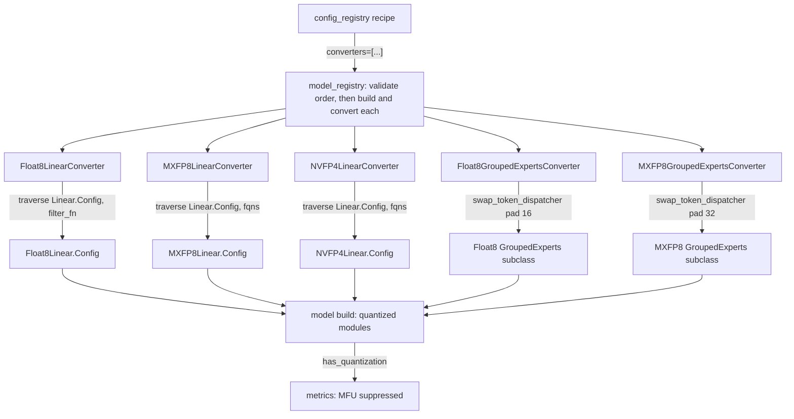

# Quantized training: float8, MXFP8 and NVFP4 converters for Linear and MoE grouped experts

## Overview
TorchTitan does not quantize a live `nn.Module`. Quantization is a **config-tree rewrite** performed
before the model is built: a [`QuantizationConverter`](https://github.com/google-pytorch/torchtitan/blob/033f131322a8b5b026ac53d734c689d664442bf8/torchtitan/components/quantization/__init__.py#L21 "torchtitan/components/quantization/__init__#QuantizationConverter")
(a kind of [`ModelConfigConverter`](https://github.com/google-pytorch/torchtitan/blob/033f131322a8b5b026ac53d734c689d664442bf8/torchtitan/protocols/model.py#L19 "torchtitan/protocols/model#ModelConfigConverter"))
walks the model config, finds every `Linear.Config` or `GroupedExperts.Config`, and replaces it in
place with the config of a quantized drop-in module. When the model is then built, the quantized
modules are constructed directly; there is no module swap, no re-init and no FQN change, so
checkpoints, sharding configs and the optimizer see the same parameter names. The low-precision
kernels (casts, scaled GEMMs and grouped GEMMs) come from `torchao`; float8 and NVFP4 linears reuse
`torchao`'s module classes, while the MXFP8 linear now owns its autograd function and an FSDP-managed
quantized-weight cache inside TorchTitan. There are five converters:
[`Float8LinearConverter`](https://github.com/google-pytorch/torchtitan/blob/033f131322a8b5b026ac53d734c689d664442bf8/torchtitan/components/quantization/float8.py#L53 "torchtitan/components/quantization/float8#Float8LinearConverter"),
[`MXFP8LinearConverter`](https://github.com/google-pytorch/torchtitan/blob/033f131322a8b5b026ac53d734c689d664442bf8/torchtitan/components/quantization/mxfp8/converter.py#L58 "torchtitan/components/quantization/mxfp8/converter#MXFP8LinearConverter")
and [`NVFP4LinearConverter`](https://github.com/google-pytorch/torchtitan/blob/033f131322a8b5b026ac53d734c689d664442bf8/torchtitan/components/quantization/nvfp4.py#L267 "torchtitan/components/quantization/nvfp4#NVFP4LinearConverter")
for dense linears, [`Float8GroupedExpertsConverter`](https://github.com/google-pytorch/torchtitan/blob/033f131322a8b5b026ac53d734c689d664442bf8/torchtitan/components/quantization/float8.py#L224 "torchtitan/components/quantization/float8#Float8GroupedExpertsConverter")
and [`MXFP8GroupedExpertsConverter`](https://github.com/google-pytorch/torchtitan/blob/033f131322a8b5b026ac53d734c689d664442bf8/torchtitan/components/quantization/mxfp8/converter.py#L236 "torchtitan/components/quantization/mxfp8/converter#MXFP8GroupedExpertsConverter")
for MoE expert grouped GEMMs. Every one of them is gated on NVIDIA/AMD hardware capability at
construction time, which is the fact a TPU user needs first: this subsystem has no TPU execution path
of its own (the TPU experiment ships a float8 subclass that bypasses the gate, see below).

## Diagram

Legend:
- `REC` - (concept) a recipe such as [`llama3_405b`](https://github.com/google-pytorch/torchtitan/blob/033f131322a8b5b026ac53d734c689d664442bf8/torchtitan/models/llama3/config_registry.py#L370 "torchtitan/models/llama3/config_registry#llama3_405b"), [`llama3_8b_first_85_pct_layers_nvfp4`](https://github.com/google-pytorch/torchtitan/blob/033f131322a8b5b026ac53d734c689d664442bf8/torchtitan/models/llama3/config_registry.py#L292 "torchtitan/models/llama3/config_registry#llama3_8b_first_85_pct_layers_nvfp4") or [`graph_trainer_deepseek_v3_debugmodel_mxfp8`](https://github.com/google-pytorch/torchtitan/blob/033f131322a8b5b026ac53d734c689d664442bf8/torchtitan/experiments/graph_trainer/deepseek_v3/config_registry.py#L35 "torchtitan/experiments/graph_trainer/deepseek_v3/config_registry#graph_trainer_deepseek_v3_debugmodel_mxfp8")
- `MR` - (concept) each model's `model_registry(flavor, converters=...)`
- `FLC` - [`Float8LinearConverter`](https://github.com/google-pytorch/torchtitan/blob/033f131322a8b5b026ac53d734c689d664442bf8/torchtitan/components/quantization/float8.py#L53 "torchtitan/components/quantization/float8#Float8LinearConverter")
- `MLC` - [`MXFP8LinearConverter`](https://github.com/google-pytorch/torchtitan/blob/033f131322a8b5b026ac53d734c689d664442bf8/torchtitan/components/quantization/mxfp8/converter.py#L58 "torchtitan/components/quantization/mxfp8/converter#MXFP8LinearConverter")
- `NLC` - [`NVFP4LinearConverter`](https://github.com/google-pytorch/torchtitan/blob/033f131322a8b5b026ac53d734c689d664442bf8/torchtitan/components/quantization/nvfp4.py#L267 "torchtitan/components/quantization/nvfp4#NVFP4LinearConverter")
- `FGC` - [`Float8GroupedExpertsConverter`](https://github.com/google-pytorch/torchtitan/blob/033f131322a8b5b026ac53d734c689d664442bf8/torchtitan/components/quantization/float8.py#L224 "torchtitan/components/quantization/float8#Float8GroupedExpertsConverter")
- `MGC` - [`MXFP8GroupedExpertsConverter`](https://github.com/google-pytorch/torchtitan/blob/033f131322a8b5b026ac53d734c689d664442bf8/torchtitan/components/quantization/mxfp8/converter.py#L236 "torchtitan/components/quantization/mxfp8/converter#MXFP8GroupedExpertsConverter")
- `F8L` - config of [`Float8Linear`](https://github.com/google-pytorch/torchtitan/blob/033f131322a8b5b026ac53d734c689d664442bf8/torchtitan/components/quantization/float8.py#L27 "torchtitan/components/quantization/float8#Float8Linear")
- `MXL` - config of [`MXFP8Linear`](https://github.com/google-pytorch/torchtitan/blob/033f131322a8b5b026ac53d734c689d664442bf8/torchtitan/components/quantization/mxfp8/linear.py#L303 "torchtitan/components/quantization/mxfp8/linear#MXFP8Linear"), built by [`build`](https://github.com/google-pytorch/torchtitan/blob/033f131322a8b5b026ac53d734c689d664442bf8/torchtitan/components/quantization/mxfp8/linear.py#L336 "torchtitan/components/quantization/mxfp8/linear#MXFP8Linear.Config.build")
- `NVL` - config of [`NVFP4Linear`](https://github.com/google-pytorch/torchtitan/blob/033f131322a8b5b026ac53d734c689d664442bf8/torchtitan/components/quantization/nvfp4.py#L84 "torchtitan/components/quantization/nvfp4#NVFP4Linear"), built by [`build`](https://github.com/google-pytorch/torchtitan/blob/033f131322a8b5b026ac53d734c689d664442bf8/torchtitan/components/quantization/nvfp4.py#L113 "torchtitan/components/quantization/nvfp4#NVFP4Linear.Config.build")
- `F8E` - per-parent subclass produced inside [`convert`](https://github.com/google-pytorch/torchtitan/blob/033f131322a8b5b026ac53d734c689d664442bf8/torchtitan/components/quantization/float8.py#L254 "torchtitan/components/quantization/float8#Float8GroupedExpertsConverter.convert"), padded by [`swap_token_dispatcher`](https://github.com/google-pytorch/torchtitan/blob/033f131322a8b5b026ac53d734c689d664442bf8/torchtitan/components/quantization/utils.py#L33 "torchtitan/components/quantization/utils#swap_token_dispatcher")
- `MXE` - per-parent subclass produced inside [`convert`](https://github.com/google-pytorch/torchtitan/blob/033f131322a8b5b026ac53d734c689d664442bf8/torchtitan/components/quantization/mxfp8/converter.py#L271 "torchtitan/components/quantization/mxfp8/converter#MXFP8GroupedExpertsConverter.convert")
- `BUILD` - (concept) `config.build()` of the rewritten tree
- `MET` - [`has_quantization`](https://github.com/google-pytorch/torchtitan/blob/033f131322a8b5b026ac53d734c689d664442bf8/torchtitan/components/quantization/utils.py#L67 "torchtitan/components/quantization/utils#has_quantization") feeding the metrics processor the [`Trainer`](https://github.com/google-pytorch/torchtitan/blob/033f131322a8b5b026ac53d734c689d664442bf8/torchtitan/trainer.py#L74 "torchtitan/trainer#Trainer") builds

The MXFP8 dense linear adds a runtime structure the other formats do not have: its weight is a
tensor subclass whose FSDP hooks quantize once per unshard.

```mermaid
flowchart LR
  S["_ShardedFSDPTensor (BF16/FP32 master shard)"] -->|"all-gather in param dtype"| PAG["fsdp_post_all_gather"]
  PAG -->|"logical tensor"| BO["_build_operands"]
  BO --> QW["_quantize_mxfp8_weight (32x32 tiles)"]
  QW -->|"operands"| U["_UnshardedFSDPTensor (storage-free)"]
  U --> FWD["MXFP8Linear.forward"]
  FWD --> AF["_MXFP8LinearFunction.forward"]
  AF -->|"saved weight or operands"| AB["_MXFP8LinearFunction.backward"]
```

Legend:
- `S` - [`_ShardedFSDPTensor`](https://github.com/google-pytorch/torchtitan/blob/033f131322a8b5b026ac53d734c689d664442bf8/torchtitan/components/quantization/_fsdp_tensor.py#L259 "torchtitan/components/quantization/_fsdp_tensor#_ShardedFSDPTensor") (its [`_tensor`](https://github.com/google-pytorch/torchtitan/blob/033f131322a8b5b026ac53d734c689d664442bf8/torchtitan/components/quantization/_fsdp_tensor.py#L289 "torchtitan/components/quantization/_fsdp_tensor#_ShardedFSDPTensor._tensor") holds the shard)
- `PAG` - [`fsdp_post_all_gather`](https://github.com/google-pytorch/torchtitan/blob/033f131322a8b5b026ac53d734c689d664442bf8/torchtitan/components/quantization/_fsdp_tensor.py#L398 "torchtitan/components/quantization/_fsdp_tensor#_ShardedFSDPTensor.fsdp_post_all_gather")
- `BO` - [`_build_operands`](https://github.com/google-pytorch/torchtitan/blob/033f131322a8b5b026ac53d734c689d664442bf8/torchtitan/components/quantization/mxfp8/tensor.py#L92 "torchtitan/components/quantization/mxfp8/tensor#_LinearShardedTensorWithMXFP8Compute._build_operands")
- `QW` - [`_quantize_mxfp8_weight`](https://github.com/google-pytorch/torchtitan/blob/033f131322a8b5b026ac53d734c689d664442bf8/torchtitan/components/quantization/mxfp8/tensor.py#L54 "torchtitan/components/quantization/mxfp8/tensor#_quantize_mxfp8_weight")
- `U` - [`_UnshardedFSDPTensor`](https://github.com/google-pytorch/torchtitan/blob/033f131322a8b5b026ac53d734c689d664442bf8/torchtitan/components/quantization/_fsdp_tensor.py#L446 "torchtitan/components/quantization/_fsdp_tensor#_UnshardedFSDPTensor")
- `FWD` - [`forward`](https://github.com/google-pytorch/torchtitan/blob/033f131322a8b5b026ac53d734c689d664442bf8/torchtitan/components/quantization/mxfp8/linear.py#L368 "torchtitan/components/quantization/mxfp8/linear#MXFP8Linear.forward")
- `AF` - [`forward`](https://github.com/google-pytorch/torchtitan/blob/033f131322a8b5b026ac53d734c689d664442bf8/torchtitan/components/quantization/mxfp8/linear.py#L69 "torchtitan/components/quantization/mxfp8/linear#_MXFP8LinearFunction.forward")
- `AB` - [`backward`](https://github.com/google-pytorch/torchtitan/blob/033f131322a8b5b026ac53d734c689d664442bf8/torchtitan/components/quantization/mxfp8/linear.py#L201 "torchtitan/components/quantization/mxfp8/linear#_MXFP8LinearFunction.backward")

## Design rationale (why it's built this way)
- **Rewrite configs, not modules.** The base-class docstring of
  [`ModelConfigConverter`](https://github.com/google-pytorch/torchtitan/blob/033f131322a8b5b026ac53d734c689d664442bf8/torchtitan/protocols/model.py#L19 "torchtitan/protocols/model#ModelConfigConverter")
  says converters "modify configs before model build (e.g. quantization, LoRA)". Because the quantized
  config *subclasses* the original (the configs of [`Float8Linear`](https://github.com/google-pytorch/torchtitan/blob/033f131322a8b5b026ac53d734c689d664442bf8/torchtitan/components/quantization/float8.py#L27 "torchtitan/components/quantization/float8#Float8Linear"),
  [`MXFP8Linear`](https://github.com/google-pytorch/torchtitan/blob/033f131322a8b5b026ac53d734c689d664442bf8/torchtitan/components/quantization/mxfp8/linear.py#L303 "torchtitan/components/quantization/mxfp8/linear#MXFP8Linear") and [`NVFP4Linear`](https://github.com/google-pytorch/torchtitan/blob/033f131322a8b5b026ac53d734c689d664442bf8/torchtitan/components/quantization/nvfp4.py#L84 "torchtitan/components/quantization/nvfp4#NVFP4Linear") extend `Linear.Config`, the
  grouped-experts `Config` extends the parent experts config), everything downstream that dispatches
  on `isinstance(cfg, Linear.Config)` (sharding helpers, param init, later converters) keeps working,
  and `param_init` is copied over so initialization is unchanged.
- **Two ways to satisfy the Module protocol.**
  [`Float8Linear`](https://github.com/google-pytorch/torchtitan/blob/033f131322a8b5b026ac53d734c689d664442bf8/torchtitan/components/quantization/float8.py#L27 "torchtitan/components/quantization/float8#Float8Linear")
  and [`NVFP4Linear`](https://github.com/google-pytorch/torchtitan/blob/033f131322a8b5b026ac53d734c689d664442bf8/torchtitan/components/quantization/nvfp4.py#L84 "torchtitan/components/quantization/nvfp4#NVFP4Linear")
  subclass the `torchao` implementation plus
  [`Module`](https://github.com/google-pytorch/torchtitan/blob/033f131322a8b5b026ac53d734c689d664442bf8/torchtitan/protocols/module.py#L43 "torchtitan/protocols/module#Module");
  the float8 docstring says they "inherit from Module (not Linear) to satisfy the Module protocol
  (init_states, _param_init) while avoiding MRO conflicts with Linear.__init__".
  [`MXFP8Linear`](https://github.com/google-pytorch/torchtitan/blob/033f131322a8b5b026ac53d734c689d664442bf8/torchtitan/components/quantization/mxfp8/linear.py#L303 "torchtitan/components/quantization/mxfp8/linear#MXFP8Linear")
  instead subclasses TorchTitan's own [`Linear`](https://github.com/google-pytorch/torchtitan/blob/033f131322a8b5b026ac53d734c689d664442bf8/torchtitan/models/common/linear.py#L31 "torchtitan/models/common/linear#Linear") and keeps only kernel-level
  ops from `torchao`; the MXFP8 README states the split: TorchTitan owns "MXFP8 linear autograd", "the
  generic FSDP unsharded-tensor lifecycle", "quantized-weight storage and lifetime" and the
  "input-activation storage policy". If the `torchao` pieces are not importable, the class names are
  bound to `None` and the converters raise `ImportError` on construction instead of at import time
  (MXFP8 linears need a `torchao` nightly: the 32x32 swizzled cast kernel "is not in any release up to
  v0.18.0").
- **Grouped experts are quantized by subclassing whatever expert class the model uses.**
  [`convert`](https://github.com/google-pytorch/torchtitan/blob/033f131322a8b5b026ac53d734c689d664442bf8/torchtitan/components/quantization/float8.py#L254 "torchtitan/components/quantization/float8#Float8GroupedExpertsConverter.convert")
  and its MXFP8 twin build (and memoize in a per-process class cache) a subclass per parent, so
  model-specific experts (the docstring names "gpt-oss variants") are covered. The subclass now
  overrides the experts' `_grouped_mm` seam to call `torchao`'s `_quantize_then_scaled_grouped_mm`,
  replacing the former `quantize_` call on the module; the seam's docstring says keeping the op there
  "rather than behind a tensor-subclass `__torch_function__`" lets FX tracers capture it.
- **MXFP8 weights are quantized once per FSDP unshard, with square tiles.** The persistent parameter
  is a [`_ShardedFSDPTensor`](https://github.com/google-pytorch/torchtitan/blob/033f131322a8b5b026ac53d734c689d664442bf8/torchtitan/components/quantization/_fsdp_tensor.py#L259 "torchtitan/components/quantization/_fsdp_tensor#_ShardedFSDPTensor")
  ("Persistent high-precision parameter that owns the FSDP hooks"); after the BF16 all-gather,
  [`fsdp_post_all_gather`](https://github.com/google-pytorch/torchtitan/blob/033f131322a8b5b026ac53d734c689d664442bf8/torchtitan/components/quantization/_fsdp_tensor.py#L398 "torchtitan/components/quantization/_fsdp_tensor#_ShardedFSDPTensor.fsdp_post_all_gather")
  builds the MXFP8 operands and returns a storage-free
  [`_UnshardedFSDPTensor`](https://github.com/google-pytorch/torchtitan/blob/033f131322a8b5b026ac53d734c689d664442bf8/torchtitan/components/quantization/_fsdp_tensor.py#L446 "torchtitan/components/quantization/_fsdp_tensor#_UnshardedFSDPTensor"),
  "which is what lets FSDP release the all-gather output". Weights use 32x32 scale tiles because a
  square tile "is a valid MX group along both axes at once, which is what makes it transpose-invariant
  and lets FPROP and DGRAD share one qdata allocation"
  ([`_quantize_mxfp8_weight`](https://github.com/google-pytorch/torchtitan/blob/033f131322a8b5b026ac53d734c689d664442bf8/torchtitan/components/quantization/mxfp8/tensor.py#L54 "torchtitan/components/quantization/mxfp8/tensor#_quantize_mxfp8_weight")); activations keep 1x32 tiles.
- **MXFP8 lets you choose what the WGRAD GEMM saves.** The MXFP8 linear converter
  [`Config`](https://github.com/google-pytorch/torchtitan/blob/033f131322a8b5b026ac53d734c689d664442bf8/torchtitan/components/quantization/mxfp8/converter.py#L62 "torchtitan/components/quantization/mxfp8/converter#MXFP8LinearConverter.Config")
  adds `linears_saving_inputs_for_backward_in_mxfp8`: BF16 is "the conservative default" because a
  linear whose input is already kept alive by another op (e.g. flash attention's output) would only add
  memory by also saving an MXFP8 copy; single-consumer inputs (the Llama 3 policy picks the fused QKV
  and `feed_forward.w2`) save the columnwise MXFP8 operand instead.
- **NVFP4 keeps everything off the wire in bf16.** The `nvfp4` module docstring calls
  [`NVFP4LinearConverter`](https://github.com/google-pytorch/torchtitan/blob/033f131322a8b5b026ac53d734c689d664442bf8/torchtitan/components/quantization/nvfp4.py#L267 "torchtitan/components/quantization/nvfp4#NVFP4LinearConverter")
  "a pure leaf swap": it "inherits the model's stock colwise/rowwise sharding and changes only the
  GEMM", and "NVFP4 does not move fp4 codes over the wire". The Random Hadamard Transform sign vector is
  hardcoded so it is identical on every TP rank (the transform "only cancels between the two operands
  when both use the same sign vector"), while the stochastic-rounding seed is drawn per rank in
  [`__init__`](https://github.com/google-pytorch/torchtitan/blob/033f131322a8b5b026ac53d734c689d664442bf8/torchtitan/components/quantization/nvfp4.py#L159 "torchtitan/components/quantization/nvfp4#NVFP4Linear.__init__")'s buffer protocol and is not checkpointed.
- **Hardware gates are hard errors.** Float8 needs "NVIDIA SM89 or later, or AMD gfx942 (MI300) or
  later"; MXFP8 and NVFP4 need "SM100 or later". The only escape is the `emulate` field of the float8
  linear converter's [`Config`](https://github.com/google-pytorch/torchtitan/blob/033f131322a8b5b026ac53d734c689d664442bf8/torchtitan/components/quantization/float8.py#L57 "torchtitan/components/quantization/float8#Float8LinearConverter.Config"),
  documented as "for test purpose only. Not compatible with torch.compile".
- **Compile is assumed for performance.** The package header says the modules "are intended to be ran
  under `torch.compile` for competitive performance": dynamic quantization only pays off when the
  scale computation and casts are fused into neighbouring kernels. Converters therefore carry
  [`model_compile_enabled`](https://github.com/google-pytorch/torchtitan/blob/033f131322a8b5b026ac53d734c689d664442bf8/torchtitan/components/quantization/__init__.py#L30 "torchtitan/components/quantization/__init__#QuantizationConverter.Config.model_compile_enabled");
  the two grouped-experts converters and the NVFP4 converter warn when it is false, the MXFP8 linear
  converter no longer warns, and the float8 linear converter only consults the flag in its emulate gate.
- **MFU is not reported for quantized runs.** [`has_quantization`](https://github.com/google-pytorch/torchtitan/blob/033f131322a8b5b026ac53d734c689d664442bf8/torchtitan/components/quantization/utils.py#L67 "torchtitan/components/quantization/utils#has_quantization")
  detects any quantized linear (float8, MXFP8 or NVFP4) or expert config, and the metrics processor then
  reports MFU as `None`, because MFU is computed against BF16 peak FLOPs and would be misleading with
  FP8/MX/FP4 GEMMs.
- **TPU float8 rides on the upstream float8 converter.** The TPU experiment now ships a subclass of
  [`Float8LinearConverter`](https://github.com/google-pytorch/torchtitan/blob/033f131322a8b5b026ac53d734c689d664442bf8/torchtitan/components/quantization/float8.py#L53 "torchtitan/components/quantization/float8#Float8LinearConverter")
  (`torchtitan/experiments/tpu/float8_converter.py`, used by a Llama 3 70B float8 TPU recipe) that skips
  the CUDA/ROCm gate, builds the `torchao` config from [`recipe_name`](https://github.com/google-pytorch/torchtitan/blob/033f131322a8b5b026ac53d734c689d664442bf8/torchtitan/components/quantization/float8.py#L58 "torchtitan/components/quantization/float8#Float8LinearConverter.Config.recipe_name")
  itself with `use_fast_accum=False` on the forward GEMM, and inherits `convert`; its tests
  (`test_builds_without_cuda`, `test_rowwise_recipe_without_fast_accum`) pin that behaviour. Its
  docstring states "TPU v7x has native float8 matmuls (TorchTPU lowers `torch._scaled_mm`)" and that
  TorchTPU's `_scaled_mm` rejects fast accumulation, since TPU matmuls accumulate in FP32.

> [!inferred]
> **TPU reading.** None of the five upstream converters can be constructed on a Cloud TPU host except
> `Float8LinearConverter` with `emulate=True` in eager mode, which runs `torchao`'s float8 emulation
> (casts and scaling in higher precision), not a native FP8 matmul, and is explicitly test-only. The
> grouped-experts, MXFP8 and NVFP4 converters have no emulate path and no TPU subclass. The only native
> TPU route is the TPU experiment's float8 subclass above, which needs TorchTPU's `torch._scaled_mm`
> lowering and therefore FP8-capable hardware. As for hardware: the MXU in TPU v5e, v5p and v6e
> (Trillium) natively executes bf16 and int8 matmuls; native FP8 MXU support arrives with TPU v7
> (Ironwood). MXFP8's 1x32 block scales and NVFP4's 16-element FP4 blocks are formats designed around
> NVIDIA Blackwell tensor cores; there is no evidence in this repo of an XLA lowering for `torchao`'s
> MX/FP4 GEMMs or scaled grouped GEMMs. So on TPU today, "quantized training" means dense float8 linears
> on Ironwood through the TPU subclass, and nothing else in this subsystem.

## Entry points
- [`Float8LinearConverter`](https://github.com/google-pytorch/torchtitan/blob/033f131322a8b5b026ac53d734c689d664442bf8/torchtitan/components/quantization/float8.py#L53 "torchtitan/components/quantization/float8#Float8LinearConverter")
  is listed in a recipe's `converters=[...]` and built inside `model_registry` before the `ModelSpec` is
  created, e.g. [`llama3_405b`](https://github.com/google-pytorch/torchtitan/blob/033f131322a8b5b026ac53d734c689d664442bf8/torchtitan/models/llama3/config_registry.py#L370 "torchtitan/models/llama3/config_registry#llama3_405b")
  (with `filter_fqns=["lm_head"]`) and the separate DeepSeek V3 671B float8 recipe (with
  `filter_fqns=["lm_head", "router.gate"]` plus the grouped-experts converter); the base 671B recipe is
  no longer quantized.
- [`MXFP8LinearConverter`](https://github.com/google-pytorch/torchtitan/blob/033f131322a8b5b026ac53d734c689d664442bf8/torchtitan/components/quantization/mxfp8/converter.py#L58 "torchtitan/components/quantization/mxfp8/converter#MXFP8LinearConverter")
  selects linears by an allow-list of FQN substrings in its
  [`Config`](https://github.com/google-pytorch/torchtitan/blob/033f131322a8b5b026ac53d734c689d664442bf8/torchtitan/components/quantization/mxfp8/converter.py#L62 "torchtitan/components/quantization/mxfp8/converter#MXFP8LinearConverter.Config")
  (`fqns`, empty means every linear) plus the per-linear WGRAD save-format selectors; Llama 3 and
  DeepSeek V3 build it through a shared policy helper used by both the eager and GraphTrainer recipes,
  e.g. [`graph_trainer_deepseek_v3_debugmodel_mxfp8`](https://github.com/google-pytorch/torchtitan/blob/033f131322a8b5b026ac53d734c689d664442bf8/torchtitan/experiments/graph_trainer/deepseek_v3/config_registry.py#L35 "torchtitan/experiments/graph_trainer/deepseek_v3/config_registry#graph_trainer_deepseek_v3_debugmodel_mxfp8").
- [`NVFP4LinearConverter`](https://github.com/google-pytorch/torchtitan/blob/033f131322a8b5b026ac53d734c689d664442bf8/torchtitan/components/quantization/nvfp4.py#L267 "torchtitan/components/quantization/nvfp4#NVFP4LinearConverter")
  selects linears the same way through [`fqns`](https://github.com/google-pytorch/torchtitan/blob/033f131322a8b5b026ac53d734c689d664442bf8/torchtitan/components/quantization/nvfp4.py#L272 "torchtitan/components/quantization/nvfp4#NVFP4LinearConverter.Config.fqns");
  the mixed-precision recipes [`llama3_8b_first_85_pct_layers_nvfp4`](https://github.com/google-pytorch/torchtitan/blob/033f131322a8b5b026ac53d734c689d664442bf8/torchtitan/models/llama3/config_registry.py#L292 "torchtitan/models/llama3/config_registry#llama3_8b_first_85_pct_layers_nvfp4"),
  [`qwen3_8b_first_85_pct_layers_nvfp4`](https://github.com/google-pytorch/torchtitan/blob/033f131322a8b5b026ac53d734c689d664442bf8/torchtitan/models/qwen3/config_registry.py#L262 "torchtitan/models/qwen3/config_registry#qwen3_8b_first_85_pct_layers_nvfp4") and
  [`qwen3_debugmodel_first_85_pct_layers_nvfp4`](https://github.com/google-pytorch/torchtitan/blob/033f131322a8b5b026ac53d734c689d664442bf8/torchtitan/models/qwen3/config_registry.py#L99 "torchtitan/models/qwen3/config_registry#qwen3_debugmodel_first_85_pct_layers_nvfp4")
  pass FQNs (`layers.0.`, `layers.1.`, ...) for the leading ~85% of decoder layers, leaving the tail
  and the LM head in bf16.
- [`Float8GroupedExpertsConverter`](https://github.com/google-pytorch/torchtitan/blob/033f131322a8b5b026ac53d734c689d664442bf8/torchtitan/components/quantization/float8.py#L224 "torchtitan/components/quantization/float8#Float8GroupedExpertsConverter")
  and [`MXFP8GroupedExpertsConverter`](https://github.com/google-pytorch/torchtitan/blob/033f131322a8b5b026ac53d734c689d664442bf8/torchtitan/components/quantization/mxfp8/converter.py#L236 "torchtitan/components/quantization/mxfp8/converter#MXFP8GroupedExpertsConverter")
  are the MoE entry points; they also rewrite each routed-experts block's token dispatcher.

## Mechanism (step-by-step)
1. **Construct and gate.** The float8 linear converter stores its
   [`config`](https://github.com/google-pytorch/torchtitan/blob/033f131322a8b5b026ac53d734c689d664442bf8/torchtitan/components/quantization/float8.py#L75 "torchtitan/components/quantization/float8#Float8LinearConverter.config"),
   raises if `torchao` is missing, then requires CUDA capability 8.9+, ROCm 9.4+, or
   (`emulate` and not compiled); otherwise it raises `ValueError`. The MXFP8 constructors
   ([`__init__`](https://github.com/google-pytorch/torchtitan/blob/033f131322a8b5b026ac53d734c689d664442bf8/torchtitan/components/quantization/mxfp8/converter.py#L107 "torchtitan/components/quantization/mxfp8/converter#MXFP8LinearConverter.__init__"),
   [`__init__`](https://github.com/google-pytorch/torchtitan/blob/033f131322a8b5b026ac53d734c689d664442bf8/torchtitan/components/quantization/mxfp8/converter.py#L254 "torchtitan/components/quantization/mxfp8/converter#MXFP8GroupedExpertsConverter.__init__"))
   and the NVFP4 one ([`__init__`](https://github.com/google-pytorch/torchtitan/blob/033f131322a8b5b026ac53d734c689d664442bf8/torchtitan/components/quantization/nvfp4.py#L280 "torchtitan/components/quantization/nvfp4#NVFP4LinearConverter.__init__"))
   require CUDA capability 10.0, and the float8 experts one
   ([`__init__`](https://github.com/google-pytorch/torchtitan/blob/033f131322a8b5b026ac53d734c689d664442bf8/torchtitan/components/quantization/float8.py#L234 "torchtitan/components/quantization/float8#Float8GroupedExpertsConverter.__init__"))
   requires SM89 or MI300 with no emulation escape. The MXFP8 linear constructor's `ImportError` prints
   the exact `torchao` nightly install command for the installed torch build.
2. **Resolve the float8 recipe.** The float8 linear converter builds a `torchao` float8 config from
   [`recipe_name`](https://github.com/google-pytorch/torchtitan/blob/033f131322a8b5b026ac53d734c689d664442bf8/torchtitan/components/quantization/float8.py#L58 "torchtitan/components/quantization/float8#Float8LinearConverter.Config.recipe_name")
   (`rowwise` default, or `rowwise_with_gw_hp`, which keeps the weight-gradient GEMM in high
   precision) and stores it as [`torchao_config`](https://github.com/google-pytorch/torchtitan/blob/033f131322a8b5b026ac53d734c689d664442bf8/torchtitan/components/quantization/float8.py#L113 "torchtitan/components/quantization/float8#Float8LinearConverter.torchao_config");
   `emulate` replaces it with an emulating config. With `rowwise` it also flips the global inductor
   flag `emulate_precision_casts` as a short-term workaround for a PyTorch issue. If `torchao` is too
   old to look up recipes by name it logs a warning and disables itself rather than failing.
3. **Choose which linears to convert.** For float8, [`filter_fn`](https://github.com/google-pytorch/torchtitan/blob/033f131322a8b5b026ac53d734c689d664442bf8/torchtitan/components/quantization/float8.py#L137 "torchtitan/components/quantization/float8#Float8LinearConverter.filter_fn")
   defaults to [`module_filter_fn`](https://github.com/google-pytorch/torchtitan/blob/033f131322a8b5b026ac53d734c689d664442bf8/torchtitan/components/quantization/utils.py#L16 "torchtitan/components/quantization/utils#module_filter_fn")
   with the configured `filter_fqns`:
   a linear is converted only if both `in_features` and `out_features` are multiples of 16 ("due to
   float8 tensorcore hardware requirements") and no filter string is a *substring* of its FQN. The
   special entry `auto_filter_small_kn` switches to `torchao`'s size-based auto filter, which skips
   GEMMs too small to beat the dynamic-quantization overhead (thresholds measured on H100). MXFP8 and
   NVFP4 use the opposite polarity: an allow-list of FQN substrings, where empty means "every linear".
   All three now raise `ValueError` if a selected linear is a router gate (`RouterGateLinear.Config`),
   so MoE recipes must exclude `router.gate` explicitly.
4. **Rewrite the Linear configs.** [`convert`](https://github.com/google-pytorch/torchtitan/blob/033f131322a8b5b026ac53d734c689d664442bf8/torchtitan/components/quantization/float8.py#L151 "torchtitan/components/quantization/float8#Float8LinearConverter.convert")
   iterates `model_config.traverse(Linear.Config)`, which yields `(fqn, config, parent, attr)` with FQNs
   mirroring the eventual module names, and for each accepted linear builds a `Float8Linear.Config` with
   the same `in_features`, `out_features`, `bias` and `param_init` plus the shared `torchao` config,
   then writes it back via `setattr(parent, attr, ...)` or list indexing (or replaces the root). The MXFP8
   [`convert`](https://github.com/google-pytorch/torchtitan/blob/033f131322a8b5b026ac53d734c689d664442bf8/torchtitan/components/quantization/mxfp8/converter.py#L121 "torchtitan/components/quantization/mxfp8/converter#MXFP8LinearConverter.convert")
   additionally sets each new config's `input_activation_format_for_backward` to `"mxfp8"` for FQNs
   matched by a save-format selector and `"bf16"` otherwise, and raises if any selector matched no
   converted linear; [`convert`](https://github.com/google-pytorch/torchtitan/blob/033f131322a8b5b026ac53d734c689d664442bf8/torchtitan/components/quantization/nvfp4.py#L299 "torchtitan/components/quantization/nvfp4#NVFP4LinearConverter.convert")
   is the plain allow-list version. The new configs validate shapes in `__post_init__`: MXFP8 needs both
   dims divisible by 32, NVFP4 by 128.
5. **Rewrite the MoE experts and their dispatcher.** The grouped-experts
   [`convert`](https://github.com/google-pytorch/torchtitan/blob/033f131322a8b5b026ac53d734c689d664442bf8/torchtitan/components/quantization/float8.py#L254 "torchtitan/components/quantization/float8#Float8GroupedExpertsConverter.convert")
   (and its MXFP8 [`convert`](https://github.com/google-pytorch/torchtitan/blob/033f131322a8b5b026ac53d734c689d664442bf8/torchtitan/components/quantization/mxfp8/converter.py#L271 "torchtitan/components/quantization/mxfp8/converter#MXFP8GroupedExpertsConverter.convert"))
   visits every `GroupedExperts.Config`. First [`swap_token_dispatcher`](https://github.com/google-pytorch/torchtitan/blob/033f131322a8b5b026ac53d734c689d664442bf8/torchtitan/components/quantization/utils.py#L33 "torchtitan/components/quantization/utils#swap_token_dispatcher")
   is handed the *parent* routed-experts config (which owns the `token_dispatcher` child) and replaces a
   standard all-to-all dispatcher with the `torchao` padding dispatcher (or re-creates a HybridEP one
   with a pad multiple, now preserving its `hidden_dim` and `num_max_tokens_per_rank`) so that each
   expert's token group is padded to a multiple of 16 (FP8, "16 byte alignment / 1 byte per elem") or of
   the MXFP8 `pad_multiple` (32 by default); any other dispatcher raises. Then it looks up the config's
   owning module class, gets the memoized quantized subclass, and copies every dataclass field into that
   subclass's `Config` (adding `recipe_name` for MXFP8).
6. **Build.** When the model is built, [`__init__`](https://github.com/google-pytorch/torchtitan/blob/033f131322a8b5b026ac53d734c689d664442bf8/torchtitan/components/quantization/float8.py#L40 "torchtitan/components/quantization/float8#Float8Linear.__init__")
   calls the `torchao` constructor with the stored float8 config, and
   [`__init__`](https://github.com/google-pytorch/torchtitan/blob/033f131322a8b5b026ac53d734c689d664442bf8/torchtitan/components/quantization/nvfp4.py#L159 "torchtitan/components/quantization/nvfp4#NVFP4Linear.__init__")
   calls `torchao`'s NVFP4 constructor, then re-registers the `_sr_seed` and `_rht_sign_vector` buffers
   as `None` so TorchTitan's buffer protocol materializes them per rank on the real device.
   [`build`](https://github.com/google-pytorch/torchtitan/blob/033f131322a8b5b026ac53d734c689d664442bf8/torchtitan/components/quantization/nvfp4.py#L113 "torchtitan/components/quantization/nvfp4#NVFP4Linear.Config.build")
   folds the stock colwise/rowwise sharding into a local-map region for the opaque NVFP4 op, and
   [`build`](https://github.com/google-pytorch/torchtitan/blob/033f131322a8b5b026ac53d734c689d664442bf8/torchtitan/components/quantization/mxfp8/linear.py#L336 "torchtitan/components/quantization/mxfp8/linear#MXFP8Linear.Config.build")
   rejects the `partial_dtensor` SPMD backend ("The MXFP8 matmul is an opaque autograd function with no
   DTensor sharding rule") so MXFP8 linears require `spmd_types`. The MXFP8 linear also wraps its weight
   in the sharded tensor subclass up front. The quantized experts' constructors only build a float8 or
   MXFP8 training-op config; the overridden `_grouped_mm` then dispatches the expert GEMMs to
   `torchao`'s scaled grouped GEMM, with the high-precision weight as master copy and dynamic per-GEMM
   quantization. For rowwise float8, "all distributed communication is done in high precision" per the
   package docs.
7. **MXFP8 weight lifecycle under FSDP.** The pre-all-gather hook of
   [`_ShardedFSDPTensor`](https://github.com/google-pytorch/torchtitan/blob/033f131322a8b5b026ac53d734c689d664442bf8/torchtitan/components/quantization/_fsdp_tensor.py#L259 "torchtitan/components/quantization/_fsdp_tensor#_ShardedFSDPTensor")
   casts its shard to the mixed-precision param dtype (bf16 by default; the shard itself is normally an
   fp32 master weight), and after the all-gather
   [`fsdp_post_all_gather`](https://github.com/google-pytorch/torchtitan/blob/033f131322a8b5b026ac53d734c689d664442bf8/torchtitan/components/quantization/_fsdp_tensor.py#L398 "torchtitan/components/quantization/_fsdp_tensor#_ShardedFSDPTensor.fsdp_post_all_gather")
   narrows away uneven-sharding padding rows ("they would occupy real scale tiles"), then calls
   [`_build_operands`](https://github.com/google-pytorch/torchtitan/blob/033f131322a8b5b026ac53d734c689d664442bf8/torchtitan/components/quantization/mxfp8/tensor.py#L92 "torchtitan/components/quantization/mxfp8/tensor#_LinearShardedTensorWithMXFP8Compute._build_operands"),
   which runs [`_quantize_mxfp8_weight`](https://github.com/google-pytorch/torchtitan/blob/033f131322a8b5b026ac53d734c689d664442bf8/torchtitan/components/quantization/mxfp8/tensor.py#L54 "torchtitan/components/quantization/mxfp8/tensor#_quantize_mxfp8_weight")
   to produce one E4M3 qdata allocation plus FPROP and DGRAD scale layouts. On the first unshard it
   returns a new [`_UnshardedFSDPTensor`](https://github.com/google-pytorch/torchtitan/blob/033f131322a8b5b026ac53d734c689d664442bf8/torchtitan/components/quantization/_fsdp_tensor.py#L446 "torchtitan/components/quantization/_fsdp_tensor#_UnshardedFSDPTensor");
   on later unshards it refills that object's tensors in place so module and autograd references stay
   valid. The unsharded tensor's [`__torch_dispatch__`](https://github.com/google-pytorch/torchtitan/blob/033f131322a8b5b026ac53d734c689d664442bf8/torchtitan/components/quantization/_fsdp_tensor.py#L522 "torchtitan/components/quantization/_fsdp_tensor#_UnshardedFSDPTensor.__torch_dispatch__")
   allows only view and factory ops and raises on anything that would read the missing high-precision
   storage.
8. **MXFP8 forward and backward.** [`forward`](https://github.com/google-pytorch/torchtitan/blob/033f131322a8b5b026ac53d734c689d664442bf8/torchtitan/components/quantization/mxfp8/linear.py#L368 "torchtitan/components/quantization/mxfp8/linear#MXFP8Linear.forward")
   reads the cached operands off the unsharded tensor, or, when no data-parallel wrapper owns the weight
   (no FSDP, or GraphTrainer's `spmd_types` path), quantizes the weight per call.
   [`forward`](https://github.com/google-pytorch/torchtitan/blob/033f131322a8b5b026ac53d734c689d664442bf8/torchtitan/components/quantization/mxfp8/linear.py#L69 "torchtitan/components/quantization/mxfp8/linear#_MXFP8LinearFunction.forward")
   requires BF16 inputs and local dims divisible by 32, pads token rows to 32, quantizes the activation
   rowwise (and columnwise too in `"mxfp8"` save mode) and runs `F.scaled_mm` with `BlockWise1x32`
   scales; it saves the unsharded-tensor wrapper rather than its operands, since FSDP may free and refill
   them before backward. [`backward`](https://github.com/google-pytorch/torchtitan/blob/033f131322a8b5b026ac53d734c689d664442bf8/torchtitan/components/quantization/mxfp8/linear.py#L201 "torchtitan/components/quantization/mxfp8/linear#_MXFP8LinearFunction.backward")
   quantizes the gradient once (rowwise for DGRAD, columnwise for WGRAD), rebuilds the columnwise input
   from the saved BF16 tensor in `"bf16"` mode, and returns a BF16 weight gradient to the master
   parameter.

## Key data structures
- [`Config`](https://github.com/google-pytorch/torchtitan/blob/033f131322a8b5b026ac53d734c689d664442bf8/torchtitan/components/quantization/__init__.py#L29 "torchtitan/components/quantization/__init__#QuantizationConverter.Config")
  contributes only `model_compile_enabled`; recipes derive it from
  `compile.enable and "model" in compile.components`.
- [`Config`](https://github.com/google-pytorch/torchtitan/blob/033f131322a8b5b026ac53d734c689d664442bf8/torchtitan/components/quantization/float8.py#L57 "torchtitan/components/quantization/float8#Float8LinearConverter.Config")
  of the float8 linear converter: `recipe_name`, `filter_fqns`, `emulate`.
  [`Config`](https://github.com/google-pytorch/torchtitan/blob/033f131322a8b5b026ac53d734c689d664442bf8/torchtitan/components/quantization/mxfp8/converter.py#L62 "torchtitan/components/quantization/mxfp8/converter#MXFP8LinearConverter.Config")
  of the MXFP8 linear converter: `fqns` and `linears_saving_inputs_for_backward_in_mxfp8` (empty
  selectors are rejected). [`Config`](https://github.com/google-pytorch/torchtitan/blob/033f131322a8b5b026ac53d734c689d664442bf8/torchtitan/components/quantization/nvfp4.py#L271 "torchtitan/components/quantization/nvfp4#NVFP4LinearConverter.Config")
  of the NVFP4 converter: `fqns` only. The float8 experts converter's config is empty (its pad multiple
  is a class constant of [`Float8GroupedExpertsConverter`](https://github.com/google-pytorch/torchtitan/blob/033f131322a8b5b026ac53d734c689d664442bf8/torchtitan/components/quantization/float8.py#L224 "torchtitan/components/quantization/float8#Float8GroupedExpertsConverter")); the MXFP8 experts one has
  `recipe_name` (`mxfp8_rceil`: RCEIL rounding for the e8m0 scales) and `pad_multiple`.
- The config of [`MXFP8Linear`](https://github.com/google-pytorch/torchtitan/blob/033f131322a8b5b026ac53d734c689d664442bf8/torchtitan/components/quantization/mxfp8/linear.py#L303 "torchtitan/components/quantization/mxfp8/linear#MXFP8Linear")
  adds `input_activation_format_for_backward` (`"bf16"` or `"mxfp8"`) to `Linear.Config`; the NVFP4 one
  adds nothing; the float8 one adds the `torchao` config object.
- The MXFP8 operands: a frozen dataclass of `weight_qdata_dgrad_NK` and the two swizzled scale tensors,
  with the FPROP qdata exposed as a transposed view. Only the dataclass fields are FSDP-managed
  allocations, which is why a derived view must be a property. The persistent high-precision shard lives
  in [`_tensor`](https://github.com/google-pytorch/torchtitan/blob/033f131322a8b5b026ac53d734c689d664442bf8/torchtitan/components/quantization/_fsdp_tensor.py#L289 "torchtitan/components/quantization/_fsdp_tensor#_ShardedFSDPTensor._tensor").
- The two expert class caches map parent expert class to quantized subclass, and double as the registry
  that [`has_quantization`](https://github.com/google-pytorch/torchtitan/blob/033f131322a8b5b026ac53d734c689d664442bf8/torchtitan/components/quantization/utils.py#L67 "torchtitan/components/quantization/utils#has_quantization")
  consults to recognize quantized expert configs.

## Dynamics (design intent)
- **Ordering of converters.** Converters run in list order inside `model_registry`, each receiving the
  previous one's output tree; a validation step rejects a quantization converter placed after a LoRA
  converter ("quantization/QAT converters precede LoRA"), as exercised by the Llama 3 debug-model
  float8-emulate + LoRA recipe, which places [`Float8LinearConverter`](https://github.com/google-pytorch/torchtitan/blob/033f131322a8b5b026ac53d734c689d664442bf8/torchtitan/components/quantization/float8.py#L53 "torchtitan/components/quantization/float8#Float8LinearConverter") first.
- **Once per process.** The float8 recipe's inductor flag and the class caches are process-global;
  converting two models in one process (as tests do) shares them.
- **MXFP8 and reshard-after-forward.** The MXFP8 README's table: with `reshard_after_forward=False` the
  weight is quantized on the first unshard and the operands are reused until FSDP releases them after
  backward (pipeline microbatches reuse them too); with `True`, backward performs another BF16
  all-gather and quantization. Both FPROP and DGRAD operands are built on every actual unshard, because
  FSDP does not expose which phase an unshard serves. This lifecycle is implemented by
  [`fsdp_post_all_gather`](https://github.com/google-pytorch/torchtitan/blob/033f131322a8b5b026ac53d734c689d664442bf8/torchtitan/components/quantization/_fsdp_tensor.py#L398 "torchtitan/components/quantization/_fsdp_tensor#_ShardedFSDPTensor.fsdp_post_all_gather").
- **When the gain appears.** The float8 README frames the trade: speedup only where "GEMMs are
  sufficiently large enough that the speedup from using float8 tensorcores outweighs the overhead of
  dynamic quantization", hence the size filter and the compile requirement.

## Edge cases
- **Filter strings are substrings of FQNs.** `"layers.1"` would also match `layers.10`; the NVFP4 FQN
  helper appends a trailing `.` for that reason, and refuses a tail fraction that would leave nothing to
  convert, since an empty `fqns` list converts *every* linear (the opposite of the intent).
- **DeepSeek V3 671B compiles only the loss.** Its recipe sets compile components to `["loss"]`, so
  `model_compile_enabled` is false; the float8 grouped-experts converter warns that compile is required
  for high performance (the float8 linear converter emits no such warning).
- **Shape constraints differ by format.** Float8 silently skips linears whose dims are not divisible by
  16; MXFP8 and NVFP4 instead raise at config construction (32 and 128 respectively), and NVFP4's kernel
  raises again on the per-rank local dims once TP has sharded the weight, so such linears must be left
  out of `fqns`.
- **Router gates are rejected, not skipped.** Selecting a router gate in any of the three linear
  converters is a `ValueError`.
- **MXFP8 linears need `spmd_types`.** Building one under the `partial_dtensor` SPMD backend raises.
- **Quantized MoE no longer requires expert parallelism.** The `torchao` padding dispatcher now also
  runs with EP=1, applying only the local padded permute (useful for single-GPU debugging and numerics).
- **Frozen MXFP8 weights are re-quantized every call** when no FSDP wrapper owns them (a TODO in
  [`forward`](https://github.com/google-pytorch/torchtitan/blob/033f131322a8b5b026ac53d734c689d664442bf8/torchtitan/components/quantization/mxfp8/linear.py#L368 "torchtitan/components/quantization/mxfp8/linear#MXFP8Linear.forward") notes caching on the parameter's version counter).
- **Docs drift.** The shipped `float8.md` and `mxfp8/README.md` still show a `quantization=[...]`
  argument; the code takes `converters=[...]`. The MXFP8 `pad_multiple` docstring says the sm_100
  CuTeDSL kernel "requires multiples of 128" while the default is 32 (the GraphTrainer DeepSeek V3 MXFP8
  recipe passes 128).

## Open questions
- The TPU float8 subclass relies on TorchTPU lowering `torch._scaled_mm`; whether a lowering exists for
  `torch._scaled_grouped_mm` (which a TPU float8 MoE path would need) is not answerable from this repo,
  and the grouped-experts hardware gate would block it regardless.
- int8 training (the precision TPU v5e/v5p/v6e MXUs natively accelerate) has no converter here.
- Whether the MXFP8 FSDP-managed operand lifecycle (`_fsdp_tensor.py`, generic by design) will be
  reused by NVFP4 or float8 is not stated; today only MXFP8 subclasses it.

## See also
- [LoRA](lora.md) - the other `ModelConfigConverter`, which must run after quantization
- [Model definitions](model-definitions.md) - the `Linear` and `GroupedExperts` configs being rewritten
- [Expert parallel](expert-parallel.md) - token dispatchers and padded expert groups
- [FSDP sharding](fsdp-sharding.md) - the all-gather and reshard policy the MXFP8 weight cache hooks into
- [torch.compile integration](torch-compile-integration.md) - why the converters want the model compiled
- [Metrics and observability](metrics-and-observability.md) - MFU suppression for quantized runs
- [Train spec and model protocol](train-spec-and-model-protocol.md) - `model_registry`, `ModelSpec` and converters
- [TorchTPU backend](torchtpu-backend.md) - the TPU lane and its float8 converter subclass

## Recent changes
- `fa627bf2` (upstream sync to `d771abb0`) restructured this subsystem: `mx.py` became the `mxfp8/`
  package with a TorchTitan-owned MXFP8 linear (32x32 weight tiles, FSDP-managed operands via the new
  `_fsdp_tensor.py`, selectable WGRAD input save format), NVFP4 linear training was added (`nvfp4.py`,
  with ~85%-NVFP4 Llama 3 / Qwen3 recipes), grouped experts switched from `quantize_` to a `_grouped_mm`
  override, all linear converters now reject router gates, and `swap_token_dispatcher` takes the
  routed-experts parent config.
- `9b288c48` removed withheld partner-model code; for this page it means the model base class now always
  raises when a submodule (quantized modules included) fails the Module protocol, with no warn-only
  exemption left.
- [all changes in 033f131322](../changes/033f131322.md)
