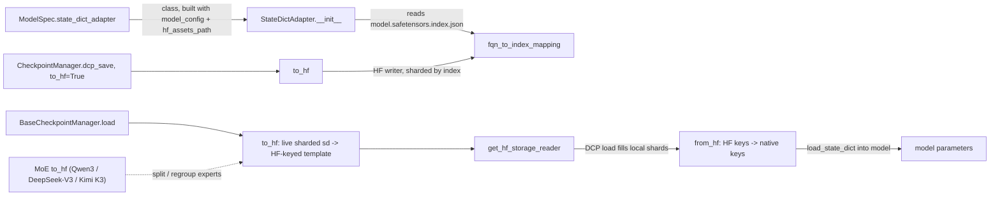

# State-dict adapters: Hugging Face <-> TorchTitan weight conversion

## Overview
TorchTitan models do not use Hugging Face module names or layouts: attention projections live
under `attention.qkv_linear.wq`, MLPs are `feed_forward.w1/w2/w3`, MoE experts are one 3D
parameter per projection (under `moe.routed_experts.inner_experts`) instead of a list of 2D
ones, and Llama's Q/K rows are ordered for
TorchTitan's complex-number RoPE. A **state-dict adapter** is the per-model object that bridges
the two. The protocol, [`BaseStateDictAdapter`](https://github.com/google-pytorch/torchtitan/blob/033f131322a8b5b026ac53d734c689d664442bf8/torchtitan/protocols/state_dict_adapter.py#L19 "torchtitan/protocols/state_dict_adapter#BaseStateDictAdapter"),
has just two pure mappings, [`to_hf`](https://github.com/google-pytorch/torchtitan/blob/033f131322a8b5b026ac53d734c689d664442bf8/torchtitan/protocols/state_dict_adapter.py#L41 "torchtitan/protocols/state_dict_adapter#BaseStateDictAdapter.to_hf")
and [`from_hf`](https://github.com/google-pytorch/torchtitan/blob/033f131322a8b5b026ac53d734c689d664442bf8/torchtitan/protocols/state_dict_adapter.py#L53 "torchtitan/protocols/state_dict_adapter#BaseStateDictAdapter.from_hf"),
plus a factory for the safetensors reader. The key design idea is that **`to_hf` doubles as a
load template**: to load HF weights, the checkpointer converts the *live, already-sharded*
model state dict to HF keys, lets DCP's HF reader fill those tensors shard by shard, then maps
them back with `from_hf`. Apart from the Muse Glimmer Q/K permute (which briefly replicates
those weights, see Mechanism step 2), no rank materializes a full HF tensor, which is what makes
it possible to start a 405B TPU fine-tune from HF safetensors.

## Diagram

Legend:
- `SPEC` - [`state_dict_adapter`](https://github.com/google-pytorch/torchtitan/blob/033f131322a8b5b026ac53d734c689d664442bf8/torchtitan/protocols/model_spec.py#L48 "torchtitan/protocols/model_spec#ModelSpec.state_dict_adapter")
- `SDA` - [`__init__`](https://github.com/google-pytorch/torchtitan/blob/033f131322a8b5b026ac53d734c689d664442bf8/torchtitan/protocols/state_dict_adapter.py#L83 "torchtitan/protocols/state_dict_adapter#StateDictAdapter.__init__") of [`StateDictAdapter`](https://github.com/google-pytorch/torchtitan/blob/033f131322a8b5b026ac53d734c689d664442bf8/torchtitan/protocols/state_dict_adapter.py#L80 "torchtitan/protocols/state_dict_adapter#StateDictAdapter")
- `IDX` - [`fqn_to_index_mapping`](https://github.com/google-pytorch/torchtitan/blob/033f131322a8b5b026ac53d734c689d664442bf8/torchtitan/protocols/state_dict_adapter.py#L29 "torchtitan/protocols/state_dict_adapter#BaseStateDictAdapter.fqn_to_index_mapping")
- `CM` - [`load`](https://github.com/google-pytorch/torchtitan/blob/033f131322a8b5b026ac53d734c689d664442bf8/torchtitan/components/checkpointer/base.py#L230 "torchtitan/components/checkpointer/base#BaseCheckpointManager.load")
- `CM2` - [`dcp_save`](https://github.com/google-pytorch/torchtitan/blob/033f131322a8b5b026ac53d734c689d664442bf8/torchtitan/components/checkpointer/dcp.py#L252 "torchtitan/components/checkpointer/dcp#CheckpointManager.dcp_save") called from the last-step save, see [checkpointing](checkpointing.md)
- `TOHF` - [`to_hf`](https://github.com/google-pytorch/torchtitan/blob/033f131322a8b5b026ac53d734c689d664442bf8/torchtitan/protocols/state_dict_adapter.py#L41 "torchtitan/protocols/state_dict_adapter#BaseStateDictAdapter.to_hf")
- `TOHF2` - [`to_hf`](https://github.com/google-pytorch/torchtitan/blob/033f131322a8b5b026ac53d734c689d664442bf8/torchtitan/protocols/state_dict_adapter.py#L41 "torchtitan/protocols/state_dict_adapter#BaseStateDictAdapter.to_hf")
- `RD` - [`get_hf_storage_reader`](https://github.com/google-pytorch/torchtitan/blob/033f131322a8b5b026ac53d734c689d664442bf8/torchtitan/protocols/state_dict_adapter.py#L129 "torchtitan/protocols/state_dict_adapter#StateDictAdapter.get_hf_storage_reader")
- `FROMHF` - [`from_hf`](https://github.com/google-pytorch/torchtitan/blob/033f131322a8b5b026ac53d734c689d664442bf8/torchtitan/protocols/state_dict_adapter.py#L53 "torchtitan/protocols/state_dict_adapter#BaseStateDictAdapter.from_hf")
- `MODEL` - (concept) the model parts' DTensor parameters
- `MOE` - [`to_hf`](https://github.com/google-pytorch/torchtitan/blob/033f131322a8b5b026ac53d734c689d664442bf8/torchtitan/models/qwen3/state_dict_adapter.py#L56 "torchtitan/models/qwen3/state_dict_adapter#Qwen3StateDictAdapter.to_hf") (Qwen 3), likewise the DeepSeek-V3 [`to_hf`](https://github.com/google-pytorch/torchtitan/blob/033f131322a8b5b026ac53d734c689d664442bf8/torchtitan/models/deepseek_v3/state_dict_adapter.py#L152 "torchtitan/models/deepseek_v3/state_dict_adapter#DeepSeekV3StateDictAdapter.to_hf") and Kimi K3 [`to_hf`](https://github.com/google-pytorch/torchtitan/blob/033f131322a8b5b026ac53d734c689d664442bf8/torchtitan/models/kimi_k3/state_dict_adapter.py#L136 "torchtitan/models/kimi_k3/state_dict_adapter#KimiK3StateDictAdapter.to_hf"), all built on the shared MoE adapter base

## Design rationale (why it's built this way)
- **Adapters are per model, attached to the spec.** A model opts in by setting
  [`state_dict_adapter`](https://github.com/google-pytorch/torchtitan/blob/033f131322a8b5b026ac53d734c689d664442bf8/torchtitan/protocols/model_spec.py#L48 "torchtitan/protocols/model_spec#ModelSpec.state_dict_adapter")
  to an adapter *class*; the trainer instantiates it with the (already converted) model config
  and `hf_assets_path`. Conversion logic depends on config values (head counts, weight tying,
  MoE expert count, whether DeepSeek uses a low-rank Q projection), so it cannot be a static
  key table.
- **Mappings are templates, not per-layer tables.** Each concrete adapter keeps one
  `from_hf_map` of abstract keys with `{}` placeholders for layer (and expert) numbers; `to_hf`
  inverts it once and uses a regex to substitute the first number. HF-only keys such as
  `rotary_emb.inv_freq` map to `None` and are dropped.
- **Preserve the HF file layout on export.** [`__init__`](https://github.com/google-pytorch/torchtitan/blob/033f131322a8b5b026ac53d734c689d664442bf8/torchtitan/protocols/state_dict_adapter.py#L83 "torchtitan/protocols/state_dict_adapter#StateDictAdapter.__init__")
  reads `model.safetensors.index.json` from [`hf_assets_path`](https://github.com/google-pytorch/torchtitan/blob/033f131322a8b5b026ac53d734c689d664442bf8/torchtitan/protocols/state_dict_adapter.py#L30 "torchtitan/protocols/state_dict_adapter#BaseStateDictAdapter.hf_assets_path")
  and records, for every HF key, the number of the safetensors shard it lived in. On an HF
  export the checkpointer passes this [`fqn_to_index_mapping`](https://github.com/google-pytorch/torchtitan/blob/033f131322a8b5b026ac53d734c689d664442bf8/torchtitan/protocols/state_dict_adapter.py#L29 "torchtitan/protocols/state_dict_adapter#BaseStateDictAdapter.fqn_to_index_mapping")
  to the HF writer, so the exported files mirror the original checkpoint. With no index file it
  warns and falls back to a single consolidated file.
- **Fail fast on a RoPE mismatch.** Q/K permutation only makes sense for one RoPE flavour.
  [`_validate_hf_rope_config`](https://github.com/google-pytorch/torchtitan/blob/033f131322a8b5b026ac53d734c689d664442bf8/torchtitan/protocols/state_dict_adapter.py#L113 "torchtitan/protocols/state_dict_adapter#StateDictAdapter._validate_hf_rope_config")
  walks every layer in [`layers`](https://github.com/google-pytorch/torchtitan/blob/033f131322a8b5b026ac53d734c689d664442bf8/torchtitan/models/common/decoder.py#L84 "torchtitan/models/common/decoder#Decoder.Config.layers")
  and raises if the attention RoPE config is not the expected class: the Llama 3, DeepSeek-V3
  and Muse Glimmer adapters demand [`ComplexRoPE`](https://github.com/google-pytorch/torchtitan/blob/033f131322a8b5b026ac53d734c689d664442bf8/torchtitan/models/common/rope.py#L185 "torchtitan/models/common/rope#ComplexRoPE"),
  the Qwen 3 adapter demands [`CosSinRoPE`](https://github.com/google-pytorch/torchtitan/blob/033f131322a8b5b026ac53d734c689d664442bf8/torchtitan/models/common/rope.py#L281 "torchtitan/models/common/rope#CosSinRoPE").
  Layers whose attention has no RoPE config at all (NoPE layers, `rope=None`) are skipped, so
  hybrid NoPE/RoPE stacks validate. Because the check is `isinstance`, the TPU Llama recipes'
  real-arithmetic RoPE override (a subclass of the complex RoPE config, added so the decoder can
  run inside `scan`) still passes.
- **MoE conversion without memory blow-up.** The shared MoE adapter base that the Qwen 3,
  DeepSeek-V3 and Kimi K3 adapters extend (its helpers back the
  [`GroupedExperts`](https://github.com/google-pytorch/torchtitan/blob/033f131322a8b5b026ac53d734c689d664442bf8/torchtitan/models/common/moe.py#L440 "torchtitan/models/common/moe#GroupedExperts")
  conversion) states the goal in its docstring: HF stores experts "as a module list each with
  2D weights", TorchTitan as a 3D parameter, and the helpers "convert 3D param into list of 2D
  params so that the checkpoint can be loaded without incurring local memory overhead, and then
  concatenate the results back to 3D param".

> [!inferred]
> For TPU customer onboarding from an HF/JAX workflow, the adapter is the whole interop
> contract: if the model spec has no adapter, neither `initial_load_in_hf` nor `last_save_in_hf`
> can be used. Several TPU experiment specs (for example Mamba2 and Conformer) set it to
> `None`, while the TPU Qwen3 spec and the TPU Llama 3 recipes (which reuse the core Llama 3
> registry) do have one.

## Entry points
- [`StateDictAdapter`](https://github.com/google-pytorch/torchtitan/blob/033f131322a8b5b026ac53d734c689d664442bf8/torchtitan/protocols/state_dict_adapter.py#L80 "torchtitan/protocols/state_dict_adapter#StateDictAdapter")
  is the base every per-model adapter extends (the RL vLLM wrapper's
  `PlainToDTensorStateDictAdapter` instead implements the protocol directly, delegating to a
  model adapter); it is instantiated once in trainer construction
  and handed to the checkpointer as its `sd_adapter` (the DCP
  [`__init__`](https://github.com/google-pytorch/torchtitan/blob/033f131322a8b5b026ac53d734c689d664442bf8/torchtitan/components/checkpointer/dcp.py#L151 "torchtitan/components/checkpointer/dcp#CheckpointManager.__init__")
  and the TorchFT [`__init__`](https://github.com/google-pytorch/torchtitan/blob/033f131322a8b5b026ac53d734c689d664442bf8/torchtitan/experiments/torchft/checkpoint.py#L73 "torchtitan/experiments/torchft/checkpoint#TorchFTCheckpointManager.__init__")
  both take it, and refuse `last_save_in_hf` without one).
- [`to_hf`](https://github.com/google-pytorch/torchtitan/blob/033f131322a8b5b026ac53d734c689d664442bf8/torchtitan/protocols/state_dict_adapter.py#L41 "torchtitan/protocols/state_dict_adapter#BaseStateDictAdapter.to_hf")
  is reached from the checkpointer twice: on an HF load (to build the template, from
  [`load`](https://github.com/google-pytorch/torchtitan/blob/033f131322a8b5b026ac53d734c689d664442bf8/torchtitan/components/checkpointer/base.py#L230 "torchtitan/components/checkpointer/base#BaseCheckpointManager.load"))
  and on an HF last-step save (to rename and reshape before writing).
- [`from_hf`](https://github.com/google-pytorch/torchtitan/blob/033f131322a8b5b026ac53d734c689d664442bf8/torchtitan/protocols/state_dict_adapter.py#L53 "torchtitan/protocols/state_dict_adapter#BaseStateDictAdapter.from_hf")
  is reached only on HF load, after DCP has filled the template.
- [`get_hf_storage_reader`](https://github.com/google-pytorch/torchtitan/blob/033f131322a8b5b026ac53d734c689d664442bf8/torchtitan/protocols/state_dict_adapter.py#L65 "torchtitan/protocols/state_dict_adapter#BaseStateDictAdapter.get_hf_storage_reader")
  is called with the checkpoint path and the `from_quantized` flag; the default returns a plain
  HF safetensors reader and warns if quantized loading was requested.
- Outside the checkpointer, RL code drives the same three calls by hand: the parity test's
  [`build_trainer_model`](https://github.com/google-pytorch/torchtitan/blob/033f131322a8b5b026ac53d734c689d664442bf8/torchtitan/experiments/rl/tests/test_bitwise_parity.py#L102 "torchtitan/experiments/rl/tests/test_bitwise_parity#build_trainer_model")
  and the TPU Ray RL trainer's initial HF weight load, which on CPU runs `to_hf` -> DCP load -> `from_hf` itself and on a device defers to the base
  implementation.

## Mechanism (step-by-step)
1. **Build the adapter and the shard index.** [`__init__`](https://github.com/google-pytorch/torchtitan/blob/033f131322a8b5b026ac53d734c689d664442bf8/torchtitan/protocols/state_dict_adapter.py#L83 "torchtitan/protocols/state_dict_adapter#StateDictAdapter.__init__")
   stores [`model_config`](https://github.com/google-pytorch/torchtitan/blob/033f131322a8b5b026ac53d734c689d664442bf8/torchtitan/protocols/state_dict_adapter.py#L88 "torchtitan/protocols/state_dict_adapter#StateDictAdapter.model_config")
   and `hf_assets_path`, then parses the `weight_map` of the HF index into
   `fqn_to_index_mapping` (`"model-00003-of-00004.safetensors"` becomes `3`, taking the first
   number in the filename). Subclass constructors then install their `from_hf_map`; the MoE base
   also creates empty dicts for expert placements, shapes, meshes and local index ranges.
2. **Build the HF template from the live model.** On an HF load the checkpointer passes the
   model's own state dict (DTensor shards after FSDP/TP/EP) to
   [`to_hf`](https://github.com/google-pytorch/torchtitan/blob/033f131322a8b5b026ac53d734c689d664442bf8/torchtitan/protocols/state_dict_adapter.py#L41 "torchtitan/protocols/state_dict_adapter#BaseStateDictAdapter.to_hf").
   The Llama 3 adapter's `to_hf` renames each key and applies HF's Q/K permutation (a reshape to
   `(heads, head_dim/2, 2, dim)`, transpose, reshape, then `clone`), with the K projection
   permuted using `n_kv_heads` so GQA works. The clone means the Q and K template entries are
   new buffers, not the parameters. With weight tying, `lm_head.weight` is left out and also
   removed from the index mapping so the writer does not expect it. The Muse Glimmer adapter
   applies the same split-half <-> interleaved Q/K permute (text and vision towers, see its
   [`from_hf`](https://github.com/google-pytorch/torchtitan/blob/033f131322a8b5b026ac53d734c689d664442bf8/torchtitan/models/muse_glimmer/state_dict_adapter.py#L279 "torchtitan/models/muse_glimmer/state_dict_adapter#MuseGlimmerStateDictAdapter.from_hf")),
   but wraps it so a DTensor is redistributed to `Replicate`, permuted locally and restored to
   its placements: its comment notes the head-splitting `view` "cannot unflatten an
   unevenly-sharded dim" when FSDP shards the Q/K rows on dim 0.
3. **Split grouped experts into per-expert keys.** For MoE models (Qwen3 MoE, DeepSeek-V3,
   Kimi K3),
   [`to_hf`](https://github.com/google-pytorch/torchtitan/blob/033f131322a8b5b026ac53d734c689d664442bf8/torchtitan/models/qwen3/state_dict_adapter.py#L56 "torchtitan/models/qwen3/state_dict_adapter#Qwen3StateDictAdapter.to_hf")
   treats each [`GroupedExperts`](https://github.com/google-pytorch/torchtitan/blob/033f131322a8b5b026ac53d734c689d664442bf8/torchtitan/models/common/moe.py#L440 "torchtitan/models/common/moe#GroupedExperts")
   weight (keys containing `moe.routed_experts.inner_experts`: `w1_EFD`, `w3_EFD`, `w2_EDF`)
   specially. If it is a DTensor, the shared MoE adapter helpers read its placements, work out which contiguous expert range this rank holds (plain
   `Shard(0)` for EP, or strided-shard plus shard on dim 0 for FSDP combined with EP), remember
   placements, shape, mesh and range for the way back, and emit one entry per *local* expert:
   either a plain 2D tensor or a DTensor on the sub-mesh that excludes the expert-sharding mesh
   dims (so a TP shard of an expert stays sharded). A non-DTensor weight takes an "offline
   conversion" path that splits all experts.
4. **Let DCP read into the template.** [`get_hf_storage_reader`](https://github.com/google-pytorch/torchtitan/blob/033f131322a8b5b026ac53d734c689d664442bf8/torchtitan/protocols/state_dict_adapter.py#L129 "torchtitan/protocols/state_dict_adapter#StateDictAdapter.get_hf_storage_reader")
   returns the safetensors reader and DCP load fills each template tensor with just the slice
   this rank owns. DeepSeek-V3 overrides the reader for `initial_load_in_hf_quantized` so the
   FP8, 128-block-quantized release is dequantized to float32 during the read, which is why
   its [`from_hf`](https://github.com/google-pytorch/torchtitan/blob/033f131322a8b5b026ac53d734c689d664442bf8/torchtitan/models/deepseek_v3/state_dict_adapter.py#L211 "torchtitan/models/deepseek_v3/state_dict_adapter#DeepSeekV3StateDictAdapter.from_hf")
   docstring lists dequantization as step 1.
5. **Map back to native keys.** [`from_hf`](https://github.com/google-pytorch/torchtitan/blob/033f131322a8b5b026ac53d734c689d664442bf8/torchtitan/models/llama3/state_dict_adapter.py#L113 "torchtitan/models/llama3/state_dict_adapter#Llama3StateDictAdapter.from_hf")
   first validates the RoPE flavour, restores a tied `lm_head` from `embed_tokens` if the HF
   checkpoint omitted it, reverse-permutes Q/K, and renames. The Qwen 3
   [`from_hf`](https://github.com/google-pytorch/torchtitan/blob/033f131322a8b5b026ac53d734c689d664442bf8/torchtitan/models/qwen3/state_dict_adapter.py#L131 "torchtitan/models/qwen3/state_dict_adapter#Qwen3StateDictAdapter.from_hf")
   accumulates expert tensors per layer and projection and, once all local experts for a key
   have arrived, stacks them and rebuilds a DTensor with the placements recorded in step 3; if
   step 3 never ran (offline use) it concatenates all `num_experts`. The result is then loaded
   into the model through the checkpointer's model wrapper.
6. **Export at the last step.** With `last_save_in_hf`, the checkpointer's last save runs
   `to_hf` on the model-only state dict. In the DCP backend,
   [`dcp_save`](https://github.com/google-pytorch/torchtitan/blob/033f131322a8b5b026ac53d734c689d664442bf8/torchtitan/components/checkpointer/dcp.py#L252 "torchtitan/components/checkpointer/dcp#CheckpointManager.dcp_save")
   writes it with an HF storage writer that uses the
   [`fqn_to_index_mapping`](https://github.com/google-pytorch/torchtitan/blob/033f131322a8b5b026ac53d734c689d664442bf8/torchtitan/protocols/state_dict_adapter.py#L29 "torchtitan/protocols/state_dict_adapter#BaseStateDictAdapter.fqn_to_index_mapping")
   to place keys into the same numbered files as the original release: shards go to a
   `sharded/` subdirectory and are then consolidated on every rank into the final files (with
   no mapping, the writer consolidates into one file itself). The `torch_checkpointing` backend's
   [`_save_last_step`](https://github.com/google-pytorch/torchtitan/blob/033f131322a8b5b026ac53d734c689d664442bf8/torchtitan/components/checkpointer/torch_checkpointing.py#L456 "torchtitan/components/checkpointer/torch_checkpointing#TorchCheckpointingManager._save_last_step")
   does the same in its own way: each rank writes `model_{rank}.safetensors` into `sharded/`,
   and a pre-finalize callback barriers and repacks them into HF-layout files with the same
   mapping before the checkpoint directory is published. Models whose HF format fuses tensors do
   the fusing in `to_hf`: the Qwen 3.5 adapter concatenates `w1` and `w3` along dim -2 into HF's
   fused `gate_up_proj` (the down projection now has the same `[E, dim, hidden]` layout on both
   sides and is copied as is), fuses DeltaNet and vision Q/K/V, reshapes the vision patch
   embedding from a linear weight back into a Conv3d weight, and uses the `model.` prefix
   instead of `model.language_model.` for text-only checkpoints. The Kimi K3
   [`to_hf`](https://github.com/google-pytorch/torchtitan/blob/033f131322a8b5b026ac53d734c689d664442bf8/torchtitan/models/kimi_k3/state_dict_adapter.py#L136 "torchtitan/models/kimi_k3/state_dict_adapter#KimiK3StateDictAdapter.to_hf")
   fuses vision Q/K/V and synthesizes deterministic placeholders for two unused layer-0
   attention-residual keys of the released checkpoint "to preserve strict HF state-dict loading".

## Key data structures
- `from_hf_map` (per concrete adapter): HF abstract key -> TorchTitan abstract key or `None`.
  The DeepSeek-V3 [`to_hf`](https://github.com/google-pytorch/torchtitan/blob/033f131322a8b5b026ac53d734c689d664442bf8/torchtitan/models/deepseek_v3/state_dict_adapter.py#L152 "torchtitan/models/deepseek_v3/state_dict_adapter#DeepSeekV3StateDictAdapter.to_hf")
  map also covers MLA projections (`wkv_a`, `kv_norm`, `wkv_b`, and either `wq` or the
  low-rank `wq_a`/`q_norm`/`wq_b`), shared experts, `e_score_correction_bias` ->
  `expert_bias_E`, and the multi-token-prediction (MTP) modules (`enorm`, `hnorm`, `eh_proj`,
  `shared_head.norm` -> `mtp_norm`). With MTP enabled, HF layer indices at or beyond the number
  of main layers are remapped to `mtp_layers.{i - num_main_layers}` and back.
- [`fqn_to_index_mapping`](https://github.com/google-pytorch/torchtitan/blob/033f131322a8b5b026ac53d734c689d664442bf8/torchtitan/protocols/state_dict_adapter.py#L29 "torchtitan/protocols/state_dict_adapter#BaseStateDictAdapter.fqn_to_index_mapping"):
  HF key -> safetensors file number, or `None` when there is no index file. An adapter may also
  clear it on purpose: Kimi K3 sets it to `None` because "the released index contains MXFP4
  packed/scale FQNs, while this adapter exports unquantized weights", so its export is one
  consolidated file.
- MoE bookkeeping on the shared MoE adapter base, filled by
  [`to_hf`](https://github.com/google-pytorch/torchtitan/blob/033f131322a8b5b026ac53d734c689d664442bf8/torchtitan/models/qwen3/state_dict_adapter.py#L56 "torchtitan/models/qwen3/state_dict_adapter#Qwen3StateDictAdapter.to_hf"):
  per TorchTitan abstract key, the grouped weight's placements, global shape, device mesh, and
  the `(start, end)` local expert range. It is populated by `to_hf`, so the adapter instance is
  stateful and `from_hf` on the online path depends on a prior `to_hf` call.

## Dynamics (design intent)
- The whole HF load is collective and happens once, at the start of training, inside the
  checkpointer's `load`; it only runs when the run's checkpoint folder does not exist yet, and
  only the DCP backend implements it (the `torch_checkpointing` backend raises "does not yet
  support loading Hugging Face checkpoints").
- Peak extra memory during an HF load is the template: renamed entries alias the parameters,
  but permuted Q/K entries and regrouped expert stacks are fresh local buffers, freed after the
  model wrapper copies them in.
- The `build_trainer_model` parity test exercises exactly this path (`state_dict_adapter`,
  `to_hf`, `get_hf_storage_reader`, `from_hf`) to check trainer-versus-vLLM bitwise parity.

## Edge cases
- **Unknown keys are dropped silently by some adapters and fatal in others.** The Qwen 3 `to_hf`
  skips any key missing from the map, and the Llama 3 `to_hf` skips unknown per-layer keys (a
  top-level key goes through a direct lookup and would raise), so extra per-layer parameters (for
  example LoRA adapters, see [LoRA](lora.md)) are left out of an HF export and are not read on an
  HF load. The
  DeepSeek-V3 `to_hf` indexes the map directly and would raise on any extra key. The Kimi K3
  adapter is strict by design: both its `to_hf` and its
  [`from_hf`](https://github.com/google-pytorch/torchtitan/blob/033f131322a8b5b026ac53d734c689d664442bf8/torchtitan/models/kimi_k3/state_dict_adapter.py#L267 "torchtitan/models/kimi_k3/state_dict_adapter#KimiK3StateDictAdapter.from_hf")
  collect every unmapped key and raise, and `from_hf` also raises on an incomplete set of
  routed-expert weights.
- **Expert keys are matched by substring.** The MoE adapters recognize grouped-expert weights
  by `moe.routed_experts.inner_experts` in the key (renamed from `moe.experts` in this pin); a
  model whose MoE module tree uses a different path falls through to the per-layer rename branch
  instead of the expert split.
- **HF load needs the DCP backend.** HF export works with both checkpoint backends, HF import
  only with the DCP one (see Dynamics).
- **Weight tying** is handled on both sides: tied `lm_head` is never exported, and restored from
  `embed_tokens` on import.
- **Uneven expert sharding is rejected**: if `num_experts` is not divisible by the product of
  the expert-dim shard degrees, the index computation raises; only `Shard(0)` and
  strided-shard plus shard on dim 0 are supported for grouped experts.
- **Quantized load is DeepSeek-only**: the default reader just logs a warning when
  `from_quantized` is requested and reads normally.
- **The mapping from index file names takes the first number** in the file name, which is the
  shard number for the standard `model-0000K-of-0000N` naming.

## Open questions
- Whether the Q/K permutation (`view` then `transpose`) behaves identically on DTensors sharded
  on dim 0 across all TPU mesh shapes is not covered by a TPU test in this packet; the
  numerical parity test is on the RL (GPU/vLLM) side. The Muse Glimmer adapter documents that
  the `view` fails on an unevenly sharded dim and guards against it by replicating first; the
  Llama 3 adapter's permute has no such guard, so whether a Llama 3 HF load hits that error
  when the FSDP degree does not divide the Q/K row count is unsettled here.
- The TPU Ray trainer's CPU path relies on a helper that works around a DTensor copy issue on
  CPU; that helper is not in this packet, so its exact semantics are not documented here.
- The generic HF-transformers backend has its own adapter subclass that is not in this packet.

## See also
- [Checkpointing](checkpointing.md): when the adapter is called, `initial_load_in_hf`, `last_save_in_hf` and the HF export path.
- [Model definitions](model-definitions.md) and [Train spec and model protocol](train-spec-and-model-protocol.md): where the adapter class is attached to a model.
- [Expert parallel](expert-parallel.md) and [DTensor and sharding types](dtensor-and-sharding-types.md): the placements the MoE adapter decodes.
- [FSDP sharding](fsdp-sharding.md): why the template tensors are local shards.
- [Quantization](quantization.md): the quantized HF read for DeepSeek-V3.
- [LoRA](lora.md): how adapter parameters interact with HF import and export.

## Recent changes
- `fa627bf2` (update from upstream `d771abb0`) renamed the grouped-expert FQNs to
  `moe.routed_experts.inner_experts.*` in every MoE adapter, made the RoPE check skip NoPE
  layers, split the checkpointer into `components/checkpointer/` (HF load and DCP export in
  `base`/`dcp`, HF export without HF load in the new `torch_checkpointing` backend), added the
  Kimi K3 and Muse Glimmer adapters and DeepSeek-V3 MTP key mapping, and changed the Qwen 3.5
  expert layout (no down-projection transpose) and text-only `model.` prefix.
- `9f6ed5f1`, `c79866f6` and `67d17d26` reworked the MoE aux loss, routing metrics and token
  counting in `models/common/moe.py`; they do not change weight conversion.
- [all changes in 033f131322](../changes/033f131322.md)
