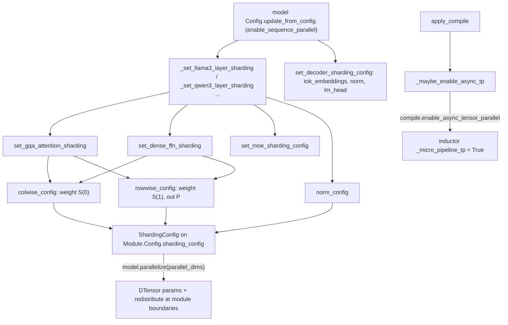

# Tensor parallelism and sequence parallelism (TP/SP) in TorchTitan

## Overview
Tensor parallelism (TP) splits the weight matrices of every attention and feed-forward layer
across the `tp` mesh axis, so each rank holds `1/tp` of each weight and computes `1/tp` of the
heads or hidden units. TorchTitan uses the classic Megatron pairing: a **colwise** linear (weight
sharded on its output dimension, no communication on the way in) feeds a **rowwise** linear
(weight sharded on its input dimension, output is a partial sum that must be reduced). With
**sequence parallelism** (SP, on by default) the reduction becomes a reduce-scatter along the
token dimension, so norms and residual adds between blocks run on `1/tp` of the tokens, and an
all-gather re-forms the full token set at the next block's input. The key design idea is that the
TP plan is **config-driven**: every module config carries an optional
[`sharding_config`](https://github.com/google-pytorch/torchtitan/blob/033f131322a8b5b026ac53d734c689d664442bf8/torchtitan/protocols/module.py#L96 "torchtitan/protocols/module#Module.Config.sharding_config"), a
[`ShardingConfig`](https://github.com/google-pytorch/torchtitan/blob/033f131322a8b5b026ac53d734c689d664442bf8/torchtitan/protocols/sharding.py#L60 "torchtitan/protocols/sharding#ShardingConfig") of SPMD placements keyed by
mesh axis name, filled in at config time by shared helpers in `models/common/decoder_sharding.py`
and `models/common/moe_sharding.py` (plus each model's `sharding.py`), and applied as DTensor
placements when the model's `parallelize(parallel_dims)` runs (see
[DTensor and sharding types](dtensor-and-sharding-types.md)). The `ParallelStyle`
[`NoParallel`](https://github.com/google-pytorch/torchtitan/blob/033f131322a8b5b026ac53d734c689d664442bf8/torchtitan/distributed/tensor_parallel.py#L19 "torchtitan/distributed/tensor_parallel#NoParallel") in
`torchtitan/distributed/tensor_parallel.py` remains, but in-tree plans now express "replicate on
TP" as a `ShardingConfig` instead.

## Diagram

Legend:
- `CFG` - (concept) a model `Config.update_from_config` hook reading `parallelism.enable_sequence_parallel`
- `MOD` - [`_set_llama3_layer_sharding`](https://github.com/google-pytorch/torchtitan/blob/033f131322a8b5b026ac53d734c689d664442bf8/torchtitan/models/llama3/sharding.py#L44 "torchtitan/models/llama3/sharding#_set_llama3_layer_sharding") and [`_set_qwen3_layer_sharding`](https://github.com/google-pytorch/torchtitan/blob/033f131322a8b5b026ac53d734c689d664442bf8/torchtitan/models/qwen3/sharding.py#L60 "torchtitan/models/qwen3/sharding#_set_qwen3_layer_sharding")
- `ROOT` - [`set_decoder_sharding_config`](https://github.com/google-pytorch/torchtitan/blob/033f131322a8b5b026ac53d734c689d664442bf8/torchtitan/models/common/decoder_sharding.py#L365 "torchtitan/models/common/decoder_sharding#set_decoder_sharding_config")
- `GQA` - [`set_gqa_attention_sharding`](https://github.com/google-pytorch/torchtitan/blob/033f131322a8b5b026ac53d734c689d664442bf8/torchtitan/models/common/decoder_sharding.py#L228 "torchtitan/models/common/decoder_sharding#set_gqa_attention_sharding")
- `FFN` - [`set_dense_ffn_sharding`](https://github.com/google-pytorch/torchtitan/blob/033f131322a8b5b026ac53d734c689d664442bf8/torchtitan/models/common/decoder_sharding.py#L329 "torchtitan/models/common/decoder_sharding#set_dense_ffn_sharding")
- `MOE` - [`set_moe_sharding_config`](https://github.com/google-pytorch/torchtitan/blob/033f131322a8b5b026ac53d734c689d664442bf8/torchtitan/models/common/moe_sharding.py#L305 "torchtitan/models/common/moe_sharding#set_moe_sharding_config")
- `COL` - [`colwise_config`](https://github.com/google-pytorch/torchtitan/blob/033f131322a8b5b026ac53d734c689d664442bf8/torchtitan/models/common/decoder_sharding.py#L138 "torchtitan/models/common/decoder_sharding#colwise_config")
- `ROW` - [`rowwise_config`](https://github.com/google-pytorch/torchtitan/blob/033f131322a8b5b026ac53d734c689d664442bf8/torchtitan/models/common/decoder_sharding.py#L149 "torchtitan/models/common/decoder_sharding#rowwise_config")
- `NRM` - [`norm_config`](https://github.com/google-pytorch/torchtitan/blob/033f131322a8b5b026ac53d734c689d664442bf8/torchtitan/models/common/decoder_sharding.py#L169 "torchtitan/models/common/decoder_sharding#norm_config")
- `SC` - [`ShardingConfig`](https://github.com/google-pytorch/torchtitan/blob/033f131322a8b5b026ac53d734c689d664442bf8/torchtitan/protocols/sharding.py#L60 "torchtitan/protocols/sharding#ShardingConfig") stored in [`sharding_config`](https://github.com/google-pytorch/torchtitan/blob/033f131322a8b5b026ac53d734c689d664442bf8/torchtitan/protocols/module.py#L96 "torchtitan/protocols/module#Module.Config.sharding_config")
- `APPLY` - (concept) `Module.parallelize`, see [DTensor and sharding types](dtensor-and-sharding-types.md)
- `CMP` - [`apply_compile`](https://github.com/google-pytorch/torchtitan/blob/033f131322a8b5b026ac53d734c689d664442bf8/torchtitan/distributed/compile.py#L39 "torchtitan/distributed/compile#apply_compile")
- `ATP` - [`_maybe_enable_async_tp`](https://github.com/google-pytorch/torchtitan/blob/033f131322a8b5b026ac53d734c689d664442bf8/torchtitan/distributed/compile.py#L75 "torchtitan/distributed/compile#_maybe_enable_async_tp")
- `IND` - (concept) PyTorch Inductor's micro-pipeline TP pass

Per-block data flow with SP on (default), for flattened activations of shape `(tokens, hidden)`:

```mermaid
flowchart LR
  X["x: tokens sharded on (dp, cp, tp)"] -->|"all-gather tp"| QKV["wq/wkv colwise: out S(-1) heads"]
  QKV --> ATT["attention on local heads"]
  ATT --> WO["wo rowwise: Partial"]
  WO -->|"reduce-scatter tokens"| N2["ffn_norm on token shard"]
  N2 -->|"all-gather tp"| W13["w1/w3 colwise"]
  W13 --> W2["w2 rowwise: Partial"]
  W2 -->|"reduce-scatter tokens"| OUT["next block input: token shard"]
```

Legend:
- `X` - (concept) sequence-parallel residual stream, [`dense_sequence_parallel_placement`](https://github.com/google-pytorch/torchtitan/blob/033f131322a8b5b026ac53d734c689d664442bf8/torchtitan/models/common/decoder_sharding.py#L114 "torchtitan/models/common/decoder_sharding#dense_sequence_parallel_placement")
- `QKV` - (concept) colwise projection, [`colwise_config`](https://github.com/google-pytorch/torchtitan/blob/033f131322a8b5b026ac53d734c689d664442bf8/torchtitan/models/common/decoder_sharding.py#L138 "torchtitan/models/common/decoder_sharding#colwise_config")
- `ATT` - (concept) attention over the local head shard
- `WO` - (concept) rowwise projection, [`rowwise_config`](https://github.com/google-pytorch/torchtitan/blob/033f131322a8b5b026ac53d734c689d664442bf8/torchtitan/models/common/decoder_sharding.py#L149 "torchtitan/models/common/decoder_sharding#rowwise_config")
- `N2` - (concept) sequence-parallel norm, [`norm_config`](https://github.com/google-pytorch/torchtitan/blob/033f131322a8b5b026ac53d734c689d664442bf8/torchtitan/models/common/decoder_sharding.py#L169 "torchtitan/models/common/decoder_sharding#norm_config")
- `W13` - (concept) colwise FFN projections
- `W2` - (concept) rowwise FFN projection
- `OUT` - (concept) sequence-parallel residual stream

## Design rationale (why it's built this way)
- **Colwise then rowwise keeps communication to the block boundary.** A colwise projection
  needs a replicated input and produces a head/hidden-sharded output. The attention kernel and the
  SwiGLU elementwise ops run entirely on local shards. The rowwise projection then produces a
  partial sum. Only two reductions per block are needed (after `wo` and after `w2`), plus the
  matching all-gathers when SP is on. [`colwise_config`](https://github.com/google-pytorch/torchtitan/blob/033f131322a8b5b026ac53d734c689d664442bf8/torchtitan/models/common/decoder_sharding.py#L138 "torchtitan/models/common/decoder_sharding#colwise_config")
  ("ColwiseParallel: weight S(0), output S(-1)") and
  [`rowwise_config`](https://github.com/google-pytorch/torchtitan/blob/033f131322a8b5b026ac53d734c689d664442bf8/torchtitan/models/common/decoder_sharding.py#L149 "torchtitan/models/common/decoder_sharding#rowwise_config")
  ("RowwiseParallel: weight S(1), bias R ... reduce-scatter if SP on, else ... all-reduce") are the
  two building blocks; [`set_gqa_attention_sharding`](https://github.com/google-pytorch/torchtitan/blob/033f131322a8b5b026ac53d734c689d664442bf8/torchtitan/models/common/decoder_sharding.py#L228 "torchtitan/models/common/decoder_sharding#set_gqa_attention_sharding")
  and [`set_dense_ffn_sharding`](https://github.com/google-pytorch/torchtitan/blob/033f131322a8b5b026ac53d734c689d664442bf8/torchtitan/models/common/decoder_sharding.py#L329 "torchtitan/models/common/decoder_sharding#set_dense_ffn_sharding")
  compose them for Q/K/V + `wo` and `w1`/`w3` + `w2`, and declare the block-input all-gather
  (input `in_src` = the SP layout, `in_dst` = replicated on TP).
- **Placements are SPMD types over every axis, not TP-only placements.** Every declaration goes
  through [`dense_param_placement`](https://github.com/google-pytorch/torchtitan/blob/033f131322a8b5b026ac53d734c689d664442bf8/torchtitan/models/common/decoder_sharding.py#L24 "torchtitan/models/common/decoder_sharding#dense_param_placement")
  ("DP/CP axes are spmd.R ... TP placement is caller-specified") or
  [`dense_activation_placement`](https://github.com/google-pytorch/torchtitan/blob/033f131322a8b5b026ac53d734c689d664442bf8/torchtitan/models/common/decoder_sharding.py#L39 "torchtitan/models/common/decoder_sharding#dense_activation_placement")
  ("DP is token-sharded"), keyed by [`MeshAxisName`](https://github.com/google-pytorch/torchtitan/blob/033f131322a8b5b026ac53d734c689d664442bf8/torchtitan/distributed/parallel_dims.py#L65 "torchtitan/distributed/parallel_dims#MeshAxisName").
  The same declaration therefore serves both SPMD backends: under `partial_dtensor` only the `tp`
  and `ep` entries become DTensor placements, while `spmd_types` also type-checks `dp` and `cp`
  (the active backend is [`get_spmd_backend`](https://github.com/google-pytorch/torchtitan/blob/033f131322a8b5b026ac53d734c689d664442bf8/torchtitan/distributed/utils.py#L45 "torchtitan/distributed/utils#get_spmd_backend")).
- **Plans are declared unconditionally.** The Llama 3 docstring says specs "are populated
  unconditionally - the mesh actually passed to `Module.parallelize()` at runtime determines which
  declarations apply", and [`set_moe_sharding_config`](https://github.com/google-pytorch/torchtitan/blob/033f131322a8b5b026ac53d734c689d664442bf8/torchtitan/models/common/moe_sharding.py#L305 "torchtitan/models/common/moe_sharding#set_moe_sharding_config")
  says the same ("`resolve_mesh` filters out disabled axes at runtime"). A TP=1 run carries the
  whole plan and applies none of its TP placements.
- **SP turns all-reduce into reduce-scatter plus all-gather.** Both options move the same bytes
  (an all-reduce is a reduce-scatter followed by an all-gather), but SP moves the all-gather to
  just before the next colwise layer. In between, norms and residuals run on `1/tp` of the tokens
  and the saved activations are `1/tp` the size. The Llama 3 layer helper documents the two modes:
  with SP "`attention.wo` and `feed_forward.w2` reduce-scatter to Shard(0)"; without it they
  "all-reduce to Replicate" and norms "stay Replicate". SP is `parallelism.enable_sequence_parallel`
  and is on by default.
- **Replicated-on-TP state still becomes a DTensor.** [`NoParallel`](https://github.com/google-pytorch/torchtitan/blob/033f131322a8b5b026ac53d734c689d664442bf8/torchtitan/distributed/tensor_parallel.py#L19 "torchtitan/distributed/tensor_parallel#NoParallel")
  existed to replicate a module's computation while converting its parameters to DTensors on the
  TP mesh, "to ensure all parameters are on the same 1D/2D mesh, which is assumed by (1) gradient
  norm clipping, and (2) optimizer fused implementation". The config-driven plans keep that rule
  but express it as a `state_shardings` entry with `tp=R`: the MoE router gate, the RoPE cache, and
  the low-rank MLA projections in [`_set_deepseek_v3_layer_sharding`](https://github.com/google-pytorch/torchtitan/blob/033f131322a8b5b026ac53d734c689d664442bf8/torchtitan/models/deepseek_v3/sharding.py#L74 "torchtitan/models/deepseek_v3/sharding#_set_deepseek_v3_layer_sharding")
  ("We still distribute them (Replicate DTensor) so DTensor activations flow through without
  mixing plain Tensor + DTensor in the matmul"); the HF backend's replicate helper calls itself the
  "ShardingConfig equivalent of NoParallel".
- **Async TP is opt-in and compile-only.** The knob moved to
  [`CompileConfig`](https://github.com/google-pytorch/torchtitan/blob/033f131322a8b5b026ac53d734c689d664442bf8/torchtitan/config/configs.py#L338 "torchtitan/config/configs#CompileConfig") (`compile.enable_async_tensor_parallel`),
  whose `__post_init__` rejects it unless `compile.enable` is on and "model" is in
  `compile.components`, because the overlap is implemented by an Inductor graph pass
  (`_micro_pipeline_tp`) that decomposes all-gather + matmul and matmul + reduce-scatter into
  overlapped chunks. [`_maybe_enable_async_tp`](https://github.com/google-pytorch/torchtitan/blob/033f131322a8b5b026ac53d734c689d664442bf8/torchtitan/distributed/compile.py#L75 "torchtitan/distributed/compile#_maybe_enable_async_tp")
  now also registers symmetric memory for the TP process group before setting the flag.

> [!inferred]
> On TPU, the Inductor flag set by [`_maybe_enable_async_tp`](https://github.com/google-pytorch/torchtitan/blob/033f131322a8b5b026ac53d734c689d664442bf8/torchtitan/distributed/compile.py#L75 "torchtitan/distributed/compile#_maybe_enable_async_tp")
> only has an effect if the model is compiled with Inductor. The TPU wrapper
> in `torchtitan/experiments/tpu/llama3/infra/parallelize.py`
> compiles the full model with `backend="tpu"` in "fullgraph" mode, so there the TP collectives
> are lowered by XLA, and any collective-matmul overlap is XLA's decision, not this flag's.
> Cost model per transformer block with TP degree `t`, `T` tokens and hidden size `H`
> (bf16): SP on gives two all-gathers and two reduce-scatters of `T*H` elements over the `tp`
> axis in forward, and the same again in backward. Weight memory per rank is about `1/t`, and SP
> also cuts norm/residual activation memory to `1/t`. Because `tp` is the innermost mesh axis
> (see [ParallelDims and the device mesh](parallel-dims-and-mesh.md)), these per-layer collectives
> run over the nearest group of chips, which is where their latency-sensitivity belongs on ICI.

## Entry points
- [`set_decoder_sharding_config`](https://github.com/google-pytorch/torchtitan/blob/033f131322a8b5b026ac53d734c689d664442bf8/torchtitan/models/common/decoder_sharding.py#L365 "torchtitan/models/common/decoder_sharding#set_decoder_sharding_config")
  is called from each decoder's config hook (for Llama 3, `update_from_config` passes
  `enable_sp=parallelism.enable_sequence_parallel`) together with a per-layer helper such as
  [`_set_llama3_layer_sharding`](https://github.com/google-pytorch/torchtitan/blob/033f131322a8b5b026ac53d734c689d664442bf8/torchtitan/models/llama3/sharding.py#L44 "torchtitan/models/llama3/sharding#_set_llama3_layer_sharding"),
  [`_set_qwen3_layer_sharding`](https://github.com/google-pytorch/torchtitan/blob/033f131322a8b5b026ac53d734c689d664442bf8/torchtitan/models/qwen3/sharding.py#L60 "torchtitan/models/qwen3/sharding#_set_qwen3_layer_sharding"),
  [`_set_deepseek_v3_layer_sharding`](https://github.com/google-pytorch/torchtitan/blob/033f131322a8b5b026ac53d734c689d664442bf8/torchtitan/models/deepseek_v3/sharding.py#L74 "torchtitan/models/deepseek_v3/sharding#_set_deepseek_v3_layer_sharding")
  or [`_set_gpt_oss_layer_sharding`](https://github.com/google-pytorch/torchtitan/blob/033f131322a8b5b026ac53d734c689d664442bf8/torchtitan/models/gpt_oss/sharding.py#L78 "torchtitan/models/gpt_oss/sharding#_set_gpt_oss_layer_sharding").
  Models with extra block types add their own: [`set_qwen35_sharding_config`](https://github.com/google-pytorch/torchtitan/blob/033f131322a8b5b026ac53d734c689d664442bf8/torchtitan/models/qwen3_5/sharding.py#L115 "torchtitan/models/qwen3_5/sharding#set_qwen35_sharding_config")
  (with [`_set_deltanet_sharding`](https://github.com/google-pytorch/torchtitan/blob/033f131322a8b5b026ac53d734c689d664442bf8/torchtitan/models/qwen3_5/sharding.py#L303 "torchtitan/models/qwen3_5/sharding#_set_deltanet_sharding") for head-sharded GatedDeltaNet)
  and [`set_deepseek_v4_sharding_config`](https://github.com/google-pytorch/torchtitan/blob/033f131322a8b5b026ac53d734c689d664442bf8/torchtitan/models/deepseek_v4/sharding.py#L308 "torchtitan/models/deepseek_v4/sharding#set_deepseek_v4_sharding_config").
- [`set_moe_sharding_config`](https://github.com/google-pytorch/torchtitan/blob/033f131322a8b5b026ac53d734c689d664442bf8/torchtitan/models/common/moe_sharding.py#L305 "torchtitan/models/common/moe_sharding#set_moe_sharding_config")
  is called by those layer helpers for MoE blocks; it fills the [`MoE`](https://github.com/google-pytorch/torchtitan/blob/033f131322a8b5b026ac53d734c689d664442bf8/torchtitan/models/common/moe.py#L934 "torchtitan/models/common/moe#MoE")
  wrapper, router gate, shared experts and routed experts.
- [`set_hf_sharding_configs`](https://github.com/google-pytorch/torchtitan/blob/033f131322a8b5b026ac53d734c689d664442bf8/torchtitan/experiments/transformers_modeling_backend/hf_sharding.py#L104 "torchtitan/experiments/transformers_modeling_backend/hf_sharding#set_hf_sharding_configs")
  is the HF-transformers backend's equivalent: it sets `_sharding_config` on HF submodules so a single
  `model.parallelize(parallel_dims)` call applies TP (it replaced the backend's earlier classic
  `parallelize_module` plan).
- [`_maybe_enable_async_tp`](https://github.com/google-pytorch/torchtitan/blob/033f131322a8b5b026ac53d734c689d664442bf8/torchtitan/distributed/compile.py#L75 "torchtitan/distributed/compile#_maybe_enable_async_tp")
  is called at the start of the per-block [`apply_compile`](https://github.com/google-pytorch/torchtitan/blob/033f131322a8b5b026ac53d734c689d664442bf8/torchtitan/distributed/compile.py#L39 "torchtitan/distributed/compile#apply_compile")
  and of the graph trainer's [`apply_compile`](https://github.com/google-pytorch/torchtitan/blob/033f131322a8b5b026ac53d734c689d664442bf8/torchtitan/experiments/graph_trainer/compile.py#L56 "torchtitan/experiments/graph_trainer/compile#apply_compile")
  (configured by [`GraphTrainerCompileConfig`](https://github.com/google-pytorch/torchtitan/blob/033f131322a8b5b026ac53d734c689d664442bf8/torchtitan/experiments/graph_trainer/configs.py#L69 "torchtitan/experiments/graph_trainer/configs#GraphTrainerCompileConfig")),
  with the dense TP mesh when `tp_enabled`, else `None`.
- [`NoParallel`](https://github.com/google-pytorch/torchtitan/blob/033f131322a8b5b026ac53d734c689d664442bf8/torchtitan/distributed/tensor_parallel.py#L19 "torchtitan/distributed/tensor_parallel#NoParallel")
  can still be used inside a PyTorch `parallelize_module` plan, but no in-tree plan instantiates it
  at this pin.

## Mechanism (step-by-step)
1. **Declare the plan at config time.** When a model config is built, its hook calls [`set_decoder_sharding_config`](https://github.com/google-pytorch/torchtitan/blob/033f131322a8b5b026ac53d734c689d664442bf8/torchtitan/models/common/decoder_sharding.py#L365 "torchtitan/models/common/decoder_sharding#set_decoder_sharding_config") for the root modules and a per-layer helper for each block. The embedding is vocab-sharded (weight `S(0)`, output `Partial`, redistributed to the SP layout or to replicated), the pre-`lm_head` norm all-gathers the token shard back to replicated, and `lm_head` is colwise over the vocabulary (output `S(-1)`, which the loss turns into vocab-parallel cross-entropy). In each block, norms get [`norm_config`](https://github.com/google-pytorch/torchtitan/blob/033f131322a8b5b026ac53d734c689d664442bf8/torchtitan/models/common/decoder_sharding.py#L169 "torchtitan/models/common/decoder_sharding#norm_config"), Q/K/V and `w1`/`w3` get [`colwise_config`](https://github.com/google-pytorch/torchtitan/blob/033f131322a8b5b026ac53d734c689d664442bf8/torchtitan/models/common/decoder_sharding.py#L138 "torchtitan/models/common/decoder_sharding#colwise_config"), and `wo`/`w2` get [`rowwise_config`](https://github.com/google-pytorch/torchtitan/blob/033f131322a8b5b026ac53d734c689d664442bf8/torchtitan/models/common/decoder_sharding.py#L149 "torchtitan/models/common/decoder_sharding#rowwise_config"). Each result is a [`ShardingConfig`](https://github.com/google-pytorch/torchtitan/blob/033f131322a8b5b026ac53d734c689d664442bf8/torchtitan/protocols/sharding.py#L60 "torchtitan/protocols/sharding#ShardingConfig") assigned to the sub-config's [`sharding_config`](https://github.com/google-pytorch/torchtitan/blob/033f131322a8b5b026ac53d734c689d664442bf8/torchtitan/protocols/module.py#L96 "torchtitan/protocols/module#Module.Config.sharding_config"); building the config copies it onto the [`Module`](https://github.com/google-pytorch/torchtitan/blob/033f131322a8b5b026ac53d734c689d664442bf8/torchtitan/protocols/module.py#L43 "torchtitan/protocols/module#Module") instance (for example a [`Linear`](https://github.com/google-pytorch/torchtitan/blob/033f131322a8b5b026ac53d734c689d664442bf8/torchtitan/models/common/linear.py#L31 "torchtitan/models/common/linear#Linear")).
2. **What a ShardingConfig says.** [`state_shardings`](https://github.com/google-pytorch/torchtitan/blob/033f131322a8b5b026ac53d734c689d664442bf8/torchtitan/protocols/sharding.py#L108 "torchtitan/protocols/sharding#ShardingConfig.state_shardings") gives parameter/buffer placements (`{"weight": ...}`). Inputs are a (source, destination) pair: [`in_src_shardings`](https://github.com/google-pytorch/torchtitan/blob/033f131322a8b5b026ac53d734c689d664442bf8/torchtitan/protocols/sharding.py#L109 "torchtitan/protocols/sharding#ShardingConfig.in_src_shardings") says what layout an input arrives in (and annotates plain tensors as DTensors), [`in_dst_shardings`](https://github.com/google-pytorch/torchtitan/blob/033f131322a8b5b026ac53d734c689d664442bf8/torchtitan/protocols/sharding.py#L110 "torchtitan/protocols/sharding#ShardingConfig.in_dst_shardings") what it must be redistributed to. Outputs likewise: [`out_src_shardings`](https://github.com/google-pytorch/torchtitan/blob/033f131322a8b5b026ac53d734c689d664442bf8/torchtitan/protocols/sharding.py#L111 "torchtitan/protocols/sharding#ShardingConfig.out_src_shardings") and [`out_dst_shardings`](https://github.com/google-pytorch/torchtitan/blob/033f131322a8b5b026ac53d734c689d664442bf8/torchtitan/protocols/sharding.py#L112 "torchtitan/protocols/sharding#ShardingConfig.out_dst_shardings"). The author's rationale: "declaring it explicitly keeps the contract uniform with future erased-type systems that require both sides of every redistribute". An optional [`LocalMapConfig`](https://github.com/google-pytorch/torchtitan/blob/033f131322a8b5b026ac53d734c689d664442bf8/torchtitan/protocols/sharding.py#L34 "torchtitan/protocols/sharding#LocalMapConfig") runs the forward on local tensors (used for the embedding, inner attention and routed experts).
3. **MoE plan.** [`set_moe_sharding_config`](https://github.com/google-pytorch/torchtitan/blob/033f131322a8b5b026ac53d734c689d664442bf8/torchtitan/models/common/moe_sharding.py#L305 "torchtitan/models/common/moe_sharding#set_moe_sharding_config") branches per module between a dense family (EP off, experts sharded on TP: `Shard(1)` for colwise expert weights, `Shard(2)` for rowwise) and a sparse family (EP on, experts `S(0)` on `ep`, replicated on the FSDP storage axes). [`_routed_experts_sharding_configs`](https://github.com/google-pytorch/torchtitan/blob/033f131322a8b5b026ac53d734c689d664442bf8/torchtitan/models/common/moe_sharding.py#L200 "torchtitan/models/common/moe_sharding#_routed_experts_sharding_configs") puts the activation contracts and `local_map` on `routed_experts` and the weight placements on `routed_experts.inner_experts`; the router gate is replicated on TP.
4. **Apply when the model is parallelized.** The model's parallelize function calls `model.parallelize(parallel_dims)` when TP (or EP, or the `spmd_types` backend) is enabled. For every module that carries a [`ShardingConfig`](https://github.com/google-pytorch/torchtitan/blob/033f131322a8b5b026ac53d734c689d664442bf8/torchtitan/protocols/sharding.py#L60 "torchtitan/protocols/sharding#ShardingConfig"), its states become DTensors on the resolved mesh and its `forward` is wrapped with "redistribute inputs -> forward -> redistribute outputs". That wrapper is where the all-gathers (block input SP layout -> replicated on TP) and the reduce-scatters or all-reduces (rowwise `Partial` -> SP layout or replicated) are issued. Mesh and placement resolution are covered on [DTensor and sharding types](dtensor-and-sharding-types.md).
5. **Dist-GEMM variants.** When the attention `wo` or the FFN is configured as a fused distributed-GEMM module, [`set_gqa_attention_sharding`](https://github.com/google-pytorch/torchtitan/blob/033f131322a8b5b026ac53d734c689d664442bf8/torchtitan/models/common/decoder_sharding.py#L228 "torchtitan/models/common/decoder_sharding#set_gqa_attention_sharding") and [`set_dense_ffn_sharding`](https://github.com/google-pytorch/torchtitan/blob/033f131322a8b5b026ac53d734c689d664442bf8/torchtitan/models/common/decoder_sharding.py#L329 "torchtitan/models/common/decoder_sharding#set_dense_ffn_sharding") drop the block-level input contract and keep only parameter shardings on the rowwise linear, because "the reduce-scatter happens inside the fused op" and the output is already in its final token-sharded layout. SP and `spmd_types` are preconditions for this path.
6. **Optionally enable async TP.** [`_maybe_enable_async_tp`](https://github.com/google-pytorch/torchtitan/blob/033f131322a8b5b026ac53d734c689d664442bf8/torchtitan/distributed/compile.py#L75 "torchtitan/distributed/compile#_maybe_enable_async_tp") returns immediately unless `compile.enable_async_tensor_parallel` is set and a TP mesh was passed. Otherwise it enables symmetric memory for the TP group, sets `torch._inductor.config._micro_pipeline_tp = True`, and logs "Async TP is enabled" through [`logger`](https://github.com/google-pytorch/torchtitan/blob/033f131322a8b5b026ac53d734c689d664442bf8/torchtitan/tools/logging.py#L12 "torchtitan/tools/logging#logger"). Invalid combinations were already rejected when [`CompileConfig`](https://github.com/google-pytorch/torchtitan/blob/033f131322a8b5b026ac53d734c689d664442bf8/torchtitan/config/configs.py#L338 "torchtitan/config/configs#CompileConfig") was constructed.
7. **Compose with the other axes.** After TP, the caller applies activation checkpointing, per-block compile, and finally FSDP over `fsdp` (or `dp_replicate x fsdp`). FSDP shards the already-TP-sharded DTensor parameters along the data axes, which produces 2-D sharded weights (TP inner, FSDP outer); the norm weight is declared `R` under SP with a "pending BWD AR handled by FSDP" ([`norm_config`](https://github.com/google-pytorch/torchtitan/blob/033f131322a8b5b026ac53d734c689d664442bf8/torchtitan/models/common/decoder_sharding.py#L169 "torchtitan/models/common/decoder_sharding#norm_config")). The trainer also requires `training.num_tokens_per_microbatch_per_dp_rank` to be divisible by `tp` when SP is on (times `2 * cp` when CP is on), because SP splits the tokens across TP ranks.

## Key data structures
- **[`ShardingConfig`](https://github.com/google-pytorch/torchtitan/blob/033f131322a8b5b026ac53d734c689d664442bf8/torchtitan/protocols/sharding.py#L60 "torchtitan/protocols/sharding#ShardingConfig")**: `state_shardings`,
  `in_src_shardings`/`in_dst_shardings` (keyed by `forward()` argument name),
  `out_src_shardings`/`out_dst_shardings`, optional `local_map`. All values are `SpmdType`s
  keyed by mesh axis name; it is "Completely dtype-agnostic at this moment - quantization
  (Float8/MXFP8) is orthogonal".
- **Placements used by TP**: `S(0)` / `S(1)` on weights (colwise / rowwise), the SP layout
  [`dense_sequence_parallel_placement`](https://github.com/google-pytorch/torchtitan/blob/033f131322a8b5b026ac53d734c689d664442bf8/torchtitan/models/common/decoder_sharding.py#L114 "torchtitan/models/common/decoder_sharding#dense_sequence_parallel_placement")
  (tokens sharded over `(dp, cp, tp)`), `S(-1)` on colwise outputs, `P` on rowwise outputs before
  reduction, `R` for norms under SP, the router, the RoPE cache and low-rank projections, and `I`
  (all-reduced replicated) for activations and norms when SP is off.
- **Module hooks**: [`Module`](https://github.com/google-pytorch/torchtitan/blob/033f131322a8b5b026ac53d734c689d664442bf8/torchtitan/protocols/module.py#L43 "torchtitan/protocols/module#Module") components such as
  [`GQAttention`](https://github.com/google-pytorch/torchtitan/blob/033f131322a8b5b026ac53d734c689d664442bf8/torchtitan/models/common/attention.py#L999 "torchtitan/models/common/attention#GQAttention"),
  [`FeedForward`](https://github.com/google-pytorch/torchtitan/blob/033f131322a8b5b026ac53d734c689d664442bf8/torchtitan/models/common/feed_forward.py#L34 "torchtitan/models/common/feed_forward#FeedForward"),
  [`RMSNorm`](https://github.com/google-pytorch/torchtitan/blob/033f131322a8b5b026ac53d734c689d664442bf8/torchtitan/models/common/nn_modules.py#L134 "torchtitan/models/common/nn_modules#RMSNorm") and [`RoPE`](https://github.com/google-pytorch/torchtitan/blob/033f131322a8b5b026ac53d734c689d664442bf8/torchtitan/models/common/rope.py#L84 "torchtitan/models/common/rope#RoPE")
  are the units that receive a config; activations are named by their `forward` argument
  (`x_TD`, `x`, `input`).
- **Config knobs**: `tensor_parallel_degree` (1 = off), `enable_sequence_parallel` (default
  True), and `compile.enable_async_tensor_parallel` on [`CompileConfig`](https://github.com/google-pytorch/torchtitan/blob/033f131322a8b5b026ac53d734c689d664442bf8/torchtitan/config/configs.py#L338 "torchtitan/config/configs#CompileConfig")
  (default False, "Whether to pipeline tensor-parallel collectives with matrix multiplications").

## Dynamics (design intent)
- Redistributions happen at module boundaries declared in the plan. With a declared `in_src`
  equal to the layout the previous module emitted (the FFN's `attn_x_layout` is chosen "to match
  the layout that the layer's attention block emits so the FFN's input wrap is a no-op redistribute
  when placements already agree"), no extra collective is issued.
- TP is applied before activation checkpointing, compile and FSDP. The per-block compile and FSDP
  wrappers therefore see modules whose forward already contains the redistribute calls, and the
  collectives end up inside the compiled region.
- The TPU TP parity tests use loose tolerances (forward `atol=rtol=5e-2`, loss `3e-2`, grads
  `5e-3`), so bitwise equality with single-device runs is not expected under TP.

## Edge cases
- **`tensor_parallel_degree` must fit the head counts.** Colwise Q/K/V sharding splits heads, so
  `n_heads` and `n_kv_heads` must be divisible by `tp`. That is not validated in this unit and
  surfaces as a shape error.
- **Token-count divisibility.** With SP on, the per-microbatch token count
  (`training.num_tokens_per_microbatch_per_dp_rank`) must be divisible by `tp` (combined with
  CP's `2*cp` requirement into `tp * 2 * cp`).
- **Async TP without compile** is a hard error at config construction, not a warning.
- **Every axis must be declared.** Placement resolution raises `ValueError` if a `ShardingConfig`
  entry does not declare a placement for an axis of the mesh it is applied against, so a custom
  plan must use the `dense_*_placement` helpers (which declare `dp`, `cp` and `tp`) or list every axis.
- **Embedding scatter breaks SP at the input.** Kimi's VLM plan keeps `tok_embeddings` replicated
  and resumes SP at layer 0's output ([`_shard_decoder_after_embedding_scatter`](https://github.com/google-pytorch/torchtitan/blob/033f131322a8b5b026ac53d734c689d664442bf8/torchtitan/models/kimi_k2_7/sharding.py#L69 "torchtitan/models/kimi_k2_7/sharding#_shard_decoder_after_embedding_scatter")),
  because "a `Shard(0)` one cannot be indexed by sequence position locally".
- **Conformer on TPU rejects TP** outright ("Tensor Parallelism is not supported for Conformer
  yet").

## Open questions
- Whether async TP (`_micro_pipeline_tp`) has any effect under the TPU compile modes ("layer"
  with the configured backend vs "fullgraph" with `backend="tpu"`) is not settled by this code.
- Several docstrings still describe the pre-flattening `(batch, seq, hidden)` layout:
  `rowwise_config` says the SP output is "S(1)" and the Qwen3.5 DeltaNet helper says
  "reduce-scatter to Shard(1)", while the placement they build shards the flattened token
  dimension (dim 0), as `set_decoder_sharding_config` and the Llama 3 helper state.
- `Module.parallelize`, `parallelize_llama` and the fused dist-GEMM modules are outside this
  page's symbol subgraph; see [DTensor and sharding types](dtensor-and-sharding-types.md) for how
  declarations are resolved and applied.

## See also
- [ParallelDims and the device mesh](parallel-dims-and-mesh.md) - where the `tp` axis sits (innermost) and `seq_len_divisor`.
- [DTensor and sharding types](dtensor-and-sharding-types.md) - how ShardingConfig placements are resolved and applied.
- [FSDP sharding](fsdp-sharding.md) - applied after TP, over the data axes.
- [Context parallel](context-parallel.md), [Expert parallel](expert-parallel.md), [Pipeline parallel](pipeline-parallel.md)
- [torch.compile integration](torch-compile-integration.md) - required for async TP.
- [Model definitions](model-definitions.md), [Loss and validation](loss-and-validation.md) - vocab-sharded `lm_head` output and the loss.

## Recent changes
- `fa627bf2` rebases onto upstream `d771abb0`: per-model TP plans are now config-driven
  `ShardingConfig` declarations (`decoder_sharding.py`, `moe_sharding.py`, per-model `sharding.py`)
  over flattened `[T, D]` activations, `maybe_enable_async_tp` moved from `tensor_parallel.py` to
  `compile.py` as `_maybe_enable_async_tp`, and its knob moved from `parallelism` to
  `compile.enable_async_tensor_parallel`.
- `d4fcbc42` brings the HF transformers modeling backend to TorchTPU; its TP plan is the
  ShardingConfig-based `set_hf_sharding_configs`.
- [all changes in 033f131322](../changes/033f131322.md)
