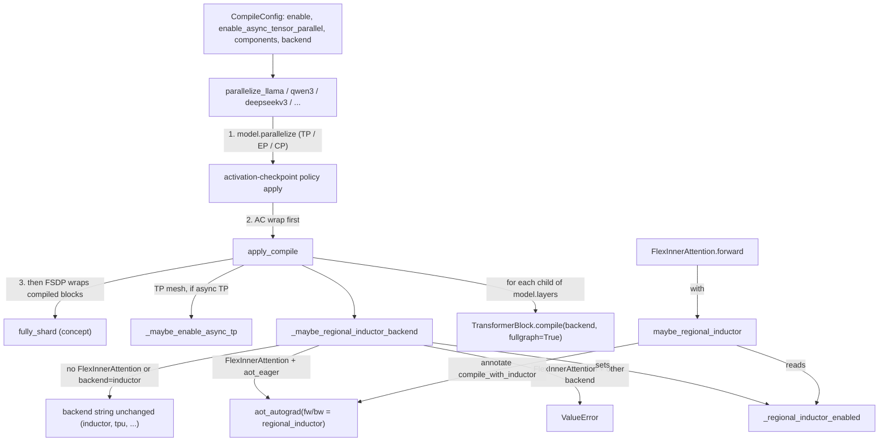

# torch.compile integration: per-TransformerBlock compile and regional inductor

## Overview
TorchTitan's eager trainer applies `torch.compile` in one place:
[`apply_compile`](https://github.com/google-pytorch/torchtitan/blob/033f131322a8b5b026ac53d734c689d664442bf8/torchtitan/distributed/compile.py#L39 "torchtitan/distributed/compile#apply_compile")
in `torchtitan/distributed/compile.py`, called from each model's parallelize function when
[`CompileConfig`](https://github.com/google-pytorch/torchtitan/blob/033f131322a8b5b026ac53d734c689d664442bf8/torchtitan/config/configs.py#L338 "torchtitan/config/configs#CompileConfig")
has `enable` set and `"model"` in `components`. The key design idea is in its docstring: compile
"each TransformerBlock, which makes compilation efficient due to repeated structure". Every
[`TransformerBlock`](https://github.com/google-pytorch/torchtitan/blob/033f131322a8b5b026ac53d734c689d664442bf8/torchtitan/models/common/decoder.py#L46 "torchtitan/models/common/decoder#TransformerBlock")
has the same code and shapes, so Dynamo traces one block and reuses the result, instead of tracing
a model that is N copies of it. Each block is compiled in place with `fullgraph=True` and the
backend string from [`backend`](https://github.com/google-pytorch/torchtitan/blob/033f131322a8b5b026ac53d734c689d664442bf8/torchtitan/config/configs.py#L348 "torchtitan/config/configs#CompileConfig.backend")
(`inductor` by default, `tpu` in TPU recipes). Before compiling, it also configures Inductor's
async tensor-parallel pass through
[`_maybe_enable_async_tp`](https://github.com/google-pytorch/torchtitan/blob/033f131322a8b5b026ac53d734c689d664442bf8/torchtitan/distributed/compile.py#L75 "torchtitan/distributed/compile#_maybe_enable_async_tp"),
which is why it now takes [`ParallelDims`](https://github.com/google-pytorch/torchtitan/blob/033f131322a8b5b026ac53d734c689d664442bf8/torchtitan/distributed/parallel_dims.py#L105 "torchtitan/distributed/parallel_dims#ParallelDims").
The second half of the module is a narrow bridge,
[`_maybe_regional_inductor_backend`](https://github.com/google-pytorch/torchtitan/blob/033f131322a8b5b026ac53d734c689d664442bf8/torchtitan/distributed/compile.py#L99 "torchtitan/distributed/compile#_maybe_regional_inductor_backend")
plus [`maybe_regional_inductor`](https://github.com/google-pytorch/torchtitan/blob/033f131322a8b5b026ac53d734c689d664442bf8/torchtitan/distributed/compile.py#L137 "torchtitan/distributed/compile#maybe_regional_inductor").
It lets a model that uses [`FlexInnerAttention`](https://github.com/google-pytorch/torchtitan/blob/033f131322a8b5b026ac53d734c689d664442bf8/torchtitan/models/common/attention.py#L233 "torchtitan/models/common/attention#FlexInnerAttention")
be compiled with the non-inductor `aot_eager` backend, while the flex region alone is still lowered
by inductor.

## Diagram

Legend:
- `CFG` - [`CompileConfig`](https://github.com/google-pytorch/torchtitan/blob/033f131322a8b5b026ac53d734c689d664442bf8/torchtitan/config/configs.py#L338 "torchtitan/config/configs#CompileConfig") and its [`backend`](https://github.com/google-pytorch/torchtitan/blob/033f131322a8b5b026ac53d734c689d664442bf8/torchtitan/config/configs.py#L348 "torchtitan/config/configs#CompileConfig.backend")
- `PAR` - [`parallelize_llama`](https://github.com/google-pytorch/torchtitan/blob/033f131322a8b5b026ac53d734c689d664442bf8/torchtitan/models/llama3/parallelize.py#L23 "torchtitan/models/llama3/parallelize#parallelize_llama"), [`parallelize_qwen3`](https://github.com/google-pytorch/torchtitan/blob/033f131322a8b5b026ac53d734c689d664442bf8/torchtitan/models/qwen3/parallelize.py#L28 "torchtitan/models/qwen3/parallelize#parallelize_qwen3"), [`parallelize_deepseekv3`](https://github.com/google-pytorch/torchtitan/blob/033f131322a8b5b026ac53d734c689d664442bf8/torchtitan/models/deepseek_v3/parallelize.py#L21 "torchtitan/models/deepseek_v3/parallelize#parallelize_deepseekv3")
- `AC` - (concept) the activation-checkpointing policy built from `ac_config`, see [activation-checkpointing](activation-checkpointing.md)
- `AP` - [`apply_compile`](https://github.com/google-pytorch/torchtitan/blob/033f131322a8b5b026ac53d734c689d664442bf8/torchtitan/distributed/compile.py#L39 "torchtitan/distributed/compile#apply_compile")
- `FSDP` - (concept) FSDP wrapping, see [fsdp-sharding](fsdp-sharding.md)
- `ATP` - [`_maybe_enable_async_tp`](https://github.com/google-pytorch/torchtitan/blob/033f131322a8b5b026ac53d734c689d664442bf8/torchtitan/distributed/compile.py#L75 "torchtitan/distributed/compile#_maybe_enable_async_tp")
- `BE` - [`_maybe_regional_inductor_backend`](https://github.com/google-pytorch/torchtitan/blob/033f131322a8b5b026ac53d734c689d664442bf8/torchtitan/distributed/compile.py#L99 "torchtitan/distributed/compile#_maybe_regional_inductor_backend")
- `RAW` - (concept) the unmodified backend string passed to `torch.compile`
- `REG` - (concept) `torch.fx.passes.regional_inductor` wrapped in `aot_autograd`
- `ERR` - (concept) the raised configuration error
- `FLAG` - [`_regional_inductor_enabled`](https://github.com/google-pytorch/torchtitan/blob/033f131322a8b5b026ac53d734c689d664442bf8/torchtitan/distributed/compile.py#L36 "torchtitan/distributed/compile#_regional_inductor_enabled._regional_inductor_enabled")
- `TB` - [`TransformerBlock`](https://github.com/google-pytorch/torchtitan/blob/033f131322a8b5b026ac53d734c689d664442bf8/torchtitan/models/common/decoder.py#L46 "torchtitan/models/common/decoder#TransformerBlock")
- `FWD` - [`forward`](https://github.com/google-pytorch/torchtitan/blob/033f131322a8b5b026ac53d734c689d664442bf8/torchtitan/models/common/attention.py#L337 "torchtitan/models/common/attention#FlexInnerAttention.forward")
- `MRI` - [`maybe_regional_inductor`](https://github.com/google-pytorch/torchtitan/blob/033f131322a8b5b026ac53d734c689d664442bf8/torchtitan/distributed/compile.py#L137 "torchtitan/distributed/compile#maybe_regional_inductor")

## Design rationale (why it's built this way)
- **Block granularity is the default, not whole-model compile.** The
  [`apply_compile`](https://github.com/google-pytorch/torchtitan/blob/033f131322a8b5b026ac53d734c689d664442bf8/torchtitan/distributed/compile.py#L39 "torchtitan/distributed/compile#apply_compile")
  docstring names the alternative ("one can compile the whole model (after applying DP)") and chooses
  blocks because of the repeated structure. The TPU optimization guide in `experiments/tpu` reaches
  the same conclusion for TPU: per-block compile "fuses the ops *within* a block while keeping
  activation checkpointing *between* blocks, so memory stays bounded". Whole-model compile has
  failure modes there (all activations live at once, embedding-backward binding, lazily created RoPE
  buffers).
- **Compile sits between AC and FSDP.** Every parallelizer that calls it uses this order, and most
  carry the comment "turn on per-TransformerBlock compile after AC wrapping and before FSDP"; see for example
  [`parallelize_llama`](https://github.com/google-pytorch/torchtitan/blob/033f131322a8b5b026ac53d734c689d664442bf8/torchtitan/models/llama3/parallelize.py#L23 "torchtitan/models/llama3/parallelize#parallelize_llama")
  and [`parallelize_qwen3`](https://github.com/google-pytorch/torchtitan/blob/033f131322a8b5b026ac53d734c689d664442bf8/torchtitan/models/qwen3/parallelize.py#L28 "torchtitan/models/qwen3/parallelize#parallelize_qwen3").
  In the model parallelizers the TP/CP/EP rewrite (a single config-driven `model.parallelize(parallel_dims)`
  call) happens before AC, so the compiled graph already contains DTensor/local-map regions and the
  checkpoint wrapper. [`parallelize_hf_transformers`](https://github.com/google-pytorch/torchtitan/blob/033f131322a8b5b026ac53d734c689d664442bf8/torchtitan/experiments/transformers_modeling_backend/parallelize.py#L87 "torchtitan/experiments/transformers_modeling_backend/parallelize#parallelize_hf_transformers")
  now follows the same order: it wraps its flex kernels for CP "before model.parallelize so the wrap
  is captured inside the local_map region", and only attaches the CP mesh after FSDP.
- **Async TP is owned by the compile step.** The async-TP switch moved from the parallelism config
  into [`CompileConfig`](https://github.com/google-pytorch/torchtitan/blob/033f131322a8b5b026ac53d734c689d664442bf8/torchtitan/config/configs.py#L338 "torchtitan/config/configs#CompileConfig")
  (`enable_async_tensor_parallel`), and its `__post_init__` rejects it unless `enable` is set and
  `"model"` is compiled. The reason is mechanical: [`_maybe_enable_async_tp`](https://github.com/google-pytorch/torchtitan/blob/033f131322a8b5b026ac53d734c689d664442bf8/torchtitan/distributed/compile.py#L75 "torchtitan/distributed/compile#_maybe_enable_async_tp")
  only flips an Inductor pass (`_micro_pipeline_tp`) and registers symmetric memory for the TP
  group, so it does nothing without an Inductor compile of the blocks. The graph trainer's own
  [`apply_compile`](https://github.com/google-pytorch/torchtitan/blob/033f131322a8b5b026ac53d734c689d664442bf8/torchtitan/experiments/graph_trainer/compile.py#L56 "torchtitan/experiments/graph_trainer/compile#apply_compile")
  reuses the same helper.
- **Two global Dynamo switches are set with a stated reason.** `capture_scalar_outputs=True` is
  "Needed for torch.compile to handle data-dependent dynamic shapes in token-choice MoE dispatch.
  Harmless for dense models." `skip_fwd_side_effects_in_bwd_under_checkpoint=True` accepts an
  eager/compile divergence: eager AC replays Python side effects such as RoPE cache updates during
  recompute, and compile cannot.
- **Regional inductor exists because FlexInnerAttention only lowers through inductor.** The
  [`_maybe_regional_inductor_backend`](https://github.com/google-pytorch/torchtitan/blob/033f131322a8b5b026ac53d734c689d664442bf8/torchtitan/distributed/compile.py#L99 "torchtitan/distributed/compile#_maybe_regional_inductor_backend")
  comments say that under any other backend the flex region "would decompose to eager aten ops (no
  Triton kernel)". For `aot_eager` it can instead "scoop" just the annotated region into an inductor
  sub-compile. Other backends cannot be scooped, so it raises rather than "silently degrading".
- **Annotation is opt-in to avoid dead metadata.** [`maybe_regional_inductor`](https://github.com/google-pytorch/torchtitan/blob/033f131322a8b5b026ac53d734c689d664442bf8/torchtitan/distributed/compile.py#L137 "torchtitan/distributed/compile#maybe_regional_inductor")
  returns a null context unless the backend wrapper flipped
  [`_regional_inductor_enabled`](https://github.com/google-pytorch/torchtitan/blob/033f131322a8b5b026ac53d734c689d664442bf8/torchtitan/distributed/compile.py#L36 "torchtitan/distributed/compile#_regional_inductor_enabled._regional_inductor_enabled"),
  so the default inductor and eager paths emit "no annotation metadata".

> [!inferred]
> Two choices in `apply_compile` are not explained in the source but have clear consequences.
> `fullgraph=True` turns any graph break inside a block into an error. Without it, a break would
> quietly split the block into several programs plus eager glue, which is an expensive, invisible
> regression on hardware where each program launch costs (TPU especially). Calling the in-place
> `transformer_block.compile(...)` instead of `torch.compile(block)` keeps the same module object
> in `model.layers`, so parameter FQNs, checkpoint keys and the later FSDP wrap all see the original
> module rather than an `OptimizedModule` wrapper.

## Entry points
- [`apply_compile`](https://github.com/google-pytorch/torchtitan/blob/033f131322a8b5b026ac53d734c689d664442bf8/torchtitan/distributed/compile.py#L39 "torchtitan/distributed/compile#apply_compile")
  is reached during model construction, inside the model's `parallelize_fn`, when
  `compile.enable` is set and `"model"` is in `compile.components`. It is keyword-only after the
  model (`compile_config=`, `parallel_dims=`). Callers include
  [`parallelize_llama`](https://github.com/google-pytorch/torchtitan/blob/033f131322a8b5b026ac53d734c689d664442bf8/torchtitan/models/llama3/parallelize.py#L23 "torchtitan/models/llama3/parallelize#parallelize_llama"),
  [`parallelize_qwen3`](https://github.com/google-pytorch/torchtitan/blob/033f131322a8b5b026ac53d734c689d664442bf8/torchtitan/models/qwen3/parallelize.py#L28 "torchtitan/models/qwen3/parallelize#parallelize_qwen3"),
  [`parallelize_deepseekv3`](https://github.com/google-pytorch/torchtitan/blob/033f131322a8b5b026ac53d734c689d664442bf8/torchtitan/models/deepseek_v3/parallelize.py#L21 "torchtitan/models/deepseek_v3/parallelize#parallelize_deepseekv3"),
  [`parallelize_gptoss`](https://github.com/google-pytorch/torchtitan/blob/033f131322a8b5b026ac53d734c689d664442bf8/torchtitan/models/gpt_oss/parallelize.py#L58 "torchtitan/models/gpt_oss/parallelize#parallelize_gptoss"),
  [`parallelize_qwen3_5`](https://github.com/google-pytorch/torchtitan/blob/033f131322a8b5b026ac53d734c689d664442bf8/torchtitan/models/qwen3_5/parallelize.py#L34 "torchtitan/models/qwen3_5/parallelize#parallelize_qwen3_5"),
  [`parallelize_kimi_k2_5`](https://github.com/google-pytorch/torchtitan/blob/033f131322a8b5b026ac53d734c689d664442bf8/torchtitan/models/kimi_k2_7/parallelize.py#L36 "torchtitan/models/kimi_k2_7/parallelize#parallelize_kimi_k2_5"),
  [`parallelize_muse_glimmer`](https://github.com/google-pytorch/torchtitan/blob/033f131322a8b5b026ac53d734c689d664442bf8/torchtitan/models/muse_glimmer/parallelize.py#L30 "torchtitan/models/muse_glimmer/parallelize#parallelize_muse_glimmer"),
  [`parallelize_hf_transformers`](https://github.com/google-pytorch/torchtitan/blob/033f131322a8b5b026ac53d734c689d664442bf8/torchtitan/experiments/transformers_modeling_backend/parallelize.py#L87 "torchtitan/experiments/transformers_modeling_backend/parallelize#parallelize_hf_transformers"),
  the TPU [`parallelize_muse_glimmer`](https://github.com/google-pytorch/torchtitan/blob/033f131322a8b5b026ac53d734c689d664442bf8/torchtitan/experiments/tpu/muse_glimmer/infra/parallelize.py#L124 "torchtitan/experiments/tpu/muse_glimmer/infra/parallelize#parallelize_muse_glimmer")
  (only in its `layer` compile mode), and the TPU examples
  [`parallelize_mamba2`](https://github.com/google-pytorch/torchtitan/blob/033f131322a8b5b026ac53d734c689d664442bf8/torchtitan/experiments/tpu/examples/mamba2/parallelize.py#L21 "torchtitan/experiments/tpu/examples/mamba2/parallelize#parallelize_mamba2")
  and [`parallelize_mamba3`](https://github.com/google-pytorch/torchtitan/blob/033f131322a8b5b026ac53d734c689d664442bf8/torchtitan/experiments/tpu/examples/mamba3/parallelize.py#L17 "torchtitan/experiments/tpu/examples/mamba3/parallelize#parallelize_mamba3")
  (see Edge cases: they still use the old positional call). The TPU Llama and Qwen3 parallelizers
  reach it indirectly by delegating to the upstream ones (see [torchtpu-backend](torchtpu-backend.md)).
- [`maybe_regional_inductor`](https://github.com/google-pytorch/torchtitan/blob/033f131322a8b5b026ac53d734c689d664442bf8/torchtitan/distributed/compile.py#L137 "torchtitan/distributed/compile#maybe_regional_inductor")
  is reached at trace time from [`forward`](https://github.com/google-pytorch/torchtitan/blob/033f131322a8b5b026ac53d734c689d664442bf8/torchtitan/models/common/attention.py#L337 "torchtitan/models/common/attention#FlexInnerAttention.forward"),
  which wraps its class-level compiled flex-attention call in it with
  `FlexInnerAttention.inductor_configs`.
- Loss compile is separate. The loss base class wraps its loss function in
  `torch.compile(self.fn, backend=compile_config.backend)` when `"loss"` is in
  [`CompileConfig`](https://github.com/google-pytorch/torchtitan/blob/033f131322a8b5b026ac53d734c689d664442bf8/torchtitan/config/configs.py#L338 "torchtitan/config/configs#CompileConfig")
  `components`. The default components list is `["model", "loss"]`, so enabling compile
  compiles both unless a recipe narrows it (TPU recipes use `components=["model"]`).

## Mechanism (step-by-step)
1. **Gate and placement.** The parallelize function computes `model_compile_enabled` from
   [`CompileConfig`](https://github.com/google-pytorch/torchtitan/blob/033f131322a8b5b026ac53d734c689d664442bf8/torchtitan/config/configs.py#L338 "torchtitan/config/configs#CompileConfig").
   It applies TP/CP/EP through `model.parallelize(parallel_dims)`, then builds and applies the
   activation-checkpointing policy from `ac_config`, and only then calls
   [`apply_compile`](https://github.com/google-pytorch/torchtitan/blob/033f131322a8b5b026ac53d734c689d664442bf8/torchtitan/distributed/compile.py#L39 "torchtitan/distributed/compile#apply_compile").
   FSDP comes after, unless `skip_dp` returns early (for example for inference, where "FSDP's forward
   hooks are incompatible with torch.inference_mode()"). Some models add a step:
   [`parallelize_gptoss`](https://github.com/google-pytorch/torchtitan/blob/033f131322a8b5b026ac53d734c689d664442bf8/torchtitan/models/gpt_oss/parallelize.py#L58 "torchtitan/models/gpt_oss/parallelize#parallelize_gptoss")
   raises Dynamo's `recompile_limit` first when TP or EP is on, and
   [`parallelize_qwen3_5`](https://github.com/google-pytorch/torchtitan/blob/033f131322a8b5b026ac53d734c689d664442bf8/torchtitan/models/qwen3_5/parallelize.py#L34 "torchtitan/models/qwen3_5/parallelize#parallelize_qwen3_5")
   and [`parallelize_kimi_k2_5`](https://github.com/google-pytorch/torchtitan/blob/033f131322a8b5b026ac53d734c689d664442bf8/torchtitan/models/kimi_k2_7/parallelize.py#L36 "torchtitan/models/kimi_k2_7/parallelize#parallelize_kimi_k2_5")
   call `apply_compile` a second time on their vision encoder
   ([`parallelize_muse_glimmer`](https://github.com/google-pytorch/torchtitan/blob/033f131322a8b5b026ac53d734c689d664442bf8/torchtitan/models/muse_glimmer/parallelize.py#L30 "torchtitan/models/muse_glimmer/parallelize#parallelize_muse_glimmer")
   also on its vision adapter).

2. **Async TP and global Dynamo configuration.** [`apply_compile`](https://github.com/google-pytorch/torchtitan/blob/033f131322a8b5b026ac53d734c689d664442bf8/torchtitan/distributed/compile.py#L39 "torchtitan/distributed/compile#apply_compile")
   first hands the dense TP mesh (or `None` when TP is off) to
   [`_maybe_enable_async_tp`](https://github.com/google-pytorch/torchtitan/blob/033f131322a8b5b026ac53d734c689d664442bf8/torchtitan/distributed/compile.py#L75 "torchtitan/distributed/compile#_maybe_enable_async_tp").
   When `enable_async_tensor_parallel` is set it enables symmetric memory for the TP process group
   (a workaround the source says should go away once PyTorch registers it automatically), sets
   `torch._inductor.config._micro_pipeline_tp = True` and logs "Async TP is enabled". It then sets
   `torch._dynamo.config.capture_scalar_outputs = True` and
   `skip_fwd_side_effects_in_bwd_under_checkpoint = True`. These are process-wide settings; they
   affect any later `torch.compile` in the same process, including the loss compile. Importing the
   module also permanently wraps `FakeTensorMode.__init__` in `torch.compiler.disable(recursive=True)`,
   a monkeypatch the source ties to PyTorch issue 178887.

3. **Backend resolution.** [`_maybe_regional_inductor_backend`](https://github.com/google-pytorch/torchtitan/blob/033f131322a8b5b026ac53d734c689d664442bf8/torchtitan/distributed/compile.py#L99 "torchtitan/distributed/compile#_maybe_regional_inductor_backend")
   scans `model.modules()` for [`FlexInnerAttention`](https://github.com/google-pytorch/torchtitan/blob/033f131322a8b5b026ac53d734c689d664442bf8/torchtitan/models/common/attention.py#L233 "torchtitan/models/common/attention#FlexInnerAttention")
   (an `isinstance` test, so the CP variants such as
   [`KVAllGatherCPFlexInnerAttention`](https://github.com/google-pytorch/torchtitan/blob/033f131322a8b5b026ac53d734c689d664442bf8/torchtitan/models/common/cp_attention.py#L55 "torchtitan/models/common/cp_attention#KVAllGatherCPFlexInnerAttention")
   and [`UlyssesCPFlexInnerAttention`](https://github.com/google-pytorch/torchtitan/blob/033f131322a8b5b026ac53d734c689d664442bf8/torchtitan/models/common/cp_attention.py#L113 "torchtitan/models/common/cp_attention#UlyssesCPFlexInnerAttention")
   count too). With no flex module, or with `backend == "inductor"`, it returns the configured string
   unchanged. This is the path for `tpu`, which TPU recipes pair with SDPA or splash attention. With
   flex and `aot_eager`, it sets [`_regional_inductor_enabled`](https://github.com/google-pytorch/torchtitan/blob/033f131322a8b5b026ac53d734c689d664442bf8/torchtitan/distributed/compile.py#L36 "torchtitan/distributed/compile#_regional_inductor_enabled._regional_inductor_enabled")
   to True, logs "regional_inductor is enabled", and returns
   `aot_autograd(fw_compiler=regional_inductor, bw_compiler=regional_inductor)`. With flex and any
   other backend it raises `ValueError`.

4. **Per-block compile.** [`apply_compile`](https://github.com/google-pytorch/torchtitan/blob/033f131322a8b5b026ac53d734c689d664442bf8/torchtitan/distributed/compile.py#L39 "torchtitan/distributed/compile#apply_compile")
   iterates `model.layers.named_children()` and calls `compile(backend=..., fullgraph=True)` on each
   [`TransformerBlock`](https://github.com/google-pytorch/torchtitan/blob/033f131322a8b5b026ac53d734c689d664442bf8/torchtitan/models/common/decoder.py#L46 "torchtitan/models/common/decoder#TransformerBlock").
   Because it walks the children of `model.layers` (a `ModuleDict` keyed by layer index in the
   shared decoder), the embedding, final norm and LM head stay eager. At this point each block may
   already be an AC `checkpoint_wrapper`, so the compiled unit is the checkpointed block. The TPU
   layer loop is still a `ModuleDict` subclass holding the same layer objects, so the same loop
   compiles each layer inside it. Compilation itself is lazy: Dynamo traces on the first forward call.

5. **Trace-time annotation of the flex region.** When a compiled block runs
   [`forward`](https://github.com/google-pytorch/torchtitan/blob/033f131322a8b5b026ac53d734c689d664442bf8/torchtitan/models/common/attention.py#L337 "torchtitan/models/common/attention#FlexInnerAttention.forward"),
   the inputs are reshaped from `[T, H, K]` to `[1, H, T, K]` at the kernel boundary and the call to
   the shared compiled flex attention is wrapped in
   [`maybe_regional_inductor`](https://github.com/google-pytorch/torchtitan/blob/033f131322a8b5b026ac53d734c689d664442bf8/torchtitan/distributed/compile.py#L137 "torchtitan/distributed/compile#maybe_regional_inductor").
   With the flag set, this is `fx_traceback.annotate({"compile_with_inductor": {"inductor_configs": ...}})`,
   so the resulting FX nodes carry the tag. `regional_inductor`, running as both the forward and
   backward compiler inside `aot_autograd`, lowers only the tagged nodes with inductor and leaves the
   rest as `aot_eager` graphs.

6. **Graph-trainer lane differs.** [`GraphTrainerCompileConfig`](https://github.com/google-pytorch/torchtitan/blob/033f131322a8b5b026ac53d734c689d664442bf8/torchtitan/experiments/graph_trainer/configs.py#L69 "torchtitan/experiments/graph_trainer/configs#GraphTrainerCompileConfig")
   subclasses [`CompileConfig`](https://github.com/google-pytorch/torchtitan/blob/033f131322a8b5b026ac53d734c689d664442bf8/torchtitan/config/configs.py#L338 "torchtitan/config/configs#CompileConfig")
   and changes the defaults: `mode="aot_fx_trace"` (make_fx trace of forward+loss+backward),
   `backend="aot_eager"`, pass lists, `memory_policy`, and `inductor_compilation="regional"|"full"`.
   That lane uses the graph trainer's own
   [`apply_compile`](https://github.com/google-pytorch/torchtitan/blob/033f131322a8b5b026ac53d734c689d664442bf8/torchtitan/experiments/graph_trainer/compile.py#L56 "torchtitan/experiments/graph_trainer/compile#apply_compile"),
   which shares only the async-TP helper with this module.
   On TPU the `aot_fx_trace` lane skips per-block compile entirely and lowers the joint graph through
   torch_tpu (see [torchtpu-backend](torchtpu-backend.md)).

## Key data structures
- [`CompileConfig`](https://github.com/google-pytorch/torchtitan/blob/033f131322a8b5b026ac53d734c689d664442bf8/torchtitan/config/configs.py#L338 "torchtitan/config/configs#CompileConfig")
  (CLI `--compile.*`) has four fields, validated in `__post_init__` (unknown `components`
  entries raise, and async TP without model compile raises):

  | Field | Default | Meaning |
  |---|---|---|
  | `enable` | False | master switch |
  | `enable_async_tensor_parallel` | False | "pipeline tensor-parallel collectives with matrix multiplications" (Inductor micro-pipeline TP); requires `enable` and `"model"` |
  | `components` | `["model", "loss"]` | which of model blocks and the loss function to compile; only `model` and `loss` are allowed |
  | [`backend`](https://github.com/google-pytorch/torchtitan/blob/033f131322a8b5b026ac53d734c689d664442bf8/torchtitan/config/configs.py#L348 "torchtitan/config/configs#CompileConfig.backend") | `"inductor"` | backend string passed to `torch.compile`; TPU recipes use `"tpu"` |

- [`_regional_inductor_enabled`](https://github.com/google-pytorch/torchtitan/blob/033f131322a8b5b026ac53d734c689d664442bf8/torchtitan/distributed/compile.py#L36 "torchtitan/distributed/compile#_regional_inductor_enabled._regional_inductor_enabled")
  is a module-level boolean. It is written once by the backend wrapper and read at every
  flex-attention trace. Nothing resets it.
- `FlexInnerAttention.inductor_configs` and the class-level compiled flex-attention function are
  shared across all instances. The [`forward`](https://github.com/google-pytorch/torchtitan/blob/033f131322a8b5b026ac53d734c689d664442bf8/torchtitan/models/common/attention.py#L337 "torchtitan/models/common/attention#FlexInnerAttention.forward")
  comment explains that it "has to be a class variable, otherwise there will be multiple compiled
  flex_attention instances, which can be slow". The default `inductor_configs` turn on
  `max_autotune`, with a comment recommending one autotuned run and then fixed `kernel_options`.

## Dynamics (design intent)
- **Compile happens on the first step, per distinct block signature.** Since every block has the same
  code, Dynamo can reuse one trace across blocks. Blocks that differ (sliding-window versus full
  attention in GPT-OSS, MoE versus dense layers) or DTensor inputs that arrive in different states
  cause recompiles. The GPT-OSS parallelizer comment explains that TP/EP "can compile a block before
  every DTensor local tensor has resolved from AsyncCollectiveTensor to a plain Tensor", and that
  `fullgraph=True` makes the recompile cap "a hard failure instead of falling back". Hence the raised
  limit of 10 or 12.
- **Collectives stay outside the compiled region for FSDP.** Because FSDP is applied after compile,
  its all-gather and reduce-scatter hooks run around each compiled block, not inside it.
  TP collectives inserted by `parallelize` before compile are inside, which is what lets the async-TP
  pass enabled by [`_maybe_enable_async_tp`](https://github.com/google-pytorch/torchtitan/blob/033f131322a8b5b026ac53d734c689d664442bf8/torchtitan/distributed/compile.py#L75 "torchtitan/distributed/compile#_maybe_enable_async_tp")
  overlap them with the block's matmuls.
- **Some features require compile.** Trainer config validation rejects memory-budget activation
  checkpointing without model compile, and
  [`CompileConfig`](https://github.com/google-pytorch/torchtitan/blob/033f131322a8b5b026ac53d734c689d664442bf8/torchtitan/config/configs.py#L338 "torchtitan/config/configs#CompileConfig")
  rejects async TP unless `"model"` is compiled.

> [!inferred]
> Placing compile before FSDP means a TPU or GPU program boundary falls at every block edge where
> FSDP communicates. That is what keeps per-block memory bounded, and it is also why the TPU backend
> offers the whole-graph `aot_fx_trace` lane when that per-block dispatch becomes the bottleneck.

## Edge cases
- **FlexInnerAttention with `backend="tpu"` (or any backend other than inductor or aot_eager) raises**
  `ValueError` at parallelize time. TPU recipes therefore build models with `attn_backend="sdpa"`
  and switch to Pallas splash attention through their own config.
- **The TPU Mamba examples call the old signature.** [`parallelize_mamba2`](https://github.com/google-pytorch/torchtitan/blob/033f131322a8b5b026ac53d734c689d664442bf8/torchtitan/experiments/tpu/examples/mamba2/parallelize.py#L21 "torchtitan/experiments/tpu/examples/mamba2/parallelize#parallelize_mamba2")
  and [`parallelize_mamba3`](https://github.com/google-pytorch/torchtitan/blob/033f131322a8b5b026ac53d734c689d664442bf8/torchtitan/experiments/tpu/examples/mamba3/parallelize.py#L17 "torchtitan/experiments/tpu/examples/mamba3/parallelize#parallelize_mamba3")
  still call `apply_compile(model, compile_config)` positionally, while
  [`apply_compile`](https://github.com/google-pytorch/torchtitan/blob/033f131322a8b5b026ac53d734c689d664442bf8/torchtitan/distributed/compile.py#L39 "torchtitan/distributed/compile#apply_compile")
  now takes `compile_config` and `parallel_dims` as keyword-only arguments.

> [!inferred]
> Read statically, that call raises `TypeError` as soon as compile is enabled for these examples;
> they only run with `compile.enable=False` until they are updated.

- **`dynamic` is not set.** [`apply_compile`](https://github.com/google-pytorch/torchtitan/blob/033f131322a8b5b026ac53d734c689d664442bf8/torchtitan/distributed/compile.py#L39 "torchtitan/distributed/compile#apply_compile")
  passes only `backend` and `fullgraph`, so Dynamo's default dynamic-shape heuristics apply. The TPU
  optimization guide recommends `dynamic=False` on TPU; the shared path does not pass it.
- **Enabling compile also compiles the loss** unless `components` is narrowed, because the default is
  `["model", "loss"]`. The loss is compiled with the same backend, so a backend that cannot handle the
  loss (for example a custom-kernel loss) needs `components=["model"]`.
- **Async TP silently does nothing without TP.** [`_maybe_enable_async_tp`](https://github.com/google-pytorch/torchtitan/blob/033f131322a8b5b026ac53d734c689d664442bf8/torchtitan/distributed/compile.py#L75 "torchtitan/distributed/compile#_maybe_enable_async_tp")
  returns early when the TP mesh is `None`, so `enable_async_tensor_parallel=True` on a TP=1 run
  passes validation but changes nothing.
- **Flux does not use this module.** Its parallelizer carries its own block-compile helper and
  checks the same `enable` and `"model"` condition.
- **Global state leaks across models in one process.** The Dynamo config switches, the Inductor
  micro-pipeline-TP switch and
  [`_regional_inductor_enabled`](https://github.com/google-pytorch/torchtitan/blob/033f131322a8b5b026ac53d734c689d664442bf8/torchtitan/distributed/compile.py#L36 "torchtitan/distributed/compile#_regional_inductor_enabled._regional_inductor_enabled")
  persist after the first call. A second model built later in the same process (RL generator plus
  trainer, tests) inherits them.

## Open questions
- Nothing in this module records compile time or graph-break counts. Whether TorchTitan exposes
  per-block recompile diagnostics beyond Dynamo's own logging is not settled here.
- `skip_fwd_side_effects_in_bwd_under_checkpoint` accepts a known eager/compile divergence. The source
  does not quantify which models' numerics it affects beyond RoPE cache updates.
- `apply_compile` iterates `model.layers.named_children()` without a type check. The code does not
  say what is expected for models whose `layers` container holds non-block children (the vision
  adapter compiled by the Muse Glimmer parallelizer is one such caller).
- The async-TP pass is an Inductor pass; whether it has any effect under `backend="tpu"` is not
  stated in the source.

## See also
- [torchtpu-backend](torchtpu-backend.md) - how the TPU lanes use this (`layer` mode with `backend="tpu"`) and when they bypass it (`fullgraph`, `aot_fx_trace`)
- [activation-checkpointing](activation-checkpointing.md) - applied immediately before compile
- [fsdp-sharding](fsdp-sharding.md) - applied immediately after compile
- [tensor-parallel](tensor-parallel.md) - async TP is configured by the compile step and requires model compile
- [model-definitions](model-definitions.md), [train-spec-and-model-protocol](train-spec-and-model-protocol.md) - where `parallelize_fn` is registered
- [loss-and-validation](loss-and-validation.md) - the loss-compile path in the loss base class
- torch_tpu: [torch-compile-backend](../../torch_tpu/concepts/torch-compile-backend.md) - the `tpu` Dynamo backend

## Recent changes
- `fa627bf2` rebases TorchTitan onto upstream `d771abb0`: `apply_compile` becomes keyword-only and takes `parallel_dims`, async-TP setup moves into the compile step (`_maybe_enable_async_tp`, driven by the new `compile.enable_async_tensor_parallel` with `__post_init__` validation), and `FlexAttention` is replaced by `FlexInnerAttention` (with `[T, H, K]` inputs) throughout the regional-inductor bridge. Parallelizers now apply TP/EP/CP through one `model.parallelize(parallel_dims)` call.
- `d4fcbc42` adds training of Hugging Face transformers models on TorchTPU through the HF modeling-backend adapter, with "SimpleFSDP, per-layer compile, and TPU kernels".
- `0b54347d` makes FLOPs accounting layout-independent for stacked (scanned) TPU models; it touches the TPU layer loop that per-block compile walks, not the compile path itself.
- [all changes in 033f131322](../changes/033f131322.md)
