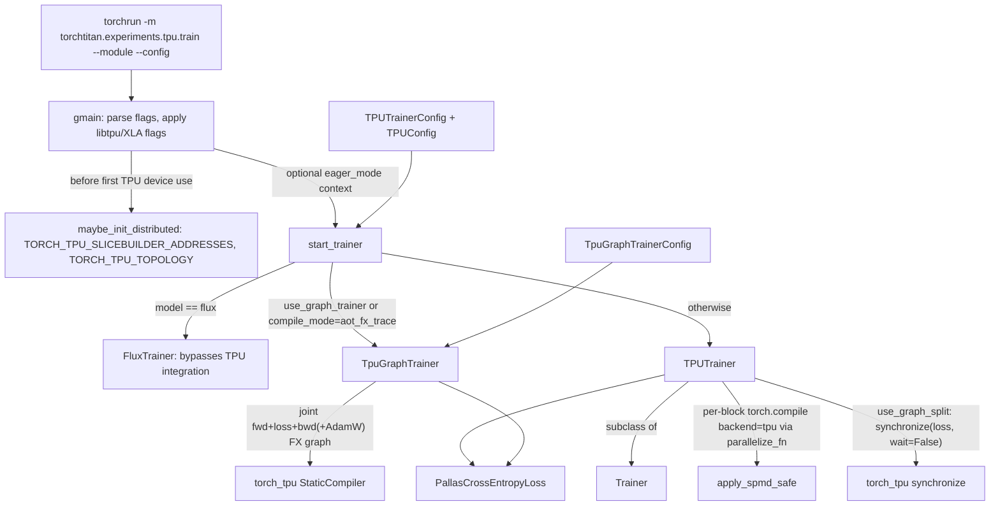
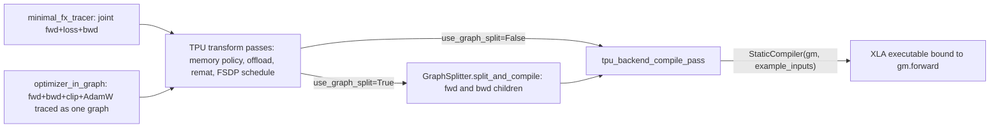

# TorchTPU backend: training TorchTitan on Cloud TPU (experiments/tpu)

## Overview
`torchtitan/experiments/tpu` is the layer that lets an unmodified TorchTitan job config run on Cloud
TPU through the TorchTPU runtime (`torch_tpu`), where the device is `torch.device("tpu")`, the
process-group backend is `tpu_dist`, and every compiled region becomes an XLA program run through
PJRT. The authors' README calls it "a demonstration of running TorchTitan on Google Cloud TPUs using
the TorchTPU framework". It is not a fork of the trainer. It is a set of specializations layered onto
upstream TorchTitan: a config subclass
([`TPUTrainerConfig`](https://github.com/google-pytorch/torchtitan/blob/033f131322a8b5b026ac53d734c689d664442bf8/torchtitan/experiments/tpu/tpu_job_config.py#L308 "torchtitan/experiments/tpu/tpu_job_config#TPUTrainerConfig"))
that carries a [`TPUConfig`](https://github.com/google-pytorch/torchtitan/blob/033f131322a8b5b026ac53d734c689d664442bf8/torchtitan/experiments/tpu/tpu_job_config.py#L62 "torchtitan/experiments/tpu/tpu_job_config#TPUConfig")
knob block, per-model TPU config registries and parallelizers, and **two training lanes** chosen by
[`start_trainer`](https://github.com/google-pytorch/torchtitan/blob/033f131322a8b5b026ac53d734c689d664442bf8/torchtitan/experiments/tpu/train.py#L215 "torchtitan/experiments/tpu/train#start_trainer").
The first lane is [`TPUTrainer`](https://github.com/google-pytorch/torchtitan/blob/033f131322a8b5b026ac53d734c689d664442bf8/torchtitan/experiments/tpu/train.py#L42 "torchtitan/experiments/tpu/train#TPUTrainer"),
the upstream [`Trainer`](https://github.com/google-pytorch/torchtitan/blob/033f131322a8b5b026ac53d734c689d664442bf8/torchtitan/trainer.py#L74 "torchtitan/trainer#Trainer") plus
per-block `torch.compile(backend="tpu")`. The second is
[`TpuGraphTrainer`](https://github.com/google-pytorch/torchtitan/blob/033f131322a8b5b026ac53d734c689d664442bf8/torchtitan/experiments/tpu/graph_trainer/tpu_graph_trainer.py#L90 "torchtitan/experiments/tpu/graph_trainer/tpu_graph_trainer#TpuGraphTrainer"),
which traces forward, loss, backward and optionally AdamW into one FX graph and lowers it with
torch_tpu's `StaticCompiler`. The single design idea behind both lanes is that **on TPU,
performance is decided by how much of the step becomes one XLA program**. Each knob either grows
the compiled region (per-block, then whole-graph, then optimizer-in-graph) or cuts a region that has
grown too large to compile or to fit in HBM (graph split, scan layers, rematerialization, host offload).

## Diagram
Launch and lane selection (one process per TPU device; `torchrun` or `xpk` spawns them):

Legend:
- `RUN` - (concept) the launch command from the README; `xpk workload create` wraps the same `torchrun` line on GKE
- `GM` - (concept) `gmain.handle_main` / `_start_trainer`, the absl entry that `train.py` hands [`start_trainer`](https://github.com/google-pytorch/torchtitan/blob/033f131322a8b5b026ac53d734c689d664442bf8/torchtitan/experiments/tpu/train.py#L215 "torchtitan/experiments/tpu/train#start_trainer") to
- `MID` - [`maybe_init_distributed`](https://github.com/google-pytorch/torchtitan/blob/033f131322a8b5b026ac53d734c689d664442bf8/torchtitan/experiments/tpu/distributed_utils.py#L9 "torchtitan/experiments/tpu/distributed_utils#maybe_init_distributed"), delegating to [`maybe_init_distributed`](https://github.com/google-pytorch/torchtitan/blob/033f131322a8b5b026ac53d734c689d664442bf8/torchtitan/experiments/tpu/cloud_distributed_utils.py#L194 "torchtitan/experiments/tpu/cloud_distributed_utils#maybe_init_distributed") (Cloud/GKE)
- `ST` - [`start_trainer`](https://github.com/google-pytorch/torchtitan/blob/033f131322a8b5b026ac53d734c689d664442bf8/torchtitan/experiments/tpu/train.py#L215 "torchtitan/experiments/tpu/train#start_trainer")
- `CFG` - [`TPUTrainerConfig`](https://github.com/google-pytorch/torchtitan/blob/033f131322a8b5b026ac53d734c689d664442bf8/torchtitan/experiments/tpu/tpu_job_config.py#L308 "torchtitan/experiments/tpu/tpu_job_config#TPUTrainerConfig") with [`tpu_config`](https://github.com/google-pytorch/torchtitan/blob/033f131322a8b5b026ac53d734c689d664442bf8/torchtitan/experiments/tpu/tpu_job_config.py#L309 "torchtitan/experiments/tpu/tpu_job_config#TPUTrainerConfig.tpu_config") of type [`TPUConfig`](https://github.com/google-pytorch/torchtitan/blob/033f131322a8b5b026ac53d734c689d664442bf8/torchtitan/experiments/tpu/tpu_job_config.py#L62 "torchtitan/experiments/tpu/tpu_job_config#TPUConfig")
- `FLUX` - (concept) the upstream Flux trainer, selected by model name
- `GT` - [`TpuGraphTrainer`](https://github.com/google-pytorch/torchtitan/blob/033f131322a8b5b026ac53d734c689d664442bf8/torchtitan/experiments/tpu/graph_trainer/tpu_graph_trainer.py#L90 "torchtitan/experiments/tpu/graph_trainer/tpu_graph_trainer#TpuGraphTrainer")
- `TGC` - [`TpuGraphTrainerConfig`](https://github.com/google-pytorch/torchtitan/blob/033f131322a8b5b026ac53d734c689d664442bf8/torchtitan/experiments/tpu/graph_trainer/tpu_graph_trainer.py#L60 "torchtitan/experiments/tpu/graph_trainer/tpu_graph_trainer#TpuGraphTrainerConfig")
- `TT` - [`TPUTrainer`](https://github.com/google-pytorch/torchtitan/blob/033f131322a8b5b026ac53d734c689d664442bf8/torchtitan/experiments/tpu/train.py#L42 "torchtitan/experiments/tpu/train#TPUTrainer")
- `BASE` - [`Trainer`](https://github.com/google-pytorch/torchtitan/blob/033f131322a8b5b026ac53d734c689d664442bf8/torchtitan/trainer.py#L74 "torchtitan/trainer#Trainer")
- `SPMD` - [`apply_spmd_safe`](https://github.com/google-pytorch/torchtitan/blob/033f131322a8b5b026ac53d734c689d664442bf8/torchtitan/experiments/tpu/spmd_utils.py#L17 "torchtitan/experiments/tpu/spmd_utils#apply_spmd_safe")
- `SYNC` - (concept) `torch_tpu._internal.sync.synchronize`, see [synchronization](../../torch_tpu/concepts/synchronization.md)
- `SC` - (concept) `torch_tpu._internal.compile.compiler.StaticCompiler`, see [compilation-pipeline](../../torch_tpu/concepts/compilation-pipeline.md)
- `LOSS` - [`PallasCrossEntropyLoss`](https://github.com/google-pytorch/torchtitan/blob/033f131322a8b5b026ac53d734c689d664442bf8/torchtitan/experiments/tpu/loss.py#L103 "torchtitan/experiments/tpu/loss#PallasCrossEntropyLoss")

The graph-trainer compile path, per first step (traced once, then replayed):

Legend:
- `TR` - (concept) the upstream GraphTrainer tracer, invoked from [`TpuGraphTrainer`](https://github.com/google-pytorch/torchtitan/blob/033f131322a8b5b026ac53d734c689d664442bf8/torchtitan/experiments/tpu/graph_trainer/tpu_graph_trainer.py#L90 "torchtitan/experiments/tpu/graph_trainer/tpu_graph_trainer#TpuGraphTrainer")
- `TP` - (concept) `construct_tpu_transform_passes` in `graph_trainer/tpu_backend_pass.py`
- `GS` - (concept) `GraphSplitter` in `graph_trainer/graph_split.py`, configured by `TPUConfig.graph_split`
- `CP` - (concept) `tpu_backend_compile_pass`, the terminal pass that calls torch_tpu's `StaticCompiler`
- `EX` - (concept) the compiled PJRT executable
- `OIG` - (concept) the optimizer-in-graph variant of [`TpuGraphTrainer`](https://github.com/google-pytorch/torchtitan/blob/033f131322a8b5b026ac53d734c689d664442bf8/torchtitan/experiments/tpu/graph_trainer/tpu_graph_trainer.py#L90 "torchtitan/experiments/tpu/graph_trainer/tpu_graph_trainer#TpuGraphTrainer")

## Design rationale (why it's built this way)
- **Compile or be dispatch-bound.** The directory's optimization guide
  (`torch-tpu-optimization-guide.md`) puts it plainly: "Run uncompiled and each op becomes its own
  program", and the TPU sits idle between launches. Every lane is a different answer to how big the
  compiled program should be. The `layer` lane compiles each transformer block (fuses within a block,
  keeps activation checkpointing between blocks). The `fullgraph` lane wraps the whole model in one
  `torch.compile(model, fullgraph=True, backend="tpu")`. [`start_trainer`](https://github.com/google-pytorch/torchtitan/blob/033f131322a8b5b026ac53d734c689d664442bf8/torchtitan/experiments/tpu/train.py#L215 "torchtitan/experiments/tpu/train#start_trainer")
  warns that this "does NOT capture the optimizer step". The `aot_fx_trace` lane
  ([`TpuGraphTrainer`](https://github.com/google-pytorch/torchtitan/blob/033f131322a8b5b026ac53d734c689d664442bf8/torchtitan/experiments/tpu/graph_trainer/tpu_graph_trainer.py#L90 "torchtitan/experiments/tpu/graph_trainer/tpu_graph_trainer#TpuGraphTrainer"))
  traces forward, loss and backward jointly, and with `optimizer_in_graph` the AdamW update as well,
  so the whole step is one executable.
- **Subclass, do not fork.** [`TPUTrainer`](https://github.com/google-pytorch/torchtitan/blob/033f131322a8b5b026ac53d734c689d664442bf8/torchtitan/experiments/tpu/train.py#L42 "torchtitan/experiments/tpu/train#TPUTrainer")
  overrides only `__init__`, `_clip_grad_norm` and `forward_backward_step`. Its docstring lists the
  two added behaviors: `use_graph_split` and `compile_grad_norm`. Everything else (data loading,
  checkpointing, metrics, LR schedule) is upstream [`Trainer`](https://github.com/google-pytorch/torchtitan/blob/033f131322a8b5b026ac53d734c689d664442bf8/torchtitan/trainer.py#L74 "torchtitan/trainer#Trainer")
  behavior. [`TpuGraphTrainer`](https://github.com/google-pytorch/torchtitan/blob/033f131322a8b5b026ac53d734c689d664442bf8/torchtitan/experiments/tpu/graph_trainer/tpu_graph_trainer.py#L90 "torchtitan/experiments/tpu/graph_trainer/tpu_graph_trainer#TpuGraphTrainer")
  calls itself a "Branched specialization of GraphTrainer for TPU/PJRT execution". Its nested
  `Config` multiply-inherits the GraphTrainer config and [`TPUTrainerConfig`](https://github.com/google-pytorch/torchtitan/blob/033f131322a8b5b026ac53d734c689d664442bf8/torchtitan/experiments/tpu/tpu_job_config.py#L308 "torchtitan/experiments/tpu/tpu_job_config#TPUTrainerConfig"),
  so one recipe object drives both.
- **Split a monolithic graph to cut compile time and peak memory.** The `TPUTrainer` docstring says
  that inserting `synchronize(loss, wait=False)` between forward+loss and backward "splits the
  monolithic XLA computation graph into two smaller graphs ... significantly reducing first-step XLA
  compilation time". The same docstring notes that torch_tpu's `synchronize` "materializes the forward
  graph without breaking autograd". On the graph-trainer lane, the `GraphSplitterConfig` comments
  explain the finer split: grouping layers into one executable "widens the compiler scheduling
  window without changing activation-checkpoint boundaries".
- **The loss is a kernel because the logits do not fit.** [`pallas_cross_entropy_loss`](https://github.com/google-pytorch/torchtitan/blob/033f131322a8b5b026ac53d734c689d664442bf8/torchtitan/experiments/tpu/loss.py#L18 "torchtitan/experiments/tpu/loss#pallas_cross_entropy_loss")
  computes "sum-reduced linear cross entropy without materializing logits". The LM head no longer
  projects: it returns `(hidden, W^T)`, and one fused Mosaic kernel does projection, softmax and CE
  tile by tile. With vocabularies of 128K to 150K the `[B, S, V]` logits tensor is often the largest
  activation in the step.
- **Refuse rather than silently degrade.** Several validators turn silent performance or memory
  cliffs into errors. [`pallas_cross_entropy_loss`](https://github.com/google-pytorch/torchtitan/blob/033f131322a8b5b026ac53d734c689d664442bf8/torchtitan/experiments/tpu/loss.py#L18 "torchtitan/experiments/tpu/loss#pallas_cross_entropy_loss")
  refuses a token count that is not a multiple of `b_block_size` ("an accidental XLA fallback changes
  the memory and performance contract"). [`TPUTrainerConfig`](https://github.com/google-pytorch/torchtitan/blob/033f131322a8b5b026ac53d734c689d664442bf8/torchtitan/experiments/tpu/tpu_job_config.py#L308 "torchtitan/experiments/tpu/tpu_job_config#TPUTrainerConfig")
  refuses `use_scan_layers` outside the graph trainer ("Anywhere else the flag would be accepted and
  then do nothing"). The graph-trainer config conversion refuses ZeRO-3 without a lifetime boundary,
  because "XLA can merge forward and recomputed all-gathers and retain full parameters through backward".
- **Launch-time state lives in the environment, and it must be set before PJRT starts.** libtpu reads
  `LIBTPU_INIT_ARGS`/`XLA_FLAGS`, and torch_tpu reads `TORCH_TPU_SLICEBUILDER_ADDRESSES`/`TORCH_TPU_TOPOLOGY`,
  when the PJRT client is created. So the backend renders config-owned flags and topology into
  `os.environ` in each worker before the first TPU tensor exists. The README makes the flags "citizens
  of the TorchTitan training configuration instead of them being documented only at the launcher level".

## Entry points
- [`start_trainer`](https://github.com/google-pytorch/torchtitan/blob/033f131322a8b5b026ac53d734c689d664442bf8/torchtitan/experiments/tpu/train.py#L215 "torchtitan/experiments/tpu/train#start_trainer")
  in `train.py` is the production entry: `python -m torchtitan.experiments.tpu.train --module=<pkg> --config=<fn>`
  under `torchrun`. `train.py` imports the TPU model packages (`deepseek_v3`,
  `flux`, `llama3`, `muse_glimmer` and `qwen3`) so their config registries register (`conformer` and `mamba2` are not
  among them), then hands `start_trainer` to `gmain.handle_main`, which parses the absl flags and the TorchTitan
  CLI, applies TPU init flags, bootstraps topology and optionally enters an eager-mode context before
  calling it.
- The `start_trainer` functions in the minimal trainers are standalone, hand-written loops that bypass
  [`Trainer`](https://github.com/google-pytorch/torchtitan/blob/033f131322a8b5b026ac53d734c689d664442bf8/torchtitan/trainer.py#L74 "torchtitan/trainer#Trainer") entirely. They
  build the model on `meta` and call the model's `parallelize_fn`; the Conformer one also
  drives `torch_tpu._internal.sync` directly (the generic one does not). They exist for Conformer and for tests:
  [`start_trainer`](https://github.com/google-pytorch/torchtitan/blob/033f131322a8b5b026ac53d734c689d664442bf8/torchtitan/experiments/tpu/conformer/train_minimal.py#L144 "torchtitan/experiments/tpu/conformer/train_minimal#start_trainer")
  (Conformer) and the generic [`start_trainer`](https://github.com/google-pytorch/torchtitan/blob/033f131322a8b5b026ac53d734c689d664442bf8/torchtitan/experiments/tpu/train_minimal.py#L466 "torchtitan/experiments/tpu/train_minimal#start_trainer").
  The last one takes a plain upstream `JobConfig` and on TPU downgrades a `fused` optimizer to
  `foreach`.
- [`run_distributed`](https://github.com/google-pytorch/torchtitan/blob/033f131322a8b5b026ac53d734c689d664442bf8/torchtitan/experiments/tpu/distributed.py#L120 "torchtitan/experiments/tpu/distributed#run_distributed")
  is the programmatic launcher used by the TPU test suites (for example the DeepSeek-V3
  TP-equivalence tests). It runs `func(device, rank, world_size, *args)` inline for one
  device, or spawns workers through `gdist.torchrun` for more. The device is selected by
  [`AcceleratorDeviceType`](https://github.com/google-pytorch/torchtitan/blob/033f131322a8b5b026ac53d734c689d664442bf8/torchtitan/experiments/tpu/accelerator_device_type.py#L10 "torchtitan/experiments/tpu/accelerator_device_type#AcceleratorDeviceType")
  (`TPU`, `CUDA`, `CPU`), so the same test can run on TPU and on a CPU/GPU reference.
- Config registry functions are what `--config=` names. Examples:
  [`llama3_1b`](https://github.com/google-pytorch/torchtitan/blob/033f131322a8b5b026ac53d734c689d664442bf8/torchtitan/experiments/tpu/llama3/config_registry.py#L139 "torchtitan/experiments/tpu/llama3/config_registry#llama3_1b"),
  [`llama3_8b`](https://github.com/google-pytorch/torchtitan/blob/033f131322a8b5b026ac53d734c689d664442bf8/torchtitan/experiments/tpu/llama3/config_registry.py#L178 "torchtitan/experiments/tpu/llama3/config_registry#llama3_8b"),
  [`qwen3_8b`](https://github.com/google-pytorch/torchtitan/blob/033f131322a8b5b026ac53d734c689d664442bf8/torchtitan/experiments/tpu/qwen3/config_registry.py#L375 "torchtitan/experiments/tpu/qwen3/config_registry#qwen3_8b"),
  [`qwen3_moe_30b`](https://github.com/google-pytorch/torchtitan/blob/033f131322a8b5b026ac53d734c689d664442bf8/torchtitan/experiments/tpu/qwen3/config_registry.py#L557 "torchtitan/experiments/tpu/qwen3/config_registry#qwen3_moe_30b").
  Each returns a fully populated [`TPUTrainerConfig`](https://github.com/google-pytorch/torchtitan/blob/033f131322a8b5b026ac53d734c689d664442bf8/torchtitan/experiments/tpu/tpu_job_config.py#L308 "torchtitan/experiments/tpu/tpu_job_config#TPUTrainerConfig")
  whose `model_spec.parallelize_fn` is replaced by the TPU parallelizer for that model. The newest
  model package is Muse Glimmer: [`_muse_glimmer_30b_base`](https://github.com/google-pytorch/torchtitan/blob/033f131322a8b5b026ac53d734c689d664442bf8/torchtitan/experiments/tpu/muse_glimmer/config_registry.py#L128 "torchtitan/experiments/tpu/muse_glimmer/config_registry#_muse_glimmer_30b_base")
  holds the "Model, data, optimizer and kernels shared by every 30B recipe" (context 16384,
  SimpleFSDP on the topology-aware mesh, JAX Splash with a sliding-window `LocalMask` for the local
  layers), and the recipes on top pick the trainer and optionally the fused loss.
- The HuggingFace transformers modeling backend has its own TPU registry: `--module=torchtitan.experiments.tpu.transformers_modeling_backend`
  resolves recipes built by [`_tpu_hf_config`](https://github.com/google-pytorch/torchtitan/blob/033f131322a8b5b026ac53d734c689d664442bf8/torchtitan/experiments/tpu/transformers_modeling_backend/config_registry.py#L183 "torchtitan/experiments/tpu/transformers_modeling_backend/config_registry#_tpu_hf_config").
  Its module docstring says these are "the GPU registry's configs with three things changed: the
  config type (so the TPU entry point accepts it), the parallelize function (SimpleFSDP instead of
  FSDP2), and `attn_implementation` (sdpa rather than flex, which has no TPU path)". `attn="splash_tpu"`
  routes any architecture's attention through the TPU Splash kernel via HF's `AttentionInterface`,
  and `fused_loss=True` selects the Pallas loss. It runs through the same `train.py` entry; it has no
  graph-trainer registry, so it uses the `TPUTrainer` lane.

## Mechanism (step-by-step)
1. **Flags and topology are rendered before any TPU device exists.** `gmain._start_trainer` does
   this only when TorchTitan detected `tpu` as the device type (on other devices it goes straight to
   the trainer). It first calls `tpu_flags.apply_init_flags`
   to export the config's `libtpu_init_flags`/`xla_flags` (fields on the base TPU config, with
   `extra_*` additive overrides and the process environment having the final say, per the README).
   It then calls [`maybe_init_distributed`](https://github.com/google-pytorch/torchtitan/blob/033f131322a8b5b026ac53d734c689d664442bf8/torchtitan/experiments/tpu/distributed_utils.py#L9 "torchtitan/experiments/tpu/distributed_utils#maybe_init_distributed").
   That function is a no-op for one device or when `TORCH_TPU_SLICEBUILDER_ADDRESSES` is already set
   (a host-level launcher set it before spawning). Otherwise it delegates to the Cloud version
   [`maybe_init_distributed`](https://github.com/google-pytorch/torchtitan/blob/033f131322a8b5b026ac53d734c689d664442bf8/torchtitan/experiments/tpu/cloud_distributed_utils.py#L194 "torchtitan/experiments/tpu/cloud_distributed_utils#maybe_init_distributed"),
   which tries GKE first and then a single-host TPU VM. Both rewrite the libtpu environment into a
   **one-device-per-process** topology: `TPU_CHIPS_PER_HOST_BOUNDS` becomes all ones,
   `TPU_VISIBLE_CHIPS=LOCAL_RANK`, and each process gets a port from 10000 upward. On GKE,
   `TPU_HOST_BOUNDS` is multiplied by the old per-host chip bounds; the single-host TPU VM path instead
   looks `TPU_HOST_BOUNDS` up in a fixed per-chip-type table. The resulting `host:port` list is
   exported as both `TPU_PROCESS_ADDRESSES` and `TORCH_TPU_SLICEBUILDER_ADDRESSES`, with
   `TORCH_TPU_TOPOLOGY` set to the host bounds. For TPU7x the bounds gain a fourth dimension: on GKE
   (`TPU_ACCELERATOR_TYPE` starting with `tpu7x`) the device count per host is doubled and a trailing
   `,2` bound is appended, and the TPU VM table uses four-element 7x entries (8 devices -> `2,2,1,2`). An Ironwood chip exposes two TensorCores and TorchTitan
   runs one process per core (the `tpu7x-2x2x2` recipe README: "`tpu7x-16` is therefore 16 devices on
   8 chips").

2. **Optional eager-mode context.** If [`TPUConfig`](https://github.com/google-pytorch/torchtitan/blob/033f131322a8b5b026ac53d734c689d664442bf8/torchtitan/experiments/tpu/tpu_job_config.py#L62 "torchtitan/experiments/tpu/tpu_job_config#TPUConfig")
   `eager_mode` is set (`DEFER_AND_FUSE`, `INTERNAL_DEFER_ALL`, `DEFER_NEVER`,
   `DEFER_NEVER_AND_LAUNCH_BLOCKING`), the whole run executes inside
   `torch_tpu._internal.execution_mode.set_eager_mode(...)`. Most dense recipes, including
   [`llama3_8b`](https://github.com/google-pytorch/torchtitan/blob/033f131322a8b5b026ac53d734c689d664442bf8/torchtitan/experiments/tpu/llama3/config_registry.py#L178 "torchtitan/experiments/tpu/llama3/config_registry#llama3_8b")
   and [`qwen3_1_7b`](https://github.com/google-pytorch/torchtitan/blob/033f131322a8b5b026ac53d734c689d664442bf8/torchtitan/experiments/tpu/qwen3/config_registry.py#L215 "torchtitan/experiments/tpu/qwen3/config_registry#qwen3_1_7b"),
   set `DEFER_AND_FUSE`. Under it, the eager glue between compiled blocks (embedding, loss, optimizer)
   is deferred and fused by torch_tpu instead of dispatched op by op (see the torch_tpu page on
   [deferred execution](../../torch_tpu/concepts/deferred-execution-and-materialization.md)).

3. **Lane selection.** [`start_trainer`](https://github.com/google-pytorch/torchtitan/blob/033f131322a8b5b026ac53d734c689d664442bf8/torchtitan/experiments/tpu/train.py#L215 "torchtitan/experiments/tpu/train#start_trainer")
   reads the model name from [`model_spec`](https://github.com/google-pytorch/torchtitan/blob/033f131322a8b5b026ac53d734c689d664442bf8/torchtitan/trainer.py#L83 "torchtitan/trainer#Trainer.Config.model_spec")
   and the [`tpu_config`](https://github.com/google-pytorch/torchtitan/blob/033f131322a8b5b026ac53d734c689d664442bf8/torchtitan/experiments/tpu/tpu_job_config.py#L309 "torchtitan/experiments/tpu/tpu_job_config#TPUTrainerConfig.tpu_config")
   switches, and chooses one of three lanes. Flux goes to the upstream Flux trainer, which
   "bypasses the TPU integration" (and rejects `compile_grad_norm`). `use_graph_trainer=True` or
   `compile_mode="aot_fx_trace"` selects
   [`TpuGraphTrainer`](https://github.com/google-pytorch/torchtitan/blob/033f131322a8b5b026ac53d734c689d664442bf8/torchtitan/experiments/tpu/graph_trainer/tpu_graph_trainer.py#L90 "torchtitan/experiments/tpu/graph_trainer/tpu_graph_trainer#TpuGraphTrainer"),
   but only `qwen3`, `llama3`, `deepseek_v3` and `muse_glimmer` have graph-trainer model registries
   (the Muse Glimmer one is TPU-side, `graph_trainer/muse_glimmer.py`, SimpleFSDP/HSDP only); any other
   model raises. For that lane the recipe is converted with `to_tpu_graph_trainer_config`. When
   `bld_block_layout` is on (the default), the converted `parallelize_fn` is wrapped so the `[B, L]`
   block layout is applied before parallelization: the source comment says the graph trainer's
   parallelizer binds instance-level forward wrappers "after which a class swap no longer takes
   effect". A
   [`TpuGraphTrainerConfig`](https://github.com/google-pytorch/torchtitan/blob/033f131322a8b5b026ac53d734c689d664442bf8/torchtitan/experiments/tpu/graph_trainer/tpu_graph_trainer.py#L60 "torchtitan/experiments/tpu/graph_trainer/tpu_graph_trainer#TpuGraphTrainerConfig")
   ("Subset of job/TPU config carried forward into TpuGraphTrainer") collects the attention
   backend (`splash` versus `sdpa-no-scale`), MoE dispatcher settings, EP degree, the optimizer
   compile flags and the MFU-benchmark window. Everything else runs on
   [`TPUTrainer`](https://github.com/google-pytorch/torchtitan/blob/033f131322a8b5b026ac53d734c689d664442bf8/torchtitan/experiments/tpu/train.py#L42 "torchtitan/experiments/tpu/train#TPUTrainer"),
   with warnings when `fullgraph` or `optimizer_in_graph` is requested there, because this lane
   cannot put the optimizer in the graph. Setting `use_graph_trainer` with a non-fullgraph compile
   mode triggers a warning about "severe HBM fragmentation and stack reservation OOMs".

4. **Pre-construction hardening.** Before building the trainer,
   [`start_trainer`](https://github.com/google-pytorch/torchtitan/blob/033f131322a8b5b026ac53d734c689d664442bf8/torchtitan/experiments/tpu/train.py#L215 "torchtitan/experiments/tpu/train#start_trainer")
   raises Dynamo's recompile limits for the model and, for every model but Flux, shrinks each RoPE
   cache to [`max_context_length`](https://github.com/google-pytorch/torchtitan/blob/033f131322a8b5b026ac53d734c689d664442bf8/torchtitan/config/configs.py#L51 "torchtitan/config/configs#TrainingConfig.max_context_length")
   (on both the recipe and the converted graph-trainer config). The helper's docstring explains why:
   upstream stopped resizing RoPE in `update_from_config`, so caches were built for the flavor's full
   context ("131072 for llama3"), "which ran llama3-70b on tpu7x-2x2x4 out of program HBM". It then
   runs `dist.barrier()`. The source comment explains that rank 0's device-setup graph can compile
   faster, race into an XLA all-reduce while other ranks are still compiling their broadcast graph,
   and deadlock. It also forces `debug.seed=42` when unset (a hang workaround), and wraps
   `model_spec.parallelize_fn` so that `workarounds.apply_patches` runs first. For `llama3`, `muse_glimmer`
   and `qwen3` on the TPUTrainer lane the wrapper forwards `tpu_compile_mode`. After construction it checks that scan layers were really applied when
   `use_scan_layers` is set. `create_seed_checkpoint` requires `WORLD_SIZE == 1`. `trainer.train()`
   runs inside an "unflatten" context that publishes `max_context_length` as the sequence length:
   upstream folded the `[B, L]` token dims into one `T` dim (and renamed `training.seq_len` to
   `training.max_context_length`), and the TPU-side code that needs `L` back, such as the `[B, L]`
   block layout, reads it from there.

5. **TPUTrainer lane: per-block compile.** In the `layer` compile mode the TPU
   parallelizer calls [`apply_spmd_safe`](https://github.com/google-pytorch/torchtitan/blob/033f131322a8b5b026ac53d734c689d664442bf8/torchtitan/experiments/tpu/spmd_utils.py#L17 "torchtitan/experiments/tpu/spmd_utils#apply_spmd_safe")
   on every transformer block, which wraps the block's `forward` in torch_tpu's
   `spmd_safe`, now read from the public `torch.tpu.distributed.spmd_safe` rather than a private
   `torch_tpu._internal` module. If that attribute is missing, an identity decorator is used
   instead and a warning says compiled modules "will fall back to skinny collective behavior". The
   parallelizer then delegates to the upstream parallelizer, whose `apply_compile` compiles each block
   with the configured backend; TPU recipes set `CompileConfig(backend="tpu")` (see
   [torch-compile-integration](torch-compile-integration.md)). In `fullgraph` mode per-block compile
   is switched off and the whole model is wrapped in a single `torch.compile(..., fullgraph=True,
   backend="tpu")` after an `apply_spmd_safe` on the root.

6. **TPUTrainer: targeted graph work around the compiled blocks.**
   [`TPUTrainer`](https://github.com/google-pytorch/torchtitan/blob/033f131322a8b5b026ac53d734c689d664442bf8/torchtitan/experiments/tpu/train.py#L42 "torchtitan/experiments/tpu/train#TPUTrainer")
   rebuilds the loss with `build_cross_entropy_loss` (step 10). `compile_grad_norm` routes clipping
   through a `CompiledGradNorm` static graph, while the in-place clip stays eager.
   `compile_optimizer` replaces the trainer's `OptimizersContainer.step` so AdamW runs as a
   `StaticCompiler` executable per param group; the module docstring says this eliminates "300+ host
   dispatch roundtrips per step". It supports only `torch.optim.AdamW` (anything else raises
   `TypeError`), and when a group has a `None` grad it falls back to the inner optimizer's eager
   `step()`, which updates all of that optimizer's groups. With `use_graph_split` (and PP off), the inputs are built by the
   model's own `preprocess_inputs` (labels now travel inside `input_dict`, as upstream changed), the
   forward and loss run, then `synchronize(loss, wait=False)` cuts the deferred graph before
   `loss.backward()`.

7. **TpuGraphTrainer construction.** [`TpuGraphTrainer`](https://github.com/google-pytorch/torchtitan/blob/033f131322a8b5b026ac53d734c689d664442bf8/torchtitan/experiments/tpu/graph_trainer/tpu_graph_trainer.py#L90 "torchtitan/experiments/tpu/graph_trainer/tpu_graph_trainer#TpuGraphTrainer")
   rejects `ChunkedLossWrapper` ("FX unrolls its loop and defeats bounded-memory execution") and
   registers the `"tpu"` pass pipeline before the base GraphTrainer builds anything. It also splits
   optimizer param groups by DTensor mesh, since EP experts and dense params live on different meshes,
   and rebuilds LR schedulers if it did. It sets `capturable=True` on every group, applies TPU MoE
   workarounds, and builds a `GraphSplitter` from `TPUConfig.graph_split`. When the optimizer is
   compiled but not in-graph, it installs the same separate AdamW graph as in step 6.

8. **Trace once, transform, compile, replay.** On the first step,
   [`TpuGraphTrainer`](https://github.com/google-pytorch/torchtitan/blob/033f131322a8b5b026ac53d734c689d664442bf8/torchtitan/experiments/tpu/graph_trainer/tpu_graph_trainer.py#L90 "torchtitan/experiments/tpu/graph_trainer/tpu_graph_trainer#TpuGraphTrainer")
   traces the joint forward+loss+backward function with the upstream FX tracer, or loads a
   precompiled artifact. The TPU transform passes then run on the whole joint graph in a fixed order: (a) tag with the memory
   policy (`graph_trainer_memory_policy`: `default` SAC, `full` recompute, or the TPU-only
   `full_and_offload`/`full_and_scan_offload`/`tpu_selective`; the last is "Full recompute, except the
   configured save regions", `moe.routing` and `attention.inner_attention`, each saved in every layer
   or only in its last N layers, "which backward reaches first"); (b) insert CPU offload; (c) selective
   rematerialization; (d) optionally the TPU remat schedule and the FSDP all-gather
   prefetch/interleave schedule; (e) combine barriers; (f) with an FSDP schedule, moving FSDP
   communication into dense regions (plus a reduce-scatter deadline schedule for `interleave`);
   (g) optionally the selected-parameter "reduce-scatter as all-reduce plus slice" rewrite. Without graph split, the terminal pass hands the graph to torch_tpu's `StaticCompiler` and rebinds
   `gm.forward` to the executable. Its log line reads "PJRT compile finishes lazily on first execute".
   With graph split, the graph is cut into forward and backward children, and optionally per-layer
   children. Each child is compiled separately, and forward outputs are enqueued with
   `synchronize(..., wait=False)` before backward runs. Later steps only replay the executable and
   copy gradients into `param.grad`.

9. **Optimizer in graph: one executable per step.** With `optimizer_in_graph=True`, the first call
   registers persistent buffers `_optstate_<leaf>_exp_avg` and `_optstate_<leaf>_exp_avg_sq` next to
   every trainable parameter, plus a scalar `_optstate_step` and a non-persistent `_optstate_lr`. It
   then traces forward, loss, parameter gradients, global-norm clipping and a functional AdamW update
   into one FX graph, lowered through the same `"tpu"` pipeline. Each step fills `_optstate_lr` from
   the scheduler, runs the executable, and copies the new params, moments and step back. Changing
   the learning rate therefore needs no retrace (it is a buffer), but betas, eps, weight decay and
   `max_norm` are baked in as trace-time constants. [`qwen3_8b`](https://github.com/google-pytorch/torchtitan/blob/033f131322a8b5b026ac53d734c689d664442bf8/torchtitan/experiments/tpu/qwen3/config_registry.py#L375 "torchtitan/experiments/tpu/qwen3/config_registry#qwen3_8b")
   is the reference recipe for this configuration (`use_graph_trainer`, `aot_fx_trace`,
   `compile_optimizer`, `optimizer_in_graph`).

10. **The Pallas fused loss.** The recipe helper selects
   [`PallasCrossEntropyLoss`](https://github.com/google-pytorch/torchtitan/blob/033f131322a8b5b026ac53d734c689d664442bf8/torchtitan/experiments/tpu/loss.py#L103 "torchtitan/experiments/tpu/loss#PallasCrossEntropyLoss")
   and appends the `overrides/fused_loss` config override, so the LM head becomes a module that
   returns `(hidden_states, weight.T)` while keeping the same weight, sharding and checkpoint key.
   [`pallas_cross_entropy_loss`](https://github.com/google-pytorch/torchtitan/blob/033f131322a8b5b026ac53d734c689d664442bf8/torchtitan/experiments/tpu/loss.py#L18 "torchtitan/experiments/tpu/loss#pallas_cross_entropy_loss")
   flattens to `[tokens, hidden]`, validates shapes and tiles, and handles `IGNORE_INDEX` without
   changing the token count. Ignored rows get zeroed hidden states and label 0. Each such row then
   contributes exactly `log(vocab)` with zero gradient, and that amount is subtracted from the sum.
   The kernel wrapper (`kernels/linear_softmax_cross_entropy_loss.py`) compiles tokamax's Mosaic TPU
   forward and backward through `torch_tpu._internal.pallas.custom_jax_kernel`. It registers them as
   `torch.library` custom ops named `pallas::linear_loss_{fwd,bwd}_<hash of config>` with fake
   implementations, so both Dynamo and the FX tracer see opaque ops, and it casts gradients back to
   the input dtype. `BaseLoss` then divides by global valid tokens. `implementation="xla"` swaps in
   tokamax's reference math for debugging. For a soft-capped LM head (Muse Glimmer's
   `SoftCappedLinear`), the loss config's `soft_cap` and `output_multiplier` re-apply
   `logits = cap * tanh(z * mul / cap)` inside the kernel: the override only hands over
   `(hidden, weight.T)`, so recipes copy both values from `model_spec.model.lm_head`. The ignored-row
   trick still holds, since zero hidden states give all-zero logits under either transform.

11. **Observability hooks.** When `use_jax_profiler` is set, `profiler_workaround` (monkey-patched
    onto TorchTitan's profiler at import time) swaps the torch profiler for
    [`JaxProfiler`](https://github.com/google-pytorch/torchtitan/blob/033f131322a8b5b026ac53d734c689d664442bf8/torchtitan/experiments/tpu/jax_profiler.py#L14 "torchtitan/experiments/tpu/jax_profiler#JaxProfiler").
    This profiler runs `jax.profiler.start_trace` on rank 0 only, into
    `<save_traces_folder>/iteration_<n>/rank_<r>`, on the upstream `profile_freq`/warmup/active
    cycle. The JAX lane has its own [`JaxProfiler`](https://github.com/google-pytorch/torchtitan/blob/033f131322a8b5b026ac53d734c689d664442bf8/torchtitan/experiments/jax/jax_profiling.py#L52 "torchtitan/experiments/jax/jax_profiling#maybe_enable_profiling.JaxProfiler").
    The Conformer minimal trainer calls [`wrap_model`](https://github.com/google-pytorch/torchtitan/blob/033f131322a8b5b026ac53d734c689d664442bf8/torchtitan/experiments/tpu/model_annotator.py#L7 "torchtitan/experiments/tpu/model_annotator#wrap_model")
    only when compile is off and profiling is on. It hangs `jax.profiler.TraceAnnotation` scopes on
    every module's forward and backward hooks, which would otherwise break graph capture.
    Numerical parity tests record per-step loss, grads and params on one device and replay them
    against another through
    [`StateValidatorCallback`](https://github.com/google-pytorch/torchtitan/blob/033f131322a8b5b026ac53d734c689d664442bf8/torchtitan/experiments/tpu/numerical_validation.py#L85 "torchtitan/experiments/tpu/numerical_validation#StateValidatorCallback").
    Used as a context manager, it collects every tolerance violation and raises them together on exit.
    The recorder side now also stores `positions`, because "Packed streams carry document boundaries
    only in positions; a replay without them reads the whole stream as one sequence".

## Key data structures
- [`TPUTrainerConfig`](https://github.com/google-pytorch/torchtitan/blob/033f131322a8b5b026ac53d734c689d664442bf8/torchtitan/experiments/tpu/tpu_job_config.py#L308 "torchtitan/experiments/tpu/tpu_job_config#TPUTrainerConfig")
  (`kw_only`, `slots`) extends a shared base TPU config, which is itself an upstream `Trainer.Config`.
  The base carries lane-agnostic blocks: `xla_flags`, `libtpu_init_flags` and their `extra_*` forms;
  `splash_attention_kernel` block sizes and layouts; `loss_kernel` (legacy Pallas loss switch and tiles);
  `lora`; and per-model blocks (for example `conformer`, `qwen3`, `flux`). The subclass adds
  [`tpu_config`](https://github.com/google-pytorch/torchtitan/blob/033f131322a8b5b026ac53d734c689d664442bf8/torchtitan/experiments/tpu/tpu_job_config.py#L309 "torchtitan/experiments/tpu/tpu_job_config#TPUTrainerConfig.tpu_config").
  The JAX and torchax lanes derive their configs from it with `derive_from`. The base
  `__post_init__` now sets `training.disable_cuda_graphs = True` before calling upstream's: upstream
  validates CUDA-graph capturability there and "rejects any MoE token dispatcher it does not
  recognize -- which is all of the TPU ones".
- [`TPUConfig`](https://github.com/google-pytorch/torchtitan/blob/033f131322a8b5b026ac53d734c689d664442bf8/torchtitan/experiments/tpu/tpu_job_config.py#L62 "torchtitan/experiments/tpu/tpu_job_config#TPUConfig")
  holds the torch_tpu runtime knobs (CLI prefix `--tpu-config.`):

  | Knob | Default | Effect |
  |---|---|---|
  | `compile_mode` | `layer` | `layer` = per-block compile, `fullgraph` = one `torch.compile` over the model, `aot_fx_trace` = graph trainer. |
  | `use_graph_trainer` | False | select `TpuGraphTrainer` (joint fwd+loss+bwd trace) |
  | `optimizer_in_graph` | False | fuse AdamW into the joint graph (graph trainer only) |
  | `compile_optimizer` | False | AdamW as its own static XLA graph |
  | `compile_grad_norm` | False | global grad norm as a static graph; needs EP=1, PP=1, not with `optimizer_in_graph` |
  | `use_graph_split` / `graph_split` | False / defaults | split fwd from bwd; `GraphSplitterConfig` adds `forward_layers_per_executable`, `backward_partition_mode` (`none`, `by_layer`, `fsdp_pipeline`), `backward_layers_per_executable`, `donate_internal_buffers`, `cpu_offload_prefetch_executables` |
  | `use_scan_layers` | False | stack layer weights and run decoder layers as one scan; graph trainer only; changes optimizer-state names |
  | `graph_trainer_memory_policy` | `default` | SAC / `full` / `full_and_offload` / `full_and_scan_offload` / `tpu_selective` |
  | `graph_trainer_cpu_offload_budget_gb` | 100.0 | host offload budget |
  | `graph_trainer_save_regions`, `graph_trainer_save_last_n_layers` | (), {} | `tpu_selective` only: regions saved in every layer, or only in their last N layers (each region in one of the two) |
  | `bld_block_layout` | True | run dense Llama3/Qwen3 blocks on `[B, L, ...]` views instead of folded `[T, ...]` tensors, which "make XLA pick slow TPU layouts"; skipped under CP or TP |
  | `enable_graph_trainer_remat_schedule`, `graph_trainer_fsdp_schedule`, `graph_trainer_fsdp_prefetch_distance` | False, `none`, 1 | keep remat workspaces local; order recomputed FSDP all-gathers (`prefetch`) and fence them on reduce-scatters (`interleave`) |
  | `fsdp_allreduce_slice_parameter_patterns`, `fsdp_allreduce_slice_max_input_bytes` | (), 0 | lower selected FSDP grad reduce-scatters as all-reduce plus slice (latency workaround) |
  | `eager_mode` | "" | torch_tpu execution mode for the whole run |
  | `use_jax_profiler`, `enable_mfu_benchmark`, `enable_amp`, `use_simple_fsdp`, `apply_rope_complex_workaround` | | profiling, MFU window, AMP off switch, legacy toggles |

- [`TpuGraphTrainerConfig`](https://github.com/google-pytorch/torchtitan/blob/033f131322a8b5b026ac53d734c689d664442bf8/torchtitan/experiments/tpu/graph_trainer/tpu_graph_trainer.py#L60 "torchtitan/experiments/tpu/graph_trainer/tpu_graph_trainer#TpuGraphTrainerConfig")
  is a plain side-band dataclass, separate from the graph trainer's own `Config`. It carries what the
  GraphTrainer config conversion does not: `attention_backend`, `moe_*`, `ep_degree`,
  `optimizer_in_graph`, `optimizer_compile`, `compile_mode`, the MFU window and a back-reference
  `job_config`.
- Optimizer-in-graph state is ordinary module buffers (`_optstate_*`), not `optimizer.state`. The
  moments are `persistent=True` and live in the model state dict; `_optstate_lr` is non-persistent.
- The recipes tree `experiments/tpu/recipes/` has one directory per hardware generation, then model,
  then topology: `ironwood/` for TPU7x (for example `qwen3-8b/tpu7x-2x2x2`, `llama3-70b/tpu7x-64`,
  `qwen3-30b-a3b/tpu7x-4x4x4`) and `trillium/` for v6e (for example `llama3-8b/v6e-8`,
  `llama3-8b/v6e-256`, `qwen3-8b/v6e-256`). Each holds a README with the `xpk` command and the tuned
  flags. They are ingested separately as docs and are not transcribed here.

## Dynamics (design intent)
- **First step is compile time.** Both lanes pay XLA compilation on step 1: per block and per eager
  segment on the TPUTrainer lane, and once for the whole joint graph on the graph lane (lazily, at
  first execute). Graph split trades one huge compile for several smaller ones. torch_tpu's
  compilation caches still apply to every child executable, per the `TPUConfig.use_graph_split`
  comment.
- **Asynchrony is preserved at the cut points.** Every `synchronize` call in this directory uses
  `wait=False`. It enqueues the forward executable so the backward graph starts a new program,
  without blocking the host. Loss values are only pulled to host (`.item()`) on metric log steps; the
  minimal trainers and the optimizer-in-graph loop skip the device-to-host copy otherwise.
- **Collective ordering is a correctness concern.** The pre-construction barrier (step 4) and the
  graph splitter's rule that all forward children are enqueued before backward collectives both
  prevent ranks from entering different XLA collectives in different orders, which deadlocks.
- **Overlap is a pass, not a runtime scheduler.** Compute/communication overlap for FSDP comes from
  graph passes that place all-gathers and reduce-scatters (`graph_trainer_fsdp_schedule`,
  `backward_partition_mode="fsdp_pipeline"`) and from libtpu flags such as the latency-hiding
  scheduler and SparseCore collective offload set by the Ironwood recipes. The scan recipes (Llama3
  `*_scan` and Qwen3-235B scan) add `tpu_flags.ICI_AG_PIPELINING`, which starts "each layer's FSDP
  weight all-gather one scan iteration early" at the cost of HBM for the prefetched next-layer
  weights.

> [!inferred]
> The overall ladder a customer walks appears to be:
> 1. `layer` compile with `DEFER_AND_FUSE` (the dense Llama recipes on v6e);
> 2. add graph split and a compiled grad norm (`reg_trainer_qwen3_8b`);
> 3. move to the graph trainer with optimizer-in-graph (`qwen3_8b`);
> 4. add scan layers and host offload once the model is too large to compile layer by layer.
>
> The Llama recipe helper `_on_scan_lane` says offload "is not optional above 8B" and that 405B
> "does not compile" layerwise.

## Edge cases
- **Token count and `b_block_size`.** With the Mosaic loss, the microbatch token count (now
  [`num_tokens_per_microbatch_per_dp_rank`](https://github.com/google-pytorch/torchtitan/blob/033f131322a8b5b026ac53d734c689d664442bf8/torchtitan/config/configs.py#L37 "torchtitan/config/configs#TrainingConfig.num_tokens_per_microbatch_per_dp_rank"),
  which upstream substituted for `local_batch_size * seq_len`) must be a
  multiple of `b_block_size` (default 1024), or the run raises. The directory's optimization guide
  still says the kernel "silently falls back to XLA"; the code now refuses instead.
- **Scan-lane restrictions.** `use_scan_layers` requires the graph trainer. It rejects EP > 1 and the
  generic `*_and_offload` memory policies (use `full_and_scan_offload`) and `tpu_selective` ("A scan
  node stands for the whole layer loop and is always saved", so the save regions are invisible to the
  policy). MoE is no longer excluded: `qwen3_moe_235b_scan` scans all 94 layers of the 235B-A22B
  model with ZeRO-3 and scan offload. Flipping it breaks optimizer
  checkpoint resume because parameter names change, although model checkpoints keep per-layer keys.
- **GraphTrainer ZeRO-3.** `fsdp_reshard_after_forward="always"` needs `use_graph_split`,
  `use_scan_layers` or an FSDP schedule. Graph split in turn is incompatible with
  `graph_trainer_fsdp_schedule`, with `optimizer_in_graph` and with precompiled FX artifacts.
  Internal-buffer donation stays off until torch_tpu keys its compilation cache on donation.
- **Model coverage.** The graph trainer supports only `llama3`, `qwen3`, `deepseek_v3` and
  `muse_glimmer`; its Muse Glimmer path has no TP (the module docstring says TP forward currently
  hangs on TPU).
  Optimizer-in-graph supports exactly one model part (no PP) and uses param-group 0's AdamW
  hyperparameters for every parameter. TPUTrainer graph split is skipped under PP and asserts a
  single model part.
- **Topology bootstrap limits.** The TPU-VM path is single-host only and requires the local chip count
  to equal `WORLD_SIZE`. The GKE path returns False without writing anything and without raising
  when the Kubernetes variables are inconsistent (host count or chip product does not match
  `WORLD_SIZE`), so a misconfigured pod is not reported at this point.
- **`--device` is a check, not a selector.** gmain raises if `--device` disagrees with the detected
  accelerator. To force CPU, set `TORCH_DEVICE_BACKEND_AUTOLOAD=0` in the environment.
- **CPU offload on the TPUTrainer lane** is forced off by the TPU Llama parallelizer ("CPU offload is
  not supported for TPU torchtitan run").
  [`ptd_checkpoint_wrapper_with_early_stop`](https://github.com/google-pytorch/torchtitan/blob/033f131322a8b5b026ac53d734c689d664442bf8/torchtitan/experiments/tpu/utils.py#L14 "torchtitan/experiments/tpu/utils#ptd_checkpoint_wrapper_with_early_stop"),
  used by the Conformer parallelizer for activation checkpointing, raises
  `NotImplementedError` if `early_stop=True`.
- **Flag precedence surprises.** An exported `LIBTPU_INIT_ARGS`/`XLA_FLAGS` overrides the recipe (with
  a warning). XLA options can additionally be overridden per compile inside torch_tpu (README note).
- **README drift.** The top-level README still says only `llama3_tpu` is supported and caps
  `max_context_length` (formerly `seq_len`) at 128/512. The registries now ship Qwen3, Qwen3-MoE,
  DeepSeek-V3, Muse Glimmer, Conformer, Flux and HF-backend configs at 2048 to 16384 tokens, so treat
  the recipes, not the README notes, as current.
- **MaxText FLOPs only in `*maxtext*` recipes.** Qwen3 MFU uses upstream torchtitan FLOPs by
  default; only recipes named `*maxtext*` wrap the model config in `MaxTextQwen3Config`, whose
  docstring says MaxText "halves attention FLOPs for the causal mask". The graph-trainer conversion
  re-applies that class, because GraphTrainer rebuilds the model config and would drop it. Compare MFU
  across recipes only within one convention.

## Open questions
- In the optimizer-in-graph step, the clipping norm is `vector_norm` over the gradients traced inside
  the graph. The source does not say whether those are local shards or DTensor-global values after
  tracing. If local, clipping would differ from upstream global-norm clipping under FSDP.
- The optimizer-in-graph loop passes `0.0` as the gradient norm to the metrics processor, so the
  logged grad norm is not meaningful on that path. Whether this is intentional is not documented.
- `spmd_safe` is read from `torch.tpu.distributed`, and its exact semantics
  ("skinny collective behavior" when missing) are defined on the torch_tpu side. This repo does not
  specify when omitting it changes numerics as opposed to only performance.
- `use_simple_fsdp` and `apply_rope_complex_workaround` remain on
  [`TPUConfig`](https://github.com/google-pytorch/torchtitan/blob/033f131322a8b5b026ac53d734c689d664442bf8/torchtitan/experiments/tpu/tpu_job_config.py#L62 "torchtitan/experiments/tpu/tpu_job_config#TPUConfig"),
  but the recipes set SimpleFSDP through `ParallelismConfig.use_simple_fsdp` and RoPE through config
  overrides. Whether the `TPUConfig` copies are still read anywhere is unclear.

## Runtime underneath (torch_tpu)
This page describes the TorchTitan side. The runtime entry points it binds to, and where they are
documented:
- `torch_tpu._internal.sync.synchronize(tensors, wait=False)` is the graph cut in `TPUTrainer` graph
  split, the minimal trainers and the graph splitter. See
  [synchronization](../../torch_tpu/concepts/synchronization.md).
- `torch_tpu._internal.compile.compiler.StaticCompiler` lowers FX graphs (the joint step, split
  children, the separate AdamW graph) to PJRT executables. See
  [compilation-pipeline](../../torch_tpu/concepts/compilation-pipeline.md).
- `torch.compile(backend="tpu")` is the Dynamo backend behind the `layer`/`fullgraph` lanes. See
  [torch-compile-backend](../../torch_tpu/concepts/torch-compile-backend.md).
- `torch_tpu._internal.pallas` (`custom_jax_kernel`) bridges JAX/Pallas kernels (the fused loss,
  splash attention, grouped matmul, Mamba2) into torch custom ops. See
  [pallas-custom-kernels](../../torch_tpu/concepts/pallas-custom-kernels.md).
- The `tpu_dist` process group, SliceBuilder addresses and `spmd_safe` are covered in
  [distributed-launchers-and-spmd](../../torch_tpu/concepts/distributed-launchers-and-spmd.md).
- For an overview of the runtime, see [torch_tpu overview](../../torch_tpu/overview.md).
- Target hardware: [TPU v6e (Trillium)](../../../hardware/tpu-v6e.md) and
  [TPU7x (Ironwood)](../../../hardware/tpu-7x.md).

## See also
- [torch-compile-integration](torch-compile-integration.md) - the upstream per-block `apply_compile` that the `layer` lane reuses with `backend="tpu"`
- [trainer-lifecycle](trainer-lifecycle.md) and [training-loop](training-loop.md) - the base `Trainer` that `TPUTrainer` specializes
- [job-configuration](job-configuration.md) - how `--module`/`--config` resolve a registry function into a config
- [fsdp-sharding](fsdp-sharding.md), [activation-checkpointing](activation-checkpointing.md), [expert-parallel](expert-parallel.md), [parallel-dims-and-mesh](parallel-dims-and-mesh.md)
- [loss-and-validation](loss-and-validation.md) - `BaseLoss` normalization used by the Pallas loss
- [optimizer-and-lr-schedule](optimizer-and-lr-schedule.md), [profiling-and-tooling](profiling-and-tooling.md), [metrics-and-observability](metrics-and-observability.md)
- torch_tpu: [overview](../../torch_tpu/overview.md), [synchronization](../../torch_tpu/concepts/synchronization.md), [compilation-pipeline](../../torch_tpu/concepts/compilation-pipeline.md), [torch-compile-backend](../../torch_tpu/concepts/torch-compile-backend.md), [pallas-custom-kernels](../../torch_tpu/concepts/pallas-custom-kernels.md), [hardware-introspection](../../torch_tpu/concepts/hardware-introspection.md), [distributed-launchers-and-spmd](../../torch_tpu/concepts/distributed-launchers-and-spmd.md)
- Hardware: [tpu-v6e](../../../hardware/tpu-v6e.md), [tpu-7x](../../../hardware/tpu-7x.md)

## Recent changes
- `41e1e2e2`, `3377d824`, `bb71bb7c`, `bc20ff97` and `ab2fe2df` add the `tpu_selective` memory policy: full recompute except named save regions, now one `moe.routing` region (top-k ids and route permutation saved together, so backward never pairs a saved sort with recomputed ids) and `attention.inner_attention`, budgeted by "save in the last N layers" instead of a GiB budget.
- `bf4af2be` and `033f1313` turn on `xla_tpu_enable_ici_ag_pipelining` in the Qwen3-235B and Llama3 scan recipes so each layer's FSDP all-gather overlaps the previous layer's compute (Llama3-405B scan on 64 TPU v7x chips: 100.26s -> 98.60s per step, MFU 55.59% -> 56.50%).
- `bf6d10b2` keeps the `[B, L]` block layout on under GraphSplitter activation offload; `0785a99b` brings document-aware Splash attention and parity tests to the HF backend on TPU (the parity recorder now keeps `positions`).
- `552d351b`, `567dbe5d`, `ea1284ce`, `e7964fec` and `0b54347d` settle FLOP accounting: upstream torchtitan FLOPs by default, MaxText FLOPs only in `*maxtext*` recipes via the model config, and layout-independent FLOPs for scanned (stacked) MoE models.
- `3d57bb2c` makes the float8 converter import lazy so torchao is needed only for float8 recipes; `57aac5b3` drops the diagnostic-coordinator workaround (fixed in libtpu 0.0.50); `801355af` aligns the Llama3 LR schedules with upstream; `ed34fbce` enables the topology-aware mesh in the Llama3 SimpleFSDP recipes. `9b288c48` removes withheld partner model code from the TPU lane and `a32c7a03` removes internal references from the tree.
- [all changes in 033f131322](../changes/033f131322.md)
