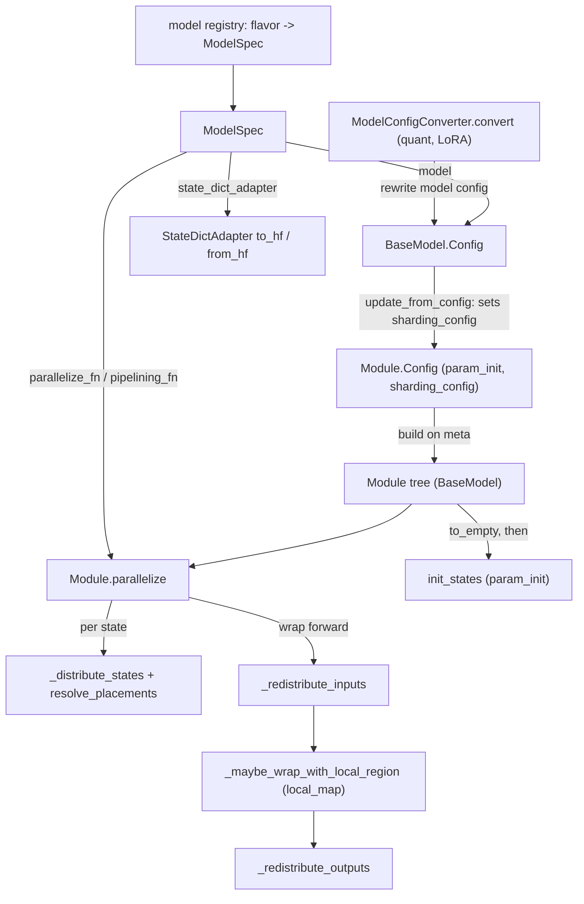

# ModelSpec and the Module protocol: how a model plugs into the trainer and declares its own sharding

## Overview
`torchtitan/protocols` is the contract every model satisfies so that one trainer can train Llama,
Qwen, DeepSeek, Flux or an experimental TPU model. It has three layers. [`ModelSpec`](https://github.com/google-pytorch/torchtitan/blob/033f131322a8b5b026ac53d734c689d664442bf8/torchtitan/protocols/model_spec.py#L33 "torchtitan/protocols/model_spec#ModelSpec")
is the "Per-model bundle. Contains already-selected arch config + callables": a
[`name`](https://github.com/google-pytorch/torchtitan/blob/033f131322a8b5b026ac53d734c689d664442bf8/torchtitan/protocols/model_spec.py#L36 "torchtitan/protocols/model_spec#ModelSpec.name"),
a [`flavor`](https://github.com/google-pytorch/torchtitan/blob/033f131322a8b5b026ac53d734c689d664442bf8/torchtitan/protocols/model_spec.py#L37 "torchtitan/protocols/model_spec#ModelSpec.flavor"),
the [`model`](https://github.com/google-pytorch/torchtitan/blob/033f131322a8b5b026ac53d734c689d664442bf8/torchtitan/protocols/model_spec.py#L38 "torchtitan/protocols/model_spec#ModelSpec.model")
config, the [`max_context_length`](https://github.com/google-pytorch/torchtitan/blob/033f131322a8b5b026ac53d734c689d664442bf8/torchtitan/protocols/model_spec.py#L39 "torchtitan/protocols/model_spec#ModelSpec.max_context_length") the config was built for, and the functions the trainer calls to parallelize,
pipeline and convert checkpoints.
[`BaseModel`](https://github.com/google-pytorch/torchtitan/blob/033f131322a8b5b026ac53d734c689d664442bf8/torchtitan/protocols/model.py#L36 "torchtitan/protocols/model#BaseModel")
and its [`Config`](https://github.com/google-pytorch/torchtitan/blob/033f131322a8b5b026ac53d734c689d664442bf8/torchtitan/protocols/model.py#L109 "torchtitan/protocols/model#BaseModel.Config")
add the hooks the trainer needs from any model: accept runtime job settings, report
parameters and FLOPs, and (on `BaseModel` itself) turn a dataloader batch into forward inputs. Underneath, every submodule is a [`Module`](https://github.com/google-pytorch/torchtitan/blob/033f131322a8b5b026ac53d734c689d664442bf8/torchtitan/protocols/module.py#L43 "torchtitan/protocols/module#Module"):
an `nn.Module` that is also [`Configurable`](https://github.com/google-pytorch/torchtitan/blob/033f131322a8b5b026ac53d734c689d664442bf8/torchtitan/config/configurable.py#L18 "torchtitan/config/configurable#Configurable"),
built from a config that may carry a per-parameter initializer and a
[`ShardingConfig`](https://github.com/google-pytorch/torchtitan/blob/033f131322a8b5b026ac53d734c689d664442bf8/torchtitan/protocols/sharding.py#L60 "torchtitan/protocols/sharding#ShardingConfig").
The key idea is that **sharding is data on the config tree**, declared per module by mesh-axis
name, and [`parallelize`](https://github.com/google-pytorch/torchtitan/blob/033f131322a8b5b026ac53d734c689d664442bf8/torchtitan/protocols/module.py#L279 "torchtitan/protocols/module#Module.parallelize")
turns those declarations into distributed parameters and forward-time redistributions against
whatever mesh the job actually has.

## Diagram

Legend:
- `REG` - (concept) a per-model registry function returning a spec; TPU example [`qwen3_1_7b`](https://github.com/google-pytorch/torchtitan/blob/033f131322a8b5b026ac53d734c689d664442bf8/torchtitan/experiments/tpu/qwen3/config_registry.py#L215 "torchtitan/experiments/tpu/qwen3/config_registry#qwen3_1_7b") calls one
- `MS` - [`ModelSpec`](https://github.com/google-pytorch/torchtitan/blob/033f131322a8b5b026ac53d734c689d664442bf8/torchtitan/protocols/model_spec.py#L33 "torchtitan/protocols/model_spec#ModelSpec")
- `CONV` - [`ModelConfigConverter`](https://github.com/google-pytorch/torchtitan/blob/033f131322a8b5b026ac53d734c689d664442bf8/torchtitan/protocols/model.py#L19 "torchtitan/protocols/model#ModelConfigConverter") via [`convert`](https://github.com/google-pytorch/torchtitan/blob/033f131322a8b5b026ac53d734c689d664442bf8/torchtitan/protocols/model.py#L32 "torchtitan/protocols/model#ModelConfigConverter.convert")
- `MC` - [`Config`](https://github.com/google-pytorch/torchtitan/blob/033f131322a8b5b026ac53d734c689d664442bf8/torchtitan/protocols/model.py#L109 "torchtitan/protocols/model#BaseModel.Config") (its `update_from_config` hook)
- `MOD` - [`Config`](https://github.com/google-pytorch/torchtitan/blob/033f131322a8b5b026ac53d734c689d664442bf8/torchtitan/protocols/module.py#L94 "torchtitan/protocols/module#Module.Config") with [`param_init`](https://github.com/google-pytorch/torchtitan/blob/033f131322a8b5b026ac53d734c689d664442bf8/torchtitan/protocols/module.py#L95 "torchtitan/protocols/module#Module.Config.param_init") and [`sharding_config`](https://github.com/google-pytorch/torchtitan/blob/033f131322a8b5b026ac53d734c689d664442bf8/torchtitan/protocols/module.py#L96 "torchtitan/protocols/module#Module.Config.sharding_config")
- `M` - [`BaseModel`](https://github.com/google-pytorch/torchtitan/blob/033f131322a8b5b026ac53d734c689d664442bf8/torchtitan/protocols/model.py#L36 "torchtitan/protocols/model#BaseModel") built by [`build`](https://github.com/google-pytorch/torchtitan/blob/033f131322a8b5b026ac53d734c689d664442bf8/torchtitan/protocols/module.py#L98 "torchtitan/protocols/module#Module.Config.build")
- `PAR` - [`parallelize`](https://github.com/google-pytorch/torchtitan/blob/033f131322a8b5b026ac53d734c689d664442bf8/torchtitan/protocols/module.py#L279 "torchtitan/protocols/module#Module.parallelize"), invoked from [`parallelize_fn`](https://github.com/google-pytorch/torchtitan/blob/033f131322a8b5b026ac53d734c689d664442bf8/torchtitan/protocols/model_spec.py#L45 "torchtitan/protocols/model_spec#ModelSpec.parallelize_fn") or [`pipelining_fn`](https://github.com/google-pytorch/torchtitan/blob/033f131322a8b5b026ac53d734c689d664442bf8/torchtitan/protocols/model_spec.py#L46 "torchtitan/protocols/model_spec#ModelSpec.pipelining_fn")
- `DS` - [`_distribute_states`](https://github.com/google-pytorch/torchtitan/blob/033f131322a8b5b026ac53d734c689d664442bf8/torchtitan/protocols/module.py#L401 "torchtitan/protocols/module#Module._distribute_states") and [`resolve_placements`](https://github.com/google-pytorch/torchtitan/blob/033f131322a8b5b026ac53d734c689d664442bf8/torchtitan/protocols/sharding.py#L120 "torchtitan/protocols/sharding#resolve_placements")
- `RI` - [`_redistribute_inputs`](https://github.com/google-pytorch/torchtitan/blob/033f131322a8b5b026ac53d734c689d664442bf8/torchtitan/protocols/module.py#L594 "torchtitan/protocols/module#Module._redistribute_inputs")
- `LM` - [`_maybe_wrap_with_local_region`](https://github.com/google-pytorch/torchtitan/blob/033f131322a8b5b026ac53d734c689d664442bf8/torchtitan/protocols/module.py#L489 "torchtitan/protocols/module#Module._maybe_wrap_with_local_region")
- `RO` - [`_redistribute_outputs`](https://github.com/google-pytorch/torchtitan/blob/033f131322a8b5b026ac53d734c689d664442bf8/torchtitan/protocols/module.py#L695 "torchtitan/protocols/module#Module._redistribute_outputs")
- `INIT` - [`init_states`](https://github.com/google-pytorch/torchtitan/blob/033f131322a8b5b026ac53d734c689d664442bf8/torchtitan/protocols/module.py#L109 "torchtitan/protocols/module#Module.init_states")
- `SDA` - [`StateDictAdapter`](https://github.com/google-pytorch/torchtitan/blob/033f131322a8b5b026ac53d734c689d664442bf8/torchtitan/protocols/state_dict_adapter.py#L80 "torchtitan/protocols/state_dict_adapter#StateDictAdapter") with [`to_hf`](https://github.com/google-pytorch/torchtitan/blob/033f131322a8b5b026ac53d734c689d664442bf8/torchtitan/protocols/state_dict_adapter.py#L41 "torchtitan/protocols/state_dict_adapter#BaseStateDictAdapter.to_hf") / [`from_hf`](https://github.com/google-pytorch/torchtitan/blob/033f131322a8b5b026ac53d734c689d664442bf8/torchtitan/protocols/state_dict_adapter.py#L53 "torchtitan/protocols/state_dict_adapter#BaseStateDictAdapter.from_hf")

## Design rationale (why it's built this way)
- **A spec is data plus a few callables, and it is being retired.** [`ModelSpec`](https://github.com/google-pytorch/torchtitan/blob/033f131322a8b5b026ac53d734c689d664442bf8/torchtitan/protocols/model_spec.py#L33 "torchtitan/protocols/model_spec#ModelSpec")
  carries a TODO "deprecate ModelSpec, move fields to model config or trainer config". Its callable
  fields are typed as bare `Callable` because tyro cannot resolve `Callable[..., X]`, and the trainer
  config hides the whole spec from the CLI. The spec's `traverse` exposes only `model`, so the override
  mechanism can reach model components while the callables stay out of reach ("intentionally not
  traversable").
- **Recipes can swap the parallelization strategy without touching the model.** Because
  [`parallelize_fn`](https://github.com/google-pytorch/torchtitan/blob/033f131322a8b5b026ac53d734c689d664442bf8/torchtitan/protocols/model_spec.py#L45 "torchtitan/protocols/model_spec#ModelSpec.parallelize_fn")
  is a field, TPU recipes such as [`qwen3_1_7b`](https://github.com/google-pytorch/torchtitan/blob/033f131322a8b5b026ac53d734c689d664442bf8/torchtitan/experiments/tpu/qwen3/config_registry.py#L215 "torchtitan/experiments/tpu/qwen3/config_registry#qwen3_1_7b")
  and [`reg_trainer_qwen3_8b`](https://github.com/google-pytorch/torchtitan/blob/033f131322a8b5b026ac53d734c689d664442bf8/torchtitan/experiments/tpu/qwen3/config_registry.py#L289 "torchtitan/experiments/tpu/qwen3/config_registry#reg_trainer_qwen3_8b")
  take their spec from the TPU Qwen3 model registry (for 8B with SDPA, a custom spec built around a
  TPU-specific Qwen3 8B config rather than the upstream one) and assign the TPU parallelize function
  (SimpleFSDP, compile modes) to the field, and the TPU launcher wraps it again with TPU workarounds
  at start-up.
- **Sharding is declared, not coded, and declared unconditionally.** A
  [`ShardingConfig`](https://github.com/google-pytorch/torchtitan/blob/033f131322a8b5b026ac53d734c689d664442bf8/torchtitan/protocols/sharding.py#L60 "torchtitan/protocols/sharding#ShardingConfig")
  lists placements per mesh-axis name (for example `{"weight": {TP: Shard(0)}}` for colwise). Models
  fill these in during `update_from_config` for every axis they might use; the mesh actually passed
  to `parallelize` decides which apply. That separates "how this layer shards" (model author) from
  "how many chips on each axis" (job config), and lets the same declarations drive both SPMD
  backends, `partial_dtensor` (the default) and `spmd_types`. Placements are now `spmd_types.SpmdType`
  values keyed by mesh-axis name (the old torchtitan-local `SpmdLayout` wrapper is gone). The docstring stresses it is "Completely dtype-agnostic",
  so Float8/MXFP8 quantization composes orthogonally.
- **Redistribution is a (source, destination) pair.** Inputs and outputs each have a `src` (what the
  tensor is on arrival) and a `dst` (what the compute wants). For DTensor the source is usually
  implicit, but declaring it "keeps the contract uniform with future erased-type systems that require
  both sides of every redistribute", which is what the `spmd_types` backend needs.
- **Size-1 axes are normalized.** [`resolve_placements`](https://github.com/google-pytorch/torchtitan/blob/033f131322a8b5b026ac53d734c689d664442bf8/torchtitan/protocols/sharding.py#L120 "torchtitan/protocols/sharding#resolve_placements")
  maps `Shard` or `Partial` on a size-1 mesh axis to `Replicate()`, because they are operationally
  identical but DTensor's op rules "treat them as distinct and reject Shard/Partial in places where
  Replicate would work". A missing axis declaration is an error; extra axes are ignored. A logical
  `dp` entry is unfolded into the concrete `dp_replicate` and `dp_shard` storage axes before lookup,
  so one declaration covers both.
- **Context length is fixed when the spec is built.** [`max_context_length`](https://github.com/google-pytorch/torchtitan/blob/033f131322a8b5b026ac53d734c689d664442bf8/torchtitan/protocols/model_spec.py#L39 "torchtitan/protocols/model_spec#ModelSpec.max_context_length") is a required spec field: upstream
  registries now pick the context length at registry time (a flavor's maximum, or a smaller requested
  `seq_len`), build RoPE for it, and store it on the spec; config registries such as [`llama3_debugmodel`](https://github.com/google-pytorch/torchtitan/blob/033f131322a8b5b026ac53d734c689d664442bf8/torchtitan/models/llama3/config_registry.py#L63 "torchtitan/models/llama3/config_registry#llama3_debugmodel") copy it
  into `training.max_context_length` and size token budgets from it. `update_from_config` therefore
  no longer validates or resizes RoPE against the training sequence length.
- **Initialization is recursive and config-driven.** [`init_states`](https://github.com/google-pytorch/torchtitan/blob/033f131322a8b5b026ac53d734c689d664442bf8/torchtitan/protocols/module.py#L109 "torchtitan/protocols/module#Module.init_states")
  is not meant to be overridden except when a model needs custom ordering (the docstring's example
  is weight tying before init, which is what the decoder does): it recurses into children (looking
  through plain wrappers such as activation-checkpoint or compile wrappers), initializes own parameters from
  [`param_init`](https://github.com/google-pytorch/torchtitan/blob/033f131322a8b5b026ac53d734c689d664442bf8/torchtitan/protocols/module.py#L95 "torchtitan/protocols/module#Module.Config.param_init")
  or `reset_parameters`, then own buffers. This runs after `to_empty()` on already-sharded
  parameters, so initialization writes each shard in place. The TPU Qwen3 recipes use this to set the
  token-embedding initializer to `normal_(std=1.0)` without subclassing the model.

## Entry points
- [`ModelSpec`](https://github.com/google-pytorch/torchtitan/blob/033f131322a8b5b026ac53d734c689d664442bf8/torchtitan/protocols/model_spec.py#L33 "torchtitan/protocols/model_spec#ModelSpec")
  is produced by a model's registry function and attached to the trainer config by the config
  registry; the trainer's [`__init__`](https://github.com/google-pytorch/torchtitan/blob/033f131322a8b5b026ac53d734c689d664442bf8/torchtitan/trainer.py#L344 "torchtitan/trainer#Trainer.__init__")
  reads every field except `max_context_length` (it uses `training.max_context_length`, which config
  registries copy from the spec). The fault-tolerant [`__init__`](https://github.com/google-pytorch/torchtitan/blob/033f131322a8b5b026ac53d734c689d664442bf8/torchtitan/experiments/torchft/trainer.py#L46 "torchtitan/experiments/torchft/trainer#FaultTolerantTrainer.__init__")
  consumes it the same way. (The Forge engine, which called it `train_spec`, no longer exists.)
- [`Config`](https://github.com/google-pytorch/torchtitan/blob/033f131322a8b5b026ac53d734c689d664442bf8/torchtitan/protocols/model.py#L109 "torchtitan/protocols/model#BaseModel.Config")'s `update_from_config`
  is called once by the trainer (and by the minimal TPU launchers such as
  [`start_trainer`](https://github.com/google-pytorch/torchtitan/blob/033f131322a8b5b026ac53d734c689d664442bf8/torchtitan/experiments/tpu/conformer/train_minimal.py#L144 "torchtitan/experiments/tpu/conformer/train_minimal#start_trainer"))
  before the model is built; a TODO calls it an encapsulation violation. The trainer now also passes
  sample-count batch sizes (`global_batch_size`, `local_global_batch_size`) re-derived from the
  token-based training fields, and applies config overrides only after this call, because it is what
  sets the sharding configs on the pre-override modules.
- [`build`](https://github.com/google-pytorch/torchtitan/blob/033f131322a8b5b026ac53d734c689d664442bf8/torchtitan/protocols/module.py#L98 "torchtitan/protocols/module#Module.Config.build")
  constructs any module from its config, attaching `param_init` and `sharding_config` to the instance.
- [`parallelize`](https://github.com/google-pytorch/torchtitan/blob/033f131322a8b5b026ac53d734c689d664442bf8/torchtitan/protocols/module.py#L279 "torchtitan/protocols/module#Module.parallelize")
  is called on the root model by a model's parallelize function: always under the `spmd_types`
  backend, and under the default `partial_dtensor` backend only when TP is enabled (FSDP there is still
  applied separately with `fully_shard`).
- [`get_nparams_and_flops`](https://github.com/google-pytorch/torchtitan/blob/033f131322a8b5b026ac53d734c689d664442bf8/torchtitan/protocols/model.py#L127 "torchtitan/protocols/model#BaseModel.Config.get_nparams_and_flops")
  is called once on the meta-device model to feed MFU.
- [`to_hf`](https://github.com/google-pytorch/torchtitan/blob/033f131322a8b5b026ac53d734c689d664442bf8/torchtitan/protocols/state_dict_adapter.py#L41 "torchtitan/protocols/state_dict_adapter#BaseStateDictAdapter.to_hf")
  and [`from_hf`](https://github.com/google-pytorch/torchtitan/blob/033f131322a8b5b026ac53d734c689d664442bf8/torchtitan/protocols/state_dict_adapter.py#L53 "torchtitan/protocols/state_dict_adapter#BaseStateDictAdapter.from_hf")
  are called by the checkpointer when saving or loading Hugging Face format.
- [`BaseModel`](https://github.com/google-pytorch/torchtitan/blob/033f131322a8b5b026ac53d734c689d664442bf8/torchtitan/protocols/model.py#L36 "torchtitan/protocols/model#BaseModel")'s `preprocess_inputs` is called by the trainer (and validator) on every microbatch: it builds
  attention masks, applies context-parallel sharding and SPMD annotation, and splits `input`/`labels`
  out of the batch, returning `(inputs, labels, extra_kwargs)`. The base raises `NotImplementedError`
  ("There is no meaningful default"); models with a bespoke pipeline such as Flux never call it.

## Mechanism (step-by-step)
1. **Select and convert the architecture.** A model registry function picks the flavor's config and
   applies any [`ModelConfigConverter`](https://github.com/google-pytorch/torchtitan/blob/033f131322a8b5b026ac53d734c689d664442bf8/torchtitan/protocols/model.py#L19 "torchtitan/protocols/model#ModelConfigConverter")
   configs in order; each [`convert`](https://github.com/google-pytorch/torchtitan/blob/033f131322a8b5b026ac53d734c689d664442bf8/torchtitan/protocols/model.py#L32 "torchtitan/protocols/model#ModelConfigConverter.convert")
   rewrites the model config tree (quantization, LoRA) and "may return a replacement root config when
   the transform needs to wrap the model config itself". The result is wrapped in a
   [`ModelSpec`](https://github.com/google-pytorch/torchtitan/blob/033f131322a8b5b026ac53d734c689d664442bf8/torchtitan/protocols/model_spec.py#L33 "torchtitan/protocols/model_spec#ModelSpec")
   together with [`parallelize_fn`](https://github.com/google-pytorch/torchtitan/blob/033f131322a8b5b026ac53d734c689d664442bf8/torchtitan/protocols/model_spec.py#L45 "torchtitan/protocols/model_spec#ModelSpec.parallelize_fn"),
   [`pipelining_fn`](https://github.com/google-pytorch/torchtitan/blob/033f131322a8b5b026ac53d734c689d664442bf8/torchtitan/protocols/model_spec.py#L46 "torchtitan/protocols/model_spec#ModelSpec.pipelining_fn"),
   [`post_optimizer_build_fn`](https://github.com/google-pytorch/torchtitan/blob/033f131322a8b5b026ac53d734c689d664442bf8/torchtitan/protocols/model_spec.py#L47 "torchtitan/protocols/model_spec#ModelSpec.post_optimizer_build_fn")
   (MoE models register a load-balancing hook here) and the
   [`state_dict_adapter`](https://github.com/google-pytorch/torchtitan/blob/033f131322a8b5b026ac53d734c689d664442bf8/torchtitan/protocols/model_spec.py#L48 "torchtitan/protocols/model_spec#ModelSpec.state_dict_adapter")
   class. The registry also records the context length it built the config for (RoPE included) as
   [`max_context_length`](https://github.com/google-pytorch/torchtitan/blob/033f131322a8b5b026ac53d734c689d664442bf8/torchtitan/protocols/model_spec.py#L39 "torchtitan/protocols/model_spec#ModelSpec.max_context_length"), rejecting a requested `seq_len` above the flavor's maximum.
2. **Absorb the job config.** The `update_from_config` hook of [`Config`](https://github.com/google-pytorch/torchtitan/blob/033f131322a8b5b026ac53d734c689d664442bf8/torchtitan/protocols/model.py#L109 "torchtitan/protocols/model#BaseModel.Config")
   receives the full trainer config. Decoder models use it to reject incompatible combinations (weight
   tying with PP, TP not dividing query or KV head counts, EP not dividing the expert count), update
   the EP token-dispatcher config, and write a [`ShardingConfig`](https://github.com/google-pytorch/torchtitan/blob/033f131322a8b5b026ac53d734c689d664442bf8/torchtitan/protocols/sharding.py#L60 "torchtitan/protocols/sharding#ShardingConfig")
   into each sub-config's [`sharding_config`](https://github.com/google-pytorch/torchtitan/blob/033f131322a8b5b026ac53d734c689d664442bf8/torchtitan/protocols/module.py#L96 "torchtitan/protocols/module#Module.Config.sharding_config"),
   honoring `enable_sequence_parallel`.
3. **Build and verify on meta.** [`build`](https://github.com/google-pytorch/torchtitan/blob/033f131322a8b5b026ac53d734c689d664442bf8/torchtitan/protocols/module.py#L98 "torchtitan/protocols/module#Module.Config.build")
   calls the base [`build`](https://github.com/google-pytorch/torchtitan/blob/033f131322a8b5b026ac53d734c689d664442bf8/torchtitan/config/configurable.py#L134 "torchtitan/config/configurable#Configurable.Config.build")
   explicitly (slots prevent `super()`) and copies `param_init` and `sharding_config` onto the instance
   as `_param_init` and [`_sharding_config`](https://github.com/google-pytorch/torchtitan/blob/033f131322a8b5b026ac53d734c689d664442bf8/torchtitan/protocols/module.py#L55 "torchtitan/protocols/module#Module._sharding_config");
   this happens in `build` because "there is no common Module.__init__ that all subclasses call".
   Leaf modules such as [`Linear`](https://github.com/google-pytorch/torchtitan/blob/033f131322a8b5b026ac53d734c689d664442bf8/torchtitan/models/common/linear.py#L31 "torchtitan/models/common/linear#Linear")
   (built from its [`Config`](https://github.com/google-pytorch/torchtitan/blob/033f131322a8b5b026ac53d734c689d664442bf8/torchtitan/models/common/linear.py#L35 "torchtitan/models/common/linear#Linear.Config"))
   and containers [`ModuleList`](https://github.com/google-pytorch/torchtitan/blob/033f131322a8b5b026ac53d734c689d664442bf8/torchtitan/protocols/module.py#L768 "torchtitan/protocols/module#ModuleList"),
   and [`ModuleDict`](https://github.com/google-pytorch/torchtitan/blob/033f131322a8b5b026ac53d734c689d664442bf8/torchtitan/protocols/module.py#L774 "torchtitan/protocols/module#ModuleDict")
   (plus a `Sequential` counterpart) keep every node inside the protocol, which
   [`verify_module_protocol`](https://github.com/google-pytorch/torchtitan/blob/033f131322a8b5b026ac53d734c689d664442bf8/torchtitan/protocols/model.py#L88 "torchtitan/protocols/model#BaseModel.verify_module_protocol")
   checks over `named_modules()`, raising on any non-conforming submodule (the earlier warn-only
   exemption for experimental wrapper models was removed).
4. **Distribute states.** [`parallelize`](https://github.com/google-pytorch/torchtitan/blob/033f131322a8b5b026ac53d734c689d664442bf8/torchtitan/protocols/module.py#L279 "torchtitan/protocols/module#Module.parallelize")
   marks the module parallelized (a second call raises), recurses into children (again looking through
   non-Module wrappers), and returns early for modules without a sharding config. Otherwise
   [`_distribute_states`](https://github.com/google-pytorch/torchtitan/blob/033f131322a8b5b026ac53d734c689d664442bf8/torchtitan/protocols/module.py#L401 "torchtitan/protocols/module#Module._distribute_states")
   looks up each own parameter and buffer in
   [`state_shardings`](https://github.com/google-pytorch/torchtitan/blob/033f131322a8b5b026ac53d734c689d664442bf8/torchtitan/protocols/sharding.py#L108 "torchtitan/protocols/sharding#ShardingConfig.state_shardings")
   (a missing entry raises), resolves a mesh for that layout's axes, converts the layout with
   [`resolve_placements`](https://github.com/google-pytorch/torchtitan/blob/033f131322a8b5b026ac53d734c689d664442bf8/torchtitan/protocols/sharding.py#L120 "torchtitan/protocols/sharding#resolve_placements"),
   and re-registers it as a `distribute_tensor` DTensor. Under `spmd_types`, each parameter is first
   checked for even TP/EP sharding (a TP- or EP-sharded dim not divisible by that axis size raises,
   because "spmd_types does not support uneven model-parallel parameter sharding"), then distributed on
   a mesh that includes size-1 axes, keeping its original `requires_grad`, and asserted against its
   `SpmdType`. A parameter already a DTensor (weight tying) is skipped after checking placements agree.
5. **Wrap the forward.** The forward becomes `reshard inputs -> [optional local_map] forward ->
   reshard outputs`. [`_redistribute_inputs`](https://github.com/google-pytorch/torchtitan/blob/033f131322a8b5b026ac53d734c689d664442bf8/torchtitan/protocols/module.py#L594 "torchtitan/protocols/module#Module._redistribute_inputs")
   maps positional args to names (cached from the unwrapped signature), wraps plain tensors with
   `DTensor.from_local` using [`in_src_shardings`](https://github.com/google-pytorch/torchtitan/blob/033f131322a8b5b026ac53d734c689d664442bf8/torchtitan/protocols/sharding.py#L109 "torchtitan/protocols/sharding#ShardingConfig.in_src_shardings"),
   checks arriving DTensors match the source, and redistributes to
   [`in_dst_shardings`](https://github.com/google-pytorch/torchtitan/blob/033f131322a8b5b026ac53d734c689d664442bf8/torchtitan/protocols/sharding.py#L110 "torchtitan/protocols/sharding#ShardingConfig.in_dst_shardings")
   with `async_op=True` (for example `{TP: Replicate()}` means an all-gather).
   [`_maybe_wrap_with_local_region`](https://github.com/google-pytorch/torchtitan/blob/033f131322a8b5b026ac53d734c689d664442bf8/torchtitan/protocols/module.py#L489 "torchtitan/protocols/module#Module._maybe_wrap_with_local_region")
   applies a [`LocalMapConfig`](https://github.com/google-pytorch/torchtitan/blob/033f131322a8b5b026ac53d734c689d664442bf8/torchtitan/protocols/sharding.py#L34 "torchtitan/protocols/sharding#LocalMapConfig")
   when present (DTensor `local_map`, or under `spmd_types` an `spmd.no_typecheck` region), so the body computes on plain local tensors (the path for kernels that do not
   understand DTensor). [`_redistribute_outputs`](https://github.com/google-pytorch/torchtitan/blob/033f131322a8b5b026ac53d734c689d664442bf8/torchtitan/protocols/module.py#L695 "torchtitan/protocols/module#Module._redistribute_outputs")
   checks the output against [`out_src_shardings`](https://github.com/google-pytorch/torchtitan/blob/033f131322a8b5b026ac53d734c689d664442bf8/torchtitan/protocols/sharding.py#L111 "torchtitan/protocols/sharding#ShardingConfig.out_src_shardings")
   and redistributes to [`out_dst_shardings`](https://github.com/google-pytorch/torchtitan/blob/033f131322a8b5b026ac53d734c689d664442bf8/torchtitan/protocols/sharding.py#L112 "torchtitan/protocols/sharding#ShardingConfig.out_dst_shardings")
   (the docstring's example is `{TP: Shard(1)}` for a reduce-scatter into sequence parallel; with
   activations now flattened to `[T, D]`, the Llama3 declarations reduce-scatter to `Shard(0)`).
6. **Materialize and initialize.** After the trainer's `to_empty()`,
   [`init_states`](https://github.com/google-pytorch/torchtitan/blob/033f131322a8b5b026ac53d734c689d664442bf8/torchtitan/protocols/module.py#L109 "torchtitan/protocols/module#Module.init_states")
   (reached through `BaseModel.init_weights`, kept as an alias for external tools) initializes
   children first, then own parameters by `param_init[name](param)` or `reset_parameters()`, raising if
   neither exists. Buffers recomputed by `_init_self_buffers` (RoPE caches, MoE counters) are
   re-distributed to their previous DTensor placements, and SPMD type annotations are saved and
   restored across `to_empty()` and buffer init.
7. **Convert checkpoints.** The trainer instantiates the spec's adapter class with the model config
   and `hf_assets_path`. [`StateDictAdapter`](https://github.com/google-pytorch/torchtitan/blob/033f131322a8b5b026ac53d734c689d664442bf8/torchtitan/protocols/state_dict_adapter.py#L80 "torchtitan/protocols/state_dict_adapter#StateDictAdapter")
   reads `model.safetensors.index.json` into
   [`fqn_to_index_mapping`](https://github.com/google-pytorch/torchtitan/blob/033f131322a8b5b026ac53d734c689d664442bf8/torchtitan/protocols/state_dict_adapter.py#L29 "torchtitan/protocols/state_dict_adapter#BaseStateDictAdapter.fqn_to_index_mapping")
   (Hugging Face key to shard-file number) so exports reproduce the original file split, falling back
   to a single file with a warning when the index is missing. Subclasses implement the key and layout
   mapping in [`to_hf`](https://github.com/google-pytorch/torchtitan/blob/033f131322a8b5b026ac53d734c689d664442bf8/torchtitan/protocols/state_dict_adapter.py#L41 "torchtitan/protocols/state_dict_adapter#BaseStateDictAdapter.to_hf")
   and [`from_hf`](https://github.com/google-pytorch/torchtitan/blob/033f131322a8b5b026ac53d734c689d664442bf8/torchtitan/protocols/state_dict_adapter.py#L53 "torchtitan/protocols/state_dict_adapter#BaseStateDictAdapter.from_hf").

## Key data structures
- [`ModelSpec`](https://github.com/google-pytorch/torchtitan/blob/033f131322a8b5b026ac53d734c689d664442bf8/torchtitan/protocols/model_spec.py#L33 "torchtitan/protocols/model_spec#ModelSpec"):
  plain dataclass; `name` also drives trainer-class selection on the TPU lane (`flux` gets its own
  trainer; `qwen3`, `llama3`, `deepseek_v3` and `muse_glimmer` are the names the graph trainer
  accepts). [`max_context_length`](https://github.com/google-pytorch/torchtitan/blob/033f131322a8b5b026ac53d734c689d664442bf8/torchtitan/protocols/model_spec.py#L39 "torchtitan/protocols/model_spec#ModelSpec.max_context_length") is the context length the model config was built for.
- [`ShardingConfig`](https://github.com/google-pytorch/torchtitan/blob/033f131322a8b5b026ac53d734c689d664442bf8/torchtitan/protocols/sharding.py#L60 "torchtitan/protocols/sharding#ShardingConfig"):
  `state_shardings: dict[name, SpmdType]`, `in_src/in_dst: dict[arg, SpmdType] | None`,
  `out_src: SpmdType | tuple | None`, `out_dst: SpmdType | None`, `local_map: LocalMapConfig | None`.
  An `SpmdType` (from the `spmd_types` package) maps mesh-axis names to per-axis types, optionally
  with a partition spec; the config's `to_dict` is a `repr` for JSON logging.
- [`LocalMapConfig`](https://github.com/google-pytorch/torchtitan/blob/033f131322a8b5b026ac53d734c689d664442bf8/torchtitan/protocols/sharding.py#L34 "torchtitan/protocols/sharding#LocalMapConfig"):
  only `in_grad_placements`; input and output placements come from the enclosing `ShardingConfig`.
- Per-instance protocol state on [`Module`](https://github.com/google-pytorch/torchtitan/blob/033f131322a8b5b026ac53d734c689d664442bf8/torchtitan/protocols/module.py#L43 "torchtitan/protocols/module#Module"):
  `_param_init`, [`_sharding_config`](https://github.com/google-pytorch/torchtitan/blob/033f131322a8b5b026ac53d734c689d664442bf8/torchtitan/protocols/module.py#L55 "torchtitan/protocols/module#Module._sharding_config"),
  cached positional-arg names, a `_parallelized` flag, and two remat fields (a module FQN and a tuple
  of save patterns) that [`configure_remat_regions`](https://github.com/google-pytorch/torchtitan/blob/033f131322a8b5b026ac53d734c689d664442bf8/torchtitan/protocols/module.py#L76 "torchtitan/protocols/module#Module.configure_remat_regions") stamps onto every `Module` in a block. Region-based activation
  checkpointing calls it per transformer block; model code then asks `remat_should_recompute(local_name)`,
  which recomputes a region unless its qualified name matches a save pattern (`fnmatch`). Outside an
  enclosing remat checkpoint the fields have no effect.
- [`Config`](https://github.com/google-pytorch/torchtitan/blob/033f131322a8b5b026ac53d734c689d664442bf8/torchtitan/protocols/model.py#L28 "torchtitan/protocols/model#ModelConfigConverter.Config")
  of a converter: empty base; concrete converters (quantization, LoRA) add fields, and the model
  registries require quantization converters to precede LoRA.

## Dynamics (design intent)
- Which axes a declaration touches depends on the SPMD backend: under the default `partial_dtensor`
  only `tp` and `ep` are resolved in-band (data parallel stays with `fully_shard`), and under
  `spmd_types` `dp`, `cp`, `tp` and `ep` are. The `full_dtensor` backend is gone, and context parallel
  now requires `spmd_types`. The same `ShardingConfig` therefore produces TP-only DTensors in one run
  and fully annotated tensors in another.
- `parallelize` visits children in reverse order (a stack) while `init_states` visits them in order (a
  queue); nothing in the protocol depends on the order, but hooks with side effects would observe it.
- Redistributions inside the wrapped forward run at every call, so they become collectives inside
  whatever graph is traced or compiled around the module.

> [!inferred]
> For TPU this is the mechanism that decides where collectives appear in the compiled program: each
> `in_dst`/`out_dst` declaration that differs from the arriving placement emits an all-gather,
> reduce-scatter or all-reduce at a module boundary, and XLA can only overlap or fuse what the traced
> graph exposes. Declaring `Replicate` on size-1 axes (automatic via `resolve_placements`) also keeps
> TorchTPU from seeing needless `Partial` placements that would otherwise force reductions.

## Edge cases
- The `src` and `dst` layouts of one boundary (and the grad layouts of a `local_map`) must name the
  same mesh axes, or mesh resolution fails an assertion ("Inconsistent mesh axes within a boundary");
  `resolve_placements` additionally raises if a layout lacks an axis of the mesh it is resolved on.
- Under `spmd_types`, an input `dst` without a `src` raises ("SPMD input redistribution requires
  explicit in_src_shardings"), and a TP- or EP-sharded parameter whose sharded dim is not divisible by
  that axis size raises at parallelize time. Under `partial_dtensor`, a plain tensor with no `src` simply
  passes through un-annotated.
- The TPU launcher shrinks every RoPE cache to `training.max_context_length` for non-Flux models
  before building (restoring the pre-rebase behavior), because TPU configs do not pass `seq_len` to the
  registry and full-flavor caches (131072 positions for Llama3) ran a 70B model out of HBM. Recipes
  outside the TPU launcher must pass `seq_len` themselves.
- The adapter's RoPE-class check skips layers whose `rope` is `None` (NoPE layers).
- Output redistribution handles a single tensor only; tuple outputs pass through (a TODO covers
  Flux and MoE multi-output modules).
- `local_map` requires `in_dst` (or `in_src`) entries for every positional arg and an `out_src`
  (or `out_dst`); missing ones raise at parallelize time, not at the first forward.
- A module with parameters but neither `param_init` nor `reset_parameters` fails at init; a
  `param_init` dict missing a parameter name fails with the available keys listed.
- Tied weights referenced by two modules with conflicting sharding configs raise when the second
  module is distributed.

## Open questions
- `ModelSpec` is slated for deprecation (TODO in source); where `parallelize_fn` and friends will
  live afterwards is not decided in this code.
- The shard-order comment (FSDP plus TP both sharding dim 0) was removed along with `SpmdLayout`;
  whether `SpmdType` partition specs now carry explicit shard order for that case is not settled in
  this subsystem's code.
- How the TPU parallelize functions (SimpleFSDP path) interact with `Module.parallelize` under the
  `partial_dtensor` backend is outside this packet's subgraph.

## See also
- [Trainer lifecycle](trainer-lifecycle.md): when the spec's hooks are called.
- [Job configuration](job-configuration.md): `Configurable`, recipes and overrides that rewrite the model config.
- [DTensor and sharding types](dtensor-and-sharding-types.md): `SpmdType`, placements and the `spmd_types` backend.
- [Parallel dims and mesh](parallel-dims-and-mesh.md): how axis names resolve to meshes.
- [Tensor parallel](tensor-parallel.md) and [FSDP sharding](fsdp-sharding.md): the main users of `ShardingConfig`.
- [Model definitions](model-definitions.md): concrete `BaseModel` subclasses and their sharding declarations.
- [State dict adapters](state-dict-adapters.md): per-model `to_hf`/`from_hf`.
- [Quantization](quantization.md) and [LoRA](lora.md): `ModelConfigConverter` implementations.

## Recent changes
- `fa627bf2` rebases onto upstream `d771abb0`: `ModelSpec` gains a required `max_context_length`
  (registries fix context length and build RoPE for it), `BaseModel` gains `preprocess_inputs`,
  `SpmdLayout` is replaced by `spmd_types.SpmdType`, the backends become `partial_dtensor` and
  `spmd_types`, `Module` gains remat-region configuration, and the Forge engine is gone.
- `9b288c48` removes withheld experimental models; `verify_module_protocol` now always raises.
- `ea1284ce`, `567dbe5d` and `e7964fec` make TPU Qwen3 report upstream torchtitan FLOPs by default and
  keep MaxText FLOPs only in the `*maxtext` recipes, carried in the recipe's model config.
- TPU Qwen3 recipe tuning that touches spec-built configs: `08f60747` (Qwen3-32B 4x8x8), `6c7618f1`
  (Tokamax splash attention), `bf4af2be` (early next-layer all-gather in the 235B scan recipe).
- [all changes in 033f131322](../changes/033f131322.md)
