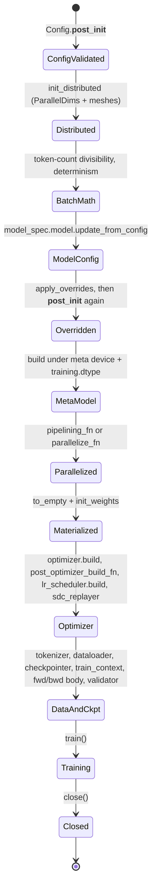

# Trainer lifecycle: how Trainer.__init__ assembles a sharded training job

## Overview
[`Trainer`](https://github.com/google-pytorch/torchtitan/blob/033f131322a8b5b026ac53d734c689d664442bf8/torchtitan/trainer.py#L74 "torchtitan/trainer#Trainer") is both a
[`Configurable`](https://github.com/google-pytorch/torchtitan/blob/033f131322a8b5b026ac53d734c689d664442bf8/torchtitan/config/configurable.py#L18 "torchtitan/config/configurable#Configurable")
(so `Trainer.Config(...).build()` constructs it) and a DCP `Stateful` (so the checkpointer can save
its step counters). Its nested [`Config`](https://github.com/google-pytorch/torchtitan/blob/033f131322a8b5b026ac53d734c689d664442bf8/torchtitan/trainer.py#L76 "torchtitan/trainer#Trainer.Config")
is the whole job: one field per component, each itself a `Config` that knows how to build its
component. Nearly all of the interesting work happens in
[`__init__`](https://github.com/google-pytorch/torchtitan/blob/033f131322a8b5b026ac53d734c689d664442bf8/torchtitan/trainer.py#L344 "torchtitan/trainer#Trainer.__init__"),
whose order is load-bearing: distributed state and the device mesh first, then a model built on the
`meta` device (no memory), then parallelism (sharding is decided while parameters are still
shapeless), then materialization and weight init directly into the sharded layout, and only then the
optimizer, which must see the final sharded parameters. The training loop that follows is covered in
[training-loop](training-loop.md); this page is about getting there and about the hooks subclasses
override.

## Diagram

## Design rationale (why it's built this way)
- **Meta-device build, then parallelize, then materialize.** The model is built inside
  `torch.device("meta")` with the default dtype set from
  [`training`](https://github.com/google-pytorch/torchtitan/blob/033f131322a8b5b026ac53d734c689d664442bf8/torchtitan/trainer.py#L113 "torchtitan/trainer#Trainer.Config.training")`.dtype`,
  so an 8B or 405B model costs no memory until it is already sharded. `to_empty()` then allocates only
  each rank's shard, and `init_weights` runs under `no_grad` on the DTensor shards. Consequence for
  TPU: HBM is never asked to hold an unsharded copy, and the reported "memory usage for model" after
  init reflects the sharded footprint.
- **Model config is mutated by the job config before build.**
  [`model_spec`](https://github.com/google-pytorch/torchtitan/blob/033f131322a8b5b026ac53d734c689d664442bf8/torchtitan/trainer.py#L83 "torchtitan/trainer#Trainer.Config.model_spec")
  carries an already-selected model config; `update_from_config` receives the whole trainer config plus
  the batch sizes so the model can validate TP against head counts and EP against expert counts, and
  populate per-module sharding declarations (it no longer resizes RoPE to the context length). Overrides from
  [`override`](https://github.com/google-pytorch/torchtitan/blob/033f131322a8b5b026ac53d734c689d664442bf8/torchtitan/trainer.py#L129 "torchtitan/trainer#Trainer.Config.override")
  run *after* that call on purpose; the comment explains that `update_from_config` "sets sharding
  config on the pre-override modules", and all other components are built later, so a single override
  pass can replace any config in the tree before anything is constructed.
- **Optimizer after parallelism.** The comment "build optimizer after applying parallelisms to the
  model" is the key invariant: [`optimizers`](https://github.com/google-pytorch/torchtitan/blob/033f131322a8b5b026ac53d734c689d664442bf8/torchtitan/trainer.py#L320 "torchtitan/trainer#Trainer.optimizers")
  must hold references to the final (possibly DTensor, possibly FSDP-wrapped) parameters, otherwise
  optimizer state would be allocated unsharded or on stale tensors.
- **Train state before checkpoint load.** [`step`](https://github.com/google-pytorch/torchtitan/blob/033f131322a8b5b026ac53d734c689d664442bf8/torchtitan/trainer.py#L339 "torchtitan/trainer#Trainer.step")
  and [`ntokens_seen`](https://github.com/google-pytorch/torchtitan/blob/033f131322a8b5b026ac53d734c689d664442bf8/torchtitan/trainer.py#L340 "torchtitan/trainer#Trainer.ntokens_seen")
  are set to 0 before the checkpointer is built because the trainer registers itself as
  `states={"train_state": self}`; loading then overwrites them.
- **Fail fast on incompatible combinations.** [`__post_init__`](https://github.com/google-pytorch/torchtitan/blob/033f131322a8b5b026ac53d734c689d664442bf8/torchtitan/trainer.py#L132 "torchtitan/trainer#Trainer.Config.__post_init__")
  rejects batch-invariant mode in pre-training, a non-positive `num_pp_microbatches`, SPMD typechecking
  under PP, selective AC with FlexAttention under SPMD typechecking, memory-budget AC without a compiled
  model, and invalid context-parallel setups, at config time rather than minutes into a TPU compile. Two
  helpers carry the newer checks: [`_validate_cuda_graphs`](https://github.com/google-pytorch/torchtitan/blob/033f131322a8b5b026ac53d734c689d664442bf8/torchtitan/trainer.py#L186 "torchtitan/trainer#Trainer.Config._validate_cuda_graphs")
  (CUDA graphs are on unless `training.disable_cuda_graphs`, and reject validation under PP, looped PP
  schedules, varlen attention without `dataloader.max_num_documents`, and EP dispatchers that
  synchronize with the host) and [`_validate_sdc_replay`](https://github.com/google-pytorch/torchtitan/blob/033f131322a8b5b026ac53d734c689d664442bf8/torchtitan/trainer.py#L245 "torchtitan/trainer#Trainer.Config._validate_sdc_replay")
  (silent-data-corruption replay needs strict determinism). Because overrides can change any field,
  `__init__` calls `__post_init__` a second time after applying them; the comment notes it "only raises
  (no mutation), so re-running is safe".
- **One class, many lanes.** The step is split into overridable methods
  ([`forward_backward_step`](https://github.com/google-pytorch/torchtitan/blob/033f131322a8b5b026ac53d734c689d664442bf8/torchtitan/trainer.py#L789 "torchtitan/trainer#Trainer.forward_backward_step"),
  [`_clip_grad_norm`](https://github.com/google-pytorch/torchtitan/blob/033f131322a8b5b026ac53d734c689d664442bf8/torchtitan/trainer.py#L1098 "torchtitan/trainer#Trainer._clip_grad_norm"),
  [`train_step`](https://github.com/google-pytorch/torchtitan/blob/033f131322a8b5b026ac53d734c689d664442bf8/torchtitan/trainer.py#L907 "torchtitan/trainer#Trainer.train_step"),
  [`should_continue_training`](https://github.com/google-pytorch/torchtitan/blob/033f131322a8b5b026ac53d734c689d664442bf8/torchtitan/trainer.py#L1175 "torchtitan/trainer#Trainer.should_continue_training"),
  [`init_distributed`](https://github.com/google-pytorch/torchtitan/blob/033f131322a8b5b026ac53d734c689d664442bf8/torchtitan/trainer.py#L750 "torchtitan/trainer#Trainer.init_distributed"))
  so that the TPU trainer (graph split, compiled grad norm), the graph trainer (joint FX trace), Flux
  and TorchFT can each replace one piece. The separate post-dataloading hook of the previous pin is
  gone: `forward_backward_step` now asks the model to split the batch (the model's `preprocess_inputs`
  returns inputs, labels and extra kwargs), so per-model input handling moved out of the trainer, and
  then calls a forward/backward body chosen once in `__init__` (PP or non-PP), which is what CUDA-graph
  capture wraps.

## Entry points
- [`Config`](https://github.com/google-pytorch/torchtitan/blob/033f131322a8b5b026ac53d734c689d664442bf8/torchtitan/trainer.py#L76 "torchtitan/trainer#Trainer.Config") is
  "Default container for training configuration". Config registry functions return it (or a TPU
  subclass); the CLI edits it; `build()` constructs the trainer. TPU recipes such as
  [`qwen3_8b`](https://github.com/google-pytorch/torchtitan/blob/033f131322a8b5b026ac53d734c689d664442bf8/torchtitan/experiments/tpu/qwen3/config_registry.py#L375 "torchtitan/experiments/tpu/qwen3/config_registry#qwen3_8b"),
  [`reg_trainer_qwen3_8b`](https://github.com/google-pytorch/torchtitan/blob/033f131322a8b5b026ac53d734c689d664442bf8/torchtitan/experiments/tpu/qwen3/config_registry.py#L289 "torchtitan/experiments/tpu/qwen3/config_registry#reg_trainer_qwen3_8b"),
  [`llama3_70b`](https://github.com/google-pytorch/torchtitan/blob/033f131322a8b5b026ac53d734c689d664442bf8/torchtitan/experiments/tpu/llama3/config_registry.py#L244 "torchtitan/experiments/tpu/llama3/config_registry#llama3_70b")
  and [`sft_llama3_8b_metamath`](https://github.com/google-pytorch/torchtitan/blob/033f131322a8b5b026ac53d734c689d664442bf8/torchtitan/experiments/tpu/llama3/config_registry.py#L376 "torchtitan/experiments/tpu/llama3/config_registry#sft_llama3_8b_metamath")
  are such functions; upstream registries such as
  [`llama3_debugmodel`](https://github.com/google-pytorch/torchtitan/blob/033f131322a8b5b026ac53d734c689d664442bf8/torchtitan/models/llama3/config_registry.py#L63 "torchtitan/models/llama3/config_registry#llama3_debugmodel")
  return the base `Trainer.Config`.
- [`__init__`](https://github.com/google-pytorch/torchtitan/blob/033f131322a8b5b026ac53d734c689d664442bf8/torchtitan/trainer.py#L344 "torchtitan/trainer#Trainer.__init__") runs
  when the launcher builds the config; it is decorated with torchelastic's `@record` to "enable debug
  tracing on failure" during setup.
- [`train`](https://github.com/google-pytorch/torchtitan/blob/033f131322a8b5b026ac53d734c689d664442bf8/torchtitan/trainer.py#L1108 "torchtitan/trainer#Trainer.train") is called
  once by the launcher after construction (skipped when creating a seed checkpoint).
- [`init_distributed`](https://github.com/google-pytorch/torchtitan/blob/033f131322a8b5b026ac53d734c689d664442bf8/torchtitan/trainer.py#L750 "torchtitan/trainer#Trainer.init_distributed")
  is the override point for how the process group and mesh are created; the fault-tolerant trainer
  overrides it to add a TorchFT manager.
- The TPU minimal launchers, for example [`start_trainer`](https://github.com/google-pytorch/torchtitan/blob/033f131322a8b5b026ac53d734c689d664442bf8/torchtitan/experiments/tpu/conformer/train_minimal.py#L144 "torchtitan/experiments/tpu/conformer/train_minimal#start_trainer"),
  do *not* construct a Trainer: they re-implement a subset of this lifecycle inline (distributed init,
  `ParallelDims`, meta build, parallelize, loop) for experimental models.

## Mechanism (step-by-step)
1. **Validate the config.** Dataclass construction runs
   [`__post_init__`](https://github.com/google-pytorch/torchtitan/blob/033f131322a8b5b026ac53d734c689d664442bf8/torchtitan/trainer.py#L132 "torchtitan/trainer#Trainer.Config.__post_init__").
   Most cross-field checks live here (CUDA-graph and SDC-replay checks in their own helpers); the
   memory-budget AC check reads
   [`activation_checkpoint`](https://github.com/google-pytorch/torchtitan/blob/033f131322a8b5b026ac53d734c689d664442bf8/torchtitan/trainer.py#L118 "torchtitan/trainer#Trainer.Config.activation_checkpoint")
   and [`compile`](https://github.com/google-pytorch/torchtitan/blob/033f131322a8b5b026ac53d734c689d664442bf8/torchtitan/trainer.py#L121 "torchtitan/trainer#Trainer.Config.compile").
2. **Pick the device and bring up distributed.** `__init__` sets the
   local device (before any TorchFT manager), then
   [`init_distributed`](https://github.com/google-pytorch/torchtitan/blob/033f131322a8b5b026ac53d734c689d664442bf8/torchtitan/trainer.py#L750 "torchtitan/trainer#Trainer.init_distributed")
   initializes the process group from `comm` (with a CPU backend when
   [`training`](https://github.com/google-pytorch/torchtitan/blob/033f131322a8b5b026ac53d734c689d664442bf8/torchtitan/trainer.py#L113 "torchtitan/trainer#Trainer.Config.training")`.enable_cpu_offload`)
   and returns `ParallelDims.from_config(parallelism, world_size)`, stored as
   [`parallel_dims`](https://github.com/google-pytorch/torchtitan/blob/033f131322a8b5b026ac53d734c689d664442bf8/torchtitan/trainer.py#L310 "torchtitan/trainer#Trainer.parallel_dims").
   The config is logged only now ([`maybe_log`](https://github.com/google-pytorch/torchtitan/blob/033f131322a8b5b026ac53d734c689d664442bf8/torchtitan/trainer.py#L287 "torchtitan/trainer#Trainer.Config.maybe_log")),
   because saving it is rank-0-only and needs the process group.
3. **Derive batch math and seeds.** Batch sizes are now counted in tokens, not samples:
   `num_tokens_per_microbatch_per_dp_rank` must divide by `tp` (when sequence parallel is on) times
   `2 * cp` (when CP is on). The SPMD backend is selected, the `batch` mesh gives the data-parallel
   degree and rank, the GC handler takes over Python GC, and determinism is set with PP stages getting
   distinct seeds. Later in `__init__`, `gradient_accumulation_steps = num_tokens_per_train_step //
   (num_tokens_per_microbatch_per_dp_rank * num_pp_microbatches * dp_degree)`, with a hard error if it
   does not divide; `num_tokens_per_train_step = -1` means one accumulation step.
   All inputs come from [`TrainingConfig`](https://github.com/google-pytorch/torchtitan/blob/033f131322a8b5b026ac53d734c689d664442bf8/torchtitan/config/configs.py#L36 "torchtitan/config/configs#TrainingConfig")
   and [`parallelism`](https://github.com/google-pytorch/torchtitan/blob/033f131322a8b5b026ac53d734c689d664442bf8/torchtitan/trainer.py#L114 "torchtitan/trainer#Trainer.Config.parallelism").
4. **Finalize and build the model on meta.** The model config from
   [`model_spec`](https://github.com/google-pytorch/torchtitan/blob/033f131322a8b5b026ac53d734c689d664442bf8/torchtitan/trainer.py#L83 "torchtitan/trainer#Trainer.Config.model_spec")
   gets `update_from_config(config=..., global_batch_size=..., local_global_batch_size=...)` (the two
   sample counts are re-derived from the token fields by dividing by `max_context_length`, because the
   fork's MoE auxiliary-loss normalization still needs samples), then
   `apply_overrides` runs if [`override`](https://github.com/google-pytorch/torchtitan/blob/033f131322a8b5b026ac53d734c689d664442bf8/torchtitan/trainer.py#L129 "torchtitan/trainer#Trainer.Config.override")
   lists imports and `__post_init__` re-validates, then the model is built on `meta` and checked with `verify_module_protocol` (every
   submodule must be a TorchTitan [`Module`](https://github.com/google-pytorch/torchtitan/blob/033f131322a8b5b026ac53d734c689d664442bf8/torchtitan/protocols/module.py#L43 "torchtitan/protocols/module#Module")).
5. **Metrics and FLOPs before parallelism.** The
   [`metrics_processor`](https://github.com/google-pytorch/torchtitan/blob/033f131322a8b5b026ac53d734c689d664442bf8/torchtitan/trainer.py#L323 "torchtitan/trainer#Trainer.metrics_processor")
   is built from [`metrics`](https://github.com/google-pytorch/torchtitan/blob/033f131322a8b5b026ac53d734c689d664442bf8/torchtitan/trainer.py#L100 "torchtitan/trainer#Trainer.Config.metrics")
   with the serialized config ([`to_dict`](https://github.com/google-pytorch/torchtitan/blob/033f131322a8b5b026ac53d734c689d664442bf8/torchtitan/trainer.py#L267 "torchtitan/trainer#Trainer.Config.to_dict"),
   which replaces the non-serializable `model_spec` by name, flavor and the model config's own dict),
   and the model config reports
   parameter count and FLOPs per token for MFU while the model is still whole on meta.
6. **Choose where weights materialize and build the loss.** Seed checkpoints initialize on CPU; CPU
   offload initializes parameters on CPU but buffers on the accelerator; otherwise everything goes to
   the device. The [`loss_fn`](https://github.com/google-pytorch/torchtitan/blob/033f131322a8b5b026ac53d734c689d664442bf8/torchtitan/trainer.py#L319 "torchtitan/trainer#Trainer.loss_fn")
   is built from [`loss`](https://github.com/google-pytorch/torchtitan/blob/033f131322a8b5b026ac53d734c689d664442bf8/torchtitan/trainer.py#L130 "torchtitan/trainer#Trainer.Config.loss")
   with the compile config so it can be compiled independently of the model.
7. **Parallelize and initialize.** With PP, the model spec's pipelining function returns
   [`pp_schedule`](https://github.com/google-pytorch/torchtitan/blob/033f131322a8b5b026ac53d734c689d664442bf8/torchtitan/trainer.py#L523 "torchtitan/trainer#Trainer.pp_schedule"),
   the stage modules, and first/last-stage flags; the whole model is then discarded and each part is
   materialized and initialized. Without PP, the parallelize function applies TP, AC, compile and
   FSDP (skipped for seed checkpoints, which need none of it) and the single part is materialized.
   Either way the result is [`model_parts`](https://github.com/google-pytorch/torchtitan/blob/033f131322a8b5b026ac53d734c689d664442bf8/torchtitan/trainer.py#L318 "torchtitan/trainer#Trainer.model_parts").
   Then [`_collect_moe_routing_metrics`](https://github.com/google-pytorch/torchtitan/blob/033f131322a8b5b026ac53d734c689d664442bf8/torchtitan/trainer.py#L581 "torchtitan/trainer#Trainer._collect_moe_routing_metrics")
   is configured, and a chunked loss is handed the `lm_head` (last PP stage only) while the model is
   told to skip it.
8. **Optimizer and schedule.** [`optimizers`](https://github.com/google-pytorch/torchtitan/blob/033f131322a8b5b026ac53d734c689d664442bf8/torchtitan/trainer.py#L320 "torchtitan/trainer#Trainer.optimizers")
   is built from [`optimizer`](https://github.com/google-pytorch/torchtitan/blob/033f131322a8b5b026ac53d734c689d664442bf8/torchtitan/trainer.py#L107 "torchtitan/trainer#Trainer.Config.optimizer")
   over `model_parts`; the model spec's optional post-optimizer hook runs (used for things like MoE
   load-balancing bias updates); the LR schedulers come from [`lr_scheduler`](https://github.com/google-pytorch/torchtitan/blob/033f131322a8b5b026ac53d734c689d664442bf8/torchtitan/trainer.py#L110 "torchtitan/trainer#Trainer.Config.lr_scheduler")
   with `training.steps`. Train state is zeroed here, and if a recipe assigned `sdc_replayer`, the
   silent-data-corruption replayer is built over the model parts with `ntokens_seen` as the only
   trainer scalar it must capture.
9. **Data, checkpoint, context, validator.** The tokenizer is built from
   [`tokenizer`](https://github.com/google-pytorch/torchtitan/blob/033f131322a8b5b026ac53d734c689d664442bf8/torchtitan/trainer.py#L103 "torchtitan/trainer#Trainer.Config.tokenizer")
   and [`hf_assets_path`](https://github.com/google-pytorch/torchtitan/blob/033f131322a8b5b026ac53d734c689d664442bf8/torchtitan/trainer.py#L89 "torchtitan/trainer#Trainer.Config.hf_assets_path");
   the dataloader from [`dataloader`](https://github.com/google-pytorch/torchtitan/blob/033f131322a8b5b026ac53d734c689d664442bf8/torchtitan/trainer.py#L106 "torchtitan/trainer#Trainer.Config.dataloader")
   with the DP degree/rank, `max_context_length` and a per-batch token budget of
   `num_tokens_per_microbatch_per_dp_rank` (the old `checkpoint.interval * gradient_accumulation_steps`
   snapshot cadence argument is gone). The checkpointer
   comes from [`checkpoint`](https://github.com/google-pytorch/torchtitan/blob/033f131322a8b5b026ac53d734c689d664442bf8/torchtitan/trainer.py#L115 "torchtitan/trainer#Trainer.Config.checkpoint")
   (typed as a base checkpoint-manager config whose default is the DCP
   [`CheckpointManager`](https://github.com/google-pytorch/torchtitan/blob/033f131322a8b5b026ac53d734c689d664442bf8/torchtitan/components/checkpointer/dcp.py#L89 "torchtitan/components/checkpointer/dcp#CheckpointManager"))
   with the dataloader, model parts, optimizers, schedulers, the trainer itself as `train_state`, and a
   state-dict adapter instance (for Hugging Face import/export) when the model spec has one. The
   train context is the SPMD context manager every forward runs under (with SPMD typechecking when
   `spmd_backend == "spmd_types"` and `debug.spmd_typechecking`). The forward/backward body is then
   picked (PP or non-PP) and, unless `training.disable_cuda_graphs`, wrapped for CUDA-graph capture. A validator is built from
   [`validator`](https://github.com/google-pytorch/torchtitan/blob/033f131322a8b5b026ac53d734c689d664442bf8/torchtitan/trainer.py#L123 "torchtitan/trainer#Trainer.Config.validator")
   only when enabled, sharing the loss, metrics processor and PP schedule.
10. **Run and close.** [`train`](https://github.com/google-pytorch/torchtitan/blob/033f131322a8b5b026ac53d734c689d664442bf8/torchtitan/trainer.py#L1108 "torchtitan/trainer#Trainer.train")
    loads the checkpoint and loops (see [training-loop](training-loop.md)); the profiler comes from
    [`profiler`](https://github.com/google-pytorch/torchtitan/blob/033f131322a8b5b026ac53d734c689d664442bf8/torchtitan/trainer.py#L99 "torchtitan/trainer#Trainer.Config.profiler")
    and output goes under [`dump_folder`](https://github.com/google-pytorch/torchtitan/blob/033f131322a8b5b026ac53d734c689d664442bf8/torchtitan/trainer.py#L96 "torchtitan/trainer#Trainer.Config.dump_folder").
    [`close`](https://github.com/google-pytorch/torchtitan/blob/033f131322a8b5b026ac53d734c689d664442bf8/torchtitan/trainer.py#L1187 "torchtitan/trainer#Trainer.close") closes the
    [`dataloader`](https://github.com/google-pytorch/torchtitan/blob/033f131322a8b5b026ac53d734c689d664442bf8/torchtitan/trainer.py#L314 "torchtitan/trainer#Trainer.dataloader"), tears down
    CUDA graphs when they are enabled, then closes the checkpointer (which first waits for in-flight
    staging and saving) and the metrics processor, guarded by `hasattr` so it is safe on a partially
    constructed trainer.

## Key data structures
- [`config`](https://github.com/google-pytorch/torchtitan/blob/033f131322a8b5b026ac53d734c689d664442bf8/torchtitan/trainer.py#L309 "torchtitan/trainer#Trainer.config"): the
  finalized `Trainer.Config`, including the overridden model config.
- [`parallel_dims`](https://github.com/google-pytorch/torchtitan/blob/033f131322a8b5b026ac53d734c689d664442bf8/torchtitan/trainer.py#L310 "torchtitan/trainer#Trainer.parallel_dims"):
  degrees and named meshes (`batch`, `loss`, `pp`, `cp`, ...), the source of every mesh lookup.
- [`model_parts`](https://github.com/google-pytorch/torchtitan/blob/033f131322a8b5b026ac53d734c689d664442bf8/torchtitan/trainer.py#L318 "torchtitan/trainer#Trainer.model_parts"):
  list of `nn.Module`; one entry without PP, one per local stage with PP (a TODO wants it typed as
  `BaseModel`).
- [`device`](https://github.com/google-pytorch/torchtitan/blob/033f131322a8b5b026ac53d734c689d664442bf8/torchtitan/trainer.py#L327 "torchtitan/trainer#Trainer.device"): the local
  accelerator; its `type` gates TPU/CPU-specific behavior such as skipping process-group timeout
  tightening.
- Train state saved in checkpoints: [`step`](https://github.com/google-pytorch/torchtitan/blob/033f131322a8b5b026ac53d734c689d664442bf8/torchtitan/trainer.py#L339 "torchtitan/trainer#Trainer.step")
  and [`ntokens_seen`](https://github.com/google-pytorch/torchtitan/blob/033f131322a8b5b026ac53d734c689d664442bf8/torchtitan/trainer.py#L340 "torchtitan/trainer#Trainer.ntokens_seen").
- Component config fields with non-obvious defaults: `tokenizer` defaults to the Hugging Face
  tokenizer config, `activation_checkpoint` to selective AC, `hf_assets_path` to
  `./tests/assets/tokenizer`, `dump_folder` to `./outputs`, and
  [`debug`](https://github.com/google-pytorch/torchtitan/blob/033f131322a8b5b026ac53d734c689d664442bf8/torchtitan/trainer.py#L124 "torchtitan/trainer#Trainer.Config.debug")
  carries seed, determinism and config printing.

## Dynamics (design intent)
- Construction is collective: every rank runs the same `__init__`, and several steps (distributed
  init, determinism broadcast, parallelize, weight init on DTensors) involve collectives, so any
  rank-dependent branch before them is a hang risk. The TPU launcher adds a barrier before
  construction for exactly this reason (see [training-loop](training-loop.md)).
- Each component `build` call is wrapped in a structured-trace span by the config system, so setup
  time per component shows up in the structured log.
- [`should_continue_training`](https://github.com/google-pytorch/torchtitan/blob/033f131322a8b5b026ac53d734c689d664442bf8/torchtitan/trainer.py#L1175 "torchtitan/trainer#Trainer.should_continue_training")
  is the only termination condition (`step < training.steps`) besides running out of data; subclasses
  can override it for time- or signal-based stopping.

> [!inferred]
> On TPU the lifecycle's first real device work (determinism broadcast, weight init on sharded
> tensors) triggers TorchTPU compilations of small setup graphs, which is why ranks can drift apart
> during `__init__` and why the TPU lanes insert barriers and a default seed. The minimal launchers go
> further and replace `set_determinism` with a plain `torch.manual_seed` on TPU, citing a hang.

## Edge cases
- `model_spec` is suppressed from the CLI (`tyro.conf.Suppress`, plus an unused string constructor
  that, per the comment, "keeps Tyro from traversing the model config before applying Suppress"); it
  can only come from the config registry function and has no default.
- With PP enabled but no pipelining function in the model spec, construction raises.
- `ChunkedLossWrapper` requires an `lm_head`; with PP only the last stage wires it.
- `num_tokens_per_train_step` must be a multiple of the tokens processed globally in one accumulation
  iteration, and the per-microbatch token count must divide by the SP x CP divisor; both raise
  `ValueError` during `__init__`, after distributed init, not at config time.
- CUDA graphs are opt-out (`training.disable_cuda_graphs`), so the CUDA-graph checks in
  `__post_init__` apply to any config that does not set that flag.
- Saving the config file (`debug.save_config_file`) is silently skipped with a warning when
  distributed is not initialized.
- TPU recipes: [`qwen3_8b`](https://github.com/google-pytorch/torchtitan/blob/033f131322a8b5b026ac53d734c689d664442bf8/torchtitan/experiments/tpu/qwen3/config_registry.py#L375 "torchtitan/experiments/tpu/qwen3/config_registry#qwen3_8b")
  keeps `activation_checkpoint=SelectiveAC.Config()` but runs on the graph trainer, whose comment
  notes it "does not apply this eager AC config"; the eager-trainer variant
  [`reg_trainer_qwen3_8b`](https://github.com/google-pytorch/torchtitan/blob/033f131322a8b5b026ac53d734c689d664442bf8/torchtitan/experiments/tpu/qwen3/config_registry.py#L289 "torchtitan/experiments/tpu/qwen3/config_registry#reg_trainer_qwen3_8b")
  uses full AC instead.

## Open questions
- `verify_module_protocol` is called in `__init__` with a TODO to move it into module validation, and
  some experimental TPU models override it to do nothing; which TPU models still violate the protocol
  is not enumerated.
- The TPU trainer subclass that the TPU lane actually constructs, and its config class, are outside
  this packet's subgraph; their overrides are summarized in [training-loop](training-loop.md).
- Whether optimizer state is allocated lazily (first step) or at build time is decided by the
  optimizer container, not visible here.

## See also
- [Training loop](training-loop.md): what `train()` does per step.
- [Job configuration](job-configuration.md): `Configurable`, config registries, CLI and overrides.
- [Train spec and model protocol](train-spec-and-model-protocol.md): `ModelSpec`, `update_from_config`, `Module.parallelize`.
- [Parallel dims and mesh](parallel-dims-and-mesh.md): what `init_distributed` returns.
- [FSDP sharding](fsdp-sharding.md) and [Activation checkpointing](activation-checkpointing.md): what the parallelize function applies.
- [Checkpointing](checkpointing.md) and [State dict adapters](state-dict-adapters.md): the checkpointer's inputs.
- [Metrics and observability](metrics-and-observability.md): FLOPs per token and MFU.

## Recent changes
- `fa627bf2` rebases onto upstream `d771abb0`: `TrainingConfig` switches from sample-based
  `seq_len`/`local_batch_size`/`global_batch_size` to token-based `num_tokens_per_microbatch_per_dp_rank`,
  `num_tokens_per_train_step` and `max_context_length`; `Trainer.Config` gains `sdc_replayer`, CUDA-graph
  validation and a re-run of `__post_init__` after overrides; the post-dataloading hook is replaced by
  model-side input preprocessing, and the checkpointer moves under `components/checkpointer/`.
- `9f6ed5f1` restores the global-batch MoE aux loss and routing metrics after that rebase, which is
  why `__init__` re-derives sample counts for `update_from_config`.
- TPU recipes the page cites were retuned: `801355af` matches the upstream LR schedule in the Llama3
  recipes, `ed34fbce` enables the topology-aware mesh in the Llama3 SimpleFSDP recipes, and `ea1284ce`
  / `e7964fec` make Qwen3 report torchtitan FLOPs by default, keeping MaxText FLOPs only in the
  `*maxtext` recipes.
- [all changes in 033f131322](../changes/033f131322.md)
