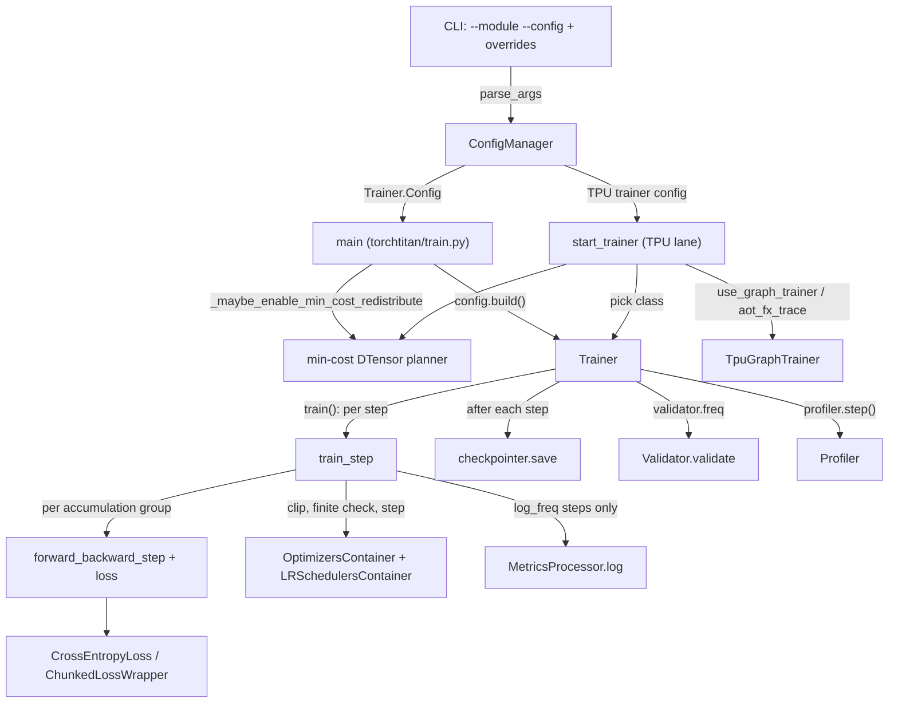

# Training loop, from the train.py entry point to one optimizer step

## Overview
A TorchTitan run is one long-lived [`Trainer`](https://github.com/google-pytorch/torchtitan/blob/033f131322a8b5b026ac53d734c689d664442bf8/torchtitan/trainer.py#L74 "torchtitan/trainer#Trainer")
object driven by a tiny launcher. The launcher is either the generic
[`main`](https://github.com/google-pytorch/torchtitan/blob/033f131322a8b5b026ac53d734c689d664442bf8/torchtitan/train.py#L48 "torchtitan/train#main") in `torchtitan/train.py`
(parse config, build the trainer from its config, call `train()`, tear down) or, on Cloud TPU, the
[`start_trainer`](https://github.com/google-pytorch/torchtitan/blob/033f131322a8b5b026ac53d734c689d664442bf8/torchtitan/experiments/tpu/train.py#L215 "torchtitan/experiments/tpu/train#start_trainer")
lane in `torchtitan/experiments/tpu/train.py`, which picks one of three trainer classes and patches the
model's parallelize function before doing the same thing. The loop itself is deliberately plain: each
step pulls `gradient_accumulation_steps` groups of microbatches onto the host, agrees on a *global*
count of valid tokens (kept on the device), runs forward and backward per group with the loss already
divided by that global count, then clips, refuses the update if the loss or gradient norm is not finite,
steps the [`OptimizersContainer`](https://github.com/google-pytorch/torchtitan/blob/033f131322a8b5b026ac53d734c689d664442bf8/torchtitan/components/optimizer/optimizer.py#L84 "torchtitan/components/optimizer/optimizer#OptimizersContainer")
and [`LRSchedulersContainer`](https://github.com/google-pytorch/torchtitan/blob/033f131322a8b5b026ac53d734c689d664442bf8/torchtitan/components/optimizer/lr_scheduler.py#L25 "torchtitan/components/optimizer/lr_scheduler#LRSchedulersContainer"),
and only on logging steps pays for the distributed loss reductions and device-to-host copies. The
key design idea is that the gradient is exactly "sum of per-token losses over the global batch, divided
by the number of valid tokens", independent of how the batch is split across microbatches and
data-parallel ranks.

## Diagram

Legend:
- `CLI` - (concept) command line: `--module`, `--config` and dotted `--section.key` overrides
- `CM` - [`ConfigManager`](https://github.com/google-pytorch/torchtitan/blob/033f131322a8b5b026ac53d734c689d664442bf8/torchtitan/config/manager.py#L29 "torchtitan/config/manager#ConfigManager") via [`parse_args`](https://github.com/google-pytorch/torchtitan/blob/033f131322a8b5b026ac53d734c689d664442bf8/torchtitan/config/manager.py#L44 "torchtitan/config/manager#ConfigManager.parse_args")
- `MAIN` - [`main`](https://github.com/google-pytorch/torchtitan/blob/033f131322a8b5b026ac53d734c689d664442bf8/torchtitan/train.py#L48 "torchtitan/train#main")
- `TPU` - [`start_trainer`](https://github.com/google-pytorch/torchtitan/blob/033f131322a8b5b026ac53d734c689d664442bf8/torchtitan/experiments/tpu/train.py#L215 "torchtitan/experiments/tpu/train#start_trainer")
- `MC` - [`_maybe_enable_min_cost_redistribute`](https://github.com/google-pytorch/torchtitan/blob/033f131322a8b5b026ac53d734c689d664442bf8/torchtitan/train.py#L19 "torchtitan/train#_maybe_enable_min_cost_redistribute")
- `TR` - [`Trainer`](https://github.com/google-pytorch/torchtitan/blob/033f131322a8b5b026ac53d734c689d664442bf8/torchtitan/trainer.py#L74 "torchtitan/trainer#Trainer"), built through [`build`](https://github.com/google-pytorch/torchtitan/blob/033f131322a8b5b026ac53d734c689d664442bf8/torchtitan/config/configurable.py#L134 "torchtitan/config/configurable#Configurable.Config.build")
- `TGT` - [`TpuGraphTrainer`](https://github.com/google-pytorch/torchtitan/blob/033f131322a8b5b026ac53d734c689d664442bf8/torchtitan/experiments/tpu/graph_trainer/tpu_graph_trainer.py#L90 "torchtitan/experiments/tpu/graph_trainer/tpu_graph_trainer#TpuGraphTrainer") (subclass of [`GraphTrainer`](https://github.com/google-pytorch/torchtitan/blob/033f131322a8b5b026ac53d734c689d664442bf8/torchtitan/experiments/graph_trainer/trainer.py#L142 "torchtitan/experiments/graph_trainer/trainer#GraphTrainer"))
- `STEP` - (concept) the Trainer's per-step method; see [trainer-lifecycle](trainer-lifecycle.md). Variant shown by [`train_step`](https://github.com/google-pytorch/torchtitan/blob/033f131322a8b5b026ac53d734c689d664442bf8/torchtitan/experiments/torchft/trainer.py#L454 "torchtitan/experiments/torchft/trainer#FaultTolerantTrainer.train_step")
- `FB` - (concept) the Trainer's forward/backward method; the Flux variant is [`forward_backward_step`](https://github.com/google-pytorch/torchtitan/blob/033f131322a8b5b026ac53d734c689d664442bf8/torchtitan/models/flux/trainer.py#L216 "torchtitan/models/flux/trainer#FluxTrainer.forward_backward_step")
- `LOSS` - [`CrossEntropyLoss`](https://github.com/google-pytorch/torchtitan/blob/033f131322a8b5b026ac53d734c689d664442bf8/torchtitan/components/loss.py#L287 "torchtitan/components/loss#CrossEntropyLoss") or [`ChunkedLossWrapper`](https://github.com/google-pytorch/torchtitan/blob/033f131322a8b5b026ac53d734c689d664442bf8/torchtitan/components/loss.py#L515 "torchtitan/components/loss#ChunkedLossWrapper")
- `OPT` - [`OptimizersContainer`](https://github.com/google-pytorch/torchtitan/blob/033f131322a8b5b026ac53d734c689d664442bf8/torchtitan/components/optimizer/optimizer.py#L84 "torchtitan/components/optimizer/optimizer#OptimizersContainer") and [`LRSchedulersContainer`](https://github.com/google-pytorch/torchtitan/blob/033f131322a8b5b026ac53d734c689d664442bf8/torchtitan/components/optimizer/lr_scheduler.py#L25 "torchtitan/components/optimizer/lr_scheduler#LRSchedulersContainer")
- `MET` - [`log`](https://github.com/google-pytorch/torchtitan/blob/033f131322a8b5b026ac53d734c689d664442bf8/torchtitan/components/metrics.py#L467 "torchtitan/components/metrics#MetricsProcessor.log") on [`MetricsProcessor`](https://github.com/google-pytorch/torchtitan/blob/033f131322a8b5b026ac53d734c689d664442bf8/torchtitan/components/metrics.py#L265 "torchtitan/components/metrics#MetricsProcessor")
- `CKPT` - (concept) the checkpointer's `save`; the default checkpointer is [`CheckpointManager`](https://github.com/google-pytorch/torchtitan/blob/033f131322a8b5b026ac53d734c689d664442bf8/torchtitan/components/checkpointer/dcp.py#L89 "torchtitan/components/checkpointer/dcp#CheckpointManager")
- `VAL` - [`validate`](https://github.com/google-pytorch/torchtitan/blob/033f131322a8b5b026ac53d734c689d664442bf8/torchtitan/components/validate.py#L142 "torchtitan/components/validate#Validator.validate") on [`Validator`](https://github.com/google-pytorch/torchtitan/blob/033f131322a8b5b026ac53d734c689d664442bf8/torchtitan/components/validate.py#L57 "torchtitan/components/validate#Validator")
- `PROF` - [`Profiler`](https://github.com/google-pytorch/torchtitan/blob/033f131322a8b5b026ac53d734c689d664442bf8/torchtitan/tools/profiler.py#L106 "torchtitan/tools/profiler#Profiler")

## Design rationale (why it's built this way)
- **The launcher is thin; the trainer owns everything.** [`main`](https://github.com/google-pytorch/torchtitan/blob/033f131322a8b5b026ac53d734c689d664442bf8/torchtitan/train.py#L48 "torchtitan/train#main")
  does not know the model, the parallelism or the data. It parses a config, calls
  `config.build()` (the [`build`](https://github.com/google-pytorch/torchtitan/blob/033f131322a8b5b026ac53d734c689d664442bf8/torchtitan/config/configurable.py#L134 "torchtitan/config/configurable#Configurable.Config.build")
  auto-wired by [`Configurable`](https://github.com/google-pytorch/torchtitan/blob/033f131322a8b5b026ac53d734c689d664442bf8/torchtitan/config/configurable.py#L18 "torchtitan/config/configurable#Configurable")
  to construct the owning class), and calls `train()`. That is why swapping the trainer (Flux,
  fault-tolerant, graph trainer) is a subclass plus a `Config` subclass, not a new script.
- **The min-cost redistribution planner must wrap model construction, not just training.** The
  docstring of [`_maybe_enable_min_cost_redistribute`](https://github.com/google-pytorch/torchtitan/blob/033f131322a8b5b026ac53d734c689d664442bf8/torchtitan/train.py#L19 "torchtitan/train#_maybe_enable_min_cost_redistribute")
  says the planner "runs during tracing, so a plan chosen under the greedy planner is baked into the
  compiled graph and a later switch has no effect". It also clears DTensor's plan cache, because the
  context manager "only flips a global". The flag's docstring on
  [`ParallelismConfig`](https://github.com/google-pytorch/torchtitan/blob/033f131322a8b5b026ac53d734c689d664442bf8/torchtitan/config/configs.py#L123 "torchtitan/config/configs#ParallelismConfig")
  explains why it matters on TPU: for an HSDP gradient the greedy planner all-reduces the full tensor
  over the replicate axis before reduce-scattering; the min-cost planner reduce-scatters first,
  shrinking the all-reduce payload by the shard degree, "a large win on multi-slice, where the
  replicate dim crosses DCN". It is off by default because planning is paid per redistribute while
  tracing.
- **Loss is normalized by global valid tokens before backward.** Every loss class divides its
  sum-reduced loss by `global_valid_tokens` ([`CrossEntropyLoss`](https://github.com/google-pytorch/torchtitan/blob/033f131322a8b5b026ac53d734c689d664442bf8/torchtitan/components/loss.py#L287 "torchtitan/components/loss#CrossEntropyLoss")
  is "Cross-entropy loss with sum reduction for token-based normalization"). Summing gradients across
  microbatches and ranks therefore yields the true per-token mean for the whole global batch, even
  when padding or `IGNORE_INDEX` labels make microbatches uneven. MoE auxiliary losses use the same
  denominator ([`AuxLoss`](https://github.com/google-pytorch/torchtitan/blob/033f131322a8b5b026ac53d734c689d664442bf8/torchtitan/models/common/aux_loss.py#L81 "torchtitan/models/common/aux_loss#AuxLoss") receives it before the first forward), "so their scale is independent of
  parallelism degrees". The cost is one small all-reduce of the token count before any forward runs,
  and the source keeps that count "on device so loss normalization does not introduce a CPU
  synchronization in the training path".
- **Microbatches are staged on the host.** The batch generator yields CPU tensors; the step moves each
  microbatch to the device only right before its forward. The docstring says this "allows for more
  efficient memory usage when doing gradient accumulation": device memory holds one microbatch of
  inputs at a time, not all of them.
- **Non-finite steps are refused on the device, every step.** Each group's loss finiteness is folded
  into a device flag, reduced with `MIN` over the `loss` and `pp` meshes, combined with the gradient
  norm's finiteness and checked with an asynchronous assertion before `optimizers.step()`. The comment
  explains the shape: it keeps "the check and optimizer kernels ordered on the device without
  synchronizing the host on every step".
- **Expensive reductions only on log steps.** Global average loss, global max loss and tokens-seen are
  reduced across the `loss` mesh and copied to the host only when
  [`MetricsProcessor`](https://github.com/google-pytorch/torchtitan/blob/033f131322a8b5b026ac53d734c689d664442bf8/torchtitan/components/metrics.py#L265 "torchtitan/components/metrics#MetricsProcessor")
  says the step should be logged (step 1 and every `log_freq`); the step only accumulates the loss
  tensor at all when it will be logged.

> [!inferred]
> For TPU this shape matters twice. First, under TorchTPU's deferred execution every `.item()` is a
> materialization point, so keeping loss reductions off non-log steps lets consecutive steps be
> dispatched without waiting on the device. Second, with the token count and the finiteness check both
> kept as device tensors, a non-log step of the base loop has no host read of its own; the remaining
> host syncs are on log steps (`int(global_valid_tokens)`, the loss reductions and `grad_norm.item()`).
> Waiting for async checkpoint staging immediately before the optimizer step (rather than earlier)
> presumably lets the checkpoint's device-to-host copy overlap the next step's forward and backward
> while guaranteeing the optimizer never mutates weights mid-copy.

## Entry points
- [`main`](https://github.com/google-pytorch/torchtitan/blob/033f131322a8b5b026ac53d734c689d664442bf8/torchtitan/train.py#L48 "torchtitan/train#main") is the generic entry
  (`python -m torchtitan.train --module llama3 --config llama3_debugmodel ...`). It initializes the
  logger with [`init_logger`](https://github.com/google-pytorch/torchtitan/blob/033f131322a8b5b026ac53d734c689d664442bf8/torchtitan/tools/logging.py#L15 "torchtitan/tools/logging#init_logger"),
  parses with [`parse_args`](https://github.com/google-pytorch/torchtitan/blob/033f131322a8b5b026ac53d734c689d664442bf8/torchtitan/config/manager.py#L44 "torchtitan/config/manager#ConfigManager.parse_args"),
  starts the structured logger with [`init_structured_logger`](https://github.com/google-pytorch/torchtitan/blob/033f131322a8b5b026ac53d734c689d664442bf8/torchtitan/observability/structured_logger/structured_logging.py#L224 "torchtitan/observability/structured_logger/structured_logging#init_structured_logger") (and emits a
  `structured_logger_started` instant), then builds and trains inside an `ExitStack` that may hold the
  min-cost planner.
- [`start_trainer`](https://github.com/google-pytorch/torchtitan/blob/033f131322a8b5b026ac53d734c689d664442bf8/torchtitan/experiments/tpu/train.py#L215 "torchtitan/experiments/tpu/train#start_trainer")
  is the TPU lane's entry, invoked through the TPU `gmain` wrapper after flags such as XLA/libtpu flags
  and the TorchTPU eager mode have been applied. It chooses the trainer class from the model name and
  the TPU config (Flux trainer for `flux`, [`TpuGraphTrainer`](https://github.com/google-pytorch/torchtitan/blob/033f131322a8b5b026ac53d734c689d664442bf8/torchtitan/experiments/tpu/graph_trainer/tpu_graph_trainer.py#L90 "torchtitan/experiments/tpu/graph_trainer/tpu_graph_trainer#TpuGraphTrainer")
  for `--tpu-config.use-graph-trainer` or `compile_mode=aot_fx_trace` with a per-model GraphTrainer
  registry for `qwen3`, `llama3`, `deepseek_v3` and `muse_glimmer`, otherwise a TPU subclass of
  [`Trainer`](https://github.com/google-pytorch/torchtitan/blob/033f131322a8b5b026ac53d734c689d664442bf8/torchtitan/trainer.py#L74 "torchtitan/trainer#Trainer")), sizes every RoPE cache to
  `training.max_context_length`, wraps the model spec's parallelize function with TPU workarounds, and
  reuses [`_maybe_enable_min_cost_redistribute`](https://github.com/google-pytorch/torchtitan/blob/033f131322a8b5b026ac53d734c689d664442bf8/torchtitan/train.py#L19 "torchtitan/train#_maybe_enable_min_cost_redistribute")
  from the generic entry. After the build it asks every model part whether scan-over-layers was really
  applied when `use_scan_layers` is set.
- [`train`](https://github.com/google-pytorch/torchtitan/blob/033f131322a8b5b026ac53d734c689d664442bf8/torchtitan/experiments/torchft/trainer.py#L588 "torchtitan/experiments/torchft/trainer#FaultTolerantTrainer.train")
  (fault-tolerant variant) shows the same loop wrapped in a TorchFT semi-sync context manager, which
  turns it into DiLoCo or LocalSGD when TorchFT is enabled; it is useful as a diff against the
  base loop.

## Mechanism (step-by-step)
1. **Parse and select the config.** [`ConfigManager`](https://github.com/google-pytorch/torchtitan/blob/033f131322a8b5b026ac53d734c689d664442bf8/torchtitan/config/manager.py#L29 "torchtitan/config/manager#ConfigManager")
   imports `<module>.config_registry`, calls the named config function to get a fully populated
   trainer config (with its [`ModelSpec`](https://github.com/google-pytorch/torchtitan/blob/033f131322a8b5b026ac53d734c689d664442bf8/torchtitan/protocols/model_spec.py#L33 "torchtitan/protocols/model_spec#ModelSpec")
   already attached), then lets tyro apply CLI overrides on top. See [job-configuration](job-configuration.md).
2. **Open the planner scope and build.** Inside an `ExitStack`,
   [`_maybe_enable_min_cost_redistribute`](https://github.com/google-pytorch/torchtitan/blob/033f131322a8b5b026ac53d734c689d664442bf8/torchtitan/train.py#L19 "torchtitan/train#_maybe_enable_min_cost_redistribute")
   enters DTensor's min-cost planner when `--parallelism.enable_min_cost_redistribute` is set, then
   [`build`](https://github.com/google-pytorch/torchtitan/blob/033f131322a8b5b026ac53d734c689d664442bf8/torchtitan/config/configurable.py#L134 "torchtitan/config/configurable#Configurable.Config.build")
   constructs the [`Trainer`](https://github.com/google-pytorch/torchtitan/blob/033f131322a8b5b026ac53d734c689d664442bf8/torchtitan/trainer.py#L74 "torchtitan/trainer#Trainer"):
   distributed init and mesh, meta-device model build, parallelization, weight init, optimizer,
   dataloader and checkpointer (details in [trainer-lifecycle](trainer-lifecycle.md)). On the TPU lane
   [`start_trainer`](https://github.com/google-pytorch/torchtitan/blob/033f131322a8b5b026ac53d734c689d664442bf8/torchtitan/experiments/tpu/train.py#L215 "torchtitan/experiments/tpu/train#start_trainer")
   first runs a `dist.barrier()` (so rank 0 cannot race into an XLA all-reduce while other ranks are
   still compiling their device-init graph, a documented deadlock) and forces `debug.seed=42` when
   unset (a workaround for a TPU hang).
3. **Seed checkpoint or train.** If `checkpoint.create_seed_checkpoint` is set, the entry asserts
   `WORLD_SIZE == 1` and checkpointing enabled, then calls the checkpointer's `save` (by default a
   [`CheckpointManager`](https://github.com/google-pytorch/torchtitan/blob/033f131322a8b5b026ac53d734c689d664442bf8/torchtitan/components/checkpointer/dcp.py#L89 "torchtitan/components/checkpointer/dcp#CheckpointManager"))
   with `curr_step=0, last_step=True` instead of training. A seed checkpoint is an unsharded,
   deterministic initialization that sharded runs can load.
4. **Resume and loop.** `train()` calls [`load`](https://github.com/google-pytorch/torchtitan/blob/033f131322a8b5b026ac53d734c689d664442bf8/torchtitan/components/checkpointer/base.py#L230 "torchtitan/components/checkpointer/base#BaseCheckpointManager.load")
   (restoring `step` and `ntokens_seen` via the trainer's own state dict), opens the
   [`Profiler`](https://github.com/google-pytorch/torchtitan/blob/033f131322a8b5b026ac53d734c689d664442bf8/torchtitan/tools/profiler.py#L106 "torchtitan/tools/profiler#Profiler")
   with the loaded step so trace folders are named correctly, and loops while `step < training.steps`
   (the [`training`](https://github.com/google-pytorch/torchtitan/blob/033f131322a8b5b026ac53d734c689d664442bf8/torchtitan/trainer.py#L113 "torchtitan/trainer#Trainer.Config.training")
   section). Each iteration increments `step`, runs the GC handler, runs the step inside a
   [`log_trace_span`](https://github.com/google-pytorch/torchtitan/blob/033f131322a8b5b026ac53d734c689d664442bf8/torchtitan/observability/structured_logger/structured_logging.py#L364 "torchtitan/observability/structured_logger/structured_logging#log_trace_span")
   named `step`, then calls checkpoint save, validation (when `validator.enable` and the validator says
   this step is due) and `profiler.step()`. Running out of data raises a dataloader-exhausted error that
   cancels the whole step and ends the loop.
5. **Collect microbatches and the global token count.** The step zeroes gradients, snapshots the
   per-group learning rates, then pulls `gradient_accumulation_steps` groups of `num_pp_microbatches`
   microbatches each (one microbatch per group without pipeline parallelism) into a host-side list. The
   collator already counted each batch's non-`IGNORE_INDEX` labels as `num_valid_tokens`; the step pops
   that field and sums it. The sum becomes an `int64` device tensor and, with data parallelism enabled,
   is summed over the `batch` mesh from [`get_mesh`](https://github.com/google-pytorch/torchtitan/blob/033f131322a8b5b026ac53d734c689d664442bf8/torchtitan/distributed/parallel_dims.py#L435 "torchtitan/distributed/parallel_dims#ParallelDims.get_mesh")
   without a host round trip; it is then handed to [`AuxLoss`](https://github.com/google-pytorch/torchtitan/blob/033f131322a8b5b026ac53d734c689d664442bf8/torchtitan/models/common/aux_loss.py#L81 "torchtitan/models/common/aux_loss#AuxLoss")
   as the step denominator. The fault-tolerant
   [`train_step`](https://github.com/google-pytorch/torchtitan/blob/033f131322a8b5b026ac53d734c689d664442bf8/torchtitan/experiments/torchft/trainer.py#L454 "torchtitan/experiments/torchft/trainer#FaultTolerantTrainer.train_step")
   follows the same structure (accumulation groups, SDC replay of the first group), without the HSDP
   toggle or the non-finite check.
6. **Forward and backward per accumulation group.** Each group's tensors are moved to the device
   (`non_blocking=True`) and handed to the forward/backward function. Input post-processing (attention
   masks and document metadata for the attention backend, context-parallel sequence sharding, input
   annotation) is the model's own `preprocess_inputs` on [`BaseModel`](https://github.com/google-pytorch/torchtitan/blob/033f131322a8b5b026ac53d734c689d664442bf8/torchtitan/protocols/model.py#L36 "torchtitan/protocols/model#BaseModel"),
   not trainer code. Without pipeline parallelism the model is called once, the loss
   ([`CrossEntropyLoss`](https://github.com/google-pytorch/torchtitan/blob/033f131322a8b5b026ac53d734c689d664442bf8/torchtitan/components/loss.py#L287 "torchtitan/components/loss#CrossEntropyLoss"),
   or [`ChunkedLossWrapper`](https://github.com/google-pytorch/torchtitan/blob/033f131322a8b5b026ac53d734c689d664442bf8/torchtitan/components/loss.py#L515 "torchtitan/components/loss#ChunkedLossWrapper")
   which computes lm_head plus loss per token chunk to cap the `[T, V]` logits at `O(T/N*V)`) divides by
   the global token count, the prediction is freed, and `backward()` runs. With pipeline parallelism the
   schedule's `step()` does forward and backward over the group's microbatches, and only the last stage
   holds real losses (others report a `-1` sentinel). Under HSDP the replicate all-reduce is switched
   off for every group but the last, so gradients cross the replicate axis once per optimizer step. The
   function may be wrapped for CUDA-graph capture (never on TPU, see Edge cases), and an optional SDC
   replayer re-runs the first group to detect silent data corruption.
7. **Optimizer phase.** Under an `optim` span the step clips the global gradient norm over all model
   parts (PP- and EP-aware), reduces the loss-finiteness flag over the `loss` and `pp` meshes, asserts
   asynchronously that loss and gradient norm are finite ("Stopping training before the optimizer
   update"), waits for any in-flight async checkpoint staging, then steps
   [`OptimizersContainer`](https://github.com/google-pytorch/torchtitan/blob/033f131322a8b5b026ac53d734c689d664442bf8/torchtitan/components/optimizer/optimizer.py#L84 "torchtitan/components/optimizer/optimizer#OptimizersContainer")
   and [`LRSchedulersContainer`](https://github.com/google-pytorch/torchtitan/blob/033f131322a8b5b026ac53d734c689d664442bf8/torchtitan/components/optimizer/lr_scheduler.py#L25 "torchtitan/components/optimizer/lr_scheduler#LRSchedulersContainer").
8. **Log (sometimes).** On log steps the summed group loss is reduced over the `loss` mesh into a
   global average (a plain sum, because each rank's loss is already divided by the global count) and a
   global max of per-rank local averages. Then
   [`log`](https://github.com/google-pytorch/torchtitan/blob/033f131322a8b5b026ac53d734c689d664442bf8/torchtitan/components/metrics.py#L467 "torchtitan/components/metrics#MetricsProcessor.log")
   receives those losses, the clipped gradient norm and extra metrics (tokens seen, learning rates,
   auxiliary-loss and MoE load-balancing metrics), and computes tokens per second per device, TFLOPs and
   MFU (skipped under quantization, since MFU is defined against BF16 peak), timing and peak device
   memory, and resets its windows.
9. **Teardown.** On success the entry calls `close()` on the trainer (dataloader, checkpointer and
   metrics), then a barrier and `destroy_process_group()` under a
   [`log_trace_span`](https://github.com/google-pytorch/torchtitan/blob/033f131322a8b5b026ac53d734c689d664442bf8/torchtitan/observability/structured_logger/structured_logging.py#L364 "torchtitan/observability/structured_logger/structured_logging#log_trace_span");
   on an exception it closes the trainer and re-raises without the barrier or process-group teardown.

## TPU-specific step variants
- **Graph split (regular trainer).** With `--tpu-config.use-graph-split` and no PP, the TPU subclass
  launched by [`start_trainer`](https://github.com/google-pytorch/torchtitan/blob/033f131322a8b5b026ac53d734c689d664442bf8/torchtitan/experiments/tpu/train.py#L215 "torchtitan/experiments/tpu/train#start_trainer")
  inserts a non-blocking TorchTPU `synchronize(loss, wait=False)` between loss and `backward()`. This
  cuts the deferred-op graph into a forward program and a backward program, "significantly reducing
  first-step XLA compilation time", while autograd is unaffected. The same subclass replaces the loss
  with a TPU cross-entropy builder when it is given a TPU trainer config.
- **Compiled grad norm and optimizer.** `compile_grad_norm` replaces the clipping step's norm with a
  standalone static XLA graph (clipping itself stays eager); `compile_optimizer` compiles the AdamW step
  into its own graph. The TPU config rejects `compile_grad_norm` with EP or PP > 1 and with
  `optimizer_in_graph`.
- **Graph trainer.** [`GraphTrainer`](https://github.com/google-pytorch/torchtitan/blob/033f131322a8b5b026ac53d734c689d664442bf8/torchtitan/experiments/graph_trainer/trainer.py#L142 "torchtitan/experiments/graph_trainer/trainer#GraphTrainer")
  in `aot_fx_trace` mode traces forward, loss and backward once into a joint FX graph, applies graph
  passes, and on later steps replays it and accumulates the returned gradients (or, with in-place graph
  gradient accumulation, accumulates inside the graph; that option requires `aot_fx_trace`, no PP and a
  single model part). It falls back to the base forward/backward under PP or any other compile mode.
  [`TpuGraphTrainer`](https://github.com/google-pytorch/torchtitan/blob/033f131322a8b5b026ac53d734c689d664442bf8/torchtitan/experiments/tpu/graph_trainer/tpu_graph_trainer.py#L90 "torchtitan/experiments/tpu/graph_trainer/tpu_graph_trainer#TpuGraphTrainer")
  adds the TPU pass pipeline and optionally folds the AdamW update into the same graph
  (`optimizer_in_graph`). It rejects [`ChunkedLossWrapper`](https://github.com/google-pytorch/torchtitan/blob/033f131322a8b5b026ac53d734c689d664442bf8/torchtitan/components/loss.py#L515 "torchtitan/components/loss#ChunkedLossWrapper")
  "until it can preserve sequential chunk lifetimes". With `bld_block_layout` the launcher applies the
  `[B, L]` block layout before the graph trainer's own parallelize function, because that function binds
  instance-level forward wrappers after which a class swap no longer takes effect. The launcher warns
  that enabling the graph trainer without a fullgraph compile mode "may lead to severe HBM fragmentation
  and stack reservation OOMs".
- **Flux.** The Flux trainer's [`train_step`](https://github.com/google-pytorch/torchtitan/blob/033f131322a8b5b026ac53d734c689d664442bf8/torchtitan/models/flux/trainer.py#L357 "torchtitan/models/flux/trainer#FluxTrainer.train_step")
  and [`forward_backward_step`](https://github.com/google-pytorch/torchtitan/blob/033f131322a8b5b026ac53d734c689d664442bf8/torchtitan/models/flux/trainer.py#L216 "torchtitan/models/flux/trainer#FluxTrainer.forward_backward_step")
  bypass the TPU integration entirely and assert `global_valid_tokens is None`, because the diffusion
  loss is rescaled inside the step (it recomputes the count from the image encodings) rather than per
  text token.

## Key data structures
- `step` and `ntokens_seen` on [`Trainer`](https://github.com/google-pytorch/torchtitan/blob/033f131322a8b5b026ac53d734c689d664442bf8/torchtitan/trainer.py#L74 "torchtitan/trainer#Trainer"):
  the only loop state saved in checkpoints (`{"step", "ntokens_seen"}`); `ntokens_seen` counts the
  labels returned by the model's input preprocessing (after CP sharding), so it reflects what this rank
  actually processed.
- `gradient_accumulation_steps`: `num_tokens_per_train_step // (num_tokens_per_microbatch_per_dp_rank
  * num_pp_microbatches * dp_degree)`, fixed at construction from the token-based fields of
  [`TrainingConfig`](https://github.com/google-pytorch/torchtitan/blob/033f131322a8b5b026ac53d734c689d664442bf8/torchtitan/config/configs.py#L36 "torchtitan/config/configs#TrainingConfig").
- `global_valid_tokens`: an `int64` device tensor, the denominator every microbatch loss (and every
  auxiliary loss) is divided by.
- The returned per-group loss is "local SUM loss / global_valid_tokens"; the accumulated step loss
  is the sum of those, so summing again over ranks gives the global mean.

## Dynamics (design intent)
- The process-group timeout is tightened to `comm.train_timeout_seconds` after the first step of this
  process (using the step relative to the loaded checkpoint, so resumed runs also get it), on the
  assumption that lazy init and compilation are done. The base loop skips this on `tpu` and `cpu`
  devices (a TODO notes TPU lacks `set_pg_timeouts`); the fault-tolerant loop does not have that guard
  and keys on absolute `step == 1`.
- GC is taken over by the trainer and run every `training.gc_freq` steps "to avoid stragglers".
- Checkpoint save is called every step; the checkpointer decides from the interval and `last_step`
  whether to write, and in async modes returns after staging.
- Validation runs synchronously inside the step span, after the checkpoint save and before
  `profiler.step()`, and switches model parts to eval mode for its duration.

## Edge cases
- `training.num_tokens_per_train_step` must be divisible by
  `num_tokens_per_microbatch_per_dp_rank * num_pp_microbatches * dp_degree`; `-1` (the default) means
  exactly one accumulation step.
- The non-finite guard now runs every step, but asynchronously: the failure surfaces when the device
  executes the assertion, not at the Python line. The source notes the error "is catchable on CPU,
  while a failed CUDA assertion invalidates the process".
- If data runs out mid-accumulation the partial step is discarded, not applied.
- CUDA graphs are on by default in the base config (`training.disable_cuda_graphs = False`) and only
  take effect on NVIDIA CUDA; the TPU trainer config forces `disable_cuda_graphs = True` before the
  base validation runs, because that validation rejects every TPU MoE token dispatcher.
- On the TPU lane, `use_graph_split` is ignored when PP is enabled, and the Flux model rejects
  `compile_grad_norm`.
- Under PP the last stage's losses are detached, summed and moved to the device; non-last stages
  return the `-1` sentinel, so their logged loss is meaningless.

## Open questions
- The base loop, the TPU trainer subclass and the graph trainer each implement grad-norm clipping
  differently; which one is numerically authoritative for TPU recipes is not stated. The TPU subclass
  and its config class are outside this packet's subgraph.
- How the asynchronous finiteness assertion surfaces under TorchTPU (where in the deferred graph it
  fails, and whether the process stays usable) is not settled by the source.
- The fault-tolerant loop logs only the first scheduler's LR and omits the non-finite check; it
  is unclear whether that divergence is intentional.

## See also
- [Trainer lifecycle](trainer-lifecycle.md): construction order and what each component receives.
- [Job configuration](job-configuration.md): how `--module/--config` and CLI overrides produce the config.
- [Loss and validation](loss-and-validation.md): token-normalized losses and the validator.
- [Optimizer and LR schedule](optimizer-and-lr-schedule.md): what the optimizer phase steps.
- [Metrics and observability](metrics-and-observability.md): MFU, tps and structured trace spans.
- [Checkpointing](checkpointing.md): save cadence, async staging and seed checkpoints.
- [torch.compile integration](torch-compile-integration.md) and [TorchTPU backend](torchtpu-backend.md): compile modes and graph split.
- [Pipeline parallel](pipeline-parallel.md): the schedule-driven forward/backward branch.

## Recent changes
- `fa627bf2` rebases onto upstream `d771abb0`: batch sizing becomes token-based (`num_tokens_per_microbatch_per_dp_rank`, `num_tokens_per_train_step`, `max_context_length`), the global token count stays on device, a per-step non-finite loss/grad-norm assertion guards the optimizer update, forward/backward can be CUDA-graph captured (the TPU config opts out), the checkpointer becomes a package, and `main` drops its `local_tensor` early return.
- `6f108364` registers text-only Muse Glimmer with the TPU trainer; `f94af2bb` routes `muse_glimmer` to the TPU GraphTrainer in `start_trainer`.
- `bf6d10b2` keeps the `[B, L]` block layout under GraphSplitter activation offload, simplifying the launcher's skip-reason call.
- `552d351b`, `567dbe5d` and `e7964fec` settle how MaxText FLOPs reach MFU: a short-lived launcher override was replaced by the recipe's model config carrying the convention.
- `0785a99b` (document-aware splash attention for the HF backend) makes `start_trainer` raise Dynamo recompile limits for the model.
- [all changes in 033f131322](../changes/033f131322.md)
