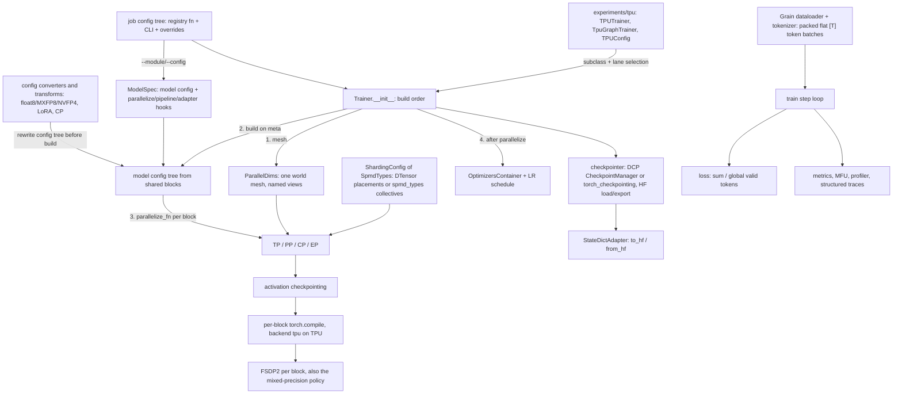
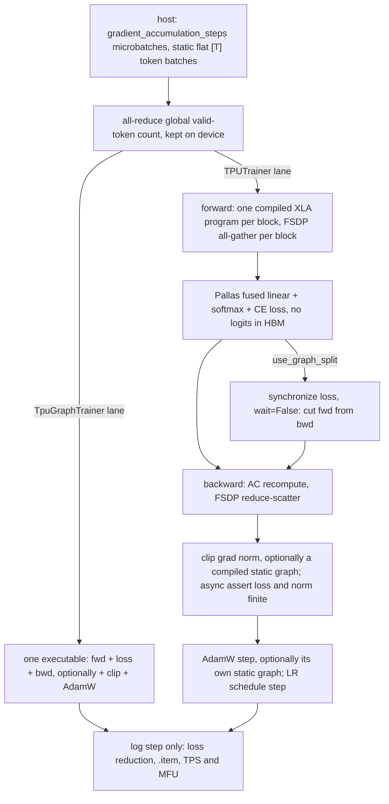

# torchtitan - what it is and how it fits together

> **Which torchtitan.** This is https://github.com/google-pytorch/torchtitan, Google's TorchTitan
> and the one with the TorchTPU backend (`torchtitan/experiments/tpu`). The official
> https://github.com/pytorch/torchtitan has no TPU backend. Symbols, lines and flags here are for
> the Google repo at the pin; do not assume they match upstream.

## In one paragraph
TorchTitan is a PyTorch-native training platform for large language (and diffusion) models: one
`Trainer` class drives any model that satisfies a small protocol, and every parallelism is a
PyTorch primitive (FSDP2, DTensor tensor parallelism, `torch.distributed.pipelining`, context and
expert parallelism). A job is not a YAML file but a tree of Python dataclass configs returned by a
registry function (`--module/--config`), edited by the CLI and rewritten by `@override` factories
before anything is built. The trainer then builds a device mesh, constructs the model on the
`meta` device, applies parallelism per transformer block (TP/CP/EP, then activation checkpointing,
then `torch.compile`, then FSDP), materializes only each rank's shards, and only then builds the
optimizer. Batches are sized in tokens and arrive as one flattened `[T]` token stream, and the loss
is a sum divided by a global valid-token count, so the gradient does not depend on how the batch was
split. On Cloud TPU the `torchtitan/experiments/tpu` backend subclasses this
trainer and runs it on `torch_tpu` in two lanes; its central idea is that on TPU, performance is
decided by how much of the step becomes one XLA program.

## Core architecture

Legend:
- `CFG` - [job-configuration](concepts/job-configuration.md) (overrides: [kernel-overrides](doc-concepts/kernel-overrides.md))
- `SPEC` - [train-spec-and-model-protocol](concepts/train-spec-and-model-protocol.md)
- `CONV` - [quantization](concepts/quantization.md), [lora](concepts/lora.md) and the CP transform in [context-parallel](concepts/context-parallel.md)
- `MODEL` - [model-definitions](concepts/model-definitions.md)
- `TRN` - [trainer-lifecycle](concepts/trainer-lifecycle.md)
- `TPU` - [torchtpu-backend](concepts/torchtpu-backend.md)
- `MESH` - [parallel-dims-and-mesh](concepts/parallel-dims-and-mesh.md)
- `AXES` - [tensor-parallel](concepts/tensor-parallel.md), [pipeline-parallel](concepts/pipeline-parallel.md), [context-parallel](concepts/context-parallel.md), [expert-parallel](concepts/expert-parallel.md)
- `SHARD` - [dtensor-and-sharding-types](concepts/dtensor-and-sharding-types.md) (`ShardingConfig`: [train-spec-and-model-protocol](concepts/train-spec-and-model-protocol.md))
- `AC` - [activation-checkpointing](concepts/activation-checkpointing.md)
- `COMP` - [torch-compile-integration](concepts/torch-compile-integration.md)
- `FSDP` - [fsdp-sharding](concepts/fsdp-sharding.md)
- `OPT` - [optimizer-and-lr-schedule](concepts/optimizer-and-lr-schedule.md)
- `CKPT` - [checkpointing](concepts/checkpointing.md)
- `SDA` - [state-dict-adapters](concepts/state-dict-adapters.md)
- `DATA` - [dataloading-and-tokenizer](concepts/dataloading-and-tokenizer.md)
- `LOOP` - [training-loop](concepts/training-loop.md)
- `LOSS` - [loss-and-validation](concepts/loss-and-validation.md)
- `OBS` - [metrics-and-observability](concepts/metrics-and-observability.md) and [profiling-and-tooling](concepts/profiling-and-tooling.md)

One TPU training step, in the two lanes (`start_trainer` picks the lane once, at launch):

Legend:
- `A` - [dataloading-and-tokenizer](concepts/dataloading-and-tokenizer.md), [training-loop](concepts/training-loop.md)
- `B` - [training-loop](concepts/training-loop.md), [loss-and-validation](concepts/loss-and-validation.md)
- `C` - [torch-compile-integration](concepts/torch-compile-integration.md), [fsdp-sharding](concepts/fsdp-sharding.md)
- `D` - [loss-and-validation](concepts/loss-and-validation.md), [torchtpu-backend](concepts/torchtpu-backend.md)
- `E` - [torchtpu-backend](concepts/torchtpu-backend.md)
- `F` - [activation-checkpointing](concepts/activation-checkpointing.md), [fsdp-sharding](concepts/fsdp-sharding.md)
- `G` - [training-loop](concepts/training-loop.md), [torchtpu-backend](concepts/torchtpu-backend.md)
- `H` - [optimizer-and-lr-schedule](concepts/optimizer-and-lr-schedule.md)
- `GT` - [torchtpu-backend](concepts/torchtpu-backend.md), [graph-trainer](doc-concepts/graph-trainer.md)
- `J` - [metrics-and-observability](concepts/metrics-and-observability.md), [profiling-and-tooling](concepts/profiling-and-tooling.md)

## Main concepts

### Configuration is the object graph
Every buildable component is a `Configurable` with a nested `Config` dataclass; `build()` constructs
the owner. A recipe is a Python registry function that returns a fully populated config (TPU
recipes return a `TPUTrainerConfig` carrying a `TPUConfig` knob block), the CLI edits leaves through
tyro, and `@override` factories, activated by `module.function` entries in `override.imports` (with
optional kwargs), replace whole config nodes by class and FQN glob before anything is built.
Selecting an implementation means replacing a `Config` node, not setting a string flag. The batch is
configured in tokens (`num_tokens_per_microbatch_per_dp_rank`, `num_tokens_per_train_step`,
`max_context_length`), not samples. See
[job-configuration](concepts/job-configuration.md), [kernel-overrides](doc-concepts/kernel-overrides.md)
and [config-system-conventions](doc-concepts/config-system-conventions.md).

### A model is a config tree plus a ModelSpec
Models are fully specified config trees assembled from shared blocks in `models/common` (configurable
`Linear`, GQA attention with a pluggable inner attention, SwiGLU, `GroupedExperts` MoE, RoPE
variants); per-parameter init and per-module sharding declarations are data on that tree. Every
module now works on a flattened `[T, ...]` token stream; the TPU fork reshapes back to `[B, S]`
(`TT-UNFLATTEN-SHIM`) only for TPU kernels not yet ported. A `ModelSpec` bundles the config, the
`max_context_length` it was built for, and the parallelize, pipelining and state-dict-adapter hooks,
which is how TPU recipes swap in a TPU parallelizer without touching the model; the model's
`preprocess_inputs` turns a batch into forward inputs. Because the architecture is data first,
quantization, LoRA and context parallelism are config rewrites performed before build. See
[model-definitions](concepts/model-definitions.md),
[train-spec-and-model-protocol](concepts/train-spec-and-model-protocol.md),
[model-registry](doc-concepts/model-registry.md), [quantization](concepts/quantization.md) and
[lora](concepts/lora.md).

### Build order is load-bearing
`Trainer.__init__` sets up distributed state and the mesh, builds the model on `meta`, applies
parallelism while parameters are still shapeless, materializes each rank's shards with `to_empty()`
and runs init on the shards, and only then builds the optimizer, so Adam moments are sharded exactly
like the parameters. HBM never holds an unsharded copy. The step is split into overridable methods,
which is how the TPU, graph, Flux and fault-tolerant trainers each replace one piece. See
[trainer-lifecycle](concepts/trainer-lifecycle.md).

### One world mesh, many named views
`ParallelDims` holds six degrees (`dp_replicate`, `dp_shard`, `cp`, `tp`, `pp`, `ep`), builds one 1-D
world mesh and unflattens it into dataloading, loss, dense and sparse (MoE) views; parallelizers ask
for submeshes by axis name. `tp` is innermost, so TP groups are consecutive ranks. On TPU,
`enable_tpu_topo_mesh` builds the world mesh from a topology-aware rank order; without it XLA falls
back from the fast N-D SparseCore collective strategy to a slow 1-D ring (the Llama3 SimpleFSDP
recipes now turn it on). Sharding plans are written once as `SpmdType` layouts in each module's
`ShardingConfig` and executed as DTensor placements (`spmd_backend="partial_dtensor"`, the default)
or explicit per-axis collectives (`spmd_types`); the `full_dtensor` backend and `SpmdLayout` are gone.
See [parallel-dims-and-mesh](concepts/parallel-dims-and-mesh.md) and
[dtensor-and-sharding-types](concepts/dtensor-and-sharding-types.md).

### Parallelism composes per transformer block, and TPU recipes use FSDP only
Each model's parallelize function applies TP/EP through one `model.parallelize(parallel_dims)` call
that turns the config-declared `ShardingConfig`s into placements, then per-block activation
checkpointing, then per-block `torch.compile(fullgraph=True)`, then FSDP2 with one group per block.
CP is no longer a forward patch: a config transform swaps every inner attention for a CP kernel
(FlexAttention only), and CP > 1 requires the `spmd_types` backend.
FSDP is applied even at degree 1 because it also installs the bf16-param / fp32-reduce
mixed-precision policy, and TorchTitan disables FSDP's gradient division (and forces plain-sum
reductions on non-CUDA devices). PP is FQN-based stage splitting with the SPMD axes applied inside
each chunk. Every recipe shipped under `experiments/tpu/recipes` is pure FSDP across all devices,
with no TP, PP, CP or EP, even Llama3-70B and the Qwen3-30B-A3B MoE (a few registry configs, such as
`qwen3_moe_30b`, add EP); scaling out changes the slice size and the libtpu collective flags, not
the strategy. See [fsdp-sharding](concepts/fsdp-sharding.md),
[tensor-parallel](concepts/tensor-parallel.md), [pipeline-parallel](concepts/pipeline-parallel.md),
[context-parallel](concepts/context-parallel.md), [expert-parallel](concepts/expert-parallel.md),
[activation-checkpointing](concepts/activation-checkpointing.md),
[torch-compile-integration](concepts/torch-compile-integration.md) and
[tpu-recipe-scaling-patterns](doc-concepts/tpu-recipe-scaling-patterns.md).

### Loss is normalized by global valid tokens
Every loss sums per-token losses (in fp32 at the softmax) and divides by a `global_valid_tokens`
count all-reduced before the first forward and kept on device, so gradient accumulation, DP degree
and `IGNORE_INDEX` masking do not change the objective. Microbatches stay on the host until their
forward; loss reductions and device-to-host copies happen only on logging steps, while a
non-finite loss or gradient norm now refuses the update on every step through an asynchronous
device assertion. On TPU the recipes replace the
LM-head-plus-CE with a Pallas fused linear-softmax-cross-entropy kernel that never writes logits to
HBM. See [training-loop](concepts/training-loop.md) and
[loss-and-validation](concepts/loss-and-validation.md).

### Two TPU training lanes
`python -m torchtitan.experiments.tpu.train` renders libtpu/XLA flags and a one-device-per-process
topology into the environment before PJRT starts, then `start_trainer` picks a lane. `TPUTrainer` is
the base `Trainer` plus per-block `torch.compile(backend="tpu")`, with optional graph split
(`synchronize(loss, wait=False)` between forward and backward), a compiled grad norm and a compiled
AdamW. `TpuGraphTrainer` traces forward + loss + backward (optionally + clip + AdamW) as one FX
graph, runs TPU memory/remat/FSDP-schedule passes, and lowers it with torch_tpu's `StaticCompiler`;
it has model registries only for Llama3, Qwen3, DeepSeek-V3 and Muse Glimmer (Flux bypasses both
lanes). The graph trainer is the lane used on TPU7x (Qwen3-8B, the highest-MFU recipe in the tree) and still
OOMs on v6e, where the Qwen3 recipes use `TPUTrainer` instead. See
[torchtpu-backend](concepts/torchtpu-backend.md), [graph-trainer](doc-concepts/graph-trainer.md),
[ironwood-tpu7x-recipes](doc-concepts/ironwood-tpu7x-recipes.md) and
[trillium-v6e-recipes](doc-concepts/trillium-v6e-recipes.md).

### Checkpoints are sharded DCP; HF is an adapter away
The `components/checkpointer` package puts load, save and retention policy on a shared base; the
default DCP `CheckpointManager` hands every rank's local DTensor shards to Distributed Checkpoint,
flattened into one FQN-keyed dict, so nothing is gathered and loads can reshard (a second
`torch_checkpointing`-backed manager cannot load HF checkpoints). Hugging Face interop goes through
the model's `StateDictAdapter`, whose `to_hf` doubles as a load template so HF safetensors load
straight into sharded tensors. On this fork the in-training last-step HF export raises a `NameError` for
multi-file exports: save DCP and convert offline with the conversion script. See
[checkpointing](concepts/checkpointing.md), [state-dict-adapters](concepts/state-dict-adapters.md)
and [checkpoint-conversion](doc-concepts/checkpoint-conversion.md).

### Numbers are per device, and TPU7x has two devices per chip
`torchtitan/tools` detects the device once at import and shims the CUDA-shaped device-module API onto
`torch.tpu`. MFU divides by a hard-coded per-device peak: TPU7x exposes each chip's 2 TensorCores as
separate devices, so its per-chip peak is halved. Ironwood recipe metrics are per TensorCore while v6e
recipe metrics are per chip; double TPU7x throughput numbers before comparing per chip (MFU is
already on one per-device basis). Qwen3 MFU counts upstream
torchtitan FLOPs except in `*maxtext*` recipes, so compare MFU only within one convention. On TPU,
peak memory is not reset between windows. See [profiling-and-tooling](concepts/profiling-and-tooling.md),
[metrics-and-observability](concepts/metrics-and-observability.md),
[ironwood-tpu7x-recipes](doc-concepts/ironwood-tpu7x-recipes.md) and
[trillium-v6e-recipes](doc-concepts/trillium-v6e-recipes.md).

## How a request flows
`torchrun ... -m torchtitan.experiments.tpu.train --module=<pkg> --config=<fn>` starts one process
per TPU device. The config registry function returns a `TPUTrainerConfig`
([job-configuration](concepts/job-configuration.md)); libtpu/XLA flags are resolved (recipe, then
`--extra-*` CLI, then the environment wins) and topology is exported before PJRT starts
([tpu-init-flags-precedence](doc-concepts/tpu-init-flags-precedence.md),
[torchtpu-backend](concepts/torchtpu-backend.md)). `start_trainer` picks the lane; the trainer builds
the mesh ([parallel-dims-and-mesh](concepts/parallel-dims-and-mesh.md)), the model on `meta`
([model-definitions](concepts/model-definitions.md)), applies the parallelize function
([fsdp-sharding](concepts/fsdp-sharding.md),
[activation-checkpointing](concepts/activation-checkpointing.md),
[torch-compile-integration](concepts/torch-compile-integration.md)), materializes shards, builds the
optimizer ([optimizer-and-lr-schedule](concepts/optimizer-and-lr-schedule.md)) and checkpointer
([checkpointing](concepts/checkpointing.md)), optionally loads HF weights
([state-dict-adapters](concepts/state-dict-adapters.md)), and loops
([training-loop](concepts/training-loop.md)): step 1 pays XLA compilation, later steps replay the
compiled programs, and loss and MFU reach the host only on log steps.

## Performance-relevant surfaces
The lens of this silo is a customer training a model on Cloud TPU. These are the knobs the pages
document, most consequential first, with the page that explains each.

| Surface | What it controls | Page |
|---|---|---|
| `tpu_config.compile_mode` (`layer`, `fullgraph`, `aot_fx_trace`), `use_graph_trainer`, `optimizer_in_graph`, `compile_optimizer` | how much of the step is one XLA program; TPUTrainer vs TpuGraphTrainer | [torchtpu-backend](concepts/torchtpu-backend.md), [graph-trainer](doc-concepts/graph-trainer.md) |
| `parallelism.data_parallel_shard_degree=-1`, `use_simple_fsdp` | the FSDP-over-every-device mesh all TPU recipes use | [tpu-recipe-scaling-patterns](doc-concepts/tpu-recipe-scaling-patterns.md), [fsdp-sharding](concepts/fsdp-sharding.md) |
| `parallelism.enable_tpu_topo_mesh` | topology-aware rank order; without it XLA falls back to a slow 1-D ring (on in the Llama3 SimpleFSDP recipes; the TPU minimal trainers ignore it) | [parallel-dims-and-mesh](concepts/parallel-dims-and-mesh.md) |
| `libtpu_init_flags`, `xla_flags`, `--extra-*` flags, exported `LIBTPU_INIT_ARGS` / `XLA_FLAGS` | libtpu/XLA options; the environment silently wins over the recipe | [tpu-init-flags-precedence](doc-concepts/tpu-init-flags-precedence.md) |
| SparseCore latency-hiding, dual-SparseCore and hierarchical reduce-scatter bundles, `xla_tpu_dvfs_p_state`, scoped VMEM limit, `xla_tpu_enable_ici_ag_pipelining` (scan recipes) | collective offload and per-model tuning at scale; ICI AG pipelining overlaps each layer's FSDP all-gather with the previous layer's compute | [ironwood-tpu7x-recipes](doc-concepts/ironwood-tpu7x-recipes.md), [tpu-recipe-scaling-patterns](doc-concepts/tpu-recipe-scaling-patterns.md) |
| `tpu_config.eager_mode=DEFER_AND_FUSE` | deferring and fusing the eager glue between compiled blocks | [torchtpu-backend](concepts/torchtpu-backend.md), [trillium-v6e-recipes](doc-concepts/trillium-v6e-recipes.md) |
| `use_graph_split` / `graph_split`, `compile_grad_norm` | first-step compile time and peak memory; compiled clipping | [torchtpu-backend](concepts/torchtpu-backend.md) |
| activation checkpointing mode (`selective`, `region`, `full`, `memory-budget`), `graph_trainer_memory_policy` (incl. `tpu_selective` save regions), `use_scan_layers`, CPU offload budget | activation memory vs recompute; SelectiveAC OOMs on v6e | [activation-checkpointing](concepts/activation-checkpointing.md), [torchtpu-backend](concepts/torchtpu-backend.md), [trillium-v6e-recipes](doc-concepts/trillium-v6e-recipes.md) |
| `training.mixed_precision_param`, `mixed_precision_reduce`, FSDP reshard-after-forward | bf16 compute, fp32 reductions, all-gather count | [fsdp-sharding](concepts/fsdp-sharding.md) |
| optimizer `implementation` (`foreach`, `fused_opt_states_bf16`) | optimizer-state memory (bf16 moments halve it) | [optimizer-and-lr-schedule](concepts/optimizer-and-lr-schedule.md) |
| `PallasCrossEntropyLoss`, `b_block_size` (tokens must be a multiple) | logits never in HBM; refuses rather than falls back | [loss-and-validation](concepts/loss-and-validation.md), [torchtpu-backend](concepts/torchtpu-backend.md) |
| `attn_backend` (SDPA / Splash), `compile.backend="tpu"` | the attention kernel and compile backend; `FlexInnerAttention` cannot use `tpu` | [torch-compile-integration](concepts/torch-compile-integration.md), [model-definitions](concepts/model-definitions.md) |
| `enable_min_cost_redistribute` | HSDP gradient reduce-scatter before all-reduce, for multi-slice DCN | [training-loop](concepts/training-loop.md) |
| token budgets (`num_tokens_per_microbatch_per_dp_rank`, `num_tokens_per_train_step`, `max_context_length`), packed flat `[T]` batches | static shapes, one compiled program per run | [dataloading-and-tokenizer](concepts/dataloading-and-tokenizer.md), [job-configuration](concepts/job-configuration.md) |
| `tpu_config.bld_block_layout` (default on) | runs dense Llama3/Qwen3 blocks on `[B, L]` views, because folded `[T]` tensors make XLA pick slow TPU layouts | [torchtpu-backend](concepts/torchtpu-backend.md) |
| `TpuFloat8LinearConverter` in `converters=[...]` (`llama3_70b_float8`) | dense rowwise float8 linears on TPU v7x via TorchTPU's `_scaled_mm` | [quantization](concepts/quantization.md) |
| `checkpoint.async_mode` | checkpoint blocking time vs host RAM | [checkpointing](concepts/checkpointing.md) |
| `get_peak_flops`, `*maxtext*` FLOP convention, `profile_freq` / warmup / active, `use_jax_profiler` | MFU denominator and numerator, and the trace window | [profiling-and-tooling](concepts/profiling-and-tooling.md), [tpu-profiling-tensorboard](doc-concepts/tpu-profiling-tensorboard.md) |

### What does not run on TPU
- MXFP8 and NVFP4 converters and the float8 grouped-experts converter: hardware-gated to NVIDIA/AMD, with no TPU path. Dense float8 linears are the exception: the TPU lane's `TpuFloat8LinearConverter` skips the gate and relies on TorchTPU lowering `torch._scaled_mm` (native FP8 on TPU v7x, used by `llama3_70b_float8`); upstream float8 otherwise constructs only with `emulate=True` (test-only) -> [quantization](concepts/quantization.md), [float8-training](doc-concepts/float8-training.md), [mxfp8-training](doc-concepts/mxfp8-training.md).
- The MinimalAsyncEP MoE backend (CUDA symmetric memory, Triton); TPU MoE registries use the `standard` all-to-all -> [expert-parallel](concepts/expert-parallel.md).
- Inductor, CUDA-graph and EP-overlap passes under `TpuGraphTrainer`: the TPU pass pipeline ends in `StaticCompiler`, so those flags do nothing -> [graph-trainer](doc-concepts/graph-trainer.md), [ep-overlap-graph-chunking](doc-concepts/ep-overlap-graph-chunking.md).
- `FlexInnerAttention` with `compile.backend="tpu"` raises at parallelize time; TPU recipes use SDPA or Splash -> [torch-compile-integration](concepts/torch-compile-integration.md). CP is GPU-first at this pin: its only kernels are FlexAttention subclasses, and the TPU lane rejects CP > 1 on the scan, `[B, L]` layout, Mamba-2 and Muse Glimmer paths -> [context-parallel](concepts/context-parallel.md).
- Async TP (`compile.enable_async_tensor_parallel`, formerly a `parallelism` knob) is an Inductor pass and has no effect under `backend="tpu"` -> [tensor-parallel](concepts/tensor-parallel.md), [torch-compile-integration](concepts/torch-compile-integration.md).

## Known issues at this pin
Upstream bugs and pitfalls confirmed from source; each page gives the detail.
1. `get_peak_flops` returns `None` for an unrecognized TPU name (the TPU branch logs a fallback but never returns; the second TPU branch added at this pin is unreachable), and the trainer crashes at start-up formatting it with `:.3e` -> [profiling-and-tooling](concepts/profiling-and-tooling.md).
2. In-training last-step HF export (DCP backend): `consolidate_safetensors_files_on_every_rank` is commented out on import but still called, a `NameError` on multi-file export -> [checkpointing](concepts/checkpointing.md), [checkpoint-conversion](doc-concepts/checkpoint-conversion.md).
3. A resumable `step-N` left in the checkpoint folder silently wins over `initial_load_path` / `initial_load_in_hf`: a fine-tuning job pointed at a reused dump folder resumes the old run instead of loading HF weights -> [checkpointing](concepts/checkpointing.md).
4. DeepSeek-V3 recipes that select `minimal_async_ep` leave EP at 1, which its validator rejects (the backend also demands full AC) -> [expert-parallel](concepts/expert-parallel.md).
5. Stale `output` reference after the `lm_head` rename: the Qwen3 MoE no-weight-decay group misses `lm_head`, which gets weight decay -> [optimizer-and-lr-schedule](concepts/optimizer-and-lr-schedule.md).
6. Token budgets on the TPU fork: model code still expects sample counts, so the trainer re-derives them as `num_tokens_per_microbatch_per_dp_rank // max_context_length`, and a budget that is not a multiple of `max_context_length` silently truncates; the `TT-UNFLATTEN-SHIM` also needs `T` to be a multiple of `max_context_length` -> [job-configuration](concepts/job-configuration.md), [dataloading-and-tokenizer](concepts/dataloading-and-tokenizer.md), [model-definitions](concepts/model-definitions.md).
7. CP > 1 with the default `spmd_backend` (`partial_dtensor`) raises in validation; CP needs `spmd_types` and a FlexAttention CP inner attention, so SDPA and varlen models cannot enable it -> [context-parallel](concepts/context-parallel.md), [job-configuration](concepts/job-configuration.md).
8. LoRA on Llama 3: attention now uses a fused `wqkv` projection, so an old `["wq", "wkv", "wo"]` target list adapts only `wo`, with just a warning; the default targets (every `Linear`) also catch MoE router gates -> [lora](concepts/lora.md).
9. The MoE aux-loss metric is replayed by `FullAC` / `SelectiveAC` and over-counts in the logs ("2x under `FullAC`"); the gradient is unaffected -> [activation-checkpointing](concepts/activation-checkpointing.md).
10. The TPU Mamba2/Mamba3 parallelizers still call `apply_compile` positionally, while it is now keyword-only, so read statically they raise `TypeError` once compile is enabled -> [torch-compile-integration](concepts/torch-compile-integration.md).
11. The deprecated config pickling path calls `ConfigManager(base)` on a no-argument constructor and an undefined `_dict_to_dataclass` -> [job-configuration](concepts/job-configuration.md).
12. The `@override` docstring's bare-glob example matches nothing (full dotted paths from the trainer config root, such as `model_spec.model.layers.0.feed_forward`, are matched; use `*.`-prefixed globs) -> [job-configuration](concepts/job-configuration.md), [kernel-overrides](doc-concepts/kernel-overrides.md).

## Map of the wiki
- *How does mechanism X work, and why?* One page per subsystem under `concepts/`, listed in
  [index.md](index.md): the spine is job-configuration, trainer-lifecycle, parallel-dims-and-mesh,
  the parallelism pages, training-loop; the TPU backend (`torchtitan/experiments/tpu`) is covered by
  [torchtpu-backend](concepts/torchtpu-backend.md). wikify excludes `experiments/` paths from concept
  planning, so that page was seeded explicitly; other experiments are covered only by the
  README-derived pages below and the symbol index.
- *What did the maintainers say about it?* The README-derived pages under `doc-concepts/`:
  - TPU launch: [tpu-vm-provisioning](doc-concepts/tpu-vm-provisioning.md),
    [torchtpu-wheel-and-container-image](doc-concepts/torchtpu-wheel-and-container-image.md),
    [tpu-multihost-launch](doc-concepts/tpu-multihost-launch.md),
    [tpu-init-flags-precedence](doc-concepts/tpu-init-flags-precedence.md),
    [tpu-profiling-tensorboard](doc-concepts/tpu-profiling-tensorboard.md),
    [tpu-support-status-and-limits](doc-concepts/tpu-support-status-and-limits.md).
  - TPU recipes: [tpu-training-recipes](doc-concepts/tpu-training-recipes.md),
    [ironwood-tpu7x-recipes](doc-concepts/ironwood-tpu7x-recipes.md),
    [trillium-v6e-recipes](doc-concepts/trillium-v6e-recipes.md),
    [tpu-recipe-scaling-patterns](doc-concepts/tpu-recipe-scaling-patterns.md),
    [long-context-training-recipe](doc-concepts/long-context-training-recipe.md).
  - Other TPU lanes: [jax-backend](doc-concepts/jax-backend.md),
    [torchax-backend](doc-concepts/torchax-backend.md),
    [tpu-rl-with-ray](doc-concepts/tpu-rl-with-ray.md),
    [tpu-rl-kuberay-deployment](doc-concepts/tpu-rl-kuberay-deployment.md).
  - Graph trainer: [graph-trainer](doc-concepts/graph-trainer.md),
    [graph-pp-pipeline-parallel](doc-concepts/graph-pp-pipeline-parallel.md),
    [graph-trainer-precompile](doc-concepts/graph-trainer-precompile.md),
    [ep-overlap-graph-chunking](doc-concepts/ep-overlap-graph-chunking.md),
    [graph-trainer-autoresearch](doc-concepts/graph-trainer-autoresearch.md).
  - Models: [model-registry](doc-concepts/model-registry.md),
    [qwen3-model](doc-concepts/qwen3-model.md), [qwen3-5-model](doc-concepts/qwen3-5-model.md),
    [deepseek-v3-model](doc-concepts/deepseek-v3-model.md), [flux-model](doc-concepts/flux-model.md),
    [llama3-model](doc-concepts/llama3-model.md), [deepseek-v4-model](doc-concepts/deepseek-v4-model.md),
    [kimi-k2-7-model](doc-concepts/kimi-k2-7-model.md), [kimi-k3-model](doc-concepts/kimi-k3-model.md),
    [muse-glimmer-model](doc-concepts/muse-glimmer-model.md),
    [transformers-modeling-backend](doc-concepts/transformers-modeling-backend.md),
    [checkpoint-conversion](doc-concepts/checkpoint-conversion.md).
  - Overrides and precision: [kernel-overrides](doc-concepts/kernel-overrides.md),
    [fused-swiglu-and-helion-rope](doc-concepts/fused-swiglu-and-helion-rope.md),
    [float8-training](doc-concepts/float8-training.md),
    [mxfp8-training](doc-concepts/mxfp8-training.md),
    [nvfp4-training](doc-concepts/nvfp4-training.md).
  - Data and sharding: [grain-data-pipeline](doc-concepts/grain-data-pipeline.md),
    [dataset-mixing-and-packing](doc-concepts/dataset-mixing-and-packing.md),
    [flexshard-dist-muon](doc-concepts/flexshard-dist-muon.md).
  - Other experiments: [rl-post-training](doc-concepts/rl-post-training.md),
    [rl-batch-invariance](doc-concepts/rl-batch-invariance.md),
    [rl-metrics](doc-concepts/rl-metrics.md),
    [search-r1-tool-use-rl](doc-concepts/search-r1-tool-use-rl.md),
    [dapo-math-rl-recipe](doc-concepts/dapo-math-rl-recipe.md),
    [verifiers-rl-integration](doc-concepts/verifiers-rl-integration.md),
    [torchft-fault-tolerance](doc-concepts/torchft-fault-tolerance.md),
    [structured-trace-logging](doc-concepts/structured-trace-logging.md).
  - Conventions: [repo-conventions](doc-concepts/repo-conventions.md),
    [config-system-conventions](doc-concepts/config-system-conventions.md),
    [distributed-conventions](doc-concepts/distributed-conventions.md),
    [model-authoring-conventions](doc-concepts/model-authoring-conventions.md),
    [full-configurations-and-recipes](doc-concepts/full-configurations-and-recipes.md),
    [model-config-transforms](doc-concepts/model-config-transforms.md),
    [experiments-policy](doc-concepts/experiments-policy.md),
    [testing-strategy](doc-concepts/testing-strategy.md).
- *What is symbol S: signature, docstring, source line, who calls it?* The symbol index:
  `grep -P '^<path>#<Symbol>\t' catalog/symbols.tsv` returns its row; `catalog/edges.tsv` holds
  `callee<TAB>caller`; [catalog/index.md](catalog/index.md) is the module map with the grep recipes.
  Count callers with `grep -c` before listing, and end every listing with `| head`.
- *The runtime underneath:* [torch_tpu overview](../torch_tpu/overview.md); hardware:
  [TPU v6e](../../hardware/tpu-v6e.md), [TPU7x](../../hardware/tpu-7x.md).
- *Where the authors' own map routes* (the top-level `README.md`, new at this pin, points into
  `torchtitan/experiments/tpu/README.md`, the TPU README; `.claude/CLAUDE.md` holds the repo rules):
  - Top-level README "Start here": "Train on TPU" -> the TPU README rows below, starting at
    [tpu-vm-provisioning](doc-concepts/tpu-vm-provisioning.md); "Pick a recipe" ->
    [tpu-training-recipes](doc-concepts/tpu-training-recipes.md); "Tune a model" (the TorchTPU
    optimization guide) -> [torchtpu-backend](concepts/torchtpu-backend.md) and
    [torch-compile-integration](concepts/torch-compile-integration.md), which quote the guide;
    "Everything else" (upstream TorchTitan's README and docs) -> not covered by this wiki beyond
    the concept pages. "Issues and contributing" (TPU changes under `experiments/tpu`, shared code
    upstream) -> [experiments-policy](doc-concepts/experiments-policy.md) and
    [repo-conventions](doc-concepts/repo-conventions.md); `CONTRIBUTING.md` and the license are not
    in the ingested doc set.
  - TPU README "Before you begin", "Create a TPU VM", "Run a TorchTitan training job" ->
    [tpu-vm-provisioning](doc-concepts/tpu-vm-provisioning.md); "Build TorchTPU wheel", "Install",
    "Build the Docker image" -> [torchtpu-wheel-and-container-image](doc-concepts/torchtpu-wheel-and-container-image.md);
    the optional HF tokenizer download -> the provisioning and launch pages plus
    [dataloading-and-tokenizer](concepts/dataloading-and-tokenizer.md).
  - TPU README "Multi-host model training on GKE" (XPK, cluster network options, GCS FUSE, deploy,
    clean up) -> [tpu-multihost-launch](doc-concepts/tpu-multihost-launch.md).
  - TPU README "Configuring XLA and libtpu flags" (usage, bundles, logging) ->
    [tpu-init-flags-precedence](doc-concepts/tpu-init-flags-precedence.md); "Profile workloads using
    TensorBoard" -> [tpu-profiling-tensorboard](doc-concepts/tpu-profiling-tensorboard.md); the
    support caveats (`llama3_tpu` only, `max_context_length` caps of 128/512, MFU accuracy; the
    registries have outgrown both) ->
    [tpu-support-status-and-limits](doc-concepts/tpu-support-status-and-limits.md).
  - `.claude/CLAUDE.md` "Build & Test" -> [testing-strategy](doc-concepts/testing-strategy.md);
    "Performance Testing", "Validating Numerics", "Core Principles", "Code Style", "PR Expectations"
    -> [repo-conventions](doc-concepts/repo-conventions.md) and the `.claude/rules` pages linked from it.
  - Not covered by this wiki: the "System prompt overrides" section of `.claude/CLAUDE.md`
    (internal agent-tooling instructions), and the sibling docs `torchtitan-slurm.md`,
    `torchtitan-gke-xpk.md` and `torch-tpu-optimization-guide.md` in `experiments/tpu`, which were
    not in the ingested doc set (the optimization guide is quoted on
    [torchtpu-backend](concepts/torchtpu-backend.md) and
    [torch-compile-integration](concepts/torch-compile-integration.md)).

## Where to go for a given task

| Task | Start here | Then |
|---|---|---|
| Provision a TPU VM, build the torch_tpu stack and run a first job | [tpu-vm-provisioning](doc-concepts/tpu-vm-provisioning.md) | [torchtpu-wheel-and-container-image](doc-concepts/torchtpu-wheel-and-container-image.md), [tpu-support-status-and-limits](doc-concepts/tpu-support-status-and-limits.md) |
| Launch a multi-host job on GKE with XPK | [tpu-multihost-launch](doc-concepts/tpu-multihost-launch.md) | [tpu-training-recipes](doc-concepts/tpu-training-recipes.md), [tpu-init-flags-precedence](doc-concepts/tpu-init-flags-precedence.md), [torchtpu-backend](concepts/torchtpu-backend.md) |
| Pick or scale a recipe for v6e or TPU7x | [tpu-training-recipes](doc-concepts/tpu-training-recipes.md) | [ironwood-tpu7x-recipes](doc-concepts/ironwood-tpu7x-recipes.md), [trillium-v6e-recipes](doc-concepts/trillium-v6e-recipes.md), [tpu-recipe-scaling-patterns](doc-concepts/tpu-recipe-scaling-patterns.md) |
| Tune throughput or fix an HBM OOM on TPU | [torchtpu-backend](concepts/torchtpu-backend.md) | [activation-checkpointing](concepts/activation-checkpointing.md), [fsdp-sharding](concepts/fsdp-sharding.md), [optimizer-and-lr-schedule](concepts/optimizer-and-lr-schedule.md), [parallel-dims-and-mesh](concepts/parallel-dims-and-mesh.md) |
| Profile a run and read MFU correctly | [tpu-profiling-tensorboard](doc-concepts/tpu-profiling-tensorboard.md) | [profiling-and-tooling](concepts/profiling-and-tooling.md), [metrics-and-observability](concepts/metrics-and-observability.md) |
| Fine-tune from Hugging Face weights and export back | [state-dict-adapters](concepts/state-dict-adapters.md) | [checkpointing](concepts/checkpointing.md), [checkpoint-conversion](doc-concepts/checkpoint-conversion.md), [lora](concepts/lora.md) |
| Add or port a model | [model-registry](doc-concepts/model-registry.md) | [model-definitions](concepts/model-definitions.md), [train-spec-and-model-protocol](concepts/train-spec-and-model-protocol.md), [model-authoring-conventions](doc-concepts/model-authoring-conventions.md) |
| Write a recipe or swap a component with `@override` | [job-configuration](concepts/job-configuration.md) | [kernel-overrides](doc-concepts/kernel-overrides.md), [fused-swiglu-and-helion-rope](doc-concepts/fused-swiglu-and-helion-rope.md), [config-system-conventions](doc-concepts/config-system-conventions.md) |
| What changed since the previous version | [changes/033f131322](changes/033f131322.md) | [log](log.md) |
