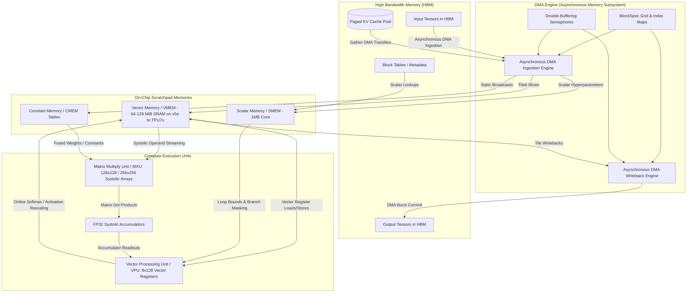
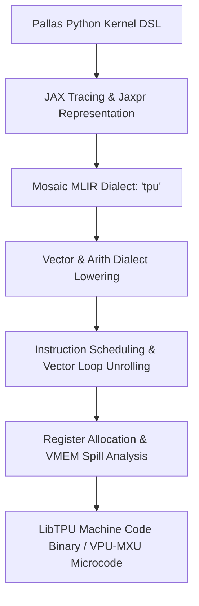

# Pallas on Cloud TPU: Master SOTA Mental Model & Kernel Engineering Guide

This document serves as the master **SOTA Mental Model and Kernel Engineering Guide** for developing bare-metal high-performance kernels on Google Cloud TPUs (TPU v5p, TPU v6e / Trillium, and TPU v7) using **JAX Pallas** and the **Mosaic MLIR** compiler infrastructure.

---

## 📚 Referenced SOTA & Wiki Sources

This guide synthesizes hardware architectures, compiler dialects, empirical benchmarks, and optimization axioms across the `tpu_world_model` repository:
- `wiki/kernels/memory_management/docs/00_cuda_rosetta_stone.md`: CUDA SIMT to TPU SIMD translation axioms.
- `wiki/kernels/memory_management/docs/pallas_tpu_reference.md`: Core Pallas and `pltpu` API specifications.
- `wiki/kernels/hardware_constraints/docs/vpu.md` & `wiki/kernels/hardware_constraints/docs/mxu.md`: Vector Processing Unit and Matrix Systolic Array execution limits.
- `wiki/kernels/memory_management/docs/vmem.md`: VMEM scratchpad limits (physical capacity and scoped limit) and memory scheduling.
- `wiki/vllm_tpu/02_pallas_attention_kernels.md`: FlashAttention, RingAttention, and PagedAttention kernel architectures in `vllm-torchtpu`.
- `wiki/torch_tpu/pallas_integration.md`: PyTorch custom operator registration and StableHLO compilation flow.
- `wiki/kernels/performance/docs/xprof.md` & `wiki/kernels/performance/docs/mfu.md`: XProf trace analysis, memory-bound vs. compute-bound diagnosis, and Model FLOPs Utilization (MFU) calculations.

---

## 🏛️ Pallas Execution & Memory Hierarchy Architecture



---

## 1. Architectural Foundation & Execution Model

Developing bare-metal kernels for Google Cloud TPUs requires abandoning the thread-centric mental model of GPUs (CUDA/Triton) in favor of a **coarse-grained SIMD orchestration model**.

```
+-----------------------------------------------------------------------------+
|                               GPU vs TPU PARADIGM                           |
+-----------------------------------+-----------------------------------------+
| NVIDIA CUDA / Triton (SIMT)       | Google TPU Pallas / Mosaic (SIMD)       |
+-----------------------------------+-----------------------------------------+
| - Threads execute scalar code in  | - 1 Program Instance = Entire Core Tile |
|   lockstep (32-thread warps)      | - 8x128 2D Vector Registers (1024 words)|
| - Massive thread oversubscription | - Explicit Asynchronous DMA Controller   |
|   hides memory latency via context| - Double-buffering & explicit software  |
|   swapping                        |   pipelining hides memory latency       |
| - Dynamic cache hierarchy (L1/L2) | - Software-managed Scratchpad (VMEM)    |
| - Branch divergence serialization | - Hardware Predication & Mask Registers |
+-----------------------------------+-----------------------------------------+
```

### 1.1 SIMD vs. SIMT (CUDA vs. TPU)
In CUDA, a developer authors a scalar kernel representing the execution of a single thread (`threadIdx.x`), relying on the hardware warp scheduler to bundle 32 threads into SIMT execution. If threads within a warp diverge on conditionals, the hardware serializes both branch paths.

In **Pallas on TPU**:
- A **Program Instance** (a single coordinate in the grid) is analogous to an entire CUDA Thread Block.
- Execution is **SIMD** (Single Instruction, Multiple Data). You write operations directly over massive 2D matrix tiles.
- There are no individual "threads" or "thread IDs". You invoke vectorized instructions that process entire 2D register tiles simultaneously (e.g., `x_tile + y_tile`).
- Branching is implemented via **hardware predication** and bitwise masking (`jnp.where` / `pl.load(..., mask=...)`). Both branches compute on the vector unit, and results are multiplexed via vector mask registers without execution stalling.

### 1.2 8x128 Vector Registers
The TensorCore Vector Processing Unit (VPU) operates on native **8x128 2D vector registers**:
- Each vector register contains **8 sublanes**, and each sublane contains **128 32-bit elements** (a total of 1,024 elements / 4,096 bytes per 32-bit float register, or 2,048 elements for 16-bit `bfloat16`/`fp16` types).
- All VPU arithmetic (additions, activations, transcendental approximations, reductions) processes data across these 8x128 registers in parallel.
- The minor dimension of any vector register operation is physically hardwired to **128 elements**.

### 1.3 VPU vs. DMA Engine Parallelism
A Google Cloud TPU TensorCore physically decouples **computation** from **data movement**:
1. **Vector Processing Unit (VPU) & Matrix Unit (MXU)**: Dedicated arithmetic execution hardware.
2. **Direct Memory Access (DMA) Engine**: An autonomous memory controller with dedicated hardware queues and address translation pipelines.

Because the DMA engine runs completely asynchronously from the VPU/MXU, optimal Pallas kernels maintain **100% compute overlap**: while the VPU/MXU is executing arithmetic on tile $t$, the DMA engine is concurrently fetching tile $t+1$ from High Bandwidth Memory (HBM) into Vector Memory (VMEM) and committing tile $t-1$ back to HBM.

---

## 2. Memory Hierarchy & VMEM Management

Cloud TPU memory architecture is an explicitly addressed, non-coherent scratchpad hierarchy designed for deterministic throughput:

```
+--------------------------------------------------------------------+
|                         TPU MEMORY HIERARCHY                       |
+-------------------+--------------------+---------------------------+
| Memory Tier       | Capacity           | Bandwidth & Latency       |
+-------------------+--------------------+---------------------------+
| HBM (High BW Mem) | 16GB - 192GiB/chip | ~0.8 - 7.4 TB/s (~100-300 |
|                   | (Global Storage)   | cycles latency)           |
+-------------------+--------------------+---------------------------+
| VMEM (Vector Mem) | 64-128MiB / core   | >25 TB/s on-chip SRAM     |
|                   | (v5e to TPU7x)     | (Single-digit cycles)     |
+-------------------+--------------------+---------------------------+
| SMEM (Scalar Mem) | 1MB / TensorCore   | Core-local scalar memory  |
+-------------------+--------------------+---------------------------+
| CMEM (Constant)   | Static Core Table  | Read-only broadcast bus   |
+-------------------+--------------------+---------------------------+
| Vector Registers  | 128 x (8x128)      | Zero-cycle direct ALU bus |
+-------------------+--------------------+---------------------------+
```

### 2.1 The Data Pathway: HBM $\to$ VMEM $\to$ Vector Registers
1. **HBM (High Bandwidth Memory)**: Off-chip main memory storing global model weights, KV cache pools, and activations. Accessing HBM requires issuing DMA descriptors.
2. **VMEM (Vector Memory)**: 64-128 MiB on v5e to TPU7x of ultra-high-bandwidth on-chip SRAM private to each TensorCore (see 2.2). In Pallas, VMEM buffers are explicitly managed scratchpads.
3. **Vector Registers**: The 8x128 register files connected directly to the VPU and MXU arithmetic pipelines.

### 2.2 The VMEM Scratchpad Boundary: Physical Capacity vs. Scoped Limit
Unlike GPUs that rely on hardware-managed L1/L2 caches with dynamic cache lines and cache-miss stalls, TPUs use **statically allocated SRAM scratchpads**. Two different numbers bound a kernel's VMEM, and they are often confused:

| Generation | Physical VMEM per TensorCore | Source |
| :--- | :--- | :--- |
| TPU v5e | 128 MiB | JAX `tpu_info.py` (https://github.com/jax-ml/jax/blob/be2c88887fb7/jax/_src/tpu_info.py) |
| TPU v5p | 64 MiB | same |
| TPU v6e (Trillium) | 128 MiB | same |
| TPU7x (Ironwood) | 64 MiB | same |

- **Physical capacity** is a hard limit. A kernel over it fails to compile, e.g. on TPU7x with libtpu 0.0.44, `Used 64.01M of 63.94M vmem. Exceeded vmem capacity by 72.0K.` ([#400](https://github.com/google-pytorch/torchtpu-agents/issues/400#issuecomment-5927027288)).
- **Scoped VMEM limit** is a compiler default, not a hardware wall. Each Pallas kernel is held to its own `vmem_limit_bytes` (Mosaic compiler params) if it passes one; otherwise to the libtpu flag `--xla_tpu_scoped_vmem_limit_kib`; otherwise to a default of 32 MiB. The kernel value wins over the flag, even when it is lower. A value above physical capacity raises no error and is clamped to the usable capacity (63.94 MiB on TPU7x). This is what we measured on TPU7x (tpu7x-8) with libtpu 0.0.44 and 0.0.44.1 ([#400](https://github.com/google-pytorch/torchtpu-agents/issues/400#issuecomment-5927027288)); the JAX [`jax/_src/pallas/mosaic/core.py`](https://github.com/jax-ml/jax/blob/be2c88887fb7/jax/_src/pallas/mosaic/core.py) docstring says `vmem_limit_bytes` must be paired with a larger `--xla_tpu_scoped_vmem_limit_kib`, but these builds did not need the flag. Check your own build before relying on a number. A kernel over the scoped limit fails with E1001 scoped VMEM out of memory (e.g. `Scoped allocation with size 32.00M and limit 32.00M exceeded scoped vmem limit by 4.0K`; [E1001](https://openxla.org/xla/errors/error_1001)).
- Memory allocations in VMEM are verified at compile-time by the Mosaic compiler, and an over-budget kernel aborts with:
  ```
  RESOURCE_EXHAUSTED: Ran out of memory in memory space vmem while allocating on stack...
  ```
- **Engineering Axiom**: Size your tile dimensions ($B_M, B_N, B_K$) such that total active VMEM footprint per core satisfies:
  $$\text{Footprint}_{\text{VMEM}} = \sum_{\text{inputs}} (\text{Bytes}_{\text{tile}} \times \text{Stages}) + \sum_{\text{outputs}} (\text{Bytes}_{\text{tile}} \times \text{Stages}) + \text{Scratch} \le \text{scoped limit}$$
  leaving headroom for compiler-injected spill slots and address lookup buffers. Raise the scoped limit if the kernel needs it, but never past physical capacity.

### 2.3 SMEM (Scalar Memory)
Each TensorCore features a dedicated **Scalar Memory (SMEM)**, 1 MiB per core on v4 and later (16 KiB on v2/v3, per JAX `tpu_info.py`):
- Houses scalar control variables, loop iterators, dynamic shape bounds, and PagedAttention block lookup indices.
- Scalar integer instructions on SMEM execute concurrently with vector math on VMEM.

### 2.4 CMEM (Constant Memory)
A specialized on-chip memory space for immutable constant tables, quantization scale vectors, and broadcast weights. CMEM feeds directly into systolic array broadcast buses without consuming VMEM allocation slots.

---

## 3. Grid Mapping & BlockSpecs

In Pallas, kernel execution is parameterized by an iteration space (**`grid`**) and a memory slicing specification (**`BlockSpec`**).

```python
import jax
import jax.numpy as jnp
from jax.experimental import pallas as pl
from jax.experimental.pallas import tpu as pltpu

def matmul_kernel(x_ref, y_ref, o_ref):
  # x_ref: [BM, BK] in VMEM
  # y_ref: [BK, BN] in VMEM
  # o_ref: [BM, BN] in VMEM
  acc = jnp.zeros(o_ref.shape, dtype=jnp.float32)
  
  # Accumulate across inner reduction blocks
  acc = pl.dot(x_ref[...], y_ref[...])
  o_ref[...] = o_ref[...] + acc.astype(o_ref.dtype)

def launch_matmul(x: jax.Array, y: jax.Array) -> jax.Array:
  M, K = x.shape
  K, N = y.shape
  BM, BN, BK = 128, 128, 128
  
  grid = (M // BM, N // BN)
  
  in_specs = (
      pl.BlockSpec(
          block_shape=(BM, BK),
          index_map=lambda i, j: (i, 0),
          pipeline_mode=pl.Buffered(),
          memory_space=pltpu.VMEM,
      ),
      pl.BlockSpec(
          block_shape=(BK, BN),
          index_map=lambda i, j: (0, j),
          pipeline_mode=pl.Buffered(),
          memory_space=pltpu.VMEM,
      ),
  )
  out_specs = pl.BlockSpec(
      block_shape=(BM, BN),
      index_map=lambda i, j: (i, j),
      pipeline_mode=pl.Buffered(),
      memory_space=pltpu.VMEM,
  )
  
  return pl.pallas_call(
      matmul_kernel,
      out_shape=jax.ShapeDtypeStruct((M, N), x.dtype),
      grid=grid,
      in_specs=in_specs,
      out_specs=out_specs,
      compiler_params=pltpu.CompilerParams(
          dimension_semantics=("parallel", "parallel")
      ),
  )(x, y)
```

### 3.1 Defining Iteration Spaces (`grid`)
The `grid` parameter is a tuple of integers specifying the number of iterations along each logical axis. The Pallas runtime maps grid dimensions to:
- **Spatial Axes (`parallel`)**: Distributed across physical TPU cores / sub-cores.
- **Temporal Axes (`loop` / `sequential`)**: Executed sequentially as hardware loops inside each core.

### 3.2 `BlockSpec` Memory Slicing & Index Mapping
A `BlockSpec` instructs the DMA engine how to slice a global tensor in HBM into local tiles in VMEM for each grid point $(i_0, i_1, \dots, i_n)$:
- `block_shape`: The exact shape of the tile residing in VMEM (e.g., `(128, 128)`).
- `index_map`: A lambda taking the current grid coordinates and returning the top-left index offset of the slice in HBM.
- `memory_space`: Specifies target physical memory (`pltpu.VMEM`, `pltpu.SMEM`, `pltpu.CMEM`, or `pl.ANY`).

### 3.3 Double-Buffering Pipelines (`pl.Buffered()`)
When `pipeline_mode=pl.Buffered()` is specified:
1. Pallas automatically allocates **two physical buffers** (ping-pong buffers) in VMEM for that operand.
2. The Mosaic compiler automatically unrolls the loop into a software-pipelined prologue, steady-state loop, and epilogue.
3. Hardware semaphores are injected into the MLIR instruction stream to synchronize DMA transfers with VPU computation with **zero pipeline bubbles**:

```
Cycle Timeline:
DMA Engine:  [ Load Tile 0 ] [ Load Tile 1 ] [ Load Tile 2 ] [ Load Tile 3 ] ...
VPU/MXU:                    [ Compute T0   ] [ Compute T1   ] [ Compute T2   ] ...
```

---

## 4. Hardware Alignment & MXU Systolic Rules

TPU TensorCores achieve theoretical peak TFLOPs only when tensor shapes and memory access strides strictly conform to physical hardware alignments.

```
+-------------------------------------------------------------------------------+
|                         HARDWARE ALIGNMENT CONSTRAINTS                        |
+-------------------------------+-----------------------------------------------+
| Constraint                    | Requirement & Hardware Rationale              |
+-------------------------------+-----------------------------------------------+
| Minor Dimension (Contiguous)  | Must be a multiple of 128 elements            |
| Sublane Dimension             | Must be a multiple of 8 elements (8 sublanes) |
| DMA Burst Granularity         | 128-byte aligned memory base addresses        |
| MXU Systolic Block Dimensions | Multiples of 128x128 (v5p) or 256x256 (v6e/v7)|
+-------------------------------+-----------------------------------------------+
```

### 4.1 128-Byte & 128-Element Alignment Constraints
- The physical TPU memory bus transfers data in **128-byte aligned bursts**.
- In the Vector Processing Unit, the vector registers require that the innermost (minor) dimension of any slice be a multiple of **128 elements**.
- If a kernel passes an unaligned dimension (e.g., sequence length 100 or hidden dimension 60), the compiler will either:
  1. Insert costly sublane masking instructions that drop compute throughput by 4x–10x.
  2. Inject silent zero-padding that inflates memory traffic and VMEM consumption.

### 4.2 8-Lane Packing & Sublane Layout
TPU registers are laid out as $(8, 128)$:
- Dimension 0 represents the **8 parallel sublanes**.
- Dimension 1 represents the **128 vector lane elements**.
- When operating on 2D arrays $(M, N)$, optimal tiling sets $M$ to a multiple of 8 (or 128) and $N$ to a multiple of 128.

### 4.3 Sublane Padding & Avoidance Strategies
When kernel dimensions are inherently non-multiple (e.g., hidden size $D = 80$ in small heads or vocabulary size $V = 32000$):
- Explicitly pad the tensor in HBM to the next multiple of 128 before launching the Pallas kernel:
  ```python
  def pad_to_128(size: int) -> int:
    return (size + 127) // 128 * 128
  ```
- Use `pl.load(..., mask=...)` inside the kernel to ignore padded elements during accumulation without corrupting dot-product reductions.

### 4.4 MXU Systolic Array Rules
The Matrix Multiply Unit (MXU) is a 2D systolic array:
- On **TPU v5p**: 128x128 systolic array. Issues 1 multiply-accumulate instruction every 8 cycles.
- On **TPU v6e (Trillium) & v7**: 256x256 systolic array.
- Operands stream through the systolic grid: Matrix $A$ is held stationary or streamed horizontally, while Matrix $B$ streams vertically.
- Accumulation is maintained in dedicated high-precision **FP32 hardware accumulators** (`tpu.matmul_accumulator`), preventing precision loss during massive outer-product summations before downcasting to `bfloat16` or `fp8`.

---

## 5. Mosaic Compilation & MLIR Lowering

Pallas is compiled to TPU machine code via the **Mosaic compiler**, an MLIR-based lowering infrastructure.



### 5.1 The `@pallas_call` Compilation Pipeline
1. **JAX Tracing**: JAX traces the Python kernel into a structured `Jaxpr` computational graph.
2. **Mosaic Lowering**: The Jaxpr is lowered to the `tpu` MLIR dialect, translating array slices into explicit hardware instructions:
   - `tpu.vector_load`: Loads an 8x128 slice from VMEM to vector registers.
   - `tpu.matmul_accumulator`: Configures and reads MXU systolic accumulators.
   - `tpu.async_copy`: Generates DMA descriptors for background HBM $\leftrightarrow$ VMEM transfers.
   - `tpu.semaphore`: Hardware synchronization primitives.
3. **LLVM & LibTPU Code Generation**: MLIR passes schedule instructions, allocate vector registers, unroll loops, and emit native microcode executed by the TPU runtime.

### 5.2 Vector Loop Unrolling & Instruction-Level Parallelism
Mosaic automatically unrolls inner reduction loops when tile sizes are static constants. To maximize instruction-level parallelism (ILP):
- Ensure tile shapes ($B_M, B_N, B_K$) are compile-time constants (e.g., Python `int` literals rather than dynamic scalar values).
- Pass compiler optimization hints via `pltpu.CompilerParams`:
  ```python
  compiler_params = pltpu.CompilerParams(
      dimension_semantics=("parallel", "arbitrary"),
      unroll_factors=(2, 4),
  )
  ```

### 5.3 Preventing Dead-Code Elimination (Anti-DCE)
Because XLA and Mosaic apply aggressive dead-code elimination (DCE) passes:
- Any computation whose result does not strictly reach a registered `out_spec` tensor writeback will be completely eliminated at compile-time.
- When writing benchmarking kernels, warmup loops, or diagnostic accumulators, always bind intermediate results to an explicit output buffer or use side-effecting custom call anchors to prevent the compiler from optimizing away the entire kernel computation.

---

## 6. Kernel Primitives & Serving Integration

### 6.1 Pallas PagedAttention v1/v2
In large-scale LLM inference (e.g., `vllm-torchtpu`), dynamic KV caches are managed as non-contiguous physical pages in HBM. Pallas PagedAttention loads these non-contiguous pages directly into VMEM without materializing $O(L^2)$ attention matrices:

```python
import jax
import jax.numpy as jnp
from jax.experimental import pallas as pl
from jax.experimental.pallas import tpu as pltpu

def paged_attention_kernel(
    q_ref,           # [1, num_heads, head_dim] in VMEM
    kv_pool_ref,     # [num_blocks, block_size, 2, num_heads, head_dim] in HBM
    block_table_ref, # [batch_size, max_blocks] in SMEM / HBM
    out_ref,         # [1, num_heads, head_dim] in VMEM
    *,
    block_size: int = 32,
    head_dim: int = 128,
):
  batch_idx = pl.program_id(0)
  head_idx = pl.program_id(1)
  
  # Load Query vector into vector registers
  q = q_ref[0, head_idx, :]
  
  # Initialize Online Softmax Accumulators
  m_prev = -1e9
  l_prev = 0.0
  acc = jnp.zeros((head_dim,), dtype=jnp.float32)
  
  num_blocks = block_table_ref.shape[1]
  for block_step in range(num_blocks):
    phys_block = block_table_ref[batch_idx, block_step]
    
    # Load Key and Value tiles for this physical page
    k_tile = kv_pool_ref[phys_block, :, 0, head_idx, :]  # [block_size, head_dim]
    v_tile = kv_pool_ref[phys_block, :, 1, head_idx, :]  # [block_size, head_dim]
    
    # Compute logits: S = Q * K^T
    logits = jnp.dot(k_tile, q) * (1.0 / jnp.sqrt(head_dim))  # [block_size]
    
    # Online Softmax Update
    m_curr = jnp.maximum(m_prev, jnp.max(logits))
    p = jnp.exp(logits - m_curr)
    l_curr = l_prev * jnp.exp(m_prev - m_curr) + jnp.sum(p)
    
    # Rescale previous accumulator and add new value projection
    alpha = jnp.exp(m_prev - m_curr)
    acc = acc * alpha + jnp.dot(p, v_tile)
    
    m_prev = m_curr
    l_prev = l_curr

  # Final Normalization and Writeback
  out_ref[0, head_idx, :] = (acc / l_prev).astype(out_ref.dtype)
```

### 6.2 Online Softmax Numerical Stability
Computing standard softmax requires two passes over the sequence: one for the maximum/normalizer and one for the weighted sum. In Pallas, **FlashAttention Online Softmax** maintains running statistics in VMEM vector registers:
$$\begin{aligned}
m_{\text{new}} &= \max(m_{\text{old}}, \max(S)) \\
\alpha &= e^{m_{\text{old}} - m_{\text{new}}} \\
l_{\text{new}} &= l_{\text{old}} \cdot \alpha + \sum e^{S - m_{\text{new}}} \\
O_{\text{new}} &= O_{\text{old}} \cdot \alpha + P_{\text{new}} V
\end{aligned}$$
This eliminates all intermediate $S$ matrix writes to HBM, converting an $O(L^2)$ memory bandwidth bottleneck into an $O(L)$ arithmetic pipeline.

### 6.3 INT8 / FP8 Quantized GEMM
For low-precision matrix multiplication on TPU v6e and v7:
- Weights are stored in HBM as quantized `int8` or `fp8_e4m3fn` / `fp8_e5m2`.
- The DMA engine streams quantized tiles into VMEM.
- Dequantization scale factors are loaded into CMEM/SMEM.
- The MXU systolic array executes INT8/FP8 matrix multiplications at **2x the peak FLOP throughput of BF16**, accumulating directly into FP32 registers.

### 6.4 PyTorch Interoperability via `torch_tpu`
Custom Pallas kernels can be registered as first-class PyTorch operators via `torch_tpu`:

```python
import torch
import jax
from jax.experimental import pallas as pl
from torch_tpu._internal import pallas

# 1. Define JAX Pallas Kernel
def rms_norm_kernel(x_ref, scale_ref, o_ref, *, eps=1e-6):
  x = x_ref[...]
  scale = scale_ref[...]
  variance = jnp.mean(jnp.square(x), axis=-1, keepdims=True)
  o_ref[...] = (x * jax.lax.rsqrt(variance + eps) * scale).astype(o_ref.dtype)

def rms_norm_jax(x: jax.Array, scale: jax.Array) -> jax.Array:
  return pl.pallas_call(
      rms_norm_kernel,
      out_shape=jax.ShapeDtypeStruct(x.shape, x.dtype),
      grid=(x.shape[0],),
      in_specs=(
          pl.BlockSpec(block_shape=(1, x.shape[1]), index_map=lambda i: (i, 0)),
          pl.BlockSpec(block_shape=(x.shape[1],), index_map=lambda i: (0,)),
      ),
      out_specs=pl.BlockSpec(block_shape=(1, x.shape[1]), index_map=lambda i: (i, 0)),
  )(x, scale)

# 2. Register as a PyTorch Custom Operator (Zero Host Sync)
rms_norm_torch = pallas.jax_op("custom_pallas::rms_norm", rms_norm_jax)

# 3. Native PyTorch Execution on TPU
x = torch.randn(32, 4096, dtype=torch.bfloat16, device="tpu")
scale = torch.ones(4096, dtype=torch.bfloat16, device="tpu")
out = rms_norm_torch(x, scale)
```

---

## 7. Performance Profiling & Roofline Analysis

### 7.1 Hardware Performance Counters & Bottleneck Analysis
Profiling TPU kernels requires measuring the ratio of compute time to memory transfer time.
- **Arithmetic Intensity ($I$)**:
  $$I = \frac{\text{Total FLOPs}}{\text{Total Bytes Transferred from HBM}} \quad (\text{FLOPs/Byte})$$
- **Hardware Balance ($B_{\text{hw}}$)**:
  $$B_{\text{hw}} = \frac{\text{Peak Hardware TFLOP/s}}{\text{Peak HBM Bandwidth (TB/s)}}$$
- **Kernel Regime**:
  - If $I < B_{\text{hw}}$: The kernel is **Memory-Bound**. Optimize by fusing operations, increasing tile sizes ($B_M, B_N$), and reusing data in VMEM.
  - If $I \ge B_{\text{hw}}$: The kernel is **Compute-Bound**. Optimize MXU systolic array packing, eliminate sublane padding, and maximize loop unrolling.

```
+-------------------------------------------------------------------------+
|                  HARDWARE ROOFLINE SPECIFICATIONS                       |
+-------------------+--------------------+------------------+-------------+
| TPU Generation    | Peak TFLOP/s       | Peak HBM BW      | Machine     |
|                   | (BF16 / FP8)       | (GB/s)           | Balance     |
+-------------------+--------------------+------------------+-------------+
| TPU v5p           | 459 TFLOP/s (BF16) | 4,800 GB/s       | 95.6 FLOP/B |
| TPU v6e (Trillium)| 985 TFLOP/s (BF16) | 1,640 GB/s       | 600 FLOP/B  |
|                   | 1,970 TFLOP/s (FP8)|                  | 1200 FLOP/B |
| TPU v7            | Frontier Scale     | Frontier HBM     | >1000 FLOP/B|
+-------------------+--------------------+------------------+-------------+
```

### 7.2 XProf Trace Analysis & TraceMe Instrumentation
Instrument your Pallas kernels using `jax.profiler.TraceMe` or PyTorch `torch.profiler.record_function`:
```python
with jax.profiler.TraceMe("pallas_custom_attention_forward"):
  out = launch_attention_kernel(q, k, v)
```
When viewing the trace in Perfetto / TensorBoard XProf:
1. **Check for `custom-call` Duration**: Inspect the exact on-device execution time of the Pallas kernel.
2. **Verify DMA Overlap**: Ensure `dma-transfer` slices run entirely underneath the `vpu-compute` and `mxu-compute` timeline blocks. If gaps appear between compute bursts, double-buffering is stalling on HBM memory latency.
3. **Inspect Step Time Graph**: Verify that CPU host dispatch is running fully ahead of device execution, ensuring zero host-device synchronization stalls.

### 7.3 Model FLOPs Utilization (MFU) Calculation
Measure the empirical efficiency of your kernel against hardware physical limits:

$$\text{TFLOPs}_{\text{observed}} = \frac{\text{Total Floating Point Operations (FLOPs)}}{\text{Kernel Execution Time (seconds)} \times 10^{12}}$$

$$\text{MFU} = \frac{\text{TFLOPs}_{\text{observed}}}{\text{Theoretical Peak Hardware TFLOPs}} \times 100\%$$

For a matrix multiplication $M \times N \times K$:
$$\text{FLOPs} = 2 \times M \times N \times K$$
A well-optimized Pallas GEMM kernel on TPU v6e achieves **$>75\%$ MFU** for tile sizes $\ge 1024\times 1024$.

---

## 8. Summary of Golden Engineering Axioms

1. **Think in Tiles, Not Threads**: Structure computations as 2D matrix transformations across 8x128 vector registers.
2. **Stay Within the Scoped VMEM Limit**: Raise it with `vmem_limit_bytes`, never past physical capacity, and account for double-buffering multipliers when allocating input/output scratchpads.
3. **Enforce 128-Element Alignment**: Ensure innermost dimensions and memory strides are multiples of 128 to prevent hardware masking penalties.
4. **Always Double-Buffer HBM Transfers**: Use `pipeline_mode=pl.Buffered()` so asynchronous DMA transfers are completely hidden behind MXU/VPU compute cycles.
5. **Keep Dynamic Data in SMEM**: Route scalar pointers, block indices, and dynamic sequence bounds through scalar registers to prevent vector instruction stalls.
6. **Profile with XProf**: Validate DMA overlap and compute intensity in Perfetto before committing kernels to production serving pipelines.
