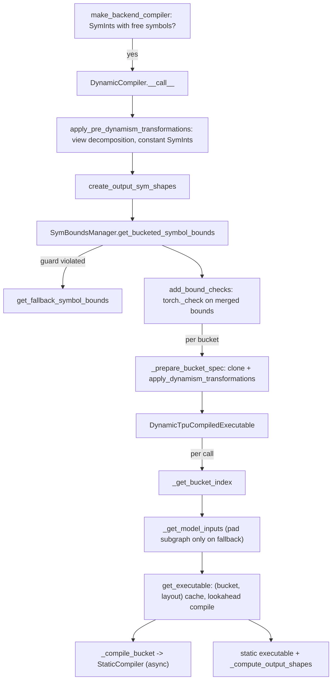

# Dynamic shapes under torch.compile with bounded dynamism

## Overview
XLA on TPU compiles static shapes, so a graph whose dimensions vary would recompile per shape.
The dynamic compiler in `src/torch_tpu/_internal/compile/dynamic` takes the bounded-dynamism
route: every dynamic dimension (a `SymInt`) is replaced by an upper bound, and the actual runtime
size travels into the program as a size tensor, so one static executable serves every shape up to
that bound. [`DynamicCompiler`](https://github.com/google-pytorch/torch_tpu/blob/6d2a45754bdb52743883f75fbf753408345f6d1b/src/torch_tpu/_internal/compile/dynamic/dynamic_compiler.py#L117 "src/torch_tpu/_internal/compile/dynamic/dynamic_compiler#DynamicCompiler")
no longer compiles a single bound: it splits each symbol's range into up to `num_dynamic_buckets`
contiguous buckets whose upper bounds are aligned to `bucket_size` (default 128)
([`get_bucketed_symbol_bounds`](https://github.com/google-pytorch/torch_tpu/blob/6d2a45754bdb52743883f75fbf753408345f6d1b/src/torch_tpu/_internal/compile/dynamic/sym_bounds_manager.py#L75 "src/torch_tpu/_internal/compile/dynamic/sym_bounds_manager#SymBoundsManager.get_bucketed_symbol_bounds")),
rewrites a clone of the FX graph for each bucket
([`apply_dynamism_transformations`](https://github.com/google-pytorch/torch_tpu/blob/6d2a45754bdb52743883f75fbf753408345f6d1b/src/torch_tpu/_internal/compile/dynamic/graph_transformations.py#L395 "src/torch_tpu/_internal/compile/dynamic/graph_transformations#apply_dynamism_transformations")),
and returns a [`DynamicTpuCompiledExecutable`](https://github.com/google-pytorch/torch_tpu/blob/6d2a45754bdb52743883f75fbf753408345f6d1b/src/torch_tpu/_internal/compile/dynamic/dynamic_executable.py#L59 "src/torch_tpu/_internal/compile/dynamic/dynamic_executable#DynamicTpuCompiledExecutable")
that compiles each bucket lazily (and asynchronously, with lookahead) through the
[static compiler](torch-compile-backend.md). Per call it picks the smallest bucket that fits the
runtime sizes, builds the model inputs, computes the real output shapes from symbolic
expressions, and executes. Smaller inputs thus pad only to the next bucket instead of to the
global maximum.

## Diagram

Legend:
- `MBC` - [`make_backend_compiler`](https://github.com/google-pytorch/torch_tpu/blob/6d2a45754bdb52743883f75fbf753408345f6d1b/src/torch_tpu/_internal/compile/_backend.py#L432 "src/torch_tpu/_internal/compile/_backend#make_backend_compiler")
- `DC` - [`__call__`](https://github.com/google-pytorch/torch_tpu/blob/6d2a45754bdb52743883f75fbf753408345f6d1b/src/torch_tpu/_internal/compile/dynamic/dynamic_compiler.py#L221 "src/torch_tpu/_internal/compile/dynamic/dynamic_compiler#DynamicCompiler.__call__")
- `PRE` - [`apply_pre_dynamism_transformations`](https://github.com/google-pytorch/torch_tpu/blob/6d2a45754bdb52743883f75fbf753408345f6d1b/src/torch_tpu/_internal/compile/dynamic/graph_transformations.py#L349 "src/torch_tpu/_internal/compile/dynamic/graph_transformations#apply_pre_dynamism_transformations")
- `OSS` - [`create_output_sym_shapes`](https://github.com/google-pytorch/torch_tpu/blob/6d2a45754bdb52743883f75fbf753408345f6d1b/src/torch_tpu/_internal/compile/dynamic/output_sym_shape.py#L264 "src/torch_tpu/_internal/compile/dynamic/output_sym_shape#create_output_sym_shapes")
- `BKT` - [`get_bucketed_symbol_bounds`](https://github.com/google-pytorch/torch_tpu/blob/6d2a45754bdb52743883f75fbf753408345f6d1b/src/torch_tpu/_internal/compile/dynamic/sym_bounds_manager.py#L75 "src/torch_tpu/_internal/compile/dynamic/sym_bounds_manager#SymBoundsManager.get_bucketed_symbol_bounds")
- `FB` - [`get_fallback_symbol_bounds`](https://github.com/google-pytorch/torch_tpu/blob/6d2a45754bdb52743883f75fbf753408345f6d1b/src/torch_tpu/_internal/compile/dynamic/sym_bounds_manager.py#L41 "src/torch_tpu/_internal/compile/dynamic/sym_bounds_manager#SymBoundsManager.get_fallback_symbol_bounds")
- `CHK` - [`add_bound_checks`](https://github.com/google-pytorch/torch_tpu/blob/6d2a45754bdb52743883f75fbf753408345f6d1b/src/torch_tpu/_internal/compile/dynamic/sym_bounds_manager.py#L265 "src/torch_tpu/_internal/compile/dynamic/sym_bounds_manager#SymBoundsManager.add_bound_checks")
- `SPEC` - [`_prepare_bucket_spec`](https://github.com/google-pytorch/torch_tpu/blob/6d2a45754bdb52743883f75fbf753408345f6d1b/src/torch_tpu/_internal/compile/dynamic/dynamic_compiler.py#L177 "src/torch_tpu/_internal/compile/dynamic/dynamic_compiler#DynamicCompiler._prepare_bucket_spec")
- `DE` - [`DynamicTpuCompiledExecutable`](https://github.com/google-pytorch/torch_tpu/blob/6d2a45754bdb52743883f75fbf753408345f6d1b/src/torch_tpu/_internal/compile/dynamic/dynamic_executable.py#L59 "src/torch_tpu/_internal/compile/dynamic/dynamic_executable#DynamicTpuCompiledExecutable")
- `BI` - [`_get_bucket_index`](https://github.com/google-pytorch/torch_tpu/blob/6d2a45754bdb52743883f75fbf753408345f6d1b/src/torch_tpu/_internal/compile/dynamic/dynamic_executable.py#L272 "src/torch_tpu/_internal/compile/dynamic/dynamic_executable#DynamicTpuCompiledExecutable._get_bucket_index")
- `MI` - [`_get_model_inputs`](https://github.com/google-pytorch/torch_tpu/blob/6d2a45754bdb52743883f75fbf753408345f6d1b/src/torch_tpu/_internal/compile/dynamic/dynamic_executable.py#L296 "src/torch_tpu/_internal/compile/dynamic/dynamic_executable#DynamicTpuCompiledExecutable._get_model_inputs"), [`_compile_and_execute_pad_subgraph`](https://github.com/google-pytorch/torch_tpu/blob/6d2a45754bdb52743883f75fbf753408345f6d1b/src/torch_tpu/_internal/compile/dynamic/dynamic_executable.py#L151 "src/torch_tpu/_internal/compile/dynamic/dynamic_executable#DynamicTpuCompiledExecutable._compile_and_execute_pad_subgraph")
- `GE` - [`get_executable`](https://github.com/google-pytorch/torch_tpu/blob/6d2a45754bdb52743883f75fbf753408345f6d1b/src/torch_tpu/_internal/compile/dynamic/dynamic_executable.py#L438 "src/torch_tpu/_internal/compile/dynamic/dynamic_executable#DynamicTpuCompiledExecutable.get_executable")
- `CB` - [`_compile_bucket`](https://github.com/google-pytorch/torch_tpu/blob/6d2a45754bdb52743883f75fbf753408345f6d1b/src/torch_tpu/_internal/compile/dynamic/dynamic_executable.py#L417 "src/torch_tpu/_internal/compile/dynamic/dynamic_executable#DynamicTpuCompiledExecutable._compile_bucket")
- `RUN` - [`_compute_output_shapes`](https://github.com/google-pytorch/torch_tpu/blob/6d2a45754bdb52743883f75fbf753408345f6d1b/src/torch_tpu/_internal/compile/dynamic/dynamic_executable.py#L360 "src/torch_tpu/_internal/compile/dynamic/dynamic_executable#DynamicTpuCompiledExecutable._compute_output_shapes"); the executable itself is (concept), see [torch-compile-backend](torch-compile-backend.md)

## Design rationale (why it's built this way)
- **Bounds, not symbols, reach XLA.** TPU executables need static buffer sizes; the compromise
  is StableHLO's bounded dynamism, where a tensor has a static allocation (the bound) and a
  logical size set at runtime. Every `SymInt` therefore needs an upper bound, held per bucket in
  a [`SymbolBounds`](https://github.com/google-pytorch/torch_tpu/blob/6d2a45754bdb52743883f75fbf753408345f6d1b/src/torch_tpu/_internal/compile/dynamic/symbol_bounds.py#L218 "src/torch_tpu/_internal/compile/dynamic/symbol_bounds#SymbolBounds")
  ("holds lower and upper bounds for atomic symbols and evaluates symbolic expressions"). Lower
  and upper limits come from the shape environment (its recorded ranges or its bound solver over
  `torch._check` constraints); an unbounded symbol falls back to twice its starting value.
- **Buckets trade compile count for padding waste.** The commit that introduced them explains
  that "a single upper-bound bucket forces smaller inputs to pad up to the maximum size, wasting
  compute and memory".
  [`get_bucketed_symbol_bounds`](https://github.com/google-pytorch/torch_tpu/blob/6d2a45754bdb52743883f75fbf753408345f6d1b/src/torch_tpu/_internal/compile/dynamic/sym_bounds_manager.py#L75 "src/torch_tpu/_internal/compile/dynamic/sym_bounds_manager#SymBoundsManager.get_bucketed_symbol_bounds")
  uses "128k - c alignment": for a symbol `s` appearing in an output shape as `s + c`, bucket
  upper bounds are chosen so that `s + c` lands on a multiple of `bucket_step`, which keeps output
  shapes on TPU tile multiples. The first bucket starts at the symbol's lower bound and its upper
  bound is sized to cover the larger of that lower bound and the concrete size that triggered
  compilation; buckets are contiguous and non-overlapping,
  and a finite user maximum caps the last bucket. Each candidate is checked against the active
  shape guards (for example reshape divisibility); any violation abandons bucketing for the
  single fallback bound from
  [`get_fallback_symbol_bounds`](https://github.com/google-pytorch/torch_tpu/blob/6d2a45754bdb52743883f75fbf753408345f6d1b/src/torch_tpu/_internal/compile/dynamic/sym_bounds_manager.py#L41 "src/torch_tpu/_internal/compile/dynamic/sym_bounds_manager#SymBoundsManager.get_fallback_symbol_bounds").
- **Bound checks keep Dynamo honest.**
  [`add_bound_checks`](https://github.com/google-pytorch/torch_tpu/blob/6d2a45754bdb52743883f75fbf753408345f6d1b/src/torch_tpu/_internal/compile/dynamic/sym_bounds_manager.py#L265 "src/torch_tpu/_internal/compile/dynamic/sym_bounds_manager#SymBoundsManager.add_bound_checks")
  emits `torch._check(symint >= lower)` and `torch._check(symint <= upper)` over the merged range of
  all buckets; per the source comment, this "forces dynamo to trigger a recompilation if the bound
  constraint isn't satisfied", so a size beyond the last bucket recompiles rather than silently
  overflowing a buffer.
- **Runtime sizes become graph inputs.** For every SymInt input, a pass adds an `i32[]` size
  placeholder next to it
  ([`ScanInputsCreatePlaceholdersPass.__call__`](https://github.com/google-pytorch/torch_tpu/blob/6d2a45754bdb52743883f75fbf753408345f6d1b/src/torch_tpu/_internal/compile/dynamic/graph_transformations.py#L197 "src/torch_tpu/_internal/compile/dynamic/graph_transformations#ScanInputsCreatePlaceholdersPass.__call__")),
  and [`ensure_tensor`](https://github.com/google-pytorch/torch_tpu/blob/6d2a45754bdb52743883f75fbf753408345f6d1b/src/torch_tpu/_internal/compile/dynamic/graph_transform_context.py#L146 "src/torch_tpu/_internal/compile/dynamic/graph_transform_context#GraphTransformContext.ensure_tensor")
  turns any symbol or symbolic expression into a tensor node, reusing a size placeholder or
  emitting ATen ops for the expression
  ([`_get_or_create_tensor_node`](https://github.com/google-pytorch/torch_tpu/blob/6d2a45754bdb52743883f75fbf753408345f6d1b/src/torch_tpu/_internal/compile/dynamic/graph_transform_context.py#L87 "src/torch_tpu/_internal/compile/dynamic/graph_transform_context#GraphTransformContext._get_or_create_tensor_node")).
  Dynamic input tensors are then wrapped in `tpu._pad_real_to_static(tensor, sizes, bounds,
  is_dynamic)` or, where that custom call cannot be used, marked with
  `tpu._set_dimension_logical_size`.
- **Padding moved into the graph.** With `pad_real_to_static`, inputs are padded inside the main
  executable, so the separate pad program (which the previous version compiled per input shape)
  is only a fallback for `libtpu` older than 0.0.49 or 64/128-bit dynamic inputs, which XLA cannot
  rewrite for that custom call.
- **Reuse the static compiler.** Each bucket's bounded example inputs replace dynamic tensors with
  zero tensors at the bucket's bound shape plus `TensorBounds`, and SymInts with their bound plus
  an `int32` size tensor; the static compiler (always in `async_compile` mode, with StableHLO
  bounds) then compiles them with dynamic placeholders, so constants, RNG and caching are shared
  with the static path.
- **Returned dynamic views become copies.** AOTAutograd regenerates outputs that alias an input
  by replaying views, but skips replay when a view has SymInt arguments and falls back to
  `as_strided` on the graph's output, which on TPU is a fresh contiguous buffer. The pre-grad pass
  [`ReplaceDynamicOutputBroadcastOpsPreGradPass.__call__`](https://github.com/google-pytorch/torch_tpu/blob/6d2a45754bdb52743883f75fbf753408345f6d1b/src/torch_tpu/_internal/compile/dynamic/view_ops_passes.py#L811 "src/torch_tpu/_internal/compile/dynamic/view_ops_passes#ReplaceDynamicOutputBroadcastOpsPreGradPass.__call__")
  therefore turns returned dynamic `expand`/`broadcast_to` into `expand_copy` and clones returned
  slice/select/narrow views with dynamic indices.

> [!inferred]
> In practice: dynamic compilation is selected automatically when Dynamo hands the backend
> SymInts (for example after `torch._dynamo.mark_dynamic`), while `dynamic=True` itself is still
> rejected. Give dynamic dims explicit `min`/`max` (or `torch._check`) bounds so the buckets and
> fallback bound are realistic, raise `num_dynamic_buckets` (1-8) when inputs span a wide range,
> and expect warmup to compile all buckets in the background.

## Entry points
- [`make_backend_compiler`](https://github.com/google-pytorch/torch_tpu/blob/6d2a45754bdb52743883f75fbf753408345f6d1b/src/torch_tpu/_internal/compile/_backend.py#L432 "src/torch_tpu/_internal/compile/_backend#make_backend_compiler"):
  the backend's factory; when the example inputs contain SymInts with free symbols it builds a
  [`DynamicCompiler`](https://github.com/google-pytorch/torch_tpu/blob/6d2a45754bdb52743883f75fbf753408345f6d1b/src/torch_tpu/_internal/compile/dynamic/dynamic_compiler.py#L117 "src/torch_tpu/_internal/compile/dynamic/dynamic_compiler#DynamicCompiler")
  with `num_dynamic_buckets` and `bucket_size` from the backend options, and wraps it in the split
  compiler like the static one.
- [`execute_pre_grad_passes`](https://github.com/google-pytorch/torch_tpu/blob/6d2a45754bdb52743883f75fbf753408345f6d1b/src/torch_tpu/_internal/compile/dynamic/dynamic_compiler.py#L165 "src/torch_tpu/_internal/compile/dynamic/dynamic_compiler#DynamicCompiler.execute_pre_grad_passes"):
  runs the static compiler's pre-grad passes, then the dynamic-output view pass, before
  AOTAutograd.
- [`DynamicCompiler.__call__`](https://github.com/google-pytorch/torch_tpu/blob/6d2a45754bdb52743883f75fbf753408345f6d1b/src/torch_tpu/_internal/compile/dynamic/dynamic_compiler.py#L221 "src/torch_tpu/_internal/compile/dynamic/dynamic_compiler#DynamicCompiler.__call__"):
  "called by AOT Autograd to compile the graph", once per forward/backward graph.
- [`DynamicTpuCompiledExecutable.__call__`](https://github.com/google-pytorch/torch_tpu/blob/6d2a45754bdb52743883f75fbf753408345f6d1b/src/torch_tpu/_internal/compile/dynamic/dynamic_executable.py#L515 "src/torch_tpu/_internal/compile/dynamic/dynamic_executable#DynamicTpuCompiledExecutable.__call__"):
  the runtime wrapper Dynamo calls on every step.
- [`is_symint_node`](https://github.com/google-pytorch/torch_tpu/blob/6d2a45754bdb52743883f75fbf753408345f6d1b/src/torch_tpu/_internal/compile/dynamic/sym_utils.py#L93 "src/torch_tpu/_internal/compile/dynamic/sym_utils#is_symint_node"),
  [`is_symint`](https://github.com/google-pytorch/torch_tpu/blob/6d2a45754bdb52743883f75fbf753408345f6d1b/src/torch_tpu/_internal/compile/dynamic/sym_utils.py#L111 "src/torch_tpu/_internal/compile/dynamic/sym_utils#is_symint")
  and [`has_dynamic_shape`](https://github.com/google-pytorch/torch_tpu/blob/6d2a45754bdb52743883f75fbf753408345f6d1b/src/torch_tpu/_internal/compile/dynamic/sym_utils.py#L194 "src/torch_tpu/_internal/compile/dynamic/sym_utils#has_dynamic_shape"):
  the predicates the passes, the split compiler and the executable use to tell symbolic values
  and dynamic tensors apart.
- The C++ helpers this path calls (`dynamic_placeholder`, the pad-module bindings,
  `is_device_shape_dynamic`, `get_device_layout_if_materialized`, `get_default_layout`) live with
  the static backend in [torch-compile-backend](torch-compile-backend.md); the Python side reaches
  the pad module from
  [`_compile_and_execute_pad_subgraph`](https://github.com/google-pytorch/torch_tpu/blob/6d2a45754bdb52743883f75fbf753408345f6d1b/src/torch_tpu/_internal/compile/dynamic/dynamic_executable.py#L151 "src/torch_tpu/_internal/compile/dynamic/dynamic_executable#DynamicTpuCompiledExecutable._compile_and_execute_pad_subgraph").

## Mechanism (step-by-step)
1. **Pre-passes.** [`DynamicCompiler.__call__`](https://github.com/google-pytorch/torch_tpu/blob/6d2a45754bdb52743883f75fbf753408345f6d1b/src/torch_tpu/_internal/compile/dynamic/dynamic_compiler.py#L221 "src/torch_tpu/_internal/compile/dynamic/dynamic_compiler#DynamicCompiler.__call__")
   first runs [`apply_pre_dynamism_transformations`](https://github.com/google-pytorch/torch_tpu/blob/6d2a45754bdb52743883f75fbf753408345f6d1b/src/torch_tpu/_internal/compile/dynamic/graph_transformations.py#L349 "src/torch_tpu/_internal/compile/dynamic/graph_transformations#apply_pre_dynamism_transformations"),
   which decomposes dynamic view inputs into their base tensors (remembering which argument
   indices were views, using layout decomposition such as
   [`_decompose_layout`](https://github.com/google-pytorch/torch_tpu/blob/6d2a45754bdb52743883f75fbf753408345f6d1b/src/torch_tpu/_internal/compile/dynamic/view_decomposition.py#L622 "src/torch_tpu/_internal/compile/dynamic/view_decomposition#_decompose_layout"))
   and converts SymInts that are really constants into ints, updating the example inputs.
2. **Analyze shapes and bounds.** A `SymBoundsManager` collects the atomic symbols from the example
   inputs (every symbol used in a shape, stride or offset must also appear as a standalone SymInt
   input).
   [`create_output_sym_shapes`](https://github.com/google-pytorch/torch_tpu/blob/6d2a45754bdb52743883f75fbf753408345f6d1b/src/torch_tpu/_internal/compile/dynamic/output_sym_shape.py#L264 "src/torch_tpu/_internal/compile/dynamic/output_sym_shape#create_output_sym_shapes")
   records, for each output, the expression of every dynamic dimension and the `(input, dim)` it
   depends on ([`from_output_node_meta_value`](https://github.com/google-pytorch/torch_tpu/blob/6d2a45754bdb52743883f75fbf753408345f6d1b/src/torch_tpu/_internal/compile/dynamic/output_sym_shape.py#L151 "src/torch_tpu/_internal/compile/dynamic/output_sym_shape#OutputSymShape.from_output_node_meta_value")).
   The bucketed bounds are computed (or the fallback bound), merged, and enforced with
   [`add_bound_checks`](https://github.com/google-pytorch/torch_tpu/blob/6d2a45754bdb52743883f75fbf753408345f6d1b/src/torch_tpu/_internal/compile/dynamic/sym_bounds_manager.py#L265 "src/torch_tpu/_internal/compile/dynamic/sym_bounds_manager#SymBoundsManager.add_bound_checks").
3. **Rewrite per bucket.** For each bucket,
   [`_prepare_bucket_spec`](https://github.com/google-pytorch/torch_tpu/blob/6d2a45754bdb52743883f75fbf753408345f6d1b/src/torch_tpu/_internal/compile/dynamic/dynamic_compiler.py#L177 "src/torch_tpu/_internal/compile/dynamic/dynamic_compiler#DynamicCompiler._prepare_bucket_spec")
   deep-copies the graph and runs
   [`apply_dynamism_transformations`](https://github.com/google-pytorch/torch_tpu/blob/6d2a45754bdb52743883f75fbf753408345f6d1b/src/torch_tpu/_internal/compile/dynamic/graph_transformations.py#L395 "src/torch_tpu/_internal/compile/dynamic/graph_transformations#apply_dynamism_transformations")
   with that bucket's bounds: size placeholders, dynamic-input wrapping, generative ops
   (`ones`, `zeros`, `full`, `rand`... are created at the bound and then given a logical size,
   [`_process_bounded_size_op`](https://github.com/google-pytorch/torch_tpu/blob/6d2a45754bdb52743883f75fbf753408345f6d1b/src/torch_tpu/_internal/compile/dynamic/generative_ops_pass.py#L326 "src/torch_tpu/_internal/compile/dynamic/generative_ops_pass#HandleGenerativeOpsPass._process_bounded_size_op");
   `arange` with a truly dynamic length uses a dedicated `_dynamic_arange` op), reshape-like and
   broadcast-like ops, slice-like ops, and finally any SymInt still consumed by a tensor op or
   returned as an output
   ([`HandleSymIntUsagesPass.__call__`](https://github.com/google-pytorch/torch_tpu/blob/6d2a45754bdb52743883f75fbf753408345f6d1b/src/torch_tpu/_internal/compile/dynamic/graph_transformations.py#L240 "src/torch_tpu/_internal/compile/dynamic/graph_transformations#HandleSymIntUsagesPass.__call__")).
   Any SymInt use left after that raises `NotImplementedError` naming the node and asking for
   `dynamic=False`. The bucket's bounded inputs and `TensorBounds` are packed into a
   `BucketCompilationSpec`.
4. **Slices on dynamic data.**
   [`_process_slice_op`](https://github.com/google-pytorch/torch_tpu/blob/6d2a45754bdb52743883f75fbf753408345f6d1b/src/torch_tpu/_internal/compile/dynamic/view_ops_passes.py#L449 "src/torch_tpu/_internal/compile/dynamic/view_ops_passes#HandleSliceLikeOpsPass._process_slice_op")
   lowers a slice "on dynamic input / with dynamic parameters" to `tpu._dynamic_slice` over a
   bound-sized operand followed by `_set_dimension_logical_size` on each dynamic output dim
   ([`_dynamic_output_dim_sizes`](https://github.com/google-pytorch/torch_tpu/blob/6d2a45754bdb52743883f75fbf753408345f6d1b/src/torch_tpu/_internal/compile/dynamic/view_ops_passes.py#L360 "src/torch_tpu/_internal/compile/dynamic/view_ops_passes#HandleSliceLikeOpsPass._dynamic_output_dim_sizes")).
   [`_prepare_slice_operand`](https://github.com/google-pytorch/torch_tpu/blob/6d2a45754bdb52743883f75fbf753408345f6d1b/src/torch_tpu/_internal/compile/dynamic/view_ops_passes.py#L295 "src/torch_tpu/_internal/compile/dynamic/view_ops_passes#HandleSliceLikeOpsPass._prepare_slice_operand")
   widens each dynamic dim to its bound so the window comes from the padded buffer, and appends a
   zero block only when the start bound plus the slice extent would exceed the operand bound,
   because XLA clamps `dynamic_slice` starts. `select` becomes `dynamic_slice` plus squeeze
   ([`_process_select_op`](https://github.com/google-pytorch/torch_tpu/blob/6d2a45754bdb52743883f75fbf753408345f6d1b/src/torch_tpu/_internal/compile/dynamic/view_ops_passes.py#L616 "src/torch_tpu/_internal/compile/dynamic/view_ops_passes#HandleSliceLikeOpsPass._process_select_op")),
   and the pass's [`_op_handlers`](https://github.com/google-pytorch/torch_tpu/blob/6d2a45754bdb52743883f75fbf753408345f6d1b/src/torch_tpu/_internal/compile/dynamic/view_ops_passes.py#L227 "src/torch_tpu/_internal/compile/dynamic/view_ops_passes#HandleSliceLikeOpsPass._op_handlers")
   also cover `slice_backward` and `constant_pad_nd`.
5. **Pick a bucket at call time.**
   [`DynamicTpuCompiledExecutable.__call__`](https://github.com/google-pytorch/torch_tpu/blob/6d2a45754bdb52743883f75fbf753408345f6d1b/src/torch_tpu/_internal/compile/dynamic/dynamic_executable.py#L515 "src/torch_tpu/_internal/compile/dynamic/dynamic_executable#DynamicTpuCompiledExecutable.__call__")
   replaces decomposed view arguments with their base tensors, then
   [`_get_bucket_index`](https://github.com/google-pytorch/torch_tpu/blob/6d2a45754bdb52743883f75fbf753408345f6d1b/src/torch_tpu/_internal/compile/dynamic/dynamic_executable.py#L272 "src/torch_tpu/_internal/compile/dynamic/dynamic_executable#DynamicTpuCompiledExecutable._get_bucket_index")
   bisects each symbol's runtime value into the per-bucket upper bounds
   ([`_symbol_bucket_uppers`](https://github.com/google-pytorch/torch_tpu/blob/6d2a45754bdb52743883f75fbf753408345f6d1b/src/torch_tpu/_internal/compile/dynamic/dynamic_executable.py#L257 "src/torch_tpu/_internal/compile/dynamic/dynamic_executable#DynamicTpuCompiledExecutable._symbol_bucket_uppers"),
   located through [`_symbol_to_input_loc`](https://github.com/google-pytorch/torch_tpu/blob/6d2a45754bdb52743883f75fbf753408345f6d1b/src/torch_tpu/_internal/compile/dynamic/dynamic_executable.py#L224 "src/torch_tpu/_internal/compile/dynamic/dynamic_executable#DynamicTpuCompiledExecutable._symbol_to_input_loc"))
   and takes the largest index any symbol needs.
6. **Build inputs.** On the fallback path, dynamic input tensors that are not already
   device-dynamic go through the pad program
   ([`_compile_and_execute_pad_subgraph`](https://github.com/google-pytorch/torch_tpu/blob/6d2a45754bdb52743883f75fbf753408345f6d1b/src/torch_tpu/_internal/compile/dynamic/dynamic_executable.py#L151 "src/torch_tpu/_internal/compile/dynamic/dynamic_executable#DynamicTpuCompiledExecutable._compile_and_execute_pad_subgraph")
   with the selected bucket's bounds); otherwise they pass through unchanged.
   [`_get_model_inputs`](https://github.com/google-pytorch/torch_tpu/blob/6d2a45754bdb52743883f75fbf753408345f6d1b/src/torch_tpu/_internal/compile/dynamic/dynamic_executable.py#L296 "src/torch_tpu/_internal/compile/dynamic/dynamic_executable#DynamicTpuCompiledExecutable._get_model_inputs")
   assembles the model inputs from a packing plan precomputed at construction, turning each
   dynamic scalar into a cached `int32` device tensor.
7. **Get or compile, then execute.** The device layouts of the dynamic inputs form a layout key;
   [`get_executable`](https://github.com/google-pytorch/torch_tpu/blob/6d2a45754bdb52743883f75fbf753408345f6d1b/src/torch_tpu/_internal/compile/dynamic/dynamic_executable.py#L438 "src/torch_tpu/_internal/compile/dynamic/dynamic_executable#DynamicTpuCompiledExecutable.get_executable")
   looks up `(bucket, layout)` in
   [`_model_executables`](https://github.com/google-pytorch/torch_tpu/blob/6d2a45754bdb52743883f75fbf753408345f6d1b/src/torch_tpu/_internal/compile/dynamic/dynamic_executable.py#L114 "src/torch_tpu/_internal/compile/dynamic/dynamic_executable#DynamicTpuCompiledExecutable._model_executables"),
   compiles a miss with
   [`_compile_bucket`](https://github.com/google-pytorch/torch_tpu/blob/6d2a45754bdb52743883f75fbf753408345f6d1b/src/torch_tpu/_internal/compile/dynamic/dynamic_executable.py#L417 "src/torch_tpu/_internal/compile/dynamic/dynamic_executable#DynamicTpuCompiledExecutable._compile_bucket"),
   enqueues the following buckets as lookahead compilations before blocking on the current one,
   and resolves it. [`_compute_output_shapes`](https://github.com/google-pytorch/torch_tpu/blob/6d2a45754bdb52743883f75fbf753408345f6d1b/src/torch_tpu/_internal/compile/dynamic/dynamic_executable.py#L360 "src/torch_tpu/_internal/compile/dynamic/dynamic_executable#DynamicTpuCompiledExecutable._compute_output_shapes")
   evaluates the output expressions with the runtime values (restricted to the executable's
   deduplicated outputs), the executable runs with explicit output shapes so buffers carry their
   runtime sizes, and outputs that were promoted scalars are converted back with `.item()`.

## Key data structures
- [`SymbolBounds`](https://github.com/google-pytorch/torch_tpu/blob/6d2a45754bdb52743883f75fbf753408345f6d1b/src/torch_tpu/_internal/compile/dynamic/symbol_bounds.py#L218 "src/torch_tpu/_internal/compile/dynamic/symbol_bounds#SymbolBounds"):
  a range per atomic symbol; evaluates the bounds of any expression
  ([`get_upper_bound`](https://github.com/google-pytorch/torch_tpu/blob/6d2a45754bdb52743883f75fbf753408345f6d1b/src/torch_tpu/_internal/compile/dynamic/graph_transform_context.py#L83 "src/torch_tpu/_internal/compile/dynamic/graph_transform_context#GraphTransformContext.get_upper_bound")
  is the passes' view of it) and can merge buckets into their union.
- `BucketCompilationSpec`: one bucket's bounds, its transformed graph clone, its bounded example
  inputs and their `TensorBounds`; the executable keeps them in order in
  [`_bucket_specs`](https://github.com/google-pytorch/torch_tpu/blob/6d2a45754bdb52743883f75fbf753408345f6d1b/src/torch_tpu/_internal/compile/dynamic/dynamic_executable.py#L99 "src/torch_tpu/_internal/compile/dynamic/dynamic_executable#DynamicTpuCompiledExecutable._bucket_specs").
- `GraphTransformContext`: shared by all passes of one bucket; maps symbols to their size
  placeholders and expressions to the tensor nodes built for them, so each is materialized once.
  The slice pass holds it as
  [`_transform_context`](https://github.com/google-pytorch/torch_tpu/blob/6d2a45754bdb52743883f75fbf753408345f6d1b/src/torch_tpu/_internal/compile/dynamic/view_ops_passes.py#L226 "src/torch_tpu/_internal/compile/dynamic/view_ops_passes#HandleSliceLikeOpsPass._transform_context").
- `OutputSymShape`: per output, the expression and dependencies of each dynamic dimension,
  whether the output is a tensor or a promoted scalar, and the `s + c` offsets used for bucket
  alignment.
- [`_model_executables`](https://github.com/google-pytorch/torch_tpu/blob/6d2a45754bdb52743883f75fbf753408345f6d1b/src/torch_tpu/_internal/compile/dynamic/dynamic_executable.py#L114 "src/torch_tpu/_internal/compile/dynamic/dynamic_executable#DynamicTpuCompiledExecutable._model_executables"):
  `(bucket index, layout key) -> executable` (possibly still an unresolved async artifact).

## Dynamics (design intent)
- Bounds fix the device memory footprint of every dynamic tensor at its bucket's maximum; smaller
  runtime sizes save compute where XLA honors logical sizes, and buckets bound the waste.
- The underlying static compiler always runs with `async_compile`, and lookahead defaults to the
  number of buckets, so the source comment's intent is that "all configured buckets are
  pre-compiled during warmup (on StaticCompiler's bounded thread pool), avoiding lookahead
  compilation overhead during steady-state execution". The backend caps `num_dynamic_buckets` at
  8 to match that pool's worker count.
- Executables are additionally keyed by input layout, so the same bucket can compile again if a
  dynamic input arrives with a different device layout.
- [`updates_default_generator_state`](https://github.com/google-pytorch/torch_tpu/blob/6d2a45754bdb52743883f75fbf753408345f6d1b/src/torch_tpu/_internal/compile/dynamic/dynamic_executable.py#L580 "src/torch_tpu/_internal/compile/dynamic/dynamic_executable#DynamicTpuCompiledExecutable.updates_default_generator_state")
  is true if any compiled bucket updates RNG state; the per-bucket static executables handle the
  generator threading themselves.

## Edge cases
- A runtime value above every bucket raises `ValueError` listing the compiled buckets; in practice
  the merged-range `torch._check` guards make Dynamo recompile before that point.
- Lowering failures (`RuntimeError`/`ValueError`) while compiling a bucket drop the cache entries
  and are re-raised as `NotImplementedError` suggesting `dynamic=False`.
- CPU tensors are rejected as dynamic inputs ("please move inputs to TPU").
- Slices with a non-unit step on a dynamic dimension, and unbacked SymInt indices whose sign is
  unknown ([`_is_negative`](https://github.com/google-pytorch/torch_tpu/blob/6d2a45754bdb52743883f75fbf753408345f6d1b/src/torch_tpu/_internal/compile/dynamic/view_ops_passes.py#L238 "src/torch_tpu/_internal/compile/dynamic/view_ops_passes#HandleSliceLikeOpsPass._is_negative")),
  raise `NotImplementedError`; negative indices are normalized from the trace-time hint
  ([`_normalize_index`](https://github.com/google-pytorch/torch_tpu/blob/6d2a45754bdb52743883f75fbf753408345f6d1b/src/torch_tpu/_internal/compile/dynamic/view_ops_passes.py#L259 "src/torch_tpu/_internal/compile/dynamic/view_ops_passes#HandleSliceLikeOpsPass._normalize_index")),
  and the pass avoids evaluating symbolic comparisons because that would install Dynamo guards.
- An input SymInt that depends on a symbol not passed as a standalone SymInt input raises
  `ValueError`.
- Dynamic compilations are excluded from AOTAutograd cache serialization; pickling the executable
  raises `NotImplementedError`.

## Open questions
- The fallback pad program is built with the `get_dynamic_pad_module` binding, which compiles
  directly rather than through the cache; how often that path recompiles on old `libtpu` is not
  settled by this unit.
- Lookahead is fixed to all buckets; the source notes a configurable lookahead is pending until
  steady-state lookahead overhead is resolved.

## See also
- [torch-compile-backend](torch-compile-backend.md): the static path and the C++ pad/slice helpers this wraps.
- eager-dynamic-shapes: `mark_dynamic`, pad and slice modules, bounded dynamic cache entries.
- compilation-cache: the bounded-dynamic index.
- view-decomposition: base-shape choice under compiled mode.

## Recent changes
- `e8e9eef7b` computes bucketed `SymbolBounds` with 128 (tile size) padding steps, falling back to
  "2 * lower bound as the upper bound" when a bucket violates a constraint.
- `86ef604a4` compiles dynamic-shape executables lazily on demand with an async static compiler,
  and `76ed57f25` adds multi-bucket bounded dynamism with async lookahead compilation, because a
  single upper bound "forces smaller inputs to pad up to the maximum size".
- `e4ac9c047` replaces the lookahead options with a configurable `bucket_size` (default 128) next
  to `num_dynamic_buckets` (default 1) and prefetches all buckets by default.
- `8750b50d3` gates `PadRealToStatic` on `libtpu >= 0.0.49`, falling back to
  `set_dimension_logical_size` on older versions; `6c76a52b8` renames the dynamism-only custom ops
  with a `_` prefix to mark them internal.
- all changes in release/0.1.2
