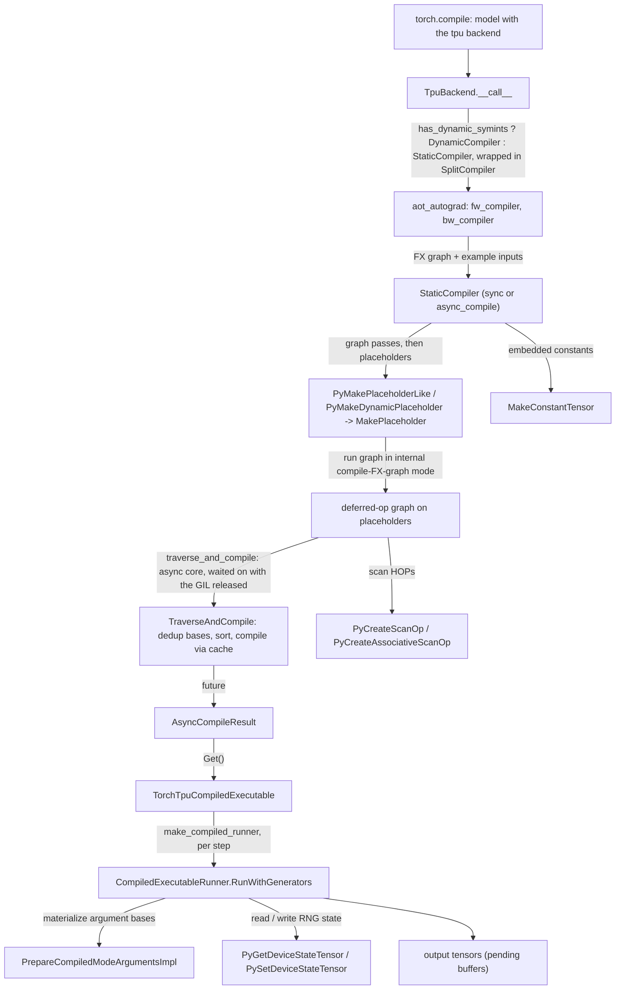
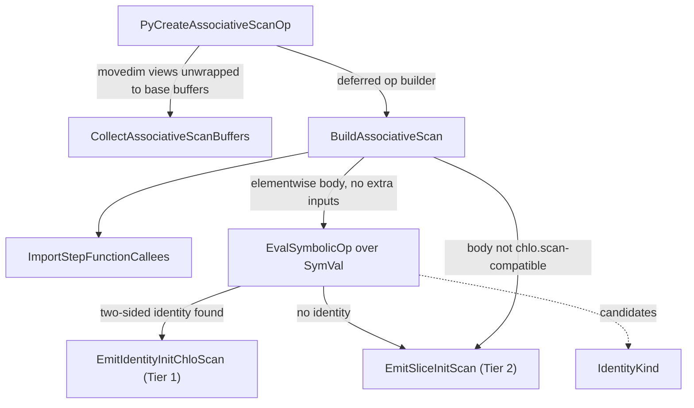

# torch.compile backend, from FX graph to a cached PjRt executable

## Overview
`torch.compile(model)` on a TPU tensor reaches [`TpuBackend`](https://github.com/google-pytorch/torch_tpu/blob/6d2a45754bdb52743883f75fbf753408345f6d1b/src/torch_tpu/_internal/compile/_backend.py#L613 "src/torch_tpu/_internal/compile/_backend#TpuBackend"), a callable that hands the Dynamo
graph to `aot_autograd` with a forward and a backward compiler. Each compiler call receives an FX
graph module and example inputs and must return something callable; TorchTPU returns a
[`TorchTpuCompiledExecutable`](https://github.com/google-pytorch/torch_tpu/blob/6d2a45754bdb52743883f75fbf753408345f6d1b/src/torch_tpu/_internal/compile/torch_tpu_compiled_executable.py#L225 "src/torch_tpu/_internal/compile/torch_tpu_compiled_executable#TorchTpuCompiledExecutable") wrapping a PjRt executable. The subsystem is split in two: the
Python half (`src/torch_tpu/_internal/compile`: the backend, the static/split/dynamic compilers,
the executable wrapper and the scan HOP handlers) decides *what* to compile, and the C++ half
documented here (`csrc/internal/compile`) does the work and is exposed to Python as the
`tpu_torch_compile` pybind module
([`TorchTpuPyBindInitModule_tpu_torch_compile`](https://github.com/google-pytorch/torch_tpu/blob/6d2a45754bdb52743883f75fbf753408345f6d1b/csrc/internal/compile/tpu_torch_compile.cc#L2014 "csrc/internal/compile/tpu_torch_compile.cc#TorchTpuPyBindInitModule_tpu_torch_compile")).
The bridge from FX to XLA reuses the eager machinery rather than a separate lowering: every
example input is replaced by a *placeholder* tensor
([`MakePlaceholder`](https://github.com/google-pytorch/torch_tpu/blob/6d2a45754bdb52743883f75fbf753408345f6d1b/csrc/internal/compile/compiled_mode.cc#L284 "csrc/internal/compile/compiled_mode.cc#MakePlaceholder")),
the graph is executed op by op under the internal compile-FX-graph eager mode so each ATen call
becomes a deferred op on placeholders, and the resulting deferred graph is traversed and compiled
([`TraverseAndCompile`](https://github.com/google-pytorch/torch_tpu/blob/6d2a45754bdb52743883f75fbf753408345f6d1b/csrc/internal/compile/compiled_mode.cc#L357 "csrc/internal/compile/compiled_mode.cc#TraverseAndCompile"),
[`ExtractMlirFromGraph`](https://github.com/google-pytorch/torch_tpu/blob/6d2a45754bdb52743883f75fbf753408345f6d1b/csrc/internal/compile/compiled_mode.cc#L299 "csrc/internal/compile/compiled_mode.cc#ExtractMlirFromGraph"))
through the same compilation cache as eager. Compilation now returns a
future ([`AsyncCompileResult`](https://github.com/google-pytorch/torch_tpu/blob/6d2a45754bdb52743883f75fbf753408345f6d1b/csrc/internal/compile/compiled_mode.h#L101 "csrc/internal/compile/compiled_mode.h#AsyncCompileResult")),
and each step runs through a pre-bound C++ runner that materializes argument base buffers,
threads RNG generator state
([`RunWithGenerators`](https://github.com/google-pytorch/torch_tpu/blob/6d2a45754bdb52743883f75fbf753408345f6d1b/csrc/internal/compile/tpu_torch_compile.cc#L1956 "csrc/internal/compile/tpu_torch_compile.cc#CompiledExecutableRunner.RunWithGenerators")),
and enqueues the executable on the materialization worker. Around this core sit a split compiler
that cuts graphs at collectives, native `scan` / `associative_scan` lowerings, optional
serialization for PyTorch's AOTAutograd cache, and the dynamic-shapes compiler described in
[dynamic-shapes-compiler](dynamic-shapes-compiler.md).

## Diagram

Legend:
- `TC` - (concept) user code calling `torch.compile(..., backend="tpu")`
- `BE` - [`TpuBackend`](https://github.com/google-pytorch/torch_tpu/blob/6d2a45754bdb52743883f75fbf753408345f6d1b/src/torch_tpu/_internal/compile/_backend.py#L613 "src/torch_tpu/_internal/compile/_backend#TpuBackend")
- `AOT` - (concept) PyTorch AOTAutograd
- `SC` - [`StaticCompiler`](https://github.com/google-pytorch/torch_tpu/blob/6d2a45754bdb52743883f75fbf753408345f6d1b/src/torch_tpu/_internal/compile/compiler.py#L312 "src/torch_tpu/_internal/compile/compiler#StaticCompiler")
- `PH` - [`PyMakePlaceholderLike`](https://github.com/google-pytorch/torch_tpu/blob/6d2a45754bdb52743883f75fbf753408345f6d1b/csrc/internal/compile/tpu_torch_compile.cc#L186 "csrc/internal/compile/tpu_torch_compile.cc#PyMakePlaceholderLike"), [`PyMakeDynamicPlaceholder`](https://github.com/google-pytorch/torch_tpu/blob/6d2a45754bdb52743883f75fbf753408345f6d1b/csrc/internal/compile/tpu_torch_compile.cc#L165 "csrc/internal/compile/tpu_torch_compile.cc#PyMakeDynamicPlaceholder"), [`MakePlaceholder`](https://github.com/google-pytorch/torch_tpu/blob/6d2a45754bdb52743883f75fbf753408345f6d1b/csrc/internal/compile/compiled_mode.cc#L284 "csrc/internal/compile/compiled_mode.cc#MakePlaceholder")
- `DG` - (concept) the deferred-op graph, see deferred-execution-and-materialization
- `TR` - [`TraverseAndCompile`](https://github.com/google-pytorch/torch_tpu/blob/6d2a45754bdb52743883f75fbf753408345f6d1b/csrc/internal/compile/compiled_mode.cc#L357 "csrc/internal/compile/compiled_mode.cc#TraverseAndCompile")
- `AR` - [`AsyncCompileResult`](https://github.com/google-pytorch/torch_tpu/blob/6d2a45754bdb52743883f75fbf753408345f6d1b/csrc/internal/compile/compiled_mode.h#L101 "csrc/internal/compile/compiled_mode.h#AsyncCompileResult")
- `EXE` - [`TorchTpuCompiledExecutable`](https://github.com/google-pytorch/torch_tpu/blob/6d2a45754bdb52743883f75fbf753408345f6d1b/src/torch_tpu/_internal/compile/torch_tpu_compiled_executable.py#L225 "src/torch_tpu/_internal/compile/torch_tpu_compiled_executable#TorchTpuCompiledExecutable")
- `RUN` - [`RunWithGenerators`](https://github.com/google-pytorch/torch_tpu/blob/6d2a45754bdb52743883f75fbf753408345f6d1b/csrc/internal/compile/tpu_torch_compile.cc#L1956 "csrc/internal/compile/tpu_torch_compile.cc#CompiledExecutableRunner.RunWithGenerators")
- `PREP` - [`PrepareCompiledModeArgumentsImpl`](https://github.com/google-pytorch/torch_tpu/blob/6d2a45754bdb52743883f75fbf753408345f6d1b/csrc/internal/compile/compiled_mode.cc#L211 "csrc/internal/compile/compiled_mode.cc#PrepareCompiledModeArgumentsImpl")
- `RNG` - [`PyGetDeviceStateTensor`](https://github.com/google-pytorch/torch_tpu/blob/6d2a45754bdb52743883f75fbf753408345f6d1b/csrc/internal/compile/tpu_torch_compile.cc#L689 "csrc/internal/compile/tpu_torch_compile.cc#PyGetDeviceStateTensor"), [`PySetDeviceStateTensor`](https://github.com/google-pytorch/torch_tpu/blob/6d2a45754bdb52743883f75fbf753408345f6d1b/csrc/internal/compile/tpu_torch_compile.cc#L695 "csrc/internal/compile/tpu_torch_compile.cc#PySetDeviceStateTensor")
- `OUT` - (concept) output tensors backed by pending buffers
- `CT` - [`MakeConstantTensor`](https://github.com/google-pytorch/torch_tpu/blob/6d2a45754bdb52743883f75fbf753408345f6d1b/csrc/internal/compile/compiled_mode.cc#L705 "csrc/internal/compile/compiled_mode.cc#MakeConstantTensor")
- `SCAN` - [`PyCreateScanOp`](https://github.com/google-pytorch/torch_tpu/blob/6d2a45754bdb52743883f75fbf753408345f6d1b/csrc/internal/compile/dispatch_scan.cc#L984 "csrc/internal/compile/dispatch_scan.cc#PyCreateScanOp"), [`PyCreateAssociativeScanOp`](https://github.com/google-pytorch/torch_tpu/blob/6d2a45754bdb52743883f75fbf753408345f6d1b/csrc/internal/compile/dispatch_scan.cc#L1124 "csrc/internal/compile/dispatch_scan.cc#PyCreateAssociativeScanOp")

The associative-scan lowering picks one of two tiers:

Legend:
- `ENT` - [`PyCreateAssociativeScanOp`](https://github.com/google-pytorch/torch_tpu/blob/6d2a45754bdb52743883f75fbf753408345f6d1b/csrc/internal/compile/dispatch_scan.cc#L1124 "csrc/internal/compile/dispatch_scan.cc#PyCreateAssociativeScanOp")
- `BUF` - [`CollectAssociativeScanBuffers`](https://github.com/google-pytorch/torch_tpu/blob/6d2a45754bdb52743883f75fbf753408345f6d1b/csrc/internal/compile/dispatch_scan.cc#L804 "csrc/internal/compile/dispatch_scan.cc#CollectAssociativeScanBuffers")
- `BAS` - [`BuildAssociativeScan`](https://github.com/google-pytorch/torch_tpu/blob/6d2a45754bdb52743883f75fbf753408345f6d1b/csrc/internal/compile/dispatch_scan.cc#L920 "csrc/internal/compile/dispatch_scan.cc#BuildAssociativeScan")
- `IMP` - [`ImportStepFunctionCallees`](https://github.com/google-pytorch/torch_tpu/blob/6d2a45754bdb52743883f75fbf753408345f6d1b/csrc/internal/compile/dispatch_scan.cc#L158 "csrc/internal/compile/dispatch_scan.cc#ImportStepFunctionCallees")
- `INF` - [`EvalSymbolicOp`](https://github.com/google-pytorch/torch_tpu/blob/6d2a45754bdb52743883f75fbf753408345f6d1b/csrc/internal/compile/dispatch_scan.cc#L506 "csrc/internal/compile/dispatch_scan.cc#EvalSymbolicOp"), [`SymVal`](https://github.com/google-pytorch/torch_tpu/blob/6d2a45754bdb52743883f75fbf753408345f6d1b/csrc/internal/compile/dispatch_scan.cc#L358 "csrc/internal/compile/dispatch_scan.cc#SymVal")
- `T1` - [`EmitIdentityInitChloScan`](https://github.com/google-pytorch/torch_tpu/blob/6d2a45754bdb52743883f75fbf753408345f6d1b/csrc/internal/compile/dispatch_scan.cc#L840 "csrc/internal/compile/dispatch_scan.cc#EmitIdentityInitChloScan")
- `T2` - [`EmitSliceInitScan`](https://github.com/google-pytorch/torch_tpu/blob/6d2a45754bdb52743883f75fbf753408345f6d1b/csrc/internal/compile/dispatch_scan.cc#L869 "csrc/internal/compile/dispatch_scan.cc#EmitSliceInitScan")
- `IK` - [`IdentityKind`](https://github.com/google-pytorch/torch_tpu/blob/6d2a45754bdb52743883f75fbf753408345f6d1b/csrc/internal/compile/dispatch_scan.cc#L349 "csrc/internal/compile/dispatch_scan.cc#IdentityKind")

## Design rationale (why it's built this way)
- **Placeholders make the traced graph depend only on shape and dtype.** The header comment on
  [`MakePlaceholder`](https://github.com/google-pytorch/torch_tpu/blob/6d2a45754bdb52743883f75fbf753408345f6d1b/csrc/internal/compile/compiled_mode.cc#L284 "csrc/internal/compile/compiled_mode.cc#MakePlaceholder")
  explains the problem: `torch.compile`'s example inputs "might be views or have deferred ops",
  which would change the deferred graph even for the same FX graph. A placeholder is a fresh
  contiguous tensor with an unshared storage and a placeholder buffer, so tracing "will depend
  only on the shape and dtype of the example inputs", and at execution time
  [`PrepareCompiledModeArgumentsImpl`](https://github.com/google-pytorch/torch_tpu/blob/6d2a45754bdb52743883f75fbf753408345f6d1b/csrc/internal/compile/compiled_mode.cc#L211 "csrc/internal/compile/compiled_mode.cc#PrepareCompiledModeArgumentsImpl")
  materializes the real arguments' *base* buffers in exactly the shape the executable expects
  (the comment insists this "**must** match the logic in tpu_torch_compile's
  [`PyMakePlaceholderLike`](https://github.com/google-pytorch/torch_tpu/blob/6d2a45754bdb52743883f75fbf753408345f6d1b/csrc/internal/compile/tpu_torch_compile.cc#L186 "csrc/internal/compile/tpu_torch_compile.cc#PyMakePlaceholderLike")",
  which builds a minimal contiguous base placeholder and re-applies the view's strides on top).
  This is also why the static compiler runs under `unset_fake_temporarily`: TorchTPU tracing
  needs real storage, and placeholders act as "TPU-compatible FakeTensors".
- **Eager tracing, not a second lowering.** Running the FX graph in the internal compile-FX-graph
  eager mode (see deferred-execution-and-materialization)
  means every kernel, view decomposition and custom kernel used by eager is automatically
  available to `torch.compile`; scalars become MLIR constants in this mode so XLA can
  specialize, at the risk of recompiling when they change (eager-op-dispatch).
  Constants embedded in the graph are handled by a pass that marks them and by
  [`MakeConstantTensor`](https://github.com/google-pytorch/torch_tpu/blob/6d2a45754bdb52743883f75fbf753408345f6d1b/csrc/internal/compile/compiled_mode.cc#L705 "csrc/internal/compile/compiled_mode.cc#MakeConstantTensor"),
  which memcpys the CPU bytes into a constant deferred op "so that dropping the tensor does not
  invalidate the DeferredOp we will create".
- **Arguments are deduplicated by base buffer and reordered to PyTorch's order.**
  [`TraverseAndCompile`](https://github.com/google-pytorch/torch_tpu/blob/6d2a45754bdb52743883f75fbf753408345f6d1b/csrc/internal/compile/compiled_mode.cc#L357 "csrc/internal/compile/compiled_mode.cc#TraverseAndCompile")
  collapses arguments that share a base buffer (for example `[x, x.t()]`) so the executable
  takes each base once, records an argument-index map, remaps donated inputs onto the unique
  bases, and maps forced argument layouts onto bases only from arguments that cover the whole
  buffer unchanged (conflicting requests drop the layout with a warning). It then builds the
  traversal from the result tensors, sorts it by node creation order, and validates and reorders
  arguments to match the FX signature; mismatches are treated as backend bugs (crashes, not
  user errors).
- **Compilation is a future, and the GIL is released.** The result type is
  [`AsyncCompileResult`](https://github.com/google-pytorch/torch_tpu/blob/6d2a45754bdb52743883f75fbf753408345f6d1b/csrc/internal/compile/compiled_mode.h#L101 "csrc/internal/compile/compiled_mode.h#AsyncCompileResult"):
  "Unlike `CompileResult`, the executable is not available yet: the underlying compilation
  future resolves once XLA compilation completes on a background thread." The Python binding
  captures the traceback with the GIL held, then releases it across traversal, lowering and the
  cache query "so multiple Python threads can lower and enqueue compilations in parallel".
  [`PyCompileMlir`](https://github.com/google-pytorch/torch_tpu/blob/6d2a45754bdb52743883f75fbf753408345f6d1b/csrc/internal/compile/tpu_torch_compile.cc#L450 "csrc/internal/compile/tpu_torch_compile.cc#PyCompileMlir")
  does the same because "PJRT compilation can take minutes". This is what makes the backend's
  `async_compile` option (a class-level thread pool of 8 workers in
  [`StaticCompiler`](https://github.com/google-pytorch/torch_tpu/blob/6d2a45754bdb52743883f75fbf753408345f6d1b/src/torch_tpu/_internal/compile/compiler.py#L312 "src/torch_tpu/_internal/compile/compiler#StaticCompiler"), which then returns an `AsyncCompiledArtifact` proxy) worthwhile.
- **Static shapes by default.** The backend module docstring states `dynamic=True` is not
  supported; with `assume_static_by_default` off the backend raises `NotImplementedError`.
  Graphs whose example inputs carry SymInts with free symbols are routed automatically to the
  [dynamic compiler](dynamic-shapes-compiler.md) (the old `dynamism` constructor flag is
  retained only for signature compatibility); the C++ pad and slice module helpers
  ([`PyPrecompilePadModule`](https://github.com/google-pytorch/torch_tpu/blob/6d2a45754bdb52743883f75fbf753408345f6d1b/csrc/internal/compile/tpu_torch_compile.cc#L926 "csrc/internal/compile/tpu_torch_compile.cc#PyPrecompilePadModule"),
  [`PyGetOrCompileSliceModule`](https://github.com/google-pytorch/torch_tpu/blob/6d2a45754bdb52743883f75fbf753408345f6d1b/csrc/internal/compile/tpu_torch_compile.cc#L1144 "csrc/internal/compile/tpu_torch_compile.cc#PyGetOrCompileSliceModule"))
  exist to serve that path.
- **Split at collectives.** `SplitCompiler` wraps the base compiler and partitions the FX graph
  on collective ops, compiling each submodule separately and propagating shapes through an FX
  interpreter, so a collective's wait boundary does not force one giant program and the
  collective itself runs through the process group path.
- **The step loop lives in C++.** The runner comment explains why: calling a pybind function
  per step pays a type-registry lookup for every argument plus several Python-to-C++
  transitions for RNG state and output reconstruction. The runner is built once per executable
  and "executes the entire step - unboxing inputs, extracting zero-copy `const at::Tensor*`
  pointers, locking and updating C++ RNG generator state tensors, invoking PJRT execution, and
  reconstructing the output PyTree - in a single C++ call". Taking raw tensor pointers avoids
  "200+ atomic increment/decrement operations on the hot path" for a model with 100+ inputs.
- **RNG is graph-safe by threading generator state.** Executables that consume randomness take
  each generator's `{seed, offset}` state tensor as a trailing input
  ([`PyGetDeviceStateTensor`](https://github.com/google-pytorch/torch_tpu/blob/6d2a45754bdb52743883f75fbf753408345f6d1b/csrc/internal/compile/tpu_torch_compile.cc#L689 "csrc/internal/compile/tpu_torch_compile.cc#PyGetDeviceStateTensor"))
  and return the updated state as a trailing output, written back with
  [`PySetDeviceStateTensor`](https://github.com/google-pytorch/torch_tpu/blob/6d2a45754bdb52743883f75fbf753408345f6d1b/csrc/internal/compile/tpu_torch_compile.cc#L695 "csrc/internal/compile/tpu_torch_compile.cc#PySetDeviceStateTensor")
  while the generator locks are held. Every generator, including user-supplied ones, is mapped to
  the device's default generator, matching observed CUDA behavior "where graphsafe RNG ops always
  mutate the global generator's state, making `torch.manual_seed()` work for compiled graphs" (a
  source comment notes the intended behavior is still to be confirmed).
- **Serialization for the AOTAutograd cache.** Static compilations are wrapped by PyTorch's
  `SerializableAOTDispatchCompiler` (the `serializable` option, default on); the executable
  pickles through the `serialize_executable` / `load_serialized_executable` bindings, which is
  what lets a later process skip compilation entirely. Dynamic compilations are excluded because
  their artifacts are not yet picklable; with `async_compile`, cache saves are offloaded to a
  background thread.
- **No-op graphs compile to nothing.** When the FX graph produces no computed tensors (a seam
  between graph breaks), the static compiler returns a no-op artifact that only reconstructs
  outputs, instead of compiling an empty executable.

> [!inferred]
> The user-facing implications: use `torch.compile(model, backend="tpu")` with static shapes
> and mark shapes static where possible; expect one compile per distinct input signature (cached
> across runs via tier-2/tier-3 caches and the AOTAutograd cache); pass
> `options={"async_compile": True}` (or use the backend's `async_compile(fn, warmup_inputs)`
> helper) to overlap Dynamo tracing of several shape buckets with XLA compilation, at the cost of
> the first call per graph becoming a warmup that raises `AsyncCompilationSubmitted`; pass
> `options={"name": ...}` to get readable module names in profiles; set `TORCH_TRACE` to get the
> FX and StableHLO artifacts in `tlparse`; and prefer `torch_tpu`'s `AdamW` inside compiled
> training steps (fused-optimizers).

## Entry points
- [`TpuBackend`](https://github.com/google-pytorch/torch_tpu/blob/6d2a45754bdb52743883f75fbf753408345f6d1b/src/torch_tpu/_internal/compile/_backend.py#L613 "src/torch_tpu/_internal/compile/_backend#TpuBackend") (the docstring: "TPU backend for torch.compile() integration"; an instance is
  registered as the `tpu` backend when `torch_tpu._internal.compile` is imported): reads the
  `options` dict (`async_compile`, `num_dynamic_buckets` 1-8, `bucket_size` default 128,
  `serializable`, `debug_callback`, `custom_module_name`/`name`), picks the static or dynamic
  compiler through [`make_backend_compiler`](https://github.com/google-pytorch/torch_tpu/blob/6d2a45754bdb52743883f75fbf753408345f6d1b/src/torch_tpu/_internal/compile/_backend.py#L432 "src/torch_tpu/_internal/compile/_backend#make_backend_compiler"), and calls `aot_autograd`. Everything it compiles ends in
  [`TraverseAndCompile`](https://github.com/google-pytorch/torch_tpu/blob/6d2a45754bdb52743883f75fbf753408345f6d1b/csrc/internal/compile/compiled_mode.cc#L357 "csrc/internal/compile/compiled_mode.cc#TraverseAndCompile")
  via the Python export layer's `fx_to_mlir`.
- [`async_compile`](https://github.com/google-pytorch/torch_tpu/blob/6d2a45754bdb52743883f75fbf753408345f6d1b/src/torch_tpu/_internal/compile/_backend.py#L989 "src/torch_tpu/_internal/compile/_backend#async_compile") (exported from `torch_tpu._internal.compile`): the multi-shape warmup helper. It wraps
  `fn` in `torch.compile(fn, backend="tpu", fullgraph=True, dynamic=False)` with
  `async_compile` forced on (and `torch.no_grad()` by default), calls it once per entry in
  `warmup_inputs` while collecting the artifact carried by each `AsyncCompilationSubmitted`,
  then blocks until all of those compilations resolve before returning the compiled callable.
- The pybind surface, registered by
  [`TorchTpuPyBindInitModule_tpu_torch_compile`](https://github.com/google-pytorch/torch_tpu/blob/6d2a45754bdb52743883f75fbf753408345f6d1b/csrc/internal/compile/tpu_torch_compile.cc#L2014 "csrc/internal/compile/tpu_torch_compile.cc#TorchTpuPyBindInitModule_tpu_torch_compile"):
  placeholders ([`PyMakePlaceholder`](https://github.com/google-pytorch/torch_tpu/blob/6d2a45754bdb52743883f75fbf753408345f6d1b/csrc/internal/compile/tpu_torch_compile.cc#L155 "csrc/internal/compile/tpu_torch_compile.cc#PyMakePlaceholder"),
  [`PyMakePlaceholderLike`](https://github.com/google-pytorch/torch_tpu/blob/6d2a45754bdb52743883f75fbf753408345f6d1b/csrc/internal/compile/tpu_torch_compile.cc#L186 "csrc/internal/compile/tpu_torch_compile.cc#PyMakePlaceholderLike"),
  [`PyMakeDynamicPlaceholder`](https://github.com/google-pytorch/torch_tpu/blob/6d2a45754bdb52743883f75fbf753408345f6d1b/csrc/internal/compile/tpu_torch_compile.cc#L165 "csrc/internal/compile/tpu_torch_compile.cc#PyMakeDynamicPlaceholder")),
  MLIR handling ([`PyBuildMlir`](https://github.com/google-pytorch/torch_tpu/blob/6d2a45754bdb52743883f75fbf753408345f6d1b/csrc/internal/compile/tpu_torch_compile.cc#L334 "csrc/internal/compile/tpu_torch_compile.cc#PyBuildMlir"),
  [`PyParseMlirText`](https://github.com/google-pytorch/torch_tpu/blob/6d2a45754bdb52743883f75fbf753408345f6d1b/csrc/internal/compile/tpu_torch_compile.cc#L357 "csrc/internal/compile/tpu_torch_compile.cc#PyParseMlirText"),
  [`PyCompileMlir`](https://github.com/google-pytorch/torch_tpu/blob/6d2a45754bdb52743883f75fbf753408345f6d1b/csrc/internal/compile/tpu_torch_compile.cc#L450 "csrc/internal/compile/tpu_torch_compile.cc#PyCompileMlir")),
  `traverse_and_compile` / `async_traverse_and_compile`, `execute` and `make_compiled_runner`,
  serialization, constants, RNG state, `force_strides`
  ([`ForceStrides`](https://github.com/google-pytorch/torch_tpu/blob/6d2a45754bdb52743883f75fbf753408345f6d1b/csrc/internal/compile/tpu_torch_compile.cc#L1256 "csrc/internal/compile/tpu_torch_compile.cc#ForceStrides")),
  and the dynamic pad/slice helpers listed in [dynamic-shapes-compiler](dynamic-shapes-compiler.md).
- [`ExtractMlirFromGraph`](https://github.com/google-pytorch/torch_tpu/blob/6d2a45754bdb52743883f75fbf753408345f6d1b/csrc/internal/compile/compiled_mode.cc#L299 "csrc/internal/compile/compiled_mode.cc#ExtractMlirFromGraph"):
  the compile-free variant behind
  [`PyBuildMlir`](https://github.com/google-pytorch/torch_tpu/blob/6d2a45754bdb52743883f75fbf753408345f6d1b/csrc/internal/compile/tpu_torch_compile.cc#L334 "csrc/internal/compile/tpu_torch_compile.cc#PyBuildMlir"),
  which verifies the module and reports invalid MLIR with debug info. At this pin its only Python
  caller is the scan HOP handler (`scan.py`), which uses it to trace combine bodies; the export
  layer's `fx_to_mlir` compiles through `traverse_and_compile` instead.
- [`PyCreateScanOp`](https://github.com/google-pytorch/torch_tpu/blob/6d2a45754bdb52743883f75fbf753408345f6d1b/csrc/internal/compile/dispatch_scan.cc#L984 "csrc/internal/compile/dispatch_scan.cc#PyCreateScanOp"):
  the TPU implementation of `torch.ops.higher_order.scan`, lowering a traced body module to a
  `stablehlo.while` through the scan builder, with
  [`GetInputBuffers`](https://github.com/google-pytorch/torch_tpu/blob/6d2a45754bdb52743883f75fbf753408345f6d1b/csrc/internal/compile/dispatch_scan.cc#L82 "csrc/internal/compile/dispatch_scan.cc#GetInputBuffers")
  and [`GetOutputShapes`](https://github.com/google-pytorch/torch_tpu/blob/6d2a45754bdb52743883f75fbf753408345f6d1b/csrc/internal/compile/dispatch_scan.cc#L99 "csrc/internal/compile/dispatch_scan.cc#GetOutputShapes").
- [`PyCreateAssociativeScanOp`](https://github.com/google-pytorch/torch_tpu/blob/6d2a45754bdb52743883f75fbf753408345f6d1b/csrc/internal/compile/dispatch_scan.cc#L1124 "csrc/internal/compile/dispatch_scan.cc#PyCreateAssociativeScanOp"):
  the TPU implementation of `associative_scan`, reached both when `torch.compile` traces the HOP
  and from the eager fast path in [`_tpu_associative_scan`](https://github.com/google-pytorch/torch_tpu/blob/6d2a45754bdb52743883f75fbf753408345f6d1b/src/torch_tpu/_internal/compile/scan.py#L614 "src/torch_tpu/_internal/compile/scan#_tpu_associative_scan"), the replacement that `scan.py` patches into
  `torch._higher_order_ops.associative_scan` (outside Dynamo, when the fast path applies), which caches the traced combine body per input
  signature instead of re-tracing it through `torch.compile` on every call.

## Mechanism (step-by-step)
1. **Backend selection.** `TpuBackend.__call__` rejects `dynamic=True`, validates the options,
   picks the static or dynamic base compiler (the dynamic one when the example inputs carry
   unresolved SymInts) and wraps it in the split compiler, both in [`make_backend_compiler`](https://github.com/google-pytorch/torch_tpu/blob/6d2a45754bdb52743883f75fbf753408345f6d1b/src/torch_tpu/_internal/compile/_backend.py#L432 "src/torch_tpu/_internal/compile/_backend#make_backend_compiler"), runs pre-grad passes, and calls
   `aot_autograd` under the internal compile-FX-graph eager mode, optionally under a
   serialization context that captures the bundled cache entry. The C++ half is reached through
   the module that
   [`TorchTpuPyBindInitModule_tpu_torch_compile`](https://github.com/google-pytorch/torch_tpu/blob/6d2a45754bdb52743883f75fbf753408345f6d1b/csrc/internal/compile/tpu_torch_compile.cc#L2014 "csrc/internal/compile/tpu_torch_compile.cc#TorchTpuPyBindInitModule_tpu_torch_compile")
   registers.
2. **Graph preparation.** The static compiler decomposes auto-functionalized ops, folds GQA,
   detects causal masks, marks embedded constants, marks activation checkpoints on the backward
   graph, lints and recompiles, and emits the FX artifact when tracing is on. With
   `async_compile`, everything after this point runs on the compile thread pool and the caller
   gets a proxy artifact back immediately. Embedded constants later become constant tensors
   through
   [`MakeConstantTensor`](https://github.com/google-pytorch/torch_tpu/blob/6d2a45754bdb52743883f75fbf753408345f6d1b/csrc/internal/compile/compiled_mode.cc#L705 "csrc/internal/compile/compiled_mode.cc#MakeConstantTensor").
3. **Placeholders and tracing.** Each tensor example input becomes a placeholder via
   [`PyMakePlaceholderLike`](https://github.com/google-pytorch/torch_tpu/blob/6d2a45754bdb52743883f75fbf753408345f6d1b/csrc/internal/compile/tpu_torch_compile.cc#L186 "csrc/internal/compile/tpu_torch_compile.cc#PyMakePlaceholderLike")
   (pinned-host inputs get pinned-host placeholders) or, for bounded dynamic inputs,
   [`PyMakeDynamicPlaceholder`](https://github.com/google-pytorch/torch_tpu/blob/6d2a45754bdb52743883f75fbf753408345f6d1b/csrc/internal/compile/tpu_torch_compile.cc#L165 "csrc/internal/compile/tpu_torch_compile.cc#PyMakeDynamicPlaceholder"),
   which marks each dynamic dimension with lower bound 2 and the given upper bound. An opt-in
   storage-aware mode (`TORCH_TPU_INTERNAL_STORAGE_AWARE_PLACEHOLDERS`) gives inputs sharing a
   storage one shared base placeholder. `fx_to_mlir` then runs the graph so that every op
   dispatches as a deferred op on placeholders.
4. **Traverse and compile.**
   [`TraverseAndCompile`](https://github.com/google-pytorch/torch_tpu/blob/6d2a45754bdb52743883f75fbf753408345f6d1b/csrc/internal/compile/compiled_mode.cc#L357 "csrc/internal/compile/compiled_mode.cc#TraverseAndCompile")
   collects argument base buffers (asserting none is deferred) and deduplicates them, collects
   result buffers (asserting none is already materializing), creates the traversal from the
   results and sorts it by creation order, reorders arguments to the FX order, remaps donated
   inputs and argument layouts onto the unique bases, fetches the fast-runtime
   compilation spec, and asks the cache to compile with the optional
   module name. It returns an
   [`AsyncCompileResult`](https://github.com/google-pytorch/torch_tpu/blob/6d2a45754bdb52743883f75fbf753408345f6d1b/csrc/internal/compile/compiled_mode.h#L101 "csrc/internal/compile/compiled_mode.h#AsyncCompileResult")
   holding the fixed-shape-kernel future, the argument-index map, and (on request, for debug or
   tracing) the MLIR module.
5. **Resolve and wrap.** [`AsyncCompileResult`](https://github.com/google-pytorch/torch_tpu/blob/6d2a45754bdb52743883f75fbf753408345f6d1b/csrc/internal/compile/compiled_mode.h#L101 "csrc/internal/compile/compiled_mode.h#AsyncCompileResult")`::Get()` blocks once, attaches the argument-index
   map to the resolved executable, and returns the same executable on every later call. The
   executable becomes a `TorchTpuCompiledExecutable` holding the output-reconstruction function,
   whether the graph updates the default generator, and per-output dynamic flags; its
   constructor builds the pre-bound runner through `make_compiled_runner`. Debug mode attaches
   the graph code and MLIR text.
6. **Execute.** On each call the runner unboxes Dynamo's boxed argument list, collects raw tensor
   pointers and generator arguments, and appends the default generator if the graph updates it.
   RNG-free graphs execute directly; otherwise
   [`RunWithGenerators`](https://github.com/google-pytorch/torch_tpu/blob/6d2a45754bdb52743883f75fbf753408345f6d1b/csrc/internal/compile/tpu_torch_compile.cc#L1956 "csrc/internal/compile/tpu_torch_compile.cc#CompiledExecutableRunner.RunWithGenerators")
   locks the generators, appends their state tensors, executes, and writes the trailing state
   outputs back. Execution prepares argument buffers with
   [`PrepareCompiledModeArgumentsImpl`](https://github.com/google-pytorch/torch_tpu/blob/6d2a45754bdb52743883f75fbf753408345f6d1b/csrc/internal/compile/compiled_mode.cc#L211 "csrc/internal/compile/compiled_mode.cc#PrepareCompiledModeArgumentsImpl")
   (deduplicating by the argument-index map, and materializing only if some base is still
   deferred or a placeholder, blocking until materialization *starts*), enqueues the executable
   on the materialization worker (outputs are pending buffers), and wraps outputs as tensors; an
   output reconstructor then rebuilds the FX output structure (deduplicated outputs, passthrough
   inputs, `None`s) in C++.
7. **Scan HOPs.** When a graph contains `scan`,
   [`PyCreateScanOp`](https://github.com/google-pytorch/torch_tpu/blob/6d2a45754bdb52743883f75fbf753408345f6d1b/csrc/internal/compile/dispatch_scan.cc#L984 "csrc/internal/compile/dispatch_scan.cc#PyCreateScanOp")
   serializes the traced body module (it doubles as the op cache key), checks carry and output
   counts, and creates one deferred custom-kernel op whose builder parses the body into the
   lowering context, imports its helper functions
   ([`ImportStepFunctionCallees`](https://github.com/google-pytorch/torch_tpu/blob/6d2a45754bdb52743883f75fbf753408345f6d1b/csrc/internal/compile/dispatch_scan.cc#L158 "csrc/internal/compile/dispatch_scan.cc#ImportStepFunctionCallees")),
   and emits the loop. For `associative_scan`,
   [`BuildAssociativeScan`](https://github.com/google-pytorch/torch_tpu/blob/6d2a45754bdb52743883f75fbf753408345f6d1b/csrc/internal/compile/dispatch_scan.cc#L920 "csrc/internal/compile/dispatch_scan.cc#BuildAssociativeScan")
   returns the inputs unchanged for sequence length 0 or 1; if the combine body is purely
   elementwise with uniform static shapes and no extra inputs, it tries every tuple of
   [`IdentityKind`](https://github.com/google-pytorch/torch_tpu/blob/6d2a45754bdb52743883f75fbf753408345f6d1b/csrc/internal/compile/dispatch_scan.cc#L349 "csrc/internal/compile/dispatch_scan.cc#IdentityKind")
   candidates (up to 4 scanned inputs, so at most 256 tuples) by symbolically evaluating the body
   with [`EvalSymbolicOp`](https://github.com/google-pytorch/torch_tpu/blob/6d2a45754bdb52743883f75fbf753408345f6d1b/csrc/internal/compile/dispatch_scan.cc#L506 "csrc/internal/compile/dispatch_scan.cc#EvalSymbolicOp")
   over [`SymVal`](https://github.com/google-pytorch/torch_tpu/blob/6d2a45754bdb52743883f75fbf753408345f6d1b/csrc/internal/compile/dispatch_scan.cc#L358 "csrc/internal/compile/dispatch_scan.cc#SymVal")
   on both sides. A two-sided identity yields one `chlo.scan` seeded with it
   ([`EmitIdentityInitChloScan`](https://github.com/google-pytorch/torch_tpu/blob/6d2a45754bdb52743883f75fbf753408345f6d1b/csrc/internal/compile/dispatch_scan.cc#L840 "csrc/internal/compile/dispatch_scan.cc#EmitIdentityInitChloScan"));
   otherwise the first element becomes the carry and the rest is scanned and concatenated
   ([`EmitSliceInitScan`](https://github.com/google-pytorch/torch_tpu/blob/6d2a45754bdb52743883f75fbf753408345f6d1b/csrc/internal/compile/dispatch_scan.cc#L869 "csrc/internal/compile/dispatch_scan.cc#EmitSliceInitScan")).

## Key data structures
- `TpuBackend`: legacy flags plus the list of compiled artifacts in compilation order; options
  now arrive per call in the `options` dict.
- [`Compiler`](https://github.com/google-pytorch/torch_tpu/blob/6d2a45754bdb52743883f75fbf753408345f6d1b/src/torch_tpu/_internal/compile/compiler.py#L66 "src/torch_tpu/_internal/compile/compiler#Compiler"): the abstract base of the static, dynamic and split compilers; it is also PyTorch's
  `AOTDispatchCompiler`, its default pre-grad pass folds GQA, and its `__call__` turns an FX graph
  plus example inputs into a compiled artifact.
- [`CompiledArtifact`](https://github.com/google-pytorch/torch_tpu/blob/6d2a45754bdb52743883f75fbf753408345f6d1b/src/torch_tpu/_internal/compile/torch_tpu_compiled_executable.py#L67 "src/torch_tpu/_internal/compile/torch_tpu_compiled_executable#CompiledArtifact") / [`TorchTpuCompiledExecutable`](https://github.com/google-pytorch/torch_tpu/blob/6d2a45754bdb52743883f75fbf753408345f6d1b/src/torch_tpu/_internal/compile/torch_tpu_compiled_executable.py#L225 "src/torch_tpu/_internal/compile/torch_tpu_compiled_executable#TorchTpuCompiledExecutable") / `AsyncCompiledArtifact` /
  `NoOpCompiledArtifact` / `_SplitCompiledExecutable`: picklable callables (the base class
  requires `__reduce__` so Dynamo/AOTAutograd caching can pickle them, and sets `_boxed_call` so
  AOTAutograd passes inputs as one list); the async variant
  proxies a future, the split variant holds a partitioned FX graph module whose submodules are
  executables.
- [`AsyncCompileResult`](https://github.com/google-pytorch/torch_tpu/blob/6d2a45754bdb52743883f75fbf753408345f6d1b/csrc/internal/compile/compiled_mode.h#L101 "csrc/internal/compile/compiled_mode.h#AsyncCompileResult"):
  the optional contexted MLIR module, the executable future, and the argument-index map from each
  caller argument to its deduplicated base buffer (empty when all bases are distinct). The
  options struct beside it carries the compilation mode (fast runtime by default), whether to
  build the module, StableHLO bounds usage, forced argument layouts, donated input indices and
  an optional module name.
- [`SymVal`](https://github.com/google-pytorch/torch_tpu/blob/6d2a45754bdb52743883f75fbf753408345f6d1b/csrc/internal/compile/dispatch_scan.cc#L358 "csrc/internal/compile/dispatch_scan.cc#SymVal"):
  the "lightweight symbolic value domain" for identity inference; a value is a constant
  ([`Const`](https://github.com/google-pytorch/torch_tpu/blob/6d2a45754bdb52743883f75fbf753408345f6d1b/csrc/internal/compile/dispatch_scan.cc#L364 "csrc/internal/compile/dispatch_scan.cc#SymVal.Const")),
  an input variable, `-inf` ([`NegInf`](https://github.com/google-pytorch/torch_tpu/blob/6d2a45754bdb52743883f75fbf753408345f6d1b/csrc/internal/compile/dispatch_scan.cc#L372 "csrc/internal/compile/dispatch_scan.cc#SymVal.NegInf")),
  `+inf`, or unknown, distinguished by [`Tag`](https://github.com/google-pytorch/torch_tpu/blob/6d2a45754bdb52743883f75fbf753408345f6d1b/csrc/internal/compile/dispatch_scan.cc#L359 "csrc/internal/compile/dispatch_scan.cc#SymVal.Tag").
  Rules such as [`EvalAdd`](https://github.com/google-pytorch/torch_tpu/blob/6d2a45754bdb52743883f75fbf753408345f6d1b/csrc/internal/compile/dispatch_scan.cc#L435 "csrc/internal/compile/dispatch_scan.cc#EvalAdd"),
  [`EvalSubtract`](https://github.com/google-pytorch/torch_tpu/blob/6d2a45754bdb52743883f75fbf753408345f6d1b/csrc/internal/compile/dispatch_scan.cc#L449 "csrc/internal/compile/dispatch_scan.cc#EvalSubtract"),
  [`EvalMax`](https://github.com/google-pytorch/torch_tpu/blob/6d2a45754bdb52743883f75fbf753408345f6d1b/csrc/internal/compile/dispatch_scan.cc#L476 "csrc/internal/compile/dispatch_scan.cc#EvalMax"),
  [`EvalMin`](https://github.com/google-pytorch/torch_tpu/blob/6d2a45754bdb52743883f75fbf753408345f6d1b/csrc/internal/compile/dispatch_scan.cc#L487 "csrc/internal/compile/dispatch_scan.cc#EvalMin")
  and [`EvalNeg`](https://github.com/google-pytorch/torch_tpu/blob/6d2a45754bdb52743883f75fbf753408345f6d1b/csrc/internal/compile/dispatch_scan.cc#L406 "csrc/internal/compile/dispatch_scan.cc#EvalNeg")
  apply only exact identities (`0 + x = x`, `max(-inf, x) = x`), using
  [`IsSameVar`](https://github.com/google-pytorch/torch_tpu/blob/6d2a45754bdb52743883f75fbf753408345f6d1b/csrc/internal/compile/dispatch_scan.cc#L388 "csrc/internal/compile/dispatch_scan.cc#SymVal.IsSameVar")
  for cases like `x - x`.
- Device state tensors: the per-generator `{seed, offset}` RNG state threaded as trailing inputs
  and outputs (a 2-element output shape is appended for each generator).

## Dynamics (design intent)
- Tracing happens on the dispatch thread inside `aot_autograd`; with `async_compile` the
  lowering and XLA compilation run on an 8-worker thread pool, and execution is always
  asynchronous through the materialization worker, returning pending tensors immediately.
- [`TraverseAndCompile`](https://github.com/google-pytorch/torch_tpu/blob/6d2a45754bdb52743883f75fbf753408345f6d1b/csrc/internal/compile/compiled_mode.cc#L357 "csrc/internal/compile/compiled_mode.cc#TraverseAndCompile")'s
  header contract: thread-compatible, not thread-safe; concurrent calls on disjoint graphs are
  safe, but the subgraph reachable from the results must stay quiescent during the call, because
  the traversal is "a sequence of individually safe reads", not an atomic snapshot.
- Generator locking avoids deadlocks by sorting and deduplicating mutexes; a single uncontended
  generator is locked with `try_lock()` without dropping the GIL, and the slow path releases the
  GIL before blocking.
- Because compiled executables are cached by graph and options key, recompilation is driven by
  Dynamo guards (new shapes, new Python state), not by TorchTPU.

## Edge cases
- `dynamic=True` raises `NotImplementedError`; `num_dynamic_buckets` outside 1-8 or a
  non-positive `bucket_size` raise `ValueError`.
- Example inputs that are views or deferred are neutralized by placeholders; a deferred *argument*
  at traverse time is a backend bug and aborts.
- `float4_e2m1fn_x2` placeholders double the last physical dimension (two values per byte), and
  require at least one dimension.
- Arguments sharing a base buffer with conflicting forced layouts get no layout for that base
  (a warning is logged), and layouts of partial or permuted views are ignored.
- Executables that do not touch RNG take no state tensors; those that do always mutate the default
  generator regardless of which generator was passed.
- Non-tensor arguments are dropped from the executable call and restored by the output
  reconstruction function.
- [`ForceStrides`](https://github.com/google-pytorch/torch_tpu/blob/6d2a45754bdb52743883f75fbf753408345f6d1b/csrc/internal/compile/tpu_torch_compile.cc#L1256 "csrc/internal/compile/tpu_torch_compile.cc#ForceStrides")
  only rewrites stride metadata on an alias when the target layout differs along size-1
  dimensions (or the tensor has no elements); otherwise it emits a contiguous-to-view copy.
- [`PyCompileMlir`](https://github.com/google-pytorch/torch_tpu/blob/6d2a45754bdb52743883f75fbf753408345f6d1b/csrc/internal/compile/tpu_torch_compile.cc#L450 "csrc/internal/compile/tpu_torch_compile.cc#PyCompileMlir")
  forces replicated compilation (one replica per device, one partition) for multi-device modules
  with SparseCore custom calls and no SPMD sharding, to avoid SPMD partitioning hangs.
- `associative_scan` inputs produced by the frontend's `movedim(x, dim, 0)` are detected and
  scanned on their contiguous base buffers
  ([`CollectAssociativeScanBuffers`](https://github.com/google-pytorch/torch_tpu/blob/6d2a45754bdb52743883f75fbf753408345f6d1b/csrc/internal/compile/dispatch_scan.cc#L804 "csrc/internal/compile/dispatch_scan.cc#CollectAssociativeScanBuffers")),
  avoiding two transposes; outputs carry the view's sizes and strides.

## Open questions
- How the Python export layer chooses forced argument layouts (from materialized device layouts
  of the example inputs) interacts with the cache's argument-layout fingerprint is decided
  outside this unit.
- `donated_inputs` is described in the static compiler as an internal feature used directly after
  `make_fx` tracing; whether it becomes automatic is tracked in the source.
- The package initializer now turns on Dynamo's `trace_autograd_ops` when the installed PyTorch
  has it (a single FX graph with forward and backward); how that interacts with the separate
  forward/backward compiler calls above is not settled by this unit's code.

## See also
- [dynamic-shapes-compiler](dynamic-shapes-compiler.md): the SymInt path and its pad/slice modules.
- deferred-execution-and-materialization: placeholders, pending buffers and executable enqueueing.
- compilation-pipeline and compilation-cache: fast-runtime mode and caching.
- process-group-and-collectives: why graphs are split at collectives.
- scan-and-custom-kernels: the scan builder behind both scan lowerings.
- fused-optimizers: the compile-friendly AdamW.

## Recent changes
- `e4df9b019` sorts traversal nodes by creation order in compiled mode, because the reverse-DFS
  traversal "can emit independent branches out of dispatch order".
- `69f26771b` deduplicates `argument_layouts` for arguments sharing a base buffer; previously
  compilation failed with "argument layouts size must match".
- `546601780` adds native `chlo.scan` and an eager fast path for `associative_scan`, which
  previously "lowered to a sequential loop, transposed inputs and outputs around
  `torch.movedim`", and re-traced `combine_fn` on every eager call.
- `059246279` validates indices and sequence access in the FX output reconstructor and fixes
  zero-size physical-contiguity edge cases; `90deb04a3` makes PjRt client lookup return a status
  so initialization errors surface instead of a generic "not initialized".
- all changes in release/0.1.2
